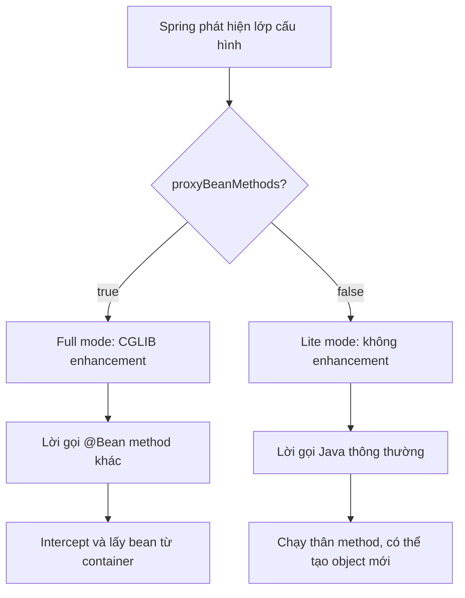

# @Configuration, proxyBeanMethods và lời gọi giữa các phương thức @Bean

## 1. Vì sao lời gọi Java có thể tạo ra bean khác?

Trong Spring, một phương thức gắn @Bean là factory method: container gọi phương thức để tạo bean và quản lý vòng đời của đối tượng. Tuy nhiên, bên trong lớp cấu hình, ta cũng có thể viết Java code gọi trực tiếp một phương thức @Bean khác. Kết quả phụ thuộc vào chế độ cấu hình.

Với @Configuration(proxyBeanMethods = true), Spring tăng cường lớp cấu hình bằng CGLIB để intercept lời gọi giữa các phương thức @Bean. Khi một phương thức @Bean gọi phương thức @Bean khác trên cùng instance cấu hình, lời gọi được chuyển về container để lấy bean phù hợp. Điều này bảo toàn semantics của container, chẳng hạn singleton scope.

Với @Configuration(proxyBeanMethods = false), Spring không tăng cường lớp cấu hình theo cách đó. Các lời gọi phương thức giữa các @Bean là lời gọi Java thông thường. Nếu một factory method gọi trực tiếp factory method khác, nó có thể tạo một đối tượng mới bên ngoài quá trình quản lý bean của container.

Khác biệt này quan trọng khi chuyển ứng dụng sang Spring AOT và GraalVM Native Image. Ta cần giữ đúng hành vi bean, hiểu proxy nào thực sự cần thiết và tránh phụ thuộc vào những lời gọi method tưởng như được container intercept.

## 2. Full mode và lite mode

Spring phân biệt hai cách xử lý các lớp có phương thức @Bean:

| Chế độ | Cách khai báo thường gặp | Cách xử lý lời gọi giữa các @Bean |
| --- | --- | --- |
| **Full configuration mode** | @Configuration với proxyBeanMethods = true (mặc định) | CGLIB enhancement intercept lời gọi, chuyển tới container |
| **Lite configuration mode** | @Configuration(proxyBeanMethods = false) hoặc lớp có @Bean nhưng không phải full @Configuration | Lời gọi method là Java thông thường, không được intercept |

@Configuration mặc định dùng proxyBeanMethods = true. Ví dụ:

```java
@Configuration
class ApplicationConfiguration {
    // Tương đương proxyBeanMethods = true.
}
```

Khai báo rõ ràng:

```java
@Configuration(proxyBeanMethods = true)
class FullConfiguration {
}
```

Lite mode:

```java
@Configuration(proxyBeanMethods = false)
class LiteConfiguration {
}
```

Một lớp @Component có các phương thức @Bean cũng hoạt động theo lite mode vì nó không được xử lý như full configuration class. Trong lite mode, Spring vẫn phát hiện và đăng ký các factory method @Bean; điều bị bỏ đi là cơ chế intercept lời gọi trực tiếp giữa chúng.



## 3. Full mode: CGLIB bảo toàn semantics của container

Xét ví dụ có một bean Clock và một bean PricingService phụ thuộc vào nó:

```java
import java.time.Clock;
import org.springframework.context.annotation.Bean;
import org.springframework.context.annotation.Configuration;

@Configuration(proxyBeanMethods = true)
class FullModeConfiguration {

    @Bean
    Clock pricingClock() {
        return Clock.systemUTC();
    }

    @Bean
    PricingService pricingService() {
        // Lời gọi này được CGLIB intercept.
        return new PricingService(pricingClock());
    }
}
```

Khi container gọi pricingService() để tạo bean, lời gọi pricingClock() trên instance configuration đã được tăng cường sẽ đi qua interceptor. Với scope mặc định là singleton, Spring trả về bean Clock mà container đã quản lý (hoặc tạo bean đó đúng theo lifecycle), thay vì gọi thân phương thức để tạo một đối tượng độc lập.

Do đó, với full mode:

- Bean pricingClock được container quản lý.
- Bean pricingService tham chiếu cùng instance Clock singleton mà container cung cấp.
- Các post-processor, scope, lifecycle callback và các cơ chế quản lý bean vẫn được áp dụng cho bean được lấy qua container.

### 3.1. Điều kiện và giới hạn của CGLIB enhancement

Full mode cần Spring tạo một subclass của lớp cấu hình để intercept các phương thức @Bean. Vì vậy:

- Lớp cấu hình không nên khai báo final.
- Phương thức @Bean cần được override để intercept; không khai báo chúng là final hoặc private nếu muốn sử dụng semantics full mode.
- Tránh gọi trực tiếp các phương thức cấu hình từ constructor hoặc trong giai đoạn trước khi instance được Spring tăng cường.
- Phương thức @Bean static không được intercept theo cơ chế instance CGLIB như các phương thức thông thường.

Các giới hạn này là hệ quả của cơ chế subclass/proxy, không phải quy tắc riêng của GraalVM. Nếu lớp cấu hình có nhiều method final/private hoặc logic gọi lẫn nhau phức tạp, hãy cân nhắc chuyển sang dependency injection qua tham số factory method.

## 4. Lite mode: lời gọi giữa các phương thức là Java thông thường

Nếu tắt proxy:

```java
@Configuration(proxyBeanMethods = false)
class LiteModeConfiguration {

    @Bean
    Clock pricingClock() {
        return Clock.systemUTC();
    }

    @Bean
    PricingService pricingService() {
        // Đây là lời gọi Java trực tiếp, không lấy bean từ container.
        return new PricingService(pricingClock());
    }
}
```

Spring vẫn gọi pricingClock() để đăng ký bean Clock. Nhưng khi Spring gọi pricingService(), lời gọi pricingClock() bên trong là Java call bình thường. Nó chạy lại thân phương thức và tạo một Clock mới. Đối tượng mới này được đưa trực tiếp vào PricingService, không phải bean Clock mà container quản lý.

Kết quả minh họa:

```text
ApplicationContext
  ├── bean "pricingClock"       → Clock A
  └── bean "pricingService"     → PricingService
                                  └── Clock B (tạo bằng Java call)

Clock A != Clock B
```

Với Clock.systemUTC(), hai object có thể cho cùng kết quả thời gian nhưng vẫn là hai instance khác nhau. Trong ví dụ thực tế, điều này có thể làm mất transaction, cache, proxy bảo mật, cấu hình tùy biến hoặc lifecycle mà Spring áp dụng cho bean gốc.

**Điểm cần nhớ:** proxyBeanMethods = false không có nghĩa Spring ngừng quản lý các phương thức @Bean. Nó chỉ có nghĩa lời gọi trực tiếp giữa các method không được chuyển qua container.

## 5. Cách khuyến nghị: inject dependency qua tham số của @Bean

Khi một bean cần bean khác, cách rõ ràng nhất là khai báo dependency thành tham số factory method:

```java
import java.time.Clock;
import org.springframework.context.annotation.Bean;
import org.springframework.context.annotation.Configuration;

@Configuration(proxyBeanMethods = false)
class ApplicationConfiguration {

    @Bean
    Clock pricingClock() {
        return Clock.systemUTC();
    }

    @Bean
    PricingService pricingService(Clock pricingClock) {
        // Spring resolve tham số từ ApplicationContext.
        return new PricingService(pricingClock);
    }
}
```

Khi Spring tạo PricingService, container resolve tham số Clock theo type/qualifier và truyền bean phù hợp vào factory method. Không có lời gọi Java trực tiếp tới pricingClock(), vì vậy cấu hình hoạt động đúng cả khi proxyBeanMethods bật lẫn tắt.

Lợi ích:

1. **Dependency rõ ràng:** chữ ký method cho biết bean cần những thành phần nào.
2. **Không phụ thuộc CGLIB interception:** có thể dùng lite mode mà không tạo object ngoài container.
3. **Dễ kiểm thử:** dễ thay dependency bằng bean khác trong test context.
4. **Hỗ trợ scope và qualifier:** container áp dụng quy tắc resolve bean, qualifier và lifecycle.
5. **Thân thiện với AOT:** quan hệ phụ thuộc thể hiện rõ trong bean definition, thuận lợi cho quá trình phân tích và sinh mã.

Nếu có nhiều bean cùng kiểu, dùng @Qualifier:

```java
@Bean
@Qualifier("utcClock")
Clock utcClock() {
    return Clock.systemUTC();
}

@Bean
PricingService pricingService(@Qualifier("utcClock") Clock clock) {
    return new PricingService(clock);
}
```

Có thể dùng tên tham số theo quy ước bean khi cấu hình phù hợp, nhưng @Qualifier giúp ý định lựa chọn rõ ràng hơn, nhất là khi ứng dụng có nhiều bean cùng type.

## 6. Singleton, prototype và các scope khác

Mặc định, bean do @Bean khai báo là **singleton** trong một ApplicationContext. Với full mode, lời gọi method giữa các bean được intercept để tôn trọng scope mà container quản lý. Với lite mode, gọi trực tiếp method chỉ chạy Java code và không tự động thực hiện quy tắc scope.

### 6.1. Ví dụ prototype

```java
@Configuration(proxyBeanMethods = true)
class FullScopeConfiguration {

    @Bean
    @Scope(ConfigurableBeanFactory.SCOPE_PROTOTYPE)
    TaskContext taskContext() {
        return new TaskContext();
    }

    @Bean
    TaskRunner taskRunner() {
        return new TaskRunner(taskContext());
    }
}
```

Trong full mode, lời gọi taskContext() được intercept và container tạo một prototype bean theo scope. Với prototype, mỗi lần container resolve bean sẽ tạo instance mới; Spring vẫn quản lý bước khởi tạo nhưng không quản lý đầy đủ destruction lifecycle của prototype sau khi đã giao cho client.

Trong lite mode, new TaskContext() từ thân method có thể tạo object mới, nhưng object này **không được tạo qua bean factory**. Nó không nhất thiết trải qua các bean post-processor, dependency injection, initialization callback hoặc quy tắc scope mà container áp dụng.

### 6.2. Prototype được inject vào singleton

Kể cả khi dùng tham số factory method, nếu TaskRunner là singleton và nhận trực tiếp một TaskContext prototype, container chỉ resolve prototype đó khi tạo singleton. Các lần gọi method của TaskRunner sau đó vẫn dùng cùng instance đã inject.

Nếu cần prototype mới cho mỗi tác vụ, inject ObjectProvider<TaskContext>:

```java
@Bean
TaskRunner taskRunner(ObjectProvider<TaskContext> taskContexts) {
    return new TaskRunner(taskContexts);
}

// Trong TaskRunner:
void runOneTask() {
    TaskContext context = taskContexts.getObject();
    // Mỗi lần gọi getObject() yêu cầu container resolve một prototype mới.
}
```

Đây là cách tách rõ trách nhiệm lấy bean theo scope khỏi lời gọi giữa các phương thức cấu hình.

## 7. Lớp @Component và cấu hình lite mode

Một lớp component cũng có thể khai báo factory method:

```java
@Component
class InfrastructureBeans {

    @Bean
    Clock systemClock() {
        return Clock.systemUTC();
    }

    @Bean
    PricingService pricingService() {
        // Không được intercept như full @Configuration.
        return new PricingService(systemClock());
    }
}
```

Lớp này là lite configuration candidate. Spring phát hiện hai phương thức @Bean và đăng ký bean tương ứng, nhưng lời gọi systemClock() bên trong pricingService() là Java call thông thường. Nếu muốn dependency do container quản lý, viết:

```java
@Component
class InfrastructureBeans {

    @Bean
    Clock systemClock() {
        return Clock.systemUTC();
    }

    @Bean
    PricingService pricingService(Clock systemClock) {
        return new PricingService(systemClock);
    }
}
```

Trong cấu hình ứng dụng mới, thường nên đặt factory methods trong các lớp cấu hình có trách nhiệm rõ ràng và dùng method parameters cho dependency. Không cần đổi mọi @Component thành @Configuration chỉ để có proxy.

## 8. Spring AOT và tác động của proxyBeanMethods

Spring AOT phân tích cấu hình và bean definitions trong build time, sau đó sinh mã hỗ trợ đăng ký bean và khởi tạo ApplicationContext. Quá trình này giảm một phần công việc phân tích cấu hình động lúc runtime và cung cấp metadata cần thiết để GraalVM tiếp tục reachability analysis.

Tuy nhiên, **AOT không thay đổi semantics của Java method call**:

- Nếu full mode dùng CGLIB để intercept lời gọi giữa @Bean, ứng dụng cần giữ đúng cơ chế full configuration đó.
- Nếu lite mode tắt proxy, lời gọi giữa các method vẫn là Java call thông thường.
- AOT không tự biến một lời gọi trực tiếp thành dependency injection, cũng không tự bảo đảm object được tạo bằng new trở thành bean do container quản lý.

### 8.1. Khi nào nên dùng proxyBeanMethods=false?

Đây là lựa chọn phù hợp khi:

- Các @Bean methods độc lập và không gọi trực tiếp lẫn nhau.
- Dependency giữa các bean đã được khai báo qua tham số factory method hoặc injection.
- Không cần CGLIB interception để bảo toàn semantics của các lời gọi method cấu hình.
- Muốn tránh configuration class enhancement không cần thiết và giữ cấu hình đơn giản.

Lợi ích là giảm nhu cầu subclass enhancement của configuration class, có thể giúp mô hình cấu hình dễ phân tích hơn trong AOT/native. Nhưng không nên coi đây là một cờ “bật native mode” hay biện pháp sửa mọi lỗi Native Image.

### 8.2. Khi nào cần giữ proxyBeanMethods=true?

Giữ full mode nếu code hiện tại **cố ý dựa vào lời gọi giữa các phương thức @Bean để lấy bean từ container**, ví dụ cần bảo toàn singleton hoặc scope semantics. Nếu chưa thể refactor ngay, giữ hành vi cũ và xác minh Spring AOT/native hỗ trợ đúng cấu hình đó trong phiên bản đang sử dụng.

Nếu muốn chuyển sang lite mode, hãy thay lời gọi trực tiếp bằng dependency injection trước, rồi chạy lại kiểm thử để bảo đảm không tạo instance ngoài container.

### 8.3. Lưu ý về điều kiện build time

AOT có thể xử lý bean graph dựa trên profile và điều kiện có hiệu lực trong lúc build. Cần giữ cấu hình build phản ánh biến thể ứng dụng dự định triển khai; thay đổi runtime property không nhất thiết tái tạo một bean definition đã được quyết định trong AOT output. Kiểm tra @Profile, @Conditional và các cấu hình quyết định việc đăng ký bean khi build native.

Với cấu hình chuẩn Spring, framework có thể cung cấp hỗ trợ AOT và metadata cần thiết. Nếu thư viện bên thứ ba dùng runtime bytecode generation hoặc dynamic proxy không được hỗ trợ, hãy xác minh tài liệu native support của thư viện và kiểm thử trên executable thực tế. Không thêm reflection hints một cách máy móc để giải quyết lỗi semantics của bean method.

## 9. Kiểm thử để phát hiện instance ngoài container

Có thể kiểm tra identity của dependency để xác nhận factory method dùng đúng bean:

```java
import static org.junit.jupiter.api.Assertions.assertSame;

import java.time.Clock;
import org.junit.jupiter.api.Test;
import org.springframework.context.annotation.AnnotationConfigApplicationContext;

class ConfigurationModeTests {

    @Test
    void pricingServiceUsesContainerClock() {
        try (var context =
                new AnnotationConfigApplicationContext(
                    ApplicationConfiguration.class)) {

            Clock clock = context.getBean(Clock.class);
            PricingService service = context.getBean(PricingService.class);

            assertSame(clock, service.clock());
        }
    }
}
```

Ví dụ giả định PricingService có accessor clock() trả về dependency đã inject. Với cấu hình lite dùng tham số Clock pricingClock, assertion sẽ đúng vì cùng singleton bean được container truyền vào.

Nếu dùng cấu hình lite nhưng factory method tự gọi pricingClock(), assertion có thể thất bại: PricingService đang giữ instance được tạo trực tiếp chứ không phải bean trong context. Test identity này phát hiện một loại lỗi mà test chỉ kiểm tra kết quả thời gian hoặc dữ liệu nghiệp vụ có thể bỏ qua.

### 9.1. Kiểm tra cả hai chế độ

Khi refactor cấu hình:

1. Chạy test với full mode ban đầu và ghi nhận bean identity, scope và kết quả nghiệp vụ.
2. Chuyển sang lite mode, thay inter-bean calls bằng tham số factory method.
3. Chạy lại cùng test và integration test.
4. Kiểm tra prototype, qualifier, post-processor và lifecycle nếu bean có sử dụng.
5. Chạy Spring AOT processing, build native và chạy smoke/integration test trên binary.

Không chỉ kiểm tra context khởi động thành công. Một context có thể khởi động trong khi bean bên trong giữ nhầm object được tạo ngoài container.

## 10. Các lỗi và hiểu nhầm thường gặp

| Hiện tượng | Nguyên nhân | Cách xử lý |
| --- | --- | --- |
| Tắt proxy làm một bean dependency bị tạo hai lần | Lời gọi giữa các method trở thành Java call | Inject dependency qua tham số factory method |
| Bean không còn singleton như mong đợi | Đối tượng được tạo bằng lời gọi method thường | Lấy bean từ container, không tự gọi method cấu hình |
| Mất transaction/cache/security advice | Dependency nhận được không phải bean đã được proxy | Dùng bean do container inject và test qua proxy |
| CGLIB không tăng cường được lớp cấu hình | Class/method final, private hoặc cấu hình không phù hợp | Bỏ giới hạn cản subclass hoặc chuyển sang lite mode + injection |
| Test JVM đạt nhưng native lỗi | Thư viện có dynamic behavior chưa được hỗ trợ/khai báo | Xác định proxy/reflection/resource và kiểm thử native |
| Prototype dùng lại sai instance | Prototype được inject một lần vào singleton | Dùng ObjectProvider hoặc scoped proxy theo nhu cầu |
| Static @Bean không có semantics intercept | Static method không được instance CGLIB override | Không dựa vào lời gọi static method để lấy bean khác |
| Thay profile nhưng bean graph không đổi như dự kiến | Điều kiện bean đã được xử lý ở AOT build time | Build với profile/condition phù hợp và kiểm thử lại |

## 11. Bài thực hành: refactor cấu hình sang lite mode

**Bối cảnh:** Ứng dụng tính giá có hai bean Clock và PricingService. Ban đầu cấu hình dùng full mode và gọi trực tiếp pricingClock() trong pricingService().

**Yêu cầu:**

1. Viết cấu hình full mode với @Configuration(proxyBeanMethods = true) và hai phương thức @Bean.
2. Viết test lấy Clock từ context và so sánh identity với dependency trong PricingService.
3. Chuyển sang @Configuration(proxyBeanMethods = false) nhưng **chưa** refactor lời gọi trực tiếp; quan sát test identity thất bại hoặc instance khác nhau.
4. Sửa factory method pricingService(Clock pricingClock) để Spring inject dependency.
5. Chạy lại unit/integration test và xác nhận identity được bảo toàn.
6. Chạy Spring AOT, build Native Image và smoke test endpoint sử dụng PricingService.
7. Ghi lại thời gian AOT/native build và kiểm tra xem thay đổi proxy mode có ảnh hưởng tới kết quả khởi động, memory hoặc tương thích không.

**Tiêu chí đạt:**

| Hạng mục | Điều kiện |
| --- | --- |
| Full mode | Hiểu lời gọi method được intercept bởi CGLIB |
| Lite mode | Hiểu lời gọi method là Java call thông thường |
| Dependency | Dùng tham số @Bean để container resolve dependency |
| Scope | Không nhầm singleton/prototype với object được tạo bằng new |
| Test | Có assertion về bean identity và kết quả nghiệp vụ |
| AOT/native | Cấu hình chạy đúng sau AOT và native compilation |
| Đánh giá | Giải thích được trade-off giữa enhancement và cấu hình tường minh |

## 12. Tổng kết

@Configuration(proxyBeanMethods = true) sử dụng full configuration mode: Spring tăng cường lớp bằng CGLIB để lời gọi giữa các phương thức @Bean được chuyển về container, bảo toàn scope và bean lifecycle. proxyBeanMethods = false dùng lite mode: các phương thức @Bean vẫn đăng ký bean, nhưng gọi trực tiếp method khác chỉ là Java call và có thể tạo object ngoài container.

Trong ứng dụng Spring Boot hiện đại, cách khai báo dependency qua **tham số của phương thức @Bean** thường rõ ràng và ít phụ thuộc proxy hơn. Khi tối ưu cho Spring AOT/GraalVM Native Image, có thể chọn lite mode nếu các factory methods độc lập hoặc đã refactor đúng dependency injection. Hãy giữ full mode khi semantics hiện tại phụ thuộc CGLIB interception và luôn kiểm chứng bean identity, scope cùng hành vi trên native executable trước khi triển khai.

