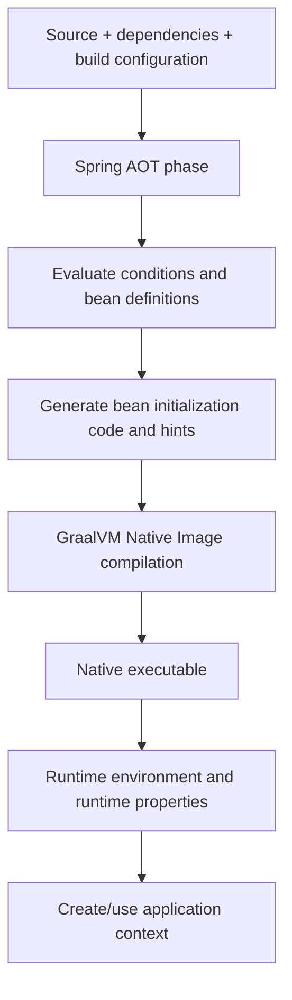

# Phân biệt thuộc tính quyết định cấu trúc bean với giá trị cấu hình lúc chạy

## 1. Vì sao phải phân biệt hai giai đoạn cấu hình?

Trong ứng dụng Spring Boot chạy trên JVM, nhiều cấu hình được đọc khi ứng dụng khởi động và Spring tạo ApplicationContext. Với **Spring AOT và GraalVM Native Image**, một phần công việc này được chuyển sang **build time**: Spring AOT phân tích cấu hình, điều kiện bean và sinh mã khởi tạo; GraalVM sau đó phân tích reachability và biên dịch executable native.

Vì vậy, cần phân biệt hai nhóm property:

- **Property quyết định cấu trúc bean (structural/build-time configuration):** ảnh hưởng bean nào được đăng ký, cấu hình nào được áp dụng, proxy hoặc thành phần nào tồn tại trong ApplicationContext. Nếu được Spring AOT đánh giá trong lúc build, kết quả có thể được phản ánh vào mã sinh và native image.
- **Property chỉ cung cấp giá trị lúc chạy (runtime value configuration):** thay đổi giá trị ứng dụng sử dụng sau khi executable đã được tạo, nhưng không làm thay đổi tập bean, kiểu bean hay cấu trúc context đã được chốt trong AOT.

Không phải cứ property được đọc trong file `application.properties` là build-time. Thời điểm và mục đích sử dụng mới quyết định ý nghĩa của nó. Một giá trị như URL dịch vụ có thể là runtime; cùng một giá trị khi được dùng trong `@ConditionalOnProperty` để bật/tắt bean có thể trở thành structural input.

## 2. Mô hình hai giai đoạn



**Build time** tạo ra một executable dựa trên source, dependency, profile/property được cung cấp cho Spring AOT và metadata. **Runtime** khởi chạy executable, đọc những cấu hình được thiết kế để thay đổi lúc chạy và thực hiện nghiệp vụ.

Điểm mấu chốt: native executable không tự chạy lại toàn bộ Spring AOT khi khởi động. Nếu một property đã quyết định bean nào được sinh vào image, đổi property đó trong container không tự tạo thêm bean bị thiếu.

## 3. Property cấu trúc bean: điều kiện đăng ký bean

Ví dụ dùng `@ConditionalOnProperty` để quyết định có đăng ký một implementation hay không:

```java
@Configuration(proxyBeanMethods = false)
class PaymentConfiguration {

    @Bean
    @ConditionalOnProperty(
            name = "payment.gateway",
            havingValue = "stripe"
    )
    PaymentGateway stripeGateway() {
        return new StripePaymentGateway();
    }

    @Bean
    @ConditionalOnProperty(
            name = "payment.gateway",
            havingValue = "mock"
    )
    PaymentGateway mockGateway() {
        return new MockPaymentGateway();
    }
}
```

Nếu Spring AOT đánh giá cấu hình với `payment.gateway=stripe`, context AOT có thể chứa `StripePaymentGateway` và không chứa `MockPaymentGateway`. Native image được build từ cấu trúc đó.

Nếu container sau đó được chạy với:

```bash
PAYMENT_GATEWAY=mock
```

thì không thể giả định `MockPaymentGateway` tự xuất hiện. Tên biến môi trường chỉ minh họa cách Spring map property; kết quả phụ thuộc property này có thực sự được dùng trong bước AOT và cách cấu hình plugin chuyển environment/property.

Với những bean có điều kiện làm thay đổi cấu trúc context, phải chọn cấu hình AOT tương ứng khi build, hoặc thiết kế để cả các implementation cần thiết đều tồn tại trong context và lựa chọn bằng giá trị runtime.

## 4. Property runtime: thay đổi giá trị nhưng giữ nguyên cấu trúc

Một service có thể đọc endpoint từ cấu hình:

```java
@Service
class InventoryClient {

    private final String baseUrl;

    InventoryClient(
            @Value("${inventory.base-url}") String baseUrl) {
        this.baseUrl = baseUrl;
    }

    URI stockUri(String sku) {
        return URI.create(baseUrl + "/stock/" + sku);
    }
}
```

Nếu bean `InventoryClient` luôn được đăng ký, còn `inventory.base-url` chỉ cung cấp địa chỉ server mà client gọi, giá trị này có thể được cung cấp lúc runtime thông qua environment hoặc config file:

```bash
INVENTORY_BASE_URL=https://inventory.internal
```

Có thể dùng cùng một executable ở staging và production với URL khác nhau, miễn là cấu trúc bean và các khả năng cần thiết không thay đổi. Cần kiểm tra ứng dụng không đóng băng giá trị này vào build time bởi custom initialization hoặc cấu hình AOT khác.

Ví dụ khác về runtime values:

- URL/hostname của dịch vụ ngoài.
- Timeout, retry count hoặc giới hạn nghiệp vụ.
- Feature threshold mà code đã hỗ trợ kiểm tra lúc chạy.
- Tên queue/topic nếu consumer/producer và cấu trúc tích hợp đã được tạo sẵn.
- Credentials được cung cấp an toàn khi chạy, không nhúng vào binary.

Runtime property vẫn phải được xác thực và bảo vệ. “Có thể thay đổi lúc chạy” không có nghĩa mọi giá trị đều an toàn hoặc ứng dụng tự động reload cấu hình khi file/environment thay đổi.

## 5. Một property có thể vừa cấu trúc vừa là giá trị runtime

Không phân loại property chỉ dựa trên tên hoặc vị trí khai báo. Hãy xem **nó được dùng ở đâu**.

| Cách sử dụng | Phân loại thường gặp | Lý do |
|---|---|---|
| `@ConditionalOnProperty` bật/tắt bean | Structural | Quyết định bean definition |
| `@Profile("production")` chọn configuration class | Structural | Thay đổi tập cấu hình/bean |
| `@Value("${service.url}")` trong bean luôn tồn tại | Runtime value nếu được resolve lúc chạy | Chỉ cung cấp giá trị cho bean |
| `@Value("${feature.limit}")` trong service | Runtime value nếu không ảnh hưởng registration | Giá trị nghiệp vụ |
| Property chọn class name rồi `Class.forName` | Dynamic/runtime type selection | Native cần biết trước class/member có thể truy cập |
| Property được dùng trong static initializer chạy lúc build | Có nguy cơ bị đóng băng | Giá trị có thể được lưu vào image heap |

Ví dụ `feature.enabled` có thể chỉ điều khiển một nhánh `if` bên trong service luôn tồn tại, khi đó là runtime value. Nhưng nếu dùng nó trong `@ConditionalOnProperty` để đăng ký hoặc bỏ bean, nó trở thành structural input.

## 6. Spring profile cũng có thể quyết định cấu trúc

Spring profile được dùng để bật các configuration class hoặc bean:

```java
@Configuration
@Profile("production")
class ProductionDataConfiguration {
    @Bean
    DataGateway dataGateway() {
        return new ProductionDataGateway();
    }
}

@Configuration
@Profile("local")
class LocalDataConfiguration {
    @Bean
    DataGateway dataGateway() {
        return new InMemoryDataGateway();
    }
}
```

Nếu AOT được chạy với profile `production`, bean graph sinh ra có thể phản ánh production configuration. Không nên build native một lần theo profile local rồi chỉ đổi `SPRING_PROFILES_ACTIVE=production` lúc chạy và kỳ vọng bean production đã bị loại ở build time xuất hiện.

Với nhiều deployment profile có cấu trúc bean khác nhau, có các lựa chọn:

1. Build artifact riêng cho mỗi cấu trúc/profile.
2. Đăng ký tất cả implementation cần thiết trong context và dùng runtime property để lựa chọn.
3. Tách chức năng có vòng đời khác biệt thành dịch vụ riêng.
4. Thiết kế abstraction/registry ổn định để thay đổi dữ liệu lựa chọn lúc runtime mà không thay bean graph.

Lựa chọn phù hợp tùy kích thước artifact, yêu cầu bảo mật, quy trình release và số biến thể deployment.

## 7. Truyền property vào Spring AOT

Khi dùng Maven hoặc Gradle, Spring Boot plugin cung cấp task/goal AOT. Property cấu hình phải được truyền vào **đúng tiến trình và đúng pha** mà Spring AOT sử dụng.

Maven minh họa:

```bash
./mvnw -Pnative \
  -Dspring.profiles.active=production \
  -Dpayment.gateway=stripe \
  native:compile
```

Gradle minh họa:

```bash
./gradlew processAot \
  -Dspring.profiles.active=production
```

Các lệnh này chỉ minh họa ý định. Việc một Maven user property hoặc JVM system property được chuyển tiếp vào Spring AOT phụ thuộc plugin/version và cấu hình process. Cần kiểm tra log và generated output để xác nhận property thực sự được dùng; không kết luận chỉ từ việc command line có `-D`.

Trong một số cấu hình, có thể đặt system property hoặc environment cho JVM thực thi build, hoặc cấu hình plugin để truyền application arguments/property vào AOT. Phải tham khảo tài liệu đúng phiên bản Spring Boot Maven/Gradle plugin.

Sau khi AOT hoàn tất, ghi lại profile/property structural đã dùng như một phần metadata build. Điều này giúp tái lập binary và biết vì sao một bean có mặt hoặc vắng mặt.

## 8. Cấu hình runtime sau khi executable đã tạo

Với runtime property, có thể truyền environment khi chạy:

```bash
INVENTORY_BASE_URL=https://inventory.prod.internal \
PAYMENT_TIMEOUT=2s \
./application
```

Hoặc truyền biến vào container:

```bash
docker run --rm \
  -e INVENTORY_BASE_URL=https://inventory.prod.internal \
  -e PAYMENT_TIMEOUT=2s \
  orders-service:1.0
```

Spring Boot property binding hỗ trợ nhiều nguồn cấu hình như command-line arguments, system properties, environment variables và config data. Thứ tự ưu tiên cụ thể tùy property source và cách ứng dụng khởi chạy; kiểm tra Spring Boot externalized configuration của phiên bản sử dụng.

Điều quan trọng là runtime property phải được đọc ở runtime. Nếu custom code chạy trong AOT/build phase và lưu giá trị vào generated code hoặc image heap, đổi environment container không thay đổi giá trị đã đóng băng.

Không nhúng secret vào build arguments, generated source hoặc native image. Cung cấp credentials bằng secret manager hoặc cơ chế runtime phù hợp với nền tảng triển khai.

## 9. Build-time initialization và nguy cơ đóng băng giá trị

Native Image có thể khởi tạo một số class ở build time và lưu trạng thái phù hợp vào image heap. Nếu static initializer đọc property/environment, giá trị của máy build có thể bị lưu lại.

Ví dụ rủi ro:

```java
final class RuntimeEndpoint {
    static final String URL =
            System.getenv("INVENTORY_BASE_URL");
}
```

Nếu class được khởi tạo lúc build, `URL` có thể phản ánh environment build thay vì environment runtime. Để tránh:

- Đọc cấu hình runtime trong bean/logic được khởi tạo ở runtime.
- Tránh static initializer phụ thuộc environment, network, thời gian hoặc secret.
- Chỉ dùng build-time initialization cho dữ liệu bất biến và an toàn để đóng băng.
- Nếu cần, xem xét tùy chọn initialize-at-run-time của Native Image cho class phù hợp, sau khi hiểu dependency và side effect.

Phân biệt **biên dịch phương thức tại build time** với **chạy static initializer tại build time**. Đây là hai quyết định khác nhau.

## 10. Runtime property không tự động thay đổi bean graph

Giả sử có hai implementation:

```java
@Component
class StripeGateway implements PaymentGateway {}

@Component
class MockGateway implements PaymentGateway {}
```

Nếu cả hai bean được đăng ký và có qualifier/registry phù hợp, service có thể chọn một implementation bằng property runtime:

```java
@Service
class PaymentService {
    private final Map<String, PaymentGateway> gateways;

    PaymentService(
            List<PaymentGateway> candidates) {
        this.gateways = candidates.stream()
                .collect(Collectors.toMap(
                        PaymentGateway::name,
                        Function.identity()));
    }

    PaymentGateway select(String name) {
        PaymentGateway gateway = gateways.get(name);
        if (gateway == null) {
            throw new IllegalArgumentException("Unknown gateway");
        }
        return gateway;
    }
}
```

Ví dụ cần bổ sung `name()` vào interface và import các collection/stream types; mục đích minh họa registry với tập implementation đã biết. Property runtime chỉ chọn giữa các bean đã tồn tại. Nó không tải thêm class hoặc plugin mới.

Trong native image, mọi implementation cần sử dụng phải có reachability phù hợp. Nếu implementation có reflection/proxy/resource riêng, cần runtime hints hoặc metadata tương ứng.

## 11. Kiểm thử sự khác biệt giữa build-time và runtime

Một bộ test nên xác nhận cả hai loại cấu hình:

| Kiểm thử | Câu hỏi cần trả lời |
|---|---|
| AOT với structural property A | Bean graph sinh ra có đúng như kỳ vọng không? |
| AOT với structural property B | Biến thể cấu trúc khác có cần build artifact riêng không? |
| Chạy cùng binary với runtime URL A/B | Giá trị endpoint có thay đổi mà không build lại không? |
| Chạy với runtime value không hợp lệ | Validation/fallback/error có đúng không? |
| Đổi environment sau khi tạo native image | Có giá trị nào bị đóng băng lúc build không? |
| Chạy native integration test | Bean, proxy, resource và dynamic access có hoạt động không? |

Để xác minh runtime property, build một executable rồi chạy hai lần với hai giá trị URL khác nhau, kiểm tra log/behavior cho thấy mỗi process dùng giá trị được truyền khi khởi chạy. Với property structural, build theo từng profile và xác nhận bean graph khác nhau bằng test hoặc log phù hợp.

Không chỉ dùng test trên JVM để chứng minh hành vi native. Hãy chạy native executable hoặc native test mode và bao phủ đúng đường đi quan trọng.

## 12. Chẩn đoán lỗi thường gặp

| Triệu chứng | Nguyên nhân có thể | Hướng xử lý |
|---|---|---|
| Đổi `SPRING_PROFILES_ACTIVE` nhưng bean không xuất hiện | Bean graph đã được xác định trong AOT với profile khác | Build lại theo structural profile hoặc giữ cả hai bean trong context |
| URL vẫn là giá trị build | Static initialization hoặc code AOT đã đóng băng property | Chuyển đọc URL sang runtime bean/configuration |
| JVM có bean nhưng native thiếu bean | Structural condition/profile khác giữa JVM và AOT | Kiểm tra property truyền vào process AOT và generated context |
| Runtime property mới không được nhận | Sai tên property, precedence hoặc binding | Kiểm tra Environment/property source và config binding |
| Native lỗi class not found ở nhánh lựa chọn | Class được chọn động không có trong image | Đăng ký type/hints hoặc thay đổi sang registry tĩnh |
| Secret lộ trong binary/log build | Secret bị đưa vào build-time config | Loại secret khỏi build, lấy từ secret store runtime |
| Local build khác CI | Profile/property/JDK/plugin khác nhau | Ghi lại và pin build inputs, kiểm tra effective config |

Khi điều tra, xác định property thuộc nhóm nào trước. Nếu nó quyết định cấu trúc bean, sửa cách cấu hình AOT. Nếu nó là runtime value, kiểm tra nguồn property lúc chạy và khả năng bị đóng băng bởi initialization.

## 13. Quy trình thực hành: một artifact, hai môi trường runtime

**Bối cảnh:** dịch vụ Spring Boot có một `InventoryClient` luôn được đăng ký và URL dịch vụ khác nhau giữa staging và production.

**Bước 1 — Tách cấu hình.** Đặt URL trong runtime property `inventory.base-url`; không dùng nó trong `@ConditionalOnProperty` hoặc profile để bật/tắt bean.

**Bước 2 — Xác nhận JVM.** Chạy cùng JAR hai lần với hai URL, kiểm tra client đọc đúng giá trị tương ứng.

**Bước 3 — Chạy Spring AOT.** Dùng profile structural đã chọn; ghi nhận property nào ảnh hưởng bean graph.

**Bước 4 — Build native.** Biên dịch executable từ output AOT, bảo đảm không có secret/URL deployment bị nhúng ngoài ý muốn.

**Bước 5 — Chạy cùng binary.** Khởi chạy hai process với hai URL khác nhau qua environment hoặc config file. Kiểm tra request đi đúng endpoint tương ứng.

**Bước 6 — Thử structural change.** Đổi property bật/tắt một bean bằng `@ConditionalOnProperty`; chứng minh thay đổi cấu trúc cần được phản ánh trong AOT build và artifact mới.

Tiêu chí hoàn thành: runtime value đổi được mà không build lại; structural property được ghi nhận và dùng nhất quán lúc AOT; native behavior được kiểm thử; không có secret hoặc environment-specific value bị đóng băng ngoài dự kiến.

## 14. Kết luận

Trong Spring Boot Native Image, cấu hình hai giai đoạn đòi hỏi phân biệt **property quyết định cấu trúc bean** với **property chỉ cung cấp giá trị lúc chạy**. Spring AOT có thể đánh giá condition/profile và sinh mã dựa trên structural inputs; những quyết định này được phản ánh trong executable. Runtime properties như URL, timeout hay ngưỡng nghiệp vụ có thể thay đổi khi chạy nếu chúng không làm thay đổi cấu trúc context và được đọc đúng thời điểm.

Phân loại theo cách property được sử dụng, ghi lại structural configuration khi build, tránh static initialization phụ thuộc môi trường và kiểm thử cùng binary với nhiều runtime values giúp ứng dụng dễ triển khai qua staging/production mà vẫn giữ được tính nhất quán của native image.
