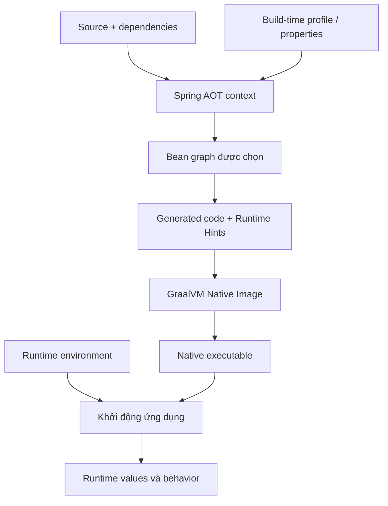

# @Profile và profile-specific configuration trong quá trình AOT

## 1. Vì sao profile quan trọng với Spring AOT?

Spring Boot thường dùng **profile** để chọn cấu hình phù hợp với từng môi trường, chẳng hạn `local`, `test`, `staging` hoặc `prod`. Annotation `@Profile` có thể quyết định bean nào được đăng ký; các file `application-{profile}.yml` cung cấp giá trị cấu hình riêng cho profile tương ứng.

Khi ứng dụng chạy JVM thông thường, Spring đánh giá điều kiện profile trong quá trình tạo application context. Với **Spring AOT**, một application context được xử lý trước lúc chạy để phân tích bean graph, sinh mã khởi tạo và runtime hints phục vụ GraalVM Native Image. Vì vậy, profile được kích hoạt trong giai đoạn AOT có thể quyết định bean nào được đưa vào mô hình đã chuẩn bị.

Đây là khác biệt cốt lõi của cấu hình hai giai đoạn:

- **Build time / AOT time**: Spring phân tích cấu hình, profile và điều kiện để xác định bean graph và tạo mã AOT.
- **Runtime**: executable native khởi động với các giá trị môi trường và cấu hình được thiết kế để thay đổi lúc chạy. Những quyết định cấu trúc đã cố định trong AOT không mặc nhiên được tính lại.



**Nguyên tắc:** nếu `@Profile` hoặc `@ConditionalOnProperty` quyết định bean có tồn tại hay không, hãy xác định profile/property được dùng khi AOT. Chỉ đặt `SPRING_PROFILES_ACTIVE=prod` lúc chạy native không bảo đảm bean chỉ xuất hiện trong profile `prod` đã được tạo vào executable.

## 2. `@Profile` hoạt động như thế nào?

Ví dụ một ứng dụng có hai cách gửi thông báo:

```java
public interface NotificationSender {
    void send(String message);
}
```

Cấu hình local:

```java
@Configuration
@Profile("local")
class LocalNotificationConfiguration {
    @Bean
    NotificationSender notificationSender() {
        return message -> System.out.println("[LOCAL] " + message);
    }
}
```

Cấu hình production:

```java
@Configuration
@Profile("prod")
class ProductionNotificationConfiguration {
    @Bean
    NotificationSender notificationSender(RemoteNotificationClient client) {
        return client::send;
    }
}
```

Khi profile `local` được kích hoạt trong lúc Spring tạo context, bean từ `LocalNotificationConfiguration` được đăng ký. Khi profile `prod` được kích hoạt, cấu hình production được chọn. Nếu không có profile phù hợp, cả hai cấu hình có thể không tạo bean, dẫn đến lỗi thiếu dependency khi một bean khác yêu cầu `NotificationSender`.

Có thể dùng biểu thức profile:

```java
@Profile("prod & cloud")
@Configuration
class CloudProductionConfiguration {
}
```

Hoặc:

```java
@Profile("local | test")
@Configuration
class DevelopmentConfiguration {
}
```

Cú pháp biểu thức profile hỗ trợ AND (`&`), OR (`|`) và NOT (`!`), có thể dùng ngoặc để làm rõ ưu tiên. Cần tránh trộn `&` và `|` mà không dùng ngoặc vì cú pháp biểu thức có quy tắc riêng.

## 3. Profile-specific configuration files

Spring Boot hỗ trợ file cấu hình theo profile:

```text
src/main/resources/
  application.yml
  application-local.yml
  application-test.yml
  application-prod.yml
```

Ví dụ file mặc định:

```yaml
server:
  port: 8080

notification:
  timeout: 3s
```

File `application-local.yml`:

```yaml
notification:
  mode: console
```

File `application-prod.yml`:

```yaml
notification:
  mode: remote
  timeout: 2s
```

Kích hoạt profile trong JVM:

```bash
java -jar app.jar --spring.profiles.active=local
```

Hoặc:

```bash
SPRING_PROFILES_ACTIVE=prod java -jar app.jar
```

Các file profile-specific cung cấp property values. Chúng có thể được đọc ở runtime nếu nằm trong cấu hình runtime của ứng dụng. Tuy nhiên, nếu property được dùng để quyết định bean graph trong AOT, giá trị tại thời điểm AOT cần được xác định chính xác.

## 4. Profile tại AOT và profile lúc runtime

Đây là phần dễ gây nhầm lẫn nhất. Spring AOT tạo ra mã khởi tạo dựa trên context đã được chuẩn bị. Nếu build AOT với profile `local`, các cấu hình `@Profile("local")` có thể được xử lý và các cấu hình `@Profile("prod")` có thể không được đưa vào mô hình đó.

Sau đó, nếu chạy executable với:

```bash
SPRING_PROFILES_ACTIVE=prod ./app
```

không thể mặc định rằng Spring sẽ tái chạy toàn bộ quá trình khám phá và sinh bean graph như JVM thông thường. Một số property có thể được đọc lại lúc runtime, nhưng thành phần bean đã bị loại trong quá trình AOT không tự xuất hiện chỉ nhờ thay biến môi trường.

| Quyết định/cấu hình | Thời điểm quan trọng | Có thể thay lúc runtime? |
|---|---|---|
| Bean được chọn bởi `@Profile` trong AOT context | AOT/build time | Không nên giả định có thể đổi tùy ý |
| Bean được chọn bởi `@ConditionalOnProperty` khi AOT | AOT/build time | Không nên giả định bật property sẽ tạo bean mới |
| Giá trị port HTTP | Runtime nếu không bị cố định theo cách khác | Thường có |
| URL datasource được bind vào bean đã tồn tại | Runtime nếu thiết kế để bind runtime | Thường có |
| Secret, password, token | Runtime/deployment | Nên cấp qua secret mechanism |
| Giá trị điều khiển logic bên trong bean đã tồn tại | Runtime nếu được đọc động | Có thể |

Cần phân biệt **cấu trúc ứng dụng** (bean graph) và **giá trị cấu hình** của các bean đã có. Hai loại dữ liệu này không có cùng mức độ linh hoạt sau khi AOT.

## 5. Chọn profile cho quá trình AOT

Spring Boot Gradle Plugin cung cấp tác vụ `processAot`. Có thể truyền application arguments cho tác vụ để kích hoạt profile cho AOT, tùy API của phiên bản plugin.

Ví dụ Groovy DSL:

```groovy
tasks.named("processAot") {
    args("--spring.profiles.active=prod")
}
```

Ví dụ Kotlin DSL (kiểu task phụ thuộc phiên bản Spring Boot):

```kotlin
tasks.named<org.springframework.boot.gradle.tasks.aot.ProcessAot>("processAot") {
    args("--spring.profiles.active=prod")
}
```

Đây là cách minh họa việc truyền **application argument** cho Spring context được xử lý ở AOT. Kiểm tra API task trong đúng phiên bản Spring Boot/Gradle Plugin của dự án; không sao chép nguyên xi nếu plugin thay đổi loại task hoặc cấu hình.

Với Maven, cấu hình native profile và plugin cũng có thể truyền tham số cho quá trình AOT. Cách khai báo chính xác phụ thuộc phiên bản Spring Boot Maven Plugin và cách dự án thiết lập lifecycle. Cần kiểm tra log AOT để biết profile thực sự được dùng.

Đừng dựa vào việc terminal có biến `SPRING_PROFILES_ACTIVE` mà không xác minh tiến trình AOT có nhận biến đó. Gradle daemon, process AOT và native executable là các process/giai đoạn khác nhau; environment của chúng có thể không giống nhau.

## 6. Profile-specific configuration và property source precedence

Spring Boot có nhiều nguồn cấu hình: command-line arguments, system properties, environment variables, config data và các nguồn khác. Thứ tự ưu tiên xác định giá trị cuối cùng của một property khi có nhiều nguồn cùng khai báo.

Ví dụ, `application-prod.yml` khai báo:

```yaml
feature:
  reports-enabled: false
```

Nhưng command line có:

```bash
--feature.reports-enabled=true
```

Giá trị hiệu lực có thể bị ghi đè theo quy tắc precedence của Spring Boot. Trong AOT, điều này quan trọng nếu property quyết định bean qua `@ConditionalOnProperty`.

Không log toàn bộ Environment hoặc biến môi trường để điều tra precedence vì có thể làm lộ secret. Thay vào đó, log các giá trị không nhạy cảm được phép, tên profile đã chọn, hoặc viết test xác nhận bean cụ thể.

## 7. Chiến lược build một hay nhiều profile?

Có hai hướng thiết kế phổ biến.

### Một native executable cho mỗi cấu hình cấu trúc

Nếu local và production có bean graph khác nhau đáng kể, build riêng executable cho từng profile:

```text
Build AOT profile=local -> app-local
Build AOT profile=prod  -> app-prod
```

Mỗi artifact cần manifest riêng ghi profile AOT, commit, toolchain và checksum. Khi triển khai, chọn đúng artifact tương ứng. Cách này tăng số lần build và số artifact phải quản lý, nhưng dễ hiểu về cấu trúc bean.

### Một executable với cấu hình runtime linh hoạt

Nếu khác biệt chỉ là endpoint, timeout, mức log, feature parameter hoặc secret, giữ bean graph ổn định và đọc các giá trị đó lúc runtime. Ví dụ cùng một `NotificationSender` bean có thể dùng URL và token được cấp từ environment runtime, miễn là class và cơ chế tạo bean đã có trong AOT image.

Tránh tạo hai bean implementation khác nhau chỉ để thay đổi một URL nếu không cần thiết. Thiết kế một bean với configuration properties có thể giúp executable dùng chung cho nhiều môi trường.

| Tiêu chí | Build riêng theo profile | Một executable, cấu hình runtime |
|---|---|---|
| Bean graph khác nhau | Phù hợp | Không phù hợp nếu bean cần bị thêm/bớt |
| Giá trị endpoint/timeout khác nhau | Có thể nhưng thường lãng phí | Phù hợp |
| Secret theo môi trường | Không nên đóng gói vào build | Cấp lúc runtime |
| Số artifact | Nhiều | Ít |
| Tính linh hoạt triển khai | Phụ thuộc artifact được chọn | Cao hơn với giá trị runtime |

## 8. Tránh đưa secret và trạng thái môi trường vào AOT

AOT có thể khởi tạo một phần application context trong quá trình build. Vì vậy, bean constructor hoặc factory method không nên phụ thuộc vào việc kết nối production database, gọi API bên ngoài hoặc đọc secret chỉ tồn tại trên máy developer/CI.

Ví dụ không nên thực hiện kết nối thật ngay khi tạo bean:

```java
@Bean
RemoteClient remoteClient() {
    // Tránh kết nối production ngay trong quá trình AOT.
    return RemoteClient.connectToProduction();
}
```

Thay vào đó, tạo client từ cấu hình nhưng trì hoãn I/O đến lúc thực sự sử dụng:

```java
@Bean
RemoteClient remoteClient(RemoteClientProperties properties) {
    return new RemoteClient(properties.endpoint(), properties.token());
}
```

Ví dụ thứ hai vẫn phải được thiết kế cẩn thận để không thực hiện network call trong constructor. Secret nên được cấp qua môi trường runtime, secret manager hoặc volume mount. Không bake secret vào generated code, resource hay native executable.

## 9. Kiểm thử profile và bean graph

Tạo test cho từng profile để xác nhận bean được đăng ký:

```java
@SpringBootTest
@ActiveProfiles("local")
class LocalProfileTest {

    @Autowired
    ApplicationContext context;

    @Test
    void registersLocalNotificationSender() {
        assertThat(context.getBean(NotificationSender.class))
            .isNotNull();
        assertThat(context.containsBean("productionNotificationSender"))
            .isFalse();
    }
}
```

Với production profile, tạo test tương ứng hoặc dùng context runner để xác minh điều kiện. Test trên JVM giúp xác nhận cấu hình Spring theo profile; nó chưa chứng minh AOT build đã sử dụng cùng profile.

Quy trình xác minh Native Image:

1. Chạy test JVM cho profile mục tiêu.
2. Chạy `processAot` với profile được định nghĩa rõ.
3. Kiểm tra log và generated output để xác nhận AOT context.
4. Chạy `nativeCompile` hoặc Maven native compile.
5. Khởi chạy executable native với runtime environment mong muốn.
6. Gọi endpoint/luồng nghiệp vụ phụ thuộc bean profile và xác minh hành vi.
7. Nếu cần nhiều bean graph, build và test từng native artifact riêng.

Test trên executable mới là bằng chứng quan trọng. Đừng chỉ kiểm tra `processAot` thành công rồi kết luận profile production đã có trong binary.

## 10. Những lỗi thường gặp

| Triệu chứng | Nguyên nhân có thể | Cách xử lý |
|---|---|---|
| Native chạy với profile prod nhưng thiếu bean prod | AOT đã build bằng profile khác | Build lại AOT/native với profile phù hợp |
| Cả hai implementation đều không có | Không có profile phù hợp khi AOT hoặc property condition sai | Kiểm tra active profiles và property precedence |
| JVM chạy được khi đổi profile, native không đổi bean graph | Quyết định bean đã được xử lý ở AOT | Tách build theo cấu trúc hoặc thiết kế bean graph ổn định |
| AOT thất bại khi khởi tạo bean | Bean factory method thực hiện I/O hoặc cần secret | Trì hoãn side effect đến runtime |
| CI và laptop sinh bean graph khác nhau | Environment/profile/property/classpath khác | Ghi nhận và chuẩn hóa đầu vào AOT |
| Secret xuất hiện trong log/build output | Đọc/log environment hoặc embed cấu hình nhạy cảm | Loại secret khỏi log và build-time inputs |

## 11. Checklist cấu hình hai giai đoạn

- Xác định bean nào được chọn bởi `@Profile` hoặc `@ConditionalOnProperty`.
- Xác định profile và property thực sự được sử dụng khi AOT.
- Không mặc định `SPRING_PROFILES_ACTIVE` runtime sẽ tạo lại bean graph.
- Tách cấu hình cấu trúc khỏi giá trị môi trường có thể thay đổi lúc chạy.
- Tránh kết nối hệ thống ngoài hoặc đọc secret trong quá trình AOT.
- Nếu bean graph khác nhau, build và quản lý native executable riêng theo profile.
- Ghi profile AOT, source commit, toolchain và checksum vào build report.
- Kiểm thử bean graph trên JVM và hành vi trên native executable.
- Kiểm thử container với cấu hình/secret được cấp đúng thời điểm runtime.

## 12. Câu hỏi tự kiểm tra

1. `@Profile` ảnh hưởng đến bean graph trong giai đoạn AOT như thế nào?
2. Vì sao kích hoạt profile `prod` lúc chạy không bảo đảm bean `@Profile("prod")` có trong executable đã build với profile `local`?
3. Khác biệt giữa property quyết định tạo bean và property chỉ điều khiển hành vi của bean đã tồn tại là gì?
4. Khi nào nên tạo một native executable riêng cho từng profile?
5. Vì sao không nên kết nối production database trong constructor/factory method được gọi lúc AOT?
6. Cần những bằng chứng nào để xác nhận profile-specific configuration hoạt động trên native executable?

**Ghi nhớ:** Spring AOT phân tích application context với profile và property có hiệu lực tại build time. Hãy cố định những lựa chọn quyết định bean graph, giữ các giá trị môi trường có thể thay đổi ở runtime, và kiểm thử đúng native artifact theo từng cấu hình cần triển khai.
