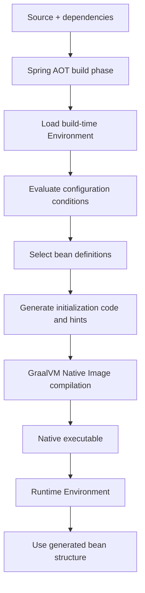

# @ConditionalOnProperty và các điều kiện được đánh giá khi build

## 1. Vì sao điều kiện cấu hình quan trọng với Native Image?

Spring Boot thường dùng điều kiện để quyết định cấu hình nào được áp dụng và bean nào được đăng ký. Ví dụ, một ứng dụng chỉ tạo tích hợp thanh toán Stripe khi property `payment.provider=stripe`, hoặc chỉ bật một thành phần quan sát khi `observability.enabled=true`.

Trên JVM, các điều kiện Spring được đánh giá trong quá trình tạo ApplicationContext khi ứng dụng khởi động. Với **Spring AOT**, Spring xử lý ApplicationContext trước khi phát hành executable. Những điều kiện liên quan đến bean registration có thể được đánh giá trong giai đoạn AOT; kết quả góp phần xác định bean definitions và mã khởi tạo được sinh ra.

Với **GraalVM Native Image**, executable được biên dịch dựa trên mã và metadata đã biết tại build time. Vì vậy, nếu một bean bị loại khỏi cấu trúc context trong quá trình AOT, việc đổi property khi chạy binary không tự động làm bean đó xuất hiện trở lại.

Bài học này tập trung vào `@ConditionalOnProperty` và các điều kiện Spring Boot/Spring Framework có thể ảnh hưởng đến cấu trúc bean. Cần hiểu rõ:

- Property nào đang quyết định bean có được đăng ký hay không.
- Giá trị property nào được sử dụng khi chạy Spring AOT.
- Kết quả điều kiện được phản ánh thế nào vào generated application context.
- Khi nào nên build artifact riêng, khi nào nên giữ các bean và lựa chọn bằng runtime property.

## 2. Cách @ConditionalOnProperty hoạt động

`@ConditionalOnProperty` là annotation của Spring Boot, cho phép điều kiện hóa configuration class hoặc bean theo giá trị property trong Spring Environment.

Ví dụ:

```java
@Configuration(proxyBeanMethods = false)
class PaymentConfiguration {

    @Bean
    @ConditionalOnProperty(
            prefix = "payment",
            name = "provider",
            havingValue = "stripe"
    )
    PaymentGateway stripeGateway() {
        return new StripePaymentGateway();
    }

    @Bean
    @ConditionalOnProperty(
            prefix = "payment",
            name = "provider",
            havingValue = "mock"
    )
    PaymentGateway mockGateway() {
        return new MockPaymentGateway();
    }
}
```

Với cấu hình:

```properties
payment.provider=stripe
```

bean `stripeGateway` thỏa điều kiện, còn `mockGateway` không thỏa. Khi cấu hình là `payment.provider=mock`, kết quả đảo lại.

Các thuộc tính chính:

| Thuộc tính | Ý nghĩa |
|---|---|
| `prefix` | Tiền tố property, ví dụ `payment` |
| `name` | Tên property cần kiểm tra, ví dụ `provider` |
| `havingValue` | Giá trị phải khớp để condition thỏa mãn |
| `matchIfMissing` | Có xem property bị thiếu là match hay không |

Nếu không đặt `havingValue`, điều kiện mặc định thường match khi property tồn tại và giá trị không bằng chuỗi `false` (không phân biệt hoa thường). Vì thế, nên khai báo `havingValue` tường minh cho lựa chọn provider hoặc chế độ có nhiều giá trị.

Ví dụ bật một tính năng theo boolean:

```java
@Bean
@ConditionalOnProperty(
        prefix = "feature.invoice",
        name = "enabled",
        havingValue = "true",
        matchIfMissing = false
)
InvoiceExportService invoiceExportService() {
    return new InvoiceExportService();
}
```

Khi property thiếu hoặc không phải `true`, bean không được đăng ký theo điều kiện này.

## 3. Điều kiện được đánh giá ở đâu trong vòng đời?

Trong một ứng dụng JVM thông thường, Spring Boot đánh giá các condition khi cấu hình được xử lý và ApplicationContext được tạo. Khi khởi động một process mới với profile/property khác, Spring có thể tạo context với cấu trúc bean khác.

Với AOT, Spring khởi tạo một context trong môi trường build để phân tích và sinh mã. Các condition liên quan đến cấu hình bean được đánh giá trong quá trình này. Kết quả AOT phản ánh những property sources, profiles và environment được cung cấp cho bước xử lý AOT.



Điểm quan trọng: executable native không tự chạy lại toàn bộ quy trình AOT để bổ sung configuration class bị loại. Runtime Environment vẫn cung cấp giá trị cho các property được đọc lúc chạy, nhưng không mặc nhiên thay thế cấu trúc bean đã được sinh.

Điều này không có nghĩa mọi condition đều luôn được đánh giá tại build time trong mọi cấu hình Spring. Cách xử lý cụ thể phụ thuộc loại condition, loại bean registration và phiên bản framework. Cần xác minh behavior của cấu hình thực tế bằng AOT output và integration test.

## 4. Ví dụ: build với provider Stripe, chạy lại bằng provider Mock

Giả sử cấu hình AOT dùng:

```properties
payment.provider=stripe
```

Spring AOT xử lý `PaymentConfiguration` và nhận thấy `stripeGateway` phù hợp. Sau đó Native Image tạo executable từ cấu trúc đã phân tích.

Nếu triển khai binary với:

```bash
PAYMENT_PROVIDER=mock ./application
```

không thể giả định `mockGateway` được đăng ký. Nếu bean này không có trong generated context, thay đổi environment không thể tạo bean đã bị loại khỏi artifact.

Đây là khác biệt quan trọng giữa:

- **Chọn cấu trúc:** quyết định implementation nào tồn tại trong ApplicationContext.
- **Chọn dữ liệu runtime:** quyết định cách một service đã tồn tại xử lý một request.

Nếu mục tiêu là một binary dùng được ở cả staging và production, cân nhắc giữ cả hai implementation trong context rồi lựa chọn bằng runtime property.

## 5. Thiết kế lựa chọn runtime khi tập implementation đã biết

Nếu cả hai provider đều an toàn và cần có trong artifact, có thể đăng ký chúng như bean thông thường:

```java
@Component
class StripePaymentGateway implements PaymentGateway {
    @Override
    public String providerName() {
        return "stripe";
    }
}

@Component
class MockPaymentGateway implements PaymentGateway {
    @Override
    public String providerName() {
        return "mock";
    }
}
```

Một service lựa chọn theo property runtime:

```java
@Service
class PaymentGatewaySelector {

    private final Map<String, PaymentGateway> gateways;
    private final String provider;

    PaymentGatewaySelector(
            List<PaymentGateway> candidates,
            @Value("${payment.provider}") String provider) {
        this.gateways = candidates.stream()
                .collect(Collectors.toUnmodifiableMap(
                        PaymentGateway::providerName,
                        Function.identity()));
        this.provider = provider;
    }

    PaymentGateway selectedGateway() {
        PaymentGateway gateway = gateways.get(provider);
        if (gateway == null) {
            throw new IllegalStateException(
                    "Unsupported payment provider: " + provider);
        }
        return gateway;
    }
}
```

Cần bổ sung import `Map`, `List`, `Collectors`, `Function`, `Service`, `Value` và định nghĩa interface `PaymentGateway` với phương thức `providerName()`. Ví dụ tập trung minh họa registry: các bean đều có mặt trong context, còn property chỉ chọn một bean lúc chạy.

Thiết kế này cho phép cùng executable được chạy với `PAYMENT_PROVIDER=stripe` hoặc `PAYMENT_PROVIDER=mock`, miễn cả hai bean đã được đưa vào image và các dependency cần thiết đều có mặt. Đối với provider production, cần quản lý secret và credential qua cấu hình bảo mật runtime.

## 6. matchIfMissing và giá trị mặc định

`matchIfMissing` ảnh hưởng trực tiếp đến kết quả condition khi property không được khai báo.

```java
@Bean
@ConditionalOnProperty(
        prefix = "metrics",
        name = "enabled",
        havingValue = "true",
        matchIfMissing = true
)
MetricsPublisher metricsPublisher() {
    return new MetricsPublisher();
}
```

Trong ví dụ này, bean được đăng ký khi `metrics.enabled=true` hoặc property không tồn tại. Khi `metrics.enabled=false`, condition không match.

Cần thận trọng với giá trị mặc định. Nếu môi trường AOT không cung cấp property, `matchIfMissing=true` có thể làm bean được đưa vào cấu trúc sinh ra; runtime environment sau đó không tự loại bean chỉ vì có giá trị khác. Ngược lại, `matchIfMissing=false` có thể khiến bean không được tạo nếu property thiếu ở AOT.

Để tránh kết quả bất ngờ:

- Khai báo rõ property structural trong cấu hình build.
- Chọn `havingValue` cụ thể thay vì dựa vào truthiness mơ hồ.
- Dùng `matchIfMissing` theo chủ đích và ghi rõ default.
- Kiểm thử cả trường hợp property thiếu, true, false và giá trị không hợp lệ.

## 7. Các điều kiện Spring khác có thể tác động cấu trúc AOT

Ngoài `@ConditionalOnProperty`, còn có các condition phổ biến:

| Annotation/condition | Tiêu chí | Tác động có thể có |
|---|---|---|
| `@Profile` | Active Spring profile | Chọn configuration/bean definitions |
| `@ConditionalOnClass` | Class có trên classpath | Bật/tắt auto-configuration theo dependency |
| `@ConditionalOnMissingBean` | Chưa có bean phù hợp | Chọn bean mặc định hoặc bean tùy chỉnh |
| `@ConditionalOnBean` | Bean phù hợp đã được đăng ký | Bật cấu hình phụ thuộc bean khác |
| `@ConditionalOnResource` | Resource có thể tìm thấy | Chọn cấu hình dựa trên resource |
| `@ConditionalOnWebApplication` | Loại ứng dụng web | Bật cấu hình web tương ứng |

Các điều kiện này thường xuất hiện trong Spring Boot auto-configuration. AOT cần phân tích cấu trúc context trong điều kiện build đã chọn. Ví dụ, `@ConditionalOnClass` phụ thuộc classpath của build; thêm dependency sau khi binary đã tạo không thể tự làm auto-configuration tương ứng xuất hiện.

Với `@ConditionalOnMissingBean`, thứ tự và thời điểm các bean definitions được đăng ký có thể ảnh hưởng kết quả. Nên dùng cấu hình auto-configuration theo khuyến nghị của Spring Boot và xác minh condition evaluation report.

## 8. Property source nào được sử dụng trong AOT?

Spring Environment có thể nhận property từ nhiều nguồn: application properties/YAML, profile-specific config data, system properties, environment variables, command-line arguments và nguồn tùy chỉnh. Trong quá trình AOT, điều quan trọng là xác định **nguồn nào thực sự được nạp vào process xử lý AOT**.

Ví dụ file:

```properties
# application-native.properties
payment.provider=stripe
metrics.enabled=true
```

Nếu build AOT dùng cấu hình này, các condition tương ứng có thể được đánh giá theo giá trị đó. Nhưng không được giả định file có tên bất kỳ tự động được nạp trong AOT. Cần cấu hình profile/config location hoặc truyền property theo cơ chế được Spring Boot plugin hỗ trợ.

Khi điều tra, ghi lại:

- Active Spring profiles ở bước AOT.
- Property sources được nạp và thứ tự ưu tiên.
- Giá trị condition thực tế nhìn thấy.
- Version Spring Boot/plugin và lệnh build.
- Bean definitions/generated initialization liên quan.

Không ghi secret thật vào log hoặc báo cáo. Có thể ghi tên property và trạng thái đã được cấp, thay vì in giá trị nhạy cảm.

## 9. Truyền structural property khi build Maven/Gradle

Ví dụ lệnh Maven:

```bash
./mvnw -Pnative \
  -Dspring.profiles.active=native \
  -Dpayment.provider=stripe \
  native:compile
```

Ví dụ Gradle:

```bash
./gradlew processAot \
  -Dspring.profiles.active=native
./gradlew nativeCompile
```

Đây là minh họa truyền property, không phải bảo đảm mọi plugin/version tự chuyển mọi tham số shell vào Spring AOT. Cần xác minh Spring Boot plugin thực sự nhận property ở đúng process. Một số dự án cấu hình AOT qua environment, system properties hoặc plugin-specific arguments.

Nếu build và native compile chạy ở hai lệnh riêng, phải bảo đảm cấu hình AOT không thay đổi giữa hai bước và output AOT được dùng trong native compile. Với lifecycle tích hợp, kiểm tra log/goal/task graph để xác nhận pha AOT đã chạy theo profile mong muốn.

Ghi lại lệnh build và property structural cùng artifact version. Điều này rất hữu ích khi điều tra tại sao một bean có mặt trong bản production nhưng không có trong bản staging.

## 10. Condition evaluation report và chẩn đoán

Spring Boot có thể cung cấp condition evaluation report giúp giải thích auto-configuration nào match hoặc không match. Khi chạy JVM, có thể bật debug condition report qua cấu hình phù hợp, ví dụ:

```properties
debug=true
```

Hoặc chạy ứng dụng với tùy chọn tương ứng:

```bash
java -jar application.jar --debug
```

Đầu ra có thể chứa nhiều thông tin cấu hình, vì vậy cần xem xét trước khi chia sẻ. Với AOT, cần kiểm tra log của process AOT và generated output; report lúc runtime của native không thể khôi phục toàn bộ điều kiện đã được đánh giá trong build phase.

Cách chẩn đoán có hệ thống:

1. Xác định bean nào đang thiếu/thừa.
2. Tìm condition trên configuration class hoặc bean method.
3. Xác định property source và giá trị ở JVM startup.
4. Xác định property/profile được dùng trong AOT.
5. So sánh condition result và bean registration giữa hai pha.
6. Build lại native với structural configuration chính xác hoặc đổi thiết kế để dùng runtime selection.

## 11. Điều kiện không phải lúc nào cũng tương đương property runtime

Một anti-pattern là dùng `@ConditionalOnProperty` cho một lựa chọn cần đổi linh hoạt giữa các deployment nhưng lại mong một binary duy nhất tự thay đổi bean graph.

Ví dụ:

```java
@Bean
@ConditionalOnProperty(name = "search.engine", havingValue = "elasticsearch")
SearchClient elasticsearchClient() {
    return new ElasticsearchClient();
}
```

Nếu `search.engine` được dùng trong AOT để quyết định đăng ký bean, giá trị runtime khác không tự tạo client còn lại. Nếu cần lựa chọn runtime, có thể:

- Đăng ký cả Elasticsearch và implementation khác trong context nếu dependency/khả năng tương thích cho phép.
- Tạo một abstraction duy nhất, đọc cấu hình runtime và chọn chiến lược trong code.
- Tách biến thể cấu trúc thành artifact riêng, mỗi artifact được build với structural property tương ứng.

Không nên giữ một implementation trong image nếu nó kéo theo thư viện, credential hoặc bề mặt tấn công không mong muốn. Quyết định giữ tất cả hay build nhiều artifact cần cân bằng tính linh hoạt, kích thước, bảo mật và chi phí CI.

## 12. Kiểm thử điều kiện trước và sau AOT

Một test suite tốt nên bao phủ condition match và non-match:

| Trường hợp | Giá trị | Kỳ vọng |
|---|---|---|
| Provider Stripe | `payment.provider=stripe` | Stripe bean được đăng ký |
| Provider Mock | `payment.provider=mock` | Mock bean được đăng ký |
| Property thiếu | Không khai báo | Theo `matchIfMissing` đã cấu hình |
| Giá trị không hỗ trợ | `payment.provider=other` | Không có bean phù hợp hoặc runtime validation báo lỗi |
| Runtime selection | Hai bean cùng tồn tại | Cùng binary chọn được provider theo property lúc chạy |

Trên JVM, dùng `ApplicationContextRunner` (Spring Boot test) hoặc `@SpringBootTest` với các property khác nhau để kiểm tra bean registration. Ví dụ:

```java
new ApplicationContextRunner()
    .withUserConfiguration(PaymentConfiguration.class)
    .withPropertyValues("payment.provider=stripe")
    .run(context -> {
        assertThat(context).hasSingleBean(StripePaymentGateway.class);
        assertThat(context).doesNotHaveBean(MockPaymentGateway.class);
    });
```

Ví dụ cần dependency Spring Boot test và AssertJ. Cấu hình test phải bảo đảm component/bean liên quan được đăng ký theo đúng cách ứng dụng sử dụng.

Sau đó chạy Spring AOT và native integration test. Đối với runtime selection, chạy cùng binary nhiều lần với property khác nhau. Đối với structural selection, build riêng theo từng property và xác nhận mỗi artifact chứa cấu trúc mong muốn. Không dùng một JVM context test để kết luận native image đã có đầy đủ reachability metadata.

## 13. Những lỗi thường gặp

| Triệu chứng | Nguyên nhân có thể | Cách xử lý |
|---|---|---|
| Bean không xuất hiện trong native | Condition không match ở AOT phase | Kiểm tra property/profile của process AOT |
| Đổi environment runtime nhưng bean vẫn thiếu | Bean đã bị loại khỏi generated context | Build lại với structural property hoặc giữ bean trong context |
| JVM có bean, AOT không có | Environment/profile giữa hai pha khác nhau | So sánh property sources và condition result |
| Bean mặc định xuất hiện ngoài ý muốn | `@ConditionalOnMissingBean` hoặc condition order/type prediction | Kiểm tra bean definitions và condition report |
| Property boolean xử lý sai | `havingValue`/ `matchIfMissing` không rõ | Khai báo tường minh và test trường hợp thiếu |
| Build local khác CI | Profile/property/plugin version khác | Ghi lại lệnh và pin structural inputs |
| Native lỗi khi gọi class theo tên | Class không reachable hoặc thiếu reflection hints | Đăng ký type/member hoặc thay thiết kế |

Khi điều tra, tách **condition không match** khỏi **bean có đăng ký nhưng Native Image thiếu metadata**. Hai trường hợp có biểu hiện khác nhau và cần giải pháp khác nhau.

## 14. Bài thực hành: một binary hay nhiều binary?

**Bối cảnh:** dịch vụ có hai payment provider, một mock dành cho test và một provider production.

**Bước 1 — Tạo condition.** Dùng `@ConditionalOnProperty` để chọn implementation theo `payment.provider`.

**Bước 2 — Chạy JVM.** Khởi động hai lần với `stripe` và `mock`, xác nhận bean tương ứng được đăng ký.

**Bước 3 — Chạy AOT với giá trị stripe.** Ghi profile/property, quan sát condition và generated output.

**Bước 4 — Build native.** Tạo executable từ AOT output, chạy với property runtime stripe, xác nhận hoạt động.

**Bước 5 — Thử đổi runtime property thành mock.** Ghi nhận bean graph không tự thay đổi nếu mock bean đã bị loại trong AOT. Đây là bằng chứng về structural configuration.

**Bước 6 — Thử thiết kế registry.** Đăng ký cả hai implementation trong context, dùng runtime property để chọn, build lại một binary và chạy với cả hai giá trị.

**Bước 7 — Đánh giá.** So sánh kích thước artifact, dependency được giữ, độ linh hoạt deployment, bảo mật và chi phí build.

Tiêu chí hoàn thành: giải thích được condition nào được đánh giá trong AOT, property nào phải cố định khi build, property nào có thể đổi lúc chạy và chứng minh hành vi bằng native executable.

## 15. Kết luận

`@ConditionalOnProperty` là công cụ hữu ích để bật/tắt bean theo property, nhưng khi sử dụng cùng Spring AOT, property đó có thể trở thành **đầu vào quyết định cấu trúc ApplicationContext tại build time**. Kết quả condition được phản ánh vào bean definitions và mã khởi tạo sinh ra; đổi property khi chạy native không tự thêm bean đã bị loại.

Muốn một executable dùng được qua nhiều môi trường, hãy giữ các implementation cần thiết trong context và lựa chọn bằng runtime value khi phù hợp. Nếu mỗi môi trường cần cấu trúc bean khác nhau, hãy build artifact riêng theo structural profile/property. Ghi lại condition inputs, kiểm tra AOT output và chạy native integration tests là cách bảo đảm ứng dụng Spring Boot Native Image có hành vi nhất quán và có thể giải thích.
