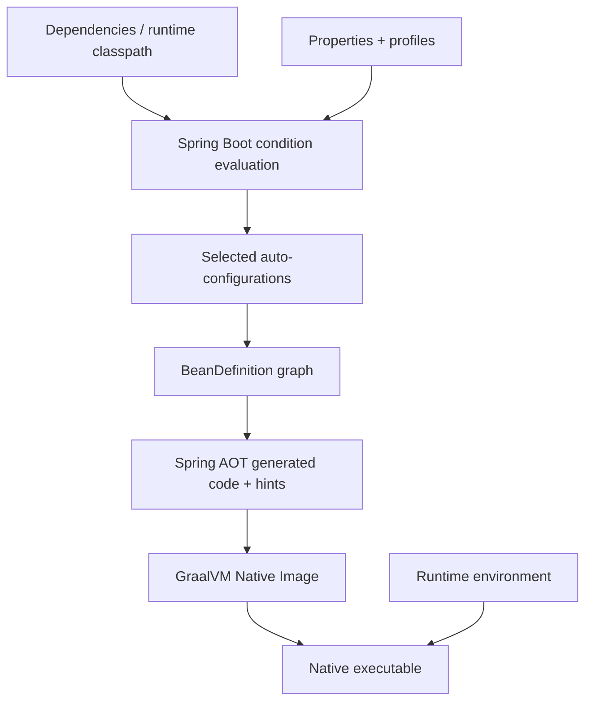

# Ảnh hưởng của classpath đến auto-configuration đã được chọn

## 1. Classpath là một phần của cấu hình Spring

Spring Boot sử dụng **auto-configuration** để tự động đăng ký bean dựa trên class có mặt, property, resource và các điều kiện khác. Vì vậy, classpath của ứng dụng không chỉ quyết định class nào có thể được nạp; nó còn ảnh hưởng đến việc **auto-configuration nào được kích hoạt**.

Trong ứng dụng chạy JVM thông thường, classpath được thiết lập khi khởi động. Spring Boot đánh giá các điều kiện như `@ConditionalOnClass`, `@ConditionalOnMissingBean`, `@ConditionalOnProperty` và tạo application context tương ứng.

Với **Spring AOT** và **GraalVM Native Image**, một context được xử lý ở build time. Spring AOT phân tích các auto-configuration đã được chọn, bean definition và dependency để sinh mã khởi tạo cùng runtime hints. Nếu classpath ở thời điểm AOT khác classpath dự kiến khi build/phát hành, tập auto-configuration có thể khác, dẫn tới bean graph khác.



**Điểm cần nhớ:** thêm hoặc loại một dependency có thể thay đổi điều kiện classpath và auto-configuration được chọn. Việc đổi classpath sau khi AOT đã sinh mã không tự làm Spring phân tích lại toàn bộ cấu hình.

## 2. Auto-configuration chọn cấu hình bằng điều kiện

Một auto-configuration có thể được bật khi class cụ thể tồn tại:

```java
@AutoConfiguration
@ConditionalOnClass(name = "com.example.cache.FastCacheClient")
class FastCacheAutoConfiguration {

    @Bean
    @ConditionalOnMissingBean
    CacheService cacheService(FastCacheClient client) {
        return new FastCacheService(client);
    }
}
```

Ví dụ trên minh họa hai điều kiện:

- `@ConditionalOnClass`: chỉ áp dụng cấu hình nếu class được chỉ định có mặt trên classpath.
- `@ConditionalOnMissingBean`: tạo bean mặc định nếu context chưa có bean tương ứng.

Khi dependency cung cấp `FastCacheClient` có mặt, auto-configuration có thể được chọn. Nếu dependency bị loại khỏi runtime classpath, điều kiện classpath không còn thỏa mãn. Khi đó bean `CacheService` mặc định cũng có thể không được đăng ký.

Một số điều kiện khác thường gặp:

| Annotation/điều kiện | Phụ thuộc vào | Ví dụ |
|---|---|---|
| `@ConditionalOnClass` | Class có trên classpath | Tích hợp cache/client |
| `@ConditionalOnMissingClass` | Class không có trên classpath | Chọn implementation thay thế |
| `@ConditionalOnBean` | Bean khác đã được đăng ký | Bổ sung adapter khi service tồn tại |
| `@ConditionalOnMissingBean` | Chưa có bean phù hợp | Cung cấp bean mặc định |
| `@ConditionalOnProperty` | Giá trị property | Bật/tắt feature |
| `@ConditionalOnResource` | Resource có thể tìm thấy | Chỉ cấu hình nếu file có mặt |
| `@ConditionalOnWebApplication` | Loại application context | Cấu hình web server |

Các điều kiện có thể kết hợp. Vì thế, khi một auto-configuration không được chọn, không nên chỉ kiểm tra một dependency; cần xem toàn bộ condition evaluation và property/profile liên quan.

## 3. Classpath compile và runtime khác nhau

Trong Gradle, các configuration dependency có phạm vi khác nhau. Điều này ảnh hưởng trực tiếp đến classpath mà Spring Boot dùng khi khởi động và khi AOT.

| Configuration | Có trên compile classpath? | Có trên runtime classpath mặc định? |
|---|---:|---:|
| `implementation` | Có | Có |
| `api` (với Java Library) | Có và công khai API cho consumer | Có theo dependency graph |
| `runtimeOnly` | Không | Có |
| `compileOnly` | Có | Không |
| `testImplementation` | Trong test compile | Không ở runtime production |
| `testRuntimeOnly` | Không ở main compile | Chỉ test runtime |

Ví dụ một starter hoặc driver được khai báo nhầm bằng `compileOnly` có thể làm code compile thành công nhưng không có mặt khi ứng dụng chạy hoặc khi Native Image phân tích runtime classpath. Khi đó, điều kiện `@ConditionalOnClass` có thể đánh giá thành false hoặc code có thể lỗi vì thiếu class.

Với Maven, cần phân biệt scope `compile`, `runtime`, `provided`, `test` và dependency exclusions. Cấu hình sai scope hoặc exclusion có thể làm dependency không đi vào runtime classpath của executable JAR/native build.

## 4. Dependency thay đổi auto-configuration như thế nào?

Giả sử ứng dụng có hai lựa chọn cache:

- Redis starter cung cấp class Redis client và auto-configuration Redis.
- Một thư viện local cung cấp in-memory cache.

Khi thêm Redis starter vào runtime classpath, Spring Boot có thể nhận diện các class Redis và chọn auto-configuration liên quan nếu các điều kiện khác thỏa mãn. Nếu loại starter khỏi runtime classpath, auto-configuration Redis không còn đủ điều kiện.

Một cấu hình phụ thuộc classpath có thể trông như sau:

```groovy
dependencies {
    implementation 'org.springframework.boot:spring-boot-starter-web'
    runtimeOnly 'org.postgresql:postgresql'
    implementation 'org.springframework.boot:spring-boot-starter-data-redis'
}
```

Đây là ví dụ dependency minh họa; version được quản lý bởi Spring Boot dependency management. Redis starter thường có các class cần thiết ở compile/runtime. Driver PostgreSQL có thể là `runtimeOnly` nếu mã nguồn không trực tiếp tham chiếu type của driver, nhưng driver vẫn phải có trên runtime classpath để kết nối.

Khi điều tra, hãy kiểm tra dependency đã resolve thay vì chỉ đọc file build. Gradle:

```bash
./gradlew dependencies --configuration runtimeClasspath
./gradlew dependencyInsight --dependency spring-boot-starter-data-redis --configuration runtimeClasspath
```

Maven:

```bash
./mvnw dependency:tree
```

Kiểm tra exclusions, version conflict và scope của dependency. Cùng một source code có thể tạo bean graph khác nếu classpath đã resolve khác nhau.

## 5. Classpath ở AOT phải phù hợp với artifact mục tiêu

Spring AOT xử lý context dựa trên runtime classpath của ứng dụng và cấu hình được cung cấp cho tác vụ AOT. Nếu bạn chạy `processAot` với một dependency graph, rồi đóng gói native executable từ một graph khác, output AOT có thể không phản ánh ứng dụng cuối.

Các nguyên nhân thường gặp:

1. Profile Gradle/Maven khác nhau kéo dependency khác nhau.
2. Một dependency được đánh dấu `compileOnly` nhưng lại cần lúc runtime.
3. Exclusion được áp dụng ở một module hoặc configuration khác.
4. Multi-module build chọn nhầm application project.
5. Dependency version thay đổi do resolution strategy hoặc version catalog.
6. CI dùng cache/lockfile khác với máy phát triển.
7. Buildpacks sử dụng builder/buildpack khác với toolchain local.

Trong multi-module project, cần chạy task ở đúng application module, ví dụ:

```bash
./gradlew :api-app:processAot
./gradlew :api-app:nativeCompile
```

AOT và Native Image phải sử dụng cùng dependency graph dự kiến cho `:api-app`. Không chạy AOT ở một app rồi lấy generated output để build app khác.

## 6. Quan sát auto-configuration đã được chọn

Khi chạy JVM, Spring Boot có thể xuất condition evaluation report bằng debug mode:

```bash
java -jar app.jar --debug
```

Trong log, tìm phần **CONDITIONS EVALUATION REPORT** để xem auto-configuration nào match hoặc không match và lý do. Có thể bật logging chi tiết cho package auto-configuration tùy nhu cầu.

Đối với AOT, hãy kiểm tra log của task `processAot` hoặc `process-aot` và xác nhận context được tạo với classpath/profile/property mục tiêu. Debug report của một lần JVM chạy khác cấu hình không thể đại diện hoàn toàn cho context AOT.

Với một điều kiện cụ thể, có thể kiểm tra classpath:

```java
boolean available = ClassUtils.isPresent(
    "com.example.cache.FastCacheClient",
    getClass().getClassLoader()
);
```

Ví dụ dùng Spring `ClassUtils`. Đây là phép kiểm tra runtime của classloader hiện tại; để xác minh build-time AOT, cần quan sát đúng process và classpath mà task AOT sử dụng.

## 7. Classpath thay đổi sau AOT: điều gì xảy ra?

Giả sử AOT được thực hiện khi Redis starter có mặt, auto-configuration Redis được chọn và generated code phản ánh bean graph tương ứng. Sau đó, build pipeline loại Redis dependency khỏi runtime classpath hoặc thay đổi dependency version trước native compile.

Đây là trạng thái không nhất quán: generated code/hints được tạo dựa trên context trước đó, trong khi tập class được biên dịch/đóng gói lại khác. Có thể xuất hiện lỗi compile, reachability hoặc runtime. Tương tự, nếu AOT chạy khi Redis không có nhưng native executable kỳ vọng dùng Redis ở runtime, việc chỉ thêm biến môi trường Redis khi chạy không tự sinh ra bean đã không được tạo trong AOT.

**Quy tắc:** thay đổi dependency/classpath có ảnh hưởng tới auto-configuration phải khiến AOT được chạy lại với đúng graph, sau đó native image được build lại.

Gradle có incremental build/cache. Khi thay đổi dependency, Gradle thường nhận biết qua task inputs, nhưng custom task hoặc environment không khai báo đúng input có thể khiến output bị tái sử dụng sai. Kiểm tra task status và log; dùng `--rerun-tasks` như công cụ điều tra có chủ đích, không làm giải pháp thay thế cho khai báo input đúng.

## 8. Phân biệt classpath condition và reflection metadata

Hai vấn đề thường bị nhầm:

- **Auto-configuration không được chọn**: class không có trên classpath hoặc property/profile condition không thỏa mãn; bean definition không được đăng ký.
- **Class có trong bean graph nhưng reflection không hoạt động**: class/member được truy cập động nhưng thiếu reachability/reflection metadata.

Thêm Runtime Hints cho reflection không làm auto-configuration bị loại trở thành được chọn. Ngược lại, thêm dependency để điều kiện classpath match không tự đảm bảo mọi member được truy cập qua reflection sẽ được giữ trong Native Image.

Cần chẩn đoán theo thứ tự: dependency có trên runtime classpath không, condition có match không, bean definition có được đăng ký không, rồi mới kiểm tra reflection/resource/proxy metadata.

## 9. Ví dụ kiểm thử điều kiện classpath

Có thể viết một test kiểm tra class có mặt:

```java
@SpringBootTest
class CacheConfigurationTest {

    @Autowired
    ApplicationContext context;

    @Test
    void cacheServiceIsRegisteredWhenExpected() {
        assertThat(context.getBeansOfType(CacheService.class))
            .isNotEmpty();
    }
}
```

Test này xác nhận bean trong context của lần chạy test. Để kiểm tra auto-configuration theo classpath khác nhau, có thể dùng `ApplicationContextRunner` và cấu hình classpath/test dependency tương ứng, hoặc tạo integration test cho từng application variant.

Với Native Image, chạy thêm test trên executable thật hoặc test task native được plugin hỗ trợ. Một JVM test pass không chứng minh binary native đã có đúng metadata và dependency.

## 10. Checklist điều tra auto-configuration

- Xác định application module và runtime classpath thực tế.
- Kiểm tra dependency scope, exclusions, version conflict và dependency lock.
- Xác định điều kiện `@ConditionalOnClass`, `@ConditionalOnBean`, `@ConditionalOnProperty` của auto-configuration cần dùng.
- Xác minh profile/property tại thời điểm AOT.
- Đọc condition evaluation report và log `processAot`.
- Chạy AOT lại khi dependency graph hoặc điều kiện build-time thay đổi.
- Kiểm tra bean definition trước khi điều tra reflection/resource hints.
- Build lại Native Image từ output AOT mới.
- Kiểm thử chính executable/container được phát hành.

## 11. Câu hỏi tự kiểm tra

1. Vì sao thêm một dependency vào classpath có thể làm Spring Boot chọn auto-configuration khác?
2. Khác biệt giữa `compileOnly` và `runtimeOnly` ảnh hưởng thế nào tới `@ConditionalOnClass`?
3. Vì sao debug report của một lần chạy JVM không đủ chứng minh context AOT đã chọn cùng cấu hình?
4. Điều gì có thể xảy ra nếu dependency graph thay đổi sau khi `processAot` đã chạy?
5. Phân biệt lỗi auto-configuration không được chọn với lỗi thiếu reflection metadata như thế nào?
6. Khi thay đổi dependency trong multi-module Gradle project, cần build lại những bước nào?

**Ghi nhớ:** classpath quyết định những class và auto-configuration mà Spring có thể nhận diện. Với Spring AOT, hãy giữ dependency graph nhất quán giữa AOT và native compilation, xác minh condition evaluation và bean graph, rồi mới xử lý metadata reflection/resource nếu code path động còn thiếu.
