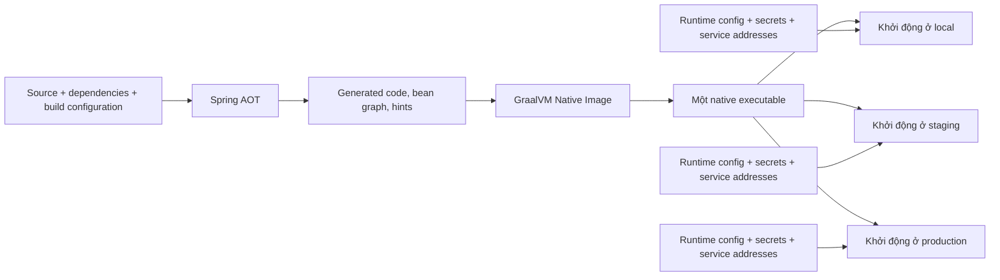

# Giá trị như cổng, địa chỉ dịch vụ và credentials có thể được cung cấp lúc chạy

Một lợi ích quan trọng của GraalVM Native Image là có thể tạo **một native executable** rồi triển khai executable đó ở nhiều môi trường như local, staging và production. Để làm được điều này, những giá trị phụ thuộc môi trường — chẳng hạn **cổng HTTP, địa chỉ database, endpoint dịch vụ và credentials** — cần được cung cấp khi tiến trình khởi động hoặc qua một nguồn cấu hình runtime được thiết kế rõ ràng.

Điều này khả thi vì Spring AOT không đóng băng toàn bộ cấu hình vận hành vào binary. AOT chuẩn bị cấu trúc bean và các khả năng cần thiết trong giai đoạn build; khi tiến trình native chạy, Spring Boot vẫn đọc externalized configuration, tạo ApplicationContext, inject giá trị vào bean và mở kết nối. Tuy nhiên, một property làm thay đổi bean graph có thể đã được quyết định trong AOT, và giá trị đã inject vào bean không tự cập nhật chỉ vì môi trường bên ngoài thay đổi.

Bài học thuộc chương **Cấu hình hai giai đoạn** của mô-đun `SPRING_BOOT_NATIVE_IMAGE`. Ta sẽ phân biệt build-time với runtime configuration, dùng environment variables và file cấu hình ngoài, cấp credentials bằng secret mount, triển khai container và xác minh cùng một binary hoạt động với nhiều bộ cấu hình.

## 1. Hai giai đoạn có trách nhiệm khác nhau

Trong quy trình native, có thể nhìn cấu hình theo hai nhóm:

- **Build/AOT time:** quyết định cấu trúc ứng dụng và tập khả năng cần đưa vào native image. Ví dụ: classpath/dependency, các bean được chọn bởi `@Profile` hoặc `@ConditionalOnProperty`, mã reflection/proxy/resource cần giữ và một số trạng thái class được cấu hình khởi tạo lúc build.
- **Runtime:** cung cấp giá trị vận hành cho cấu trúc ứng dụng đã có. Ví dụ: cổng HTTP, URL database, username/password, endpoint của payment service, timeout, log level và dữ liệu nghiệp vụ.



Ví dụ, một executable có thể lắng nghe cổng 8081 ở staging và 8080 ở production; kết nối tới database `orders-staging` ở staging và `orders-prod` ở production. Giá trị khác nhau được đọc khi khởi động, còn mã xử lý request và bean graph cần thiết đã nằm trong binary.

| Giá trị/quyết định | Thời điểm phù hợp | Có thể đổi mà không rebuild? |
| --- | --- | --- |
| Port HTTP (`server.port`) | Runtime startup | Có |
| JDBC URL và địa chỉ dịch vụ | Runtime startup | Có |
| Database username/password | Runtime startup qua config/secret | Có |
| Payment gateway URL | Runtime startup | Có |
| Timeout, log level, feature setting chỉ đổi hành vi của bean có sẵn | Runtime startup | Thường có |
| `@ConditionalOnProperty` quyết định bean có được đăng ký | Build/AOT | Cần build lại nếu bean bị loại khỏi AOT output |
| Profile làm thay đổi tập bean được AOT xử lý | Build/AOT và phải phù hợp runtime | Không nên giả định có thể đổi tùy ý sau build |
| Thêm thư viện hoặc class implementation mới | Build | Không |
| Thêm một file classpath đã nhúng vào image | Build | Không; cần rebuild hoặc chuyển sang file ngoài |

## 2. Spring Boot đọc cấu hình runtime như thế nào?

Spring Boot có cơ chế **Externalized Configuration**: một property có thể đến từ file cấu hình, environment variable, Java system property, command-line argument hoặc các nguồn cấu hình được hỗ trợ khác. Nhờ vậy, cùng một binary có thể nhận giá trị khác nhau theo môi trường triển khai.

Một số nguồn phổ biến:

| Nguồn | Ví dụ | Khi nào nên dùng |
| --- | --- | --- |
| File `application.yaml` trong artifact | Giá trị mặc định không nhạy cảm | Cấu hình chung có thể dùng cho mọi môi trường |
| File YAML bên ngoài | `/etc/orders/application.yaml` | Cấu hình được vận hành độc lập với binary |
| Environment variable | `SPRING_DATASOURCE_URL` | Container, orchestrator, CI/CD |
| Java system property | `-Dserver.port=8081` | Tham số JVM hoặc cấu hình process khi phù hợp |
| Command-line argument | `--server.port=8081` | Chạy thủ công, job hoặc override có chủ đích |
| Config tree / secret file | `/run/secrets/spring.datasource.password` | Credentials do nền tảng cấp dưới dạng file |

Trong các nguồn cấu hình chuẩn của Spring Boot, command-line properties thường có độ ưu tiên cao hơn environment variables và config data. Do đó, nếu file cấu hình đặt `server.port=8080`, environment đặt `SERVER_PORT=8081` và command line đặt `--server.port=8082`, giá trị command line được ưu tiên. Khi điều tra sai cấu hình, cần kiểm tra **tất cả nguồn và thứ tự ưu tiên**, không chỉ mở `application.yaml`.

### 2.1. Quy tắc tên environment variable

Spring Boot hỗ trợ ánh xạ relaxed binding. Với property thông thường, cách viết environment variable phổ biến là:

1. Đổi chữ thường thành chữ hoa.
2. Đổi dấu chấm thành dấu gạch dưới.
3. Giữ dấu gạch dưới phân tách từ; bỏ dấu gạch ngang trong tên property.

Ví dụ:

| Property | Environment variable |
| --- | --- |
| `server.port` | `SERVER_PORT` |
| `spring.datasource.url` | `SPRING_DATASOURCE_URL` |
| `spring.datasource.username` | `SPRING_DATASOURCE_USERNAME` |
| `spring.datasource.password` | `SPRING_DATASOURCE_PASSWORD` |
| `payment.gateway.base-url` | `PAYMENT_GATEWAY_BASEURL` |
| `management.endpoints.web.exposure.include` | `MANAGEMENT_ENDPOINTS_WEB_EXPOSURE_INCLUDE` |

Đối với property dạng danh sách/map hoặc tên có cấu trúc đặc biệt, quy tắc ánh xạ có thêm chi tiết. Khi binding không như mong đợi, xem tài liệu relaxed binding và kiểm tra property thực tế qua cấu hình ứng dụng; không suy đoán từ tên biến.

## 3. Khai báo property trong ứng dụng

Ví dụ ứng dụng dùng Spring Boot Web và JDBC, với file `src/main/resources/application.yaml` chứa các mặc định không nhạy cảm:

```yaml
server:
  port: ${SERVER_PORT:8080}

spring:
  datasource:
    url: ${SPRING_DATASOURCE_URL:jdbc:postgresql://localhost:5432/orders}
    username: ${SPRING_DATASOURCE_USERNAME:orders_app}
    # Password được cung cấp từ nguồn secret ở runtime.

payment:
  gateway:
    base-url: ${PAYMENT_GATEWAY_BASE_URL:http://localhost:8090}

app:
  integration:
    connect-timeout: ${APP_INTEGRATION_CONNECT_TIMEOUT:2s}
    read-timeout: ${APP_INTEGRATION_READ_TIMEOUT:5s}
```

Spring Boot có thể đọc giá trị từ environment variable để resolve placeholder. Với password, ta không đặt giá trị mặc định trong file cấu hình; ví dụ sẽ cấp property đó qua secret file ở phần sau.

Một bean có thể nhận cấu hình qua `@ConfigurationProperties`:

```java
package com.example.orders;

import java.net.URI;
import java.time.Duration;

import org.springframework.boot.context.properties.ConfigurationProperties;

@ConfigurationProperties(prefix = "payment.gateway")
public record PaymentGatewayProperties(
        URI baseUrl,
        Duration connectTimeout,
        Duration readTimeout) {
}
```

Đăng ký properties bằng `@ConfigurationPropertiesScan` trên application class hoặc `@EnableConfigurationProperties(PaymentGatewayProperties.class)` trong configuration:

```java
@SpringBootApplication
@ConfigurationPropertiesScan
public class OrdersApplication {
    public static void main(String[] args) {
        SpringApplication.run(OrdersApplication.class, args);
    }
}
```

Khi khởi động, Spring Boot bind giá trị từ Environment vào object properties. Cấu trúc bean `PaymentGatewayProperties` đã được xác định trong AOT; các giá trị `baseUrl` và timeout được đọc theo cấu hình runtime. Có thể dùng validation như `@Validated`, `@NotNull` hoặc custom validator để fail-fast khi thiếu giá trị bắt buộc.

### 3.1. Giá trị bắt buộc nên fail-fast

Với endpoint production hoặc credentials bắt buộc, tránh dùng một fallback có vẻ hợp lệ nhưng vô tình khiến ứng dụng kết nối nhầm dịch vụ. Ví dụ:

```yaml
spring:
  datasource:
    url: ${SPRING_DATASOURCE_URL}
    username: ${SPRING_DATASOURCE_USERNAME}
```

Nếu property không được cấp và không có nguồn cấu hình khác, ứng dụng sẽ báo lỗi khi resolve cấu hình/khởi tạo bean. Đó là hành vi tốt hơn việc âm thầm dùng database mặc định không đúng môi trường.

Đối với giá trị cần validation, có thể khai báo:

```java
@Validated
@ConfigurationProperties(prefix = "payment.gateway")
public record PaymentGatewayProperties(
        @NotNull URI baseUrl,
        @NotNull Duration connectTimeout,
        @NotNull Duration readTimeout) {
}
```

Ví dụ trên cần import `jakarta.validation.constraints.NotNull` và có validation implementation tương ứng trong dependency. Việc validation được thực hiện ở startup giúp phát hiện cấu hình sai trước khi nhận request.

## 4. Cung cấp cổng và địa chỉ dịch vụ khi chạy

### 4.1. Cổng HTTP

Có thể chạy cùng binary với các cổng khác nhau:

```bash
# Staging
SERVER_PORT=8081 ./target/orders-service

# Production
SERVER_PORT=8080 ./target/orders-service
```

Hoặc dùng command-line argument:

```bash
./target/orders-service --server.port=8081
```

Port mà ứng dụng lắng nghe bên trong container khác với host port được publish. Ví dụ `-p 18080:8080` ánh xạ host port 18080 tới container port 8080; ứng dụng vẫn cần lắng nghe port 8080 trong container (chẳng hạn `SERVER_PORT=8080`). Docker `EXPOSE 8080` chỉ khai báo metadata cổng, không tự cấu hình Spring Boot.

### 4.2. Địa chỉ database và dịch vụ tích hợp

Ví dụ địa chỉ database PostgreSQL:

```bash
SPRING_DATASOURCE_URL='jdbc:postgresql://orders-db:5432/orders' \
SPRING_DATASOURCE_USERNAME='orders_app' \
./target/orders-service
```

Địa chỉ `orders-db` phải phân giải được từ network namespace nơi native process chạy. Trong Docker Compose hoặc Kubernetes, thường dùng service DNS name nội bộ; không mặc định dùng `localhost` để trỏ sang container database khác. Trong một container, `localhost` luôn chỉ chính container đó.

Endpoint payment gateway cũng có thể cung cấp độc lập:

```bash
PAYMENT_GATEWAY_BASE_URL='https://payments.staging.internal' \
./target/orders-service
```

Một binary dùng được ở nhiều môi trường nếu DNS, routing, firewall, TLS trust và quyền truy cập dịch vụ đã được cấu hình phù hợp ở từng nơi.

## 5. Cung cấp credentials và secrets an toàn

Credentials là giá trị runtime, nhưng cách phân phối rất quan trọng. Không nên đưa password, token hoặc private key vào:

- Source code hoặc file `application.yaml` được commit.
- Maven/Gradle build arguments, Docker build arguments hoặc environment của bước tạo native image.
- Native executable, image layer, generated source hoặc metadata được lưu trong artifact.
- Log, exception message, command history hoặc báo cáo build.

Một cách phù hợp với Spring Boot là **config tree**: nền tảng mount mỗi secret thành một file; Spring Boot đọc tên file như property key và nội dung file như property value.

Ví dụ cấu trúc secret mount:

```text
/run/secrets/
├── spring.datasource.username
└── spring.datasource.password
```

Mỗi file chỉ chứa giá trị tương ứng. Thêm config tree vào cấu hình runtime bằng environment variable:

```bash
SPRING_CONFIG_IMPORT=optional:configtree:/run/secrets/ \
./target/orders-service
```

Nếu secret mount bắt buộc, có thể bỏ tiền tố `optional:` để ứng dụng fail-fast khi thư mục không tồn tại. Đường dẫn phải là nơi platform thực sự mount secret và process có quyền đọc. Khi được import, Spring Boot bind hai key `spring.datasource.username` và `spring.datasource.password` vào datasource configuration.

**Không log nội dung secret.** Chỉ ghi nhận secret source đã được mount/đọc thành công, hoặc trạng thái kết nối database. Không in toàn bộ Environment, object properties hoặc exception có thể chứa URL/credentials.

### 5.1. Vì sao config tree hữu ích trong container?

- Secret không cần nằm trong source tree hay native image.
- Có thể cấp giá trị khác nhau cho từng deployment.
- File permission có thể giới hạn quyền đọc.
- Có thể thay secret theo cơ chế của nền tảng mà không rebuild executable.

Lưu ý: ứng dụng thường đọc và bind credentials khi khởi động. Việc nền tảng cập nhật nội dung file secret không bảo đảm connection pool hay bean đã inject tự thay đổi credentials ngay lập tức. Muốn xoay vòng secret khi process đang chạy, phải có cơ chế reload/recreate connection rõ ràng hoặc restart workload theo quy trình vận hành.

## 6. Đưa file cấu hình ngoài vào runtime

Có thể mount một file `application.yaml` bên ngoài executable:

```text
/etc/orders/
└── application.yaml
```

Chạy ứng dụng với vị trí cấu hình bổ sung:

```bash
SPRING_CONFIG_ADDITIONALLOCATION=file:/etc/orders/ \
./target/orders-service
```

Spring Boot sẽ tìm config data ở vị trí đó bên cạnh các location mặc định. Dấu gạch chéo cuối giúp chỉ rõ đây là thư mục. Nếu dùng `SPRING_CONFIG_LOCATION`, cần lưu ý property này **thay thế** các vị trí mặc định; dùng sai có thể khiến ứng dụng không còn đọc `application.yaml` nằm trong classpath. `SPRING_CONFIG_ADDITIONALLOCATION` thường phù hợp khi muốn thêm cấu hình ngoài mà vẫn giữ mặc định.

Một file ngoài có thể chứa:

```yaml
server:
  port: 8082

spring:
  datasource:
    url: jdbc:postgresql://orders-db-prod:5432/orders

payment:
  gateway:
    base-url: https://payments.prod.internal
```

File cấu hình ngoài không được nhúng vào native image nếu nó chỉ được mount tại runtime. Cần đảm bảo đường dẫn đúng, quyền đọc và config import/location được cung cấp trước khi Spring Boot tạo Environment.

## 7. Phân biệt config file nhúng và config file ngoài

Hai file cùng tên `application.yaml` có thể đến từ hai nguồn khác nhau:

| Nguồn | Vị trí | Đặc điểm |
| --- | --- | --- |
| Classpath resource | `src/main/resources/application.yaml` | Được đóng gói trong artifact; nội dung thay đổi thường cần build lại. |
| External config | Ví dụ `/etc/orders/application.yaml` | Có thể mount/thay đổi độc lập với binary; được đọc khi khởi động nếu location được cấu hình. |
| Config tree | Ví dụ `/run/secrets/` | File name đại diện property key; file content là giá trị. |
| Environment variable | Môi trường process/container | Có thể thay đổi giữa các lần chạy; cần khởi động lại để bean đã bind nhận giá trị mới. |

Một config file nằm trên classpath có thể chứa placeholder để nhận giá trị từ Environment, ví dụ `${SPRING_DATASOURCE_URL}`. Trong trường hợp này, **template mặc định** được đóng gói, còn giá trị thực được resolve lúc runtime. Không phải mọi thứ trong file đều là build-time constant.

## 8. Đóng gói container mà không nhúng cấu hình môi trường

Một Dockerfile tối giản cho native executable (ví dụ binary Linux tương thích với base image):

```dockerfile
FROM debian:bookworm-slim

WORKDIR /app
COPY target/orders-service /app/orders-service

# Tạo user không có quyền root để chạy ứng dụng.
RUN useradd --system --uid 10001 appuser \
    && chown appuser:appuser /app/orders-service

USER 10001
EXPOSE 8080
ENTRYPOINT ["/app/orders-service"]
```

Base image phải phù hợp với binary được build: kiến trúc CPU, libc và các thư viện native cần thiết. Nếu binary được build với target môi trường khác, container tối giản có thể thiếu runtime library. Dùng builder/base image tương thích hoặc chọn quy trình static/musl phù hợp với mục tiêu phát hành; kiểm tra bằng container thực tế.

Chạy container với cấu hình runtime:

```bash
docker run --rm \
  -p 8080:8080 \
  -e SERVER_PORT=8080 \
  -e SPRING_DATASOURCE_URL='jdbc:postgresql://orders-db:5432/orders' \
  -e SPRING_CONFIG_IMPORT='optional:configtree:/run/secrets/' \
  -v ./secrets:/run/secrets:ro \
  orders-service:native
```

Trong production, secret mount nên được cung cấp bởi Docker/Kubernetes secret manager hoặc nền tảng quản lý secret phù hợp. Không nên đặt password trực tiếp vào lệnh `docker run -e` trong terminal hoặc script được lưu lại; ví dụ trên chỉ mount secret files.

### 8.1. Kubernetes: ConfigMap và Secret

ConfigMap phù hợp với cấu hình không nhạy cảm như service address và port. Secret phù hợp với username/password/token, đi kèm RBAC và cơ chế mã hóa/lưu trữ của cluster.

Manifest minh họa:

```yaml
apiVersion: apps/v1
kind: Deployment
metadata:
  name: orders-native
spec:
  replicas: 2
  selector:
    matchLabels:
      app: orders-native
  template:
    metadata:
      labels:
        app: orders-native
    spec:
      containers:
        - name: orders
          image: registry.example.com/orders-service:native
          ports:
            - name: http
              containerPort: 8080
          env:
            - name: SERVER_PORT
              value: "8080"
            - name: SPRING_DATASOURCE_URL
              valueFrom:
                configMapKeyRef:
                  name: orders-config
                  key: datasource-url
            - name: SPRING_CONFIG_IMPORT
              value: "optional:configtree:/run/secrets/"
          volumeMounts:
            - name: database-secret
              mountPath: /run/secrets
              readOnly: true
      volumes:
        - name: database-secret
          secret:
            secretName: orders-database
```

Secret có thể tạo thành các key tương ứng với property name:

```yaml
apiVersion: v1
kind: Secret
metadata:
  name: orders-database
type: Opaque
stringData:
  spring.datasource.username: orders_app
  spring.datasource.password: replace-with-secret-manager-value
```

Đây là ví dụ cấu trúc manifest, không phải secret dùng thật. Không commit password thật vào Git. Trong cluster thực tế, cấu hình encryption at rest, RBAC, external secret provider, rotation và quyền truy cập volume theo chính sách của tổ chức.

Nếu secret được cập nhật, ứng dụng không nhất thiết tự reload datasource. Cần xác định cơ chế restart/rollout hoặc reload an toàn để connection pool sử dụng credential mới.

## 9. TLS, truststore và các file phụ thuộc môi trường

Một số endpoint chỉ truy cập được khi có CA certificate hoặc client certificate. Những file này có thể được mount ngoài binary và cấu hình đường dẫn lúc runtime, nhưng phải kiểm thử trên native image thật:

- Đường dẫn file có tồn tại trong container không?
- Process user có quyền đọc không?
- Thư viện HTTP/driver đang sử dụng có đọc truststore/certificate theo cấu hình runtime không?
- Native Image/toolchain có yêu cầu cấu hình bổ sung cho TLS hoặc security provider không?
- Khi thay certificate, connection pool/client có cần được tạo lại không?

Ví dụ cung cấp truststore path và password qua runtime:

```bash
./target/orders-service \
  -Djavax.net.ssl.trustStore=/run/certs/service-truststore.p12
```

Tùy GraalVM version, JSSE provider, thư viện client và cách native image được build, không nên mặc định mọi cơ chế truststore trên JVM đều có hành vi giống hệt trong native. Không nhúng private key hoặc truststore có secret vào image; mount file với quyền hạn chế và kiểm tra TLS handshake bằng binary/container thực tế.

## 10. Giá trị runtime được đọc lúc nào? Có tự thay đổi nóng không?

Cần phân biệt **cung cấp khi khởi động** với **thay đổi khi process đang chạy**.

Ví dụ:

```java
@Service
class PaymentClient {
    private final URI baseUrl;

    PaymentClient(
            @Value("${payment.gateway.base-url}") URI baseUrl) {
        this.baseUrl = baseUrl;
    }
}
```

Spring inject `baseUrl` khi tạo bean. Nếu đổi environment variable trong terminal hoặc thay file cấu hình sau khi process đã chạy, field `baseUrl` của instance hiện tại không tự cập nhật. Tương tự, datasource connection pool có thể đang giữ connection tạo từ credentials cũ.

| Thay đổi | Kết quả mặc định thường gặp | Cách áp dụng |
| --- | --- | --- |
| Đổi `SERVER_PORT` trước khi khởi động | Server lắng nghe port mới | Restart process/container với giá trị mới |
| Đổi DB URL/username/password trước khi khởi động | Datasource dùng giá trị mới | Restart/recreate datasource |
| Đổi file external config trước lần khởi động tiếp theo | Spring đọc nội dung mới | Restart process |
| Thay secret file khi process đang chạy | Không bảo đảm bean/connection pool tự đổi | Thiết kế reload/rotation hoặc rollout restart |
| Đổi property được bind vào immutable configuration object | Instance cũ giữ giá trị đã bind | Rebind/refresh theo cơ chế được thiết kế |
| Đổi feature flag từ dịch vụ cấu hình động mà bean đọc mỗi lần sử dụng | Có thể áp dụng ngay | Quản lý cache, consistency và failure mode |

Không nên dùng thuật ngữ "runtime configuration" để hàm ý mọi thay đổi đều hot reload. Nhiều property runtime được đọc **một lần lúc khởi động**; chúng chỉ khác nhau giữa các lần chạy cùng binary.

## 11. Những giá trị không nên bị chụp ở build time

Native Image có thể khởi tạo một số class ngay lúc build nếu cấu hình cho phép. Nếu static initializer đọc environment, thời gian, hostname, file secret hoặc tạo kết nối, trạng thái đó có thể phản ánh môi trường build thay vì môi trường production.

Ví dụ thiết kế không nên dùng:

```java
final class PaymentSettings {
    static final String ENDPOINT =
            System.getenv("PAYMENT_GATEWAY_BASE_URL");
}
```

Nếu class này bị khởi tạo lúc build, giá trị có nguy cơ được chụp từ môi trường build. Ngay cả khi class được khởi tạo lúc runtime, static field cũng chỉ được đọc một lần khi class khởi tạo; thay đổi environment sau đó không cập nhật field.

Nên dùng Spring configuration được bind lúc startup:

```java
@ConfigurationProperties(prefix = "payment.gateway")
public record PaymentGatewayProperties(URI baseUrl) {
}
```

Không nhúng credentials vào:

- Static fields hoặc static initializer có thể chạy lúc build.
- Build arguments, Maven properties hoặc environment của pipeline native build.
- Generated AOT source/resources hoặc image heap.
- Dockerfile `ENV`, layer, shell history hoặc artifact được phát hành.

Giá trị cần giữ bí mật phải được cấp bởi secret manager ở runtime. Nếu cần tạo native image reproducible, môi trường build không nên cần biết password production hoặc endpoint private của production.

## 12. Cách xác minh cùng một binary dùng được ở hai môi trường

Một bài thực hành giúp chứng minh ranh giới hai giai đoạn:

1. Build native executable **một lần** từ cùng commit và dependency.
2. Chuẩn bị hai bộ runtime configuration: local và staging (dùng database/service giả lập hoặc môi trường test).
3. Chạy cùng binary với hai bộ cấu hình, mỗi lần dùng port và service address phù hợp.
4. Xác minh endpoint, dữ liệu và tác dụng phụ với cùng request suite.
5. Xác minh credentials không xuất hiện trong source, native artifact, log hoặc image layer.
6. Restart với giá trị khác và xác nhận bean nhận cấu hình mới.
7. Nếu đổi một property làm bean xuất hiện/biến mất, kiểm tra condition đã được đánh giá ở AOT và build lại biến thể phù hợp.

Bảng quan sát mẫu:

| Kiểm tra | Local | Staging | Điều cần giống/khác |
| --- | --- | --- | --- |
| Binary checksum | Ghi SHA-256 | Ghi SHA-256 | Giống nhau nếu cùng artifact |
| Port nội bộ | 8080 | 8081 | Khác theo runtime config |
| Database URL | Local/test DB | Staging DB | Khác theo môi trường |
| Database credential | Secret local | Secret staging | Khác; không in giá trị ra log |
| Payment endpoint | Stub/local | Staging gateway | Khác theo môi trường |
| Bean graph cần thiết | Cùng cấu trúc | Cùng cấu trúc | Phải đáp ứng cùng tính năng |
| Request suite | Chạy cùng case | Chạy cùng case | Kết quả nghiệp vụ tương đương |

Có thể dùng `sha256sum` trên Linux hoặc `Get-FileHash` trên PowerShell để so checksum. Cùng checksum chứng minh cùng bytes của executable; nó **không chứng minh** hai môi trường có cùng dependency, network, secret, dữ liệu hoặc behavior. Phải chạy kiểm thử chức năng ở từng môi trường.

## 13. Các lỗi thường gặp

| Hiện tượng | Nguyên nhân cần kiểm tra | Cách xử lý |
| --- | --- | --- |
| Binary chạy local nhưng production kết nối sai DB | URL mặc định trong classpath config ghi đè kỳ vọng hoặc environment chưa được truyền | Kiểm tra property source/precedence và cấu hình deploy |
| Ứng dụng báo unresolved placeholder | Thiếu environment/config tree property bắt buộc | Cấp đúng key trước khi khởi động, fail-fast có chủ đích |
| Container không kết nối được database bằng hostname | Dùng `localhost` thay vì DNS/service name trên network container | Dùng địa chỉ service có thể phân giải từ container |
| Server không nghe cổng publish | Nhầm host port với container port hoặc `SERVER_PORT` | Đồng bộ internal port, `containerPort` và mapping `-p` |
| Password cũ vẫn được dùng sau khi thay secret | Bean/datasource đã bind giá trị lúc startup | Restart/rollout hoặc triển khai cơ chế rotation |
| Secret xuất hiện trong image hoặc log | Secret được đưa vào build args, Dockerfile hoặc log Environment | Loại secret khỏi build; dùng secret mount và redact log |
| Runtime config không thay đổi bean | Property là condition đã quyết định lúc AOT | Giữ bean trong graph và chọn hành vi runtime, hoặc build biến thể mới |
| TLS hoạt động trên JVM nhưng lỗi trên native | Truststore/provider/certificate hoặc native metadata khác | Kiểm tra certificate path, security provider và handshake bằng native executable |
| Sửa file config nhưng ứng dụng không nhận giá trị mới | File được đọc lúc startup, location sai hoặc nguồn khác có precedence cao hơn | Kiểm tra `SPRING_CONFIG_ADDITIONALLOCATION`, precedence và restart |

## 14. Checklist trước khi triển khai

- [ ] Một native executable được build từ commit/dependency đã xác định.
- [ ] Bean graph và các điều kiện AOT phù hợp với các môi trường sẽ sử dụng binary.
- [ ] Port, database URL và service endpoint được cung cấp ở runtime.
- [ ] Username/password/token/private key không nằm trong source, build log, AOT output, native binary hoặc container layer.
- [ ] Config tree hoặc secret mount có đường dẫn và quyền đọc đúng.
- [ ] File cấu hình ngoài được thêm bằng location phù hợp; không vô tình thay thế config mặc định.
- [ ] Container dùng DNS/service address đúng; không dùng `localhost` để trỏ sang container khác.
- [ ] Host port, container port và `SERVER_PORT` được phân biệt rõ.
- [ ] TLS truststore/certificate được kiểm thử với native executable thực tế.
- [ ] Có quy trình restart hoặc reload khi credentials/configuration thay đổi.
- [ ] Log và diagnostics không làm lộ secret.
- [ ] Cùng request suite đã được chạy ở các môi trường với kết quả nghiệp vụ mong đợi.

### Câu hỏi tự đánh giá

1. Vì sao cùng một native executable có thể chạy với hai database URL khác nhau?
2. Sự khác nhau giữa `SPRING_CONFIG_LOCATION` và `SPRING_CONFIG_ADDITIONALLOCATION` là gì?
3. Tại sao database password nên được mount qua secret/config tree thay vì ghi vào `application.yaml` trong source?
4. Khi đổi environment variable sau khi bean đã được tạo, vì sao field `@Value` thường không đổi?
5. Vì sao một property dùng trong `@ConditionalOnProperty` có thể cần quyết định ở AOT thay vì chỉ truyền lúc chạy?
6. Trong container, `-p 18080:8080` khác gì với `SERVER_PORT=8080`?
7. Cùng checksum binary đã đủ chứng minh triển khai local và staging tương đương chưa? Cần kiểm tra gì nữa?

**Kết quả cần đạt:** có thể phát hành một native executable dùng chung cho nhiều môi trường, cung cấp cổng, địa chỉ dịch vụ và credentials qua runtime configuration, kiểm soát secret và phân biệt rõ giá trị được đọc lúc startup với quyết định cấu trúc đã cố định trong Spring AOT. Điều này giúp native application dễ triển khai, an toàn hơn và có thể vận hành nhất quán từ local đến production.
