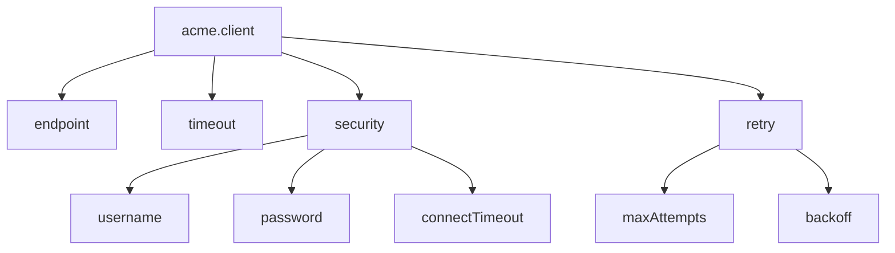

# Thuộc tính lồng nhau và @NestedConfigurationProperty

> **Chương: Cấu hình hai giai đoạn.** Module **SPRING_BOOT_NATIVE_IMAGE** biên dịch ứng dụng Spring Boot thành GraalVM Native Image bằng Spring AOT. Khi cấu hình ứng dụng, @ConfigurationProperties thường gom nhiều thuộc tính thành các nhóm có cấu trúc. Bài này giải thích cách tổ chức thuộc tính lồng nhau, vai trò của @NestedConfigurationProperty trong metadata và những điểm cần kiểm tra khi build AOT/native.

## 1. Mục tiêu học tập

Sau bài học, bạn có thể:

1. Mô hình hóa cấu hình Spring Boot thành các object lồng nhau thay vì một lớp có quá nhiều field phẳng.
2. Phân biệt **metadata configuration được sinh ở build time** với **giá trị cấu hình được bind khi ứng dụng chạy**.
3. Giải thích chính xác vai trò của @NestedConfigurationProperty: hỗ trợ annotation processor tạo metadata cho thuộc tính lồng nhau.
4. Cấu hình nested object bằng JavaBean, constructor binding hoặc record và đọc dữ liệu từ YAML/properties.
5. Kiểm tra metadata trong IDE và xác minh việc binding trong JVM cũng như GraalVM Native Image.

## 2. Thuộc tính lồng nhau là gì?

Một ứng dụng thường có nhiều nhóm cấu hình liên quan. Ví dụ một HTTP client có endpoint, timeout, retry và thông tin bảo mật. Nếu đặt tất cả thành thuộc tính cùng cấp, tên field dễ dài, khó nhóm và khó mở rộng.

Ta có thể mô hình hóa cấu hình như một cây:



Các đường dẫn tương ứng:

| Thuộc tính | Ý nghĩa |
|---|---|
| acme.client.endpoint | URL của dịch vụ bên ngoài |
| acme.client.timeout | Thời gian chờ tổng thể |
| acme.client.security.username | Tài khoản xác thực |
| acme.client.security.password | Mật khẩu hoặc secret |
| acme.client.security.connect-timeout | Timeout lúc thiết lập kết nối |
| acme.client.retry.max-attempts | Số lần thử tối đa |
| acme.client.retry.backoff | Khoảng nghỉ giữa các lần thử |

Trong Java, security và retry là những object con. Khi Spring Boot binding đọc cấu hình, binder đi theo đường dẫn thuộc tính để gán giá trị cho object tương ứng. Đây là cách tổ chức cấu trúc object; nó không đòi hỏi phải tạo một bean Spring riêng cho từng nhóm con.

## 3. Phân biệt hai giai đoạn: metadata và binding

Khi làm việc với @ConfigurationProperties, có hai hoạt động khác nhau thường bị nhầm:

**Giai đoạn 1 — Sinh configuration metadata khi build.** Annotation processor của Spring Boot phân tích các lớp cấu hình, kiểu dữ liệu, getter/setter, constructor và các annotation liên quan. Processor tạo file metadata để IDE có thể gợi ý tên thuộc tính, kiểu dữ liệu, giá trị mặc định và mô tả. @NestedConfigurationProperty là một chỉ dẫn cho giai đoạn này.

**Giai đoạn 2 — Bind giá trị cấu hình khi ứng dụng chạy.** Spring Boot đọc Environment từ các nguồn như application.yml, application.properties, biến môi trường, system properties hoặc command-line arguments. ConfigurationPropertiesBinding/Binder chuyển đổi các giá trị và gán chúng vào object cấu hình. Quá trình binding không cần file metadata được sinh ở giai đoạn 1.

| Đặc điểm | Metadata generation | Runtime binding |
|---|---|---|
| Thời điểm | Khi biên dịch/build | Khi Spring tạo và cấu hình ứng dụng |
| Thành phần | spring-boot-configuration-processor | Spring Boot Binder và @ConfigurationProperties |
| Đầu vào | Cấu trúc Java, annotation, kiểu thuộc tính | Environment và object cấu hình |
| Đầu ra | META-INF/spring-configuration-metadata.json | Object chứa giá trị cấu hình |
| Mục đích | Gợi ý IDE, tài liệu và tooling | Cung cấp giá trị cho ứng dụng |
| @NestedConfigurationProperty | Có vai trò hướng dẫn processor | Không phải annotation điều khiển binding |

**Điểm cần nhớ:** @NestedConfigurationProperty không làm Binder bắt đầu bind object con. Binder có thể bind thuộc tính lồng nhau dựa trên cấu trúc kiểu và quy tắc binding ngay cả khi không có annotation này. Annotation chủ yếu giúp processor hiểu rằng một field hoặc property kiểu khác cần được thể hiện như nhóm thuộc tính lồng nhau trong metadata.

## 4. Ví dụ JavaBean với nested properties

Giả sử ứng dụng có cấu hình HTTP client:

```java
package com.example.demo.config;

import java.time.Duration;
import org.springframework.boot.context.properties.ConfigurationProperties;
import org.springframework.boot.context.properties.NestedConfigurationProperty;
import org.springframework.validation.annotation.Validated;

@Validated
@ConfigurationProperties(prefix = "acme.client")
public class ClientProperties {

    private String endpoint = "https://api.example.com";
    private Duration timeout = Duration.ofSeconds(3);

    @NestedConfigurationProperty
    private Security security = new Security();

    @NestedConfigurationProperty
    private Retry retry = new Retry();

    public String getEndpoint() {
        return endpoint;
    }

    public void setEndpoint(String endpoint) {
        this.endpoint = endpoint;
    }

    public Duration getTimeout() {
        return timeout;
    }

    public void setTimeout(Duration timeout) {
        this.timeout = timeout;
    }

    public Security getSecurity() {
        return security;
    }

    public void setSecurity(Security security) {
        this.security = security;
    }

    public Retry getRetry() {
        return retry;
    }

    public void setRetry(Retry retry) {
        this.retry = retry;
    }
}
```

Các lớp con có thể là kiểu top-level riêng:

```java
package com.example.demo.config;

import java.time.Duration;

public class Security {
    private String username;
    private String password;
    private Duration connectTimeout = Duration.ofSeconds(2);

    public String getUsername() {
        return username;
    }

    public void setUsername(String username) {
        this.username = username;
    }

    public String getPassword() {
        return password;
    }

    public void setPassword(String password) {
        this.password = password;
    }

    public Duration getConnectTimeout() {
        return connectTimeout;
    }

    public void setConnectTimeout(Duration connectTimeout) {
        this.connectTimeout = connectTimeout;
    }
}
```

```java
package com.example.demo.config;

import java.time.Duration;

public class Retry {
    private int maxAttempts = 3;
    private Duration backoff = Duration.ofMillis(200);

    public int getMaxAttempts() {
        return maxAttempts;
    }

    public void setMaxAttempts(int maxAttempts) {
        this.maxAttempts = maxAttempts;
    }

    public Duration getBackoff() {
        return backoff;
    }

    public void setBackoff(Duration backoff) {
        this.backoff = backoff;
    }
}
```

Với các lớp con là kiểu top-level độc lập, @NestedConfigurationProperty đặt trên field security và retry giúp configuration metadata processor nhận diện cấu trúc lồng nhau. Nếu kiểu con là **inner class** theo cấu trúc mà processor nhận diện được, processor có thể tự suy ra quan hệ nested; trong trường hợp kiểu con tách thành lớp riêng, annotation giúp khai báo ý định rõ ràng.

### 4.1. Cấu hình bằng YAML

```yaml
acme:
  client:
    endpoint: https://orders.example.com
    timeout: 5s
    security:
      username: orders-service
      password: ORDERS_API_PASSWORD
      connect-timeout: 1500ms
    retry:
      max-attempts: 4
      backoff: 300ms
```

Hoặc dùng application.properties:

```properties
acme.client.endpoint=https://orders.example.com
acme.client.timeout=5s
acme.client.security.username=orders-service
acme.client.security.password=ORDERS_API_PASSWORD
acme.client.security.connect-timeout=1500ms
acme.client.retry.max-attempts=4
acme.client.retry.backoff=300ms
```

Trong môi trường thật, password nên được cấp qua secret manager hoặc biến môi trường, không commit giá trị nhạy cảm vào file YAML. Giá trị ORDERS_API_PASSWORD trong ví dụ là placeholder minh họa; cấu hình thực tế có thể tham chiếu biến môi trường theo cú pháp property placeholder của Spring.

Spring Boot hỗ trợ relaxed binding: tên thuộc tính trong file cấu hình có thể dùng kebab-case, trong khi field Java thường dùng camelCase. Ví dụ connect-timeout được bind vào connectTimeout. Các kiểu Duration có thể dùng hậu tố như ms, s, m; cần chọn đơn vị rõ ràng để tránh nhầm lẫn.

### 4.2. Đăng ký configuration properties

Có thể dùng @ConfigurationPropertiesScan tại lớp ứng dụng:

```java
package com.example.demo;

import com.example.demo.config.ClientProperties;
import org.springframework.boot.SpringApplication;
import org.springframework.boot.autoconfigure.SpringBootApplication;
import org.springframework.boot.context.properties.ConfigurationPropertiesScan;

@SpringBootApplication
@ConfigurationPropertiesScan(basePackageClasses = ClientProperties.class)
public class DemoApplication {
    public static void main(String[] args) {
        SpringApplication.run(DemoApplication.class, args);
    }
}
```

Hoặc đăng ký tường minh bằng @EnableConfigurationProperties(ClientProperties.class) trong một cấu hình Spring. Chọn một cơ chế rõ ràng để class cấu hình được đăng ký; chỉ đặt @ConfigurationProperties lên class không tự động bảo đảm nó đã trở thành bean trong mọi cấu hình ứng dụng.

## 5. Vai trò chính xác của @NestedConfigurationProperty

Annotation có package:

```java
org.springframework.boot.context.properties.NestedConfigurationProperty
```

Nó là marker để **configuration metadata processor** xem thuộc tính đó như một nhóm nested property khi sinh metadata. Ví dụ thay vì chỉ mô tả acme.client.security như một object đơn, metadata có thể biểu diễn nhóm và các thuộc tính con như acme.client.security.username, acme.client.security.connect-timeout.

Annotation này **không**:

- Tự đăng ký ClientProperties thành bean Spring.
- Tạo thêm @ConfigurationProperties cho class con.
- Thay đổi nguồn cấu hình hoặc thứ tự ưu tiên của Environment.
- Tự validate field con nếu không có validation phù hợp.
- Tạo reflection hints cho GraalVM Native Image.
- Là điều kiện bắt buộc để Binder bind object con.

### 5.1. Khi nào cần dùng?

| Cấu trúc | Cách xử lý metadata |
|---|---|
| Thuộc tính scalar như String, int, Duration | Processor nhận diện kiểu property thông thường |
| Kiểu nested là inner class được processor nhận diện | Thường không cần annotation |
| Kiểu nested là class top-level riêng, dùng làm field của configuration properties | Dùng @NestedConfigurationProperty để khai báo nested group |
| Kiểu dữ liệu bên thứ ba hoặc kiểu phức tạp không được processor suy ra đúng | Kiểm tra metadata; cân nhắc annotation hoặc metadata bổ sung |
| Thuộc tính là Map, List hoặc generic collection | Metadata phụ thuộc generic element/value type; không đánh dấu máy móc mọi collection bằng annotation |

Không nên thêm annotation cho mọi field chỉ vì tên field chứa object. Hãy kiểm tra file metadata được sinh và cách IDE hiển thị trước khi thay đổi.

### 5.2. Nested class và top-level class

Một cách tổ chức khác là khai báo class con ngay bên trong class cấu hình:

```java
@ConfigurationProperties("acme.client")
public class ClientProperties {

    private Security security = new Security();

    public Security getSecurity() {
        return security;
    }

    public void setSecurity(Security security) {
        this.security = security;
    }

    public static class Security {
        private String username;

        public String getUsername() {
            return username;
        }

        public void setUsername(String username) {
            this.username = username;
        }
    }
}
```

Với inner class phù hợp, processor có thể nhận diện quan hệ nested tự động. Khi tách Security ra thành class top-level để tái sử dụng, @NestedConfigurationProperty giúp metadata processor giữ đúng cấu trúc nhóm. Cả hai cách vẫn là object graph để Binder xử lý; lựa chọn dựa trên khả năng tái sử dụng, độ rõ ràng và thiết kế domain.

## 6. Metadata được sinh ra ở đâu và dùng để làm gì?

Để IDE có thể gợi ý cấu hình, thêm spring-boot-configuration-processor vào annotation processor path.

Với Gradle:

```groovy
dependencies {
    annotationProcessor "org.springframework.boot:spring-boot-configuration-processor"
}
```

Với Maven:

```xml
<dependency>
    <groupId>org.springframework.boot</groupId>
    <artifactId>spring-boot-configuration-processor</artifactId>
    <optional>true</optional>
</dependency>
```

Sau khi compile, kiểm tra file:

- Gradle: build/classes/java/main/META-INF/spring-configuration-metadata.json.
- Maven: target/classes/META-INF/spring-configuration-metadata.json.

Đường dẫn có thể thay đổi nếu dự án tùy biến source set, output directory hoặc module build. Với Gradle, có thể kiểm tra task compile và thư mục output thay vì giả định file luôn có trong cùng một đường dẫn.

Metadata có hai nhóm quan trọng:

- groups: nhóm cấu hình, ví dụ acme.client, acme.client.security, acme.client.retry.
- properties: từng property, ví dụ acme.client.timeout, acme.client.security.username, acme.client.retry.max-attempts.

Ví dụ giản lược về cấu trúc metadata (các tên type/source được rút gọn):

```json
{
  "groups": [
    {
      "name": "acme.client",
      "type": "com.example.demo.config.ClientProperties"
    },
    {
      "name": "acme.client.security",
      "type": "com.example.demo.config.Security"
    },
    {
      "name": "acme.client.retry",
      "type": "com.example.demo.config.Retry"
    }
  ],
  "properties": [
    {
      "name": "acme.client.endpoint",
      "type": "java.lang.String"
    },
    {
      "name": "acme.client.security.username",
      "type": "java.lang.String"
    },
    {
      "name": "acme.client.retry.max-attempts",
      "type": "java.lang.Integer"
    }
  ]
}
```

Đây là ví dụ minh họa, không phải nội dung nguyên văn của processor. Metadata thực tế còn có thể chứa sourceType, description, defaultValue, deprecation và các trường khác.

Nếu IDE không gợi ý nested properties:

1. Xác nhận dependency spring-boot-configuration-processor đã nằm trong annotation processor path.
2. Chạy compile/build để processor thực sự được thực thi.
3. Mở spring-configuration-metadata.json và kiểm tra nhóm/property con có được sinh hay không.
4. Kiểm tra field/getter và kiểu dữ liệu, đặc biệt class top-level riêng.
5. Nếu cấu trúc vẫn không được suy ra, thêm @NestedConfigurationProperty đúng field rồi build lại.
6. Kiểm tra metadata bổ sung nếu property đến từ dependency bên ngoài hoặc không thể sửa source.

Metadata phục vụ tooling; ứng dụng vẫn có thể bind được dù IDE chưa gợi ý. Ngược lại, IDE gợi ý một property cũng không chứng minh runtime binding đã thành công: tên key, kiểu chuyển đổi, validation và nguồn giá trị vẫn phải được kiểm tra.

## 7. Constructor binding và record có thuộc tính lồng nhau

Với cấu hình bất biến, có thể dùng constructor binding hoặc Java record. Ví dụ:

```java
package com.example.demo.config;

import java.time.Duration;
import org.springframework.boot.context.properties.ConfigurationProperties;

@ConfigurationProperties("acme.client")
public record ClientProperties(
        String endpoint,
        Duration timeout,
        Security security,
        Retry retry) {

    public record Security(
            String username,
            String password,
            Duration connectTimeout) {
    }

    public record Retry(
            int maxAttempts,
            Duration backoff) {
    }
}
```

Spring Boot có thể bind cấu trúc nested qua constructor/record components. Với constructor binding, cần tuân thủ quy tắc của phiên bản Spring Boot, chẳng hạn class có một constructor phù hợp hoặc record canonical constructor. Không thêm setter chỉ để làm cho ví dụ immutable hoạt động.

@NestedConfigurationProperty không phải một cách thay thế constructor binding và cũng không quyết định Binder dùng JavaBean hay constructor. Nếu cần metadata nested cho kiểu độc lập, kiểm tra processor của phiên bản đang dùng và đặt annotation tại vị trí được API hỗ trợ.

## 8. Validation cho thuộc tính con

@NestedConfigurationProperty không kích hoạt validation. Muốn kiểm tra giá trị bên trong object con, dùng Bean Validation cùng @Valid ở thuộc tính cha và constraint tại field con.

Ví dụ:

```java
import jakarta.validation.Valid;
import jakarta.validation.constraints.NotBlank;
import org.springframework.validation.annotation.Validated;

@Validated
@ConfigurationProperties("acme.client")
public class ClientProperties {

    @Valid
    private Security security = new Security();

    public Security getSecurity() {
        return security;
    }

    public void setSecurity(Security security) {
        this.security = security;
    }

    public static class Security {
        @NotBlank
        private String username;

        public String getUsername() {
            return username;
        }

        public void setUsername(String username) {
            this.username = username;
        }
    }
}
```

Trong ví dụ này:

- @Validated bật validation cho configuration properties bean.
- @Valid yêu cầu validation đi tiếp vào object security.
- @NotBlank kiểm tra username có giá trị không rỗng sau khi bind.

Nếu bỏ @Valid, constraint bên trong object con có thể không được cascade như mong muốn. Cần thêm dependency Bean Validation phù hợp, chẳng hạn starter validation nếu ứng dụng sử dụng nó.

## 9. Những điểm cần chú ý khi dùng Spring AOT và Native Image

Đối với ứng dụng native, cần tách bạch ba loại thông tin:

1. **Configuration metadata**: file JSON do annotation processor sinh, phục vụ IDE và tooling. @NestedConfigurationProperty thuộc nhóm này.
2. **Spring AOT output**: mã/hints sinh ra khi Spring phân tích cấu trúc ứng dụng ở build time.
3. **Runtime configuration values**: giá trị thực tế đọc từ file, environment, system properties hoặc command line khi ứng dụng native chạy.

Không được suy ra rằng thêm @NestedConfigurationProperty sẽ tự đăng ký reflection cho GraalVM. Annotation này không phải runtime hint. Spring Boot AOT có thể nhận diện và xử lý các @ConfigurationProperties đã đăng ký trong ứng dụng, nhưng kiểu dữ liệu, cách binding và thư viện tùy biến vẫn cần được kiểm tra theo phiên bản.

### 9.1. Checklist cho native binding

- Đăng ký class cấu hình bằng @ConfigurationPropertiesScan hoặc @EnableConfigurationProperties.
- Kiểm tra nested type có constructor/accessor phù hợp với kiểu binding được sử dụng.
- Xác minh các giá trị cấu hình đến từ runtime environment thực sự được đọc khi native executable chạy.
- Với object immutable/record, kiểm tra constructor binding và validation trên bản native.
- Với reflection hoặc thư viện serialization tùy biến trong nested object, kiểm tra runtime hints/reachability metadata riêng.
- Không nhúng secret hoặc giá trị môi trường production vào image ở build time.
- Chạy integration test trên native executable với cả cấu hình mặc định và cấu hình override.

### 9.2. Ví dụ kiểm thử binding

Có thể kiểm tra object được bind bằng @SpringBootTest:

```java
package com.example.demo;

import com.example.demo.config.ClientProperties;
import org.junit.jupiter.api.Test;
import org.springframework.beans.factory.annotation.Autowired;
import org.springframework.boot.test.context.SpringBootTest;
import org.springframework.test.context.TestPropertySource;

import static org.junit.jupiter.api.Assertions.assertEquals;

@SpringBootTest
@TestPropertySource(properties = {
    "acme.client.security.username=test-user",
    "acme.client.retry.max-attempts=5"
})
class ClientPropertiesTest {

    @Autowired
    ClientProperties properties;

    @Test
    void bindsNestedProperties() {
        assertEquals("test-user", properties.getSecurity().getUsername());
        assertEquals(5, properties.getRetry().getMaxAttempts());
    }
}
```

Chạy test JVM trước:

```bash
./gradlew test
```

Nếu dự án đã cấu hình GraalVM Native Build Tools, tiếp tục chạy test native:

```bash
./gradlew nativeTest
```

Hoặc build executable ứng dụng rồi chạy integration/smoke test với cấu hình runtime:

```bash
./gradlew nativeCompile
```

Tên binary phụ thuộc project name và cấu hình Gradle. Không giả định mọi dự án đều tạo file có tên application; kiểm tra output task trong build/native/nativeCompile/.

Test trên JVM và native nên dùng cùng bộ giá trị test, nhưng vẫn cần kiểm tra override từ environment khi chạy container. Ví dụ ACME_CLIENT_SECURITY_USERNAME có thể được dùng làm nguồn cấu hình ưu tiên cao hơn file YAML; hãy xác minh đúng quy tắc relaxed binding và precedence của Spring Boot.

## 10. Lỗi thường gặp và cách chẩn đoán

| Triệu chứng | Nguyên nhân có thể | Cách xử lý |
|---|---|---|
| IDE không gợi ý acme.client.security.* | Thiếu processor hoặc nested type không được mô tả trong metadata | Kiểm tra annotation processor và @NestedConfigurationProperty |
| Metadata chỉ có acme.client.security mà thiếu property con | Processor không đọc được kiểu/accessor hoặc cấu trúc nested | Kiểm tra source type, getter/setter, processor và metadata output |
| Binder không bind object security | Class cấu hình chưa được đăng ký, tên key sai hoặc cấu trúc object không phù hợp | Kiểm tra @ConfigurationPropertiesScan, prefix và accessor/constructor |
| Object con là null | Field chưa khởi tạo và không có cơ chế tạo instance phù hợp | Khởi tạo nested object hoặc dùng constructor binding đúng cách |
| Validation không phát hiện username rỗng | Thiếu @Valid, @Validated hoặc Bean Validation provider | Kiểm tra cascade validation và dependency |
| JVM bind được nhưng native lỗi reflection | Thiếu runtime hints hoặc kiểu truy cập động không được phân tích | Kiểm tra Spring AOT output, stack trace và reachability metadata |
| IDE gợi ý property nhưng ứng dụng không nhận giá trị | Metadata không phải runtime binding; key, source hoặc precedence sai | Kiểm tra Environment, profile, biến môi trường và log binding |
| Secret có giá trị khi build nhưng sai ở production | Giá trị đã được đưa vào cấu hình build/image thay vì runtime | Chuyển secret sang secret manager hoặc environment runtime |

Khi chẩn đoán, trước hết xác định lỗi nằm ở **metadata generation**, **runtime binding**, **validation** hay **native reachability**. Bốn lớp này có thể tạo ra biểu hiện gần giống nhau nhưng cách sửa khác nhau.

## 11. Bài tập thực hành

Tạo nhóm cấu hình cho dịch vụ thanh toán:

```yaml
payment:
  gateway:
    base-url: https://payments.example.com
    timeout: 4s
    credentials:
      client-id: demo-client
      client-secret: PAYMENT_CLIENT_SECRET
    retry:
      max-attempts: 3
      backoff: 250ms
```

Yêu cầu:

1. Tạo PaymentGatewayProperties với prefix payment.gateway.
2. Tạo hai kiểu con độc lập Credentials và Retry.
3. Đặt @NestedConfigurationProperty đúng nơi cần thiết để metadata processor nhận diện nhóm lồng nhau.
4. Thêm configuration processor vào Gradle hoặc Maven annotation processor path.
5. Build project và kiểm tra spring-configuration-metadata.json có các group/property con.
6. Đăng ký properties bean và kiểm tra giá trị bind từ YAML.
7. Thêm validation cho baseUrl và clientId; kiểm tra cascade validation ở object con.
8. Chạy test trên JVM, sau đó nativeTest hoặc native executable với cấu hình tương đương.
9. Override PAYMENT_CLIENT_SECRET ở runtime và xác minh ứng dụng nhận secret từ môi trường triển khai.

| Hạng mục | Kết quả |
|---|---|
| Metadata processor chạy | Pass/Fail |
| Group payment.gateway.credentials | Có/Không |
| Group payment.gateway.retry | Có/Không |
| Nested properties bind trên JVM | Pass/Fail |
| Validation nested object | Pass/Fail |
| Nested properties bind trên native | Pass/Fail |
| Runtime secret override | Pass/Fail |

## 12. Câu hỏi tự kiểm tra

1. @NestedConfigurationProperty hỗ trợ giai đoạn nào trong vòng đời cấu hình?
2. Vì sao bỏ annotation này không nhất thiết làm Binder ngừng bind object con?
3. Khác nhau giữa groups và properties trong configuration metadata là gì?
4. Khi nào nên dùng inner class, khi nào nên tách nested type thành top-level class?
5. Vì sao nested object có thể bind được nhưng IDE vẫn không gợi ý các thuộc tính con?
6. @Valid và @NestedConfigurationProperty có vai trò khác nhau thế nào?
7. Vì sao annotation metadata không thể thay thế runtime hints của GraalVM?
8. Làm thế nào chứng minh nested property được bind từ biến môi trường khi native executable chạy?

## Ghi nhớ

**Nested properties mô tả cấu trúc object cấu hình; Binder dùng cấu trúc đó để bind giá trị lúc chạy; @NestedConfigurationProperty giúp configuration metadata processor mô tả đúng nhóm thuộc tính lồng nhau.** Metadata, runtime binding và Spring AOT/native hints là những lớp riêng biệt. Khi build native, hãy đăng ký configuration properties, kiểm tra binding và validation bằng test, đồng thời bổ sung runtime hints nếu ứng dụng có truy cập động mà Spring AOT không tự nhận diện.

## Tài liệu tham khảo

- [Spring Boot — Configuration Metadata](https://docs.spring.io/spring-boot/reference/configuration-metadata/index.html): vai trò annotation processor, metadata và @NestedConfigurationProperty.
- [Spring Boot — Generating Your Own Metadata](https://docs.spring.io/spring-boot/specification/configuration-metadata/annotation-processor.html): cấu hình processor, nested properties và metadata bổ sung.
- [Spring Boot — Type-safe Configuration Properties](https://docs.spring.io/spring-boot/reference/features/external-config.html): @ConfigurationProperties, binding và validation.
- [Spring Boot API — NestedConfigurationProperty](https://docs.spring.io/spring-boot/api/java/org/springframework/boot/context/properties/NestedConfigurationProperty.html): định nghĩa annotation.
- [Spring Boot — AOT Processing](https://docs.spring.io/spring-boot/reference/packaging/aot.html): xử lý AOT và giới hạn cấu hình tại build time.
- [Spring Boot — GraalVM Native Images](https://docs.spring.io/spring-boot/reference/packaging/native-image/introducing-graalvm-native-images.html): Spring AOT và Native Image.
