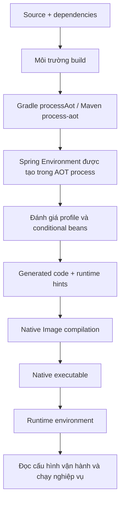
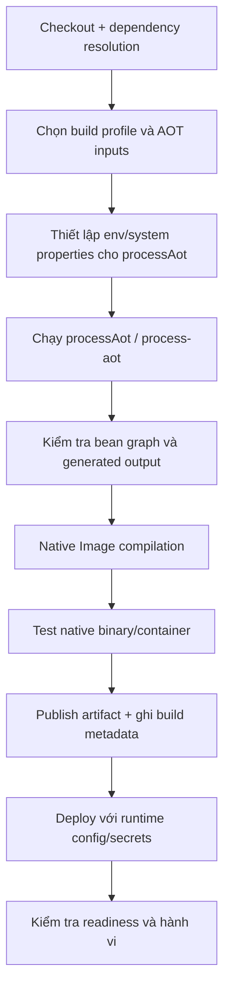

# Truyền môi trường cho processAot hoặc process-aot

Khi Spring Boot chạy **Spring AOT**, ứng dụng được khởi tạo ngay trong giai đoạn build để Spring phân tích cấu hình, đánh giá điều kiện và chuẩn bị BeanFactory. Vì vậy, những biến môi trường, system properties, arguments và Spring profiles có ảnh hưởng đến bean graph phải được truyền tới **đúng tiến trình AOT**. Thiết lập biến cho lệnh build hoặc cho container chạy sau này không tự động có nghĩa tiến trình AOT đã nhận cùng giá trị.

Với Gradle, task **`processAot`** là một `JavaExec` task nên có thể cấu hình environment variables, system properties, JVM arguments và application arguments trực tiếp. Với Maven, goal **`spring-boot:process-aot`** có các tham số riêng như `profiles`, `systemPropertyVariables`, `jvmArguments` và `arguments`. Cách cấu hình hai công cụ khác nhau; không nên sao chép cú pháp Gradle sang Maven.

## 1. Mục tiêu học tập

Sau bài học, bạn có thể:

- Giải thích vì sao môi trường của tiến trình AOT ảnh hưởng đến kết quả build.
- Phân biệt biến môi trường của shell/CI, tiến trình Gradle/Maven, tiến trình AOT và ứng dụng native khi chạy.
- Truyền environment variables, system properties, JVM arguments và application arguments cho Gradle `processAot`.
- Cấu hình Maven `process-aot` bằng Spring profiles, `systemPropertyVariables`, `jvmArguments` và `arguments`; biết cách cấp OS environment trước khi chạy Maven.
- Phân biệt Maven profile `-Pnative` với Spring profile `prod` hoặc `native`.
- Xác định property nào làm thay đổi bean graph tại build time và property nào có thể thay đổi tại runtime.
- Kiểm chứng giá trị thực sự được AOT process nhìn thấy mà không làm lộ secrets.

## 2. Vì sao phải truyền môi trường cho tiến trình AOT?

Spring AOT khởi tạo ứng dụng trong môi trường build để phân tích cấu hình. Khi BeanFactory được chuẩn bị, các điều kiện như `@Profile`, `@ConditionalOnProperty`, `@ConditionalOnClass`, `@ConditionalOnBean` và `@ConditionalOnMissingBean` được đánh giá theo đầu vào lúc đó.

Ví dụ, một tính năng audit chỉ được đăng ký khi `feature.audit.enabled=true`:

```java
@Configuration(proxyBeanMethods = false)
class AuditConfiguration {
    @Bean
    @ConditionalOnProperty(
        prefix = "feature",
        name = "audit.enabled",
        havingValue = "true"
    )
    AuditService auditService() {
        return new AuditService();
    }
}
```

Nếu AOT process nhìn thấy giá trị `false` hoặc không nhìn thấy property, bean có thể không được đưa vào graph đã chuẩn bị. Đổi biến thành `FEATURE_AUDIT_ENABLED=true` khi chạy container native không tự khiến Spring phân tích lại và thêm bean definition mới.

Do đó, cần xem môi trường AOT là **một phần đầu vào của artifact**:



**Hai giai đoạn có hai mục tiêu khác nhau:**

| Giai đoạn | Ví dụ dữ liệu | Ảnh hưởng |
| --- | --- | --- |
| **Build/AOT** | Profile làm bật bean, property condition, classpath, cấu hình quyết định auto-configuration | Có thể thay đổi bean graph và mã/hints được sinh |
| **Runtime** | Database URL, password, API endpoint, timeout hoặc giá trị nghiệp vụ được đọc lúc chạy | Cấu hình hoạt động của ứng dụng đã build |

Không phải mọi property đều bị cố định khi AOT. Các profile chỉ thay đổi giá trị cấu hình thông thường mà không làm thay đổi điều kiện bean có thể vẫn được dùng ở runtime. Ranh giới quan trọng là property có làm thay đổi **cấu trúc container** hay không.

## 3. Phân biệt các loại tham số

Các công cụ build có nhiều kênh truyền giá trị. Chúng không thể thay thế nhau:

| Kênh | Ví dụ | Được đọc ở đâu? | Dùng khi nào? |
| --- | --- | --- | --- |
| **OS environment variable** | `SPRING_PROFILES_ACTIVE=prod` | `System.getenv` và Spring Environment | Cấu hình theo môi trường, phù hợp CI/container |
| **JVM system property** | `-Dfeature.audit.enabled=true` | `System.getProperty` và Spring Environment | Cấu hình cho JVM AOT process |
| **Application argument** | `--feature.audit.enabled=true` | Spring Boot command-line property source | Truyền property như một tham số ứng dụng |
| **JVM argument** | `-Xmx2g`, `-Duser.timezone=UTC` | JVM chạy tiến trình AOT | Điều chỉnh bộ nhớ, encoding, debugging hoặc JVM behavior |
| **Spring profile** | `prod`, `native` | Spring Environment | Chọn cấu hình/bean theo profile |
| **Maven profile** | `-Pnative` | Maven model/build lifecycle | Bật plugin execution và cấu hình build |
| **Gradle project property** | `-PtargetEnv=prod` | Gradle build script | Điều khiển logic build Gradle; không tự trở thành env/property của AOT process |

Một số ví dụ trông giống nhau nhưng có đích khác nhau:

- `./mvnw -Pnative ...` kích hoạt **Maven profile** tên `native`. Nó không tự động đặt `spring.profiles.active=native`.
- `./gradlew -PtargetEnv=prod processAot` cung cấp một **Gradle project property**. Muốn tiến trình AOT nhận Spring property tương ứng, phải map nó vào `environment`, `systemProperty` hoặc `args` của task.
- `SPRING_PROFILES_ACTIVE=prod` là biến môi trường của process được thiết lập; Spring Boot có thể đọc nó khi AOT process kế thừa hoặc được cấu hình nhận biến đó.
- `-Dspring.profiles.active=prod` là JVM system property nếu nó được đặt cho đúng JVM AOT process.

Nếu nhiều nguồn cùng đặt một key với giá trị khác nhau, Spring Boot áp dụng thứ tự ưu tiên property source của nó. Để kết quả AOT dễ tái tạo, nên chọn **một nguồn chính cho mỗi property**, tránh để profile hoặc condition bị ghi đè ngoài ý muốn.

## 4. Truyền môi trường cho Gradle task processAot

### 4.1. Điều kiện để có task processAot

Task `processAot` được cung cấp bởi plugin `org.springframework.boot.aot`. Plugin này được áp dụng tự động khi dự án dùng GraalVM Native Image Gradle plugin tương thích. Nếu chỉ muốn chạy ứng dụng đã AOT trên JVM, có thể áp dụng trực tiếp Spring Boot AOT plugin.

Ví dụ `build.gradle` với Groovy:

```groovy
plugins {
    id 'org.springframework.boot' version '4.2.0'
    id 'org.graalvm.buildtools.native' version '1.1.18'
    id 'java'
}
```

Nếu project chỉ cần AOT mà chưa cấu hình native plugin, có thể áp dụng `org.springframework.boot.aot` theo tài liệu của phiên bản Spring Boot đang sử dụng.

### 4.2. Cấu hình environment variables

`processAot` là một `JavaExec` task. Có thể đặt biến môi trường riêng cho tiến trình Java này:

```groovy
tasks.named(
    'processAot',
    org.springframework.boot.gradle.tasks.aot.ProcessAot
) {
    environment 'SPRING_PROFILES_ACTIVE', 'prod'
    environment 'FEATURE_AUDIT_ENABLED', 'true'
    environment 'APP_REGION', 'ap-southeast-1'
}
```

Khi chạy:

```bash
./gradlew processAot
```

tiến trình AOT nhận các biến trên. Spring Boot có thể ánh xạ `FEATURE_AUDIT_ENABLED` thành property `feature.audit.enabled` theo quy tắc relaxed binding.

### 4.3. Kotlin DSL

Với `build.gradle.kts`:

```kotlin
tasks.named<org.springframework.boot.gradle.tasks.aot.ProcessAot>("processAot") {
    environment("SPRING_PROFILES_ACTIVE", "prod")
    environment("FEATURE_AUDIT_ENABLED", "true")
    environment("APP_REGION", "ap-southeast-1")
}
```

Kiểu task cụ thể giúp IDE và Gradle kiểm tra cấu hình tốt hơn. Nếu tên task không tồn tại, kiểm tra plugin AOT đã được áp dụng chưa và phiên bản Spring Boot có cung cấp task này không.

### 4.4. Truyền system properties, application arguments và JVM arguments

Vì `processAot` kế thừa từ `JavaExec`, có thể cấu hình các kênh khác:

```kotlin
tasks.named<org.springframework.boot.gradle.tasks.aot.ProcessAot>("processAot") {
    // Môi trường của ứng dụng đang được AOT xử lý.
    environment("SPRING_PROFILES_ACTIVE", "prod")

    // JVM system property trong tiến trình AOT.
    systemProperty("feature.audit.enabled", "true")
    systemProperty("user.timezone", "UTC")

    // Application arguments mà Spring Boot nhận khi tạo context AOT.
    args("--spring.main.banner-mode=off")

    // JVM arguments, ví dụ heap cho tiến trình AOT.
    jvmArgs("-Xmx2g")
}
```

Không cần truyền cùng một property qua cả environment, system property và arguments. Ví dụ trên cố ý dùng property khác nhau để minh họa từng kênh. Khi property xuất hiện ở nhiều nguồn, giá trị cuối cùng phụ thuộc precedence của Spring Environment.

### 4.5. Map Gradle project property vào AOT task

Một pipeline có thể dùng `-PtargetEnv` để chọn môi trường build:

```kotlin
val targetEnv = providers.gradleProperty("targetEnv")
    .orElse("dev")

tasks.named<org.springframework.boot.gradle.tasks.aot.ProcessAot>("processAot") {
    environment("SPRING_PROFILES_ACTIVE", targetEnv.get())
}
```

Chạy:

```bash
./gradlew processAot -PtargetEnv=prod
```

`targetEnv` là property của Gradle build. Nó chỉ ảnh hưởng tiến trình AOT vì build script đã **chủ động map** nó sang environment variable `SPRING_PROFILES_ACTIVE`. Nếu bỏ đoạn cấu hình task, `-PtargetEnv=prod` không tự kích hoạt Spring profile.

### 4.6. Biến môi trường từ shell và Gradle daemon

Có thể thử đặt biến ở shell trước khi chạy Gradle:

```bash
SPRING_PROFILES_ACTIVE=prod FEATURE_AUDIT_ENABLED=true ./gradlew processAot
```

Tuy nhiên, khi dùng Gradle daemon, môi trường của daemon và task cần được xem xét riêng. Với build cần tái lập, **cấu hình trực tiếp `environment(...)` trên `processAot`** thường rõ ràng hơn việc phụ thuộc vào môi trường của một daemon đã chạy từ trước.

## 5. Truyền môi trường cho Maven goal process-aot

### 5.1. Cấu hình goal process-aot

Spring Boot Maven Plugin cung cấp goal `spring-boot:process-aot` để chạy AOT engine trên ứng dụng. Ví dụ:

```xml
<build>
    <plugins>
        <plugin>
            <groupId>org.springframework.boot</groupId>
            <artifactId>spring-boot-maven-plugin</artifactId>
            <executions>
                <execution>
                    <id>process-aot</id>
                    <goals>
                        <goal>process-aot</goal>
                    </goals>
                    <configuration>
                        <profiles>
                            <profile>prod</profile>
                        </profiles>
                        <systemPropertyVariables>
                            <feature.audit.enabled>true</feature.audit.enabled>
                            <user.timezone>UTC</user.timezone>
                        </systemPropertyVariables>
                        <arguments>
                            <argument>--spring.main.banner-mode=off</argument>
                        </arguments>
                        <jvmArguments>-Xmx2g</jvmArguments>
                    </configuration>
                </execution>
            </executions>
        </plugin>
    </plugins>
</build>
```

Các trường trong ví dụ:

- `profiles`: Spring profiles được dùng khi AOT xử lý ứng dụng.
- `systemPropertyVariables`: JVM system properties được truyền vào AOT process.
- `arguments`: application arguments được tính đến khi tạo context.
- `jvmArguments`: tham số JVM của tiến trình AOT, ví dụ heap size.

Đây là cấu hình cho **Spring Boot Maven Plugin**, không phải Maven profile. Nếu plugin đã được khai báo ở `<build><plugins>` hoặc quản lý qua parent POM, hãy bổ sung execution/configuration vào đúng khai báo hiện có để tránh khai báo plugin trùng lặp.

### 5.2. Đặt OS environment trước khi chạy Maven

Maven `process-aot` nhận môi trường hệ điều hành mà tiến trình Maven được khởi chạy. Cách đơn giản là đặt biến ở shell/CI step trước lệnh Maven; tiến trình con do Maven khởi chạy sẽ kế thừa môi trường của process cha theo cơ chế hệ điều hành.

Linux/macOS:

```bash
SPRING_PROFILES_ACTIVE=prod \
FEATURE_AUDIT_ENABLED=true \
APP_REGION=ap-southeast-1 \
./mvnw clean compile spring-boot:process-aot
```

PowerShell:

```powershell
$env:SPRING_PROFILES_ACTIVE = "prod"
$env:FEATURE_AUDIT_ENABLED = "true"
$env:APP_REGION = "ap-southeast-1"
.\mvnw.cmd clean compile spring-boot:process-aot
```

Các biến trên được cung cấp cho môi trường chạy AOT. Nếu dùng Maven profile `native`, lệnh có thể là `./mvnw -Pnative ...`, nhưng vẫn cần phân biệt Maven profile với Spring profile.

**Điểm cần lưu ý:** parameter list chính thức của goal `process-aot` có `profiles`, `systemPropertyVariables`, `jvmArguments` và `arguments`; không có tham số `environmentVariables` như goal `spring-boot:run`. Vì vậy, không nên copy cấu hình `<environmentVariables>` của goal run vào execution process-aot rồi kỳ vọng plugin truyền nó. Với AOT goal, dùng environment của shell/CI hoặc các tham số AOT được hỗ trợ.

### 5.3. Spring profile không phải Maven profile

Ví dụ:

```bash
# Kích hoạt Maven profile tên native
./mvnw -Pnative package
```

`-Pnative` yêu cầu Maven kích hoạt profile `native` trong POM/parent. Profile đó có thể cấu hình execution AOT hoặc Native Build Tools, nhưng không mặc định tương đương với Spring profile `native`.

Spring profile có thể được truyền bằng cấu hình AOT:

```xml
<profiles>
    <profile>prod</profile>
</profiles>
```

Hoặc đặt qua OS environment:

```bash
SPRING_PROFILES_ACTIVE=prod ./mvnw spring-boot:process-aot
```

Không đặt cả hai nguồn với giá trị xung đột. Nếu profile làm thay đổi bean graph, cần xác định rõ profile nào đã được dùng khi AOT.

### 5.4. Khi nào dùng systemPropertyVariables thay vì environment?

Ví dụ cần đặt `feature.audit.enabled=true`:

```xml
<systemPropertyVariables>
    <feature.audit.enabled>true</feature.audit.enabled>
</systemPropertyVariables>
```

Spring có thể đọc system property này trong AOT process. Nếu muốn dùng chuẩn cấu hình môi trường, có thể đặt `FEATURE_AUDIT_ENABLED=true` ở shell/CI. Cả hai cách có thể dẫn đến cùng một Spring property, nhưng nguồn cấu hình và precedence khác nhau.

`jvmArguments` nên dành cho tùy chọn JVM như `-Xmx2g`, `-Dfile.encoding=UTF-8` hoặc tham số debugging. `arguments` dành cho tham số ứng dụng như `--spring.main.banner-mode=off`. Không dùng nhầm `-Xmx2g` làm application argument.

## 6. Hai ví dụ cấu hình tương đương

Giả sử AOT cần:

- Active Spring profile là `prod`.
- Bean audit được bật bằng `feature.audit.enabled=true`.
- JVM AOT process có timezone UTC và heap tối đa 2 GB.

### Gradle Kotlin DSL

```kotlin
tasks.named<org.springframework.boot.gradle.tasks.aot.ProcessAot>("processAot") {
    environment("SPRING_PROFILES_ACTIVE", "prod")
    environment("FEATURE_AUDIT_ENABLED", "true")
    systemProperty("user.timezone", "UTC")
    jvmArgs("-Xmx2g")
}
```

Chạy:

```bash
./gradlew processAot
```

### Maven

```xml
<execution>
    <id>process-aot</id>
    <goals>
        <goal>process-aot</goal>
    </goals>
    <configuration>
        <profiles>
            <profile>prod</profile>
        </profiles>
        <systemPropertyVariables>
            <feature.audit.enabled>true</feature.audit.enabled>
            <user.timezone>UTC</user.timezone>
        </systemPropertyVariables>
        <jvmArguments>-Xmx2g</jvmArguments>
    </configuration>
</execution>
```

Chạy:

```bash
./mvnw clean compile spring-boot:process-aot
```

Trong ví dụ Maven, Spring profile `prod` được đặt bằng tham số `profiles`; ở Gradle nó được đặt bằng environment variable. Hai cách không giống về cơ chế truyền nhưng đều nhằm tạo Spring Environment phù hợp trong AOT process.

## 7. Build-time environment và runtime environment phải được quản lý riêng

Một ứng dụng native có thể cần cấu hình ở cả hai giai đoạn. Ví dụ:

| Property | AOT/build | Native runtime | Ghi chú |
| --- | --- | --- | --- |
| `spring.profiles.active` | Cần nếu profile làm đổi bean graph | Có thể có giá trị runtime | Không kỳ vọng runtime bổ sung bean bị loại ở AOT |
| `feature.audit.enabled` | Cần nếu condition quyết định có bean audit | Có thể thay đổi nếu chỉ điều khiển logic runtime | Nếu dùng trong `@ConditionalOnProperty`, giá trị build quyết định registration |
| `DB_URL` / `SPRING_DATASOURCE_URL` | Thường không cần kết nối DB chỉ để phân tích cấu trúc | Cần khi service mở kết nối | Không để AOT build phụ thuộc database production nếu không cần |
| `DB_PASSWORD` | Không nên cấp secret production cho AOT | Cấp qua secret provider khi chạy | Không ghi vào POM, Gradle script hoặc log |
| `APP_TIMEOUT` | Thường không ảnh hưởng bean graph | Có thể đọc ở runtime | Nếu timeout được dùng trong điều kiện tạo bean, phải xét lại |
| `user.timezone` | Có thể ảnh hưởng code thực thi trong quá trình AOT | JVM/native process có thiết lập riêng | Chỉ đặt khi ứng dụng có yêu cầu rõ |
| `JAVA_TOOL_OPTIONS` | Có thể được JVM nhận ở build process | Có thể được JVM nhận khi chạy JAR/JVM | Có phạm vi rộng, dễ tác động cả Maven/Gradle và process con |

### 7.1. Ví dụ về profile làm thay đổi bean graph

```java
@Configuration(proxyBeanMethods = false)
class StorageConfiguration {
    @Bean
    @Profile("prod")
    StorageClient productionStorageClient() {
        return new ProductionStorageClient();
    }

    @Bean
    @Profile("dev")
    StorageClient localStorageClient() {
        return new LocalStorageClient();
    }
}
```

Nếu AOT chạy với profile `prod`, graph đã chuẩn bị có thể chứa `ProductionStorageClient`. Đổi `SPRING_PROFILES_ACTIVE=dev` khi chạy native không đảm bảo có thể thay bằng `LocalStorageClient`, vì generated initialization code được tạo từ graph ở build time.

Nếu profile chỉ thay đổi một giá trị cấu hình không tác động condition/bean registration, Spring Boot có thể tiếp tục đọc giá trị đó khi runtime theo cơ chế external configuration thông thường. Không nên áp dụng kết luận “mọi profile đều bị khóa” cho mọi ứng dụng; hãy xem profile cụ thể ảnh hưởng gì.

### 7.2. Giữ secrets ở runtime

Không truyền password, private key hoặc token production vào `processAot` chỉ để có thể kết nối hệ thống thật khi build. AOT nên phân tích cấu trúc container trong một môi trường build có thể tái tạo, không thực hiện công việc nghiệp vụ hay phụ thuộc vào tài nguyên production.

Nếu cần kiểm thử kết nối khi build, dùng dịch vụ test/dữ liệu giả lập và credentials ngắn hạn được quản lý an toàn. Runtime secrets nên được cấp bằng Kubernetes Secret, container secret mount, vault hoặc cơ chế phù hợp với nền tảng triển khai.

## 8. Kiểm chứng tiến trình AOT đã nhận đúng môi trường

Không nên chỉ nhìn lệnh build thành công. Hãy xác nhận các giá trị quan trọng đã đến đúng process và bean graph có kết quả mong muốn.

### 8.1. Ghi nhận cấu hình không lộ secret

Trong môi trường test, có thể dùng một initializer hoặc configuration diagnostic chỉ in các giá trị **không nhạy cảm**:

```java
import org.springframework.boot.ApplicationRunner;
import org.springframework.context.annotation.Bean;
import org.springframework.context.annotation.Configuration;
import org.springframework.core.env.Environment;

@Configuration(proxyBeanMethods = false)
class AotEnvironmentDiagnostics {
    @Bean
    ApplicationRunner printAotInputs(Environment environment) {
        return args -> {
            System.out.println(
                "Active profiles: "
                    + String.join(",", environment.getActiveProfiles())
            );
            System.out.println(
                "Audit enabled: "
                    + environment.getProperty("feature.audit.enabled")
            );
        };
    }
}
```

Đây là ví dụ chẩn đoán đơn giản. Trong ứng dụng thật, runner có thể chạy cả lúc runtime; hãy chỉ bật nó trong test hoặc profile chẩn đoán và tránh in URL chứa credentials, token, password hay giá trị secret khác.

Một cách khác là dùng điều kiện bean làm bằng chứng:

- Với `feature.audit.enabled=true`, kiểm tra bean audit có mặt trong graph/output AOT.
- Với `false`, kiểm tra bean không được đăng ký như dự kiến.
- Tạo artifact riêng cho mỗi cấu hình cấu trúc cần hỗ trợ, rồi kiểm thử native tương ứng.

### 8.2. Kiểm tra Gradle

Chạy:

```bash
./gradlew processAot --info
```

Quan sát task `processAot` được thực thi và log AOT. Nếu task không tồn tại, kiểm tra plugin AOT/native đã được áp dụng và cấu hình đúng chưa. Có thể dùng `tasks --all` để xác nhận tên task trong project.

### 8.3. Kiểm tra Maven

Chạy:

```bash
./mvnw clean compile spring-boot:process-aot
```

Nếu muốn xem log chi tiết hơn:

```bash
./mvnw -X clean compile spring-boot:process-aot
```

Log debug có thể chứa đường dẫn, property hoặc thông tin cấu hình; không chia sẻ công khai log chưa rà soát. Kiểm tra output AOT trong thư mục build do plugin cấu hình, đồng thời xác nhận điều kiện bean đúng với Spring profile/property mong muốn.

### 8.4. Ma trận kiểm thử hai giai đoạn

| Build-time condition | Runtime setting | Kỳ vọng |
| --- | --- | --- |
| Audit bật | Audit bật | Bean audit có trong graph và chức năng chạy được |
| Audit tắt | Audit tắt | Bean audit không có; ứng dụng chạy theo graph không audit |
| Audit tắt | Audit bật | Không giả định bean tự xuất hiện; cần phát hiện mismatch và build artifact phù hợp |
| Audit bật | Audit tắt | Bean có thể vẫn tồn tại; logic có thể tắt nếu được thiết kế đọc runtime property |

Ma trận này giúp phân biệt lỗi **đăng ký bean lúc AOT** với lỗi **logic đọc cấu hình lúc runtime**.

## 9. Các lỗi thường gặp

| Triệu chứng | Nguyên nhân có thể | Cách xử lý |
| --- | --- | --- |
| Gradle task không thấy `processAot` | Chưa áp dụng `org.springframework.boot.aot` hoặc GraalVM Native plugin | Kiểm tra plugin/version và task list |
| Biến env có trong shell nhưng AOT không nhận | Gradle daemon/task environment khác kỳ vọng | Cấu hình `environment(...)` trực tiếp trên task, in giá trị không nhạy cảm trong test |
| `-PtargetEnv=prod` không kích hoạt Spring profile | Đây chỉ là Gradle project property | Map project property vào `environment`, `systemProperty` hoặc `args` |
| Maven AOT không thấy `<environmentVariables>` | Goal `process-aot` không công bố parameter đó như `run` goal | Đặt OS env trước lệnh Maven hoặc dùng `profiles`/`systemPropertyVariables`/`arguments` |
| `-Pnative` không bật Spring profile native | Maven profile khác Spring profile | Cấu hình Spring profile riêng trong AOT process |
| Bean condition sai sau native build | AOT dùng profile/property khác dự kiến | Đặt đúng môi trường build và tạo lại artifact |
| Build cần DB production để tạo context | Code khởi tạo phụ thuộc I/O trong AOT | Tách kết nối khỏi cấu hình cấu trúc, dùng test service/fixture |
| Secret xuất hiện trong build log | In toàn bộ Environment hoặc truyền secret không cần thiết | Chỉ log key không nhạy cảm, dùng secret provider và rà soát log |
| Runtime đổi profile nhưng thiếu bean | Runtime graph không thể tự mở rộng từ generated AOT graph | Build artifact với điều kiện cấu trúc phù hợp |

## 10. Quy trình CI/CD khuyến nghị



Mỗi artifact nên lưu lại:

- Commit SHA và dependency versions.
- Phiên bản JDK, Spring Boot, Gradle/Maven và GraalVM.
- Maven profile hoặc Gradle task options đã dùng.
- Spring profiles và các property **không nhạy cảm** ảnh hưởng bean graph.
- OS environment keys đã được cung cấp (không lưu secret values).
- Kết quả test AOT và native integration test.
- Checksum của executable/JAR và digest của container image.

Nếu cần nhiều biến thể cấu trúc như `prod` có audit và `edge` không có audit, hãy build và kiểm thử từng biến thể một cách tường minh. Tránh thay đổi environment giữa các bước mà không ghi nhận, vì có thể tạo artifact không tái lập.

## 11. Bài thực hành

**Bối cảnh:** ứng dụng Spring Boot có `AuditService` chỉ được đăng ký khi `feature.audit.enabled=true`. Mục tiêu là build AOT với profile `prod` và bật audit.

### Với Gradle

1. Áp dụng Spring Boot AOT plugin (hoặc GraalVM Native plugin tương thích).
2. Cấu hình task `processAot`:

```kotlin
tasks.named<org.springframework.boot.gradle.tasks.aot.ProcessAot>("processAot") {
    environment("SPRING_PROFILES_ACTIVE", "prod")
    environment("FEATURE_AUDIT_ENABLED", "true")
}
```

3. Chạy `./gradlew processAot` và xác nhận task thực thi.
4. Kiểm tra generated output/bean graph để xác nhận `AuditService` được đăng ký.
5. Tiếp tục `nativeCompile` và kiểm thử native executable với chức năng audit.

### Với Maven

1. Cấu hình Spring Boot Maven Plugin execution `process-aot`.
2. Đặt `profiles` thành `prod` và `systemPropertyVariables` cho `feature.audit.enabled=true`.
3. Chạy `./mvnw clean compile spring-boot:process-aot`.
4. Kiểm tra log/output AOT và bean audit.
5. Tiếp tục native build bằng Native Build Tools hoặc buildpacks theo cấu hình dự án.

### Thử nghiệm mismatch

Tạo một lần build khác với `feature.audit.enabled=false` rồi thử bật property này ở runtime. Quan sát xem bean có xuất hiện không. Giải thích kết quả dựa trên thời điểm condition được đánh giá và cấu trúc BeanFactory đã được AOT chuẩn bị.

## 12. Ghi nhớ

- `processAot` và `process-aot` chạy trong **giai đoạn build**, dùng môi trường để tạo Spring Environment và chuẩn bị bean graph.
- Gradle `processAot` là `JavaExec`: có thể cấu hình `environment`, `systemProperty`, `args` và `jvmArgs` ngay trên task.
- Maven `process-aot` hỗ trợ `profiles`, `systemPropertyVariables`, `arguments` và `jvmArguments`. Để đặt OS environment, cung cấp biến trước khi gọi Maven; không dùng nhầm cấu hình `environmentVariables` của goal `spring-boot:run`.
- Maven profile `-Pnative` và Gradle property `-P...` điều khiển build tool; chúng không tự động trở thành Spring profiles hoặc property của AOT process.
- Các điều kiện làm thay đổi bean graph phải được truyền đúng lúc AOT. Cấu hình runtime chỉ có thể thay đổi hành vi đã được thiết kế đọc tại runtime; nó không tự thêm bean definitions đã bị loại khi build.
- Không truyền hoặc in secrets production trong AOT build. Ghi lại cấu hình không nhạy cảm, phiên bản toolchain và kết quả kiểm thử để tái lập artifact.

Khi truyền đúng môi trường cho tiến trình AOT, kết quả build sẽ phản ánh chính xác những feature và bean cần có. Đây là điều kiện quan trọng để native executable hoạt động nhất quán giữa lúc build và khi triển khai.

## Tài liệu tham khảo chính thức

- [Spring Boot Gradle Plugin — Ahead-of-Time Processing](https://docs.spring.io/spring-boot/gradle-plugin/aot.html): task `processAot` là `JavaExec` và có thể cấu hình environment variables, system properties, arguments.
- [Spring Boot Maven Plugin — Ahead-of-Time Processing](https://docs.spring.io/spring-boot/maven-plugin/aot.html): các tham số `profiles`, `systemPropertyVariables`, `jvmArguments` và `arguments` của goal `process-aot`.
- [Spring Boot Maven Plugin — Running your Application with Maven](https://docs.spring.io/spring-boot/maven-plugin/run.html): tham khảo `environmentVariables` cho goal `spring-boot:run`; không suy ra đây là tham số của `process-aot`.
