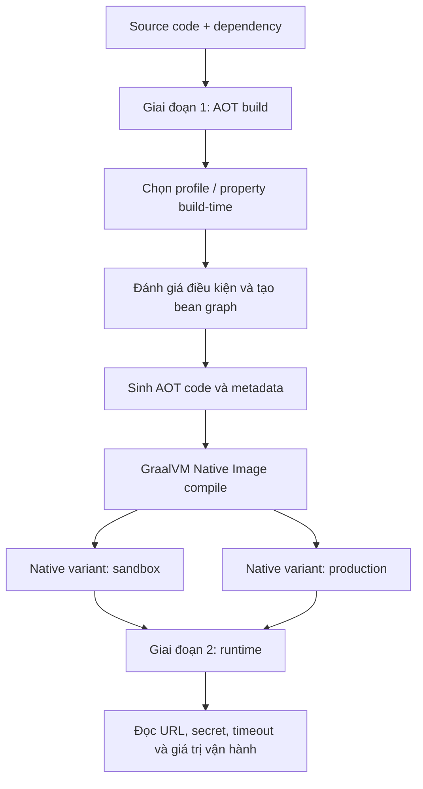
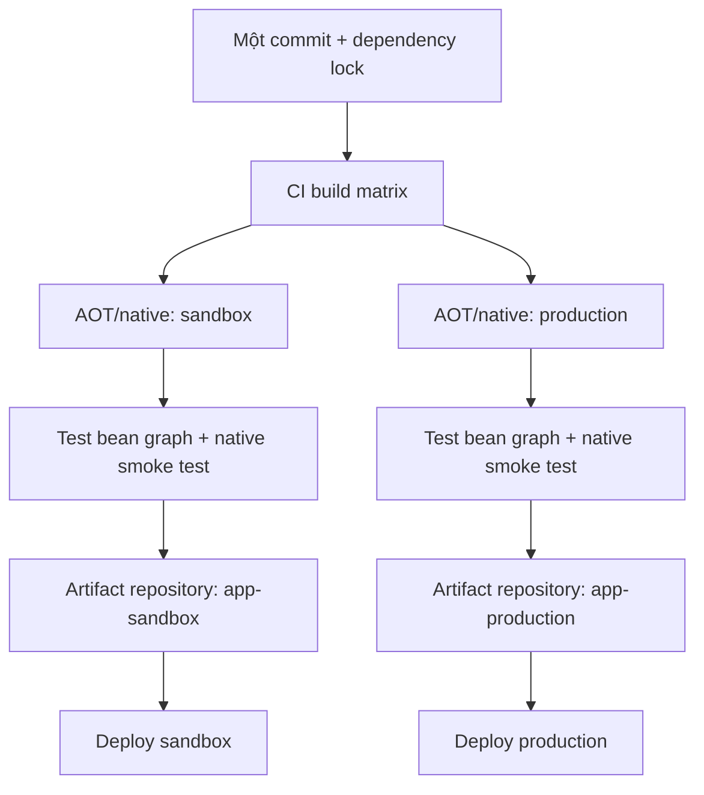

# Tạo các biến thể build khi tập bean cần khác nhau theo môi trường

## Mục tiêu bài học

Một ứng dụng Spring Boot có thể cần tập bean khác nhau giữa môi trường **sandbox**, **staging** và **production**. Ví dụ, môi trường sandbox dùng cổng thanh toán giả lập, trong khi production cần implementation kết nối nhà cung cấp thật. Khi chạy JVM thông thường, Spring có thể đọc profile và property lúc khởi động để chọn cấu hình phù hợp.

Với **Spring AOT** và **GraalVM Native Image**, việc chọn cấu hình có thêm một mốc quan trọng: **thời điểm build AOT**. Spring phân tích ApplicationContext, đánh giá các điều kiện cấu hình và sinh mã dựa trên môi trường có mặt lúc xử lý AOT. Nếu một điều kiện làm thay đổi tập bean, bạn cần tạo **biến thể build riêng** cho từng tập bean cần thiết.

Bài học này giúp bạn:

- Phân biệt cấu hình quyết định cấu trúc bean với cấu hình chỉ thay đổi giá trị khi chạy.
- Hiểu vì sao profile và conditional có thể được quyết định trong AOT build.
- Tạo các biến thể native theo môi trường bằng Maven hoặc Gradle.
- Quản lý artifact, image tag và cấu hình runtime của từng biến thể.
- Kiểm tra bean graph, kiểm thử native và tránh triển khai nhầm biến thể.

> **Nguyên tắc:** nếu môi trường cần **tập bean khác nhau**, hãy tạo các biến thể AOT/native tương ứng. Nếu môi trường chỉ khác URL, credential, timeout hoặc giá trị nghiệp vụ mà không làm thay đổi bean graph, thường có thể dùng cùng một binary và truyền cấu hình lúc runtime.

## 1. Vì sao cần nhiều biến thể build?

### 1.1. Ví dụ: cổng thanh toán khác nhau theo môi trường

Một hệ thống có hai implementation:

- `SandboxPaymentGateway`: trả kết quả giả lập để kiểm thử, không gọi nhà cung cấp thanh toán thật.
- `ProductionPaymentGateway`: gửi yêu cầu qua HTTP tới nhà cung cấp thanh toán.

Khi chạy trên JVM, Spring có thể dùng profile để chỉ đăng ký implementation phù hợp:

```java
public interface PaymentGateway {
    PaymentResult charge(PaymentRequest request);
}

@Component
@Profile("sandbox")
class SandboxPaymentGateway implements PaymentGateway {
    @Override
    public PaymentResult charge(PaymentRequest request) {
        return PaymentResult.approved("sandbox-transaction");
    }
}

@Component
@Profile("production")
class ProductionPaymentGateway implements PaymentGateway {
    @Override
    public PaymentResult charge(PaymentRequest request) {
        // Goi nha cung cap thanh toan that
        return paymentProviderClient.charge(request);
    }
}
```

Đoạn mã là ví dụ cấu trúc; `paymentProviderClient` và các kiểu request/result cần được khai báo trong ứng dụng thật. Khi chỉ bật profile `sandbox`, bean sandbox được đăng ký. Khi chỉ bật `production`, bean production được đăng ký.

Nếu cả hai profile cùng hoạt động, cả hai bean có thể cùng được tạo và injection theo `PaymentGateway` có thể trở nên mơ hồ, trừ khi có `@Primary`, `@Qualifier` hoặc một thiết kế khác xử lý trường hợp đó. Vì vậy, hai profile trong ví dụ cần được chọn loại trừ lẫn nhau.

### 1.2. Điều gì thay đổi khi dùng AOT?

Trong quy trình AOT, Spring khởi tạo một context phục vụ phân tích tại **build time**. Các cấu hình và điều kiện ảnh hưởng đến bean definitions được đánh giá trong môi trường đó. Kết quả được dùng để sinh mã đăng ký bean và metadata.

Nếu AOT build chạy với profile `sandbox`, mô hình được phân tích sẽ chứa `SandboxPaymentGateway`. Một native executable được tạo từ mô hình đó không thể được xem như một binary đa cấu hình có thể tùy ý bật `production` ở runtime để bổ sung bean đã không được đưa vào mô hình AOT.

Sơ đồ hai giai đoạn:



Hai biến thể `sandbox` và `production` được tạo bằng **hai lần AOT/native build với đầu vào build-time khác nhau**. Mỗi binary giữ bean graph phù hợp với biến thể của nó; các giá trị runtime vẫn có thể được cấp khi container khởi động.

## 2. Phân biệt cấu trúc bean và giá trị runtime

Không phải mọi khác biệt giữa môi trường đều cần một native binary riêng. Hãy xác định thay đổi đó ảnh hưởng đến **việc có bean nào tồn tại** hay chỉ ảnh hưởng đến **giá trị bean sử dụng khi chạy**.

### 2.1. Khác biệt làm thay đổi bean graph

Những trường hợp thường cần biến thể AOT/native riêng:

- `@Profile` chọn một nhóm cấu hình hoặc implementation khác.
- `@ConditionalOnProperty` bật/tắt một bean hoặc một nhóm auto-configuration.
- `@ConditionalOnClass` phụ thuộc dependency/classpath khác nhau giữa các bản build.
- Một adapter, driver hoặc integration chỉ được đưa vào một biến thể.
- Một môi trường cần tắt hẳn thành phần có khả năng thực hiện tác vụ nhạy cảm, thay vì chỉ cấu hình nó ở trạng thái inactive.

Ví dụ, sandbox không được chứa bean gửi lệnh thanh toán thật; việc tạo một biến thể chỉ có bean sandbox thể hiện ranh giới này rõ hơn một cờ runtime được kiểm tra rải rác trong logic.

### 2.2. Khác biệt chỉ là giá trị runtime

Những giá trị sau thường có thể giữ cùng một bean graph:

- URL của database, cache hoặc dịch vụ bên ngoài.
- Username/password, API token và secret được cấp lúc deploy.
- Timeout, số lần retry, giới hạn kết nối.
- Port, log level và một số giới hạn vận hành.
- Feature flag điều khiển hành vi bên trong một bean đã tồn tại, nếu việc bật/tắt không đòi hỏi thêm bean hay dependency mới.

Ví dụ:

```java
@ConfigurationProperties(prefix = "payment.provider")
public record PaymentProviderProperties(
        URI baseUrl,
        Duration timeout
) {}

@EnableConfigurationProperties(PaymentProviderProperties.class)
@Configuration(proxyBeanMethods = false)
class PaymentClientConfiguration {

    @Bean
    PaymentProviderClient paymentProviderClient(
            PaymentProviderProperties properties) {
        return new PaymentProviderClient(
                properties.baseUrl(),
                properties.timeout()
        );
    }
}
```

Nếu cả sandbox và production đều dùng cùng kiểu `PaymentProviderClient`, nhưng chỉ khác `baseUrl` và `timeout`, một binary có thể đọc hai giá trị đó từ environment/configuration lúc runtime. Không cần tạo hai biến thể chỉ vì URL khác nhau.

### 2.3. Bảng quyết định

| Khác biệt giữa môi trường | Có cần biến thể AOT/native riêng? | Lý do |
|---|---|---|
| Chọn implementation bean khác qua `@Profile` | Thường có | Bean graph được chọn trong AOT build |
| `@ConditionalOnProperty` làm bean xuất hiện/biến mất | Có, nếu cần các tập bean khác nhau | Điều kiện ảnh hưởng cấu trúc context |
| URL database khác nhau | Thường không | Bean và dependency vẫn như cũ; chỉ đổi giá trị cấu hình |
| API key/credential khác nhau | Không | Nên cấp secret ở runtime |
| Timeout/retry khác nhau | Không, nếu chỉ là property của bean hiện có | Không thay đổi tập bean |
| Thêm driver/dependency khác vào classpath | Thường có | Classpath và khả năng reachability thay đổi ở build time |
| Production không được chứa một integration nhạy cảm | Có thể cần | Biến thể riêng giúp loại bean/dependency khỏi sản phẩm đó |
| Feature flag chỉ thay đổi nhánh xử lý bên trong cùng bean | Không nhất thiết | Có thể đọc flag lúc runtime |

Quyết định cuối cùng dựa trên **bean graph thực tế** và yêu cầu bảo mật/vận hành, không chỉ dựa vào tên môi trường.

## 3. Điều kiện cấu hình được đánh giá lúc nào?

### 3.1. `@Profile`

`@Profile` quyết định cấu hình hoặc bean có được đăng ký hay không dựa trên active profiles. Khi AOT phân tích context, profile được cung cấp cho lần AOT đó sẽ ảnh hưởng đến bean graph được sinh.

Ví dụ:

```java
@Configuration(proxyBeanMethods = false)
class NotificationConfiguration {

    @Bean
    @Profile("local")
    NotificationSender localNotificationSender() {
        return new ConsoleNotificationSender();
    }

    @Bean
    @Profile("production")
    NotificationSender productionNotificationSender(
            MailProviderClient client) {
        return new MailNotificationSender(client);
    }
}
```

Để có một bản native dành cho `local` và một bản dành cho `production`, phải chạy AOT build trong hai môi trường profile tương ứng. Việc chỉ truyền `SPRING_PROFILES_ACTIVE=production` khi chạy một binary được AOT build với `local` không tạo lại mã đăng ký bean đã được quyết định ở build time.

### 3.2. `@ConditionalOnProperty`

Ví dụ:

```java
@Configuration(proxyBeanMethods = false)
class AuditConfiguration {

    @Bean
    @ConditionalOnProperty(
            prefix = "audit",
            name = "enabled",
            havingValue = "true"
    )
    AuditPublisher auditPublisher() {
        return new HttpAuditPublisher();
    }
}
```

Khi `audit.enabled=true` trong môi trường AOT, bean `AuditPublisher` có thể được đưa vào mô hình đã xử lý. Khi `false`, bean có thể bị loại khỏi bean graph của biến thể đó.

Nếu cần hai binary có tập bean khác nhau, property `audit.enabled` phải được cung cấp **trước và trong quá trình AOT processing**. Đổi property chỉ ở runtime không thể được dùng để bổ sung một bean đã bị loại khỏi mô hình AOT.

Lưu ý `havingValue`, `matchIfMissing` và prefix/name phải được hiểu đúng. Ví dụ trên không khai báo `matchIfMissing=true`, nên khi property vắng mặt điều kiện không được xem là thỏa mãn theo mặc định.

Ví dụ tạo hai biến thể theo property này bằng Gradle:

```bash
AUDIT_ENABLED=true ./gradlew --no-daemon clean nativeCompile
AUDIT_ENABLED=false ./gradlew --no-daemon clean nativeCompile
```

Trong môi trường Windows PowerShell, đặt `$env:AUDIT_ENABLED` trước khi chạy wrapper. Biến môi trường được Spring Boot ánh xạ theo relaxed binding; cần bảo đảm giá trị đó có mặt trong **tiến trình thực hiện AOT**, không chỉ trong lệnh chạy native sau build.

### 3.3. Điều kiện phụ thuộc classpath

`@ConditionalOnClass` và các điều kiện tương tự có thể tạo ra biến thể khi dependency khác nhau giữa các build:

```java
@Configuration(proxyBeanMethods = false)
@ConditionalOnClass(name = "com.vendor.search.SearchClient")
class VendorSearchConfiguration {

    @Bean
    SearchService searchService(SearchClient client) {
        return new VendorSearchService(client);
    }
}
```

Nếu dependency cung cấp `SearchClient` chỉ có trong một biến thể, hãy tạo build với dependency/classpath tương ứng và kiểm tra lại AOT output. Không nên kỳ vọng thay đổi classpath sau khi executable đã được tạo sẽ thêm implementation vào binary.

### 3.4. Không phải mọi property đều bị cố định

Spring AOT không biến mọi giá trị cấu hình thành hằng số trong binary. Một bean đã tồn tại vẫn có thể đọc property, environment variable hoặc secret lúc runtime.

Phân biệt:

- Property được dùng để **đánh giá điều kiện đăng ký bean**: cần có giá trị phù hợp trong AOT build nếu muốn quyết định bean graph.
- Property được bean đọc để **thực hiện nghiệp vụ**: có thể giữ là cấu hình runtime nếu không làm thay đổi cấu trúc context.

Khi một property được dùng cho cả hai mục đích, hãy xác định rõ phần nào quyết định bean graph và phần nào chỉ điều chỉnh hành vi. Nếu cần đổi bean graph, tạo biến thể build tương ứng.

## 4. Tạo biến thể AOT/native bằng Gradle

### 4.1. Chọn profile trước khi chạy AOT

Với Gradle, task Spring AOT thường có tên **processAot**. Khi tích hợp Native Build Tools, task **nativeCompile** sẽ sử dụng các đầu vào AOT theo task graph được plugin cấu hình.

Trên Linux/macOS, tạo biến thể sandbox:

```bash
SPRING_PROFILES_ACTIVE=sandbox ./gradlew --no-daemon clean nativeCompile
```

Tạo biến thể production:

```bash
SPRING_PROFILES_ACTIVE=production ./gradlew --no-daemon clean nativeCompile
```

Tùy chọn **--no-daemon** giúp lần chạy dùng môi trường của lệnh hiện tại, tránh nhầm lẫn khi daemon Gradle cũ được khởi chạy với environment khác. Nếu dự án có cấu hình task tùy biến hoặc CI dùng daemon riêng, hãy bảo đảm biến môi trường được chuyển vào đúng tiến trình thực hiện AOT.

Nếu muốn quan sát riêng AOT output trước khi native compilation:

```bash
SPRING_PROFILES_ACTIVE=sandbox ./gradlew --no-daemon clean processAot
```

Sau khi xác minh profile và generated output, chạy task native theo cấu hình dự án. Trong cấu hình tích hợp chuẩn, **nativeCompile** có thể kéo theo các task AOT/compile cần thiết; không phải dự án nào cũng cần gọi thủ công từng task.

### 4.2. PowerShell trên Windows

Đặt biến môi trường trước khi chạy Gradle:

```powershell
$env:SPRING_PROFILES_ACTIVE = 'sandbox'
.\gradlew.bat --no-daemon clean nativeCompile

$env:SPRING_PROFILES_ACTIVE = 'production'
.\gradlew.bat --no-daemon clean nativeCompile

Remove-Item Env:SPRING_PROFILES_ACTIVE
```

Nếu build native trên Windows nhưng đích triển khai là Linux, kiểm tra builder/toolchain hoặc dùng môi trường Linux phù hợp để tạo executable/container image Linux. Chọn profile đúng không thay thế yêu cầu về OS/CPU đích.

### 4.3. Kiểm tra AOT output của từng biến thể

Sau mỗi lần build, xem log có ghi profile và các điều kiện liên quan hay không. Kiểm tra generated sources/resources trong thư mục output do plugin thông báo, thường nằm dưới **build/generated/** hoặc các thư mục AOT tương ứng.

Một cách kiểm tra hữu ích là tạo một bean marker riêng cho từng profile:

```java
@Configuration(proxyBeanMethods = false)
class VariantMarkerConfiguration {

    @Bean
    @Profile("sandbox")
    BuildVariantMarker sandboxMarker() {
        return new BuildVariantMarker("sandbox");
    }

    @Bean
    @Profile("production")
    BuildVariantMarker productionMarker() {
        return new BuildVariantMarker("production");
    }
}

record BuildVariantMarker(String name) {}
```

Bean marker giúp test xác nhận biến thể được chọn. Không nhất thiết giữ marker trong ứng dụng production nếu không có giá trị vận hành; có thể dùng test hoặc một endpoint/health detail chỉ dành cho môi trường kiểm thử.

### 4.4. Không để hai biến thể ghi đè artifact của nhau

Gradle mặc định dùng chung thư mục **build/**. Khi build **sandbox** rồi build **production** với **clean**, output của lần trước sẽ bị xóa. Đây là hành vi bình thường nhưng cần được tính vào pipeline.

Có hai cách quản lý phổ biến:

1. **Build tuần tự:** build một biến thể, kiểm tra và lưu artifact vào kho lưu trữ với tên/tag rõ ràng, sau đó chạy **clean** và build biến thể tiếp theo.
2. **Workspace tách biệt:** mỗi biến thể chạy trong một checkout/worktree hoặc workspace CI riêng để không tranh chấp **build/** và cache output.

Không chạy đồng thời hai lệnh build khác profile trên cùng một thư mục dự án nếu chúng cùng ghi vào **build/**. Việc này có thể trộn hoặc ghi đè generated AOT source, class và executable.

## 5. Tạo biến thể AOT/native bằng Maven

### 5.1. Truyền profile vào tiến trình Maven

Với Maven, Spring Boot Maven plugin cung cấp goal **spring-boot:process-aot**; Native Build Tools cung cấp goal native compile khi dự án đã cấu hình plugin/profile phù hợp.

Trên Linux/macOS, có thể chạy AOT processing cho sandbox:

```bash
SPRING_PROFILES_ACTIVE=sandbox ./mvnw clean spring-boot:process-aot
```

Sau đó build native với cấu hình profile tương ứng:

```bash
SPRING_PROFILES_ACTIVE=sandbox ./mvnw -Pnative native:compile
```

Đối với production, dùng cùng quy trình với profile production:

```bash
SPRING_PROFILES_ACTIVE=production ./mvnw clean spring-boot:process-aot
SPRING_PROFILES_ACTIVE=production ./mvnw -Pnative native:compile
```

**Lưu ý cấu hình Maven:** nhiều dự án đã bind AOT processing vào lifecycle hoặc native profile. Khi đó goal **native:compile** có thể tự gọi các bước AOT/compile liên quan. Hãy kiểm tra cấu hình plugin và task log của dự án để tránh hiểu nhầm rằng chạy **process-aot** riêng rồi compile ở một lần build khác là luôn cần thiết. Điều bắt buộc là profile build-time phải được áp dụng cho lần AOT tạo ra artifact được native compiler sử dụng.

### 5.2. PowerShell trên Windows

```powershell
$env:SPRING_PROFILES_ACTIVE = 'sandbox'
.\mvnw.cmd clean spring-boot:process-aot
.\mvnw.cmd -Pnative native:compile

$env:SPRING_PROFILES_ACTIVE = 'production'
.\mvnw.cmd clean spring-boot:process-aot
.\mvnw.cmd -Pnative native:compile

Remove-Item Env:SPRING_PROFILES_ACTIVE
```

Các goal và profile **native** phải tồn tại trong cấu hình Maven của dự án. Nếu wrapper script hoặc plugin khác tên, điều chỉnh theo dự án; không tự thêm một profile giả định rồi xem đó là cấu hình mặc định của Maven.

### 5.3. Thư mục output và artifact naming

Maven thường ghi output dưới **target/**, gồm class, generated AOT sources/resources và executable native. Tên executable phụ thuộc **artifactId**, cấu hình plugin và hệ điều hành.

Giống Gradle, chạy **clean** trước biến thể tiếp theo sẽ xóa output trước đó. Sau khi build xong một profile, hãy lưu executable cùng metadata của build vào nơi lưu artifact riêng trước khi chạy build kế tiếp.

## 6. Thiết kế pipeline cho nhiều biến thể

### 6.1. Một commit, nhiều đầu vào AOT

Để so sánh công bằng và có thể tái lập, các biến thể nên được tạo từ **cùng một commit source** và cùng phiên bản dependency. Khác biệt được kiểm soát ở đầu vào build-time như profile/property hoặc classpath được chọn.

Pipeline khái quát:



Mỗi nhánh cần lưu thông tin để truy ngược:

- Git commit hoặc source revision.
- Phiên bản Java, Spring Boot, Gradle/Maven, GraalVM và Native Build Tools.
- Profile/property được dùng khi AOT build.
- OS/CPU đích và builder/run image nếu tạo container.
- Kết quả test, thời gian build và checksum artifact.

Những thông tin này giúp xác định binary nào được tạo từ cấu hình nào khi có sự cố.

### 6.2. Đặt tên artifact và image rõ ràng

Không dùng chung một tag mơ hồ như **latest** cho tất cả biến thể. Có thể đặt tên:

| Biến thể | Executable/artifact | Container image |
|---|---|---|
| Sandbox | **payment-service-sandbox** | **registry.example.com/payment-service:sandbox-REVISION** |
| Production | **payment-service-production** | **registry.example.com/payment-service:production-REVISION** |

Các tên trên là ví dụ quy ước. Nếu plugin tạo output mặc định cùng một tên, pipeline cần lưu/copy artifact sau từng build vào thư mục release có tên biến thể hoặc cấu hình image name riêng theo API của phiên bản plugin.

Với Spring Boot Buildpacks, task **bootBuildImage** có thể được cấu hình image name riêng cho từng lần build. Nếu dùng cùng workspace, bảo đảm mỗi lần AOT và native build nhận đúng profile trước khi tạo image tương ứng.

### 6.3. Kiểm tra biến thể trước khi publish

Một bước kiểm tra tối thiểu nên xác nhận:

1. Profile build-time đúng với tên biến thể.
2. Bean marker hoặc test context xác nhận đúng implementation đã đăng ký.
3. Các bean không được phép có mặt trong biến thể đó không xuất hiện trong bean graph.
4. Native executable/container image được tạo từ AOT output của chính biến thể đó.
5. Smoke test chạy trên executable/container native đạt.
6. Metadata artifact và image tag phản ánh đúng commit/profile/OS/CPU.

Không publish artifact nếu chỉ biết task build kết thúc thành công nhưng chưa xác minh tập bean. Lỗi chọn nhầm profile có thể tạo ra binary hợp lệ về mặt kỹ thuật nhưng sai chức năng hoặc ranh giới bảo mật.

## 7. Cấu hình runtime cho từng biến thể

### 7.1. Giữ profile runtime khớp với profile AOT

Với ứng dụng Spring Boot được xử lý AOT, các active profiles dùng khi AOT processing cần nhất quán với profiles dùng khi ứng dụng chạy. Nếu AOT được thực hiện với **sandbox**, hãy chạy biến thể đó với cùng profile; không chuyển nó sang **production** để mong Spring đăng ký implementation production lúc runtime. Spring Boot có thể phát hiện profile mismatch và từ chối khởi động vì cấu hình runtime không khớp với cấu hình đã dùng để sinh artifact AOT.

Ví dụ:

| Binary | Profile khi AOT build | Profile khi chạy |
|---|---|---|
| payment-service-sandbox | sandbox | sandbox |
| payment-service-production | production | production |

Khi container khởi động, vẫn có thể cấp URL, credential, timeout và các giá trị runtime khác. Profile phải phản ánh biến thể đã build; property nghiệp vụ được phép thay đổi nếu nó không làm thay đổi bean graph đã được AOT chuẩn bị.

### 7.2. Truyền property runtime

Ví dụ chạy production container:

```bash
docker run --rm \
  -e SPRING_PROFILES_ACTIVE=production \
  -e PAYMENT_PROVIDER_BASE_URL=https://payments.example.com \
  -e PAYMENT_PROVIDER_TIMEOUT=3s \
  -e PAYMENT_PROVIDER_API_KEY \
  -p 8080:8080 \
  registry.example.com/payment-service:production-REVISION
```

Trong ví dụ, PAYMENT_PROVIDER_API_KEY được truyền từ environment của môi trường triển khai; giá trị secret cần được cấp qua secret manager/orchestrator phù hợp, không ghi trực tiếp vào Dockerfile, source code hoặc build log.

Với sandbox:

```bash
docker run --rm \
  -e SPRING_PROFILES_ACTIVE=sandbox \
  -e PAYMENT_PROVIDER_BASE_URL=https://sandbox-payments.example.com \
  -e PAYMENT_PROVIDER_TIMEOUT=10s \
  -p 8080:8080 \
  registry.example.com/payment-service:sandbox-REVISION
```

Tên environment variable cho ConfigurationProperties phụ thuộc quy tắc relaxed binding của Spring Boot và prefix/property thực tế. Kiểm tra cấu hình của ứng dụng để bảo đảm tên biến tương ứng với trường dữ liệu.

### 7.3. Đừng đóng gói secret vào binary

Không dùng property nguồn như API key, mật khẩu database hoặc private key để quyết định một bean graph nếu có thể tránh. Các giá trị này nên được cấp lúc runtime bằng secret/config management.

Nếu một thành phần chỉ tồn tại ở production, AOT variant có thể chọn bean production, nhưng credential production vẫn cần được cung cấp khi deploy. **Việc có implementation trong binary không đồng nghĩa binary chứa credential để gọi dịch vụ thật.**

Nếu mục tiêu là bảo đảm một binary sandbox hoàn toàn không chứa thư viện/tích hợp production, chỉ dùng @Profile để loại bean khỏi context có thể chưa đủ: class hoặc dependency vẫn có thể được đưa vào image nếu còn reachable từ nơi khác. Khi cần ranh giới mạnh, hãy tách dependency/module hoặc classpath theo variant và xác minh nội dung artifact.

## 8. Kiểm thử từng biến thể

### 8.1. Test bean graph bằng profile tương ứng

Với Spring Boot Test, có thể tạo test riêng cho sandbox:

```java
@SpringBootTest
@ActiveProfiles("sandbox")
class SandboxPaymentConfigurationTests {

    @Autowired
    PaymentGateway paymentGateway;

    @Autowired
    ApplicationContext context;

    @Test
    void usesSandboxGateway() {
        assertThat(paymentGateway)
                .isInstanceOf(SandboxPaymentGateway.class);
        assertThat(context.getBeansOfType(ProductionPaymentGateway.class))
                .isEmpty();
    }
}
```

Và test cho production:

```java
@SpringBootTest
@ActiveProfiles("production")
class ProductionPaymentConfigurationTests {

    @Autowired
    PaymentGateway paymentGateway;

    @Test
    void usesProductionGateway() {
        assertThat(paymentGateway)
                .isInstanceOf(ProductionPaymentGateway.class);
    }
}
```

Đây là kiểm thử bean graph trên JVM theo profile. Nó xác nhận điều kiện Spring thông thường, nhưng **chưa tự chứng minh** hai native executable đã được AOT build bằng đúng profile. Cần chạy AOT/native build riêng và kiểm thử executable của từng biến thể.

### 8.2. Kiểm tra native artifact

Với mỗi variant, thực hiện:

1. Ghi nhận profile được truyền vào tiến trình AOT.
2. Chạy AOT processing/native compilation.
3. Kiểm tra log và output generated để xác nhận bean graph phù hợp.
4. Lưu executable hoặc OCI image dưới tên biến thể rõ ràng.
5. Khởi động executable/container với profile tương ứng.
6. Gọi smoke test cho các luồng nghiệp vụ quan trọng.
7. Xác nhận bean/implementation hoạt động đúng và các integration không mong muốn không được kích hoạt.

Nếu ứng dụng có database, queue hoặc API ngoài, hãy dùng endpoint giả lập hoặc môi trường kiểm thử được kiểm soát. Không để smoke test của biến thể sandbox vô tình gửi yêu cầu tới dịch vụ production.

### 8.3. So sánh build variant và runtime config

| Nội dung cần xác nhận | Sandbox | Production |
|---|---|---|
| Active profile khi AOT | sandbox | production |
| Implementation PaymentGateway | SandboxPaymentGateway | ProductionPaymentGateway |
| Credential | Không dùng secret production | Cấp từ secret manager lúc deploy |
| Provider URL | Sandbox endpoint hoặc mock | Production endpoint |
| Native artifact/image tag | Có hậu tố sandbox | Có hậu tố production |
| Smoke test | Không gọi nhà cung cấp thật | Kiểm tra qua môi trường/provider phù hợp |

Không nên chỉ đổi tag của cùng một binary rồi xem đó là hai biến thể. Hai artifact cần được tạo từ các đầu vào AOT phù hợp nếu bean graph thực sự khác nhau.

## 9. Lỗi thường gặp khi tạo biến thể build

| Triệu chứng | Nguyên nhân có thể | Hướng xử lý |
|---|---|---|
| Native sandbox vẫn có hành vi production | AOT build đã chạy với profile/property production hoặc profile được truyền sai tiến trình | Kiểm tra environment ngay tại thời điểm processAot chạy và generated output |
| Đổi SPRING_PROFILES_ACTIVE lúc chạy nhưng bean không đổi | Bean graph đã được quyết định khi AOT build | Build một variant mới với profile cần thiết |
| Ứng dụng AOT báo profile không khớp khi startup | Active profiles runtime khác profiles dùng khi AOT processing | Chạy đúng profile đã build hoặc tạo artifact cho profile mới |
| @ConditionalOnProperty không tạo bean mong muốn | Property không có mặt hoặc sai giá trị lúc AOT | Kiểm tra prefix, name, havingValue, matchIfMissing và build environment |
| Bean theo profile không được đăng ký | Profile không active trong AOT hoặc cấu hình nằm ngoài component scan | Kiểm tra profile, package scan và điều kiện khác |
| Hai bean cùng implement interface gây ambiguous injection | Hai profile cùng active hoặc cấu hình cùng đăng ký bean | Chọn profile loại trừ nhau hoặc dùng @Primary/@Qualifier có chủ đích |
| Build variant sau ghi đè variant trước | Cùng thư mục build/ hoặc target/ và chạy clean | Lưu artifact riêng sau mỗi lần build hoặc dùng workspace tách biệt |
| CI build song song tạo output lẫn nhau | Nhiều job dùng chung checkout/output directory | Dùng workspace riêng cho từng matrix job |
| Sandbox không có bean production nhưng vẫn chứa class production | Class/dependency còn reachable qua cấu hình hoặc thư viện khác | Tách module/classpath nếu cần loại bỏ thật sự; kiểm tra binary/dependency |
| URL/secret runtime không đổi như mong đợi | Sai environment variable, property name hoặc config source precedence | Kiểm tra relaxed binding, profile config và nguồn cấu hình |

### 9.1. Chẩn đoán theo đúng giai đoạn

Khi biến thể sai, hãy tìm lỗi theo thứ tự:

```text
Build invocation
    |
    v
Environment / active profiles / build properties
    |
    v
Spring AOT processing
    |
    v
Generated bean definitions and metadata
    |
    v
GraalVM Native Image compilation
    |
    v
Runtime profile and environment
    |
    v
Bean creation / dependency injection / external integration
```

Nếu generated AOT output đã chứa sai implementation, vấn đề thường nằm ở build-time environment hoặc điều kiện cấu hình. Nếu AOT output đúng nhưng ứng dụng không khởi động, kiểm tra profile runtime, property runtime, dependency injection và native compatibility. Đừng bắt đầu bằng cách thêm Runtime Hints khi nguyên nhân thực tế là chọn sai profile.

## 10. Quy trình thực hành hoàn chỉnh

### Bước 1 — Xác định khác biệt môi trường

Liệt kê bean nào cần có trong sandbox và production. Phân loại riêng các giá trị chỉ khác lúc chạy như URL, timeout và secret. Không tạo biến thể nếu bean graph không cần thay đổi.

### Bước 2 — Khai báo điều kiện rõ ràng

Dùng @Profile hoặc @ConditionalOnProperty để thể hiện lựa chọn implementation. Khai báo kiểu trả về @Bean đủ cụ thể để Spring dự đoán kiểu bean; giữ abstraction chung cho consumer nếu đó là hợp đồng cần dùng.

### Bước 3 — Kiểm thử cấu hình JVM

Chạy test với @ActiveProfiles("sandbox") và @ActiveProfiles("production"). Xác nhận đúng implementation được đăng ký, không có injection ambiguity và không gọi nhầm integration.

### Bước 4 — Build AOT/native từng biến thể

Truyền profile/property vào tiến trình thực hiện AOT. Chạy các task phù hợp của Gradle hoặc Maven; build tuần tự và lưu artifact riêng, hoặc dùng workspace riêng cho từng variant.

### Bước 5 — Kiểm tra output và smoke test

Xác minh AOT output, native executable/image tag, profile runtime khớp với profile build và các luồng nghiệp vụ quan trọng hoạt động đúng.

### Bước 6 — Publish và triển khai

Đính kèm commit, profile, toolchain, OS/CPU và checksum vào metadata artifact. Triển khai đúng image tag; cấp secret và giá trị runtime từ hệ thống cấu hình/secret management của môi trường đích.

### Câu hỏi tự kiểm tra

1. Vì sao thay URL database thường không cần tạo native binary riêng, còn thay implementation bean bằng @Profile có thể cần?
2. SPRING_PROFILES_ACTIVE phải được đặt ở thời điểm nào để Spring AOT đánh giá đúng @Profile?
3. Nếu native binary được AOT build với sandbox, điều gì xảy ra khi khởi động nó với profile production?
4. Vì sao @Profile loại một bean khỏi context chưa chắc đã loại mọi class liên quan khỏi native executable?
5. Làm thế nào để CI tạo hai artifact từ cùng commit mà không ghi đè thư mục build/ hoặc target/?

**Ghi nhớ:** Spring AOT biến cấu hình ứng dụng thành đầu vào build có ý nghĩa đối với bean graph. Khi tập bean cần khác nhau theo môi trường, hãy tạo từng biến thể AOT/native với profile/property phù hợp, kiểm thử bean graph và lưu artifact riêng. Những giá trị vận hành như URL, credential và timeout vẫn nên được cấp lúc runtime nếu chúng không làm thay đổi cấu trúc bean.
