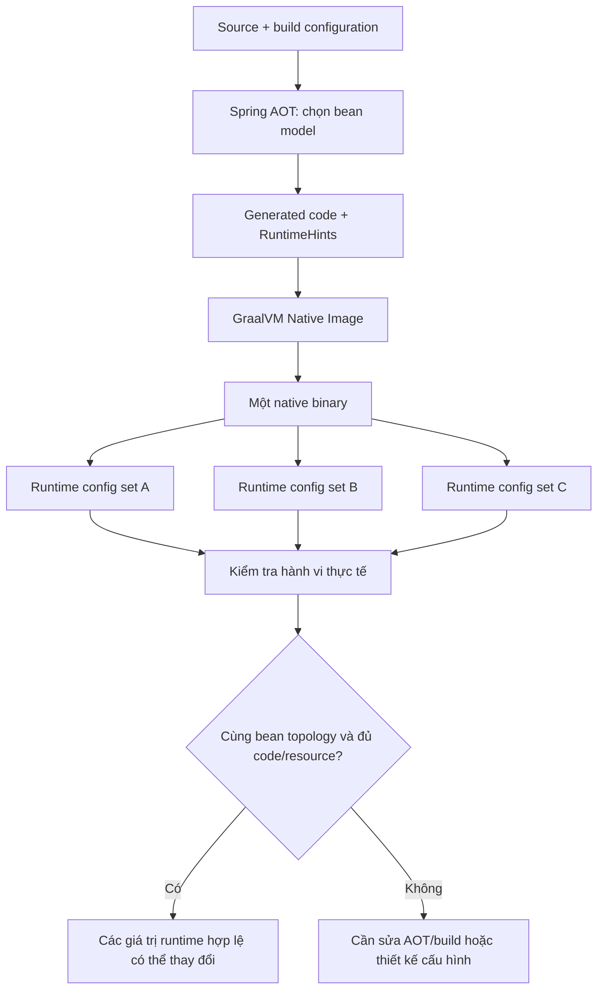

# Kiểm thử cấu hình runtime để phát hiện giả định sai về tính linh hoạt của binary

> **Chương:** Cấu hình hai giai đoạn  
> **Module:** `SPRING_BOOT_NATIVE_IMAGE`  
> **Mục tiêu:** Thiết kế kiểm thử trên **cùng một native binary** với nhiều nguồn cấu hình runtime; phân biệt property có thể thay đổi khi khởi động với quyết định bean/class/resource đã được cố định trong Spring AOT; phát hiện giả định sai trước khi phát hành.

## 1. Vì sao phải kiểm thử cấu hình runtime trên binary thật?

Một lợi ích vận hành của Spring Boot Native Image là có thể build một executable rồi triển khai ở nhiều môi trường. Port, URL dịch vụ ngoài, timeout, mức log, thông điệp và thông tin kết nối thường có thể được cấp khi khởi động bằng file cấu hình, environment variables hoặc command-line arguments.

Tuy nhiên, **không phải mọi cấu hình đều linh hoạt sau khi build**. Spring AOT phân tích application context và một số điều kiện cấu hình ở build time. GraalVM Native Image cũng đóng gói tập mã và tài nguyên có thể truy cập theo kết quả phân tích cùng metadata đã cung cấp.

Một giả định sai thường gặp là: “Chỉ cần thay `SPRING_PROFILES_ACTIVE` hoặc một property trong YAML thì binary sẽ tạo lại toàn bộ bean theo cấu hình mới”. Điều này không đúng nếu thay đổi đó làm biến đổi topology của application context hoặc yêu cầu class/resource chưa được đưa vào native image.

Vì vậy, cần kiểm thử hai nhóm độc lập:

- **Cấu hình runtime:** giá trị được đọc khi tiến trình khởi động, chẳng hạn port, endpoint, timeout, log level hoặc thông điệp.
- **Cấu hình build-time/AOT:** profile và điều kiện quyết định bean nào tồn tại, class nào có thể được nạp, proxy nào được tạo, resource nào được đóng gói và những hints native nào được áp dụng.

Mục tiêu là chứng minh điều gì thực sự thay đổi được trên **cùng một binary**, thay vì suy luận từ việc ứng dụng chạy tốt trên JVM hoặc từ việc build native thành công.



## 2. Phân loại cấu hình trước khi viết test

Trước khi lập ma trận kiểm thử, hãy ghi lại từng property và trả lời: **Property này chỉ thay giá trị khi chạy, hay nó làm thay đổi những thành phần được tạo trong application context?**

| Nhóm | Ví dụ | Kỳ vọng với cùng binary |
|---|---|---|
| Giá trị vận hành | `server.port`, `server.address` | Có thể đổi khi khởi động |
| Thông tin dịch vụ ngoài | URL upstream, timeout, retry, pool size | Thường đổi được nếu bean đã tồn tại và đọc property runtime |
| Giá trị nghiệp vụ | Thông điệp, giới hạn đơn hàng, ngưỡng xử lý | Thường đổi được nếu chỉ là dữ liệu cấu hình |
| Logging | `logging.level.root` | Thường đổi được theo cấu hình Spring Boot |
| Credentials | Username/password, token, secret mount | Có thể cấp runtime; cần bảo vệ và xác minh bean kết nối đọc đúng nguồn |
| Chọn bean bằng điều kiện | `@Profile`, `@ConditionalOnProperty`, `@ConditionalOnClass` | Điều kiện được đánh giá khi AOT; không giả định có thể tạo bean mới sau build |
| Class/plugin động | Tên class lấy từ config, plugin JAR bổ sung sau deploy | Bị giới hạn bởi tập class đã phân tích và đóng gói |
| Reflection/proxy | Method hoặc interface được xác định động | Cần runtime hints phù hợp trong native build |
| Resource trong classpath | Template, schema, JSON, certificate đóng gói | Cần được đưa vào native image; binary cũ không tự nhận resource mới |
| Hệ điều hành và kiến trúc | Linux amd64, Linux arm64, Windows | Phải build artifact phù hợp platform |

**Đừng phân loại chỉ theo tên property.** Một property dạng boolean có thể chỉ thay đổi hành vi của bean đã có, nhưng cũng có thể được dùng trong `@ConditionalOnProperty` để quyết định bean có được đăng ký hay không. Hai trường hợp đó có yêu cầu khác nhau.

### 2.1. Ví dụ hai property có tác động khác nhau

Giá trị runtime thông thường:

```java
@Value("${app.greeting:Hello}")
private String greeting;
```

Bean vẫn tồn tại; lúc khởi động, Spring inject giá trị `app.greeting` được chọn từ property sources.

Điều kiện tạo bean:

```java
@Bean
@ConditionalOnProperty(
        prefix = "app.feature",
        name = "enabled",
        havingValue = "true")
OptionalFeature optionalFeature() {
    return new OptionalFeature();
}
```

Ở đây `app.feature.enabled` quyết định **bean có tồn tại trong context hay không**. Điều kiện được xử lý trong quá trình Spring AOT. Đổi property đó sau khi binary đã được tạo không đồng nghĩa Spring sẽ chạy lại quá trình phân tích và sinh bean mới.

## 3. Xác định hợp đồng cấu hình của ứng dụng

Một bài test tốt cần có property đại diện cho các nhóm cần kiểm tra. Giả sử dịch vụ có:

| Property | Mặc định | Dùng để test |
|---|---|---|
| `server.port` | 8080 | Thay port của HTTP server |
| `app.greeting` | `Hello from native` | Kiểm tra precedence và env |
| `app.upstream-url` | `http://localhost:9000` | Thay endpoint dịch vụ ngoài |
| `app.request-timeout` | `2s` | Kiểm tra binding duration |
| `logging.level.root` | INFO | Kiểm tra cấu hình log |
| `spring.profiles.active` | Profile build đã chọn | Kiểm tra ràng buộc profile AOT |

Có thể nhóm property ứng dụng bằng `@ConfigurationProperties` để có kiểu dữ liệu rõ ràng và kiểm tra lỗi binding sớm.

Ví dụ:

```java
package com.example.nativeconfig;

import java.net.URI;
import java.time.Duration;

import org.springframework.boot.context.properties.ConfigurationProperties;

@ConfigurationProperties(prefix = "app")
public record AppRuntimeProperties(
        String greeting,
        URI upstreamUrl,
        Duration requestTimeout) {
}
```

Đăng ký properties bằng `@ConfigurationPropertiesScan` trên lớp ứng dụng hoặc cơ chế đăng ký tương ứng:

```java
@SpringBootApplication
@ConfigurationPropertiesScan
public class NativeConfigApplication {

    public static void main(String[] args) {
        SpringApplication.run(NativeConfigApplication.class, args);
    }
}
```

Và cấu hình mặc định:

```yaml
server:
  port: 8080

app:
  greeting: "Hello from native"
  upstream-url: "http://localhost:9000"
  request-timeout: 2s
```

Trong ứng dụng thật, có thể thêm validation như `@NotBlank`, `@NotNull` hoặc giới hạn thời gian dương để binary fail fast khi nhận cấu hình không hợp lệ. Cần bảo đảm dependency validation và annotation tương ứng đã có trong dự án.

## 4. Kiểm tra hành vi thay vì chỉ đọc giá trị cấu hình

Không nên chỉ kiểm tra rằng biến môi trường tồn tại. Cần chứng minh **ứng dụng sử dụng giá trị đó trong hành vi thực tế**.

Ví dụ controller đơn giản để minh họa:

```java
@RestController
class GreetingController {

    private final AppRuntimeProperties properties;

    GreetingController(AppRuntimeProperties properties) {
        this.properties = properties;
    }

    @GetMapping("/greeting")
    String greeting() {
        return properties.greeting();
    }
}
```

Nếu ứng dụng khởi động bằng `APP_GREETING="Hello from test"`, gọi `GET /greeting` phải trả về `Hello from test`. Đây là bằng chứng property đã được bind và được dùng bởi bean runtime.

Đối với URL và timeout, nên kiểm tra bằng HTTP client thật gọi đến mock server hoặc test service. Ví dụ:

- Khởi chạy mock upstream ở cổng 9000.
- Cấu hình `APP_UPSTREAM_URL` trỏ tới mock server khác ở cổng 9001.
- Gửi request nghiệp vụ qua binary.
- Xác nhận request đi tới đúng upstream mới.
- Điều chỉnh `APP_REQUEST_TIMEOUT` xuống giá trị nhỏ và xác nhận timeout được áp dụng.

Nếu chỉ expose endpoint chẩn đoán để xem property, hãy bật nó trong môi trường test hoặc bảo vệ quyền truy cập. **Không trả secret, token, password hoặc toàn bộ `Environment` ra endpoint công khai.**

## 5. Build một binary cố định làm đối tượng kiểm thử

Để chứng minh tính linh hoạt runtime, hãy tạo binary **một lần**, ghi nhận hash và dùng đúng file đó cho mọi lượt test.

Ví dụ với Maven, dự án đã cấu hình native profile và toolchain phù hợp:

```bash
./mvnw clean -Pnative native:compile
```

Hoặc Gradle:

```bash
./gradlew clean nativeCompile
```

Giả sử output thực tế là `target/native-config`. Kiểm tra file và ghi hash:

```bash
ls -l target/native-config
sha256sum target/native-config
```

Hash giúp xác nhận các lượt chạy dùng cùng một binary. Nếu thay code, runtime hints, resource hoặc cấu hình ảnh hưởng AOT rồi build lại, hash sẽ thay đổi và đó phải được xem là **một build variant khác**.

Ghi nhận build context:

- Commit/source revision.
- Phiên bản Spring Boot, Spring Framework, JDK và GraalVM.
- Hệ điều hành, kiến trúc CPU và native toolchain.
- Profile và property có mặt trong AOT processing.
- Các RuntimeHints và resource cần thiết.
- Đường dẫn, kích thước và SHA-256 của executable.
- Thời gian build và trạng thái build.

Không chỉ ghi tên binary. Một file cùng tên có thể đã được build lại với profile hoặc metadata khác.

## 6. Ma trận kiểm thử runtime trên cùng binary

Sau khi build, thực hiện từng lượt như một tiến trình riêng. Dừng tiến trình trước khi dùng lại port. Dưới đây là ma trận ví dụ cho binary `target/native-config`.

| Case | Nguồn cấu hình | Ví dụ | Điều cần xác nhận |
|---|---|---|---|
| R0 — Baseline | Config đóng gói | Không truyền thêm property | Giá trị mặc định và endpoint hoạt động |
| R1 — Environment | OS environment | `APP_GREETING=Hello-env` | Endpoint trả giá trị env |
| R2 — CLI override | Command line | `--app.greeting=Hello-cli` | CLI ghi đè env/config thấp hơn |
| R3 — External file | File ngoài | `spring.config.additional-location` | Binary đọc file tại filesystem |
| R4 — Kết hợp nguồn | Env + file + CLI | Mỗi nguồn đặt giá trị khác nhau | Precedence đúng theo từng property |
| R5 — Giá trị có kiểu | Environment/config | `APP_REQUEST_TIMEOUT=500ms` | Duration binding và hành vi timeout |
| R6 — Profile tương thích | Profile đã dùng ở AOT build | `SPRING_PROFILES_ACTIVE=prod` | Cùng topology bean và chức năng hoạt động |
| R7 — Profile không tương thích | Profile khác AOT build | `SPRING_PROFILES_ACTIVE=dev` | Phát hiện giả định sai, không mong bean mới tự xuất hiện |
| R8 — Thiếu config bắt buộc | File location không tồn tại, không optional | `file:/etc/native-config/` | Khởi động fail fast theo hợp đồng |
| R9 — Config sai kiểu | Timeout hoặc port không parse được | `APP_REQUEST_TIMEOUT=not-a-duration` | Lỗi binding rõ ràng thay vì chạy sai ngầm |

### 6.1. Case R0 — Baseline

```bash
./target/native-config --server.port=9100
```

Gọi endpoint:

```bash
curl --fail --show-error http://127.0.0.1:9100/greeting
```

Kỳ vọng là giá trị mặc định trong application config. Ghi thời gian từ lúc process start tới khi endpoint sẵn sàng.

### 6.2. Case R1 — Environment

```bash
SERVER_PORT=9101 APP_GREETING="Hello from env" ./target/native-config
```

Gọi `http://127.0.0.1:9101/greeting` và xác nhận nội dung là `Hello from env`.

Đây là phép thử quan trọng: binary không cần build lại để đổi một giá trị runtime. Nếu giá trị không đổi, kiểm tra tên property, cách bind, profile và property source trước khi kết luận native không hỗ trợ environment.

### 6.3. Case R2 — CLI ghi đè environment

```bash
APP_GREETING="Hello from env" \
  ./target/native-config \
  --server.port=9102 \
  --app.greeting="Hello from CLI"
```

Kỳ vọng endpoint trả `Hello from CLI`. Trong cấu hình Spring Boot thông thường, command-line properties có độ ưu tiên cao hơn OS environment. Nếu ứng dụng tắt command-line property support, kết quả có thể khác; hãy kiểm tra cách tạo `SpringApplication`.

### 6.4. Case R3 — External config file

Tạo file `./test-config/application.yml`:

```yaml
app:
  greeting: "Hello from external file"
  request-timeout: 750ms
```

Chạy:

```bash
./target/native-config \
  --server.port=9103 \
  --spring.config.additional-location=file:./test-config/
```

Kỳ vọng endpoint trả `Hello from external file`. Nếu ứng dụng dùng `APP_GREETING` hoặc CLI với độ ưu tiên cao hơn, giá trị có thể bị ghi đè; chạy case này với environment sạch để kiểm tra riêng external file.

Đường dẫn tương đối phụ thuộc working directory. Trong CI hoặc container, nên dùng absolute path hoặc xác định rõ `WORKDIR`.

### 6.5. Case R4 — Kiểm tra precedence của từng property

Đặt giá trị khác nhau cho cùng `app.greeting`:

- Config đóng gói: `Packaged default`.
- File ngoài: `External file`.
- Environment: `From environment`.
- CLI: `From command line`.

Chạy:

```bash
APP_GREETING="From environment" \
  ./target/native-config \
  --server.port=9104 \
  --spring.config.additional-location=file:./test-config/ \
  --app.greeting="From command line"
```

Kỳ vọng `/greeting` trả `From command line`. Sau đó bỏ CLI property và xác nhận environment thắng file; bỏ environment để xác nhận external file thắng default theo vị trí cấu hình đã chọn.

Không dùng một lần chạy duy nhất để kết luận tất cả property source. Precedence được áp dụng **riêng cho từng property**, và thứ tự config documents còn chịu ảnh hưởng location, profile, import cùng cấu hình Spring Boot.

### 6.6. Case R5 — Binding giá trị có kiểu

Đặt:

```bash
APP_REQUEST_TIMEOUT=500ms ./target/native-config --server.port=9105
```

Xác nhận `Duration` đã bind thành 500 mili giây và HTTP client thật sử dụng timeout này. Việc endpoint chẩn đoán in ra `500ms` chưa chứng minh client áp dụng timeout; cần mock upstream phản hồi chậm để xác nhận request timeout đúng.

### 6.7. Case R6 và R7 — Profile và bean topology

Profile được sử dụng trong AOT processing có ảnh hưởng đến bean model được sinh. Với native image, hãy giữ profile runtime khớp với profile đã dùng khi AOT tạo đầu ra. Thay profile có thể làm thay đổi điều kiện đăng ký bean; không nên coi đây là property runtime linh hoạt.

Ví dụ bean:

```java
@Configuration(proxyBeanMethods = false)
class StorageConfiguration {

    @Bean
    @Profile("prod")
    StorageClient productionStorageClient() {
        return new ProductionStorageClient();
    }

    @Bean
    @Profile("dev")
    StorageClient developmentStorageClient() {
        return new DevelopmentStorageClient();
    }
}
```

Nếu build AOT với `prod`, test binary với `prod` và xác nhận production client có mặt. Khi chạy cùng binary với `dev`, không mong Spring tái tạo đầy đủ bean graph đã không được sinh ở build time. Hành vi cụ thể có thể là không khởi động được, không có bean hoặc bị ràng buộc bởi kiểm tra profile AOT của phiên bản Spring Boot; điều quan trọng là **không chấp nhận kết quả sai như một biến thể hợp lệ**.

Nếu cần hỗ trợ cả hai topology, tạo hai build variant rõ ràng:

- `native-config-prod` được AOT xử lý với profile prod.
- `native-config-dev` được AOT xử lý với profile dev.

Ghi hash và metadata riêng cho mỗi variant. Nếu mục tiêu là dùng một binary cho nhiều môi trường, thiết kế bean topology chung và chỉ thay các giá trị cấu hình mà bean hiện hữu đọc lúc runtime.

## 7. Kiểm tra profile AOT một cách có kiểm soát

Không dựa vào việc ứng dụng có khởi động hay không để kết luận profile đúng. Hãy xác định **profile đã dùng lúc AOT** và **profile đang active khi chạy**.

| Giai đoạn | Thông tin cần ghi |
|---|---|
| Build | Active profiles và các property ảnh hưởng bean conditions |
| AOT processing | Bean nào được tạo/loại theo profile và condition |
| Native compile | Binary được tạo từ generated output nào |
| Runtime | `Environment.getActiveProfiles()` và các bean cần thiết có tồn tại không |
| Functional test | Gọi use case của từng implementation để chứng minh hành vi đúng |

Nếu dự án dùng nhiều profile kết hợp, ví dụ `prod,metrics`, ghi chính xác tập profile và thứ tự liên quan theo cấu hình build/runtime. Không giả định profile có thể thêm tùy ý sau khi biên dịch.

**Cách xử lý khi cần thay đổi topology:** build lại với profile/property phù hợp ở giai đoạn AOT. Nếu chỉ cần thay URL, secret, timeout hoặc feature value trong một bean đã có, ưu tiên cấu hình runtime để tránh tạo nhiều binary không cần thiết.

## 8. Viết integration test chạy trên native executable

Unit test chạy trên JVM rất hữu ích nhưng không đủ để chứng minh binary native tương thích. Cần một lớp test khởi chạy executable thật, đợi readiness, gọi HTTP và kiểm tra kết quả.

Một test harness có thể dùng Java `ProcessBuilder` hoặc script shell. Pseudocode:

```java
Process process = new ProcessBuilder(
        "./target/native-config",
        "--server.port=19100",
        "--app.greeting=Native-test")
    .redirectErrorStream(true)
    .start();

try {
    // Poll health endpoint đến khi ready hoặc hết deadline.
    // Gọi /greeting và assert response == "Native-test".
    // Kiểm tra process còn sống trong suốt test.
}
finally {
    process.destroy();
    if (!process.waitFor(10, TimeUnit.SECONDS)) {
        process.destroyForcibly();
    }
}
```

Trong test thực tế, cần:

- Dùng port riêng hoặc cơ chế chọn port không xung đột.
- Đặt deadline chờ readiness, không sleep cố định quá dài.
- Thu thập stdout/stderr để chẩn đoán nếu process thoát sớm.
- Dừng process trong `finally` ngay cả khi assertion thất bại.
- Dùng thư mục tạm cho external config, tránh phụ thuộc file trên máy developer.
- Chỉ assert các property không nhạy cảm; không log password/token.
- Chạy test trên đúng OS/architecture của binary.

### 8.1. Test negative cases

| Tình huống | Kỳ vọng |
|---|---|
| Port ngoài miền hợp lệ | Startup thất bại với lỗi binding/validation rõ ràng |
| Timeout sai định dạng | Startup hoặc binding fail fast |
| Thiếu file config bắt buộc | Startup thất bại, không âm thầm dùng default |
| Thiếu secret bắt buộc | Bean validation/khởi tạo thất bại theo hợp đồng |
| Profile không khớp AOT build | Bị phát hiện và không phát hành như biến thể hợp lệ |
| Resource cần thiết không có hint | Native integration test phát hiện lỗi ở đúng chức năng |
| URL upstream không thể kết nối | Health/readiness hoặc request behavior phản ánh dependency failure theo thiết kế |

Không yêu cầu mọi lỗi phải làm process exit theo cùng một mã. Hãy kiểm tra **hợp đồng lỗi** của ứng dụng: log có đủ thông tin, readiness có phản ánh trạng thái, và service có tránh nhận traffic khi chưa sẵn sàng hay không.

## 9. Kiểm thử container image với cùng nguyên tắc

Nếu triển khai bằng OCI image, artifact cần được cố định bằng image digest thay vì chỉ dùng tag mutable như `latest`. Build image một lần, ghi digest, rồi chạy nhiều cấu hình container khác nhau.

Ví dụ:

```bash
docker image inspect native-config:local --format '{{index .RepoDigests 0}}'
```

Nếu image chỉ có local tag, có thể lấy image ID:

```bash
docker image inspect native-config:local --format '{{.Id}}'
```

Chạy case environment:

```bash
docker run --rm \
  -p 19101:8080 \
  -e SERVER_PORT=8080 \
  -e APP_GREETING="Hello from container env" \
  native-config:local
```

Chạy case external config:

```bash
docker run --rm \
  -p 19102:8080 \
  -v "$PWD/test-config:/config:ro" \
  -e SPRING_CONFIG_ADDITIONAL_LOCATION=file:/config/ \
  native-config:local
```

Hai lần chạy phải dùng **cùng image ID/digest**. Chỉ khác runtime configuration. Nếu thay Dockerfile, build lại image hoặc cập nhật lớp resource, đó là artifact khác và phải ghi nhận riêng.

Khi dùng Kubernetes, thực hiện tương tự với cùng image digest, thay đổi ConfigMap/Secret mount hoặc environment, rồi tạo pod mới để ứng dụng đọc cấu hình khi khởi động. Thay ConfigMap trong cluster không có nghĩa mọi property trong ứng dụng được refresh nóng; phần lớn externalized configuration được đọc trong startup trừ khi ứng dụng có cơ chế refresh riêng.

## 10. Phát hiện giả định sai: dấu hiệu và cách điều tra

| Giả định sai | Dấu hiệu trong test | Cách điều tra |
|---|---|---|
| Đổi env là đổi được mọi tính năng | Property mới xuất hiện nhưng bean cần thiết không có | Kiểm tra property có điều khiển bean condition không |
| Đổi profile runtime sẽ thêm bean | Application không có implementation tương ứng hoặc startup lỗi | So sánh profile lúc AOT và lúc chạy |
| Resource có trong JAR nên chắc chắn có trong native | Chỉ native binary báo không tìm thấy template | Kiểm tra RuntimeHints và resource inclusion |
| JAR chạy tốt nghĩa native chạy tốt | JVM test pass nhưng native reflection/proxy fail | Chạy integration test trên binary |
| Build image nghĩa image chứa native | Container chạy JVM hoặc log không có native compiler | Kiểm tra native profile, buildpack và build log |
| Thay file config ngoài là property nào cũng đổi | Property value mới không ảnh hưởng hành vi | Kiểm tra precedence, binding, thời điểm đọc và bean topology |
| Sửa ConfigMap là ứng dụng tự refresh | Process vẫn dùng giá trị cũ | Restart pod hoặc triển khai cơ chế refresh được hỗ trợ |
| Cùng tên binary là cùng artifact | Kết quả test thay đổi giữa các lần build | So sánh SHA-256 và build metadata |
| Build thành công là đủ | Một số endpoint production lỗi | Test nhánh nghiệp vụ native, resource, reflection, TLS và database |

Một cách điều tra có hệ thống:

1. Xác nhận binary/image digest có đúng artifact đang test không.
2. Xác nhận runtime property source đã được nạp và giá trị có hiệu lực.
3. Xác nhận bean cần thiết tồn tại trong context.
4. Xác nhận class/resource/proxy cần cho nhánh đó có trong native image.
5. Chạy lại đúng use case trên JVM và native để phân biệt lỗi cấu hình với giới hạn native.
6. Nếu lỗi do build-time decision, sửa AOT inputs hoặc thiết kế để chuyển giá trị đó về runtime mà không thay topology.

## 11. Thiết kế ma trận môi trường cho phát hành

Với một dịch vụ triển khai ở dev, staging và production, đừng chỉ ghi “dùng chung binary”. Hãy mô tả rõ phần nào dùng chung và phần nào khác nhau.

| Thuộc tính | Dev | Staging | Production | Có thể dùng chung binary? |
|---|---|---|---|---|
| Port trong container | 8080 | 8080 | 8080 | Có |
| Upstream URL | dev endpoint | staging endpoint | production endpoint | Có, nếu đọc lúc runtime |
| Credentials | dev secret | staging secret | production secret | Có, nếu bean đã tồn tại và secret cấp runtime |
| Log level | DEBUG | INFO | WARN | Thường có |
| Profile quyết định bean | dev | staging | prod | Chỉ khi topology phù hợp với AOT build; nếu khác cần build variant |
| Class/plugin bổ sung | plugin dev | plugin staging | plugin prod | Không thể giả định có thể thêm sau build |
| Resource đóng gói | template dev | template staging | template prod | Cần cùng resource set hoặc build variant; resource ngoài có thể là lựa chọn khác |

Nếu muốn một binary chung, hãy hướng tới **cùng tập bean và class**, thay các giá trị môi trường bằng externalized configuration. Nếu ba môi trường có kiến trúc bean khác nhau, quản lý các binary riêng với build metadata/hash riêng là lựa chọn minh bạch hơn.

## 12. Ghi lại kết quả kiểm thử

Một báo cáo kiểm thử nên lưu artifact identity, runtime inputs và kết quả. Không lưu giá trị secret thật.

| Trường | Ví dụ nội dung cần ghi |
|---|---|
| Artifact | Tên executable hoặc OCI image digest |
| SHA-256 / image ID | Hash xác định artifact |
| Build revision | Commit, phiên bản dependency |
| AOT profile | Profile/property dùng khi xử lý AOT |
| Runtime profile | Profile active khi khởi động |
| Runtime config source | Env, CLI, external file, config tree |
| Case ID | R0, R1, R2... |
| Expected behavior | Endpoint/bean/use case cần hoạt động |
| Actual behavior | Kết quả quan sát được |
| Startup-to-ready | Thời gian từ process/container start đến readiness |
| Memory | RSS/PSS hoặc cgroup memory tại thời điểm đo |
| Result | PASS/FAIL và log liên quan đã loại bỏ secret |

Mẫu bảng kết quả:

| Case | Binary hash | Profile AOT/runtime | Nguồn config | Expected | Actual | Result |
|---|---|---|---|---|---|---|
| R0 | hash-... | prod/prod | packaged | Default greeting | ... | ... |
| R1 | hash-... | prod/prod | environment | Env greeting | ... | ... |
| R2 | hash-... | prod/prod | env + CLI | CLI greeting | ... | ... |
| R3 | hash-... | prod/prod | external file | File greeting | ... | ... |
| R7 | hash-... | prod/dev | runtime profile mismatch | Reject/flag unsupported | ... | ... |

Không điền kết quả giả định thành PASS. Nếu chưa chạy trên binary thật, ghi rõ trạng thái chưa kiểm chứng.

## 13. Checklist trước khi chấp nhận một binary dùng nhiều môi trường

- [ ] Đã phân loại property thành runtime value hay build-time bean/class/resource decision.
- [ ] Đã ghi lại profile và property dùng trong Spring AOT processing.
- [ ] Đã build binary một lần, ghi SHA-256 và không thay artifact giữa các case.
- [ ] Đã test default config, environment, CLI và external config riêng lẻ.
- [ ] Đã test precedence khi nhiều nguồn cùng định nghĩa một property.
- [ ] Đã kiểm tra binding kiểu dữ liệu, validation và trường hợp config thiếu/sai.
- [ ] Đã xác nhận các profile runtime tương thích với profile AOT build.
- [ ] Đã test nhánh bean condition, reflection, proxy, serialization và resource cần thiết.
- [ ] Đã chạy integration test trên native executable, không chỉ JVM JAR.
- [ ] Nếu deploy container, đã cố định image digest và test nhiều runtime config trên cùng image.
- [ ] Secrets không xuất hiện trong response diagnostics, log hoặc báo cáo.
- [ ] Kết quả startup/readiness và memory được đo với điều kiện có thể tái lập.

## 14. Ghi nhớ

Kiểm thử cấu hình runtime phải trả lời được hai câu hỏi: **giá trị nào thực sự thay đổi được trên cùng binary, và thay đổi đó có làm lệch giả định mà Spring AOT đã dùng khi build hay không?**

Port, endpoint, timeout, thông điệp, logging và credentials thường là dữ liệu vận hành có thể cấp khi khởi động. Profile/condition quyết định bean, class/plugin nạp động, proxy và resource native lại phụ thuộc vào những gì đã được phân tích và đóng gói ở build time.

Hãy build một binary có danh tính rõ ràng, chạy nó qua ma trận cấu hình có chủ đích, kiểm tra hành vi endpoint và dependency thực tế, rồi ghi nhận hash, profile AOT/runtime cùng kết quả. Chỉ khi các case được kiểm chứng trên chính executable hoặc image phát hành mới có thể kết luận binary đủ linh hoạt cho những môi trường đã xác định.

### Tài liệu tham khảo

- [Spring Boot Reference — Ahead-of-Time Processing](https://docs.spring.io/spring-boot/reference/packaging/aot.html)
- [Spring Boot Reference — Externalized Configuration](https://docs.spring.io/spring-boot/reference/features/external-config.html)
- [Spring Boot Reference — GraalVM Native Images](https://docs.spring.io/spring-boot/reference/packaging/native-image/introducing-graalvm-native-images.html)
- [Spring Framework Reference — Ahead of Time Optimizations](https://docs.spring.io/spring-framework/reference/core/aot.html)
- [GraalVM Native Image — Reachability Metadata](https://www.graalvm.org/latest/reference-manual/native-image/metadata/)
