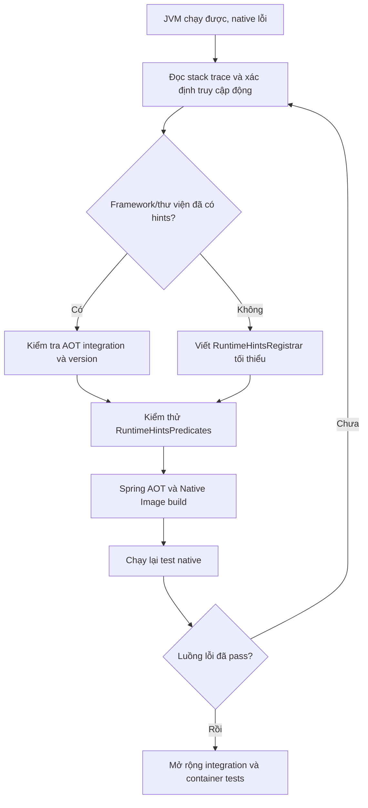

# RuntimeHints và thông tin bổ sung cho các truy cập không suy ra bằng phân tích tĩnh

## 1. Vì sao ứng dụng cần Runtime Hints?

Trong module **SPRING_BOOT_NATIVE_IMAGE**, chúng ta dùng **Spring AOT** để chuẩn bị ứng dụng Spring Boot cho GraalVM Native Image, sau đó kiểm tra tính tương thích, thời gian khởi động, bộ nhớ và cách đóng gói/vận hành trong container. Một thách thức cốt lõi của native compilation là trình biên dịch cần biết trước những thành phần mà ứng dụng sẽ truy cập khi chạy.

Trên JVM, ứng dụng có thể dùng tên class lấy từ cấu hình để gọi `Class.forName`, tạo object qua reflection, đọc template theo tên file, tạo proxy interface động hoặc serialize một kiểu được chọn lúc runtime. Những hành vi này có thể hoạt động dù bytecode không có lời gọi trực tiếp đến class/member/resource tương ứng. Phân tích tĩnh của Native Image có thể không suy ra được đầy đủ các đường đi đó.

**Runtime Hints** là API của Spring Framework để mô tả những nhu cầu truy cập động như vậy. Spring AOT thu thập hints trong quá trình xử lý application context và chuyển chúng thành thông tin phù hợp cho bước build native. Nhờ đó, Native Image có thể giữ lại hoặc cho phép truy cập các thành phần cần thiết trong executable.

Sau bài học, người học có thể:

1. Giải thích vì sao một ứng dụng chạy trên JVM vẫn có thể thiếu class, member hoặc resource khi chạy native.
2. Chọn đúng nhóm hints cho reflection, resource, JDK proxy, serialization và JNI.
3. Viết `RuntimeHintsRegistrar` và kết nối bằng `@ImportRuntimeHints`.
4. Kiểm thử hints độc lập bằng `RuntimeHintsPredicates`.
5. Phân biệt Spring Runtime Hints với GraalVM reachability metadata và hiểu cách chúng phối hợp.
6. Chẩn đoán lỗi dựa trên stack trace, đường truy cập động và bằng chứng build.

> **Nguyên tắc:** chỉ khai báo thông tin mà phân tích tĩnh không thể xác định nhưng ứng dụng thực sự cần. Hints quá rộng làm tăng bề mặt runtime và có thể khiến binary lớn hơn; hints thiếu hoặc sai vẫn gây lỗi khi chạy native.

## 2. Phân tích tĩnh có thể bỏ sót điều gì?

GraalVM Native Image phân tích tập mã có thể tiếp cận ở thời điểm build theo mô hình **closed-world**. Ví dụ, compiler dễ nhận diện lời gọi trực tiếp:

```java
OrderService service = new OrderService();
service.createOrder();
```

Nhưng nếu class được chọn bằng chuỗi cấu hình:

```java
String implementation = environment.getProperty("plugin.class");
Class<?> type = Class.forName(implementation);
Object plugin = type.getDeclaredConstructor().newInstance();
```

Trình biên dịch không nhất thiết biết giá trị của `plugin.class` trong mọi môi trường. Nếu kiểu được chọn và constructor không được mô tả bằng metadata phù hợp, Native Image có thể không đưa chúng vào executable hoặc không cho phép truy cập reflection lúc runtime.

Các nhóm truy cập thường cần chú ý:

| Hành vi | Vì sao khó suy ra tĩnh? | Hints có thể cần |
| --- | --- | --- |
| Reflection | Class/member được chọn từ tên chuỗi hoặc framework introspection. | Type, constructor, method, field. |
| Resource | Tên file được ghép từ cấu hình, locale hoặc dữ liệu runtime. | Resource pattern hoặc resource cụ thể. |
| Dynamic proxy | Interface proxy được chọn/tạo trong lúc chạy. | Danh sách interface cho JDK proxy. |
| Serialization | Kiểu được serialize/deserialize qua cơ chế cần metadata. | Kiểu serialization tương ứng. |
| JNI | Native code truy cập class/member Java. | JNI type/member và thư viện native tương ứng. |

Không phải mọi thư viện sử dụng reflection đều cần hints do ứng dụng tự viết. Spring và nhiều thư viện đã tích hợp AOT/native có thể tự cung cấp thông tin cần thiết. Hãy tái hiện lỗi hoặc kiểm tra metadata hiện có trước khi bổ sung cấu hình.

## 3. RuntimeHints gồm những nhóm nào?

Spring Framework cung cấp `RuntimeHints` như một đối tượng tổng hợp các nhóm hints. Những API thường dùng gồm:

- `hints.reflection()`: đăng ký class và member được truy cập bằng reflection.
- `hints.resources()`: đăng ký tài nguyên trên classpath cần giữ lại.
- `hints.proxies()`: đăng ký JDK dynamic proxy cho các interface.
- `hints.serialization()`: đăng ký kiểu cần hỗ trợ serialization theo cơ chế tương ứng.

Tên API và các overload có thể thay đổi theo Spring Framework version; dùng API của phiên bản mà Spring Boot project đang quản lý. JNI là một nhu cầu riêng của GraalVM/native library, không phải một nhóm accessor của Spring `RuntimeHints` trong API được trình bày ở đây. Hints cũng không thay thế dependency native của hệ điều hành: metadata JNI không tự đóng gói file `.so`, `.dylib` hoặc `.dll`.

### 3.1. Reflection hints

Reflection hints mô tả những member cần truy cập động. Ví dụ:

```java
import org.springframework.aot.hint.MemberCategory;
import org.springframework.aot.hint.RuntimeHints;

final class PluginHints {
    static void register(RuntimeHints hints) {
        hints.reflection().registerType(
            JsonPlugin.class,
            MemberCategory.INVOKE_DECLARED_CONSTRUCTORS,
            MemberCategory.INVOKE_PUBLIC_METHODS
        );
    }
}
```

Trong ví dụ, ứng dụng cần gọi constructor đã khai báo của `JsonPlugin` và các public methods qua reflection. Nếu cần đọc field, gọi declared methods không public hoặc dùng cách cấp quyền khác, phải đăng ký member category phù hợp. Không nên dùng một nhóm quyền rộng nếu chỉ cần một constructor.

Một class được đăng ký không đồng nghĩa mọi hoạt động reflection trên class đó đều được cho phép. Hãy đối chiếu chính xác thao tác trong code: constructor, method, field, annotation introspection hoặc truy cập member private có yêu cầu khác nhau.

### 3.2. Resource hints

Khi ứng dụng đọc resource bằng classpath, có thể đăng ký pattern:

```java
import org.springframework.aot.hint.RuntimeHints;

final class TemplateHints {
    static void register(RuntimeHints hints) {
        hints.resources().registerPattern("templates/*.txt");
        hints.resources().registerPattern("i18n/messages*.properties");
    }
}
```

Pattern phải khớp đường dẫn resource tương đối với classpath, không phải đường dẫn filesystem như `src/main/resources/templates/...`. Ví dụ `templates/*.txt` giả định file được đóng gói tại `templates/` trên classpath. Chỉ đăng ký các file thực sự được đọc theo đường dẫn động.

Nếu biết chính xác một file, có thể đăng ký tài nguyên cụ thể bằng API resource hints phù hợp với Spring version. Khi dùng pattern, kiểm tra quy tắc pattern của Spring ResourceHints và thử bằng native executable để tránh vô tình bỏ sót file nằm ở thư mục con.

### 3.3. JDK dynamic proxy hints

JDK dynamic proxy tạo một đối tượng thực thi một hoặc nhiều interface tại runtime. Ví dụ ứng dụng/thư viện có thể gọi `Proxy.newProxyInstance(...)` với danh sách interface được xác định động. Có thể đăng ký:

```java
import org.springframework.aot.hint.RuntimeHints;

interface PaymentGateway {
    Receipt charge(long amount);
}

interface Auditable {
    String auditId();
}

final class ProxyHints {
    static void register(RuntimeHints hints) {
        hints.proxies().registerJdkProxy(
            PaymentGateway.class,
            Auditable.class
        );
    }
}
```

Đăng ký đúng tổ hợp interface sẽ được proxy tạo ra. Không nhầm JDK dynamic proxy với CGLIB/class-based proxy; hai cơ chế có yêu cầu khác nhau và cần kiểm tra framework/plugin đã xử lý trường hợp cụ thể hay chưa. Với Spring AOP, hãy ưu tiên cấu hình Spring và hỗ trợ AOT sẵn có trước khi tự khai báo proxy.

### 3.4. Serialization hints

Một số cơ chế serialization cần biết trước kiểu được encode/decode. Ví dụ API của Spring có thể đăng ký kiểu:

```java
import org.springframework.aot.hint.RuntimeHints;

final class SerializationHints {
    static void register(RuntimeHints hints) {
        hints.serialization().registerType(StoredEvent.class);
    }
}
```

Đây là minh họa cho serialization hints của Spring, không phải hướng dẫn thay thế cho mọi serializer. Jackson JSON binding, Java native serialization, Kryo và serializer riêng có thể có yêu cầu khác nhau. Với Jackson/Spring MVC, kiểm tra hỗ trợ AOT và binding hints của framework trước; chỉ thêm serialization hints nếu cơ chế thật sự sử dụng nhóm API đó.

### 3.5. JNI và thư viện native

JNI cho phép native code gọi vào Java hoặc Java gọi native methods. Nếu thư viện dùng JNI và cần Native Image giữ lại class/member cho đường gọi đó, hãy cung cấp JNI reachability metadata theo định dạng GraalVM mà phiên bản mục tiêu hỗ trợ, hoặc dùng metadata do chính thư viện phân phối. Đây là cấu hình ở tầng Native Image, không phải gọi một `hints.jni()` trên Spring `RuntimeHints`. Metadata **không** thay thế việc cung cấp thư viện native phù hợp:

- File native library phải tồn tại cho OS/architecture đích.
- Tên thư viện, đường dẫn, loader và dynamic linking phải đúng môi trường.
- Cần kiểm thử load/unload và hành vi thực tế trong container.

Nếu ứng dụng không dùng JNI, không thêm JNI metadata chỉ vì Native Image là compiler tạo executable.

## 4. Tạo RuntimeHintsRegistrar

Khi một nhóm hints thuộc về ứng dụng, cách tổ chức có thể tái sử dụng là viết một lớp triển khai `RuntimeHintsRegistrar`. Spring gọi phương thức `registerHints` trong quá trình xử lý AOT:

```java
package com.example.orders;

import org.springframework.aot.hint.MemberCategory;
import org.springframework.aot.hint.RuntimeHints;
import org.springframework.aot.hint.RuntimeHintsRegistrar;

public final class OrderRuntimeHints implements RuntimeHintsRegistrar {

    @Override
    public void registerHints(RuntimeHints hints, ClassLoader classLoader) {
        hints.reflection().registerType(
            OrderPlugin.class,
            MemberCategory.INVOKE_DECLARED_CONSTRUCTORS,
            MemberCategory.INVOKE_PUBLIC_METHODS
        );

        hints.resources().registerPattern("templates/order-*.txt");
    }
}
```

Giải thích:

- `RuntimeHintsRegistrar` là extension point của Spring để đăng ký hints bằng code.
- `RuntimeHints` là nơi thêm các yêu cầu reflection/resources/proxies/serialization/JNI.
- `ClassLoader` được truyền vào để registrar có thể kiểm tra sự hiện diện của class khi cần; không nên dựa vào classloader context không xác định.
- Các kiểu và resource trong ví dụ phải tồn tại và thực sự được truy cập động.

Không đặt thao tác I/O, gọi database, lấy secret hoặc phụ thuộc môi trường production trong `registerHints`. Đây là bước build-time; registrar cần xác định và tái lập được trong môi trường build. Nếu metadata phụ thuộc một profile hoặc dependency có điều kiện, hãy thiết kế cấu hình AOT tương ứng và kiểm thử từng biến thể cần hỗ trợ.

### 4.1. Kết nối registrar bằng @ImportRuntimeHints

Tạo một cấu hình Spring và import registrar:

```java
package com.example.orders;

import org.springframework.context.annotation.Configuration;
import org.springframework.context.annotation.ImportRuntimeHints;

@Configuration(proxyBeanMethods = false)
@ImportRuntimeHints(OrderRuntimeHints.class)
class NativeRuntimeHintsConfiguration {
}
```

Đặt lớp cấu hình trong package được component scan của ứng dụng phát hiện, hoặc import nó rõ ràng bằng cấu hình Spring. Nếu lớp cấu hình không nằm trong application context được AOT xử lý, registrar có thể không được gọi.

Có thể đặt `@ImportRuntimeHints` trên một cấu hình Spring phù hợp; annotation này cho Spring biết registrar nào cung cấp hints. Nó không phải annotation runtime để tự thay đổi classloader lúc ứng dụng đã chạy.

### 4.2. Đăng ký hints trực tiếp qua API khi cần

Với một số trường hợp, Spring cung cấp annotation hoặc API thuận tiện hơn. Ví dụ `@RegisterReflectionForBinding` có thể hữu ích cho kiểu dữ liệu cần reflection phục vụ binding. Chọn giải pháp theo mục đích:

| Nhu cầu | Cách ưu tiên xem xét |
| --- | --- |
| DTO dùng cho binding/serialization được Spring hỗ trợ | Annotation binding hints hoặc hỗ trợ AOT tự động của framework. |
| Class/plugin được chọn bằng tên cấu hình | `RuntimeHintsRegistrar` với reflection hints có phạm vi rõ. |
| Resource được ghép tên lúc runtime | Resource hints. |
| JDK proxy có danh sách interface động | Proxy hints. |
| Dependency không tích hợp Spring nhưng có metadata Native Image | Reachability metadata trong JAR dependency. |

Không thêm `@RegisterReflectionForBinding` và reflection hints thủ công cho cùng một DTO nếu hỗ trợ hiện có đã đáp ứng; hãy kiểm tra output AOT và test để tránh cấu hình thừa.

## 5. Kiểm thử Runtime Hints trước khi build native

Một registrar có thể biên dịch nhưng đăng ký sai type, member hoặc resource. Spring cung cấp `RuntimeHintsPredicates` để kiểm tra các yêu cầu đã đăng ký. Cách tiếp cận là gọi registrar vào một `RuntimeHints` mới, sau đó assert các predicate tương ứng.

Ví dụ kiểm thử reflection và resource:

```java
package com.example.orders;

import org.junit.jupiter.api.Test;
import org.springframework.aot.hint.RuntimeHints;
import org.springframework.aot.hint.predicate.RuntimeHintsPredicates;

import static org.assertj.core.api.Assertions.assertThat;

class OrderRuntimeHintsTests {

    @Test
    void registersPluginConstructorAndTemplate() {
        RuntimeHints hints = new RuntimeHints();
        new OrderRuntimeHints().registerHints(
            hints,
            getClass().getClassLoader()
        );

        assertThat(
            RuntimeHintsPredicates.reflection()
                .onType(OrderPlugin.class)
                .withMemberCategory(
                    org.springframework.aot.hint.MemberCategory.INVOKE_DECLARED_CONSTRUCTORS
                )
        ).accepts(hints);

        assertThat(
            RuntimeHintsPredicates.resources()
                .forResource("templates/order-confirmation.txt")
        ).accepts(hints);
    }
}
```

Ví dụ minh họa API predicates phổ biến của Spring Framework; xác nhận import/package và overload đúng với version Spring đang dùng. Nếu kiểm tra pattern nhiều file, hãy kiểm tra resource thực tế tương ứng. Một predicate pass chứng minh metadata được đăng ký theo tiêu chí đó, **không chứng minh native executable chắc chắn chạy đúng toàn bộ luồng**.

### 5.1. Kiểm thử proxy/serialization

Với proxy, kiểm tra predicate cho danh sách interface mà ứng dụng dự kiến tạo. Với serialization, kiểm tra kiểu đã đăng ký. Dùng API predicates tương ứng của Spring version hiện tại; không viết test chỉ khẳng định registrar không ném exception. Test phải kiểm tra đúng type/member/resource cần thiết.

### 5.2. Kiểm thử bằng native executable

Unit test cho hints nên đi cùng integration/smoke test native:

1. Chạy luồng nghiệp vụ có sử dụng reflection/resource/proxy.
2. Kiểm tra response, dữ liệu và side effect giống bản JVM.
3. Thử trường hợp class/resource không tồn tại để xác nhận ứng dụng xử lý lỗi đúng.
4. Kiểm tra profile/cấu hình khác nhau nếu chúng thay đổi class hoặc resource được chọn.

Native Image build thành công và predicate pass vẫn chưa đủ nếu đường đi động chưa được thực thi trong native mode.

## 6. Phân biệt Spring Runtime Hints với GraalVM reachability metadata

Hai cơ chế có quan hệ nhưng khác vai trò:

| Khía cạnh | Spring Runtime Hints | GraalVM reachability metadata |
| --- | --- | --- |
| Chủ thể | Spring Framework/Spring application | Native Image toolchain và artifact/library |
| Cách khai báo | Java API, registrar, annotation | Metadata files trong `META-INF/native-image`, hoặc metadata được công cụ cung cấp |
| Thời điểm xử lý | Spring AOT xử lý trong build | GraalVM Native Image phân tích trong native build |
| Mục tiêu | Mô tả nhu cầu runtime của Spring/app | Cung cấp reachability configuration cho compiler |
| Phân phối | Source code ứng dụng và generated AOT outputs | Có thể đi cùng dependency JAR hoặc application resources |

Ví dụ: ứng dụng có plugin được chọn bằng tên cấu hình. Bạn có thể viết `RuntimeHintsRegistrar` để Spring AOT biết constructor/method cần thiết. Một thư viện bên thứ ba có thể tự đóng gói `reachability-metadata.json` trong JAR để mô tả reflection/resource của chính thư viện đó.

Khi build native, Spring AOT outputs và metadata của các dependency đều có thể là đầu vào. Không cần chuyển mọi RuntimeHints thành JSON bằng tay; Spring Boot/Native Build Tools đảm nhiệm tích hợp theo phiên bản được hỗ trợ. Ngược lại, không nên giả định tất cả metadata của dependency đều được Spring tự sinh: thư viện có thể cần cung cấp metadata riêng hoặc ứng dụng phải bổ sung.

### 6.1. Vị trí metadata trong project

Một số thư viện cung cấp GraalVM metadata theo cấu trúc:

```text
some-library.jar
└── META-INF/
    └── native-image/
        └── com.vendor/
            └── some-library/
                └── reachability-metadata.json
```

Ứng dụng cũng có thể đặt metadata của riêng mình trong resources:

```text
src/main/resources/
└── META-INF/native-image/
    └── com.example/
        └── orders-api/
            └── reachability-metadata.json
```

Đây là một cách tổ chức artifact-level metadata. Khi dùng Spring RuntimeHints, thường nên đặt registrar trong source code và kết nối với application context để AOT quản lý. Tránh khai báo cùng một nhu cầu ở cả hai nơi mà không có lý do rõ ràng.

## 7. Quy trình xử lý một lỗi native do truy cập động

Giả sử JVM chạy bình thường, nhưng native executable báo không tìm thấy constructor của `OrderPlugin`.

### Bước 1 — Tái hiện và xác định điểm truy cập

Đọc stack trace, xác định class/member được gọi và đoạn code gọi reflection. Kiểm tra tên class có đến từ property, file cấu hình, service discovery hoặc database không.

### Bước 2 — Xác định hỗ trợ hiện có

Kiểm tra dependency và framework có hỗ trợ AOT/native hay metadata đi kèm không. Không đăng ký trùng một class đã được Spring hoặc thư viện cung cấp hints đầy đủ.

### Bước 3 — Bổ sung hints tối thiểu

Viết registrar cho constructor/method thực sự được dùng. Nếu thiếu resource, thêm resource pattern tương ứng. Nếu proxy interface được tạo động, đăng ký đúng interface set.

### Bước 4 — Kiểm thử registrar

Dùng `RuntimeHintsPredicates` để assert metadata đã đăng ký. Nếu predicate không nhận, sửa registrar hoặc kiểm tra cấu hình Spring import registrar.

### Bước 5 — Chạy Spring AOT và Native Image build

Với Maven (giả định profile/plugin native đã cấu hình):

```bash
./mvnw -Pnative spring-boot:process-aot
./mvnw -Pnative native:compile
```

Với Gradle:

```bash
./gradlew processAot
./gradlew nativeCompile
```

Kiểm tra log để xác nhận đúng GraalVM/toolchain, AOT output và metadata được dùng. Không sửa trực tiếp generated source; hãy sửa registrar hoặc cấu hình source rồi build lại.

### Bước 6 — Chạy test native

Chạy lại đúng đường đi đã lỗi, rồi mở rộng sang test integration/API. Nếu lỗi vẫn còn, xác minh member category có đúng loại truy cập không; đăng ký constructor không tự cho phép mọi private method/field. Kiểm tra thêm resource path, classpath và dependency native.



## 8. Những sai lầm phổ biến

| Sai lầm | Hậu quả | Cách làm tốt hơn |
| --- | --- | --- |
| Đăng ký mọi member của mọi class | Metadata rộng, binary có thể lớn và khó hiểu. | Chỉ khai báo member được gọi động và có bằng chứng. |
| Nghĩ `@ImportRuntimeHints` tự kích hoạt trong mọi project | Registrar không được gọi nếu cấu hình không nằm trong AOT application context. | Đặt/import configuration đúng và test registrar/AOT. |
| Dùng resource filesystem path thay cho classpath path | Native Image không match resource cần thiết. | Dùng đường dẫn tương đối với classpath, kiểm tra output resources. |
| Chỉ chạy unit test hints | Có thể bỏ sót lỗi runtime trong native executable. | Thêm integration/smoke test native. |
| Coi RuntimeHints là GraalVM JSON metadata | Nhầm tầng abstraction và nơi xử lý. | Dùng Spring API cho app hints; metadata artifact cho thư viện/toolchain khi phù hợp. |
| Thêm JNI metadata nhưng không có thư viện native | Binary không thể load native library trên OS đích. | Đóng gói đúng thư viện và kiểm tra linker/runtime dependencies. |
| Chạy tracing agent một lần rồi coi metadata đầy đủ | Các đường đi chưa quan sát có thể bị bỏ sót. | Kết hợp scenario test, review metadata và test native. |
| Chỉnh generated AOT output trực tiếp | Thay đổi bị ghi đè ở build sau. | Sửa registrar, annotation hoặc source configuration. |

## 9. Bài thực hành: plugin động và resource template

**Bối cảnh:** dịch vụ Spring Boot chọn implementation `OrderPlugin` từ cấu hình `orders.plugin-class` và đọc template `templates/order-confirmation.txt`. JVM chạy được nhưng Native Image thiếu constructor và template.

### Nhiệm vụ

1. Tạo interface/plugin và một implementation có constructor công khai.
2. Viết code chọn class từ property và khởi tạo bằng reflection; viết test JVM cho luồng hợp lệ và class name sai.
3. Tạo resource template trong `src/main/resources/templates/`.
4. Viết `OrderRuntimeHints` đăng ký constructor/member thực sự cần và resource pattern phù hợp.
5. Import registrar bằng `@ImportRuntimeHints` trên cấu hình thuộc application context.
6. Viết test dùng `RuntimeHintsPredicates` cho constructor và template.
7. Chạy Spring AOT và native build; kiểm tra log, không sửa generated files.
8. Chạy native executable với các property hợp lệ/không hợp lệ; so sánh response và cách xử lý lỗi với JVM.
9. Ghi lại metadata, phiên bản GraalVM/Spring, lệnh build và điều kiện tái lập.

### Hồ sơ kết quả

| Bằng chứng | Nội dung cần lưu |
| --- | --- |
| Truy cập động | Property chọn class, constructor/method được gọi, resource path. |
| Registrar | Các hints đã đăng ký và lý do. |
| Spring configuration | Nơi `@ImportRuntimeHints` được khai báo và cách cấu hình được phát hiện. |
| Predicate tests | Assertions reflection/resource/proxy/serialization nếu có. |
| AOT/native build | Lệnh, version, log và đường dẫn executable. |
| Native runtime tests | Luồng hợp lệ, lỗi class, lỗi resource, kết quả API. |
| Đối chiếu JVM/native | Sai khác đã phát hiện và cách giải quyết. |

### Tiêu chí hoàn thành

- [ ] Giải thích được hành vi động nào không thể suy ra đầy đủ bằng phân tích tĩnh.
- [ ] Chọn đúng loại Runtime Hints cho từng truy cập.
- [ ] Registrar được Spring AOT gọi thông qua cấu hình hợp lệ.
- [ ] Predicate tests xác nhận đúng type/member/resource cần thiết.
- [ ] Native executable chạy được luồng plugin và template.
- [ ] Các trường hợp lỗi được kiểm tra, không chỉ luồng thành công.
- [ ] Có thể tái lập build và giải thích ranh giới giữa Spring hints với GraalVM metadata.

## 10. Câu hỏi tự đánh giá

1. Vì sao `Class.forName` với class name lấy từ cấu hình có thể cần reflection hints khi build native?
2. `RuntimeHintsRegistrar` được gọi ở giai đoạn nào và cần được kết nối vào Spring application context bằng cách nào?
3. Vì sao resource hint dùng classpath-relative path thay vì đường dẫn `src/main/resources`?
4. Đăng ký constructor có đảm bảo mọi method/field của class đều truy cập reflection được không?
5. Khi nào nên dùng `@RegisterReflectionForBinding` hoặc hỗ trợ AOT của framework thay cho registrar tự viết?
6. RuntimeHints và `reachability-metadata.json` khác nhau ở chủ thể khai báo và thời điểm xử lý nào?
7. Vì sao predicate tests cần được bổ sung bằng native integration tests?
8. JNI reachability metadata giải quyết phần nào và phần nào vẫn phụ thuộc hệ điều hành/container?

## 11. Tài liệu chính thức

API cụ thể phụ thuộc Spring Framework version mà Spring Boot quản lý. Khi triển khai, đối chiếu tài liệu đúng release:

- [Spring Framework — Runtime Hints](https://docs.spring.io/spring-framework/reference/core/aot.html): reflection, resources, proxy, serialization và RuntimeHintsRegistrar.
- [Spring Framework API — RuntimeHints](https://docs.spring.io/spring-framework/docs/current/javadoc-api/org/springframework/aot/hint/RuntimeHints.html): các nhóm hints và API đăng ký.
- [Spring Framework API — RuntimeHintsRegistrar](https://docs.spring.io/spring-framework/docs/current/javadoc-api/org/springframework/aot/hint/RuntimeHintsRegistrar.html): extension point đăng ký hints.
- [Spring Framework API — ImportRuntimeHints](https://docs.spring.io/spring-framework/docs/current/javadoc-api/org/springframework/context/annotation/ImportRuntimeHints.html): kết nối registrar với cấu hình Spring.
- [Spring Framework API — RuntimeHintsPredicates](https://docs.spring.io/spring-framework/docs/current/javadoc-api/org/springframework/aot/hint/predicate/RuntimeHintsPredicates.html): kiểm thử hints.
- [GraalVM Native Image — Reachability Metadata](https://www.graalvm.org/latest/reference-manual/native-image/metadata/): metadata artifact và cách cung cấp thông tin cho Native Image.
- [Spring Boot — GraalVM Native Image](https://docs.spring.io/spring-boot/reference/packaging/native-image/index.html): quy trình AOT/native cho ứng dụng Spring Boot.

**Điểm cần nhớ:** Runtime Hints là hợp đồng mô tả những truy cập động mà ứng dụng cần. Đăng ký đúng hints, kết nối registrar vào Spring AOT, kiểm thử predicate và chạy native integration tests sẽ giúp biến những giả định về reflection/resource/proxy thành bằng chứng có thể kiểm tra.
