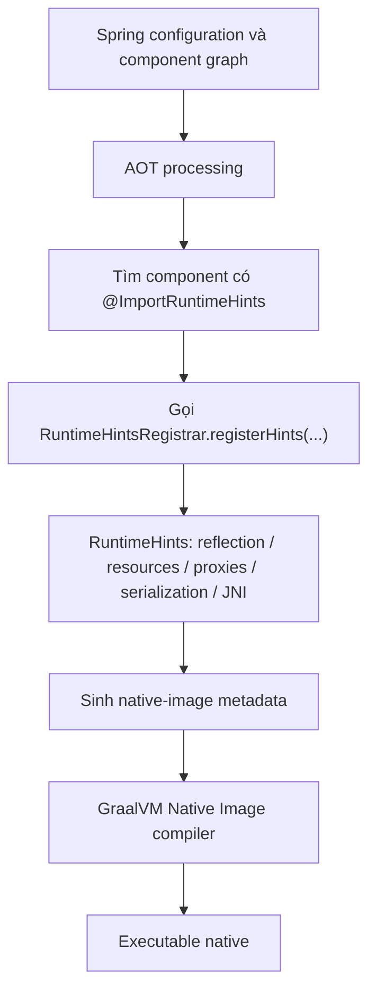
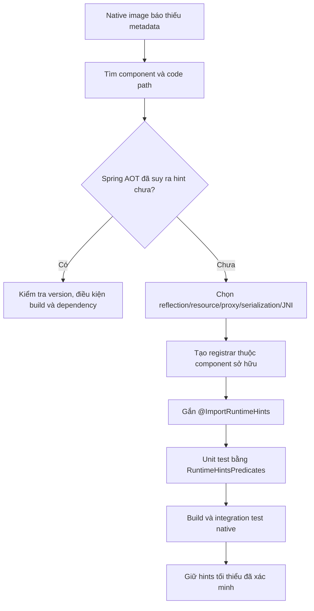

# `RuntimeHintsRegistrar` và tổ chức hints theo thành phần sở hữu

## 1. Vì sao cần tổ chức Runtime Hints theo component?

Khi chạy ứng dụng Spring Boot trên JVM, nhiều thư viện có thể sử dụng reflection, đọc file từ classpath, tạo JDK proxy hoặc Java serialization mà không cần người phát triển khai báo trước từng thao tác. Với **GraalVM Native Image**, trình biên dịch phân tích reachability ở build time và cần biết trước những hành vi động như vậy. Một class hoặc resource chỉ được truy cập bằng tên ở runtime có thể không tự động được đưa vào executable.

Spring AOT và Spring Framework cung cấp `RuntimeHints` để mô tả những khả năng cần thiết. Khi core container không thể suy ra một yêu cầu, ta có thể bổ sung hints bằng **`RuntimeHintsRegistrar`**.

Ví dụ một hệ thống đặt hàng có các thành phần:

- `InvoiceExportService` đọc template và gọi một số method bằng reflection.
- `PaymentGatewayClient` sử dụng JDK dynamic proxy cho một interface tích hợp.
- `LegacyXmlAdapter` tùy chọn tích hợp thư viện XML của bên thứ ba.
- `NativeCompressionAdapter` gọi thư viện native qua JNI.

Nếu gom tất cả hints vào một registrar lớn ở cấu hình ứng dụng trung tâm, mỗi lần thêm hoặc bỏ một thành phần lại phải sửa danh sách dùng chung. Điều đó dễ làm hints của một thư viện tùy chọn bị đưa vào image dù thư viện không được sử dụng.

**Nguyên tắc quan trọng:** thành phần nào sở hữu hành vi động thì thành phần đó nên sở hữu registrar tương ứng. Đặt `@ImportRuntimeHints` sát bean hoặc `@Bean` factory method cần hints giúp Spring chỉ đóng góp hints khi thành phần đó thực sự có mặt trong `BeanFactory`.

Sau bài này, bạn có thể:

- Viết `RuntimeHintsRegistrar` và đăng ký bằng `@ImportRuntimeHints`.
- Chọn API phù hợp cho reflection, resource, JDK proxy, Java serialization và JNI.
- Tổ chức hints theo component, module hoặc thư viện sở hữu.
- Xử lý dependency tùy chọn bằng `ClassLoader` được cung cấp.
- Kiểm thử registrar với `RuntimeHintsPredicates` và xác minh hành vi trên native executable.

## 2. `RuntimeHintsRegistrar` hoạt động ở đâu?

### 2.1. Runtime hints là metadata build time

`RuntimeHints` không phải một service chạy để bật reflection sau khi ứng dụng đã khởi động. Đây là tập mô tả những hành vi cần được giữ lại hoặc hỗ trợ khi tạo native image. Spring AOT gọi registrar **trong quá trình xử lý AOT tại build time**, thu thập các hints và tạo cấu hình tương ứng cho native compiler.



Hệ quả: nếu một bean được điều kiện cấu hình loại khỏi `BeanFactory`, registrar gắn với bean đó cũng không đóng góp hints thông qua `@ImportRuntimeHints`. Nếu điều kiện thay đổi sau khi native executable đã build, hints không được bổ sung lại lúc runtime.

### 2.2. Interface và phương thức chính

`RuntimeHintsRegistrar` là functional interface trong package `org.springframework.aot.hint`:

```java
package org.springframework.aot.hint;

public interface RuntimeHintsRegistrar {

    void registerHints(RuntimeHints hints, ClassLoader classLoader);
}
```

API `RuntimeHints` và `RuntimeHintsRegistrar` có từ Spring Framework 6.0. Với Spring Boot 3.x trở lên, đây là cơ chế chuẩn của Spring AOT; các ví dụ Spring Native cũ thuộc hệ sinh thái Spring Boot 2 có thể dùng cách cấu hình khác.

`registerHints(...)` nhận hai đối số:

| Tham số | Ý nghĩa | Cách sử dụng |
|---|---|---|
| `RuntimeHints hints` | Tập hints mà AOT engine đang thu thập | Đăng ký reflection, resource, proxy, serialization hoặc JNI cần thiết |
| `ClassLoader classLoader` | Class loader của deployment unit; có thể là `null` trong một số môi trường | Dùng để kiểm tra class/resource có tồn tại, đặc biệt với dependency tùy chọn |

Registrar nên có **constructor không tham số** và không phụ thuộc vào bean runtime của ứng dụng. AOT engine tạo registrar để thu thập metadata, không dùng registrar như một service thông thường trong `ApplicationContext`.

Không nên đọc file cấu hình production, truy vấn database, gọi HTTP hoặc tạo kết nối ngoài trong `registerHints(...)`. Build phải có khả năng tái lập; registrar nên chỉ mô tả metadata dựa trên classpath và thông tin build đã biết.

## 3. Đăng ký registrar với `@ImportRuntimeHints`

### 3.1. Đặt annotation gần component sở hữu

Spring cung cấp `@ImportRuntimeHints` trong package `org.springframework.context.annotation`. Annotation có thể đặt trên một Spring bean hoặc trên phương thức `@Bean`.

Ví dụ một dịch vụ xuất hóa đơn đọc template theo tên:

```java
package com.example.orders.invoice;

import java.util.Locale;
import java.util.List;

import org.springframework.aot.hint.ExecutableMode;
import org.springframework.aot.hint.RuntimeHints;
import org.springframework.aot.hint.RuntimeHintsRegistrar;
import org.springframework.context.annotation.ImportRuntimeHints;
import org.springframework.core.io.ClassPathResource;
import org.springframework.stereotype.Component;

@Component
@ImportRuntimeHints(InvoiceExportRuntimeHints.class)
public class InvoiceExportService {

    public ClassPathResource template(Locale locale) {
        return new ClassPathResource(
                "templates/invoice/" + locale.getLanguage() + ".html");
    }

    static class InvoiceExportRuntimeHints implements RuntimeHintsRegistrar {

        @Override
        public void registerHints(RuntimeHints hints, ClassLoader classLoader) {
            hints.resources().registerPattern("templates/invoice/*.html");
            hints.reflection().registerType(InvoiceRow.class, typeHint -> typeHint
                    .withMethod("toExternalFormat", List.of(), ExecutableMode.INVOKE));
        }
    }
}
```

Trong ví dụ, `InvoiceExportRuntimeHints` được đặt ngay trong class sở hữu resource. Pattern được tính từ **classpath root**, ví dụ `src/main/resources/templates/invoice/en.html` sẽ có tên resource `templates/invoice/en.html`. Không thêm tiền tố `src/main/resources/` vào pattern.

Nếu `InvoiceExportService` không được scan/import hoặc bị điều kiện cấu hình loại bỏ, hints của nó cũng không được đóng góp qua annotation này. Đây là lý do Spring khuyến nghị dùng `@ImportRuntimeHints` càng gần component cần hints càng tốt.

### 3.2. Đăng ký qua `@Bean` factory method

Khi component được tạo bởi cấu hình Java thay vì component scan, có thể gắn annotation lên factory method:

```java
package com.example.orders.invoice;

import org.springframework.context.annotation.Bean;
import org.springframework.context.annotation.Configuration;
import org.springframework.context.annotation.ImportRuntimeHints;

@Configuration(proxyBeanMethods = false)
class InvoiceConfiguration {

    @Bean
    @ImportRuntimeHints(InvoiceExportService.InvoiceExportRuntimeHints.class)
    InvoiceExportService invoiceExportService() {
        return new InvoiceExportService();
    }
}
```

Nếu phương thức `@Bean` còn có `@Conditional`, registrar chỉ đóng góp hints khi bean definition tương ứng được đăng ký. Điều này hữu ích cho starter hoặc module có thể bật/tắt theo cấu hình.

### 3.3. Khi nào dùng `META-INF/spring/aot.factories`?

Spring cũng hỗ trợ đăng ký registrar tĩnh trong file `META-INF/spring/aot.factories`:

```properties
org.springframework.aot.hint.RuntimeHintsRegistrar=com.example.shared.SharedLibraryRuntimeHints
```

Cách này phù hợp với thư viện hoặc hạ tầng cần đóng góp hints toàn cục khi module hiện diện trên classpath, không gắn với một Spring bean cụ thể. Tuy nhiên, nếu thư viện là tùy chọn hoặc hints chỉ cần khi một component được tạo, `@ImportRuntimeHints` thường có phạm vi tốt hơn.

| Cách đăng ký | Phạm vi | Khi nên dùng |
|---|---|---|
| `@ImportRuntimeHints` trên component | Gắn với bean/component được đưa vào `BeanFactory` | Lựa chọn mặc định cho application component và integration tùy chọn |
| `@ImportRuntimeHints` trên `@Bean` method | Gắn với bean do factory method tạo | Cấu hình Java, conditional bean hoặc starter |
| `META-INF/spring/aot.factories` | Registrar được đăng ký tĩnh theo deployment unit | Hints dùng chung của thư viện/hạ tầng không gắn với một bean cụ thể |

## 4. Nhóm hints và API thường dùng

`RuntimeHints` cung cấp các điểm truy cập chính sau:

| API | Mô tả | Ví dụ nhu cầu |
|---|---|---|
| `hints.reflection()` | Reflection trên type, constructor, method, field | Thư viện gọi method bằng reflection |
| `hints.resources()` | Resource trên classpath và resource bundle | Đọc template, schema, dictionary hoặc file cấu hình đóng gói |
| `hints.proxies()` | JDK dynamic proxy và class proxy | Tạo proxy cho interface ở runtime |
| `hints.serialization()` | Java object serialization | Ghi/đọc object qua `ObjectOutputStream`/`ObjectInputStream` |
| `hints.jni()` | Reflection-like access cần cho JNI | Truy cập member của class từ mã native qua JNI |

Không phải mọi hoạt động serialization hoặc proxy đều cần hints thủ công. Spring AOT và các thư viện được hỗ trợ có thể tự suy ra một số nhu cầu. Chỉ thêm hints cho hành vi động mà framework không thể tự nhận biết.

## 5. Reflection hints: đăng ký đúng member cần gọi

### 5.1. Ví dụ component sở hữu reflection

Giả sử thư viện xuất dữ liệu sử dụng reflection để gọi `toExternalFormat()` trên `InvoiceRow`:

```java
package com.example.orders.invoice;

public class InvoiceRow {

    public String toExternalFormat() {
        return "invoice-row";
    }
}
```

Registrar có thể đăng ký đúng method:

```java
hints.reflection().registerType(InvoiceRow.class, typeHint -> typeHint
        .withMethod("toExternalFormat", java.util.List.of(), ExecutableMode.INVOKE));
```

Đây là phần reflection được gộp vào `InvoiceExportRuntimeHints` ở ví dụ trước. Nếu một component có nhiều nhóm nhu cầu độc lập, có thể tách registrar riêng rồi liệt kê nhiều class trong `@ImportRuntimeHints`. `ExecutableMode.INVOKE` biểu thị method sẽ được gọi qua reflection. Nếu thư viện cần constructor hoặc field cụ thể, đăng ký chính xác constructor/field đó hoặc các `MemberCategory` tương ứng.

Ví dụ đăng ký các public constructor và public method khi một thư viện thật sự cần toàn bộ nhóm member này:

```java
import org.springframework.aot.hint.MemberCategory;

hints.reflection().registerType(
        InvoiceRow.class,
        MemberCategory.INVOKE_PUBLIC_CONSTRUCTORS,
        MemberCategory.INVOKE_PUBLIC_METHODS);
```

Tránh đăng ký toàn bộ member category nếu chỉ một method được gọi. Hints càng rộng, native image càng phải giữ nhiều metadata và càng khó phát hiện phần reflection thực sự cần thiết.

### 5.2. Dependency tùy chọn: dùng `registerTypeIfPresent`

Một starter có thể tích hợp với thư viện bên ngoài nhưng không bắt buộc thư viện đó phải có mặt trong mọi ứng dụng. Không nên tham chiếu class tùy chọn trực tiếp trong code registrar nếu việc đó khiến class loading thất bại khi dependency không được cài.

Có thể dùng `registerTypeIfPresent(...)`:

```java
import org.springframework.aot.hint.ExecutableMode;
import org.springframework.aot.hint.RuntimeHints;
import org.springframework.aot.hint.RuntimeHintsRegistrar;

public class OptionalXmlRuntimeHints implements RuntimeHintsRegistrar {

    @Override
    public void registerHints(RuntimeHints hints, ClassLoader classLoader) {
        hints.reflection().registerTypeIfPresent(
                classLoader,
                "com.vendor.xml.XmlEncoder",
                typeHint -> typeHint.withMethod(
                        "encode",
                        java.util.List.of(org.springframework.aot.hint.TypeReference.of(String.class)),
                        ExecutableMode.INVOKE));
    }
}
```

Registrar sử dụng class loader do Spring cung cấp và chỉ đăng ký hint khi class có thể được tìm thấy. Đây là cách hữu ích cho thư viện starter hỗ trợ nhiều integration tùy chọn.

Không thay `classLoader` bằng `ClassLoader.getSystemClassLoader()` theo thói quen. Class loader của ứng dụng có thể khác system class loader; đối số được truyền vào registrar phản ánh deployment unit cần phân tích và có thể là `null` trong một số trường hợp.

## 6. Resource hints: đóng gói resource theo module sở hữu

### 6.1. Resource theo pattern

Classpath resource không tự động được giữ lại trong native image chỉ vì code có thể ghép chuỗi tên file ở runtime. Đăng ký pattern trong registrar của component đọc resource:

```java
public class InvoiceTemplateRuntimeHints implements RuntimeHintsRegistrar {

    @Override
    public void registerHints(RuntimeHints hints, ClassLoader classLoader) {
        hints.resources().registerPattern("templates/invoice/*.html");
        hints.resources().registerPattern("schemas/invoice/*.xsd");
    }
}
```

Pattern resource tính từ classpath root. Ví dụ:

```text
src/main/resources/
  templates/
    invoice/
      en.html
      vi.html
  schemas/
    invoice/
      invoice-v1.xsd
```

Nếu ứng dụng chỉ cần `templates/invoice/vi.html`, có thể đăng ký đúng file đó. Pattern rộng như `**/*` có thể giữ lại rất nhiều tài nguyên và làm tăng kích thước image.

### 6.2. Resource bundle

Nếu component sử dụng `ResourceBundle` theo base name, đăng ký bundle:

```java
hints.resources().registerResourceBundle("messages.invoice");
```

Với cấu trúc:

```text
src/main/resources/
  messages/
    invoice.properties
    invoice_en.properties
    invoice_vi.properties
```

Base name là `messages.invoice`, không phải tên file có đuôi `.properties`.

### 6.3. Chỉ đăng ký resource nếu tồn tại

Trong thư viện có resource tùy chọn, có thể dùng `registerPatternIfPresent(...)` để kiểm tra trước khi đóng góp hint:

```java
hints.resources().registerPatternIfPresent(
        classLoader,
        "META-INF/vendor/xml-defaults.properties",
        resourceHint -> resourceHint.includes("META-INF/vendor/xml-defaults.properties"));
```

Phương thức kiểm tra `location` có trên classpath bằng `classLoader`; callback `resourceHint` khai báo pattern thực sự cần đưa vào image. Cách này tránh đăng ký resource hint cho một file không có trong deployment.

## 7. JDK proxy hints: component nào tạo proxy thì component đó đăng ký

Một số thư viện tạo JDK dynamic proxy bằng `Proxy.newProxyInstance(...)`. Native Image cần biết trước những interface mà proxy sẽ triển khai.

Giả sử `PaymentGatewayClient` tạo proxy cho interface `PaymentGateway`:

```java
public interface PaymentGateway {
    PaymentResult authorize(PaymentRequest request);
}
```

Registrar sở hữu proxy:

```java
import org.springframework.aot.hint.RuntimeHints;
import org.springframework.aot.hint.RuntimeHintsRegistrar;

public class PaymentGatewayRuntimeHints implements RuntimeHintsRegistrar {

    @Override
    public void registerHints(RuntimeHints hints, ClassLoader classLoader) {
        hints.proxies().registerJdkProxy(PaymentGateway.class);
    }
}
```

Gắn registrar vào component tích hợp:

```java
@Component
@ImportRuntimeHints({
        PaymentGatewayRuntimeHints.class,
        PaymentSerializationRuntimeHints.class
})
public class PaymentGatewayClient {
    // Tạo hoặc sử dụng JDK dynamic proxy cho PaymentGateway.
}
```

Nếu proxy được tạo bởi Spring AOP hoặc thư viện framework, kiểm tra xem framework đã tự đăng ký proxy hints chưa. Đối với proxy Spring AOP, `AopProxyUtils.completeJdkProxyInterfaces(...)` có thể hữu ích khi tự đăng ký các interface hoàn chỉnh. Không đăng ký proxy chỉ vì một interface có thể được proxy; phải có code path thật sự tạo proxy đó.

## 8. Java serialization hints: không nhầm với JSON binding

`hints.serialization()` dành cho **Java native object serialization**, ví dụ `ObjectOutputStream` và `ObjectInputStream`. Nó không đồng nghĩa với việc một DTO được Jackson serialize thành JSON qua REST API.

Ví dụ:

```java
import java.io.Serializable;

public class PaymentSnapshot implements Serializable {

    private static final long serialVersionUID = 1L;

    private String transactionId;

    public PaymentSnapshot() {
    }
}
```

Nếu component thật sự dùng Java serialization cho kiểu này:

```java
import org.springframework.aot.hint.RuntimeHints;
import org.springframework.aot.hint.RuntimeHintsRegistrar;

public class PaymentSerializationRuntimeHints implements RuntimeHintsRegistrar {

    @Override
    public void registerHints(RuntimeHints hints, ClassLoader classLoader) {
        hints.serialization().registerType(PaymentSnapshot.class);
    }
}
```

Trong ứng dụng Spring MVC/WebFlux trả DTO JSON, Spring AOT thường có thể suy ra nhiều reflection/binding hints từ kiểu trả về của controller. Nếu DTO được serialize theo cách động mà core container không nhìn thấy (ví dụ dùng WebClient trong method body, mapping tự tạo hoặc thư viện tùy biến), hãy đánh giá `@RegisterReflectionForBinding` nếu phiên bản Spring hỗ trợ hoặc đăng ký reflection hints chính xác.

Không thêm `hints.serialization()` cho mọi DTO JSON. Java serialization và JSON serialization là hai cơ chế khác nhau.

## 9. JNI hints: đăng ký phần Java được native code truy cập

Một component gọi native library bằng JNI có thể cần khai báo những class/member được truy cập từ native code:

```java
import org.springframework.aot.hint.MemberCategory;
import org.springframework.aot.hint.RuntimeHints;
import org.springframework.aot.hint.RuntimeHintsRegistrar;

public class NativeCompressionRuntimeHints implements RuntimeHintsRegistrar {

    @Override
    public void registerHints(RuntimeHints hints, ClassLoader classLoader) {
        hints.jni().registerType(
                NativeCompressionBridge.class,
                MemberCategory.INVOKE_PUBLIC_METHODS,
                MemberCategory.INVOKE_PUBLIC_CONSTRUCTORS);
    }
}
```

JNI hints mô tả khả năng truy cập Java từ mã native. Chúng **không đóng gói hoặc chuyển đổi** thư viện `.so`, `.dll` hay `.dylib`. Bạn vẫn phải bảo đảm native library có trong image, đúng hệ điều hành/kiến trúc CPU, đúng ABI và có thể được loader tìm thấy.

Đặt registrar ngay cạnh `NativeCompressionAdapter` hoặc module JNI sở hữu bridge. Khi integration không được dùng, hints và native dependency của integration đó không nên bị kéo vào image một cách vô ích.

## 10. Tổ chức hints theo thành phần sở hữu

### 10.1. Cấu trúc package gợi ý

```text
com.example.orders/
  invoice/
    InvoiceExportService.java
    InvoiceRow.java
  payment/
    PaymentGatewayClient.java
    PaymentGatewayRuntimeHints.java
    PaymentSerializationRuntimeHints.java
  xml/
    OptionalXmlAdapter.java
    OptionalXmlRuntimeHints.java
  nativecompression/
    NativeCompressionAdapter.java
    NativeCompressionRuntimeHints.java
```

Mỗi registrar phản ánh nhu cầu của một component hoặc integration. Không cần bắt buộc một registrar cho từng class nhỏ; nhóm các hints lại khi chúng cùng thuộc một component và cùng vòng đời bật/tắt.

### 10.2. Quy tắc sở hữu

| Chủ sở hữu | Hints nên quản lý | Nơi đăng ký |
|---|---|---|
| Invoice export | Reflection trên `InvoiceRow`, template invoice | `InvoiceExportService` |
| Payment gateway | JDK proxy của `PaymentGateway`, Java serialization nếu thật sự dùng | `PaymentGatewayClient` |
| XML adapter tùy chọn | Reflection/resource của thư viện XML nếu class có mặt | `OptionalXmlAdapter` hoặc cấu hình bean có điều kiện |
| Native compression | JNI member của bridge, class/resource phụ trợ | `NativeCompressionAdapter` |
| Shared library infrastructure | Hints bắt buộc cho toàn deployment, không phụ thuộc một bean cụ thể | `META-INF/spring/aot.factories` khi phù hợp |

### 10.3. Vì sao gắn registrar sát component?

Giả sử `OptionalXmlAdapter` được tạo bằng:

```java
@Configuration(proxyBeanMethods = false)
class XmlConfiguration {

    @Bean
    @ConditionalOnClass(name = "com.vendor.xml.XmlEncoder")
    @ConditionalOnProperty(prefix = "orders.xml", name = "enabled", havingValue = "true")
    @ImportRuntimeHints(OptionalXmlRuntimeHints.class)
    OptionalXmlAdapter optionalXmlAdapter() {
        return new OptionalXmlAdapter();
    }
}
```

Khi class vendor không có mặt hoặc property không bật tại build time, bean definition không được đóng góp và registrar gắn trên factory method cũng không được xử lý qua đường này. Nhờ vậy, native metadata không bị thêm vô điều kiện chỉ vì ứng dụng có dependency của starter.

Lưu ý: các điều kiện `@Conditional` và `@Profile` ảnh hưởng bean graph được đánh giá trong AOT build. Native executable không thể bật integration mới bằng cách thay đổi property lúc chạy nếu integration đó đã bị loại khỏi cấu trúc AOT.

### 10.4. Tránh registrar trung tâm quá lớn

Một registrar tổng hợp có thể hữu ích cho một thư viện nhỏ, nhưng dễ trở thành điểm tập trung không rõ ownership khi ứng dụng lớn lên:

```java
// Thiết kế khó bảo trì khi hệ thống lớn dần
public class AllApplicationRuntimeHints implements RuntimeHintsRegistrar {
    @Override
    public void registerHints(RuntimeHints hints, ClassLoader classLoader) {
        // Reflection cho invoice, payment, xml, native compression...
        // Resource của nhiều module...
        // Proxy và serialization của các integration khác...
    }
}
```

Những vấn đề thường gặp:

- Gỡ một module nhưng quên xóa hints và dependency liên quan.
- Hints của integration tùy chọn luôn được thêm vào dù bean không tồn tại.
- Người bảo trì không biết class nào đang sử dụng reflection hoặc resource đó.
- Một thay đổi ở component nhỏ lại phải sửa registrar toàn ứng dụng.

Thay vào đó, chia registrar theo component/module và dùng `@ImportRuntimeHints` để liên kết metadata với nơi sử dụng.

## 11. Kiểm thử registrar với `RuntimeHintsPredicates`

Đừng chỉ xác nhận native build thành công. Hãy kiểm tra registrar tạo đúng hints trước khi gọi native compiler. Spring Core cung cấp `RuntimeHintsPredicates` cho reflection, resource, serialization và proxy.

### 11.1. Unit test cho resource và reflection

```java
package com.example.orders.invoice;

import org.junit.jupiter.api.Test;
import org.springframework.aot.hint.RuntimeHints;
import org.springframework.aot.hint.predicate.RuntimeHintsPredicates;

import static org.assertj.core.api.Assertions.assertThat;

class InvoiceExportRuntimeHintsTests {

    @Test
    void registersInvoiceTemplateAndReflection() {
        RuntimeHints hints = new RuntimeHints();
        new InvoiceExportService.InvoiceExportRuntimeHints().registerHints(
                hints, getClass().getClassLoader());

        assertThat(RuntimeHintsPredicates.resource()
                .forResource("templates/invoice/vi.html"))
                .accepts(hints);

        assertThat(RuntimeHintsPredicates.reflection()
                .onMethod(InvoiceRow.class, "toExternalFormat")
                .invoke())
                .accepts(hints);
    }
}
```

Test này gọi registrar trực tiếp, sau đó kiểm tra hints đã khai báo có bao phủ nhu cầu mà component sử dụng hay chưa. Nếu đổi tên template hoặc method nhưng quên cập nhật hints, test sẽ phát hiện sớm.

### 11.2. Unit test cho proxy và Java serialization

```java
package com.example.orders.payment;

import org.junit.jupiter.api.Test;
import org.springframework.aot.hint.RuntimeHints;
import org.springframework.aot.hint.predicate.RuntimeHintsPredicates;

import static org.assertj.core.api.Assertions.assertThat;

class PaymentRuntimeHintsTests {

@Test
void registersPaymentProxyAndSerialization() {
    RuntimeHints hints = new RuntimeHints();
    new PaymentGatewayRuntimeHints().registerHints(
            hints, getClass().getClassLoader());
    new PaymentSerializationRuntimeHints().registerHints(
            hints, getClass().getClassLoader());

    assertThat(RuntimeHintsPredicates.proxies()
            .forInterfaces(PaymentGateway.class))
            .accepts(hints);

    assertThat(RuntimeHintsPredicates.serialization()
            .onType(PaymentSnapshot.class))
            .accepts(hints);
}
}
```

Các predicate kiểm tra cấu trúc metadata, không tự chạy code tạo proxy hoặc serialization. Hãy bổ sung integration test cho đường code thực tế.

`RuntimeHintsPredicates` cung cấp predicate cho reflection, resource, proxy và Java serialization; JNI hints cần được kiểm chứng bằng cách chạy integration test/native path có gọi bridge tương ứng.

### 11.3. Kiểm thử dependency tùy chọn

Đối với `registerTypeIfPresent`, kiểm tra hai trường hợp:

1. Class tùy chọn có mặt trong test runtime: registrar phải đóng góp reflection hint.
2. Class tùy chọn không có mặt trong classpath: registrar không được ném `ClassNotFoundException` hoặc làm AOT build thất bại chỉ vì integration không được cài.

Đây là trách nhiệm quan trọng của starter/library hỗ trợ nhiều dependency tùy chọn.

### 11.4. Khi cần theo dõi hành vi động thực tế

Unit test chỉ xác nhận những trường hợp mà bạn đã biết. Khi chưa rõ thư viện nào đang dùng reflection hoặc proxy, có thể chạy test suite/ứng dụng với **GraalVM Tracing Agent** để ghi nhận các thao tác động và tạo cấu hình JSON gợi ý.

Tracing Agent chỉ ghi lại các đường code được thực thi trong lần quan sát. Nó không chứng minh mọi nhánh, profile, input hoặc integration đều đã được chạy. Hãy dùng kết quả như dữ liệu điều tra, sau đó chuyển hints cần thiết sang cơ chế Spring `RuntimeHintsRegistrar` và kiểm thử lại.

Spring Framework còn cung cấp module `spring-core-test` với Runtime Hints Agent để ghi lại các invocation liên quan đến hints và so sánh với `RuntimeHints` đã đóng góp. Cách này hữu ích cho thư viện/hạ tầng cần kiểm chứng reflection chi tiết hơn.

## 12. Quy trình xử lý khi native image báo thiếu hint

Khi ứng dụng JVM chạy bình thường nhưng native image báo lỗi reflection hoặc resource, thực hiện theo trình tự:

1. **Tìm code path gây lỗi:** đọc exception, stack trace và xác định component gọi reflection hoặc đọc resource.
2. **Xác định chủ sở hữu:** lỗi đến từ module ứng dụng, Spring integration hay thư viện bên thứ ba? Registrar nên thuộc module sở hữu code path đó.
3. **Kiểm tra framework đã tự suy ra chưa:** Spring có thể đã tạo hints cho controller, event listener hoặc một số binding thông dụng. Không đăng ký trùng chỉ vì đang dùng native image.
4. **Chọn đúng loại hint:** reflection, resource, JDK proxy, Java serialization hoặc JNI. Một lỗi thiếu resource không được sửa bằng reflection hint.
5. **Đăng ký sát component:** dùng `@ImportRuntimeHints` trên bean hoặc `@Bean` method; dùng `aot.factories` cho nhu cầu thực sự toàn cục.
6. **Viết unit test:** dùng `RuntimeHintsPredicates` để xác nhận registrar có khai báo đúng.
7. **Build và chạy native:** xác nhận code path trước đây bị lỗi hoạt động trong executable thực tế.
8. **Thu hẹp hints:** bỏ các member, pattern hoặc proxy không còn cần thiết; giữ metadata vừa đủ.



## 13. Các lỗi thường gặp

| Triệu chứng | Nguyên nhân có thể | Cách xử lý |
|---|---|---|
| Registrar không được gọi | Class chưa gắn `@ImportRuntimeHints`, bean/config không được import hoặc registrar chưa đăng ký trong `aot.factories` | Kiểm tra configuration graph và log AOT |
| Hints vẫn xuất hiện dù integration tắt | Registrar được đăng ký toàn cục trong `aot.factories` | Chuyển sang `@ImportRuntimeHints` trên bean/factory method có điều kiện nếu phù hợp |
| `ClassNotFoundException` cho dependency tùy chọn | Registrar tham chiếu class trực tiếp hoặc dùng sai class loader | Dùng `registerTypeIfPresent(classLoader, className, ...)` |
| Resource không có trong native image | Pattern sai đường dẫn hoặc registrar chưa được gọi | Dùng path tương đối classpath root, test với `RuntimeHintsPredicates.resource()` |
| Reflection vẫn lỗi dù đã đăng ký type | Đã đăng ký type nhưng thiếu method/constructor/field cần truy cập | Đăng ký đúng member và `ExecutableMode`/`MemberCategory` |
| JDK proxy lỗi khi tạo trong native | Thiếu proxy hint hoặc danh sách interface không khớp | Đăng ký đúng interface theo thứ tự và kiểm tra framework có tự tạo hint không |
| Java serialization lỗi | Chưa đăng ký Java serialization type hoặc graph object có kiểu khác chưa được hỗ trợ | Dùng `hints.serialization()` cho kiểu thực sự được serialize; kiểm thử graph thực tế |
| JNI không tìm thấy method hoặc class | Thiếu JNI hints hoặc thư viện native không có/không đúng nền tảng | Kiểm tra `hints.jni()` và file native, ABI, OS/CPU riêng biệt |
| Hints quá rộng, image lớn | Dùng wildcard resource rộng hoặc đăng ký mọi member | Thu hẹp theo component và code path |
| Registrar gọi dịch vụ ngoài trong AOT | Thiết kế registrar phụ thuộc trạng thái runtime | Chuyển dữ liệu cần thiết thành build input ổn định, giữ registrar không có side effect |

## 14. Bài thực hành: tổ chức hints cho module invoice và payment

**Bối cảnh:** dịch vụ `order-service` có hai module độc lập. Module invoice đọc HTML template và gọi method bằng reflection; module payment tạo JDK proxy và dùng Java serialization cho snapshot tương thích với hệ thống cũ.

### Bước 1 — Tạo registrar theo component

- `InvoiceExportRuntimeHints`: resource `templates/invoice/*.html` và method `InvoiceRow.toExternalFormat()`.
- `PaymentGatewayRuntimeHints`: JDK proxy cho `PaymentGateway`.
- `PaymentSerializationRuntimeHints`: đăng ký `PaymentSnapshot` nếu code thực sự dùng Java serialization.

### Bước 2 — Gắn registrar sát component

Đặt `@ImportRuntimeHints` trên `InvoiceExportService`, hoặc đăng ký cả `PaymentGatewayRuntimeHints` và `PaymentSerializationRuntimeHints` trên `PaymentGatewayClient`. Nếu module payment được bật/tắt bằng conditional configuration, các registrar nên gắn với bean được điều kiện đó kiểm soát.

### Bước 3 — Viết unit test

Tạo các test dùng `RuntimeHintsPredicates` để xác nhận resource, reflection, proxy và serialization hints. Thử đổi một pattern resource hoặc tên method để thấy test thất bại khi metadata không còn khớp.

### Bước 4 — Build AOT/native

Chạy task AOT/native theo Maven hoặc Gradle đã cấu hình trong dự án. Xác nhận registrar được gọi trong AOT build, metadata được sinh và native compiler hoàn tất.

### Bước 5 — Chạy integration test

Kiểm thử các luồng export invoice, tạo payment proxy và serialize snapshot trên executable native. Nếu có integration tùy chọn, build thêm một biến thể không có dependency đó để bảo đảm registrar không kéo class/resource tùy chọn vào quá trình AOT.

### Phiếu kết quả

| Thành phần | Loại hint | Unit test | Native integration test |
|---|---|---|---|
| Invoice export | Reflection + resource | _(PASS/FAIL)_ | _(PASS/FAIL)_ |
| Payment gateway | JDK proxy | _(PASS/FAIL)_ | _(PASS/FAIL)_ |
| Payment snapshot | Java serialization | _(PASS/FAIL)_ | _(PASS/FAIL)_ |
| Optional XML adapter | Optional reflection/resource | _(PASS/FAIL)_ | _(PASS/FAIL)_ |
| Native compression | JNI | _(PASS/FAIL)_ | _(PASS/FAIL)_ |

## 15. Ghi nhớ

`RuntimeHintsRegistrar` là điểm mở rộng để đóng góp metadata cho Spring AOT ở build time. `@ImportRuntimeHints` là cách đăng ký nên ưu tiên khi hints thuộc về một Spring bean hoặc `@Bean` method cụ thể; nó giúp hints chỉ được đóng góp khi component thực sự tham gia `BeanFactory`. `META-INF/spring/aot.factories` phù hợp hơn với registrar hạ tầng toàn cục của thư viện.

Tổ chức hints theo thành phần sở hữu giúp module dễ bật/tắt, dễ kiểm thử và dễ bảo trì. Hãy chọn đúng loại metadata, dùng class loader được cung cấp cho dependency tùy chọn, viết test với `RuntimeHintsPredicates`, rồi xác nhận bằng integration test trên native executable. Chỉ giữ các hints đã chứng minh là cần thiết.

### Tài liệu tham khảo chính thức

- [Spring Framework — Ahead of Time Optimizations](https://docs.spring.io/spring-framework/reference/core/aot.html)
- [Spring Framework — RuntimeHintsRegistrar Javadoc](https://docs.spring.io/spring-framework/docs/current/javadoc-api/org/springframework/aot/hint/RuntimeHintsRegistrar.html)
- [Spring Framework — RuntimeHints Javadoc](https://docs.spring.io/spring-framework/docs/current/javadoc-api/org/springframework/aot/hint/RuntimeHints.html)
- [Spring Framework — ImportRuntimeHints Javadoc](https://docs.spring.io/spring-framework/docs/current/javadoc-api/org/springframework/context/annotation/ImportRuntimeHints.html)
- [Spring Framework — RuntimeHintsPredicates Javadoc](https://docs.spring.io/spring-framework/docs/current/javadoc-api/org/springframework/aot/hint/predicate/RuntimeHintsPredicates.html)
- [GraalVM — Tracing Agent](https://www.graalvm.org/latest/reference-manual/native-image/metadata/AutomaticMetadataCollection/)
