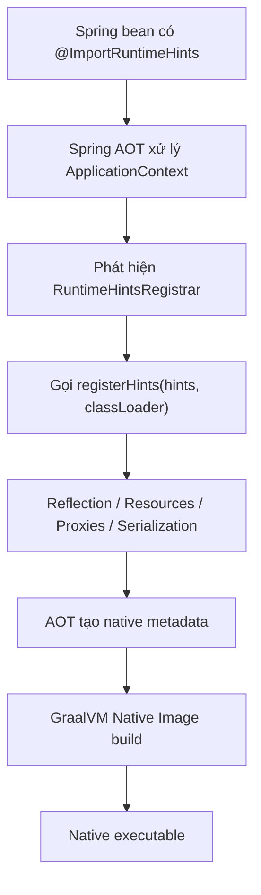

# @ImportRuntimeHints để đưa registrar vào ứng dụng

## 1. Vì sao cần đưa RuntimeHintsRegistrar vào Spring?

Khi chạy trên JVM, nhiều thao tác Java có thể sử dụng thông tin được xác định ở runtime: tên lớp lấy từ cấu hình, constructor được gọi qua reflection, resource được mở bằng đường dẫn, hoặc proxy được tạo từ một tập interface. Khi biên dịch thành **GraalVM Native Image**, các thành phần này cần được nhận diện ở thời điểm build để Native Image chuẩn bị mã và metadata tương ứng.

Spring AOT cung cấp API `RuntimeHints` để mô tả các nhu cầu đó. Ứng dụng hoặc thư viện có thể viết một lớp triển khai `RuntimeHintsRegistrar`, sau đó dùng annotation **`@ImportRuntimeHints`** để gắn registrar vào bean đang cần những hints ấy.

Điểm quan trọng của annotation này là registrar được Spring phát hiện và gọi **trong quá trình AOT processing**, không phải được đăng ký như một bean nghiệp vụ để chạy mỗi khi ứng dụng khởi động. Spring chuyển cho registrar đối tượng `RuntimeHints` mà AOT engine đang quản lý; registrar đóng góp thông tin reflection, resource, serialization, proxy hoặc JNI.

Trong module **SPRING_BOOT_NATIVE_IMAGE**, cách tổ chức này giúp gom metadata native sát với thành phần sử dụng nó. Khi một service cần đọc resource theo locale hoặc gọi plugin qua reflection, ta có thể đặt annotation ngay trên bean đó. Khi một bean không được đưa vào ApplicationContext theo cấu hình build, hints gắn với bean đó cũng không cần được đóng góp.

Sau bài học, người học có thể:

- Giải thích quan hệ giữa `@ImportRuntimeHints`, `RuntimeHintsRegistrar` và Spring AOT.
- Gắn registrar vào một Spring bean hoặc phương thức `@Bean` đúng cách.
- Đăng ký resource, reflection và proxy hints cho nhu cầu cụ thể.
- Viết unit test để kiểm tra nội dung registrar.
- Nhận biết trường hợp annotation không được xử lý vì bean không thuộc cấu hình AOT của ứng dụng.

## 2. Vai trò và vòng đời của từng thành phần

| Thành phần | Trách nhiệm |
|---|---|
| `@ImportRuntimeHints` | Khai báo một hoặc nhiều lớp `RuntimeHintsRegistrar` liên quan tới bean hoặc phương thức tạo bean |
| `RuntimeHintsRegistrar` | Cung cấp callback `registerHints(RuntimeHints, ClassLoader)` để bổ sung metadata |
| `RuntimeHints` | Tập hợp các yêu cầu về reflection, resource, serialization, proxy và JNI |
| Spring AOT engine | Tạo ApplicationContext ở thời điểm build, phát hiện registrar và thu thập hints |
| GraalVM Native Image | Sử dụng metadata được tạo để phân tích reachability và biên dịch native executable |

Luồng xử lý ở mức khái niệm:



`@ImportRuntimeHints` không tự tạo một bean registrar trong ApplicationContext. Nó cho Spring biết lớp registrar nào cần được gọi để đóng góp hints. Registrar không cần được đánh dấu `@Component` hoặc được component scan như một service thông thường.

Annotation có thể đặt trên:

- Một Spring bean, ví dụ class có `@Component` hoặc bean được cấu hình bằng `@Configuration`.
- Một phương thức factory `@Bean` trong cấu hình Spring.

Về mặt API, annotation nằm trong package `org.springframework.context.annotation`, còn `RuntimeHints` và `RuntimeHintsRegistrar` thuộc package `org.springframework.aot.hint`.

## 3. Ví dụ: gắn registrar vào bean cần đọc resource động

Giả sử service đọc từ điển theo ngôn ngữ. Đường dẫn resource được tạo tại runtime theo locale:

```java
package com.example.dictionary;

import java.io.IOException;
import java.io.InputStream;
import java.util.Locale;

import org.springframework.aot.hint.RuntimeHints;
import org.springframework.aot.hint.RuntimeHintsRegistrar;
import org.springframework.context.annotation.ImportRuntimeHints;
import org.springframework.core.io.ClassPathResource;
import org.springframework.stereotype.Component;

@Component
@ImportRuntimeHints(DictionaryService.DictionaryRuntimeHints.class)
public class DictionaryService {

    public InputStream openDictionary(Locale locale) throws IOException {
        String path = "dicts/" + locale.getLanguage() + ".txt";
        return new ClassPathResource(path).getInputStream();
    }

    public static class DictionaryRuntimeHints implements RuntimeHintsRegistrar {

        @Override
        public void registerHints(RuntimeHints hints, ClassLoader classLoader) {
            hints.resources().registerPattern("dicts/*");
        }
    }
}
```

Ví dụ có hai phần cần phân biệt:

1. `DictionaryService.openDictionary()` thực hiện công việc lúc ứng dụng chạy. Nó tạo đường dẫn như `dicts/en.txt` hoặc `dicts/vi.txt` và mở file trong classpath.
2. `DictionaryRuntimeHints.registerHints()` được gọi trong giai đoạn AOT. Nó khai báo rằng các resource khớp pattern `dicts/*` cần được đưa vào cấu hình native image.

Nếu chỉ có lệnh đọc file mà không có metadata phù hợp, JVM có thể tìm thấy resource trên classpath nhưng native image có thể không chứa resource đó. Khi ấy `getInputStream()` có thể thất bại trong bản native dù code đã được biên dịch thành công.

### Vì sao đặt annotation ngay trên service?

`DictionaryService` là thành phần cần resource. Đặt `@ImportRuntimeHints` tại đây giúp người đọc thấy ngay:

- Service sử dụng resource động.
- Hints nào phục vụ service.
- Registrar nào phải được gọi khi service tham gia cấu hình AOT.

Spring khuyến nghị đặt annotation càng gần thành phần cần hints càng tốt. Nếu bean không được đóng góp vào BeanFactory, hints gắn với bean đó cũng không được đóng góp. Điều này giúp tránh đăng ký metadata của một tính năng không được bật trong cấu hình build.

## 4. Gắn registrar qua phương thức @Bean

Không bắt buộc phải đặt annotation trên class có `@Component`. Nếu bean được tạo bằng factory method, có thể đặt `@ImportRuntimeHints` trực tiếp trên phương thức `@Bean`.

Ví dụ:

```java
package com.example.dictionary;

import org.springframework.aot.hint.RuntimeHints;
import org.springframework.aot.hint.RuntimeHintsRegistrar;
import org.springframework.boot.autoconfigure.condition.ConditionalOnProperty;
import org.springframework.context.annotation.Bean;
import org.springframework.context.annotation.Configuration;
import org.springframework.context.annotation.ImportRuntimeHints;

@Configuration(proxyBeanMethods = false)
public class DictionaryConfiguration {

    @Bean
    @ConditionalOnProperty(
        name = "dictionary.enabled",
        havingValue = "true"
    )
    @ImportRuntimeHints(DictionaryRuntimeHints.class)
    DictionaryService dictionaryService() {
        return new DictionaryService();
    }

    static class DictionaryRuntimeHints implements RuntimeHintsRegistrar {

        @Override
        public void registerHints(RuntimeHints hints, ClassLoader classLoader) {
            hints.resources().registerPattern("dicts/*");
        }
    }
}
```

Trong ví dụ, hints chỉ được đóng góp nếu bean `dictionaryService` được đăng ký. Nếu điều kiện `dictionary.enabled=true` không thỏa mãn trong quá trình AOT, factory method không tạo bean và registrar gắn với method đó không được xử lý cho bean ấy.

### Lưu ý về @Profile và @Conditional

Spring AOT xử lý cấu hình ApplicationContext ở thời điểm build. Những điều kiện ảnh hưởng đến việc bean có tồn tại hay không, chẳng hạn `@Profile` hoặc `@ConditionalOnProperty`, được đánh giá trong quá trình này. Profile hoặc property quyết định cấu hình AOT cần được chọn đúng khi build; không nên kỳ vọng thay đổi chúng tùy ý khi chạy native executable sẽ làm Spring tạo thêm bean hoặc hints chưa được đưa vào image.

Đây là lý do đặt registrar gần bean có điều kiện thường tốt hơn việc đăng ký tất cả hints toàn cục: metadata phản ánh đúng tính năng đã được chọn để build.

## 5. Một bean có thể dùng nhiều registrar

`@ImportRuntimeHints` nhận một mảng lớp triển khai `RuntimeHintsRegistrar`. Khi một thành phần cần nhiều nhóm hints, có thể khai báo nhiều registrar:

```java
@Component
@ImportRuntimeHints({
    DictionaryResourceHints.class,
    DictionaryReflectionHints.class
})
public class DictionaryService {
    // ...
}
```

Cách này giúp chia trách nhiệm:

- `DictionaryResourceHints` chỉ đăng ký resource.
- `DictionaryReflectionHints` chỉ đăng ký reflection cần cho bộ đọc/plugin.
- Mỗi registrar có thể được unit test độc lập.

Nếu nhiều bean cùng tham chiếu một implementation registrar trong một lần xử lý BeanFactory, Spring chỉ gọi implementation đó một lần cho lần xử lý tương ứng. Vì vậy, registrar nên tập trung vào việc đóng góp hints, không nên dựa vào việc callback sẽ được gọi một lần cho mỗi bean tham chiếu.

Không tạo side effect nghiệp vụ trong `registerHints()`: không gửi email, ghi dữ liệu ứng dụng, kết nối hệ thống production hoặc thay đổi trạng thái bên ngoài. Đây là callback phục vụ quá trình build, không phải lifecycle hook của service.

## 6. Ví dụ registrar cho reflection và JDK proxy

Ngoài resource, cùng cơ chế này có thể đăng ký reflection hoặc proxy.

### 6.1. Reflection cho plugin đã biết tại build time

Giả sử ứng dụng chọn một implementation từ cấu hình và gọi constructor qua reflection:

```java
String implementation = environment.getRequiredProperty("report.plugin");
Class<?> pluginType = Class.forName(implementation);
ReportPlugin plugin =
    (ReportPlugin) pluginType.getDeclaredConstructor().newInstance();
```

Nếu tên class chỉ được cung cấp trong cấu hình lúc chạy, Native Image có thể không suy ra được constructor cần thiết. Với tập plugin được biết trước khi build, đăng ký từng implementation:

```java
import org.springframework.aot.hint.MemberCategory;
import org.springframework.aot.hint.RuntimeHints;
import org.springframework.aot.hint.RuntimeHintsRegistrar;

public class ReportPluginRuntimeHints implements RuntimeHintsRegistrar {

    @Override
    public void registerHints(RuntimeHints hints, ClassLoader classLoader) {
        hints.reflection().registerType(
            CsvReportPlugin.class,
            MemberCategory.INVOKE_DECLARED_CONSTRUCTORS
        );
        hints.reflection().registerType(
            PdfReportPlugin.class,
            MemberCategory.INVOKE_DECLARED_CONSTRUCTORS
        );
    }
}
```

Gắn registrar vào bean quản lý plugin:

```java
@Component
@ImportRuntimeHints(ReportPluginRuntimeHints.class)
public class ReportPluginRegistry {
    // Chọn một implementation đã được đóng gói trong ứng dụng.
}
```

Đăng ký constructor không đồng nghĩa với đăng ký mọi field/method của class. Nếu code còn gọi method qua reflection, hãy bổ sung đúng member category hoặc member hint cần thiết. Mỗi class cũng phải có mặt trên classpath tại build; RuntimeHints không thể đưa một JAR plugin tùy ý chỉ được tải xuống sau khi native executable đã phát hành vào image.

### 6.2. JDK dynamic proxy

Nếu ứng dụng tự tạo JDK proxy cho một tập interface đã biết, có thể đóng góp proxy hints:

```java
import org.springframework.aot.hint.RuntimeHints;
import org.springframework.aot.hint.RuntimeHintsRegistrar;

public class BillingProxyRuntimeHints implements RuntimeHintsRegistrar {

    @Override
    public void registerHints(RuntimeHints hints, ClassLoader classLoader) {
        hints.proxies().registerJdkProxy(
            BillingOperations.class,
            Auditable.class
        );
    }
}
```

Sau đó gắn registrar vào bean sử dụng proxy:

```java
@Component
@ImportRuntimeHints(BillingProxyRuntimeHints.class)
public class BillingProxyFactory {
    // Tạo proxy cho BillingOperations và Auditable.
}
```

Đăng ký đúng danh sách interface mà proxy thực tế triển khai. Nếu thay đổi tập interface của proxy, hãy kiểm tra lại metadata và test native. Với proxy do Spring AOP/framework tạo, nhiều hints đã được framework tự động xử lý; chỉ thêm registrar khi use case cụ thể chưa được hỗ trợ tự động.

## 7. Chọn nơi đặt annotation: component hay @Bean method?

| Tình huống | Vị trí phù hợp | Lý do |
|---|---|---|
| Một service luôn được component scan và cần resource riêng | Trên class service | Metadata đi cùng bean sử dụng resource |
| Một bean chỉ tồn tại khi property/profile được bật | Trên phương thức `@Bean` tạo bean | Hints chỉ được đóng góp khi factory method được chọn |
| Một nhóm bean dùng chung metadata | Có thể tạo một registrar dùng chung và tham chiếu từ các bean liên quan | Tái sử dụng code nhưng vẫn gắn theo các thành phần sử dụng |
| Metadata thực sự mang tính toàn cục, không phụ thuộc bean cụ thể | Cân nhắc `META-INF/spring/aot.factories` | Đăng ký registrar tĩnh trong quá trình AOT |
| Một thao tác reflection phổ biến đã có annotation chuyên dụng | Ưu tiên annotation chuyên dụng nếu đáp ứng đúng nhu cầu | Giảm code registrar thủ công |

Đối với registrar gắn với tính năng cụ thể, ưu tiên `@ImportRuntimeHints` gần bean cần nó. Đăng ký tĩnh bằng `META-INF/spring/aot.factories` là cơ chế khác, phù hợp hơn khi hints không phụ thuộc vào sự hiện diện của bean cụ thể hoặc khi phát triển thư viện cần tham gia AOT toàn cục.

Ví dụ file `META-INF/spring/aot.factories` (một dòng cấu hình):

```properties
org.springframework.aot.hint.RuntimeHintsRegistrar=com.example.nativeimage.GlobalRuntimeHints
```

Không cần dùng đồng thời cả hai cách cho cùng một registrar nếu điều đó khiến hints bị khai báo trùng lặp không cần thiết. Với `@ImportRuntimeHints`, Spring biết hints gắn với bean/method nào; với `aot.factories`, registrar được đăng ký tĩnh.

## 8. Kiểm thử registrar bằng RuntimeHintsPredicates

Không nên đợi tới khi build native mới phát hiện registrar quên đăng ký resource hoặc constructor. Spring Core cung cấp `RuntimeHintsPredicates` để kiểm tra `RuntimeHints` có đáp ứng một nhu cầu cụ thể hay không.

Ví dụ kiểm tra resource từ `DictionaryRuntimeHints`:

```java
import org.junit.jupiter.api.Test;

import org.springframework.aot.hint.RuntimeHints;
import org.springframework.aot.hint.predicate.RuntimeHintsPredicates;

import static org.assertj.core.api.Assertions.assertThat;

class DictionaryRuntimeHintsTests {

    @Test
    void shouldRegisterDictionaryResources() {
        RuntimeHints hints = new RuntimeHints();

        new DictionaryService.DictionaryRuntimeHints()
            .registerHints(hints, getClass().getClassLoader());

        assertThat(RuntimeHintsPredicates.resource()
            .forResource("dicts/en.txt"))
            .accepts(hints);

        assertThat(RuntimeHintsPredicates.resource()
            .forResource("dicts/vi.txt"))
            .accepts(hints);
    }
}
```

Test này gọi registrar trực tiếp và xác nhận pattern resource bao phủ các đường dẫn được yêu cầu. Có thể viết predicate tương ứng cho reflection, serialization hoặc proxy theo API của phiên bản Spring Framework đang sử dụng.

Đối với reflection, predicate có thể kiểm tra một method hoặc constructor cụ thể. Ví dụ:

```java
RuntimeHints hints = new RuntimeHints();
new ReportPluginRuntimeHints().registerHints(hints, getClass().getClassLoader());

assertThat(RuntimeHintsPredicates.reflection()
    .onType(CsvReportPlugin.class)
    .withMemberCategory(MemberCategory.INVOKE_DECLARED_CONSTRUCTORS))
    .accepts(hints);
```

Đảm bảo test source có import các lớp tương ứng:

```java
import org.springframework.aot.hint.MemberCategory;
import org.springframework.aot.hint.RuntimeHints;
import org.springframework.aot.hint.predicate.RuntimeHintsPredicates;
```

Unit test xác nhận **nội dung registrar**; nó không tự chứng minh annotation đã được phát hiện trong cấu hình ứng dụng. Vì vậy, cần kiểm tra thêm:

1. Bean mang `@ImportRuntimeHints` có thực sự được component scan/import hoặc tạo bởi factory method không.
2. Các điều kiện `@Profile`/`@Conditional` có thỏa mãn trong lúc AOT processing không.
3. Maven/Gradle có thực hiện Spring AOT processing cho native build không.
4. Native executable có chạy được đúng nhánh resource/reflection/proxy sau khi build không.

## 9. Kiểm chứng bằng build và chạy native

Sau khi unit test registrar thành công, chạy quy trình build native của project. Ví dụ phổ biến khi đã cấu hình Maven/Gradle tương ứng:

```bash
# Maven: profile native phải được cấu hình trong project
./mvnw -Pnative native:compile

# Gradle: project đã áp dụng Spring Boot và Native Build Tools plugin
./gradlew nativeCompile
```

Tên task/goal và cách bật AOT có thể khác tùy cấu hình Spring Boot, Maven/Gradle plugin và phiên bản đang sử dụng. Hãy dùng command được tài liệu đúng release của dự án hướng dẫn.

Khi build, kiểm tra log AOT và các native metadata được tạo. Vị trí output cụ thể tùy plugin, nhưng thường có cấu hình dưới `META-INF/native-image` trong output/build artifacts. Không nên sửa trực tiếp file generated như cách khắc phục lâu dài; hãy sửa registrar hoặc metadata source rồi build lại.

Sau đó chạy native executable và kích hoạt đúng nghiệp vụ:

- Với resource: chọn locale có file dictionary tương ứng và xác nhận đọc được nội dung.
- Với reflection: chọn từng plugin implementation đã đăng ký, tạo instance và gọi method.
- Với proxy: tạo proxy và gọi qua các interface đã khai báo.
- Với điều kiện bean: build theo profile/property đã chọn, xác nhận tính năng đó thực sự có trong image.

Nếu một đường chạy thất bại, đọc stack trace để phân biệt thiếu resource, thiếu reflection, thiếu proxy hay dependency không tương thích. Thêm metadata rộng hơn chỉ khi có bằng chứng cho thấy thao tác đó cần thiết.

## 10. Những lỗi thường gặp

| Hiện tượng | Nguyên nhân có thể | Cách xử lý |
|---|---|---|
| Registrar không được gọi | Bean mang annotation không được đăng ký vào ApplicationContext AOT | Kiểm tra component scan, `@Import`, `@Bean` factory method |
| Registrar có chạy nhưng resource vẫn không có | Pattern sai hoặc resource không nằm trong classpath lúc build | Kiểm tra đường dẫn classpath, tên file và build output |
| Hints không xuất hiện khi dùng profile | Profile/property khiến bean không tồn tại ở thời điểm AOT | Chọn profile/property phù hợp khi build native |
| Constructor reflection lỗi | Đăng ký class nhưng thiếu category cho constructor cần gọi | Thêm `INVOKE_DECLARED_CONSTRUCTORS` hoặc hint chính xác |
| Method reflection lỗi | Chỉ đăng ký constructor, chưa đăng ký method được gọi động | Đăng ký đúng method/category cần thiết |
| JDK proxy không tạo được | Bộ interface của proxy không khớp hints | Đăng ký chính xác tập interface của proxy |
| JVM test pass nhưng native lỗi | JVM không yêu cầu cùng mức metadata như Native Image | Kiểm thử nhánh đó trên binary native |
| Registrar có side effect lạ trong build | Đưa logic nghiệp vụ hoặc phụ thuộc runtime vào callback AOT | Giữ registrar thuần, xác định và tái lập được |
| Dùng `@ImportRuntimeHints` trên class thường nhưng không có tác dụng | Class đó không phải bean và không được Spring đưa vào quá trình AOT | Gắn annotation vào bean hoặc `@Bean` method thực sự được đăng ký |
| Cùng registrar bị gọi nhiều nơi và có logic lặp | Thiết kế registrar dựa vào số lần gọi | Chỉ đóng góp hints; không dùng callback làm lifecycle hook |

## 11. Quy tắc thiết kế registrar dễ bảo trì

- **Gắn gần nơi sử dụng:** component cần resource/reflection nào thì khai báo registrar tương ứng tại đó.
- **Đăng ký tối thiểu:** chỉ khai báo class/member/resource/proxy thực sự cần thiết; tránh cho phép reflection quá rộng.
- **Dễ kiểm thử:** tách registrar thành class nhỏ, có thể gọi trực tiếp trong unit test.
- **Deterministic:** cùng source và cấu hình AOT phải cho cùng tập hints; tránh lấy quyết định từ dữ liệu production chỉ có lúc runtime.
- **Không thay thế classpath:** hints mô tả cách truy cập thành phần đã có trong ứng dụng; không đóng gói plugin JAR sẽ được tải tùy ý sau khi build.
- **Tôn trọng điều kiện bean:** nếu tính năng được bật theo profile/property, chọn điều kiện đó ở giai đoạn AOT và gắn registrar với bean tương ứng.
- **Tái sử dụng metadata của framework:** Spring và nhiều thư viện đã có hints; không thêm lại mọi hint thủ công nếu không có lỗi hoặc nhu cầu cụ thể.

## 12. Bài tập thực hành

### Bài tập A — Đăng ký resource cho service

Tạo `DictionaryService` đọc `dicts/{language}.txt` bằng `ClassPathResource`. Viết `DictionaryRuntimeHints` và gắn bằng `@ImportRuntimeHints` trên bean. Viết unit test sử dụng `RuntimeHintsPredicates.resource().forResource(...)` để xác nhận ít nhất hai resource được đăng ký.

**Tiêu chí hoàn thành:** unit test xác nhận pattern bao phủ đúng các file từ điển, và native executable đọc được file ở runtime.

### Bài tập B — Gắn hints với bean có điều kiện

Tạo `@Bean` có `@ConditionalOnProperty` và đặt `@ImportRuntimeHints` trên factory method. Build AOT với property bật, kiểm tra registrar được đóng góp; build với property tắt, xác nhận bean và hints tương ứng không được đưa vào cấu hình AOT.

**Câu hỏi:** vì sao thay property lúc chạy native executable không thể tạo lại hints đã không được đóng góp lúc build?

### Bài tập C — Đăng ký constructor cho plugin

Tạo hai implementation plugin đã có trong classpath. Viết registrar đăng ký constructor cần gọi bằng reflection, gắn vào bean quản lý plugin và kiểm tra bằng RuntimeHintsPredicates. Build native rồi thử lần lượt cả hai implementation.

**Tiêu chí hoàn thành:** cả hai constructor được gọi qua reflection trong bản native; không cần đăng ký mọi member của tất cả class nếu không sử dụng.

## 13. Checklist trước khi hoàn thành

- [ ] Bean hoặc factory method mang `@ImportRuntimeHints` được Spring AOT phát hiện.
- [ ] Registrar triển khai đúng `RuntimeHintsRegistrar` và method `registerHints`.
- [ ] Hints phản ánh chính xác thao tác runtime (reflection/resource/proxy/serialization).
- [ ] Registrar không chứa side effect nghiệp vụ hoặc phụ thuộc dữ liệu runtime không tái lập.
- [ ] Các profile/conditional được chọn đúng tại thời điểm AOT.
- [ ] Unit test kiểm tra hints bằng `RuntimeHintsPredicates`.
- [ ] Build native thành công và log xác nhận AOT processing.
- [ ] Binary native chạy được nhánh nghiệp vụ cần metadata.
- [ ] Không đăng ký metadata dư thừa hoặc sửa trực tiếp generated files.

## Tài liệu tham khảo

- [Spring Framework Reference — Ahead of Time Optimizations, Runtime Hints và @ImportRuntimeHints](https://docs.spring.io/spring-framework/reference/core/aot.html): cách đăng ký registrar trên Spring bean hoặc phương thức `@Bean`, thời điểm gọi và kiểm thử bằng `RuntimeHintsPredicates`.
- [Spring Framework Javadoc — @ImportRuntimeHints](https://docs.spring.io/spring-framework/docs/current/javadoc-api/org/springframework/context/annotation/ImportRuntimeHints.html): target của annotation và hợp đồng khai báo registrar.
- [Spring Framework Javadoc — RuntimeHintsRegistrar](https://docs.spring.io/spring-framework/docs/current/javadoc-api/org/springframework/aot/hint/RuntimeHintsRegistrar.html): callback `registerHints`.
- [Spring Framework Javadoc — RuntimeHints](https://docs.spring.io/spring-framework/docs/current/javadoc-api/org/springframework/aot/hint/RuntimeHints.html): các nhóm reflection, resource, proxy, serialization và JNI hints.

## Kết luận

`@ImportRuntimeHints` là cách gắn một `RuntimeHintsRegistrar` với bean hoặc phương thức `@Bean` cần metadata native. Spring AOT phát hiện registrar và gọi nó trong quá trình build để thu thập các yêu cầu reflection, resource, proxy hoặc serialization cho GraalVM Native Image. Đặt annotation gần thành phần sử dụng, kiểm soát điều kiện bean ở thời điểm AOT và kiểm tra registrar bằng `RuntimeHintsPredicates` giúp metadata dễ hiểu, có thể kiểm thử và tránh đăng ký dư thừa. Cuối cùng, build và chạy native executable trên đúng nhánh nghiệp vụ là bước xác nhận rằng hints đã được đóng góp và có hiệu lực trong sản phẩm.


