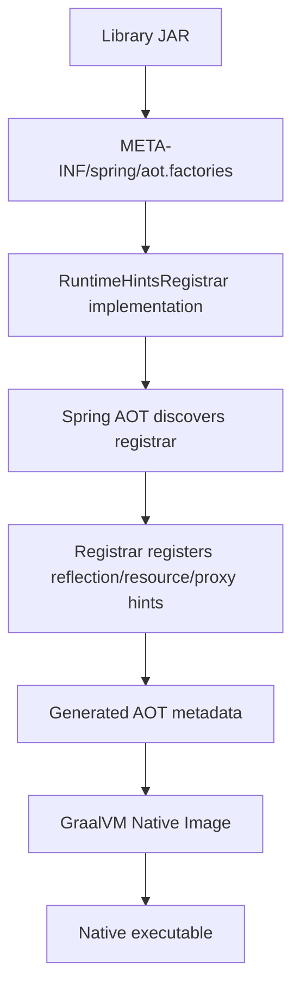

# META-INF/spring/aot.factories cho RuntimeHintsRegistrar dùng chung

## 1. Vì sao thư viện cần đăng ký RuntimeHintsRegistrar?

Khi một thư viện được dùng trong ứng dụng Spring Boot, nó có thể cần cung cấp thêm thông tin để **Spring AOT** và **GraalVM Native Image** xử lý các thao tác động. Ví dụ, thư viện có thể tải class theo tên, đọc resource theo pattern, tạo JDK dynamic proxy hoặc truy cập constructor/method qua reflection.

Nếu mỗi ứng dụng phải tự viết lại các Runtime Hints cho từng thư viện, cấu hình native sẽ bị lặp và dễ thiếu khi nâng cấp dependency. Thư viện có thể đóng gói một `RuntimeHintsRegistrar` của chính nó và khai báo điểm đăng ký dùng chung trong metadata:

`META-INF/spring/aot.factories`

Cơ chế này cho phép Spring AOT tìm registrar từ dependency trên classpath và gọi nó trong quá trình đóng góp Runtime Hints. Nhờ vậy, metadata đi cùng thư viện và được tái sử dụng bởi các ứng dụng Spring sử dụng thư viện đó.

Trong module **SPRING_BOOT_NATIVE_IMAGE**, cần hiểu rằng registrar cung cấp hints cho AOT; nó không tự thêm dependency vào classpath, không thay thế auto-configuration và không bảo đảm mọi code path của thư viện đều tương thích native.



## 2. RuntimeHintsRegistrar là gì?

Spring cung cấp interface `RuntimeHintsRegistrar` để thư viện hoặc ứng dụng đăng ký các yêu cầu runtime hints:

```java
package com.example.codec;

import org.springframework.aot.hint.RuntimeHints;
import org.springframework.aot.hint.RuntimeHintsRegistrar;

public class CodecRuntimeHints implements RuntimeHintsRegistrar {

    @Override
    public void registerHints(RuntimeHints hints, ClassLoader classLoader) {
        // Đăng ký các class/member/resource/proxy cần thiết.
    }
}
```

Phương thức `registerHints` nhận:

- `RuntimeHints hints`: registry để khai báo reflection, resources, serialization, proxies và các hint được Spring hỗ trợ.
- `ClassLoader classLoader`: class loader gắn với quá trình AOT, có thể dùng để kiểm tra hoặc tải class/resource phù hợp.

Registrar nên có constructor mặc định dễ khởi tạo, tránh phụ thuộc vào bean runtime, network, database hoặc secret. Nó chạy trong giai đoạn AOT; vì vậy code bên trong phải xác định được và an toàn trong môi trường build.

## 3. Metadata `META-INF/spring/aot.factories`

Một thư viện có thể đặt file sau trong resources:

```text
src/main/resources/
  META-INF/
    spring/
      aot.factories
```

Nội dung khai báo registrar:

```properties
org.springframework.aot.hint.RuntimeHintsRegistrar=\
com.example.codec.CodecRuntimeHints
```

Đây là định dạng properties theo cơ chế Spring AOT factories: key là tên interface/extension point, value là tên class implementation. Dấu gạch chéo ngược cuối dòng tiếp tục cùng một property ở dòng tiếp theo. Có thể khai báo nhiều implementation bằng danh sách phân tách dấu phẩy theo định dạng factories.

Ví dụ hai registrar:

```properties
org.springframework.aot.hint.RuntimeHintsRegistrar=\
com.example.codec.CodecRuntimeHints,\
com.example.codec.TemplateRuntimeHints
```

Hãy dùng đúng key `org.springframework.aot.hint.RuntimeHintsRegistrar` và đúng package interface của phiên bản Spring đang dùng. Đây là metadata dành cho **Spring AOT**, không phải file `spring.factories` cũ dùng để đăng ký mọi loại Spring Boot auto-configuration.

## 4. Ví dụ registrar đăng ký reflection và resource

Giả sử thư viện codec có một implementation được khởi tạo qua reflection và một file schema được đọc theo classpath.

```java
package com.example.codec;

public class JsonCodec {
    public JsonCodec() {
    }

    public String decode(String input) {
        return input;
    }
}
```

Resource của thư viện:

```text
src/main/resources/
  codec/
    schema.json
```

Registrar:

```java
package com.example.codec;

import org.springframework.aot.hint.MemberCategory;
import org.springframework.aot.hint.RuntimeHints;
import org.springframework.aot.hint.RuntimeHintsRegistrar;

public class CodecRuntimeHints implements RuntimeHintsRegistrar {

    @Override
    public void registerHints(RuntimeHints hints, ClassLoader classLoader) {
        hints.reflection().registerType(
            JsonCodec.class,
            MemberCategory.INVOKE_PUBLIC_CONSTRUCTORS
        );

        hints.resources().registerPattern("codec/schema.json");
    }
}
```

Trong ví dụ, registrar:

- Cho phép Native Image giữ khả năng gọi public constructor của `JsonCodec` theo nhu cầu reflection.
- Đăng ký resource `codec/schema.json` để file được đưa vào native image theo cơ chế resource hints.

Nếu thư viện chỉ gọi `new JsonCodec()` theo code tĩnh và không dùng reflection, có thể không cần reflection hint. Hãy đăng ký đúng quyền truy cập mà thư viện thực sự sử dụng; không bật mọi field/method/constructor khi không cần thiết.

## 5. Gắn registrar vào JAR của thư viện

Cấu trúc thư viện hoàn chỉnh:

```text
codec-library/
  build.gradle
  src/main/java/com/example/codec/
    JsonCodec.java
    CodecRuntimeHints.java
  src/main/resources/
    codec/schema.json
    META-INF/spring/aot.factories
```

Với Gradle Java Library, file trong `src/main/resources` được đưa vào JAR theo resource processing mặc định:

```groovy
plugins {
    id 'java-library'
}

group = 'com.example'
version = '1.0.0'
```

Build library:

```bash
./gradlew :codec-library:jar
```

Kiểm tra JAR:

```bash
jar tf codec-library/build/libs/codec-library-1.0.0.jar
```

Đảm bảo có cả:

```text
META-INF/spring/aot.factories
com/example/codec/CodecRuntimeHints.class
codec/schema.json
```

Tên file JAR phụ thuộc archive configuration. Nếu metadata không có trong JAR, Spring AOT của ứng dụng sử dụng thư viện không thể phát hiện registrar từ artifact đó.

## 6. Cách Spring AOT phát hiện registrar

Khi ứng dụng chạy tác vụ AOT, Spring xử lý các nguồn đóng góp Runtime Hints có trên classpath. Metadata `META-INF/spring/aot.factories` cho phép framework tìm implementation `RuntimeHintsRegistrar` từ thư viện.

Ứng dụng tiêu thụ chỉ cần khai báo dependency tới library theo runtime classpath:

```groovy
dependencies {
    implementation 'com.example:codec-library:1.0.0'
}
```

Sau đó chạy AOT và native build theo cấu hình project:

```bash
./gradlew processAot
./gradlew nativeCompile
```

Hai task trên giả định Spring Boot Gradle Plugin và GraalVM Native Build Tools đã được cấu hình tương thích. Nếu library chỉ nằm ở `testImplementation` hoặc `compileOnly`, registrar có thể không xuất hiện trong runtime/AOT classpath của ứng dụng production.

Với Maven, khai báo dependency trong scope phù hợp và chạy native lifecycle theo cấu hình Spring Boot Maven Plugin. Cần kiểm tra dependency tree và log AOT để xác nhận JAR thư viện thực sự có trong classpath.

## 7. Phân biệt `aot.factories` và `spring.factories`

Hai file có tên gần nhau nhưng mục đích khác nhau:

| Metadata | Mục đích | Ví dụ key |
|---|---|---|
| `META-INF/spring/aot.factories` | Đăng ký đóng góp AOT, bao gồm RuntimeHintsRegistrar | `org.springframework.aot.hint.RuntimeHintsRegistrar` |
| `META-INF/spring.factories` | Cơ chế factories lịch sử của Spring Boot cho các extension point được hỗ trợ | Các key Spring Boot tương ứng |

Không chép key auto-configuration từ `spring.factories` sang `aot.factories`. Auto-configuration hiện đại của Spring Boot thường được khai báo qua file imports riêng theo cơ chế Spring Boot; RuntimeHintsRegistrar là extension point khác.

Cũng không nhầm `aot.factories` với file reachability metadata JSON của GraalVM. Một file dùng để Spring AOT phát hiện registrar; file kia mô tả reachability cho Native Image theo schema GraalVM.

## 8. Nhiều registrar và khả năng tái sử dụng

Thư viện lớn có thể tách registrar theo trách nhiệm:

- `CodecRuntimeHints`: reflection cho codec.
- `TemplateRuntimeHints`: resource template.
- `ProxyRuntimeHints`: JDK dynamic proxy.
- `SerializationRuntimeHints`: kiểu cần serialization hints nếu cơ chế sử dụng yêu cầu.

Sau đó khai báo nhiều class trong `aot.factories`. Mỗi registrar nên nhỏ, có phạm vi rõ và chỉ đăng ký metadata thuộc thư viện của nó.

Không tạo nhiều registrar trùng lặp chỉ để đăng ký cùng một class/member. Hints có thể được hợp nhất, nhưng metadata trùng lặp làm cấu hình khó đọc và khó bảo trì.

Registrar có thể kiểm tra sự hiện diện của class tùy chọn qua `ClassLoader` nếu library hỗ trợ nhiều integration. Tuy nhiên, không nên dùng điều kiện kiểm tra class để che giấu dependency bắt buộc bị thiếu; nếu integration là bắt buộc, hãy khai báo dependency rõ ràng.

## 9. Kiểm thử registrar

Có thể kiểm tra registrar trực tiếp bằng cách tạo `RuntimeHints` và gọi phương thức:

```java
@Test
void registersCodecHints() {
    RuntimeHints hints = new RuntimeHints();

    new CodecRuntimeHints().registerHints(
        hints,
        getClass().getClassLoader()
    );

    assertThat(hints.reflection().getTypeHint(JsonCodec.class))
        .isPresent();

    assertThat(hints.resources().getResourceHint(
        "codec/schema.json"
    )).isPresent();
}
```

Đây là ví dụ định hướng; API truy vấn hint có thể khác theo phiên bản Spring Framework. Mục tiêu test là xác nhận registrar thực sự thêm hint mong muốn, không chỉ test class tồn tại.

Ngoài unit test registrar, cần test tích hợp:

1. Build JAR library.
2. Kiểm tra JAR có `META-INF/spring/aot.factories`.
3. Thêm JAR làm dependency của ứng dụng Spring Boot.
4. Chạy `processAot` và xác nhận registrar được phát hiện qua log/đầu ra AOT.
5. Build native executable.
6. Chạy code path reflection và đọc resource trên chính executable.

Unit test của registrar không chứng minh Spring đã phát hiện metadata trong JAR; integration test mới kiểm tra đường đăng ký end-to-end.

## 10. Những lỗi thường gặp

| Triệu chứng | Nguyên nhân có thể | Cách xử lý |
|---|---|---|
| Registrar không được gọi | Sai path, sai key hoặc JAR thiếu file metadata | Kiểm tra `jar tf` và nội dung `aot.factories` |
| ClassNotFoundException cho registrar | Tên package/class sai hoặc class không nằm trong artifact | Kiểm tra compiled class và metadata |
| Hints không có tác dụng | Registrar không được phát hiện trong AOT hoặc build dùng artifact cũ | Xác minh dependency graph, rerun AOT/native |
| Reflection vẫn lỗi | Đăng ký thiếu constructor/method/field cần truy cập | Xác định chính xác member và thêm category/hint |
| Resource không có trong native | Pattern sai hoặc resource không nằm trong JAR | Kiểm tra path, case sensitivity và resource hint |
| AOT lỗi khi khởi tạo registrar | Registrar có side effect hoặc phụ thuộc bean runtime | Giữ registrar đơn giản, không truy cập hệ thống ngoài |
| Thư viện có metadata nhưng ứng dụng không dùng | Dependency chỉ có trong test/compileOnly hoặc bị exclude | Kiểm tra runtimeClasspath/dependency tree |

## 11. Nguyên tắc thiết kế cho thư viện hỗ trợ Native Image

- Đặt `META-INF/spring/aot.factories` trong đúng resources của JAR.
- Dùng đúng key và tên class đầy đủ của RuntimeHintsRegistrar.
- Giữ registrar không phụ thuộc vào Spring application bean hoặc service ngoài.
- Chỉ đăng ký reflection/resource/proxy hints tối thiểu cần thiết.
- Kiểm tra metadata và implementation được đóng gói trong artifact phát hành.
- Test cả registrar unit test và AOT/native integration test.
- Ghi rõ phiên bản Spring Framework/Spring Boot/GraalVM đã xác minh.
- Không nhúng secret hoặc cấu hình môi trường vào hints/generated output.

## 12. Câu hỏi tự kiểm tra

1. `META-INF/spring/aot.factories` giúp Spring AOT tìm RuntimeHintsRegistrar như thế nào?
2. Vì sao thư viện cần đóng gói cả file metadata và class implementation trong JAR?
3. Khác nhau giữa `aot.factories` và `spring.factories` là gì?
4. Vì sao đăng ký reflection hint cho constructor không tự bảo đảm mọi method/field đều truy cập được?
5. Khi registrar unit test pass nhưng native executable vẫn thiếu resource, cần kiểm tra những bước nào?
6. Vì sao không nên để RuntimeHintsRegistrar kết nối database hoặc đọc secret khi AOT?
7. Làm thế nào kiểm chứng một ứng dụng tiêu thụ thực sự phát hiện registrar từ dependency?

**Ghi nhớ:** `META-INF/spring/aot.factories` là điểm đăng ký để thư viện đóng góp `RuntimeHintsRegistrar` cho Spring AOT. Đóng gói đúng metadata, class registrar và hints tối thiểu trong JAR, sau đó xác minh cả quá trình AOT lẫn code path trên Native Image giúp khả năng hỗ trợ native được tái sử dụng giữa nhiều ứng dụng.
