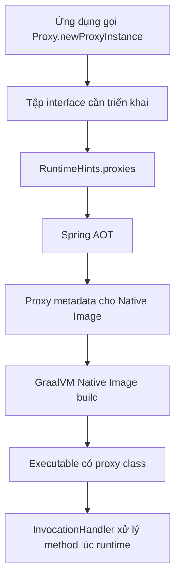

# ProxyHints cho JDK dynamic proxy

## 1. Vì sao Native Image cần khai báo JDK dynamic proxy?

Java **JDK dynamic proxy** tạo một object tại runtime để triển khai một hoặc nhiều interface. Lời gọi method trên proxy được chuyển tới một `InvocationHandler`, nơi ứng dụng hoặc framework có thể thực hiện logging, security, transaction, routing hay lời gọi từ xa.

Trên JVM HotSpot, proxy class thường được tạo động khi chương trình gọi `Proxy.newProxyInstance`. Với **GraalVM Native Image**, quá trình build phân tích trước các kiểu có thể được sử dụng. Nếu tập interface của proxy chỉ được xác định động lúc chạy, Native Image có thể không biết cần tạo proxy class nào.

Spring cung cấp **RuntimeHints.proxies()** để đăng ký JDK proxy cần thiết. Khi Spring AOT xử lý hints, thông tin này được chuyển tới quá trình native compilation, giúp proxy class tương ứng được chuẩn bị cho executable.

Trong module **SPRING_BOOT_NATIVE_IMAGE**, đây là một phần của thực hành cấu hình reflection/resource/proxy, kiểm thử tương thích và đóng gói container. Cần nhớ rằng proxy hint chỉ mô tả proxy interface; nó không tự đăng ký bean Spring, không tạo dependency graph và không thay thế metadata cho reflection hay thư viện native.



## 2. JDK dynamic proxy hoạt động như thế nào?

JDK proxy yêu cầu ít nhất một interface. Proxy object được tạo để triển khai danh sách interface đó; method invocation được gửi đến `InvocationHandler`.

Ví dụ interface:

```java
package com.example.billing;

public interface InvoiceService {
    String issue(String customerId);
}
```

Tạo proxy:

```java
InvoiceService proxy = (InvoiceService) Proxy.newProxyInstance(
    InvoiceService.class.getClassLoader(),
    new Class<?>[] { InvoiceService.class },
    (object, method, args) -> {
        if (method.getName().equals("issue")) {
            return "invoice-for-" + args[0];
        }
        return method.invoke(object, args);
    }
);
```

Đoạn trên minh họa ý tưởng, nhưng nhánh `method.invoke(object, args)` có thể tự gọi lại proxy và gây đệ quy nếu object là chính proxy. Trong ứng dụng thật, handler nên delegate tới một target object riêng và xử lý `equals`, `hashCode`, `toString` có chủ đích.

Ví dụ đầy đủ hơn:

```java
InvoiceService target = customerId -> "invoice-for-" + customerId;

InvocationHandler handler = (proxyObject, method, args) -> {
    try {
        return method.invoke(target, args);
    } catch (InvocationTargetException ex) {
        throw ex.getTargetException();
    }
};

InvoiceService proxy = (InvoiceService) Proxy.newProxyInstance(
    InvoiceService.class.getClassLoader(),
    new Class<?>[] { InvoiceService.class },
    handler
);
```

Trong ví dụ này, proxy triển khai `InvoiceService`; handler chuyển lời gọi tới target. Danh sách interface và thứ tự của nó là thông tin quan trọng để nhận diện proxy.

## 3. Đăng ký proxy bằng RuntimeHints

Spring Framework cung cấp API `RuntimeHints.proxies().registerJdkProxy(...)`.

Ví dụ registrar:

```java
package com.example.billing;

import org.springframework.aot.hint.RuntimeHints;
import org.springframework.aot.hint.RuntimeHintsRegistrar;

public class BillingProxyHints implements RuntimeHintsRegistrar {

    @Override
    public void registerHints(RuntimeHints hints, ClassLoader classLoader) {
        hints.proxies().registerJdkProxy(InvoiceService.class);
    }
}
```

Khi registrar được đưa vào Spring AOT qua `@ImportRuntimeHints` hoặc cơ chế đăng ký dùng chung của thư viện, Spring sẽ ghi nhận proxy hint cho interface `InvoiceService`.

Với cấu hình ứng dụng:

```java
@Configuration
@ImportRuntimeHints(BillingProxyHints.class)
class BillingConfiguration {
}
```

Đảm bảo import đúng `org.springframework.context.annotation.ImportRuntimeHints` và registrar nằm trên classpath AOT. Chỉ tạo class registrar mà không đăng ký nó sẽ không khiến Spring AOT tự động gọi.

## 4. Proxy triển khai nhiều interface

Một proxy có thể triển khai nhiều interface:

```java
public interface Auditable {
    String auditId();
}

public interface Retryable {
    void retry();
}
```

Đăng ký:

```java
hints.proxies().registerJdkProxy(
    InvoiceService.class,
    Auditable.class,
    Retryable.class
);
```

Danh sách interface phải khớp với cách ứng dụng tạo proxy. Khi tạo proxy với nhiều interface, thứ tự interface có thể là một phần của định danh proxy; không nên tự ý đổi thứ tự giữa lúc đăng ký hint và lúc tạo proxy.

Nếu có nhiều biến thể proxy khác nhau, đăng ký từng tập interface thực sự được dùng. Tránh đăng ký mọi interface trong ứng dụng theo kiểu tổng quát vì sẽ làm metadata phình to và che giấu thiết kế proxy không rõ ràng.

## 5. Khi nào cần ProxyHints?

Không phải mọi proxy trong Spring Boot đều cần đăng ký thủ công. Spring AOT và các tích hợp framework có thể tự phát hiện hoặc đóng góp hints cho proxy được tạo từ cấu hình tĩnh. Cần bổ sung khi proxy được tạo theo cách động mà AOT không nhận diện được.

Các tình huống đáng kiểm tra:

- Ứng dụng tự gọi `Proxy.newProxyInstance` với interface được chọn theo dữ liệu runtime.
- Plugin system tải interface theo cấu hình và tạo proxy tùy biến.
- Thư viện ngoài tạo JDK proxy theo đường code không được Spring AOT phân tích.
- Tập interface proxy được quyết định qua reflection hoặc cấu hình động.

Ví dụ proxy do Spring AOP hoặc Spring Data tạo có thể đã được framework hỗ trợ AOT. Khi gặp lỗi, hãy xác định proxy đó thuộc cơ chế nào trước khi thêm hints thủ công. Không nên đăng ký lặp lại proxy chỉ vì nhìn thấy một bean là AOP proxy.

## 6. JDK proxy khác class-based proxy

JDK dynamic proxy dựa trên interface. Class-based proxy thường tạo subclass của class mục tiêu bằng bytecode generation, chẳng hạn một số trường hợp sử dụng CGLIB.

| Đặc điểm | JDK dynamic proxy | Class-based proxy |
|---|---|---|
| Kiểu được proxy | Interface | Class cụ thể |
| Cơ chế | `java.lang.reflect.Proxy` | Sinh subclass/bytecode |
| Điều kiện chính | Có interface phù hợp | Class có thể được subclass theo giới hạn framework |
| Hint Spring | `hints.proxies().registerJdkProxy(...)` | Không giải quyết chỉ bằng JDK ProxyHints |
| Trường hợp thường gặp | Interface-based service proxy | Proxy class-based khi không dùng interface |

Không dùng `registerJdkProxy` để sửa mọi lỗi CGLIB hoặc bytecode generation. Với class-based proxy, cần xem cơ chế AOT của Spring, hỗ trợ của thư viện và các hạn chế Native Image riêng.

## 7. InvocationHandler và reflection là hai vấn đề riêng

Proxy hint cho phép Native Image có thông tin để tạo proxy cho tập interface. Nhưng nếu `InvocationHandler` gọi method bằng reflection trên target, những method/class được truy cập động vẫn có thể cần reflection hints.

Ví dụ:

```java
Method method = target.getClass().getMethod("issue", String.class);
Object result = method.invoke(target, customerId);
```

Proxy metadata không tự động đăng ký mọi method của target cho reflection. Cần phân biệt:

1. **Proxy class**: cần biết interface nào được proxy.
2. **Invocation handler**: logic nhận lời gọi, phải có trong reachability graph.
3. **Target method**: nếu gọi bằng reflection, có thể cần reflection metadata.
4. **Target class**: phải có trên runtime classpath và được Native Image giữ lại.

Nếu handler gọi target qua interface method invocation tĩnh, thường không cần reflection hint cho method đó chỉ vì có proxy. Hãy khai báo metadata dựa trên code path thực tế.

## 8. Ví dụ Spring AOP và interface proxy

Giả sử ứng dụng Spring có interface:

```java
public interface OrderService {
    Order findById(long id);
}
```

Một aspect áp dụng logging:

```java
@Aspect
@Component
class LoggingAspect {

    @Around("execution(* com.example.OrderService.*(..))")
    Object log(ProceedingJoinPoint joinPoint) throws Throwable {
        return joinPoint.proceed();
    }
}
```

Spring có thể tạo proxy cho bean theo cấu hình AOP. Nếu proxy dựa trên interface và Spring AOT nhận diện được cấu hình, framework có thể đóng góp hints phù hợp. Nếu ứng dụng tự tạo proxy hoặc thư viện tạo proxy qua đường động khác, hãy kiểm tra log AOT và thêm registrar khi cần.

Không nên thêm ProxyHints cho mọi service interface mà chưa xác định cơ chế proxy. Một lỗi runtime có thể do pointcut không match, bean không được đăng ký hoặc dependency thiếu, không nhất thiết do proxy metadata.

## 9. Kiểm thử ProxyHints

Có thể kiểm tra registrar bằng `RuntimeHints` và assert proxy hint:

```java
@Test
void registersInvoiceServiceProxy() {
    RuntimeHints hints = new RuntimeHints();

    new BillingProxyHints().registerHints(
        hints,
        getClass().getClassLoader()
    );

    assertThat(hints.proxies().jdkProxies())
        .contains(/* expected JDK proxy hint */);
}
```

API đọc danh sách proxy hint có thể thay đổi giữa các phiên bản Spring Framework; thay assertion placeholder bằng cách truy vấn phù hợp phiên bản đang dùng. Không giữ assertion giả định nếu chưa kiểm tra compile/test với version thực tế.

Quan trọng hơn, cần integration test:

1. Chạy Spring AOT với registrar đã đăng ký.
2. Build Native Image.
3. Khởi chạy executable native.
4. Gọi method qua proxy và xác minh kết quả.
5. Kiểm thử cả exception/handler path và các interface bổ sung.

Một unit test xác nhận registrar đã thêm hint không chứng minh executable native thực sự tạo và gọi proxy đúng.

## 10. Chẩn đoán lỗi thường gặp

| Triệu chứng | Nguyên nhân có thể | Hướng xử lý |
|---|---|---|
| Proxy hoạt động trên JVM nhưng native lỗi | Tập interface không được đăng ký/nhận diện | Kiểm tra proxy creation path và RuntimeHints |
| Native build báo thiếu proxy metadata | Registrar không được phát hiện hoặc tập interface sai | Kiểm tra AOT registration và interface order |
| Proxy tạo được nhưng method lỗi | Handler, target method hoặc reflection hint thiếu | Kiểm tra invocation path và target metadata |
| Class-based proxy vẫn lỗi sau khi thêm JDK hint | Nhầm cơ chế proxy | Điều tra CGLIB/bytecode generation và AOT support |
| Spring AOP bean không tồn tại | Bean condition, component scan hoặc profile | Kiểm tra application context trước khi sửa proxy hints |
| Proxy test pass trên JVM nhưng fail native | Test chưa chạy trên executable native | Thực hiện integration test native |

## 11. Nguyên tắc thiết kế và checklist

- Ưu tiên interface rõ ràng và tập interface proxy xác định được.
- Dùng Spring AOT/Framework hints có sẵn trước khi thêm đăng ký thủ công.
- Đăng ký đúng tập interface và thứ tự tương ứng với proxy thực tế.
- Giữ `InvocationHandler` đơn giản, delegate tới target rõ ràng.
- Bổ sung reflection hints riêng nếu handler truy cập target method bằng reflection.
- Phân biệt JDK proxy với class-based proxy.
- Đảm bảo registrar được import hoặc phát hiện qua metadata AOT.
- Test cả registrar, AOT output và executable native.
- Ghi nhận phiên bản Spring Framework, Spring Boot và GraalVM khi xác minh.

## 12. Câu hỏi tự kiểm tra

1. JDK dynamic proxy yêu cầu kiểu nào và chuyển lời gọi method tới đâu?
2. `registerJdkProxy` mô tả thông tin gì cho Native Image?
3. Vì sao thứ tự interface trong proxy registration cần nhất quán?
4. ProxyHints có tự cung cấp reflection metadata cho target method không?
5. Khác biệt giữa JDK dynamic proxy và class-based proxy là gì?
6. Vì sao không nên thêm ProxyHints thủ công cho mọi bean AOP?
7. Cần thực hiện kiểm thử nào để chứng minh proxy hoạt động trên executable native?

**Ghi nhớ:** `ProxyHints` giúp Spring AOT mô tả các **JDK dynamic proxy theo tập interface cụ thể**. Hãy xác định đúng cơ chế proxy, đăng ký metadata tối thiểu, phân biệt với reflection hints và kiểm thử lời gọi thật trên Native Image.
