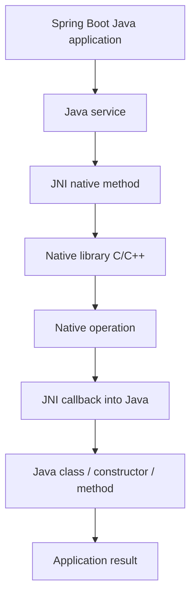

# RuntimeHints.jni() và các kiểu truy cập từ mã native

## 1. Vì sao JNI cần runtime hints?

Java Native Interface (JNI) cho phép mã Java tương tác với mã native, thường là thư viện C/C++ được nạp vào process. Ứng dụng có thể gọi hàm C từ Java, hoặc thư viện native gọi ngược vào method/constructor/field của đối tượng Java thông qua JNI.

Trên JVM, runtime có thể tìm class và member theo tên trong lúc chạy. Với GraalVM Native Image, phân tích reachability diễn ra chủ yếu ở build time. Những kiểu và member chỉ được truy cập từ mã native có thể không xuất hiện trong call graph Java thông thường, vì vậy Native Image cần được thông báo rõ về các khả năng JNI mà chương trình sử dụng.

Spring cung cấp API **`RuntimeHints.jni()`** để đăng ký những kiểu cần truy cập qua JNI. API này thuộc hệ thống RuntimeHints của Spring AOT; hints được thu thập trong build time và chuyển thành metadata mà Native Image sử dụng khi tạo executable.

Bài học tập trung vào:

- Phân biệt Java gọi native với native gọi ngược vào Java.
- Đăng ký type/member cần thiết bằng `RuntimeHints.jni()`.
- Hiểu các quyền JNI như invoke, allocate và construct.
- Kết hợp JNI hints với native library loading, resource hints và cấu hình hệ điều hành.
- Kiểm thử cả hai chiều tương tác trên executable native.

## 2. JNI hoạt động theo hai chiều

JNI có thể được dùng theo hai hướng:

1. **Java-to-native:** Java khai báo `native` method, sau đó gọi method đó. JVM/Native Image cần liên kết method với hàm native tương ứng.
2. **Native-to-Java:** mã C/C++ dùng JNI API để tìm class, tạo object, lấy field/method ID và gọi method Java. Các class/member này có thể không được reachability analysis nhìn thấy từ bytecode Java.



Một ứng dụng Spring Boot có thể dùng JNI gián tiếp thông qua thư viện xử lý ảnh, mã hóa, compression, machine learning hoặc SDK thiết bị. Không nhất thiết source Java phải khai báo `native` method trực tiếp; dependency có thể đóng gói JNI bên trong.

## 3. JNI hints trong RuntimeHints

API chính được cung cấp qua `RuntimeHints`:

```java
RuntimeHints hints = new RuntimeHints();
hints.jni();
```

`jni()` trả về đối tượng hints chuyên cho các kiểu được truy cập từ JNI. Registrar có thể đăng ký type cùng các quyền cần thiết:

```java
hints.jni().registerType(
        NativeCallback.class,
        JNIAccess.INVOKE
);
```

Các kiểu API nằm trong package `org.springframework.aot.hint`, gồm `RuntimeHints` và `JNIAccess`. API cụ thể có thể khác giữa các phiên bản Spring Framework; hãy kiểm tra Javadoc của version dự án nếu tên enum hoặc overload khác.

Một registrar hoàn chỉnh:

```java
final class NativeBridgeHints implements RuntimeHintsRegistrar {

    @Override
    public void registerHints(
            RuntimeHints hints,
            ClassLoader classLoader) {

        hints.jni().registerType(
                NativeCallback.class,
                JNIAccess.INVOKE
        );
    }
}
```

Gắn registrar vào cấu hình được Spring AOT xử lý:

```java
@Configuration(proxyBeanMethods = false)
@ImportRuntimeHints(NativeBridgeHints.class)
class NativeBridgeConfiguration {
}
```

Spring AOT thu thập các khai báo này trước khi GraalVM Native Image phân tích và biên dịch. Chỉ tạo một đối tượng `RuntimeHints` trong code runtime mà không đưa registrar vào pipeline AOT sẽ không cập nhật metadata của executable đã build.

## 4. JNIAccess biểu diễn khả năng nào?

`JNIAccess` mô tả loại thao tác mà mã native cần thực hiện trên kiểu Java. Các quyền thường gặp:

| Quyền | Ý nghĩa sử dụng |
|---|---|
| `INVOKE` | Mã native có thể gọi method của kiểu Java thông qua JNI |
| `ALLOCATE` | Mã native có thể cấp phát object theo cơ chế JNI phù hợp |
| `CONSTRUCT` | Mã native có thể tạo instance thông qua constructor |
| `PUBLIC` | Phạm vi public members theo API/phiên bản hỗ trợ |
| `DECLARED` | Phạm vi members được khai báo trực tiếp trên kiểu theo API/phiên bản hỗ trợ |

Tên và cách kết hợp chính xác của các hằng `JNIAccess` phụ thuộc Spring Framework version; một số phiên bản có thể biểu diễn phạm vi public/declared cùng hành động theo cách khác. Không sao chép danh sách enum từ phiên bản khác mà chưa kiểm tra API dự án. Các ví dụ dưới đây dùng những quyền phổ biến như `INVOKE`, `ALLOCATE` và `CONSTRUCT`; hãy xác nhận enum thực tế trong Javadoc/IDE.

Chọn quyền theo hoạt động C/C++ thật sự thực hiện. Nếu native chỉ gọi một method trên object được Java tạo sẵn, không cần đăng ký constructor chỉ vì class đó có constructor. Nếu native cần tạo object bằng JNI, phải đảm bảo khả năng cấp phát/khởi tạo tương ứng.

## 5. Ví dụ: native callback gọi method Java

Giả sử một thư viện C xử lý sự kiện và gọi ngược vào Java callback:

```java
public class NativeCallback {

    public NativeCallback() {
    }

    public void onCompleted(int status) {
        System.out.println("Native status: " + status);
    }
}
```

Native code có thể tìm class/method và gọi qua JNI:

```c
jclass callbackClass =
    (*env)->GetObjectClass(env, callback);

jmethodID method = (*env)->GetMethodID(
    env,
    callbackClass,
    "onCompleted",
    "(I)V"
);

(*env)->CallVoidMethod(env, callback, method, status);
```

Đoạn C chỉ minh họa luồng JNI; cần kiểm tra lỗi sau mỗi JNI call trong code production, quản lý local/global references và exception đúng cách.

Vì `onCompleted` được gọi từ native code, reachability analysis Java có thể không nhìn thấy lời gọi đó. Có thể đăng ký type với JNI invoke hint:

```java
hints.jni().registerType(
        NativeCallback.class,
        JNIAccess.INVOKE
);
```

Nếu native code tự tạo callback object bằng JNI constructor, cần đăng ký thêm quyền tạo/constructor phù hợp theo API phiên bản đang dùng. Nếu Java tạo object và truyền reference vào native, không nhất thiết phải mở constructor cho JNI.

## 6. Java gọi native method

Một ví dụ Java khai báo native method:

```java
public final class ImageCodec {

    static {
        System.loadLibrary("imagecodec");
    }

    public native byte[] resize(
            byte[] source,
            int width,
            int height);
}
```

Phía Java gọi:

```java
byte[] output = codec.resize(input, 320, 240);
```

Ở hướng này, lời gọi Java đến native method là tĩnh theo khai báo method, nhưng Native Image vẫn cần hỗ trợ JNI binding và native library tương ứng. Tùy cơ chế build và metadata của Native Image, có thể cần JNI hints cho kiểu/method liên quan, cấu hình thư viện native và bảo đảm library được tìm thấy lúc chạy.

Không nhầm JNI hint với việc đóng gói file thư viện. Hai yêu cầu độc lập:

- **JNI hints:** mô tả class/member được native code truy cập.
- **Native library packaging/loading:** bảo đảm file `libimagecodec.so` (Linux), `imagecodec.dll` (Windows) hoặc `libimagecodec.dylib` (macOS) có mặt và được loader tìm thấy.

## 7. Đăng ký type và phạm vi truy cập cần thiết

Giả sử native library gọi method trên `NativeCallback`, tạo `NativeResult` và ghi field `code`. Hãy lập bảng truy cập trước khi đăng ký:

| Kiểu | Native cần làm gì | Hint cần xem xét |
|---|---|---|
| `NativeCallback` | Gọi `onCompleted` | JNI invoke |
| `NativeResult` | Tạo instance bằng constructor | JNI construct/allocate theo API |
| `NativeResult` | Ghi field `code` | JNI field access theo API hỗ trợ |
| `NativeResult` | Đọc method metadata | JNI introspection nếu thư viện thực sự introspect |

Không nên đăng ký mọi type trong package với mọi quyền. Hints rộng có thể làm tăng metadata và giữ lại nhiều thành phần hơn mức cần thiết. Đăng ký theo contract native interface và test đường đi tương ứng.

Nếu JNI API của phiên bản Spring đang dùng chỉ cung cấp một số nhóm quyền ở cấp type, hãy kiểm tra cách nó ánh xạ sang Native Image metadata và chọn phạm vi phù hợp. Với field/method cụ thể, có thể cần metadata GraalVM bổ sung nếu abstraction Spring không biểu diễn đủ chi tiết.

## 8. JNI hints không thay thế reflection hints

JNI và Java reflection có mục đích gần nhau nhưng là hai đường truy cập khác nhau.

| Cơ chế | Ai khởi tạo truy cập? | Hints liên quan |
|---|---|---|
| Java reflection | Java code gọi `Class.forName`, `Method.invoke`, `Constructor.newInstance` | `hints.reflection()` |
| JNI callback | C/C++ gọi JNI API để tìm class/member và gọi Java | `hints.jni()` |
| Java resource loading | Java đọc classpath resource | `hints.resources()` |
| Dynamic proxy | Framework tạo proxy theo interface/runtime | `hints.proxies()` |

Nếu thư viện native gọi ngược vào Java, chỉ đăng ký `reflection()` không nhất thiết đủ. Ngược lại, JNI hints không thay thế reflection hints nếu Java code cũng dùng reflection trên cùng class.

Có thể một kiểu cần cả hai loại hint khi nó được sử dụng qua nhiều cơ chế. Hãy xác định từng đường truy cập, không đăng ký một loại hint với kỳ vọng nó bao phủ mọi API động.

## 9. Nạp thư viện native và runtime environment

`System.loadLibrary("imagecodec")` yêu cầu loader tìm thư viện native theo quy ước nền tảng. Trên Linux, tên thường tương ứng `libimagecodec.so`; trên Windows là `imagecodec.dll`; macOS thường là `libimagecodec.dylib`.

Các điều cần kiểm tra:

- Thư viện tồn tại trong runtime image hoặc đường dẫn được cấu hình.
- Architecture của library khớp executable (amd64/arm64).
- ABI và libc tương thích (glibc/musl trên Linux).
- Các shared libraries mà thư viện native phụ thuộc cũng có mặt.
- User chạy container có quyền đọc/thực thi phù hợp.
- Loader có thể tìm thư viện qua cơ chế chuẩn hoặc `java.library.path`/đường dẫn native phù hợp.

JNI hints không tự đóng gói native library vào executable. Nếu file library được đóng gói như resource, phải xem xét resource hints và cách extract ra filesystem; nếu được cài trong OS image, kiểm soát package và version của runtime base.

## 10. Quản lý JNI references và thread

JNI có quy tắc về reference và thread mà code C/C++ phải tuân thủ:

- **Local reference** thường chỉ hợp lệ trong phạm vi JNI call hiện tại/thread hiện tại; không lưu lại tùy tiện sau khi native method kết thúc.
- **Global reference** giữ object qua nhiều JNI call, cần xóa bằng `DeleteGlobalRef` khi không dùng nữa.
- Native thread muốn gọi Java cần attach vào JVM/Native Image runtime theo JNI API hỗ trợ, sau đó detach khi hoàn thành nếu thread được attach thủ công.
- Không giữ `JNIEnv*` rồi dùng từ thread khác; nó gắn với thread hiện tại.
- Kiểm tra exception sau JNI calls và không tiếp tục thao tác tùy tiện khi exception đang pending.

Native Image cung cấp hỗ trợ JNI theo phạm vi của runtime; các giả định của code native cần được kiểm thử trên executable thật. Sai quản lý reference/thread có thể gây lỗi memory, crash hoặc hành vi không ổn định mà metadata hints không thể sửa.

## 11. Kiểm thử JNI hints

Unit test có thể kiểm tra registrar đã đăng ký JNI hint. Spring cung cấp các tiện ích RuntimeHints predicates tùy phiên bản; kiểm tra API phù hợp với project. Nhưng test metadata không thay thế việc gọi thư viện JNI trong native process.

Quy trình xác minh:

1. Viết test registrar xác nhận type được đăng ký trong `RuntimeHints.jni()`.
2. Chạy Spring AOT để chắc chắn registrar được phát hiện.
3. Build native executable với GraalVM Native Image.
4. Chạy đường Java-to-native: gọi native method và xác minh kết quả.
5. Chạy đường native-to-Java: native library gọi callback, tạo object hoặc truy cập member đúng như contract.
6. Test thread/reference lifecycle nếu thư viện dùng callback bất đồng bộ.
7. Chạy trong runtime container đích, xác minh thư viện native và dependency đều có mặt.

Smoke test chỉ gọi native method nhưng không kiểm tra callback thì chưa bao phủ đường native-to-Java. Tương tự, test trên JVM không chứng minh metadata JNI trong native image đã đầy đủ.

## 12. Lỗi thường gặp và cách chẩn đoán

| Triệu chứng | Nguyên nhân có thể | Cách xử lý |
|---|---|---|
| JNI callback không tìm thấy class | Type chưa được đăng ký hoặc tên class trong native code sai | Kiểm tra class name, JNI hints và metadata build |
| `GetMethodID` trả null | Method name/signature sai hoặc method chưa được hỗ trợ | Đối chiếu JNI descriptor và invoke hint |
| Native code không tạo được object | Thiếu khả năng construct/allocate phù hợp | Đăng ký quyền JNI tương ứng và kiểm tra constructor |
| `UnsatisfiedLinkError` | Native library không tồn tại, sai tên hoặc không load được dependency | Kiểm tra đường dẫn, architecture, ABI và shared libraries |
| Chỉ lỗi trên ARM64 | Native library chỉ build cho x86-64 | Cung cấp library đúng target architecture |
| JVM chạy nhưng native lỗi callback | Native Image thiếu JNI reachability metadata | Đăng ký JNI hints và build lại |
| Crash khi callback từ thread riêng | Thread chưa attach hoặc reference/ENV dùng sai | Sửa JNI lifecycle/thread management |
| Hint có trong unit test nhưng native vẫn lỗi | Registrar không được đưa vào AOT hoặc lỗi nằm ở native library | Xác minh AOT output và chạy integration test executable |

Phân biệt lỗi metadata với lỗi ABI/loader và lỗi JNI programming. Thêm hint không sửa được signature sai, thư viện sai kiến trúc hay use-after-free của native reference.

## 13. Bài thực hành: Spring Boot gọi thư viện C có callback

**Bối cảnh:** một service xử lý tác vụ nền thông qua thư viện C `libtaskengine.so`. Java truyền callback để nhận kết quả khi native hoàn tất.

**Bước 1 — Xác định contract JNI.** Liệt kê class callback, method được gọi, constructor/object native có thể tạo và field nào native đọc/ghi.

**Bước 2 — Viết registrar.** Dùng `RuntimeHints.jni()` đăng ký type và quyền cần thiết. Gắn registrar qua `@ImportRuntimeHints`.

**Bước 3 — Chuẩn bị native library.** Build `libtaskengine.so` cho cùng architecture/ABI với executable. Xác định các shared libraries phụ thuộc.

**Bước 4 — Build AOT/native.** Chạy Maven/Gradle theo cấu hình Native Image, kiểm tra registrar được thực thi và hints đi vào image.

**Bước 5 — Chạy cả hai chiều.** Gọi Java native method, sau đó để C gọi callback Java. Xác minh status, dữ liệu trả về và xử lý exception.

**Bước 6 — Kiểm thử container.** Đóng gói executable và native library vào runtime image tương thích. Test dưới đúng user, filesystem và architecture triển khai.

**Bước 7 — Đánh giá vận hành.** Quan sát crash/log, memory, thread và latency. Đảm bảo reference được giải phóng và callback không sử dụng JNI environment sai thread.

Tiêu chí hoàn thành: JNI type/member được đăng ký tối thiểu, native library load được, callback hoạt động trên executable native và container đích, không có lỗi thread/reference.

## 14. Kết luận

`RuntimeHints.jni()` cho phép Spring AOT khai báo những kiểu Java mà mã native sẽ truy cập. Nó đặc biệt quan trọng với callback, constructor/object creation và các thao tác JNI mà reachability analysis từ bytecode Java không thể nhìn thấy. JNI hints khác reflection hints, resource hints và native library packaging; một ứng dụng có thể cần phối hợp nhiều loại cấu hình.

Khi tích hợp JNI vào Spring Boot Native Image, hãy lập rõ contract Java/C, đăng ký đúng quyền JNI, kiểm tra library/architecture/ABI, tuân thủ quy tắc reference và thread, rồi kiểm thử trên executable native trong container thực tế. Metadata chính xác và code JNI an toàn đều cần thiết để hệ thống vận hành ổn định.
