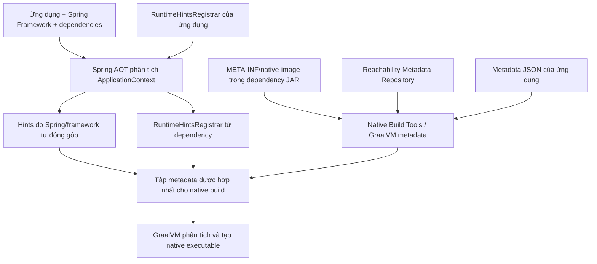

# Phân biệt hints do Spring sinh, do dependency cung cấp và do ứng dụng tự khai báo

Khi biên dịch Spring Boot thành **GraalVM Native Image**, compiler cần biết những thao tác nào có thể xảy ra lúc chạy nhưng không thể suy ra đầy đủ từ mã gọi trực tiếp. Ví dụ: một thư viện gọi constructor bằng reflection, ứng dụng đọc file theo tên được tạo động, hoặc framework tạo JDK proxy cho một tập interface. **Runtime Hints** cung cấp thông tin bổ sung để những khả năng đó vẫn hoạt động trong native executable.

Hints có thể đến từ ba nguồn chính:

1. **Spring sinh trong quá trình AOT:** Spring phân tích ApplicationContext, các bean và một số hợp đồng framework để tự tạo mã và hints cần thiết cho phần Spring nhận biết được.
2. **Dependency cung cấp:** thư viện đóng gói metadata native hoặc đăng ký một `RuntimeHintsRegistrar` để mô tả cách chính thư viện được sử dụng.
3. **Ứng dụng tự khai báo:** nhóm phát triển bổ sung hints cho những đường truy cập động riêng của ứng dụng mà Spring và dependency chưa mô tả.

Ba nguồn này cùng đóng góp vào quá trình tạo native image. Hiểu nguồn gốc giúp tìm đúng nơi cần sửa, tránh khai báo trùng hoặc mở quyền truy cập quá rộng, và giữ metadata đi cùng thành phần sở hữu hành vi.

Bài học thuộc chương **Runtime hints** của mô-đun `SPRING_BOOT_NATIVE_IMAGE`. Ta sẽ phân biệt cơ chế đóng góp, đọc các artifact, viết registrar cho ứng dụng, kiểm thử hints và điều tra lỗi thiếu metadata.

## 1. Runtime Hints mô tả điều gì?

Native Image sử dụng phân tích *closed-world* để xác định mã có thể được thực thi. Các lời gọi Java trực tiếp thường giúp compiler lần theo call graph. Nhưng với những hành vi động, đường gọi có thể chỉ xuất hiện qua tên chuỗi, metadata hoặc API của framework. Compiler cần biết trước những khả năng này.

Spring Framework cung cấp API `RuntimeHints` để mô tả một số nhóm khả năng:

| Nhóm hints | Mục đích | Ví dụ |
| --- | --- | --- |
| Reflection | Giữ metadata cho type, constructor, method hoặc field được truy cập động | `Class.forName(...)`, `getDeclaredConstructor()`, `Method.invoke()` |
| Resources | Đưa resource classpath cần thiết vào native image | Đọc `templates/invoice.txt` bằng `ClassPathResource` |
| Serialization | Hỗ trợ kiểu được dùng qua cơ chế serialization cần metadata | Kiểu được serialize/deserialize theo cơ chế tương ứng |
| JDK proxies | Mô tả tập interface được dùng để tạo dynamic proxy | `Proxy.newProxyInstance(...)` |
| JNI | Mô tả một số truy cập qua Java Native Interface | Mã Java gọi native method hoặc native code truy cập thành viên Java |

Hints **không phải mã nguồn của class**, không tải dependency mới vào dự án và không tự tạo bean definition. Chúng thông báo cho native-image tool rằng một kiểu/thành viên/resource cần được giữ hoặc có thể được truy cập theo cách mà phân tích tĩnh không tự nhận ra.

Ví dụ, khai báo reflection cho constructor không tự làm class xuất hiện trong classpath. Class vẫn phải có trong ứng dụng hoặc dependency. Tương tự, resource hint không tạo file; resource cần tồn tại trong đầu vào build.

## 2. Bản đồ ba nguồn hints



| Nguồn | Ai chịu trách nhiệm? | Cách thường gặp | Khi nào cần xem? |
| --- | --- | --- | --- |
| Spring-generated | Spring Framework/Spring Boot AOT processors | Hints được suy ra trong AOT từ bean definitions và các hợp đồng Spring nhận biết | Chức năng framework thông thường hoạt động trên JVM nhưng cần metadata trong native |
| Dependency-provided | Tác giả thư viện hoặc cộng đồng duy trì metadata | `RuntimeHintsRegistrar`, `META-INF/native-image`, Reachability Metadata Repository | Lỗi nằm trong thư viện như driver, serializer, SDK hoặc framework mở rộng |
| Application-declared | Nhóm phát triển ứng dụng | `@ImportRuntimeHints`, `META-INF/spring/aot.factories`, JSON metadata của ứng dụng | Ứng dụng có reflection, resource, proxy hoặc serialization tùy biến |

Đầu ra cuối cùng có thể chứa nhiều đóng góp đã được tổng hợp. Chỉ nhìn một file JSON trong thư mục generated chưa chắc biết hint đến từ registrar nào. Để xác định nguồn, cần truy ngược mã ứng dụng, dependency JAR và cấu hình build.

## 3. Hints do Spring tự sinh

Spring AOT phân tích ApplicationContext trong giai đoạn build và tạo các asset cần để tái tạo context. Kết quả thường bao gồm:

- Java source được sinh để đăng ký bean definitions và khởi tạo context.
- Bytecode cho một số lớp cần thiết, chẳng hạn proxy được chuẩn bị trước.
- Runtime Hints cho những truy cập động mà Spring có thể nhận biết từ cấu hình và hợp đồng framework.

Ví dụ, khi Spring nhận biết một controller trả về DTO được serialize thành JSON, AOT có thể suy ra reflection metadata phù hợp cho kiểu dữ liệu đó. Spring cũng xử lý nhiều nhu cầu nội bộ của container và các tính năng framework mà nó kiểm soát.

Điểm quan trọng là **Spring chỉ có thể tự sinh hints cho những hành vi nó nhận biết được**. Nó không thể suy ra mọi thao tác reflection tùy ý mà ứng dụng hoặc thư viện thực hiện bằng tên chuỗi, cũng không thể biết mọi file mà một thư viện sẽ đọc dựa trên dữ liệu bên ngoài.

Ví dụ:

```java
@RestController
class InvoiceController {

    @GetMapping("/invoice")
    InvoiceResponse invoice() {
        return new InvoiceResponse("INV-100", 125000);
    }
}

record InvoiceResponse(String code, long total) {}
```

Spring MVC và AOT có thể nhận biết kiểu trả về của controller cùng đường serialize được framework sử dụng. Đây là loại hành vi framework có cơ hội phân tích và tự đóng góp hints.

Ngược lại, ví dụ sau có tên class chỉ được quyết định khi runtime:

```java
Object create(String className) throws ReflectiveOperationException {
    Class<?> type = Class.forName(className);
    return type.getDeclaredConstructor().newInstance();
}
```

Nếu `className` lấy từ request hoặc config, Spring AOT không thể tự biết tất cả class hợp lệ. Ứng dụng cần giới hạn tập class được phép và khai báo hints cho tập đó, hoặc thiết kế lại bằng registry/strategy có kiểu rõ ràng.

### 3.1. Generated hints được ghi ở đâu?

Với các cấu hình Maven/Gradle Spring Boot phổ biến, generated resources thường nằm dưới:

```text
# Maven
target/spring-aot/main/
├── sources/
├── resources/
│   └── META-INF/native-image/
└── classes/

# Gradle
build/generated/
├── aotSources/
├── aotResources/
└── aotClasses/
```

Tên và cấu trúc thư mục phụ thuộc plugin/version. Hãy xem log AOT và output thực tế của dự án.

Các file trong `META-INF/native-image` có thể chứa JSON metadata mà GraalVM đọc khi build. Generated Java source giúp hiểu bean registrations; metadata giúp hiểu reflection/resource/proxy. Hai loại artifact trả lời hai câu hỏi khác nhau.

## 4. Hints do dependency cung cấp

Một thư viện bên thứ ba có thể dùng reflection, resource hoặc proxy nội bộ. Tác giả thư viện thường hiểu chính xác các đường gọi đó hơn ứng dụng sử dụng thư viện. Vì vậy, metadata nên được đóng gói cùng dependency hoặc được phân phối qua một nguồn metadata tương thích.

Có ba cách phổ biến.

### 4.1. Dependency đóng gói Native Image metadata

Một JAR có thể chứa metadata trong thư mục `META-INF/native-image`, ví dụ:

```text
some-library.jar
└── META-INF/
    └── native-image/
        └── com.vendor/
            └── invoice-client/
                ├── reachability-metadata.json
                ├── reflect-config.json
                └── resource-config.json
```

Đây là cấu trúc minh họa. Một dependency có thể chỉ chứa một số file, dùng định dạng metadata hợp nhất hoặc dùng định dạng legacy tùy phiên bản GraalVM/tooling.

Những file metadata có thể mô tả:

- Kiểu/thành viên cần reflection.
- Pattern resource cần đóng gói.
- Interface dùng cho JDK proxy.
- Kiểu cần serialization hoặc JNI metadata.

Khi dependency được đưa vào classpath native build, Native Build Tools/GraalVM có thể đọc metadata này theo quy ước được hỗ trợ. Ứng dụng không cần chép lại mọi hint của thư viện vào source riêng.

### 4.2. Dependency đăng ký RuntimeHintsRegistrar

Nếu thư viện tích hợp với Spring, nó có thể cung cấp một lớp triển khai `RuntimeHintsRegistrar` và đăng ký lớp đó trong:

```text
META-INF/spring/aot.factories
```

Nội dung minh họa:

```properties
org.springframework.aot.hint.RuntimeHintsRegistrar=\
com.vendor.invoice.InvoiceClientRuntimeHints
```

Spring AOT phát hiện registrar và gọi nó trong quá trình phân tích để đóng góp vào tập `RuntimeHints`. Cơ chế này cho phép thư viện đóng gói logic hints bằng Java, tận dụng classloader và chỉ đăng ký metadata theo điều kiện mà thư viện có thể xác định.

Dependency cũng có thể gắn `@ImportRuntimeHints` vào configuration/component của chính nó. Cách này gắn hints với thành phần được import, giúp hints chỉ được đóng góp khi thành phần tương ứng thực sự được đăng ký.

### 4.3. Reachability Metadata Repository

Không phải thư viện nào cũng phát hành sẵn metadata native trong JAR. GraalVM và cộng đồng duy trì **Reachability Metadata Repository** để cung cấp metadata cho một số dependency phổ biến.

Native Build Tools có thể tích hợp với repository này để lấy metadata phù hợp trong quá trình build, tùy phiên bản plugin và cấu hình. Điều đó giúp hỗ trợ thư viện mà nhóm phát triển ứng dụng không trực tiếp viết hints.

Tuy nhiên, repository không bảo đảm mọi phiên bản hoặc mọi đường sử dụng của mọi thư viện đều có metadata. Cần kiểm tra:

- Dependency version thực tế có được hỗ trợ không.
- Metadata có khớp với phiên bản thư viện đang dùng không.
- Tính năng ứng dụng sử dụng có nằm trong phạm vi metadata không.
- Build có tải/áp dụng metadata repository theo cấu hình hiện tại không.

**Lưu ý về trách nhiệm:** Spring Boot không chứa hints cho mọi thư viện bên thứ ba. Hints cho dependency thường do chính thư viện hoặc Reachability Metadata Repository cung cấp. Nếu một thư viện không có metadata và dùng reflection động, nhóm phát triển cần bổ sung hint ở ứng dụng hoặc đóng góp metadata phù hợp upstream.

## 5. Hints do ứng dụng tự khai báo

Ứng dụng nên tự khai báo hints khi có một đường truy cập động riêng mà Spring và dependency chưa mô tả. Spring Framework cung cấp `RuntimeHintsRegistrar` và `@ImportRuntimeHints` để làm việc này.

Ví dụ, ứng dụng cần:

- Tạo `ReportPayload` bằng reflection.
- Đọc template theo pattern `reports/*.txt`.
- Tạo JDK dynamic proxy cho `PaymentGateway`.

```java
package com.example.orders;

import org.springframework.aot.hint.MemberCategory;
import org.springframework.aot.hint.RuntimeHints;
import org.springframework.aot.hint.RuntimeHintsRegistrar;
import org.springframework.context.annotation.Configuration;
import org.springframework.context.annotation.ImportRuntimeHints;

@Configuration(proxyBeanMethods = false)
@ImportRuntimeHints(OrdersRuntimeHints.class)
class OrdersNativeConfiguration {
}

class OrdersRuntimeHints implements RuntimeHintsRegistrar {

    @Override
    public void registerHints(RuntimeHints hints, ClassLoader classLoader) {
        hints.reflection().registerType(
                ReportPayload.class,
                MemberCategory.INVOKE_DECLARED_CONSTRUCTORS,
                MemberCategory.INVOKE_PUBLIC_METHODS
        );

        hints.resources().registerPattern("reports/*.txt");

        hints.proxies().registerJdkProxy(PaymentGateway.class);
    }
}
```

Các import trong ví dụ thuộc Spring Framework AOT API. `ReportPayload` và `PaymentGateway` là kiểu của ứng dụng, cần tồn tại trong source/dependency. Hint chỉ mô tả khả năng truy cập động mà native image phải giữ.

Cách gắn `@ImportRuntimeHints` gần component cần hints thường dễ bảo trì hơn: nếu configuration/component không được đưa vào bean factory, hints gắn với nó cũng không được đóng góp. Với một nhóm hints thật sự mang tính toàn cục cho deployment unit, có thể đăng ký registrar qua `META-INF/spring/aot.factories`.

### 5.1. Chỉ khai báo đúng quyền cần dùng

Không nên đăng ký toàn bộ member của mọi class nếu chỉ cần constructor và một số method. Hãy chọn mức truy cập tương ứng:

| Nhu cầu thật | Cách khai báo |
| --- | --- |
| Tạo instance qua constructor được khai báo | `INVOKE_DECLARED_CONSTRUCTORS` |
| Gọi public methods bằng reflection | `INVOKE_PUBLIC_METHODS` |
| Đọc resource theo tên/pattern | `resources().registerPattern(...)` |
| Tạo JDK proxy cho interface đã biết | `proxies().registerJdkProxy(...)` |

Nếu API thư viện có thể dùng lời gọi trực tiếp hoặc typed bean thay cho reflection, hãy cân nhắc thiết kế lại trước khi mở rộng metadata. Hints không phải cách thay thế cho việc quản lý dependency hoặc làm rõ contract.

## 6. Đăng ký registrar ở phạm vi nào?

Hai cách đăng ký phổ biến có phạm vi khác nhau.

### 6.1. Import gần component bằng @ImportRuntimeHints

```java
@Component
@ImportRuntimeHints(DictionaryHints.class)
class DictionaryService {
    // Service đọc dictionary theo locale.
}
```

Khi component được đưa vào bean factory, registrar được xử lý trong AOT. Đây là lựa chọn phù hợp khi hints chỉ cần cho một component hoặc một feature. Nó giúp tránh đóng góp metadata cho feature không được bật.

Có thể đặt annotation trên configuration class hoặc bean factory method, tùy cấu trúc ứng dụng và phiên bản Spring Framework. Khi dùng điều kiện, gắn hints vào chính thành phần có điều kiện để phạm vi metadata đi cùng bean.

### 6.2. Đăng ký toàn cục qua META-INF/spring/aot.factories

Cấu trúc trong project ứng dụng:

```text
src/main/resources/
└── META-INF/
    └── spring/
        └── aot.factories
```

Nội dung:

```properties
org.springframework.aot.hint.RuntimeHintsRegistrar=\
com.example.orders.GlobalOrdersRuntimeHints
```

Lớp registrar phải có constructor không tham số để Spring có thể khởi tạo theo cơ chế discovery. Đăng ký toàn cục hữu ích khi hints dùng chung cho deployment unit, nhưng cần tránh thêm metadata cho feature không có trong ứng dụng.

| Phạm vi | Ưu điểm | Cần cân nhắc |
| --- | --- | --- |
| `@ImportRuntimeHints` gần component | Hints gắn với thành phần sở hữu nhu cầu | Component/configuration phải thực sự được import |
| `META-INF/spring/aot.factories` | Có thể đăng ký một registrar chung mà không cần gắn annotation từng nơi | Registrar có phạm vi toàn cục, cần tự quản lý điều kiện |
| JSON trong `META-INF/native-image` | Metadata tĩnh, không cần viết Java registrar | Khó thể hiện điều kiện phức tạp; phải quản lý file và phạm vi package |

## 7. Khi nào nên dùng JSON metadata của ứng dụng?

Spring Boot hỗ trợ khai báo native-image metadata tĩnh trong `src/main/resources/META-INF/native-image`. Ví dụ:

```text
src/main/resources/
└── META-INF/
    └── native-image/
        └── com.example/
            └── orders-additional-hints/
                └── reflect-config.json
```

Một file JSON minh họa theo định dạng legacy:

```json
[
  {
    "name": "com.example.orders.ReportPayload",
    "allDeclaredConstructors": true
  }
]
```

Dùng JSON có thể phù hợp khi:

- Cần khai báo metadata tĩnh đơn giản.
- Chia sẻ metadata cho native-image build mà không cần logic Java.
- Thư viện cũ đã cung cấp cấu hình JSON.
- Muốn đóng gói metadata độc lập với Spring AOT registrar.

Đường dẫn ví dụ dùng `orders-additional-hints` để tránh xung đột với thư mục metadata do AOT sinh cho chính artifact. Nếu thư mục generated và static trùng nhau, việc ghi output có thể gây ghi đè hoặc khó truy nguyên nguồn.

Định dạng JSON và tên file phụ thuộc phiên bản GraalVM. Các file legacy như `reflect-config.json`, `resource-config.json`, `proxy-config.json` vẫn có thể xuất hiện trong nhiều dự án; metadata mới có thể dùng schema hợp nhất `reachability-metadata.json`. Hãy kiểm tra tài liệu của Native Build Tools/GraalVM đang dùng.

## 8. Phân biệt nguồn khi điều tra một hint

Giả sử native build báo thiếu reflection cho `com.vendor.codec.PayloadReader`. Đừng lập tức thêm một hint vào ứng dụng. Trước tiên cần xác định ai sở hữu đường reflection đó.

| Câu hỏi | Dấu hiệu cần tìm | Hướng xử lý |
| --- | --- | --- |
| Đây là hành vi do Spring thực hiện? | Stack trace đi qua Spring internals; AOT generated source/hints liên quan | Xác minh framework version và hợp đồng Spring có được nhận biết không |
| Đây là hành vi nội bộ dependency? | Stack trace đi vào package thư viện; JAR có registrar hoặc native metadata | Cập nhật dependency hoặc kiểm tra metadata đi kèm/repository |
| Đây là hành vi do ứng dụng gọi trực tiếp? | Mã source dùng reflection, resource pattern, proxy hoặc serializer tùy biến | Bổ sung registrar/JSON ở ứng dụng hoặc thay thiết kế |
| Hint đã có nhưng vẫn lỗi? | Generated metadata có type/member nhưng quyền chưa đủ hoặc runtime dùng type khác | So tên class, member, mode truy cập, classloader và version |
| Hint đến từ metadata ngoài? | Native Build Tools log tải metadata, dependency chứa reachability metadata | Kiểm tra plugin version, repository và metadata version tương ứng |

Một dependency có thể cung cấp hints theo nhiều cách cùng lúc. Ví dụ, một thư viện Spring-aware có registrar cho Spring AOT và đồng thời đóng gói JSON native metadata để GraalVM đọc. Vì vậy, không nên coi ba nguồn là ba thư mục loại trừ lẫn nhau.

### 8.1. Kiểm tra dependency JAR

Nếu đã biết đường dẫn JAR, có thể xem nội dung mà không sửa dependency:

```bash
jar tf path/to/library.jar | grep -E 'META-INF/(native-image|spring/aot.factories)'
```

Trên Windows PowerShell có thể dùng:

```powershell
jar tf path	olibrary.jar | Select-String 'META-INF/(native-image|spring/aot.factories)'
```

Nếu thấy `META-INF/spring/aot.factories`, mở file trong JAR để kiểm tra registrar. Nếu thấy `META-INF/native-image`, kiểm tra metadata JSON và package/type được khai báo. Không tìm thấy file chưa đủ chứng minh dependency không hỗ trợ native: metadata có thể đến từ Reachability Metadata Repository hoặc từ một dependency khác.

### 8.2. Đọc generated output

Với Maven, generated hints thường nằm dưới `target/spring-aot/main/resources/META-INF/native-image`; với Gradle, thường dưới `build/generated/aotResources/META-INF/native-image`. Đường dẫn có thể thay đổi theo cấu hình plugin.

Tìm class liên quan:

```bash
# Maven
rg -n "PayloadReader|ReportPayload" target/spring-aot

# Gradle
rg -n "PayloadReader|ReportPayload" build/generated
```

Generated JSON cho thấy metadata đã được tổng hợp vào output AOT. Tuy nhiên, file cuối cùng có thể không ghi lại rõ provenance của từng entry. Để biết hint do Spring hay registrar nào cung cấp, tìm trong source, dependency JAR và metadata repository.

## 9. Kiểm thử registrar của ứng dụng

Không nên đợi native build thất bại mới biết registrar có đăng ký đúng hay không. Spring cung cấp `RuntimeHintsPredicates` để viết unit test cho từng hint.

Ví dụ test:

```java
package com.example.orders;

import org.junit.jupiter.api.Test;
import org.springframework.aot.hint.MemberCategory;
import org.springframework.aot.hint.RuntimeHints;
import org.springframework.aot.hint.predicate.RuntimeHintsPredicates;

import static org.assertj.core.api.Assertions.assertThat;

class OrdersRuntimeHintsTests {

    @Test
    void registersRequiredHints() {
        RuntimeHints hints = new RuntimeHints();
        new OrdersRuntimeHints().registerHints(
                hints, getClass().getClassLoader());

        assertThat(RuntimeHintsPredicates.reflection()
                .onType(ReportPayload.class)
                .withMemberCategory(MemberCategory.INVOKE_DECLARED_CONSTRUCTORS))
                .accepts(hints);

        assertThat(RuntimeHintsPredicates.resource()
                .forResource("reports/default.txt"))
                .accepts(hints);
    }
}
```

Test này xác nhận registrar đóng góp đúng metadata. Nó không chứng minh toàn bộ native executable đã nhận tất cả hints từ Spring và dependency. Cần thêm native integration test chạy đường code thật.

### 9.1. Kiểm thử với RuntimeHints Agent

Spring Framework cung cấp module test hỗ trợ quan sát các thao tác liên quan runtime hints. RuntimeHints Agent có thể ghi nhận lời gọi reflection/resource/proxy trong quá trình test, sau đó đối chiếu với `RuntimeHints` đã khai báo.

Cách tiếp cận:

1. Chạy test suite hoặc một luồng nghiệp vụ cụ thể với agent.
2. Thu thập các truy cập động mà luồng đó thực sự sử dụng.
3. Đối chiếu các truy cập với hints của ứng dụng/dependency.
4. Bổ sung metadata còn thiếu, rồi chạy lại test.
5. Thực hiện native build và kiểm tra lại binary thực tế.

GraalVM tracing agent cũng có thể ghi nhận metadata từ những đường chạy đã quan sát. Cả hai công cụ đều phụ thuộc vào **đường code thực sự được thực thi**: nếu test chưa chạy nhánh hiếm, agent không thể tự ghi nhận nhánh đó. Chúng hỗ trợ khám phá, không thay thế việc hiểu contract và thiết kế test bao phủ.

## 10. Tránh khai báo trùng hoặc quá rộng

Vì hints từ nhiều nguồn được tổng hợp, ứng dụng có thể vô tình khai báo lại metadata mà Spring hoặc dependency đã cung cấp.

Trước khi thêm hint mới:

1. Xác định chính xác thao tác đang lỗi và type/member/resource liên quan.
2. Kiểm tra Spring AOT output để xem hint đã được tạo chưa.
3. Kiểm tra dependency registrar, `META-INF/native-image` và reachability metadata.
4. Nếu metadata đã có, xác minh nó có đủ quyền truy cập và đúng phiên bản class không.
5. Chỉ bổ sung phần thiếu, với phạm vi hẹp nhất có thể.

| Cách làm | Hệ quả |
| --- | --- |
| Đăng ký toàn bộ declared members cho một package rộng | Có thể giữ nhiều metadata không cần thiết, làm tăng kích thước và khó hiểu quyền truy cập thực sự |
| Sao chép JSON từ dependency vào ứng dụng | Dễ trùng lặp và lệch version khi dependency nâng cấp |
| Đăng ký registrar toàn cục cho feature tùy chọn | Hints vẫn có thể được đóng góp dù feature không được sử dụng |
| Gắn `@ImportRuntimeHints` gần component sở hữu nhu cầu | Dễ theo dõi và đồng bộ vòng đời hints với component |
| Dùng typed API/lời gọi trực tiếp thay reflection khi hợp lý | Giảm nhu cầu metadata động và đơn giản hóa native build |

Một hint rộng không tự động làm code an toàn hơn hoặc tương thích hơn. Nó chỉ mở rộng những gì native image giữ/cho phép truy cập theo metadata. Hãy áp dụng nguyên tắc **chỉ khai báo khả năng thực sự được sử dụng**.

## 11. Ví dụ tổng hợp: tìm đúng nguồn cho resource và reflection

Giả sử ứng dụng có endpoint tạo hóa đơn. Controller và DTO thông thường được Spring AOT nhận biết; thư viện PDF dùng reflection bên trong; còn ứng dụng đọc template theo ngôn ngữ từ classpath.

| Nhu cầu | Nguồn hint hợp lý | Vì sao |
| --- | --- | --- |
| DTO trả về từ controller | Spring-generated nếu framework suy ra được | Đường serialize thuộc hợp đồng Spring MVC mà AOT có thể phân tích |
| Reflection nội bộ của thư viện PDF | Dependency-provided | Tác giả thư viện biết class/member mà PDF engine truy cập |
| Template `templates/invoice-vi.txt` do ứng dụng lựa chọn theo locale | Application-declared | Pattern tài nguyên là một phần logic ứng dụng |
| JDK proxy cho interface plugin riêng | Application-declared, trừ khi dependency đã đóng góp | Ứng dụng sở hữu tập interface cần proxy |

Registrar của ứng dụng có thể khai báo resource:

```java
class InvoiceTemplateHints implements RuntimeHintsRegistrar {

    @Override
    public void registerHints(RuntimeHints hints, ClassLoader classLoader) {
        hints.resources().registerPattern("templates/invoice-*.txt");
    }
}
```

Gắn registrar vào component đọc template:

```java
@Component
@ImportRuntimeHints(InvoiceTemplateHints.class)
class InvoiceTemplateService {
    // Đọc template theo locale.
}
```

Đối với thư viện PDF, hãy kiểm tra JAR/metadata trước khi thêm reflection hint vào ứng dụng. Nếu dependency đã cung cấp metadata đúng version, để dependency sở hữu nó. Nếu chưa có, có thể viết registrar trong ứng dụng như một giải pháp có kiểm thử, sau đó cân nhắc đóng góp upstream cho thư viện hoặc Reachability Metadata Repository để các ứng dụng khác dùng được.

## 12. Checklist điều tra và phát hành

- [ ] Xác định thao tác động gây lỗi: reflection, resource, proxy, serialization hay JNI.
- [ ] Phân biệt mã thuộc Spring, dependency hay ứng dụng.
- [ ] Kiểm tra Spring AOT generated resources/source.
- [ ] Kiểm tra dependency JAR có `META-INF/spring/aot.factories` hoặc `META-INF/native-image`.
- [ ] Kiểm tra Reachability Metadata Repository và log của Native Build Tools nếu dependency không đóng gói metadata.
- [ ] Đăng ký application hints bằng `@ImportRuntimeHints` gần component khi phù hợp.
- [ ] Dùng `META-INF/spring/aot.factories` cho registrar có phạm vi toàn cục và có constructor không tham số.
- [ ] Dùng JSON metadata khi phù hợp; đặt trong thư mục không xung đột với generated output.
- [ ] Kiểm thử registrar bằng `RuntimeHintsPredicates`.
- [ ] Chạy test/agent trên các nhánh code có truy cập động.
- [ ] Build native executable và kiểm tra đường sử dụng thật.
- [ ] Không sao chép metadata dependency một cách máy móc hoặc đăng ký toàn bộ member không cần thiết.

### Câu hỏi tự đánh giá

1. Spring AOT có thể tự sinh reflection hints cho loại hành vi nào, và tại sao không thể suy ra mọi lời gọi `Class.forName`?
2. Dependency có thể cung cấp hints qua những cơ chế nào?
3. Khác biệt giữa `@ImportRuntimeHints` và `META-INF/spring/aot.factories` là gì?
4. Vì sao một dependency có `META-INF/native-image` chưa chắc đã bao phủ mọi version hoặc mọi feature của thư viện?
5. Hints do ứng dụng khai báo có thay thế được bean definition hoặc dependency chưa có trong classpath không?
6. RuntimeHintsPredicates test chứng minh điều gì, và tại sao vẫn cần native integration test?
7. Khi thấy metadata trong generated output, làm sao truy nguồn gốc hint nếu file JSON không lưu provenance?

## Tài liệu tham khảo

- [Spring Framework — Ahead-of-Time Optimizations và Runtime Hints](https://docs.spring.io/spring-framework/reference/core/aot.html): cách AOT tạo code, classes và RuntimeHints; các contract được Spring tự xử lý và cách kiểm thử hints.
- [Spring Boot — Advanced Native Image Topics](https://docs.spring.io/spring-boot/reference/packaging/native-image/advanced-topics.html): custom hints, static metadata, vị trí file và giới hạn hỗ trợ dependency bên thứ ba.
- [Spring Framework — RuntimeHintsRegistrar API](https://docs.spring.io/spring-framework/docs/current/javadoc-api/org/springframework/aot/hint/RuntimeHintsRegistrar.html): contract đóng góp RuntimeHints và đăng ký bằng annotation hoặc `META-INF/spring/aot.factories`.
- [Spring Framework — ImportRuntimeHints API](https://docs.spring.io/spring-framework/docs/current/javadoc-api/org/springframework/context/annotation/ImportRuntimeHints.html): phạm vi đăng ký hints gắn với component/bean method.
- [GraalVM — Reachability Metadata](https://www.graalvm.org/latest/reference-manual/native-image/metadata/): định dạng và cách Native Image sử dụng metadata cho các truy cập động.

**Kết quả cần đạt:** khi native image thiếu metadata, có thể xác định hints cần đến từ Spring, dependency hay ứng dụng; biết nơi kiểm tra và cách bổ sung đúng phạm vi. Việc giữ hints đi cùng thành phần sở hữu hành vi giúp dự án dễ nâng cấp dependency, tránh metadata trùng lặp và duy trì khả năng tương thích native một cách có kiểm soát.
