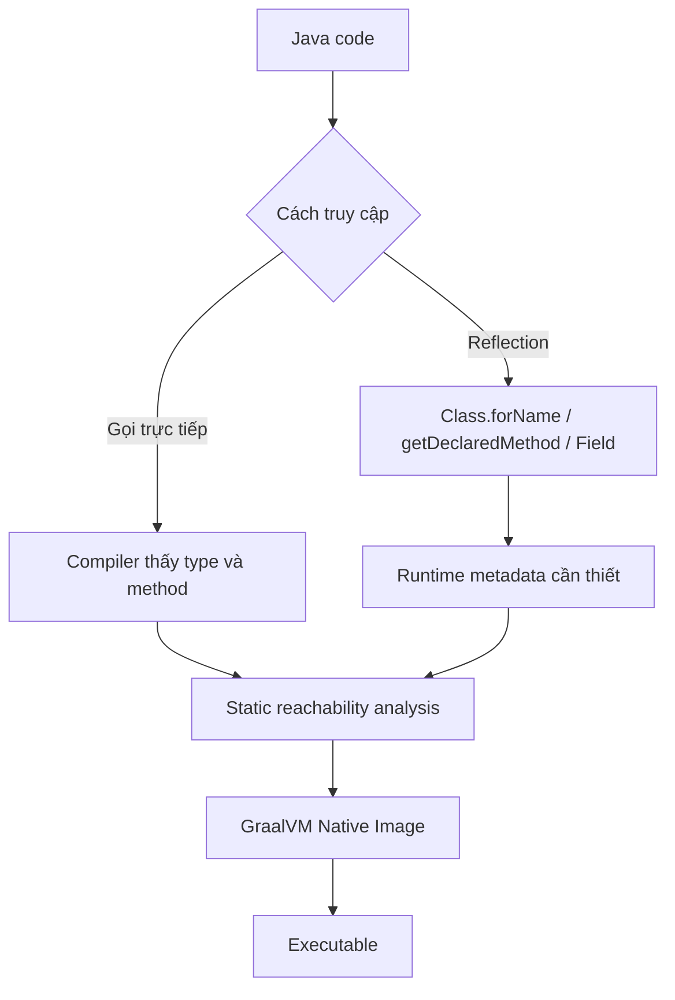

# Phân biệt gọi trực tiếp với truy cập lớp, constructor, method và field bằng reflection

## 1. Reflection là gì và vì sao Native Image quan tâm?

Java cung cấp **reflection** để chương trình kiểm tra và tương tác với class, constructor, method, field và annotation trong lúc chạy. Thay vì gọi một method bằng tên đã biết lúc biên dịch, chương trình có thể nhận tên class hoặc member từ cấu hình, tìm metadata bằng API reflection rồi thực hiện thao tác.

Trong ứng dụng Spring Boot, reflection có thể xuất hiện trong framework, thư viện serialization, dependency injection, validation, ORM, plugin system và code do chính ứng dụng viết. Trên JVM HotSpot, class metadata và khả năng nạp class động hỗ trợ nhiều trường hợp reflection. Với **GraalVM Native Image**, quá trình build phân tích reachability trước; những class/member được truy cập động có thể cần metadata để được giữ và cho phép truy cập trong executable.

Cần phân biệt hai nhóm hành vi:

- **Gọi trực tiếp (direct invocation)**: mã nguồn tham chiếu class/member cụ thể; compiler nhìn thấy lời gọi và Native Image thường có thể theo dõi qua phân tích tĩnh.
- **Truy cập bằng reflection**: chương trình tìm class/member bằng API reflection, thường qua tên hoặc dữ liệu chỉ biết lúc runtime; công cụ build có thể không suy ra đầy đủ mục tiêu.



Reflection không xấu và không bị cấm trong Native Image. Điều quan trọng là xác định chính xác phần metadata cần thiết, cung cấp qua Spring Runtime Hints hoặc reachability metadata và kiểm thử code path thực tế.

## 2. Gọi trực tiếp class và method

Ví dụ một service:

```java
package com.example.payment;

public class PaymentService {
    public String charge(String orderId) {
        return "charged:" + orderId;
    }
}
```

Gọi trực tiếp:

```java
PaymentService service = new PaymentService();
String result = service.charge("ORD-1001");
```

Compiler biết:

- Class `PaymentService` được tham chiếu.
- Constructor không tham số được gọi.
- Method `charge(String)` được gọi.
- Kiểu trả về và kiểu tham số được xác định trong bytecode.

Native Image có thể theo dõi các tham chiếu tĩnh này khi phân tích reachability. Nếu class và method không bị loại bởi điều kiện khác, thường không cần reflection hint chỉ để phục vụ lời gọi trực tiếp.

Tuy nhiên, việc một class được gọi trực tiếp không đảm bảo mọi field, constructor và method riêng tư của nó đều được giữ cho reflection. Nếu ứng dụng còn truy cập các member khác bằng reflection, cần đăng ký quyền tương ứng.

## 3. Nạp class bằng tên: `Class.forName`

Reflection thường bắt đầu khi class name chỉ có ở runtime:

```java
String className = configuration.getProperty("payment.handler");
Class<?> handlerType = Class.forName(className);
Object handler = handlerType.getDeclaredConstructor().newInstance();
```

Ở đây, compiler không biết chắc giá trị `className` sẽ là gì. Nếu property có thể chứa nhiều implementation, Native Image không thể tự suy ra tất cả class chỉ từ một chuỗi runtime.

Ví dụ cấu hình:

```properties
payment.handler=com.example.payment.CardHandler
```

Nếu class được chọn luôn cố định, thiết kế có thể dùng tham chiếu class tĩnh hoặc registry tĩnh để giúp AOT phân tích. Nếu thực sự cần lựa chọn động, cần đăng ký các class có thể được sử dụng và các member được truy cập.

### Phân biệt nạp class với khởi tạo instance

- `Class.forName(name)` nạp/khởi tạo class theo overload và cơ chế class initialization tương ứng.
- `getDeclaredConstructor()` tìm constructor.
- `newInstance()` trên `Constructor` tạo object.
- `Class.newInstance()` là API cũ đã deprecated; nên dùng `getDeclaredConstructor().newInstance()`.

Không phải chỉ đăng ký class là đủ. Nếu code gọi constructor qua reflection, constructor phù hợp cũng phải được cho phép.

## 4. Tìm và gọi method bằng reflection

Ví dụ:

```java
Method method = PaymentService.class.getDeclaredMethod(
    "charge",
    String.class
);

Object result = method.invoke(service, "ORD-1001");
```

Các bước:

1. Xác định class.
2. Tìm method theo tên và danh sách kiểu tham số.
3. Nhận đối tượng `Method`.
4. Gọi `invoke` với target và argument tương ứng.

`getMethod` chỉ tìm public method, bao gồm method kế thừa phù hợp. `getDeclaredMethod` tìm method được khai báo trực tiếp trong class, có thể là private/protected/package-private. Nếu gọi member không public, còn phải xem access rules và việc dùng `setAccessible`/Java module access.

Ví dụ private method:

```java
Method method = PaymentService.class.getDeclaredMethod(
    "calculateInternal",
    long.class
);
method.setAccessible(true);
Object result = method.invoke(service, 100L);
```

Việc mở quyền truy cập bằng reflection có giới hạn bởi module system, runtime policy và khả năng Native Image. Không nên dùng `setAccessible(true)` như cách mặc định; ưu tiên API công khai hoặc thiết kế lại nếu có thể.

Khi dùng `Method.invoke`, exception từ method được gọi thường được bọc trong `InvocationTargetException`. Hãy kiểm tra `getCause()` để tìm nguyên nhân gốc.

## 5. Truy cập field bằng reflection

Field reflection cho phép đọc/ghi field theo tên:

```java
Field field = PaymentRequest.class.getDeclaredField("customerId");
field.setAccessible(true);
Object value = field.get(request);
field.set(request, "CUST-200");
```

Phân biệt:

- `getField(name)`: tìm public field, bao gồm field kế thừa.
- `getDeclaredField(name)`: tìm field khai báo trực tiếp trong class, bất kể modifier.
- `Field.get(object)`: đọc giá trị.
- `Field.set(object, value)`: ghi giá trị nếu access và field semantics cho phép.

Field `final`, static, private và các kiểu primitive có quy tắc truy cập riêng. Không phải mọi field đều có thể ghi tùy ý. Reflection cũng không bỏ qua hoàn toàn quy tắc encapsulation của Java module system.

## 6. Bảng so sánh direct invocation và reflection

| Tiêu chí | Gọi trực tiếp | Reflection |
|---|---|---|
| Cách xác định class/member | Tham chiếu trong mã | Tìm bằng API và metadata runtime |
| Tên method | Compiler kiểm tra | Thường là chuỗi |
| Kiểu tham số | Kiểm tra lúc compile | Truyền qua mảng Class/argument |
| Phát hiện lỗi | Nhiều lỗi phát hiện sớm | Một số lỗi chỉ xuất hiện runtime |
| Tối ưu hóa | Dễ phân tích tĩnh hơn | Có thể khó suy luận mục tiêu |
| Native Image | Thường được reachability analysis nhận diện | Có thể cần reflection metadata |
| Use case | Logic nghiệp vụ thông thường | Framework, plugin, serializer, mapper |

Reflection đem lại tính linh hoạt, nhưng làm tăng độ phức tạp trong kiểm thử và cấu hình Native Image. Nếu không cần lựa chọn class/member động, lời gọi trực tiếp hoặc registry tĩnh thường dễ bảo trì hơn.

## 7. Những loại metadata reflection cần phân biệt

Native Image có thể cần biết những loại thao tác reflection khác nhau:

- **Type access/introspection**: lấy metadata class, annotation, superclass, interface.
- **Constructor access**: tìm hoặc gọi constructor, tạo instance.
- **Method access**: tìm, đọc metadata hoặc invoke method.
- **Field access**: tìm, đọc hoặc ghi field.
- **Resource/class lookup liên quan**: tìm class/resource bằng tên hoặc pattern.

Đăng ký một type không tự động có nghĩa mọi member của nó được mở cho mọi thao tác. Hãy đăng ký quyền truy cập tối thiểu theo code path.

## 8. Đăng ký reflection bằng Spring RuntimeHints

Spring cung cấp `RuntimeHints.reflection()` để khai báo type và member cần thiết.

Ví dụ class được tạo bằng constructor và gọi method qua reflection:

```java
public class CardHandler {
    public CardHandler() {
    }

    public String handle(String payload) {
        return "card:" + payload;
    }
}
```

Registrar:

```java
import org.springframework.aot.hint.MemberCategory;
import org.springframework.aot.hint.RuntimeHints;
import org.springframework.aot.hint.RuntimeHintsRegistrar;

public class PaymentReflectionHints implements RuntimeHintsRegistrar {

    @Override
    public void registerHints(RuntimeHints hints, ClassLoader classLoader) {
        hints.reflection().registerType(
            CardHandler.class,
            MemberCategory.INVOKE_DECLARED_CONSTRUCTORS,
            MemberCategory.INVOKE_PUBLIC_METHODS
        );
    }
}
```

Đăng ký registrar:

```java
@Configuration
@ImportRuntimeHints(PaymentReflectionHints.class)
class PaymentConfiguration {
}
```

Ví dụ trên cho phép các declared constructor và public method theo nhóm category. Nếu code thực tế cần private method hoặc field, hãy đăng ký quyền tương ứng thay vì giả định các category trên bao phủ mọi member.

Spring AOT sẽ thu thập Runtime Hints khi registrar được phát hiện và gọi trong quá trình AOT. Chỉ viết class registrar mà không import/đăng ký nó thì không đủ.

## 9. Đăng ký member cụ thể thay vì mở rộng quá mức

Nếu chỉ cần constructor không tham số và một method cụ thể, có thể đăng ký member chi tiết:

```java
hints.reflection().registerType(
    CardHandler.class,
    typeHint -> typeHint
        .withConstructor(new Class<?>[0],
            ExecutableMode.INVOKE)
        .withMethod(
            "handle",
            List.of(String.class),
            ExecutableMode.INVOKE
        )
);
```

API builder và import `ExecutableMode` phụ thuộc phiên bản Spring Framework. Ví dụ định hướng này minh họa việc khai báo constructor và method cần invoke. Khi triển khai, đối chiếu chữ ký API đúng version và compile test.

Đăng ký tối thiểu có lợi:

- Tránh giữ member không cần thiết trong executable.
- Giảm metadata dư thừa.
- Làm rõ mục đích của đường reflection.
- Dễ rà soát khi thư viện hoặc class thay đổi.

Nếu class có nhiều constructor cùng tên, method overload hoặc kiểu generic phức tạp, hãy khai báo đúng kiểu tham số và kiểm tra signature thực tế.

## 10. Reflection metadata trong reachability metadata JSON

Ngoài Spring RuntimeHints, GraalVM Native Image hỗ trợ reachability metadata theo định dạng JSON. Ví dụ minh họa phần reflection:

```json
{
  "reflection": [
    {
      "type": "com.example.payment.CardHandler",
      "methods": [
        {
          "name": "<init>",
          "parameterTypes": []
        },
        {
          "name": "handle",
          "parameterTypes": ["java.lang.String"]
        }
      ]
    }
  ]
}
```

Cấu trúc chính xác và trường được hỗ trợ phụ thuộc phiên bản GraalVM reachability metadata schema. Không sao chép JSON từ ví dụ mà không kiểm tra tài liệu của bản Native Image đang dùng.

Trong ứng dụng Spring Boot, RuntimeHints thường là cách tích hợp tự nhiên vì hints được Spring AOT thu thập. Metadata JSON có thể phù hợp khi thư viện muốn cung cấp reachability metadata độc lập với Spring hoặc theo cơ chế GraalVM. Tránh khai báo trùng lặp không cần thiết giữa hai nguồn.

## 11. Reflection và closed-world analysis

Native Image dùng mô hình phân tích closed-world: công cụ cần xác định tập class và member có thể được sử dụng. Lời gọi trực tiếp tạo ra các cạnh trong đồ thị reachability dễ nhận diện. Reflection qua tên runtime có thể tạo ra cạnh mà static analysis không thấy.

Ví dụ:

```java
String implementation = request.getParameter("handler");
Class<?> type = Class.forName(implementation);
```

Nếu giá trị có thể là bất kỳ class nào từ input bên ngoài, tập class không giới hạn. Đây vừa là vấn đề tương thích native, vừa là vấn đề an toàn ứng dụng. Không nên cho phép request tùy ý chọn class được khởi tạo. Dùng allowlist tên implementation và đăng ký hints cho đúng các class được phép.

## 12. Tracing Agent: phát hiện reflection trong JVM

GraalVM Native Image Tracing Agent có thể quan sát các thao tác reflection xảy ra khi ứng dụng chạy trên JVM và sinh metadata gợi ý.

Ví dụ lệnh (cú pháp cụ thể tùy phiên bản GraalVM):

```bash
java -agentlib:native-image-agent=config-output-dir=target/native-agent-config \
     -jar target/app.jar
```

Sau khi chạy các kịch bản nghiệp vụ, agent ghi nhận những thao tác động đã quan sát. Dữ liệu này có thể hỗ trợ tạo cấu hình reflection, proxy, resource và JNI.

Nhưng agent chỉ thấy code path được thực thi. Smoke test ngắn không đảm bảo mọi luồng production đã được ghi nhận. Cần chạy test suite đủ rộng, rà soát cấu hình sinh ra, loại metadata thừa và bổ sung các đường đi hiếm chưa được thực thi.

## 13. Kiểm thử reflection trên Native Image

Một quy trình kiểm thử nên gồm:

1. Viết test JVM cho hành vi reflection: class name, constructor, method/field và exception.
2. Xác định các class/member thực sự được truy cập động.
3. Đăng ký RuntimeHints hoặc reachability metadata phù hợp.
4. Chạy Spring AOT và build Native Image.
5. Chạy cùng test case trên executable native hoặc native test task.
6. Kiểm tra cả trường hợp hợp lệ và lỗi: class không được phép, thiếu constructor, sai method signature, access denied.
7. Chạy integration test trong container đích để kiểm tra OS/library và resource.

Không kết luận native compatibility chỉ từ việc build thành công. Một method reflection chỉ được gọi khi endpoint hiếm được sử dụng có thể vẫn gây lỗi ở production nếu chưa được kiểm thử.

## 14. Lỗi thường gặp

| Triệu chứng | Nguyên nhân có thể | Cách xử lý |
|---|---|---|
| `ClassNotFoundException` | Class name không đúng hoặc class không được đưa vào image | Kiểm tra runtime classpath, allowlist và reachability |
| `NoSuchMethodException` | Constructor/method signature không tồn tại hoặc không được metadata hỗ trợ | Kiểm tra tên, parameter types và hints |
| `IllegalAccessException` | Access modifier/module boundary hoặc thiếu quyền reflection | Dùng API công khai hoặc khai báo access phù hợp |
| `InvocationTargetException` | Method đích ném exception | Kiểm tra cause của exception |
| JVM chạy nhưng native lỗi reflection | Thiếu metadata hoặc registrar không được phát hiện | Kiểm tra RuntimeHints và AOT output |
| Field không đọc/ghi được | Field access chưa đăng ký hoặc field semantics không cho phép | Xác định chính xác field operation |
| Tracing Agent không phát hiện lỗi | Kịch bản chạy chưa bao phủ code path | Mở rộng integration tests và rà soát thủ công |

## 15. Nguyên tắc thiết kế

- Ưu tiên gọi trực tiếp khi class/member đã biết lúc compile.
- Nếu cần reflection, giới hạn class bằng allowlist, tránh tên class tùy ý từ request.
- Chỉ đăng ký constructor/method/field cần thiết.
- Giữ RuntimeHintsRegistrar đơn giản và đăng ký vào Spring AOT.
- Không nhầm reflection hints với resource hints hoặc proxy hints.
- Dùng tracing agent như công cụ hỗ trợ, không xem là chứng minh đầy đủ.
- Test trên executable native và container thực tế.
- Ghi rõ phiên bản Spring/GraalVM khi chia sẻ metadata và ví dụ.

## 16. Câu hỏi tự kiểm tra

1. Vì sao lời gọi trực tiếp thường dễ được Native Image phân tích hơn reflection theo tên runtime?
2. `Class.forName`, `getDeclaredConstructor`, `Method.invoke` và `Field.get` thực hiện các vai trò nào?
3. Đăng ký một type có tự động mở mọi constructor, method và field cho reflection không?
4. Khi nào nên dùng `MemberCategory` và khi nào nên khai báo member cụ thể?
5. Vì sao tracing agent không đảm bảo đã ghi nhận mọi reflection path của production?
6. Reflection metadata có giải quyết việc một dependency không nằm trong runtime classpath không?
7. Vì sao không nên cho phép client gửi tên class tùy ý để ứng dụng khởi tạo qua reflection?

**Ghi nhớ:** gọi trực tiếp tạo tham chiếu tĩnh mà Native Image dễ phân tích; reflection tìm class/member động nên có thể cần metadata riêng. Hãy xác định đúng loại thao tác, đăng ký tối thiểu qua Spring RuntimeHints hoặc reachability metadata và kiểm thử trên executable native.
