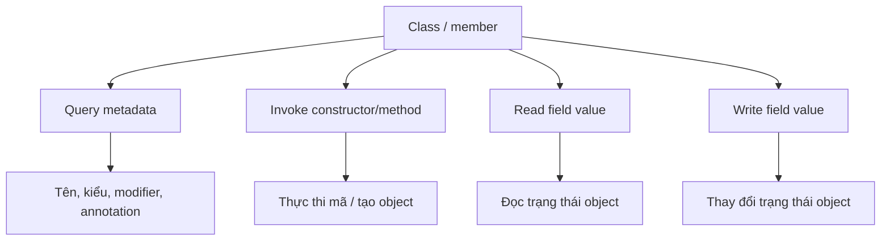

# Phân biệt xem thông tin thành viên với quyền gọi hoặc đọc, ghi

> **Chương:** Reflection  
> **Module:** `SPRING_BOOT_NATIVE_IMAGE`  
> **Mục tiêu:** Phân biệt việc truy vấn metadata của class/member với việc thực thi method/constructor hoặc đọc/ghi giá trị field; hiểu vì sao Native Image cần khai báo riêng khả năng reflection; biết cách biểu diễn nhu cầu bằng Spring RuntimeHints và kiểm thử đúng thao tác trên executable native.

## 1. Biết một thành viên tồn tại không có nghĩa được phép sử dụng nó

Java Reflection cho phép chương trình quan sát cấu trúc của class khi chạy: class có những method, constructor, field nào; tên, kiểu dữ liệu, modifier và annotation của chúng là gì. Reflection cũng cho phép thực hiện một số thao tác trên các thành viên đó: tạo object, gọi method, đọc field hoặc ghi field.

Hai nhóm khả năng này liên quan nhưng **không đồng nghĩa**:

- **Xem thông tin thành viên (introspection/query):** khám phá metadata, ví dụ gọi `getDeclaredMethods()` để lấy danh sách method hoặc `getDeclaredField("code")` để tìm metadata của field.
- **Thực thi hoặc truy cập giá trị (invoke/read/write):** gọi `Method.invoke()`, tạo object bằng `Constructor.newInstance()`, đọc bằng `Field.get()` hoặc ghi bằng `Field.set()`.

Một chương trình có thể chỉ cần liệt kê tên method để tạo tài liệu hoặc kiểm tra annotation. Chương trình khác cần gọi method được chọn theo cấu hình. Chương trình thứ ba chỉ đọc giá trị field để serialize object; chương trình thứ tư còn phải ghi ngược giá trị vào field. Mỗi nhu cầu đòi hỏi một mức quyền khác nhau.

Trong môi trường JVM thông thường, class metadata và khả năng truy cập reflection được xử lý linh hoạt theo runtime. Với **GraalVM Native Image**, compiler phân tích reachability ở build time và không mặc định giữ mọi thành viên cho mọi thao tác reflection. Vì thế, khai báo “cần xem metadata” không tự động đồng nghĩa “được phép gọi method” hoặc “được phép ghi field”.



## 2. Bốn thao tác reflection cần phân biệt

| Nhu cầu | API tiêu biểu | Ý nghĩa | Không tự suy ra |
|---|---|---|---|
| **Xem thông tin method** | `getMethod()`, `getDeclaredMethod()`, `getMethods()`, `getDeclaredMethods()` | Lấy đối tượng `Method` và metadata | Không có nghĩa method đã được phép gọi |
| **Gọi method** | `Method.invoke()` | Thực thi method trên object hoặc class target | Không có nghĩa mọi method khác cũng được gọi |
| **Xem thông tin field** | `getField()`, `getDeclaredField()`, `getFields()`, `getDeclaredFields()` | Lấy đối tượng `Field`, tên và kiểu | Không có nghĩa được đọc hoặc ghi giá trị |
| **Đọc/ghi field** | `Field.get()`, `Field.set()` | Truy cập hoặc thay đổi giá trị trên object | Không có nghĩa mọi field đều được phép truy cập |

Constructor cũng có hai mức tương tự:

- **Introspection:** lấy metadata bằng `getDeclaredConstructors()` hoặc `getDeclaredConstructor(...)`.
- **Invocation:** tạo instance bằng `Constructor.newInstance(...)`.

Ví dụ, `getDeclaredMethod("approve")` có thể trả về metadata của một method private nếu class và metadata đó được giữ phù hợp. Nhưng để gọi method, ứng dụng còn cần quyền invocation, object target phù hợp (nếu là instance method) và vượt qua các quy tắc truy cập của Java/module.

## 3. Ví dụ Java: xem method khác với gọi method

Giả sử có class nghiệp vụ:

```java
package com.example.payment;

public class PaymentCommand {

    private String reference;

    public PaymentCommand() {
        this.reference = "P-001";
    }

    public String getReference() {
        return this.reference;
    }

    private void approve() {
        System.out.println("Approved: " + this.reference);
    }
}
```

### 3.1. Chỉ xem metadata method

```java
Class<?> type = PaymentCommand.class;

for (Method method : type.getDeclaredMethods()) {
    System.out.println(
            method.getName()
            + " / return type: "
            + method.getReturnType().getName()
            + " / modifiers: "
            + Modifier.toString(method.getModifiers()));
}
```

Đoạn mã này yêu cầu JVM cung cấp danh sách metadata của các method được khai báo trực tiếp trong class, bao gồm method private. Nó không gọi `approve()` và không thực thi logic nghiệp vụ nào.

Các API có phạm vi khác nhau:

- `getMethods()` liệt kê các public methods nhìn thấy được, gồm cả những method kế thừa phù hợp.
- `getDeclaredMethods()` liệt kê các method được khai báo trực tiếp trong class, không lọc theo public/private.
- `getMethod(name, parameterTypes...)` tìm một public method theo tên và chữ ký.
- `getDeclaredMethod(name, parameterTypes...)` tìm method được khai báo trực tiếp, kể cả non-public.

**Kết quả introspection là thông tin mô tả.** Nó không tự cấp quyền thực thi method.

### 3.2. Gọi method là một thao tác khác

```java
PaymentCommand command = new PaymentCommand();

Method approve = PaymentCommand.class.getDeclaredMethod("approve");

if (!approve.trySetAccessible()) {
    throw new IllegalStateException("Cannot access approve()");
}

approve.invoke(command);
```

Đoạn mã này có thêm các yêu cầu:

1. Tìm đúng method theo tên và chữ ký.
2. Có metadata và khả năng invocation cho method trong môi trường đang chạy.
3. Có object target vì `approve()` là instance method.
4. Vượt qua access checks của Java/module.
5. Method thực sự được thực thi; nó có thể thay đổi trạng thái, ghi log, gọi dịch vụ ngoài hoặc phát sinh exception.

`trySetAccessible()` yêu cầu cho phép bỏ qua Java language access checks nếu môi trường module cho phép. Nó trả về `false` khi không thể bật quyền truy cập sâu. Gọi `setAccessible(true)` không phải cách vượt qua mọi ranh giới bảo mật; trong Java module system, truy cập private của package không được mở có thể bị từ chối.

## 4. Xem metadata field khác với đọc hoặc ghi giá trị

Vẫn dùng class `PaymentCommand` ở trên.

### 4.1. Chỉ xem thông tin field

```java
Field field = PaymentCommand.class.getDeclaredField("reference");

System.out.println(field.getName());
System.out.println(field.getType().getName());
System.out.println(Modifier.toString(field.getModifiers()));
```

Các dòng này chỉ xem tên, kiểu và modifier của field. Chúng không đọc giá trị `"P-001"` từ một object và cũng không thay đổi dữ liệu.

### 4.2. Đọc giá trị field

```java
PaymentCommand command = new PaymentCommand();
Field field = PaymentCommand.class.getDeclaredField("reference");

if (!field.trySetAccessible()) {
    throw new IllegalStateException("Cannot read reference");
}

Object value = field.get(command);
System.out.println(value);
```

`Field.get(object)` đọc giá trị của field trên instance cụ thể. Với static field, đối số target thường được bỏ qua hoặc truyền `null`. Nếu field không accessible, Java có thể ném `IllegalAccessException` hoặc từ chối việc mở quyền truy cập trước đó.

### 4.3. Ghi giá trị field

```java
PaymentCommand command = new PaymentCommand();
Field field = PaymentCommand.class.getDeclaredField("reference");

if (!field.trySetAccessible()) {
    throw new IllegalStateException("Cannot write reference");
}

field.set(command, "P-002");
System.out.println(command.getReference());
```

`Field.set(object, value)` thay đổi trạng thái object. Nó cần quyền ghi tương ứng, kiểu dữ liệu tương thích và access permission hợp lệ. Field `final`, primitive conversion, static field hoặc quy tắc module có những giới hạn riêng; không nên coi mọi field đều có thể ghi tùy ý.

### 4.4. Ma trận khác biệt

| Thao tác | API | Nhu cầu thực tế |
|---|---|---|
| Xem tên field | `getDeclaredField()` + `getName()` | Metadata |
| Xem kiểu field | `getType()` | Metadata |
| Đọc giá trị | `get()` | Field read access |
| Ghi giá trị | `set()` | Field write access |
| Xem method | `getDeclaredMethods()` | Method metadata |
| Gọi method | `invoke()` | Method invocation |
| Xem constructor | `getDeclaredConstructors()` | Constructor metadata |
| Tạo instance | `newInstance()` trên `Constructor` | Constructor invocation |

Một framework serializer có thể cần đọc field nhưng không ghi. Một binder/deserializer có thể cần ghi field hoặc gọi setter. Một công cụ phân tích chỉ cần xem metadata. **Không cấp rộng quyền ghi hoặc invocation nếu use case chỉ cần query/read.**

## 5. Java access checks vẫn áp dụng

Việc Native Image giữ metadata cho reflection và việc Java cho phép truy cập thành viên là hai vấn đề riêng.

### 5.1. Public, protected, package-private và private

- **public:** có thể truy cập nếu class và package được nhìn thấy theo quy tắc Java/module.
- **protected:** phụ thuộc package, quan hệ kế thừa và cách truy cập.
- **package-private:** chỉ có thể truy cập theo quy tắc cùng package/module tương ứng.
- **private:** chỉ truy cập trực tiếp trong phạm vi class; reflection có thể yêu cầu mở quyền truy cập sâu.

Các quy tắc Java language access vẫn có hiệu lực với native executable. Việc thêm reflection metadata không biến một private member thành public.

### 5.2. Java Platform Module System (JPMS)

Trong ứng dụng dùng named modules, cần phân biệt:

- `exports` cho phép các package public được module khác truy cập theo quy tắc module.
- `opens` cho phép truy cập sâu bằng reflection vào package được mở.
- `open module` mở tất cả package của module cho deep reflection theo quy tắc module system.

Nếu một thư viện cần truy cập private member của package trong module không mở, `trySetAccessible()` có thể trả `false` hoặc `setAccessible(true)` ném `InaccessibleObjectException`. Runtime hints của Native Image không tự thêm `opens` vào module descriptor và không vượt qua chính sách access của JVM/Java.

**Nguyên tắc:** kiểm tra riêng hai câu hỏi: metadata/thao tác reflection đã được native build giữ lại chưa, và Java/module có cho phép thao tác đó không?

## 6. Vì sao Native Image tách introspection với invocation/read/write?

HotSpot JVM thường chạy với khả năng nạp class và xử lý reflection linh hoạt. Native Image phân tích tập chương trình ở build time theo mô hình **closed world**: compiler cần biết những class/member nào có thể được sử dụng và cách chúng được truy cập.

Nếu ứng dụng chỉ cần xem tên và annotation của method, compiler có thể chỉ cần giữ metadata để query. Nếu ứng dụng còn gọi method bằng reflection, compiler phải biết method đó cần khả năng invocation. Với field, việc giữ metadata để tìm field khác với việc cấp khả năng đọc hoặc ghi giá trị.

Một cách hình dung:

| Khả năng | Ý nghĩa trong native build |
|---|---|
| **Introspection/query** | Giữ metadata cần để tìm và mô tả thành viên |
| **Invocation** | Giữ khả năng gọi constructor/method qua reflection |
| **Field read** | Cho phép truy cập giá trị field khi chương trình chạy |
| **Field write** | Cho phép thay đổi giá trị field khi chương trình chạy |

GraalVM Native Image có metadata reflection với các nhóm query và invoke riêng. Spring AOT cung cấp API RuntimeHints để mô tả nhu cầu tương ứng. Nếu chỉ khai báo query, đừng giả định lời gọi `Method.invoke()` sẽ tự hoạt động. Nếu chỉ đăng ký method invocation, đừng giả định mọi method/annotation khác trong class đều có metadata đầy đủ để introspect.

Việc đăng ký quá rộng cũng có chi phí: metadata và thành viên không cần thiết có thể làm tăng kích thước image, mở rộng tập code cần giữ và làm quá trình phân tích phức tạp hơn. Nên khai báo đúng member và thao tác cần dùng.
## 7. Khai báo đúng nhu cầu bằng Spring RuntimeHints

Spring Framework cung cấp API `RuntimeHints` để mô tả những truy cập động cần được giữ trong quá trình AOT/native build. Trong reflection hints, cần chọn **đúng member và đúng loại thao tác**.

Ví dụ với Spring Framework 6+:

```java
import java.lang.reflect.Field;
import java.lang.reflect.Method;

import org.springframework.aot.hint.ExecutableMode;
import org.springframework.aot.hint.MemberCategory;
import org.springframework.aot.hint.RuntimeHints;
import org.springframework.aot.hint.RuntimeHintsRegistrar;

public class PaymentReflectionHints implements RuntimeHintsRegistrar {

    @Override
    public void registerHints(RuntimeHints hints, ClassLoader classLoader) {
        // Chỉ cần duyệt metadata của các method khai báo trực tiếp.
        hints.reflection().registerType(
                PaymentCommand.class,
                MemberCategory.INTROSPECT_DECLARED_METHODS);

        try {
            // Chỉ method approve cần được gọi bằng reflection.
            Method approve = PaymentCommand.class.getDeclaredMethod("approve");
            hints.reflection().registerMethod(approve, ExecutableMode.INVOKE);

            // Field reference cần được đọc và ghi bằng reflection.
            Field reference = PaymentCommand.class.getDeclaredField("reference");
            hints.reflection().registerField(
                    reference,
                    fieldHint -> fieldHint.allowWrite(true));
        }
        catch (NoSuchMethodException | NoSuchFieldException ex) {
            throw new IllegalStateException(
                    "Payment reflection metadata does not match the class", ex);
        }
    }
}
```

Đăng ký registrar bằng cấu hình Spring:

```java
import org.springframework.context.annotation.Configuration;
import org.springframework.context.annotation.ImportRuntimeHints;

@Configuration(proxyBeanMethods = false)
@ImportRuntimeHints(PaymentReflectionHints.class)
class PaymentAotConfiguration {
}
```

Đọc ví dụ:

- `INTROSPECT_DECLARED_METHODS` yêu cầu metadata để quan sát các method được khai báo trực tiếp. Nó không tự yêu cầu invoke tất cả method đó.
- `registerMethod(..., ExecutableMode.INVOKE)` chỉ rõ method `approve` cần được gọi bằng reflection.
- `registerField(..., fieldHint -> fieldHint.allowWrite(true))` đăng ký field cụ thể và cho phép thao tác ghi khi cần. Nếu use case chỉ đọc, không bật quyền ghi một cách dư thừa.
- `@ImportRuntimeHints` giúp Spring AOT phát hiện registrar trong quá trình xử lý cấu hình.

Nếu cần tạo instance bằng reflection, phải khai báo khả năng invocation cho constructor tương ứng. Ví dụ với một constructor không tham số được gọi bằng reflection, có thể đăng ký constructor cụ thể ở chế độ `ExecutableMode.INVOKE`. Nếu chỉ liệt kê constructor để xem metadata, dùng nhóm introspection tương ứng.

**Lưu ý:** tên API và khả năng của hints phải khớp phiên bản Spring Framework/Spring Boot đang dùng. Khi viết extension, kiểm tra Javadoc của dependency thực tế và xác minh metadata được sinh trong build. Ví dụ trên minh họa nguyên tắc khai báo theo từng thao tác; không thay thế việc kiểm tra compile với phiên bản dự án.

### 7.1. Nhóm MemberCategory thường gặp

| Nhóm | Ví dụ | Ý nghĩa |
|---|---|---|
| Introspect constructors | `INTROSPECT_PUBLIC_CONSTRUCTORS`, `INTROSPECT_DECLARED_CONSTRUCTORS` | Xem metadata constructor |
| Invoke constructors | `INVOKE_PUBLIC_CONSTRUCTORS`, `INVOKE_DECLARED_CONSTRUCTORS` | Tạo object qua reflection |
| Introspect methods | `INTROSPECT_PUBLIC_METHODS`, `INTROSPECT_DECLARED_METHODS` | Xem metadata method |
| Invoke methods | `INVOKE_PUBLIC_METHODS`, `INVOKE_DECLARED_METHODS` | Gọi method qua reflection |
| Fields | `PUBLIC_FIELDS`, `DECLARED_FIELDS` hoặc đăng ký từng field | Khai báo field metadata; với field cụ thể có thể chỉ định quyền ghi |

Dùng category ở phạm vi toàn class khi ứng dụng thật sự cần thao tác với nhiều thành viên. Nếu chỉ một method hoặc field được dùng, đăng ký member cụ thể thường thể hiện ý định rõ hơn và giảm metadata không cần thiết.

### 7.2. RuntimeHints không thay thế Java access rules

Ví dụ registrar có thể yêu cầu giữ metadata cho private method `approve`. Điều đó không có nghĩa mọi module đều cho phép truy cập private member. Nếu package thuộc named module không mở cho deep reflection, `trySetAccessible()` vẫn có thể thất bại.

Tương tự, cho phép ghi field trong native metadata không biến field `final` hoặc trạng thái bất biến thành một API cập nhật được hỗ trợ. Hãy thiết kế class và thao tác reflection phù hợp với Java semantics.

## 8. Native Image metadata: query và invoke là hai nhu cầu

GraalVM Native Image cũng phân biệt metadata phục vụ **truy vấn** với metadata phục vụ **thực thi reflection**. Trong reachability metadata, có những khai báo dạng query cho phép khám phá member metadata và khai báo dạng invoke để gọi constructor/method. Với field, metadata còn mô tả khả năng đọc và ghi.

Có thể hiểu khái niệm như sau:

| Mục tiêu | Loại metadata cần quan tâm |
|---|---|
| Tìm class và xem thông tin class | Type metadata và query access phù hợp |
| Liệt kê declared methods | Query metadata cho declared methods |
| Gọi một method cụ thể | Invocation metadata cho method đó |
| Liệt kê constructors | Query metadata cho constructors |
| Tạo object bằng constructor reflection | Invocation metadata cho constructor |
| Tìm field và xem kiểu/modifier | Field metadata phục vụ introspection |
| Đọc giá trị field | Quyền field read tương ứng |
| Ghi giá trị field | Quyền field write tương ứng |

Một cấu hình query-only không phải là cách viết tắt cho full reflection access. Ngược lại, đăng ký invoke một method không có nghĩa mọi method khác trong cùng class đều được gọi động.

Nếu sử dụng GraalVM reachability metadata JSON trực tiếp, hãy dùng schema đúng phiên bản GraalVM và chọn các cờ query/invoke hoặc field write tương ứng. Không sao chép metadata cũ từ dự án khác mà không kiểm tra schema. Trong ứng dụng Spring Boot, ưu tiên biểu diễn nhu cầu qua Spring RuntimeHints khi có API phù hợp để metadata được tích hợp vào quy trình AOT.

### 8.1. Vì sao không nên đăng ký toàn bộ reflection?

Đăng ký tất cả declared methods, constructors và fields có thể làm native image giữ lại nhiều metadata và khả năng truy cập hơn nhu cầu thật. Điều này:

- Làm tăng lượng metadata cần xử lý.
- Có thể làm rộng tập thành viên được giữ trong binary.
- Khiến review khó xác định thành viên nào thực sự cần.
- Tạo thêm bề mặt truy cập động cần kiểm soát.

Hãy bắt đầu từ thao tác cụ thể trong code: query, invoke, field read hay field write. Sau đó đăng ký đúng phạm vi nhỏ nhất đáp ứng yêu cầu.

## 9. Thiết kế kiểm thử riêng cho từng thao tác

Không nên viết một test chung kiểu “reflection chạy được” rồi kết luận mọi khả năng đều hoạt động. Hãy chia test theo hành vi:

| Test | Hành động | Điều cần chứng minh |
|---|---|---|
| T1 — Method introspection | Gọi `getDeclaredMethods()` và tìm `approve` | Metadata method cần thiết có mặt |
| T2 — Method invocation | Gọi `Method.invoke()` trên target | Method được giữ cho invocation và access hợp lệ |
| T3 — Constructor introspection | Gọi `getDeclaredConstructors()` | Metadata constructor cần xem có mặt |
| T4 — Constructor invocation | Gọi `Constructor.newInstance()` | Constructor được giữ cho invocation |
| T5 — Field introspection | Gọi `getDeclaredField("reference")`, xem tên/kiểu | Metadata field có mặt |
| T6 — Field read | Gọi `Field.get(target)` | Có thể đọc giá trị field |
| T7 — Field write | Gọi `Field.set(target, value)` | Có quyền ghi và giá trị mới được lưu |
| T8 — Access control | Thử deep reflection trên package/module không mở | Ứng dụng xử lý access denial đúng dự kiến |

### 9.1. Kiểm tra metadata method

Một test có thể xác nhận method được tìm thấy:

```java
Method approve = PaymentCommand.class.getDeclaredMethod("approve");

assertThat(approve.getName()).isEqualTo("approve");
assertThat(Modifier.isPrivate(approve.getModifiers())).isTrue();
```

Test này chỉ chứng minh query metadata. Nó **không chứng minh** `approve.invoke(command)` hoạt động.

### 9.2. Kiểm tra invocation

```java
PaymentCommand command = new PaymentCommand();
Method approve = PaymentCommand.class.getDeclaredMethod("approve");

assertThat(approve.trySetAccessible()).isTrue();
assertThatCode(() -> approve.invoke(command)).doesNotThrowAnyException();
```

Test này kiểm tra invocation cùng access behavior. Trong ứng dụng thật, nên assert cả side effect hoặc kết quả nghiệp vụ thay vì chỉ assert không có exception.

### 9.3. Kiểm tra field read/write

```java
PaymentCommand command = new PaymentCommand();
Field reference = PaymentCommand.class.getDeclaredField("reference");

assertThat(reference.trySetAccessible()).isTrue();
assertThat(reference.get(command)).isEqualTo("P-001");

reference.set(command, "P-002");
assertThat(command.getReference()).isEqualTo("P-002");
```

Tách test read và write nếu ứng dụng chỉ cần một trong hai. Nếu chỉ test `Field.get()`, không thể kết luận `Field.set()` cũng được phép.

### 9.4. Chạy test trên native executable

Unit test chạy trong Surefire/Gradle test thường chạy trên JVM. Chúng không tự chứng minh native metadata đúng. Cần chạy test tích hợp hoặc test harness trên binary native đã build:

1. Build native executable với Spring AOT và RuntimeHints.
2. Khởi chạy binary trong test environment.
3. Gọi endpoint hoặc use case thực hiện thao tác reflection.
4. Assert đúng member được tìm thấy, gọi, đọc hoặc ghi.
5. Ghi log lỗi và build metadata nếu thao tác thất bại.
6. Chạy lại cùng test trên JVM JAR để so sánh và khoanh vùng vấn đề.

Có thể dùng Spring Native/AOT test support và cấu hình test phù hợp với phiên bản dự án. Điều quan trọng là test target cuối cùng phải là **native executable**, không chỉ test class trên JVM.

## 10. Các trường hợp lỗi và cách đọc triệu chứng

| Triệu chứng | Nguyên nhân có thể | Cần kiểm tra |
|---|---|---|
| JVM tìm được method, native không tìm thấy metadata | Method chưa được khai báo cho introspection hoặc class chưa được giữ | RuntimeHints và native reachability metadata |
| JVM gọi được method, native thất bại khi invoke | Chỉ đăng ký query metadata, thiếu invocation metadata | `ExecutableMode.INVOKE` hoặc invoke category |
| `getDeclaredMethods()` không trả đủ method | Metadata query không bao gồm các method cần liệt kê | Introspection category và đúng phạm vi declared/public |
| Tìm thấy field nhưng `Field.get()` lỗi | Chưa có quyền truy cập giá trị hoặc access check thất bại | Field registration, Java access và module openness |
| Đọc field được nhưng `Field.set()` thất bại | Metadata không cho phép ghi, field final hoặc Java access rule | Field write hint, modifier và thiết kế class |
| `trySetAccessible()` trả false | Java/module không cho deep reflection | Package có được mở bằng module policy không |
| `InaccessibleObjectException` | Cố mở member trong package/module không cho phép | JPMS, `opens` và dependency |
| Native build thành công nhưng tính năng reflection lỗi | Nhánh reflection chưa được test hoặc hints thiếu | Chạy đúng use case trên binary |
| Đã thêm hints nhưng vẫn lỗi | Registrar không được AOT phát hiện, metadata không được build dùng hoặc khai báo sai member | `@ImportRuntimeHints`, log AOT và output metadata |

Tên exception cụ thể và cách Native Image báo thiếu registration có thể khác theo phiên bản GraalVM. Hãy dựa trên stack trace của binary và kiểm tra đúng loại thao tác, thay vì thêm toàn bộ reflection metadata theo phỏng đoán.

## 11. Những nhầm lẫn cần tránh

**“Lấy được `Method` là gọi được method.”** Sai. `Method` là đối tượng mô tả member. `Method.invoke()` là thao tác thực thi riêng, cần invocation metadata và access permission phù hợp.

**“`getDeclaredFields()` thành công thì `Field.get()` và `Field.set()` đều dùng được.”** Sai. Xem danh sách field không chứng minh đã được cấp quyền đọc/ghi giá trị.

**“Đăng ký invocation sẽ tự mở private package.”** Sai. RuntimeHints không vô hiệu hóa Java language access hoặc JPMS. Metadata và access permission là hai điều kiện khác nhau.

**“Field read và field write giống nhau.”** Sai. Một framework có thể chỉ cần đọc field; thao tác ghi cần quyền và có thể bị giới hạn bởi final semantics.

**“Đã khai báo reflection cho class là mọi member đều được hỗ trợ.”** Sai. Cần xem category hoặc member cụ thể đã đăng ký và thao tác code thực sự thực hiện.

**“Thêm toàn bộ reflection metadata sẽ an toàn hơn.”** Không nhất thiết. Metadata rộng làm tăng bề mặt truy cập, giữ lại thành viên không cần thiết và khó review.

## 12. Quy trình xử lý một lỗi reflection trong ứng dụng Spring Boot Native Image

Khi một tính năng chạy trên JVM nhưng lỗi trên native, xử lý theo trình tự:

1. **Tìm đúng API bị lỗi:** `getDeclaredMethod`, `Method.invoke`, `Field.get`, `Field.set` hay `Constructor.newInstance`.
2. **Phân loại thao tác:** chỉ query metadata, invoke, field read hay field write.
3. **Kiểm tra member:** class, tên, parameter types, visibility và module/package thực tế.
4. **Kiểm tra Java access:** có cần deep reflection không, package có được mở không, `trySetAccessible()` trả gì.
5. **Kiểm tra AOT hints:** registrar đã được phát hiện chưa, category/method/field đã khai báo đúng chưa.
6. **Build lại native:** thay đổi RuntimeHints phải đi qua Spring AOT và Native Image compilation.
7. **Test đúng thao tác trên binary:** query test riêng, invoke test riêng, read/write test riêng.
8. **Thu hẹp metadata:** bỏ những quyền không còn cần, giữ lại khai báo tối thiểu cho use case.

Không coi việc thêm một hint rồi build thành công là hoàn tất. Bằng chứng cần thiết là **thao tác reflection thật** chạy thành công trên native executable trong điều kiện triển khai dự kiến.

## 13. Checklist thiết kế và kiểm thử

- [ ] Đã liệt kê rõ class/member được truy cập bằng reflection.
- [ ] Đã phân biệt introspection/query với method/constructor invocation.
- [ ] Đã phân biệt xem metadata field với đọc giá trị và ghi giá trị.
- [ ] Chỉ đăng ký member/category cần thiết trong Spring RuntimeHints.
- [ ] Nếu dùng field write, đã khai báo quyền ghi tương ứng.
- [ ] Đã kiểm tra public/private, package visibility và JPMS access.
- [ ] Không giả định Native Image hints có thể vượt qua Java module access checks.
- [ ] Đã xác nhận RuntimeHintsRegistrar được Spring AOT phát hiện.
- [ ] Đã build lại native sau khi thay hints.
- [ ] Đã chạy test introspection, invocation, field read và field write độc lập trên binary.
- [ ] Đã kiểm thử cả trường hợp access bị từ chối.
- [ ] Đã tránh đăng ký toàn bộ reflection nếu ứng dụng chỉ cần một vài member.

## 14. Ghi nhớ

**Xem thông tin thành viên là một thao tác; gọi method/constructor hoặc đọc/ghi field là các thao tác khác.** Reflection metadata chỉ trả lời những gì chương trình có thể tìm hiểu về class/member. Invocation và field access yêu cầu khả năng bổ sung, đồng thời vẫn phải tuân theo quy tắc truy cập của Java và module system.

Trong Spring Boot Native Image, hãy mô tả đúng nhu cầu bằng Spring RuntimeHints hoặc GraalVM reachability metadata: query khi cần xem metadata, invoke khi cần gọi, field read khi cần đọc và field write khi cần thay đổi. Sau đó kiểm thử từng hành vi trên chính native executable. Cách làm này giúp tránh thiếu metadata lúc runtime và không giữ những quyền reflection mà ứng dụng không sử dụng.

### Tài liệu tham khảo

- [Spring Framework — Runtime Hints](https://docs.spring.io/spring-framework/reference/core/aot.html)
- [Spring Framework Javadoc — RuntimeHints](https://docs.spring.io/spring-framework/docs/current/javadoc-api/org/springframework/aot/hint/RuntimeHints.html)
- [Spring Framework Javadoc — MemberCategory](https://docs.spring.io/spring-framework/docs/current/javadoc-api/org/springframework/aot/hint/MemberCategory.html)
- [Java Platform — AccessibleObject](https://docs.oracle.com/en/java/javase/21/docs/api/java.base/java/lang/reflect/AccessibleObject.html)
- [Java Platform — Method](https://docs.oracle.com/en/java/javase/21/docs/api/java.base/java/lang/reflect/Method.html)
- [Java Platform — Field](https://docs.oracle.com/en/java/javase/21/docs/api/java.base/java/lang/reflect/Field.html)
- [GraalVM Native Image — Reachability Metadata](https://www.graalvm.org/latest/reference-manual/native-image/metadata/)
