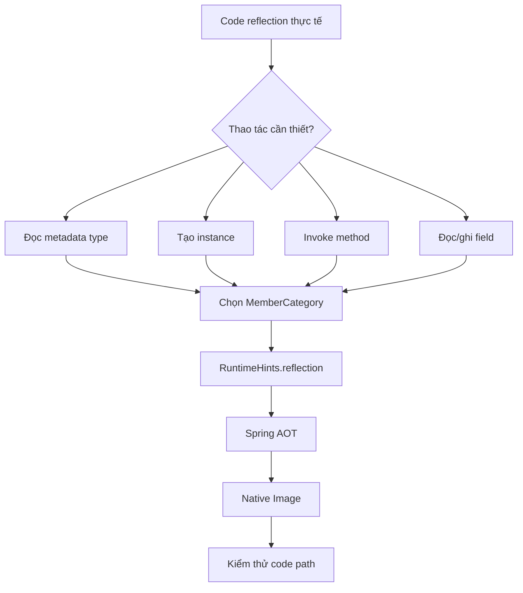

# MemberCategory và lựa chọn phạm vi khai báo phù hợp

## 1. Vì sao cần chọn đúng MemberCategory?

Khi ứng dụng Spring Boot sử dụng reflection, GraalVM Native Image cần biết class và member nào phải được giữ để truy cập lúc chạy. Spring AOT cung cấp API `RuntimeHints.reflection()`; một cách khai báo là đăng ký type cùng các **MemberCategory** mô tả nhóm thao tác reflection mà ứng dụng cần.

Chọn category quá hẹp có thể khiến native executable gặp lỗi như không tìm thấy constructor hoặc method khi code path được thực thi. Chọn quá rộng có thể giữ nhiều metadata/member không cần thiết, làm tăng kích thước image và khiến ý định cấu hình khó rà soát.

Trong module **SPRING_BOOT_NATIVE_IMAGE**, hãy xem MemberCategory như một hợp đồng cụ thể giữa code sử dụng reflection và quá trình phân tích Native Image. Cần bắt đầu từ thao tác thực tế: chỉ introspect metadata, tạo object, invoke method, đọc field hay ghi field.



## 2. MemberCategory mô tả nhóm quyền truy cập nào?

Spring AOT cung cấp enum `org.springframework.aot.hint.MemberCategory` để chỉ định nhóm member cần hỗ trợ. Các category thường dùng gồm:

| Category | Ý nghĩa thực hành |
|---|---|
| `INTROSPECT_PUBLIC_CONSTRUCTORS` | Cho phép introspection metadata của public constructors |
| `INVOKE_PUBLIC_CONSTRUCTORS` | Cho phép gọi public constructors qua reflection |
| `INTROSPECT_DECLARED_CONSTRUCTORS` | Introspect constructors được khai báo trực tiếp trong class |
| `INVOKE_DECLARED_CONSTRUCTORS` | Gọi constructors được khai báo trực tiếp |
| `INTROSPECT_PUBLIC_METHODS` | Introspect public methods |
| `INVOKE_PUBLIC_METHODS` | Invoke public methods qua reflection |
| `INTROSPECT_DECLARED_METHODS` | Introspect methods được khai báo trực tiếp |
| `INVOKE_DECLARED_METHODS` | Invoke methods được khai báo trực tiếp |
| `INTROSPECT_PUBLIC_FIELDS` | Introspect public fields |
| `ALLOW_PUBLIC_FIELD_GET` | Đọc public fields qua reflection |
| `ALLOW_PUBLIC_FIELD_SET` | Ghi public fields qua reflection |
| `INTROSPECT_DECLARED_FIELDS` | Introspect fields được khai báo trực tiếp |
| `ALLOW_DECLARED_FIELD_GET` | Đọc fields được khai báo trực tiếp |
| `ALLOW_DECLARED_FIELD_SET` | Ghi fields được khai báo trực tiếp |
| `DECLARED_CLASSES` | Truy cập thông tin các nested/declared classes theo khả năng hỗ trợ |

Tên và phạm vi chính xác của category phải được đối chiếu với phiên bản Spring Framework mà dự án sử dụng. Các category có thể thay đổi theo version. Không suy luận rằng `INVOKE_PUBLIC_METHODS` đồng nghĩa với quyền truy cập tất cả method private hoặc rằng đăng ký type tự động mở mọi member.

## 3. Introspection khác invocation

Hai nhóm category quan trọng là **INTROSPECT** và **INVOKE/ALLOW**.

- Introspection phục vụ việc tìm hiểu cấu trúc: lấy danh sách constructor, method, field, modifier, annotation hoặc signature.
- Invocation/access phục vụ hành động: gọi constructor/method, đọc field hoặc ghi field.

Ví dụ thư viện chỉ đọc tên method để hiển thị tài liệu API:

```java
for (Method method : Plugin.class.getDeclaredMethods()) {
    System.out.println(method.getName());
}
```

Trường hợp này cần introspection method metadata. Nếu ứng dụng còn gọi method qua `Method.invoke`, cần quyền invocation phù hợp.

Ví dụ gọi method:

```java
Method method = plugin.getClass().getMethod("execute", String.class);
Object result = method.invoke(plugin, payload);
```

Đăng ký `INTROSPECT_PUBLIC_METHODS` một mình không nên được coi là đủ cho invocation. Ngược lại, nếu code chỉ gọi method trực tiếp bằng Java syntax, không cần mở reflection invocation chỉ vì method tồn tại.

## 4. Constructor: introspect hay invoke?

Giả sử plugin được tạo bằng reflection:

```java
Class<?> type = Class.forName("com.example.plugins.CsvPlugin");
Constructor<?> constructor = type.getDeclaredConstructor();
Object plugin = constructor.newInstance();
```

Code cần tìm constructor và gọi nó. Nếu constructor là public, category tương ứng có thể là `INVOKE_PUBLIC_CONSTRUCTORS`; nếu cần truy cập constructor được khai báo trực tiếp bất kể visibility, cân nhắc `INVOKE_DECLARED_CONSTRUCTORS` cùng các giới hạn Java access/module.

Ví dụ RuntimeHints:

```java
hints.reflection().registerType(
    CsvPlugin.class,
    MemberCategory.INVOKE_PUBLIC_CONSTRUCTORS
);
```

Nếu thư viện chỉ kiểm tra constructor signature mà không tạo instance, dùng introspection category phù hợp. Không đăng ký cả public và declared constructor nếu code không cần cả hai.

## 5. Method: public và declared

`getMethod` tìm public method, bao gồm public method kế thừa; `getDeclaredMethod` tìm method khai báo trực tiếp trong class và có thể trả về method không public.

```java
Method publicMethod = type.getMethod("execute", String.class);
Method declaredMethod = type.getDeclaredMethod("validateInternal", String.class);
```

Nếu ứng dụng gọi public method qua reflection, `INVOKE_PUBLIC_METHODS` thường là category cần xem xét. Nếu gọi method được khai báo trực tiếp kể cả private/protected, xem `INVOKE_DECLARED_METHODS` và quy tắc access.

Không đăng ký declared methods chỉ vì muốn gọi một public method. Category declared có thể bao phủ phạm vi rộng hơn và giữ metadata không cần thiết. Với một số trường hợp chỉ cần một signature, khai báo method cụ thể có thể chính xác hơn.

## 6. Field: đọc và ghi là hai quyền khác nhau

Ví dụ mapper đọc field:

```java
Field field = CustomerRecord.class.getDeclaredField("customerId");
Object value = field.get(customer);
```

Ví dụ binder ghi field:

```java
Field field = CustomerRecord.class.getDeclaredField("status");
field.set(customer, "ACTIVE");
```

Đọc và ghi có thể cần category khác nhau:

- `ALLOW_DECLARED_FIELD_GET`: đọc field được khai báo trực tiếp.
- `ALLOW_DECLARED_FIELD_SET`: ghi field được khai báo trực tiếp.
- `ALLOW_PUBLIC_FIELD_GET` và `ALLOW_PUBLIC_FIELD_SET`: phạm vi public tương ứng.

Nếu code chỉ gọi `Field.get`, không tự động cấp quyền set. Nếu field `final`, static hoặc bị giới hạn bởi Java module access, category không xóa bỏ mọi ràng buộc ngôn ngữ/runtime.

## 7. Đăng ký category bằng Spring RuntimeHints

Ví dụ class được tạo bằng public constructor và public method được invoke:

```java
public class CsvPlugin {
    public CsvPlugin() {
    }

    public String execute(String input) {
        return "csv:" + input;
    }
}
```

Registrar:

```java
public class PluginHints implements RuntimeHintsRegistrar {

    @Override
    public void registerHints(RuntimeHints hints, ClassLoader classLoader) {
        hints.reflection().registerType(
            CsvPlugin.class,
            MemberCategory.INVOKE_PUBLIC_CONSTRUCTORS,
            MemberCategory.INVOKE_PUBLIC_METHODS
        );
    }
}
```

Đăng ký registrar trong Spring configuration:

```java
@Configuration
@ImportRuntimeHints(PluginHints.class)
class PluginConfiguration {
}
```

Cần import các API Spring tương ứng và xác nhận registrar được gọi trong AOT. Nếu class được chọn bằng tên runtime, hãy bảo đảm class có thể reach được và được đăng ký; MemberCategory không tự đưa một dependency không có trên runtime classpath vào executable.

## 8. Khi nào nên dùng khai báo member cụ thể?

MemberCategory tiện khi một thư viện thực sự cần một nhóm member rộng, chẳng hạn gọi nhiều public methods theo một contract. Nhưng nếu chỉ cần một constructor và một method, có thể khai báo member cụ thể bằng builder API.

Ví dụ định hướng:

```java
hints.reflection().registerType(
    CsvPlugin.class,
    typeHint -> typeHint
        .withConstructor(new Class<?>[0], ExecutableMode.INVOKE)
        .withMethod(
            "execute",
            List.of(String.class),
            ExecutableMode.INVOKE
        )
);
```

API builder, enum `ExecutableMode` và imports phụ thuộc version Spring Framework. Đối chiếu Javadoc của dependency trong project và compile test trước khi dùng. Ý tưởng là mô tả chính xác signature cần gọi thay vì cấp quyền cho toàn bộ method group.

| Trường hợp | Cách khai báo phù hợp |
|---|---|
| Nhiều public constructors đều được invoke | `INVOKE_PUBLIC_CONSTRUCTORS` |
| Chỉ một constructor có signature cố định | Member cụ thể |
| Cần introspect danh sách public methods | `INTROSPECT_PUBLIC_METHODS` |
| Gọi một public method duy nhất | Member method cụ thể hoặc category public phù hợp |
| Chỉ đọc một field được khai báo trực tiếp | Field GET cụ thể/category tương ứng |
| Cần đọc và ghi nhiều declared fields | Hai category GET/SET tương ứng nếu thực sự cần |

## 9. Không đăng ký thừa toàn bộ member

Một cách khai báo quá rộng có thể trông tiện:

```java
hints.reflection().registerType(
    CsvPlugin.class,
    MemberCategory.values()
);
```

Đây không phải lựa chọn mặc định nên dùng. Nó có thể mở rộng phạm vi reflection hơn nhiều so với code path thực tế, giữ thêm metadata và khiến reviewer khó biết vì sao từng member cần thiết. Một số category còn có phạm vi khác nhau giữa phiên bản framework.

Thay vào đó:

1. Tìm các API reflection thực sự được gọi.
2. Xác định class, constructor, method và field cụ thể.
3. Phân biệt introspection với invoke/get/set.
4. Chọn category nhỏ nhất đáp ứng hành vi.
5. Nếu chỉ một member cần thiết, dùng khai báo cụ thể khi API hỗ trợ.
6. Chạy native test để xác nhận.

## 10. Phân biệt MemberCategory với GraalVM reachability metadata

Spring RuntimeHints là abstraction của Spring AOT. GraalVM Native Image cũng có định dạng reachability metadata riêng, thường được cung cấp qua file JSON trong thư viện hoặc ứng dụng.

Hai cơ chế có mục tiêu gần nhau nhưng API/schema khác nhau:

- Spring RuntimeHints được Spring AOT thu thập và chuyển tiếp theo tích hợp framework.
- GraalVM reachability metadata mô tả trực tiếp các phần cần giữ cho Native Image theo schema của GraalVM.

Không chép tên MemberCategory vào JSON GraalVM như thể chúng là cùng một định dạng. Nếu thư viện hỗ trợ cả Spring AOT lẫn Native Image thuần, có thể cung cấp hai loại metadata thích hợp, nhưng phải kiểm tra tránh trùng lặp và version compatibility.

## 11. Kiểm thử phạm vi category

Unit test registrar nên xác minh đúng type và hints được đăng ký. Ví dụ:

```java
@Test
void registersOnlyRequiredPluginHints() {
    RuntimeHints hints = new RuntimeHints();

    new PluginHints().registerHints(hints, getClass().getClassLoader());

    assertThat(hints.reflection().getTypeHint(CsvPlugin.class))
        .isPresent();
}
```

Test này xác nhận type hint tồn tại nhưng chưa chứng minh category cụ thể có đúng quyền như mong muốn. Tùy phiên bản Spring Framework, có thể dùng API truy vấn hint hoặc `RuntimeHintsPredicates` để kiểm tra constructor/method invocation cụ thể.

Sau đó cần integration test trên Native Image:

1. Chạy Spring AOT với registrar được đăng ký.
2. Build executable native.
3. Gọi code path tạo plugin và invoke method.
4. Thử một thao tác không được cấp quyền để xác nhận phạm vi được kiểm soát (nếu test phù hợp).
5. Kiểm tra log và lỗi runtime.

Không chỉ test unit trên JVM rồi kết luận metadata Native Image đã đúng.

## 12. Lỗi thường gặp

| Triệu chứng | Nguyên nhân có thể | Hướng xử lý |
|---|---|---|
| Constructor không tạo được | Chỉ đăng ký introspection nhưng cần invoke | Chọn constructor invocation category |
| Method tìm thấy nhưng invoke lỗi | Thiếu invoke permission hoặc signature sai | Kiểm tra public/declared và tham số |
| Field đọc được nhưng ghi lỗi | Chỉ đăng ký GET, chưa có SET hoặc field không thể ghi | Xác định thao tác và semantics field |
| Private method không truy cập được | Chỉ đăng ký public methods hoặc Java access hạn chế | Xem declared method hints và module access |
| Native build thành công nhưng runtime lỗi | Hints thiếu cho code path chưa test | Bổ sung test và metadata đúng phạm vi |
| Image tăng kích thước sau khi thêm hints | Đăng ký quá rộng | Thu hẹp category/member |
| Registrar không có tác dụng | Chưa import/đăng ký hoặc AOT dùng artifact cũ | Xác minh AOT discovery và build lại |

## 13. Checklist chọn MemberCategory

- Xác định class nào được truy cập qua reflection.
- Phân biệt public với declared member.
- Phân biệt introspection với invoke.
- Với field, phân biệt GET và SET.
- Chỉ đăng ký category cần cho hành vi thực tế.
- Dùng member-specific hints khi phạm vi nhỏ và API hỗ trợ.
- Kiểm tra Java module/access restrictions riêng.
- Đảm bảo RuntimeHintsRegistrar được Spring AOT phát hiện.
- Kiểm thử trên native executable và ghi nhận phiên bản Spring/GraalVM.

## 14. Câu hỏi tự kiểm tra

1. Khác biệt giữa `INTROSPECT_PUBLIC_METHODS` và `INVOKE_PUBLIC_METHODS` là gì?
2. Vì sao `getDeclaredMethod` có thể cần phạm vi metadata khác `getMethod`?
3. Khi code chỉ đọc field, tại sao không nên đăng ký quyền ghi?
4. Khi nào MemberCategory tiện hơn khai báo từng member?
5. Vì sao `MemberCategory.values()` không nên là lựa chọn mặc định?
6. Spring RuntimeHints và GraalVM reachability metadata khác nhau ở điểm nào?
7. Làm thế nào xác nhận category đã chọn hoạt động trên executable native?

**Ghi nhớ:** MemberCategory biểu đạt **nhóm thao tác reflection cần được hỗ trợ**. Hãy phân biệt introspection/invocation, public/declared và field get/set; chọn phạm vi nhỏ nhất phù hợp, rồi xác minh bằng AOT và native integration test.
