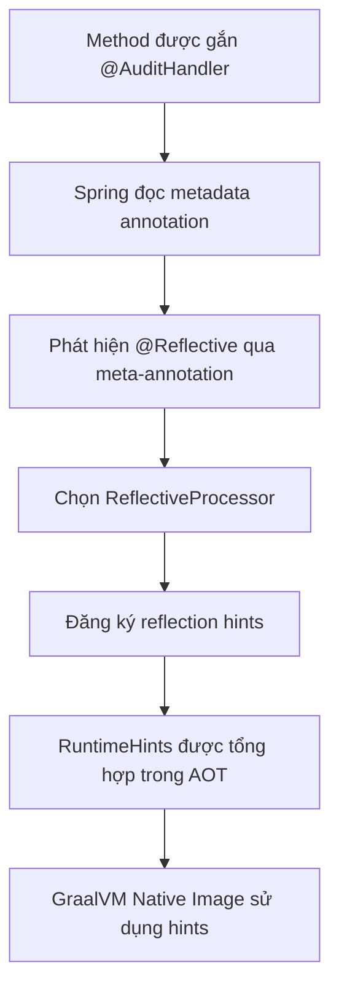

# @Reflective và các cơ chế xử lý annotation liên quan

Khi biên dịch ứng dụng Spring Boot thành **GraalVM Native Image**, những đoạn code gọi reflection cần được mô tả trước để Native Image biết kiểu, constructor, field hoặc method nào phải giữ lại. Spring Framework cung cấp **`@Reflective`** như một cách khai báo ngay trên annotation, class, constructor, field hoặc method rằng phần tử đó có nhu cầu reflection. Trong giai đoạn Spring AOT, cơ chế này được phát hiện và chuyển thành **runtime hints** cho native compilation.

`@Reflective` còn hỗ trợ **meta-annotation** và bộ xử lý tùy biến `ReflectiveProcessor`. Nhờ vậy, thư viện có thể định nghĩa annotation nghiệp vụ riêng, rồi gắn logic tạo reflection hints tương ứng. Các annotation liên quan như `@ReflectiveScan`, `@RegisterReflection` và `@RegisterReflectionForBinding` mở rộng cách phát hiện và khai báo nhu cầu reflection.

## 1. Mục tiêu học tập

Sau bài này, bạn có thể:

- Giải thích `@Reflective` đánh dấu nhu cầu reflection cho phần tử Java như thế nào.
- Phân biệt annotation được gắn trực tiếp với annotation được sử dụng qua meta-annotation.
- Mô tả cách Spring AOT phát hiện annotation và tạo reflection hints.
- Sử dụng `@ReflectiveScan` để quét package cho các phần tử cần reflection ngoài phạm vi Spring bean thông thường.
- Chọn `@RegisterReflection` hoặc `@RegisterReflectionForBinding` cho các trường hợp khai báo reflection phổ biến.
- Viết `ReflectiveProcessor` tùy biến để chuyển annotation riêng của thư viện thành hints.
- Phân biệt `ReflectiveProcessor` của Spring với Java compile-time annotation processor.
- Kiểm thử runtime hints trước khi tạo Native Image.

## 2. Vì sao cần @Reflective?

Trên JVM thông thường, nhiều thư viện có thể dùng Java Reflection để tìm class theo tên, lấy constructor, đọc field, gọi method hoặc xử lý annotation. JVM có thể nạp và kiểm tra các thành phần đó theo nhu cầu lúc chạy.

Native Image thực hiện phân tích reachability trong giai đoạn build. Các thành phần chỉ được truy cập gián tiếp qua reflection có thể không được nhận diện đầy đủ nếu không có metadata phù hợp. Khi chạy binary, ứng dụng có thể gặp lỗi dù cùng luồng code vẫn hoạt động trên JVM.

Ví dụ, một framework nhỏ tìm các method có annotation `@AuditHandler` rồi gọi chúng bằng reflection:

```java
Method handler = target.getClass()
    .getDeclaredMethod("handle", AuditEvent.class);
handler.setAccessible(true);
handler.invoke(target, event);
```

Với JVM, đoạn code có thể chạy nếu class và method có mặt, quyền truy cập phù hợp và không có giới hạn khác. Với Native Image, cần khai báo rằng method đó phải có thể được gọi qua reflection. `@Reflective` cung cấp một điểm khai báo để Spring AOT thu thập nhu cầu này.

**Reflection hint không phải mã thực thi reflection.** Annotation không tự gọi method, không tạo proxy và không biến code động thành code tĩnh. Nó mô tả cho quá trình AOT/native compilation biết những quyền truy cập nào cần được giữ lại.

## 3. @Reflective là gì?

`@Reflective` thuộc package:

```java
org.springframework.aot.hint.annotation.Reflective
```

Annotation này được giới thiệu từ Spring Framework 6.0. Nó có các đặc điểm chính:

| Thuộc tính | Ý nghĩa |
| --- | --- |
| `@Target` | Có thể đặt trên annotation type, class, constructor, field và method |
| `@Retention(RUNTIME)` | Có mặt trong metadata runtime để Spring có thể phát hiện khi AOT xử lý |
| `processors` | Danh sách `ReflectiveProcessor` được gọi cho phần tử được đánh dấu |
| `value` | Alias của `processors` |
| Processor mặc định | `SimpleReflectiveProcessor` |

Khai báo rút gọn:

```java
@Reflective
public @interface SomeReflectiveMarker {
}
```

Khi được phát hiện trong phạm vi AOT, annotation báo rằng phần tử tương ứng có nhu cầu reflection. Mặc định, Spring dùng `SimpleReflectiveProcessor` để đăng ký reflection hint cho phần tử được đánh dấu. Với một method cần gọi qua reflection, hint phù hợp là khả năng **invoke method**.

### 3.1. @Reflective không tự đăng ký mọi thành viên của class

Một nhầm lẫn phổ biến là cho rằng đặt `@Reflective` trên class sẽ tự động cho phép mọi thao tác reflection trên toàn bộ class, các class lồng nhau và mọi kiểu DTO liên quan. Cần xác định đúng phần tử và loại truy cập thực tế:

- Gọi một method bằng reflection cần invocation hint cho method đó.
- Khởi tạo object qua reflection cần hint cho constructor tương ứng.
- Đọc/ghi field cần hint cho field và chế độ truy cập phù hợp.
- Dùng reflection để bind/serialize DTO có thể cần constructor, field, property và record component.
- Dùng JDK dynamic proxy cần proxy hints tương ứng; một reflection hint thông thường không tự thay thế proxy hint.

Nếu một method được đánh dấu nhưng code còn truy cập DTO qua reflection để binding, cần đăng ký thêm hints cho DTO theo nhu cầu thực tế.

### 3.2. Spring bean được xét mặc định

Theo cơ chế mặc định, các Spring bean là đối tượng được xem xét khi Spring AOT xử lý `@Reflective`. Vì vậy, nếu annotation xuất hiện trên method của một component Spring, AOT có thể phát hiện mà không cần quét toàn bộ package thủ công.

Ví dụ `@EventListener` của Spring được meta-annotate với `@Reflective` vì Spring gọi các method listener theo cơ chế reflection. Người dùng không cần tự thêm `@Reflective` vào từng method `@EventListener` trong trường hợp framework đã cung cấp metadata phù hợp.

```java
import org.springframework.context.event.EventListener;
import org.springframework.stereotype.Component;

record OrderCreated(String orderId) {
}

@Component
class OrderEventHandler {
    @EventListener
    public void onOrderCreated(OrderCreated event) {
        System.out.println(event.orderId());
    }
}
```

Đây là ví dụ về annotation của Spring đã được chuẩn bị sẵn. Khi dùng annotation từ thư viện bên thứ ba, không nên giả định annotation đó đã có meta-annotation `@Reflective`; cần kiểm tra tài liệu hoặc metadata của thư viện.

## 4. Meta-annotation và annotation tổng hợp

Spring hỗ trợ mô hình annotation nhiều tầng. Một annotation có thể được gắn lên annotation khác; annotation ngoài cùng được gọi là **meta-annotation** của annotation sử dụng nó.

Ví dụ:

```java
@Target(ElementType.METHOD)
@Retention(RetentionPolicy.RUNTIME)
@Reflective
public @interface AuditHandler {
}
```

Khi một method sử dụng `@AuditHandler`, Spring AOT có thể nhận ra `@Reflective` thông qua meta-annotation:

```java
@Component
class AuditEventHandler {
    @AuditHandler
    public void handle(AuditEvent event) {
        // Xử lý sự kiện audit.
    }
}
```

Luồng xử lý khái quát:



Điểm quan trọng là `@Reflective` không bắt buộc phải xuất hiện trực tiếp trên method. Nó có thể nằm trên annotation type mà method sử dụng. Đây là cách thư viện đóng gói một hợp đồng reflection vào annotation nghiệp vụ của mình.

### 4.1. Vai trò của Spring merged annotation model

Spring có cơ chế đọc annotation hỗ trợ meta-annotation, annotation tổng hợp và thuộc tính được ánh xạ. Vì vậy, khi thiết kế annotation riêng:

- Dùng `@Retention(RetentionPolicy.RUNTIME)` để annotation có thể được đọc trong quá trình AOT.
- Chọn `@Target` phù hợp với vị trí sử dụng.
- Đặt `@Reflective` trên annotation type nếu mọi phần tử sử dụng annotation đó cần cùng một chính sách reflection.
- Dùng `@AliasFor` khi cần ánh xạ thuộc tính giữa annotation tổng hợp và annotation meta.
- Kiểm thử trường hợp annotation được lồng nhiều tầng, tránh giả định một cách đọc annotation thuần Java luôn tương đương với cách Spring tìm annotation.

Không phải mọi annotation trong ứng dụng đều cần `@Reflective`. Chỉ đánh dấu nơi có hợp đồng reflection thật sự; annotation chỉ dùng để cấu hình tĩnh hoặc xử lý bằng code trực tiếp thường không cần thêm hint.

## 5. @ReflectiveScan để quét các kiểu ngoài Spring bean

Mặc định, Spring AOT xét các Spring bean. Nếu thư viện có các class không phải bean nhưng chứa annotation cần reflection, có thể dùng `@ReflectiveScan`.

`@ReflectiveScan` thuộc package:

```java
org.springframework.context.annotation.ReflectiveScan
```

Annotation này được giới thiệu từ Spring Framework 6.2. Nó yêu cầu AOT quét sâu các package chỉ định để tìm `@Reflective`, trực tiếp hoặc qua meta-annotation.

Ví dụ:

```java
import org.springframework.context.annotation.Configuration;
import org.springframework.context.annotation.ReflectiveScan;

@Configuration(proxyBeanMethods = false)
@ReflectiveScan("com.example.audit.handlers")
class AuditReflectionConfiguration {
}
```

Có thể dùng marker class để tránh tên package dạng chuỗi:

```java
@Configuration(proxyBeanMethods = false)
@ReflectiveScan(basePackageClasses = AuditHandlerPackage.class)
class AuditReflectionConfiguration {
}

// Đặt marker class trong package cần quét.
final class AuditHandlerPackage {
}
```

Trong package được quét, type không cần có `@Reflective` ở cấp class mới được xét. Quá trình quét đi sâu qua class, constructor, method, field và các phần tử lồng; Spring kiểm tra `@Reflective` trực tiếp hoặc như meta-annotation. Việc quét xảy ra **trong AOT processing**, không phải một package scan mới ở runtime native.

### 5.1. Phạm vi và chi phí quét

| Cách khai báo | Phạm vi |
| --- | --- |
| Không dùng `@ReflectiveScan` | Các Spring bean thuộc phạm vi xử lý AOT mặc định |
| `@ReflectiveScan("com.example.audit")` | Package được chỉ định và các package con |
| `@ReflectiveScan(basePackageClasses = Marker.class)` | Package chứa marker class và các package con |
| `@ReflectiveScan` không chỉ định package | Quét đệ quy từ package của class khai báo annotation |

Nên chọn package hẹp chứa các handler cần xử lý. Quét toàn bộ package của một thư viện lớn có thể làm tăng thời gian AOT, tải nhiều class và tạo hints không cần thiết. Class cần quét phải có mặt trên classpath của quá trình build.

## 6. Các annotation chuyên biệt: @RegisterReflection và @RegisterReflectionForBinding

Spring cung cấp annotation chuyên biệt để tránh phải tự viết processor cho các nhu cầu reflection phổ biến.

### 6.1. @RegisterReflection

`@RegisterReflection` là specialization của `@Reflective`. Nó cho phép khai báo một hoặc nhiều kiểu đích và nhóm thành viên cần reflection.

Ví dụ:

```java
import org.springframework.aot.hint.MemberCategory;
import org.springframework.aot.hint.annotation.RegisterReflection;
import org.springframework.context.annotation.Configuration;

@Configuration(proxyBeanMethods = false)
@RegisterReflection(
    classes = LegacyAccountService.class,
    memberCategories = {
        MemberCategory.INVOKE_PUBLIC_CONSTRUCTORS,
        MemberCategory.INVOKE_PUBLIC_METHODS
    }
)
class LegacyReflectionConfiguration {
}
```

Trong ví dụ, AOT đăng ký nhu cầu gọi public constructors và public methods của `LegacyAccountService` bằng reflection. Hãy chọn category đúng với thao tác thật; không cần cấp quyền reflection cho toàn bộ thành viên nếu ứng dụng chỉ gọi một số method.

`@RegisterReflection` có thể được đặt trên class hoặc method để thể hiện rõ nơi phát sinh nhu cầu. Nó cũng có thể được dùng làm meta-annotation khi thư viện muốn tạo annotation tổng hợp cho use case riêng.

### 6.2. @RegisterReflectionForBinding

`@RegisterReflectionForBinding` phù hợp với data binding hoặc serialization dựa trên reflection. Nó đăng ký các hints cần cho constructor, field, property và record component của kiểu được khai báo; các kiểu được sử dụng xuyên qua property/record component cũng có thể được xử lý đệ quy.

Ví dụ DTO không được Spring suy ra trực tiếp từ một endpoint/controller:

```java
import org.springframework.aot.hint.annotation.RegisterReflectionForBinding;
import org.springframework.stereotype.Component;

record InvoiceLine(String sku, int quantity) {
}

record InvoicePayload(String invoiceId, InvoiceLine line) {
}

@Component
class ExternalInvoiceClient {
    @RegisterReflectionForBinding(InvoicePayload.class)
    public void submit(InvoicePayload payload) {
        // Gửi payload qua HTTP client hoặc serializer.
    }
}
```

Trong trường hợp DTO được dùng trong request/response mà Spring Web đã có thể suy ra kiểu từ signature controller, framework có thể tự đăng ký hints cần thiết. Annotation này hữu ích khi kiểu chỉ xuất hiện trong method body, client call hoặc một luồng binding mà AOT không thể suy ra từ contract web.

### 6.3. So sánh nhanh

| Annotation | Mục đích | Nên dùng khi |
| --- | --- | --- |
| `@Reflective` | Đánh dấu một phần tử cần reflection; có thể chỉ định processor | Annotation, method, constructor, field hoặc type có hợp đồng reflection riêng |
| `@ReflectiveScan` | Quét package để tìm các phần tử dùng `@Reflective` | Có kiểu ngoài Spring bean cần được xử lý |
| `@RegisterReflection` | Khai báo reflection cho các class và member categories | Cần truy cập constructor/method/field theo nhóm xác định |
| `@RegisterReflectionForBinding` | Đăng ký hints cho binding/serialization của DTO và kiểu liên quan | DTO được truy cập qua serializer hoặc binder dựa trên reflection |

Các annotation này có thể phối hợp nhưng không thay thế nhau. `@ReflectiveScan` chỉ mở rộng phạm vi phát hiện; `@RegisterReflection` và `@RegisterReflectionForBinding` mô tả loại reflection cần thiết; `@Reflective` là điểm đánh dấu và chọn processor.

## 7. ReflectiveProcessor là gì?

`ReflectiveProcessor` là interface của Spring trong package `org.springframework.aot.hint.annotation`. Nó nhận:

- `ReflectionHints`: đối tượng để đăng ký các yêu cầu reflection.
- `AnnotatedElement`: phần tử Java đang được xử lý, ví dụ class, method, field, constructor hoặc annotation type.

Hợp đồng method:

```java
void registerReflectionHints(
    ReflectionHints hints,
    AnnotatedElement element
);
```

Spring gọi processor được khai báo trong thuộc tính `processors` của `@Reflective`. Processor mặc định là `SimpleReflectiveProcessor`. Thư viện có thể cung cấp processor riêng để đọc thuộc tính annotation và đăng ký hints cho các phần tử liên quan.

### 7.1. Ví dụ annotation tùy biến

Giả sử một thư viện định nghĩa `@NativeEndpoint` để đánh dấu method được gọi bằng reflection. Annotation có thêm thuộc tính `exposedTypes` chứa các kiểu cần public constructor.

```java
import java.lang.annotation.Documented;
import java.lang.annotation.ElementType;
import java.lang.annotation.Retention;
import java.lang.annotation.RetentionPolicy;
import java.lang.annotation.Target;

import org.springframework.aot.hint.annotation.Reflective;

@Target(ElementType.METHOD)
@Retention(RetentionPolicy.RUNTIME)
@Documented
@Reflective(processors = NativeEndpointReflectiveProcessor.class)
public @interface NativeEndpoint {
    Class<?>[] exposedTypes() default {};
}
```

### 7.2. Viết processor

```java
import java.lang.reflect.AnnotatedElement;
import java.lang.reflect.Method;

import org.springframework.aot.hint.ExecutableMode;
import org.springframework.aot.hint.MemberCategory;
import org.springframework.aot.hint.ReflectionHints;
import org.springframework.aot.hint.annotation.ReflectiveProcessor;

public final class NativeEndpointReflectiveProcessor
        implements ReflectiveProcessor {

    @Override
    public void registerReflectionHints(
            ReflectionHints hints, AnnotatedElement element) {

        if (!(element instanceof Method method)) {
            return;
        }

        // Method được framework gọi bằng reflection.
        hints.registerMethod(method, ExecutableMode.INVOKE);

        NativeEndpoint annotation =
                method.getAnnotation(NativeEndpoint.class);

        if (annotation != null) {
            for (Class<?> exposedType : annotation.exposedTypes()) {
                // Chỉ cho phép gọi public constructors của các kiểu đã khai báo.
                hints.registerType(
                    exposedType,
                    MemberCategory.INVOKE_PUBLIC_CONSTRUCTORS
                );
            }
        }
    }
}
```

Processor kiểm tra đúng loại phần tử, đăng ký invocation hint cho method và đọc thuộc tính annotation để đăng ký thêm public constructors cho các kiểu được công bố. Nếu annotation được đặt ở vị trí khác ngoài method, processor bỏ qua thay vì giả định phần tử luôn là method.

### 7.3. Sử dụng annotation trong bean

```java
import org.springframework.stereotype.Component;

record AuditPayload(String actor, String action) {
}

@Component
class AuditEndpointHandler {
    @NativeEndpoint(exposedTypes = AuditPayload.class)
    public void handle(AuditPayload payload) {
        // Được framework gọi qua reflection.
    }
}
```

Khi Spring AOT phát hiện `@NativeEndpoint` trên method của bean, `@Reflective` meta-annotation chọn `NativeEndpointReflectiveProcessor`. Processor đăng ký method invocation và public constructor của `AuditPayload`.

**Giới hạn của ví dụ:** đăng ký constructor không tự đăng ký tất cả field/property của DTO cho JSON binding. Nếu serializer cần truy cập field, getter/setter hoặc record components, hãy dùng `@RegisterReflectionForBinding` hoặc bổ sung chính xác hints tương ứng.

### 7.4. Khi nào cần processor tùy biến?

Nên viết `ReflectiveProcessor` khi annotation riêng mô tả được một quy tắc reflection cụ thể, ví dụ:

- Annotation trên handler method đồng nghĩa framework sẽ gọi method đó bằng reflection.
- Annotation có thuộc tính class và các class đó cần một nhóm constructor/method xác định.
- Một annotation tổng hợp đại diện cho một hợp đồng truy cập đặc thù của thư viện.
- Nhiều dự án dùng cùng một annotation và muốn hints được đăng ký thống nhất.

Nếu chỉ cần khai báo vài DTO cho serialization, `@RegisterReflectionForBinding` thường đơn giản hơn. Nếu cần đăng ký resource, proxy, serialization hoặc nhiều loại hints ngoài reflection, `RuntimeHintsRegistrar` có thể là extension point phù hợp hơn.

## 8. ReflectiveProcessor khác Java annotation processor như thế nào?

Hai khái niệm có tên gần giống nhau nhưng hoạt động ở các giai đoạn và mục đích khác nhau:

| Tiêu chí | Spring `ReflectiveProcessor` | Java compile-time annotation processor |
| --- | --- | --- |
| API | `org.springframework.aot.hint.annotation.ReflectiveProcessor` | `javax.annotation.processing.Processor` hoặc API tương ứng của JDK |
| Đầu vào | `AnnotatedElement` và `ReflectionHints` | Mô hình source/type/element trong quá trình compile |
| Thời điểm | Khi Spring AOT xử lý ứng dụng | Khi Java compiler chạy annotation processing |
| Mục đích | Đăng ký runtime reflection hints | Phân tích annotation và có thể sinh source/resource ở compile time |
| Kết quả | Hints được tổng hợp cho GraalVM Native Image | Generated source, resource hoặc diagnostics tùy processor |
| Có tự tạo native binary? | Không | Không |

`ReflectiveProcessor` không phải `javax.annotation.processing.Processor` và không thay thế javac annotation processing. Nó hoạt động trong mô hình Spring AOT để mô tả nhu cầu reflection của ứng dụng.

## 9. ReflectiveRuntimeHintsRegistrar và các cơ chế liên quan

`ReflectiveRuntimeHintsRegistrar` là thành phần Spring dùng để xử lý các phần tử được đánh dấu `@Reflective` và đăng ký runtime hints tương ứng. Nó cung cấp các API như:

- `isCandidate(Class<?>)` để xác định type có phải ứng viên xử lý hay không.
- `registerRuntimeHints(RuntimeHints, Class<?>...)` để đăng ký hints từ các type đã biết.

Trong quy trình Spring AOT thông thường, cơ chế này được sử dụng để xử lý annotation trên các bean/type trong phạm vi hỗ trợ. Với thư viện có các type ngoài Spring bean, có thể kết hợp cơ chế tìm type ở build time với `BeanFactoryInitializationAotProcessor` và `ReflectiveRuntimeHintsRegistrar`. Hoặc dùng `@ReflectiveScan` nếu package có thể được quét tường minh.

Các thành phần có vai trò khác nhau:

| Thành phần | Trách nhiệm |
| --- | --- |
| `@Reflective` | Đánh dấu nhu cầu reflection và chọn processor |
| `ReflectiveProcessor` | Đọc phần tử annotation và đăng ký reflection hints |
| `ReflectiveRuntimeHintsRegistrar` | Điều phối xử lý các phần tử được đánh dấu |
| `@ReflectiveScan` | Mở rộng việc tìm phần tử sang package đã chỉ định |
| `RuntimeHintsRegistrar` | Đăng ký các loại hints tổng quát: reflection, resource, proxy, serialization… |
| `BeanFactoryInitializationAotProcessor` | Đóng góp mã/hints ở cấp BeanFactory trong quá trình AOT |

Không nên dùng `ReflectiveProcessor` để thay thế một `RuntimeHintsRegistrar` khi yêu cầu chủ yếu là resource patterns hoặc proxy hints. Chọn đúng API giúp phần mở rộng dễ hiểu và dễ kiểm thử.

## 10. Kiểm thử reflection hints

Đăng ký annotation chưa đủ để chứng minh binary native chạy được. Cần kiểm tra hints được tạo và kiểm thử hành vi thực tế.

### 10.1. Kiểm tra processor với RuntimeHintsPredicates

Spring Core cung cấp `RuntimeHintsPredicates` để kiểm tra `RuntimeHints` có bao phủ một hành vi reflection cụ thể hay không.

Ví dụ kiểm tra method invocation sau khi chạy custom processor:

```java
RuntimeHints hints = new RuntimeHints();
Method method = AuditEndpointHandler.class
    .getDeclaredMethod("handle", AuditPayload.class);

new NativeEndpointReflectiveProcessor()
    .registerReflectionHints(hints, method);

assertThat(
    RuntimeHintsPredicates.reflection()
        .onMethod(method)
        .invoke()
).accepts(hints);
```

Với Spring Framework 7, API predicate mới như `onMethodInvocation(method)` có thể được ưu tiên thay cho các dạng API cũ đã deprecated. Hãy dùng đúng method của phiên bản Spring Framework trong dự án.

### 10.2. Kiểm tra hints của class được khai báo

Với `exposedTypes`, kiểm tra constructor tương ứng cũng đã được đăng ký. Có thể dùng `RuntimeHintsPredicates` cho constructor hoặc kiểm tra trực tiếp `ReflectionHints` của type. Nên kiểm tra chính xác member category được yêu cầu, tránh test chỉ xác nhận class tồn tại mà không xác nhận quyền invoke cần thiết.

### 10.3. Kiểm tra quá trình AOT

Chạy AOT processing qua Maven/Gradle đã cấu hình và xác nhận:

1. Bean chứa method được đánh dấu được phát hiện.
2. Meta-annotation `@Reflective` được nhận diện.
3. Processor tùy biến được gọi.
4. Runtime hints được tổng hợp vào output AOT/native metadata.
5. Các type ngoài Spring bean được xử lý nếu `@ReflectiveScan` hoặc cơ chế đăng ký riêng đã được cấu hình.

Nếu dùng `@ReflectiveScan`, kiểm tra đúng package đã chọn và một phần tử nằm sâu trong package con. Một scan chỉ chạy lúc AOT; nếu class không có trong classpath build thì không thể được xử lý như mong đợi.

### 10.4. Chạy integration test và native executable

Sau khi hints được tạo, chạy test trên native executable hoặc native container. Cần có ít nhất một test thực hiện đúng đường reflection thật:

- Framework tìm handler bằng annotation và gọi method.
- Constructor được tìm và invoke bằng reflection.
- DTO được bind/serialize theo đúng cơ chế ứng dụng dùng.
- Field, proxy hoặc resource liên quan hoạt động nếu có.

JVM test có thể thành công ngay cả khi native hints còn thiếu, vì JVM không áp dụng cùng mô hình reachability như Native Image.

## 11. Lỗi thường gặp và cách xử lý

| Triệu chứng | Nguyên nhân có thể | Hướng xử lý |
| --- | --- | --- |
| Annotation có mặt nhưng không có hint | Type không thuộc Spring bean và chưa dùng `@ReflectiveScan` | Đưa type vào phạm vi scan hoặc đăng ký qua AOT contribution |
| Meta-annotation không được phát hiện | Thiếu runtime retention, target sai hoặc cách đọc annotation không hỗ trợ meta-annotation | Dùng `@Retention(RUNTIME)`, kiểm tra `@Target` và Spring annotation model |
| Method hint có nhưng DTO binding vẫn lỗi | Hint method không bao gồm constructors/fields/properties của DTO | Dùng `@RegisterReflectionForBinding` hoặc đăng ký đúng member |
| Custom processor không chạy | Khai báo sai `processors`, processor không có trên build classpath hoặc phần tử không được scan | Kiểm tra annotation meta, processor class và AOT log |
| Quét package nhưng bỏ sót type | Package sai, class không có trên build classpath hoặc class không load được | Thu hẹp/điều chỉnh base package và kiểm tra dependencies |
| Native binary báo thiếu constructor/method | Chỉ đăng ký type hoặc member category không đủ | Đăng ký đúng constructor/method và mode INVOKE/INTROSPECT |
| Đã thêm hint nhưng vẫn lỗi proxy | Proxy hint khác với reflection hint | Đăng ký JDK proxy hoặc dùng cơ chế proxy được Spring AOT hỗ trợ |
| Build có hint nhưng runtime vẫn lỗi | Đường chạy thực tế khác test, member overload hoặc reflection access khác | Kiểm thử đúng overload/member và dùng tracing agent nếu cần |
| Hints quá rộng, binary tăng | Đăng ký toàn bộ member không cần thiết | Chỉ cấp quyền cho các member thực sự được gọi |

## 12. Best practices khi dùng @Reflective

1. **Bắt đầu từ đường reflection thật.** Xác định class/member nào được gọi bằng reflection trước khi thêm annotation.
2. **Ưu tiên metadata do framework cung cấp.** Nếu Spring đã đánh dấu `@EventListener` hoặc các annotation tích hợp, không cần đăng ký lặp lại.
3. **Dùng meta-annotation cho hợp đồng thư viện.** Đóng gói chính sách reflection vào annotation riêng để ứng dụng sử dụng nhất quán.
4. **Giới hạn phạm vi @ReflectiveScan.** Chỉ quét package có type cần xử lý.
5. **Chọn đúng processor.** Dùng processor tùy biến khi annotation có ngữ nghĩa riêng; dùng `@RegisterReflection` và `@RegisterReflectionForBinding` cho nhu cầu phổ biến.
6. **Đăng ký member tối thiểu.** Không bật toàn bộ reflection cho một class nếu chỉ cần một method hoặc constructor.
7. **Kiểm thử hints.** Dùng `RuntimeHintsPredicates` và test AOT để kiểm tra metadata trước khi native compile.
8. **Kiểm thử trên binary native.** Xác minh hành vi thật vì JVM không phát hiện mọi thiếu sót về reachability.
9. **Theo dõi phiên bản Spring.** `@Reflective` có từ Spring Framework 6.0, `@ReflectiveScan` có từ 6.2; API hints/predicate có thể được bổ sung hoặc deprecate theo phiên bản.

## 13. Bài thực hành tổng hợp

**Bối cảnh:** một thư viện audit cung cấp annotation `@AuditHandler`. Framework dùng reflection để gọi các method được đánh dấu. Một số method nhận payload type mà AOT không thể suy ra đầy đủ.

Thực hiện:

1. Tạo annotation `@AuditHandler` với `@Target(METHOD)` và `@Retention(RUNTIME)`.
2. Meta-annotate `@AuditHandler` bằng `@Reflective`.
3. Nếu cần đăng ký thêm các kiểu liên quan, tạo `AuditHandlerReflectiveProcessor` và khai báo qua `@Reflective(processors = ...)`.
4. Đặt annotation lên method trong một Spring bean và chạy AOT.
5. Nếu có handler ngoài Spring bean, thêm `@ReflectiveScan` cho package hẹp chứa handler đó.
6. Nếu payload dùng reflection-based binding, bổ sung `@RegisterReflectionForBinding` cho DTO.
7. Viết test `RuntimeHintsPredicates` để kiểm tra invocation hint và constructor/field hints cần thiết.
8. Build Native Image, gọi handler qua chính framework reflection và xác minh luồng chạy thành công.

**Câu hỏi tự kiểm tra:** Vì sao `@Reflective` trên một method không tự bảo đảm DTO truyền vào method được serialize thành công trong Native Image? Vì hint mặc định mô tả nhu cầu reflection của phần tử được đánh dấu; DTO binding có thể cần thêm constructor, field, property và record component hints. Hãy dùng annotation binding chuyên biệt hoặc processor đăng ký chính xác các member cần thiết.

## 14. Ghi nhớ

- `@Reflective` đánh dấu phần tử cần reflection và có thể được phát hiện trực tiếp hoặc qua meta-annotation.
- Spring AOT mặc định xử lý các Spring bean; `@ReflectiveScan` mở rộng việc quét sâu sang package được chỉ định.
- `SimpleReflectiveProcessor` là processor mặc định; `ReflectiveProcessor` tùy biến cho phép đọc annotation attributes và đăng ký hints bổ sung.
- `@RegisterReflection` khai báo member categories cho các class; `@RegisterReflectionForBinding` phù hợp với DTO cần data binding/serialization.
- `ReflectiveProcessor` là API của Spring AOT, khác Java compile-time annotation processor.
- Reflection hints, resource hints, serialization hints và proxy hints là các nhu cầu riêng; không dùng một loại hint để thay thế mọi loại khác.
- Kiểm thử bằng `RuntimeHintsPredicates`, AOT output và native executable để bảo đảm đường reflection thực tế hoạt động.

`@Reflective` giúp thư viện diễn đạt rõ hợp đồng reflection ngay tại annotation. Khi kết hợp meta-annotation, scan có phạm vi và processor phù hợp, Spring AOT có thể chuyển những yêu cầu đó thành runtime hints có thể kiểm tra và dùng trong quá trình tạo GraalVM Native Image.

## Tài liệu tham khảo chính thức

- [Spring Framework — Ahead of Time Optimizations](https://docs.spring.io/spring-framework/reference/core/aot.html): phạm vi AOT, runtime hints, `@Reflective`, `@ReflectiveScan` và `@RegisterReflection`.
- [Javadoc — @Reflective](https://docs.spring.io/spring-framework/docs/current/javadoc-api/org/springframework/aot/hint/annotation/Reflective.html): target, retention và thuộc tính `processors`.
- [Javadoc — ReflectiveProcessor](https://docs.spring.io/spring-framework/docs/current/javadoc-api/org/springframework/aot/hint/annotation/ReflectiveProcessor.html): hợp đồng đăng ký reflection hints.
- [Javadoc — @ReflectiveScan](https://docs.spring.io/spring-framework/docs/current/javadoc-api/org/springframework/context/annotation/ReflectiveScan.html): package scanning trong AOT.
- [Javadoc — @RegisterReflection](https://docs.spring.io/spring-framework/docs/current/javadoc-api/org/springframework/aot/hint/annotation/RegisterReflection.html): đăng ký reflection theo member categories.
- [Javadoc — @RegisterReflectionForBinding](https://docs.spring.io/spring-framework/docs/current/javadoc-api/org/springframework/aot/hint/annotation/RegisterReflectionForBinding.html): hints cho binding và serialization.
