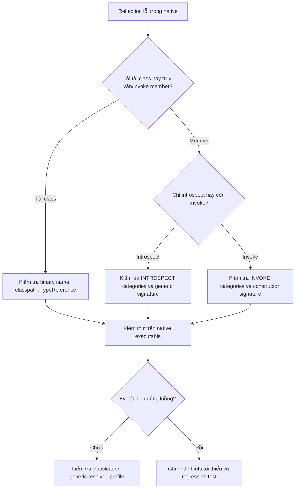

# Generic, kiểu lồng nhau và các kiểu chỉ xuất hiện qua tên chuỗi

## 1. Vì sao các kiểu này cần được xử lý riêng khi build native?

Trong module **SPRING_BOOT_NATIVE_IMAGE**, chúng ta dùng **Spring AOT** để chuẩn bị ứng dụng Spring Boot cho **GraalVM Native Image**, sau đó kiểm tra tính tương thích, đo thời gian khởi động và bộ nhớ, đóng gói container và vận hành bản native. Reflection là một điểm cần kiểm soát vì ứng dụng có thể truy cập class/member bằng thông tin chỉ xuất hiện lúc runtime.

Những trường hợp dễ bị bỏ sót gồm:

- Field có kiểu generic như `List<Order>` hoặc `Map<String, List<Order>>`, và ứng dụng đọc thông tin kiểu qua `Field.getGenericType()`.
- Method trả về kiểu generic hoặc nhận tham số generic, và framework gọi `getGenericReturnType()` hoặc `getGenericParameterTypes()`.
- Class nằm bên trong class khác, chỉ được tìm qua tên chuỗi như `com.example.Outer$NestedPlugin`.
- Plugin được chọn từ property hoặc dữ liệu cấu hình bằng `Class.forName(className)`.
- Class generic có subclass cụ thể hóa type variable, hoặc inner class cần instance của outer class khi tạo object.

Trên JVM, những đường đi đó thường hoạt động vì bytecode và class metadata được nạp động. Native Image phân tích tập mã có thể tiếp cận tại thời điểm build theo mô hình **closed-world**. Nếu kiểu hoặc member chỉ được truy cập qua reflection mà không có metadata phù hợp, class có thể không được giữ lại hoặc thao tác truy vấn/invoke có thể thất bại.

Sau bài học, người học có thể:

1. Phân biệt generic type trong source code với kiểu thực tế mà JVM lưu ở runtime.
2. Đọc generic signature qua `Type`, `ParameterizedType`, `TypeVariable`, `WildcardType` và `GenericArrayType`.
3. Nhận diện binary name của static nested class, inner class, local class và anonymous class.
4. Đăng ký reflection hints cho class/member được chọn bằng tên chuỗi.
5. Phân biệt quyền **introspect/query** metadata với quyền **invoke** constructor/method/field.
6. Kiểm thử cùng một đường truy cập trên JVM và native executable.

> **Nguyên tắc:** generic signature, binary name và class reachability là ba vấn đề khác nhau. Hints đúng phải mô tả chính xác kiểu được tìm, member cần truy vấn và thao tác cần thực hiện.

## 2. Generic trong Java: type erasure không có nghĩa mọi thông tin generic đều biến mất

Java dùng **type erasure** để triển khai generics. Nhiều kiểu generic được thay bằng raw type hoặc upper bound khi bytecode chạy. Ví dụ:

```java
List<String> names = new ArrayList<>();
List<Long> ids = new ArrayList<>();

System.out.println(names.getClass() == ids.getClass()); // true
```

Ở runtime, cả hai object đều có class là `java.util.ArrayList`. Không thể gọi `names.getClass()` rồi hỏi JVM rằng object đó được khai báo ban đầu là `List<String>` hay `List<Long>`.

Tuy nhiên, compiler Java thường ghi **generic Signature attribute** vào class file cho khai báo field, method, superclass và interface khi cần. Reflection API có thể đọc metadata khai báo đó:

| API | Thông tin khai báo |
| --- | --- |
| `Field.getGenericType()` | Kiểu generic của field. |
| `Method.getGenericReturnType()` | Kiểu trả về generic của method. |
| `Method.getGenericParameterTypes()` | Các kiểu tham số generic. |
| `Class.getGenericSuperclass()` | Kiểu superclass có tham số generic. |
| `Class.getGenericInterfaces()` | Các interface generic được khai báo. |
| `Class.getTypeParameters()` | Type variables khai báo trên class/interface. |

Điều này tạo ra ba khái niệm cần phân biệt:

- **Runtime object type:** kiểu thực tế của object, thường đã bị erasure.
- **Declared generic signature:** thông tin generic được lưu trên khai báo field/method/class và có thể đọc qua reflection nếu metadata tương ứng còn khả dụng.
- **Resolved type argument:** kiểu cụ thể sau khi giải quyết type variable qua quan hệ kế thừa/interface; có thể cần thuật toán duyệt hierarchy, không tự động xuất hiện từ object.

Vì vậy, không được kết luận Native Image cần giữ mọi tham số generic của mọi object. Chỉ khi ứng dụng/framework **truy vấn generic signature hoặc dùng kiểu được suy ra để thực hiện truy cập động**, ta mới cần kiểm soát reflection metadata cho đường đi đó.

### 2.1. Đọc generic type của field

Ví dụ một model có field lồng nhiều tầng generic:

```java
package com.example.model;

import java.util.List;
import java.util.Map;

public class OrderCatalog {
    private Map<String, List<Order>> ordersByRegion;

    public Map<String, List<Order>> getOrdersByRegion() {
        return ordersByRegion;
    }
}
```

Khi truy vấn field:

```java
Field field = OrderCatalog.class.getDeclaredField("ordersByRegion");
Type declaredType = field.getGenericType();

System.out.println(declaredType.getTypeName());
```

`declaredType` là một `ParameterizedType` chứ không phải một `Class<?>` đơn giản. Có thể phân tích các lớp lồng nhau:

```java
ParameterizedType mapType = (ParameterizedType) declaredType;

Type keyType = mapType.getActualTypeArguments()[0];   // String
Type valueType = mapType.getActualTypeArguments()[1]; // List<Order>

ParameterizedType listType = (ParameterizedType) valueType;
Type elementType = listType.getActualTypeArguments()[0]; // Order
```

`ParameterizedType` mô tả raw type và các actual type arguments. Với khai báo `Map<String, List<Order>>`, raw type là `Map`, đối số thứ nhất là `String`, đối số thứ hai lại là một `ParameterizedType` đại diện `List<Order>`.

Nếu ứng dụng chỉ cần tên kiểu để hiển thị log, có thể dùng `getTypeName()`. Nếu cần tiếp tục phân tích cấu trúc, phải kiểm tra loại `Type` bằng `instanceof`; không ép mọi kết quả sang `Class<?>`.

### 2.2. Năm dạng Type thường gặp

`java.lang.reflect.Type` là interface chung. Những dạng thường gặp:

| Dạng | Ý nghĩa | Ví dụ khai báo |
| --- | --- | --- |
| `Class<?>` | Kiểu không tham số hoặc raw type. | `String`, `List`. |
| `ParameterizedType` | Kiểu có actual type arguments. | `List<Order>`, `Map<String, Order>`. |
| `TypeVariable<?>` | Biến kiểu khai báo trên class/method. | `T` trong `class Box<T>`. |
| `WildcardType` | Kiểu wildcard với upper/lower bounds. | `List<? extends Number>`, `List<? super Order>`. |
| `GenericArrayType` | Mảng có component type generic. | `T[]` khi `T` là type variable. |

Ví dụ một method:

```java
public <T extends Number> List<? super T> convert(
        T value, List<? extends T> source) {
    // ...
}
```

`getGenericParameterTypes()` có thể trả về một `TypeVariable` cho `T` và một `ParameterizedType` chứa `WildcardType` cho `List<? extends T>`. `getGenericReturnType()` trả về cấu trúc `List<? super T>`. Các bounds của type variable và wildcard có thể được đọc qua `getBounds()`, `getUpperBounds()` hoặc `getLowerBounds()`.

Để xử lý an toàn:

1. Nhận kiểu kết quả dưới dạng `Type`.
2. Kiểm tra `instanceof Class`, `ParameterizedType`, `TypeVariable`, `WildcardType` hoặc `GenericArrayType`.
3. Duyệt đệ quy owner type, raw type, actual arguments và bounds khi cần.
4. Chỉ chuyển thành `Class<?>` khi kiểu thực sự là `Class` hoặc đã giải quyết được type variable.

### 2.3. Type erasure và type variable

Xét:

```java
class Envelope<T> {
    private T payload;
}

class OrderEnvelope extends Envelope<Order> {
}
```

Field `payload` trong `Envelope` được khai báo với `T`; `Field.getGenericType()` trả về `TypeVariable`, không tự trả về `Order` chỉ vì object cụ thể là `OrderEnvelope`.

Muốn giải quyết `T` thành `Order`, code reflection phải:

1. Đọc `OrderEnvelope.class.getGenericSuperclass()`.
2. Nhận `ParameterizedType` tương ứng với `Envelope<Order>`.
3. Lấy type variable `T` khai báo trên `Envelope`.
4. Ghép `T` với actual type argument `Order`.
5. Khi duyệt field `payload`, thay type variable bằng ánh xạ đã tìm được.

Đây là thuật toán giải quyết generic hierarchy. Spring, serializer hoặc mapper có thể thực hiện logic tương tự. Khi dùng native, cần bảo đảm các class và member mà thuật toán **truy vấn bằng reflection** có metadata introspection thích hợp; type argument `Order` cũng phải được giữ nếu ứng dụng tiếp tục introspect hoặc instantiate kiểu đó.

### 2.4. Generic owner type của nested class

Một inner class không static có thể dùng type parameter của outer class:

```java
class Registry<T> {
    class Entry<U> {
        T key;
        U value;
    }
}

Registry<String>.Entry<Long> entry;
```

Khai báo `Registry<String>.Entry<Long>` chứa thông tin generic ở cả **owner type** và inner type. Khi đọc `ParameterizedType`, ngoài `getActualTypeArguments()` còn có `getOwnerType()`. Nếu chỉ đọc raw type hoặc actual arguments của inner class mà bỏ owner type, có thể làm mất `String` được khai báo ở `Registry<String>`.

Đối với class lồng generic nhiều tầng, hãy duyệt `getOwnerType()` đệ quy thay vì giả định mọi tham số đều nằm trên type trong cùng.

## 3. Nested class: source name khác binary name

Java cho phép nhiều kiểu khai báo bên trong một class. Cách phân biệt rất quan trọng khi dùng reflection hoặc `Class.forName`.

```java
package com.example.plugins;

public class PluginContainer {

    public static class StaticPlugin {
        public StaticPlugin() {}
    }

    public class InnerPlugin {
        public InnerPlugin(String name) {}
    }

    public void registerLocal() {
        class LocalPlugin {}
        Runnable task = new Runnable() {
            @Override
            public void run() {}
        };
    }
}
```

| Loại | Đặc điểm | Tên binary điển hình |
| --- | --- | --- |
| Top-level class | Khai báo ở cấp package. | `com.example.plugins.Plugin` |
| Static nested class | Khai báo trong class với `static`, không cần instance outer để tạo object. | `com.example.plugins.PluginContainer$StaticPlugin` |
| Non-static member/inner class | Gắn với instance outer, constructor có tham số outer instance ngầm định. | `com.example.plugins.PluginContainer$InnerPlugin` |
| Local class | Khai báo trong method/constructor/block. | Tên compiler sinh, thường có số thứ tự và dấu `$`. |
| Anonymous class | Không có tên source riêng. | Tên compiler sinh, thường có số thứ tự và dấu `$`. |

### 3.1. Dùng binary name cho Class.forName

Với nested class, source notation:

```java
PluginContainer.StaticPlugin.class
```

nhưng `Class.getName()` trả về binary name:

```text
com.example.plugins.PluginContainer$StaticPlugin
```

Đây là tên thích hợp để truyền vào `Class.forName`. Dấu `$` là một phần của binary name, không phải dấu phân cách package. Ví dụ:

```java
String className =
    "com.example.plugins.PluginContainer$StaticPlugin";

Class<?> pluginType = Class.forName(
    className,
    false,
    Thread.currentThread().getContextClassLoader()
);
```

Tham số `false` yêu cầu không khởi tạo class ngay trong lần nạp này. Khi cần khởi tạo, thao tác khởi tạo sẽ xảy ra sau đó theo cơ chế JVM. Chọn classloader phù hợp với ứng dụng; context classloader có thể khác classloader của class gọi.

Không dùng `getCanonicalName()` để tạo chuỗi `Class.forName` cho nested class: canonical name dùng dấu chấm và có thể là `null` với local/anonymous class. `getName()` trả về binary name; đây là dạng phù hợp hơn cho class loading.

### 3.2. Constructor của static nested và inner class khác nhau

Static nested class có thể được tạo như một class độc lập:

```java
Class<?> type = Class.forName(
    "com.example.plugins.PluginContainer$StaticPlugin"
);
Object plugin = type.getDeclaredConstructor().newInstance();
```

Non-static inner class cần instance của outer class. Constructor thực tế nhận outer instance như một tham số:

```java
Class<?> innerType = Class.forName(
    "com.example.plugins.PluginContainer$InnerPlugin"
);

PluginContainer outer = new PluginContainer();
Constructor<?> constructor =
    innerType.getDeclaredConstructor(PluginContainer.class, String.class);

Object inner = constructor.newInstance(outer, "payments");
```

Vì vậy, nếu chỉ đăng ký hoặc tìm một constructor không tham số cho inner class, code sẽ thất bại. Hãy kiểm tra `getDeclaredConstructors()` trên JVM để hiểu signature thực tế; một số tham số do compiler sinh có thể xuất hiện trong reflection.

**Khuyến nghị thiết kế:** nếu class được cấu hình bằng tên chuỗi để làm plugin, ưu tiên top-level class hoặc static nested class có constructor rõ ràng. Local/anonymous class không thích hợp làm plugin name trong configuration vì binary name có thể phụ thuộc compiler và thay đổi khi source thay đổi.

### 3.3. Liệt kê nested class bằng reflection

Có thể truy vấn các class khai báo trực tiếp trong một class:

```java
Class<?>[] nestedTypes = PluginContainer.class.getDeclaredClasses();
for (Class<?> nested : nestedTypes) {
    System.out.println(nested.getName());
    System.out.println("member=" + nested.isMemberClass());
    System.out.println("local=" + nested.isLocalClass());
    System.out.println("anonymous=" + nested.isAnonymousClass());
}
```

`getDeclaredClasses()` liệt kê các member class/interface được khai báo trực tiếp; nó không phải phép quét toàn bộ class trong package và không liệt kê local/anonymous class theo cách mà nhiều người mới có thể mong đợi. Local/anonymous class cần được nhận diện qua các metadata/enclosing relationships thích hợp nếu ứng dụng thực sự cần.

Nếu code gọi `getDeclaredClasses()`, cần metadata introspection cho nested classes. Nếu sau đó gọi constructor hoặc method của nested class, cần thêm quyền invoke tương ứng cho chính kiểu đó.

## 4. Class chỉ xuất hiện qua tên chuỗi

Một plugin registry có thể lưu tên implementation trong configuration:

```properties
orders.plugin-class=com.example.plugins.JsonOrderPlugin
```

Code tải implementation:

```java
String className = environment.getRequiredProperty("orders.plugin-class");

Class<?> pluginType = Class.forName(
    className,
    false,
    Plugin.class.getClassLoader()
);

if (!Plugin.class.isAssignableFrom(pluginType)) {
    throw new IllegalArgumentException("Configured class is not a Plugin");
}

@SuppressWarnings("unchecked")
Class<? extends Plugin> implementation =
    (Class<? extends Plugin>) pluginType;

Plugin plugin = implementation.getDeclaredConstructor().newInstance();
```

`Plugin.class.getClassLoader()` là lựa chọn minh họa cho ứng dụng; trong hệ thống modular/plugin hoặc Spring container, cần chọn classloader theo kiến trúc thật. Kiểm tra `isAssignableFrom` giúp xác nhận kiểu triển khai interface mong đợi, nhưng **không tự giải quyết reachability metadata** cho Native Image.

### 4.1. Dùng TypeReference khi tên class chỉ biết ở build configuration

Nếu code không có tham chiếu compile-time tới class implementation, Spring Runtime Hints cho phép đăng ký kiểu theo tên thông qua `TypeReference`:

```java
package com.example.nativeapp;

import org.springframework.aot.hint.MemberCategory;
import org.springframework.aot.hint.RuntimeHints;
import org.springframework.aot.hint.RuntimeHintsRegistrar;
import org.springframework.aot.hint.TypeReference;

public final class PluginRuntimeHints implements RuntimeHintsRegistrar {

    @Override
    public void registerHints(RuntimeHints hints, ClassLoader classLoader) {
        hints.reflection().registerType(
            TypeReference.of("com.example.plugins.JsonOrderPlugin"),
            MemberCategory.INVOKE_DECLARED_CONSTRUCTORS,
            MemberCategory.INTROSPECT_PUBLIC_METHODS
        );
    }
}
```

`TypeReference.of(...)` mô tả type theo tên. Nó hữu ích khi registrar không muốn tạo liên kết compile-time tới một implementation optional, nhưng tên vẫn phải chính xác và class phải có mặt trên classpath native build. TypeReference **không tự thêm dependency** và cũng không khiến class bất kỳ được tải từ một nguồn ngoài classpath.

Nếu danh sách plugin được biết trước khi build, hãy đăng ký từng kiểu được hỗ trợ. Nếu người vận hành có thể nhập một tên class tùy ý sau khi executable đã build, Native Image không thể tự bổ sung code mới vào binary. Khi đó cần thiết kế allowlist/build variants hoặc cơ chế plugin phù hợp với closed-world.

### 4.2. Tên binary cho nested plugin

Nếu implementation là static nested class:

```java
public class BuiltInPlugins {
    public static class JsonPlugin implements Plugin {
        public JsonPlugin() {}
    }
}
```

thì giá trị cấu hình và TypeReference phải dùng:

```properties
orders.plugin-class=com.example.plugins.BuiltInPlugins$JsonPlugin
```

Không dùng `com.example.plugins.BuiltInPlugins.JsonPlugin` như binary class name cho `Class.forName`. Nên thêm test kiểm tra chính chuỗi cấu hình, vì một dấu chấm hoặc `$` sai có thể làm plugin load thất bại chỉ ở runtime.

### 4.3. Không biến cấu hình class name thành điểm nạp code tùy ý

Một property class name có thể mở đường cho việc khởi tạo implementation không mong muốn. Chỉ cho phép các class nằm trong registry/allowlist do ứng dụng kiểm soát; kiểm tra interface/base type, constructor, package và nguồn cấu hình. Không nhận tên class tùy ý từ request HTTP hoặc dữ liệu không tin cậy rồi gọi reflection trực tiếp.

Với Spring, cân nhắc dùng bean registry, conditional beans hoặc strategy map thay vì tự xây dựng plugin loader bằng reflection nếu tập implementation có thể khai báo tĩnh. Cách này giúp Spring AOT nhìn thấy bean graph dễ hơn.

## 5. Runtime Hints: phân biệt introspection và invocation

Một lỗi cấu hình phổ biến là đăng ký quyền gọi method trong khi ứng dụng chỉ truy vấn generic signature, hoặc chỉ đăng ký introspection nhưng sau đó lại invoke constructor.

Spring `MemberCategory` phân biệt hai nhóm:

- **Introspection/query:** cho phép xem thông tin member, ví dụ liệt kê method/field/constructor, đọc generic return/parameter type hoặc modifier.
- **Invocation:** cho phép gọi constructor/method hoặc truy cập field theo cơ chế reflection.

Ví dụ, nếu ứng dụng chỉ gọi `getDeclaredMethods()` và `getGenericReturnType()`, cần quyền introspection cho declared methods. Nếu ứng dụng còn gọi method qua `Method.invoke`, cần quyền invocation phù hợp.

| Thao tác | Hints cần xem xét |
| --- | --- |
| `getDeclaredMethods()`, đọc `getGenericReturnType()` | `INTROSPECT_DECLARED_METHODS`. |
| `getMethods()`, đọc generic signature của public methods | `INTROSPECT_PUBLIC_METHODS`. |
| `getDeclaredFields()`, đọc `getGenericType()` | `INTROSPECT_DECLARED_FIELDS`. |
| `getDeclaredConstructors()` để xem signature | `INTROSPECT_DECLARED_CONSTRUCTORS`. |
| `getDeclaredClasses()` | `DECLARED_CLASSES`. |
| `getDeclaredConstructor(...).newInstance()` | `INVOKE_DECLARED_CONSTRUCTORS`. |
| `Method.invoke(...)` cho declared method | `INVOKE_DECLARED_METHODS` hoặc category public phù hợp. |
| Truy cập field qua reflection | Category field invocation/access tương ứng với visibility và API dùng. |

Tên category chính xác và overload cần đối chiếu Spring Framework version. Không giả định `INVOKE_PUBLIC_METHODS` tự cho phép truy vấn tất cả declared private method, hoặc `INTROSPECT_DECLARED_METHODS` tự cho phép gọi method.

### 5.1. Registrar cho generic và nested types

Giả sử ứng dụng introspect `OrderCatalog.ordersByRegion`, xem generic signature của method, liệt kê nested types trong `PluginContainer`, và tạo một static nested plugin theo tên chuỗi:

```java
package com.example.nativeapp;

import org.springframework.aot.hint.MemberCategory;
import org.springframework.aot.hint.RuntimeHints;
import org.springframework.aot.hint.RuntimeHintsRegistrar;
import org.springframework.aot.hint.TypeReference;

public final class ReflectionRuntimeHints implements RuntimeHintsRegistrar {

    @Override
    public void registerHints(RuntimeHints hints, ClassLoader classLoader) {
        hints.reflection().registerType(
            OrderCatalog.class,
            MemberCategory.INTROSPECT_DECLARED_FIELDS,
            MemberCategory.INTROSPECT_PUBLIC_METHODS
        );

        hints.reflection().registerType(
            TypeReference.of("com.example.plugins.PluginContainer"),
            MemberCategory.DECLARED_CLASSES
        );

        hints.reflection().registerType(
            TypeReference.of(
                "com.example.plugins.PluginContainer$StaticPlugin"
            ),
            MemberCategory.INVOKE_DECLARED_CONSTRUCTORS,
            MemberCategory.INTROSPECT_DECLARED_METHODS
        );

        hints.reflection().registerType(
            TypeReference.of("com.example.model.Order"),
            MemberCategory.INTROSPECT_PUBLIC_METHODS
        );
    }
}
```

Đây là ví dụ theo nhu cầu giả định, không phải cấu hình chung cho mọi ứng dụng:

- `OrderCatalog` cần introspect field và public methods để đọc signature.
- `PluginContainer` cần liệt kê nested class; nếu ứng dụng chỉ tải một class đã biết bằng tên thì có thể không cần liệt kê toàn bộ nested classes.
- `StaticPlugin` cần constructor invocation vì code tạo instance.
- `Order` cần được introspect tiếp nếu logic dùng type argument để đọc metadata của kiểu này.

Nếu class `Order` chỉ xuất hiện trong generic signature nhưng không được ứng dụng introspect/instantiate, hãy kiểm tra hành vi thực tế trước khi đăng ký thêm quyền. Hints không phải danh sách tất cả kiểu có mặt trong source code.

### 5.2. Kết nối registrar với Spring AOT

Tạo configuration thuộc application context:

```java
import org.springframework.context.annotation.Configuration;
import org.springframework.context.annotation.ImportRuntimeHints;

@Configuration(proxyBeanMethods = false)
@ImportRuntimeHints(ReflectionRuntimeHints.class)
class NativeReflectionConfiguration {
}
```

Đảm bảo configuration được component scan hoặc import vào context mà Spring AOT xử lý. Nếu registrar không được phát hiện, các hints trong code sẽ không tự đi vào AOT output. Không sửa trực tiếp generated sources để bù cho registrar bị bỏ sót.

## 6. Kiểm thử hints và generic reflection

Một test tốt nên kiểm tra cả **hints đã đăng ký** và **đường reflection thực sự sử dụng**. Test predicate giúp phát hiện category thiếu; native integration test xác nhận metadata đủ cho hành vi thực.

### 6.1. Kiểm tra registrar bằng RuntimeHintsPredicates

Ví dụ:

```java
import org.junit.jupiter.api.Test;
import org.springframework.aot.hint.MemberCategory;
import org.springframework.aot.hint.RuntimeHints;
import org.springframework.aot.hint.predicate.RuntimeHintsPredicates;

import static org.assertj.core.api.Assertions.assertThat;

class ReflectionRuntimeHintsTests {

    @Test
    void registersGenericModelIntrospection() {
        RuntimeHints hints = new RuntimeHints();
        new ReflectionRuntimeHints().registerHints(
            hints,
            getClass().getClassLoader()
        );

        assertThat(
            RuntimeHintsPredicates.reflection()
                .onType(OrderCatalog.class)
                .withMemberCategory(MemberCategory.INTROSPECT_DECLARED_FIELDS)
        ).accepts(hints);
    }
}
```

Predicate pass xác nhận registrar đăng ký category được yêu cầu cho type đó. Nó không kiểm tra thuật toán giải quyết `TypeVariable`, không chứng minh resource hoặc dependency được đóng gói, và không thay thế native test.

### 6.2. Test generic signature trên class model

Một test JVM đơn giản giúp xác nhận code phân tích generic đúng:

```java
import java.lang.reflect.Field;
import java.lang.reflect.ParameterizedType;
import java.lang.reflect.Type;
import java.util.List;
import java.util.Map;

@Test
void readsNestedGenericFieldSignature() throws Exception {
    Field field = OrderCatalog.class.getDeclaredField("ordersByRegion");
    Type type = field.getGenericType();

    assertThat(type).isInstanceOf(ParameterizedType.class);

    ParameterizedType map = (ParameterizedType) type;
    assertThat(map.getRawType()).isEqualTo(Map.class);
    assertThat(map.getActualTypeArguments()[0]).isEqualTo(String.class);

    Type value = map.getActualTypeArguments()[1];
    assertThat(value).isInstanceOf(ParameterizedType.class);

    ParameterizedType list = (ParameterizedType) value;
    assertThat(list.getRawType()).isEqualTo(List.class);
    assertThat(list.getActualTypeArguments()[0]).isEqualTo(Order.class);
}
```

Test này kiểm tra generic signature của class file mà code đang dùng. Chạy thêm test tương tự trong native mode để phát hiện thiếu reflection metadata.

### 6.3. Test nested binary name và constructor

```java
@Test
void loadsStaticNestedPluginByBinaryName() throws Exception {
    String binaryName =
        "com.example.plugins.PluginContainer$StaticPlugin";

    Class<?> type = Class.forName(
        binaryName,
        false,
        getClass().getClassLoader()
    );

    assertThat(type.getName()).isEqualTo(binaryName);
    assertThat(type.isMemberClass()).isTrue();
    assertThat(type.getDeclaredConstructor()).isNotNull();
}
```

Nếu test tạo instance, gọi `newInstance()` trên constructor sau khi đã đăng ký invocation hints. Với inner class không static, test phải cung cấp outer instance và constructor parameters đúng signature.

## 7. Build và xác minh trên Maven/Gradle

### 7.1. Maven

Với dự án đã cấu hình Spring Boot AOT và GraalVM Native Build Tools:

```bash
./mvnw -Pnative spring-boot:process-aot
./mvnw -Pnative test
./mvnw -Pnative native:compile
```

Đọc log để xác nhận:

- Spring AOT đã xử lý configuration chứa `@ImportRuntimeHints`.
- Native plugin dùng đúng GraalVM và classpath/dependency.
- Reflection metadata cho type/member cần thiết được đưa vào build.
- Native executable tạo thành công và có thể chạy test tái hiện.

Tên profile/goal tùy cấu hình POM và version plugin. Nếu dự án dùng goal native test riêng, chạy theo cấu hình được hỗ trợ và kiểm tra test report để biết test nào thực sự được thực thi.

### 7.2. Gradle

Với project đã áp dụng Spring Boot Gradle plugin và GraalVM Native Build Tools:

```bash
./gradlew processAot
./gradlew test
./gradlew nativeCompile
```

Khi cần xem task graph/log:

```bash
./gradlew nativeCompile --dry-run
./gradlew nativeCompile --info
```

Xác minh task AOT xuất hiện trong graph phù hợp, đúng Java/GraalVM toolchain được chọn và đúng native executable được tạo. Không dùng riêng `java -version` của terminal để kết luận plugin đang sử dụng cùng JDK.

### 7.3. Kiểm thử runtime

Chạy native executable với cấu hình class name và generic model thực tế. Bao gồm:

- Tên top-level class hợp lệ.
- Tên static nested class có dấu `$`.
- Tên sai package hoặc sai binary name.
- Constructor không tồn tại hoặc không phù hợp.
- Generic field/method lồng nhiều cấp.
- Subclass cụ thể hóa type variable.
- Inner class cần outer instance.
- Profile/plugin configuration khác nhau nếu được hỗ trợ.

Ghi lại stack trace và phân loại lỗi: class không được reach, member không có invocation permission, metadata introspection thiếu, classloader không đúng, hoặc logic generic resolver sai.

## 8. Các lỗi thường gặp

| Triệu chứng | Nguyên nhân có thể | Hướng xử lý |
| --- | --- | --- |
| `ClassNotFoundException` với nested class | Dùng dấu chấm thay cho `$`, hoặc class chưa nằm trong native classpath. | Dùng `Class.getName()` để xác định binary name; kiểm tra dependency và hints. |
| `NoSuchMethodException` khi tạo inner class | Tìm constructor không tham số trong khi inner class cần outer instance. | Kiểm tra `getDeclaredConstructors()` và truyền outer class vào `getDeclaredConstructor(...)`. |
| `getGenericType()` hoặc `getGenericReturnType()` thiếu thông tin/lỗi native | Member introspection metadata chưa đủ hoặc signature không còn trong class artifact. | Đăng ký introspection category phù hợp; kiểm tra class file và shrinker/obfuscator. |
| Ép `Type` sang `Class<?>` gây `ClassCastException` | Kết quả là `ParameterizedType`, `TypeVariable`, `WildcardType` hoặc `GenericArrayType`. | Duyệt `Type` bằng `instanceof`, xử lý đệ quy. |
| Không lấy được `Order` từ field `T payload` | Type variable chưa được resolve qua generic superclass/interface. | Duyệt hierarchy và tạo ánh xạ `TypeVariable` → actual type argument. |
| `getDeclaredClasses()` trả thiếu/không có class mong muốn | Nhầm local/anonymous class với member class hoặc thiếu metadata introspection. | Kiểm tra `isMemberClass`, `isLocalClass`, `isAnonymousClass` và đăng ký declared classes nếu cần. |
| JVM tải plugin được nhưng native báo thiếu class | Class chỉ xuất hiện qua chuỗi và chưa được đăng ký reachability. | Đăng ký `TypeReference` cho từng implementation được hỗ trợ. |
| Class được tìm thấy nhưng constructor không tạo được | Chỉ đăng ký introspection, chưa đăng ký invocation constructor hoặc signature constructor sai. | Bổ sung `INVOKE_DECLARED_CONSTRUCTORS` và kiểm tra tham số thực tế. |
| Predicate pass nhưng native vẫn lỗi | Predicate chỉ kiểm tra category; đường đi runtime còn thiếu type/member/resource khác. | Thêm native integration test và lần theo stack trace. |
| Local/anonymous plugin name thay đổi giữa các bản build | Binary name do compiler sinh không ổn định. | Chuyển sang top-level hoặc static nested class có tên ổn định. |

### 8.1. Trình tự chẩn đoán



## 9. Bài thực hành: plugin generic lồng nhau được chọn bằng tên chuỗi

**Bối cảnh:** một dịch vụ Spring Boot có registry cho các plugin xử lý đơn hàng. Mỗi plugin được cấu hình bằng class name. Model `OrderCatalog` chứa `Map<String, List<Order>>`; một adapter dùng reflection để đọc generic signature và chọn converter. Một implementation là static nested class trong `BuiltInPlugins`.

### Nhiệm vụ

1. Tạo `OrderCatalog` với field generic lồng `Map<String, List<Order>>` và method trả về kiểu generic.
2. Viết utility duyệt `Type`, xử lý `ParameterizedType`, `TypeVariable`, `WildcardType`, `GenericArrayType` và `getOwnerType()`.
3. Tạo `BuiltInPlugins.JsonPlugin` dạng static nested class; cấu hình class name bằng binary name chứa `$`.
4. Thêm một non-static inner class để so sánh constructor có outer instance với static nested constructor.
5. Viết `RuntimeHintsRegistrar` đăng ký introspection cho field/method generic, declared classes khi cần, và invocation constructor của plugin.
6. Kết nối registrar với application context qua `@ImportRuntimeHints`.
7. Viết predicate tests cho hints và unit tests cho generic resolver/binary name.
8. Build Spring AOT và native executable bằng Maven hoặc Gradle.
9. Chạy native tests với plugin hợp lệ, tên class sai, generic type lồng nhau và inner class; so sánh với JVM.
10. Ghi lại metadata, loại truy cập cần thiết và bằng chứng build/runtime.

### Hồ sơ kết quả

| Bằng chứng | Nội dung cần ghi |
| --- | --- |
| Generic model | Field/method signature và `Type` tree thực tế. |
| Nested type | Source name, binary name, loại class và constructor signature. |
| String configuration | Class name hợp lệ, allowlist và classloader được chọn. |
| Runtime hints | Type, introspection categories và invocation categories. |
| Predicate tests | Assertions cho type/member cần thiết. |
| AOT/native build | Plugin/version, lệnh build, log và executable. |
| Native runtime tests | Generic resolver, plugin loading, inner/static nested constructor. |
| JVM/native comparison | Sai khác, stack trace và cách khắc phục. |

### Tiêu chí hoàn thành

- [ ] Giải thích được type erasure và generic Signature metadata.
- [ ] Xử lý được các implementation của `Type` mà không ép mọi kiểu thành `Class`.
- [ ] Giải quyết được type variable qua generic superclass/interface khi cần.
- [ ] Dùng binary name đúng cho nested class và hiểu constructor của inner class.
- [ ] Đăng ký riêng introspection và invocation theo thao tác thực tế.
- [ ] Native executable chạy được plugin và generic reflection scenario.
- [ ] Tên plugin được kiểm soát và có test cho trường hợp sai.

## 10. Câu hỏi tự đánh giá

1. Vì sao `new ArrayList<String>().getClass()` không cho biết actual type argument `String`?
2. Generic signature được lưu ở đâu và khác gì với runtime type của một object?
3. `ParameterizedType.getOwnerType()` có ý nghĩa gì với `Outer<String>.Inner<Long>`?
4. Tại sao `Class.forName("pkg.Outer.Inner")` không phải tên binary phù hợp cho nested class?
5. Vì sao non-static inner class thường không có constructor không tham số như bạn nhìn thấy trong source?
6. Khi chỉ gọi `getGenericReturnType()`, cần phân biệt hint introspection với hint invocation ra sao?
7. `TypeReference.of("...")` giúp gì cho plugin được chọn bằng tên chuỗi, và nó không giải quyết được vấn đề nào?
8. Vì sao local/anonymous class không phù hợp làm tên plugin lưu trong cấu hình?

## 11. Tài liệu chính thức

API reflection của Java và Spring hint categories có thể thay đổi theo phiên bản. Hãy đối chiếu tài liệu đúng JDK/Spring Framework mà dự án sử dụng:

- [Java API — Type](https://docs.oracle.com/en/java/javase/21/docs/api/java.base/java/lang/reflect/Type.html): hệ phân cấp generic reflection types.
- [Java API — ParameterizedType](https://docs.oracle.com/en/java/javase/21/docs/api/java.base/java/lang/reflect/ParameterizedType.html): raw type, owner type và actual type arguments.
- [Java API — TypeVariable](https://docs.oracle.com/en/java/javase/21/docs/api/java.base/java/lang/reflect/TypeVariable.html): type variables và bounds.
- [Java API — Class.forName](https://docs.oracle.com/en/java/javase/21/docs/api/java.base/java/lang/Class.html#forName(java.lang.String,boolean,java.lang.ClassLoader)): tải class bằng binary name và classloader.
- [Java Language Specification — Binary Names](https://docs.oracle.com/javase/specs/jls/se21/html/jls-13.html#jls-13.1): quy tắc tên binary của nested/local/anonymous classes.
- [Spring Framework — Runtime Hints](https://docs.spring.io/spring-framework/reference/core/aot.html): RuntimeHints, RuntimeHintsRegistrar và AOT.
- [Spring Framework API — MemberCategory](https://docs.spring.io/spring-framework/docs/current/javadoc-api/org/springframework/aot/hint/MemberCategory.html): các category introspection/invocation.
- [GraalVM Native Image — Reachability Metadata](https://www.graalvm.org/latest/reference-manual/native-image/metadata/): cách mô tả truy cập reflection cho native build.

**Điểm cần nhớ:** generic signature cho biết cấu trúc kiểu được khai báo; binary name xác định class cần tải; Runtime Hints mô tả member cần introspect hoặc invoke. Khi ba lớp thông tin này được kiểm soát và kiểm thử riêng, các framework dùng generic reflection và plugin loading có thể chạy native ổn định hơn.
