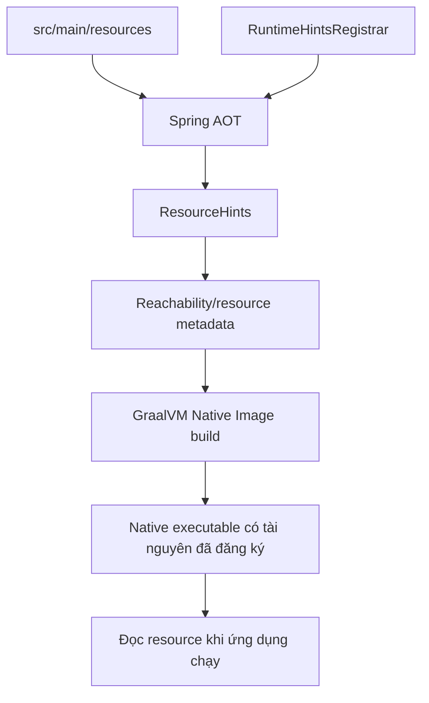

# ResourceHints và các mẫu đường dẫn cần đóng gói

> **Chương: Tài nguyên.** Module **SPRING_BOOT_NATIVE_IMAGE** biên dịch ứng dụng Spring Boot thành GraalVM Native Image bằng Spring AOT. Khi tạo native executable, tài nguyên nằm trên classpath cần được nhận diện ở build time để có thể đóng gói vào image. Bài này trình bày cách dùng Spring Runtime Hints/ResourceHints, chọn pattern phù hợp và kiểm thử tài nguyên sau khi đóng gói.

## 1. Mục tiêu học tập

Sau bài học, bạn có thể:

1. Giải thích vì sao tài nguyên được đọc động trên JVM có thể không xuất hiện trong Native Image.
2. Phân biệt tài nguyên classpath, resource bundle và tệp bên ngoài filesystem.
3. Đăng ký resource bằng RuntimeHintsRegistrar và @ImportRuntimeHints.
4. Chọn pattern chính xác cho một file, một thư mục hoặc cây thư mục có nhiều cấp.
5. Kiểm tra resource trong JVM, AOT và native executable; xử lý lỗi thiếu resource.
6. Tránh đóng gói quá nhiều dữ liệu hoặc đưa secret và cấu hình môi trường vào image ở build time.

## 2. Vì sao Native Image cần Resource Hints?

Trên JVM, ứng dụng có thể dùng tên được tạo từ dữ liệu runtime để tìm một file trong classpath:

```java
String template = request.getParameter("template");
InputStream input = getClass().getClassLoader()
        .getResourceAsStream("templates/" + template + ".html");
```

JVM thường có thể tra cứu tài nguyên trong JAR/classpath lúc chạy. GraalVM Native Image phân tích tĩnh ứng dụng và cần biết trước tài nguyên nào sẽ được truy cập. Nếu tên đường dẫn chỉ xuất hiện dưới dạng chuỗi được ghép lúc runtime, quá trình phân tích có thể không phát hiện được file cần đưa vào executable.

Spring cung cấp **Runtime Hints API** để mô tả những khả năng cần thiết khi chạy. ResourceHints là phần dành cho tài nguyên: đăng ký file hoặc pattern đường dẫn để Spring AOT chuyển thông tin đó sang metadata phù hợp cho Native Image.



**Điểm cốt lõi:** Resource Hint thông báo cho build process rằng một tài nguyên classpath có thể được dùng lúc runtime. Nó không tạo file, không tự tải tài nguyên từ Internet, không biến một đường dẫn filesystem thành classpath resource và không cấp quyền truy cập vào mọi file trên máy chủ.

## 3. Phân biệt các loại tài nguyên

| Loại tài nguyên | Ví dụ | Cách xử lý |
|---|---|---|
| Một file trên classpath | templates/invoice.html | Đăng ký resource cụ thể hoặc pattern |
| Cây thư mục trên classpath | templates/email/*.html | Đăng ký pattern bao phủ đúng các cấp cần dùng |
| Resource bundle | messages.properties, messages_vi.properties | Đăng ký bundle bằng registerResourceBundle |
| Tệp bên ngoài JAR/container | /etc/orders/application.yml | Mount/cấp tệp tại runtime; không dùng ResourceHints để đóng gói |
| File upload hoặc dữ liệu người dùng tạo | /data/uploads/123.pdf | Đọc từ filesystem/object storage runtime theo thiết kế ứng dụng |
| Tài nguyên của dependency | File do thư viện bên thứ ba cung cấp | Kiểm tra reachability metadata của dependency; bổ sung hints nếu cần |

Một tệp src/main/resources/application.yml được Spring Boot dùng để cấu hình ứng dụng không đồng nghĩa mọi file YAML khác đều tự động được đóng gói. Hãy phân biệt resource do framework tự nhận diện với resource ứng dụng tải bằng tên động.

### 3.1. Classpath và filesystem không giống nhau

Classpath resource thường được đọc qua ClassLoader, ClassPathResource hoặc API resource của Spring. Sau khi đóng gói, tài nguyên có thể nằm trong executable hoặc cấu trúc nội bộ của image; không nên giả định nó luôn tồn tại dưới dạng một file vật lý với đường dẫn có thể truyền cho File.

Ví dụ nên dùng:

```java
try (InputStream input = getClass().getClassLoader()
        .getResourceAsStream("templates/invoice.html")) {
    if (input == null) {
        throw new IllegalStateException("Missing invoice template");
    }
    // Đọc nội dung từ stream.
}
```

Với tài nguyên nằm ngoài classpath, có thể dùng File, Path, Files.newInputStream hoặc FileSystemResource theo đúng nhu cầu. Khi triển khai container, mount volume hoặc inject file qua secret/config mechanism. Những tệp này có thể thay đổi độc lập với binary, nên không cần và cũng không nên đăng ký như classpath resource.

## 4. Đăng ký resource bằng RuntimeHintsRegistrar

Giả sử ứng dụng có cấu trúc:

```text
src/main/resources/
  templates/
    invoice.html
    receipt.html
    email/
      order-confirmed.html
      payment-failed.html
  messages/
    labels.properties
    labels_vi.properties
```

Ta tạo một lớp đăng ký hints:

```java
package com.example.orders.config;

import org.springframework.aot.hint.RuntimeHints;
import org.springframework.aot.hint.RuntimeHintsRegistrar;

public class OrderResourceHints implements RuntimeHintsRegistrar {

    @Override
    public void registerHints(RuntimeHints hints, ClassLoader classLoader) {
        hints.resources().registerPattern("templates/invoice.html");
        hints.resources().registerPattern("templates/receipt.html");
        hints.resources().registerPattern("templates/email/*.html");
        hints.resources().registerResourceBundle("messages.labels");
    }
}
```

registerPattern nhận đường dẫn resource tương đối với gốc classpath. Trong ví dụ, pattern templates/email/*.html áp dụng cho các file HTML nằm trực tiếp trong thư mục email. Nếu ứng dụng còn có thư mục con sâu hơn, hãy chọn pattern bao phủ các cấp đó và kiểm tra bằng test; không giả định * và ** có cùng ý nghĩa.

registerResourceBundle nhận **base name** của bundle theo quy tắc Java ResourceBundle, không phải đường dẫn file có đuôi .properties. Với messages/labels.properties, base name là messages.labels.

### 4.1. Kết nối hints vào Spring AOT

Dùng @ImportRuntimeHints để Spring AOT phát hiện registrar:

```java
package com.example.orders.config;

import org.springframework.context.annotation.Configuration;
import org.springframework.context.annotation.ImportRuntimeHints;

@Configuration(proxyBeanMethods = false)
@ImportRuntimeHints(OrderResourceHints.class)
public class OrderResourceConfiguration {
}
```

Đảm bảo configuration class này được component scan hoặc được import bởi cấu hình ứng dụng. Nếu registrar không được phát hiện trong quá trình AOT, các hints của nó sẽ không được đưa vào output.

Có thể khai báo registrar bằng API Spring AOT khác nếu phù hợp với cấu trúc module, nhưng cần bảo đảm nó được gọi trong quá trình xử lý AOT. Không chỉ tạo lớp RuntimeHintsRegistrar rồi cho rằng Spring tự tìm mọi implementation trên classpath.

### 4.2. Đăng ký một file cụ thể

Nếu chỉ một file được tải động, ưu tiên đăng ký hẹp:

```java
@Override
public void registerHints(RuntimeHints hints, ClassLoader classLoader) {
    hints.resources().registerPattern("templates/invoice.html");
}
```

Đăng ký chính xác giúp kiểm soát kích thước tài nguyên được đóng gói và thể hiện rõ file nào thực sự được ứng dụng dùng.

## 5. Chọn pattern đường dẫn đúng

Một resource pattern thường được chọn theo đường dẫn từ gốc classpath. Ví dụ:

| Pattern | Phạm vi mong muốn |
|---|---|
| templates/invoice.html | Chỉ file invoice.html |
| templates/*.html | Các file HTML trực tiếp trong templates |
| templates/email/*.html | Các file HTML trực tiếp trong templates/email |
| templates/** | Cây tài nguyên dưới templates, theo cú pháp pattern được Spring/GraalVM hỗ trợ |
| i18n/messages | Đây là base name resource bundle nếu dùng registerResourceBundle, không phải pattern file thông thường |

Khi ứng dụng cần nhiều cấp thư mục, pattern rộng hơn có thể hữu ích. Tuy nhiên, đừng dùng ** trên toàn bộ classpath chỉ để tránh lỗi thiếu resource. Pattern quá rộng có thể đóng gói file không cần thiết, tăng kích thước executable và làm khó kiểm soát nội dung được đưa vào image.

### 5.1. Ví dụ chọn pattern theo cấu trúc

Giả sử:

```text
templates/
  invoice.html
  receipt.html
  email/
    created.html
    cancelled.html
    admin/
      alert.html
```

Nếu chỉ dùng hai template ở gốc và hai template trong email, có thể đăng ký:

```java
hints.resources().registerPattern("templates/invoice.html");
hints.resources().registerPattern("templates/receipt.html");
hints.resources().registerPattern("templates/email/*.html");
```

Nếu admin/alert.html cũng được tải bằng tên động, thêm pattern cụ thể:

```java
hints.resources().registerPattern("templates/email/admin/alert.html");
```

Hoặc dùng pattern đệ quy phù hợp nếu toàn bộ cây template được phép đóng gói:

```java
hints.resources().registerPattern("templates/**");
```

Với pattern đệ quy, cần xác nhận hành vi bằng cách build và chạy Native Image của đúng phiên bản GraalVM/Spring Framework. Không suy luận rằng một pattern đã match trên filesystem thông thường thì chắc chắn được parser metadata của mọi phiên bản hiểu giống hệt.

## 6. Resource bundle, encoding và locale

Ứng dụng Java có thể dùng ResourceBundle để chọn nội dung theo locale:

```java
ResourceBundle bundle = ResourceBundle.getBundle(
        "messages.labels",
        Locale.forLanguageTag("vi")
);

String title = bundle.getString("order.title");
```

Nếu bundle được chọn theo locale tại runtime, đăng ký base name:

```java
hints.resources().registerResourceBundle("messages.labels");
```

Điều này giúp Native Image biết bundle cần hiện diện. Nếu ứng dụng dùng nhiều bundle base name khác nhau, đăng ký từng bundle cần thiết. Hãy test locale mặc định và locale thực tế triển khai, bao gồm fallback về bundle gốc.

Đối với file properties có ký tự tiếng Việt, hãy lưu đúng encoding và kiểm tra cách đọc của API đang sử dụng. Cũng cần xác minh locale data/charset mà ứng dụng yêu cầu trên GraalVM runtime; Resource Hint chỉ giải quyết việc đóng gói tài nguyên, không tự bổ sung mọi dữ liệu locale của JDK.

## 7. Tài nguyên đến từ thư viện bên thứ ba

Một dependency có thể tải resource theo tên, ví dụ schema XML, template, JSON metadata hoặc file cấu hình thuật toán. Nếu resource không được truy cập tường minh từ mã ứng dụng, GraalVM có thể không nhận diện được.

Thứ tự xử lý nên là:

1. Kiểm tra thư viện có cung cấp **reachability metadata** cho đúng version hay không.
2. Kiểm tra metadata đó đã được GraalVM Native Image hoặc Spring AOT nhận vào build chưa.
3. Nếu thiếu, bổ sung resource hint ở ứng dụng hoặc metadata theo cơ chế mà phiên bản GraalVM đang dùng hỗ trợ.
4. Viết test kích hoạt đúng code path của thư viện và chạy test trên native executable.

Spring RuntimeHints phù hợp khi ứng dụng muốn khai báo resource phụ thuộc vào cấu hình của chính nó. Metadata đi cùng dependency có lợi thế được đóng gói cùng thư viện và có thể tái sử dụng ở nhiều ứng dụng. Tránh tạo một hint rộng trong ứng dụng để che lỗi metadata của nhiều dependency mà chưa xác định resource nào thực sự cần thiết.

## 8. Metadata GraalVM và quan hệ với Spring ResourceHints

Ở tầng GraalVM, Native Image sử dụng reachability metadata để biết tài nguyên nào cần giữ lại. Dạng metadata JSON và vị trí cấu hình có thể thay đổi theo phiên bản GraalVM. Các dự án cũ có thể gặp resource-config.json trong thư mục META-INF/native-image; các phiên bản mới có thể hỗ trợ schema metadata hợp nhất.

Với Spring Boot, nên ưu tiên RuntimeHints API cho hints của ứng dụng:

- Spring AOT thu thập hints từ RuntimeHintsRegistrar.
- Spring Native/AOT integration chuyển chúng thành cấu hình phù hợp với Native Image.
- GraalVM sử dụng metadata đó khi phân tích và tạo executable.

Ví dụ minh họa một cấu trúc metadata resource kiểu JSON truyền thống:

```json
{
  "resources": {
    "includes": [
      { "pattern": "templates/invoice\\.html" },
      { "pattern": "templates/email/.*\\.html" }
    ]
  }
}
```

Đây là ví dụ về dạng metadata resource, **không phải tệp nên sao chép máy móc vào mọi dự án**. Quy tắc regex/schema của GraalVM metadata không đồng nhất với pattern mà Spring ResourceHints.registerPattern nhận. Hãy để Spring AOT chuyển đổi hints nếu có thể; nếu phải viết metadata GraalVM thủ công, dùng schema và tài liệu đúng release, đồng thời kiểm tra vị trí metadata được build tool phát hiện.

Không khai báo cùng một resource bằng nhiều cơ chế khác nhau nếu không có lý do. Hints trùng lặp thường không giúp thêm khả năng, còn cấu hình rời rạc làm khó xác định nguồn khi nâng cấp.

## 9. Kiểm thử resource trên JVM và Native Image

Một smoke test đơn giản giúp phát hiện resource không có trong executable:

```java
package com.example.orders;

import java.io.InputStream;
import org.junit.jupiter.api.Test;

import static org.junit.jupiter.api.Assertions.assertNotNull;

class TemplateResourceTest {

    @Test
    void invoiceTemplateIsAvailable() {
        try (InputStream input = getClass().getClassLoader()
                .getResourceAsStream("templates/invoice.html")) {
            assertNotNull(input, "Invoice template must be packaged");
        } catch (Exception ex) {
            throw new AssertionError("Cannot read invoice template", ex);
        }
    }
}
```

Test trên xác minh file có thể được tìm thấy, nhưng chưa kiểm tra nội dung hoặc việc template engine parse đúng. Với tài nguyên quan trọng, hãy đọc nội dung, xác minh marker hoặc thực thi luồng render thật.

### 9.1. Kiểm thử theo từng lớp

| Giai đoạn | Cách kiểm tra | Điều cần xác nhận |
|---|---|---|
| JVM test | ./mvnw test hoặc ./gradlew test | Đường dẫn và nội dung resource đúng trên classpath |
| Spring AOT | Build AOT theo cấu hình dự án | Registrar được phát hiện, hints được thu thập |
| Native test | Chạy native test theo task/goal của plugin đã cấu hình | Resource tồn tại trong native test executable |
| Native application | Build và chạy binary, gọi endpoint dùng template/resource | Resource có mặt trong binary production |
| Container image | Chạy image trên nền tảng đích | Resource có thể đọc khi chạy trong môi trường triển khai |

Tên goal/task và cách cấu hình native test phụ thuộc phiên bản Spring Boot, GraalVM Native Build Tools và Maven/Gradle plugin. Dùng task/goal thực tế của dự án; không coi mọi dự án đều có cùng alias nativeTest.

### 9.2. Kiểm thử cả đường dẫn hợp lệ và không hợp lệ

Nếu tên template đến từ request hoặc dữ liệu DB, kiểm tra:

- Tên hợp lệ đã đăng ký có thể tải và render.
- Tên không tồn tại trả lỗi ứng dụng có kiểm soát.
- Tên chứa ../ hoặc ký tự bất thường không thể đọc tùy ý file ngoài thư mục template.
- Mọi template/locale được sử dụng trong production đều được test.
- File không cần thiết không bị đóng gói bởi pattern quá rộng.

Resource Hint không thay thế kiểm tra đầu vào. Nếu ứng dụng nhận tên file từ người dùng, nên ánh xạ qua allowlist hoặc enum thay vì nối chuỗi tùy ý vào đường dẫn.

## 10. Lỗi thường gặp và cách chẩn đoán

| Triệu chứng | Nguyên nhân có thể | Hướng xử lý |
|---|---|---|
| JVM đọc được file nhưng native trả null | Resource chưa được đưa vào Native Image | Đăng ký pattern/file trong ResourceHints, build lại và test native |
| Hint đã thêm nhưng resource vẫn thiếu | Registrar chưa được import/discover hoặc pattern không khớp đường dẫn classpath | Kiểm tra @ImportRuntimeHints, log AOT và đường dẫn tương đối gốc |
| Chỉ template ở thư mục con bị thiếu | Pattern * chỉ bao phủ cấp trực tiếp hoặc chưa bao phủ cây thư mục | Đăng ký pattern đúng cấp hoặc đệ quy và kiểm thử từng file |
| ResourceBundle không tìm thấy locale | Chưa đăng ký bundle base name hoặc thiếu biến thể locale | Dùng registerResourceBundle, test locale và fallback |
| FileNotFoundException khi dùng new File(...) | Classpath resource không phải file vật lý trong executable | Đọc bằng InputStream/Spring Resource; nếu là file ngoài, mount ở runtime |
| Resource từ dependency bị thiếu | Dependency thiếu reachability metadata hoặc thư viện truy cập động | Tra metadata của đúng version, bổ sung hint hẹp và kiểm thử |
| Image lớn bất thường | Pattern quá rộng hoặc đóng gói nhiều tài nguyên không cần thiết | Thu hẹp pattern, rà soát resource tree và đo lại kích thước |
| Secret xuất hiện trong binary | Secret đã được đặt trong src/main/resources hoặc được ghi vào resource ở build time | Xóa khỏi resource build-time, lấy secret từ runtime environment/secret store |

Quy trình chẩn đoán:

1. Xác định đường dẫn resource mà code thực sự yêu cầu, kể cả chữ hoa/thường.
2. Xác nhận file có trong output classpath của ứng dụng trước native build.
3. Kiểm tra registrar được Spring AOT phát hiện và pattern có match file.
4. Build lại native executable sau khi thay hints.
5. Chạy test trực tiếp trên native binary; nếu dùng container, kiểm tra lại image được deploy có phải image mới.
6. Nếu resource đến từ dependency, kiểm tra metadata và version thư viện.

## 11. Bài tập thực hành

Một dịch vụ đơn hàng render email từ các template:

```text
src/main/resources/
  mail/
    order-created.html
    order-cancelled.html
    locale/
      labels.properties
      labels_vi.properties
  schemas/
    order-v1.json
    order-v2.json
```

Yêu cầu:

1. Tạo MailResourceHints để đăng ký hai template email và resource bundle mail.locale.labels.
2. Đăng ký schema JSON theo pattern hẹp phù hợp với hai version.
3. Kết nối registrar bằng @ImportRuntimeHints trong cấu hình được Spring AOT phát hiện.
4. Viết test đọc cả hai template, resource bundle tiếng Việt và schema JSON.
5. Chạy test JVM, native test và một smoke test trên native application/container.
6. Thêm một trường hợp tên template không hợp lệ và bảo đảm ứng dụng không đọc được file tùy ý ngoài cây mail.
7. Kiểm tra kích thước image sau khi thu hẹp pattern; ghi rõ các file đã được đóng gói.

| Kiểm tra | Kết quả |
|---|---|
| mail/order-created.html | Pass/Fail |
| mail/order-cancelled.html | Pass/Fail |
| Resource bundle mail.locale.labels | Pass/Fail |
| Schema order-v1.json và order-v2.json | Pass/Fail |
| Native executable đọc resource | Pass/Fail |
| Container smoke test | Pass/Fail |
| Path traversal test | Pass/Fail |
| Image size trước/sau thu hẹp pattern | … |

## 12. Câu hỏi tự kiểm tra

1. Vì sao getResourceAsStream() có thể hoạt động trên JVM nhưng trả null trong Native Image?
2. registerPattern và registerResourceBundle khác nhau ở đầu vào như thế nào?
3. Vì sao templates/*.html không nên được hiểu là bao phủ mọi thư mục con?
4. @ImportRuntimeHints có vai trò gì trong quá trình Spring AOT?
5. Resource Hint có thể đóng gói một file /etc/app/secret.yml trên máy production vào executable không? Vì sao?
6. Khi nào nên dùng ResourceHints và khi nào nên mount file tại runtime?
7. Vì sao metadata JSON của GraalVM không nên được sao chép giữa các phiên bản mà không kiểm tra schema?
8. Vì sao cần test resource trên native application/container dù native test đã pass?

## Ghi nhớ

**Resource Hint mô tả tài nguyên classpath cần có khi Native Image chạy.** Dùng RuntimeHintsRegistrar và @ImportRuntimeHints để khai báo file, pattern và resource bundle. Chọn pattern vừa đủ, đọc classpath resource bằng stream/API phù hợp, quản lý file ngoài và secret ở runtime, rồi xác minh trên native executable hoặc container. Metadata được sinh ở build time không thay thế kiểm thử hành vi thực tế.

## Tài liệu tham khảo

- [Spring Framework — Runtime Hints](https://docs.spring.io/spring-framework/reference/core/aot.html): RuntimeHints API và tích hợp AOT.
- [Spring Framework API — ResourceHints](https://docs.spring.io/spring-framework/docs/current/javadoc-api/org/springframework/aot/hint/ResourceHints.html): đăng ký resource pattern và resource bundle.
- [Spring Framework API — RuntimeHintsRegistrar](https://docs.spring.io/spring-framework/docs/current/javadoc-api/org/springframework/aot/hint/RuntimeHintsRegistrar.html): giao diện đăng ký hints.
- [Spring Framework API — ImportRuntimeHints](https://docs.spring.io/spring-framework/docs/current/javadoc-api/org/springframework/context/annotation/ImportRuntimeHints.html): kết nối registrar với cấu hình.
- [Spring Boot — GraalVM Native Images](https://docs.spring.io/spring-boot/reference/packaging/native-image/introducing-graalvm-native-images.html): Spring AOT và Native Image.
- [GraalVM — Reachability Metadata](https://www.graalvm.org/latest/reference-manual/native-image/metadata/): metadata cho resources, reflection, proxy và JNI.
- [GraalVM — Resource Metadata](https://www.graalvm.org/latest/reference-manual/native-image/metadata/#resource-metadata): quy tắc khai báo resource cho Native Image theo phiên bản.
