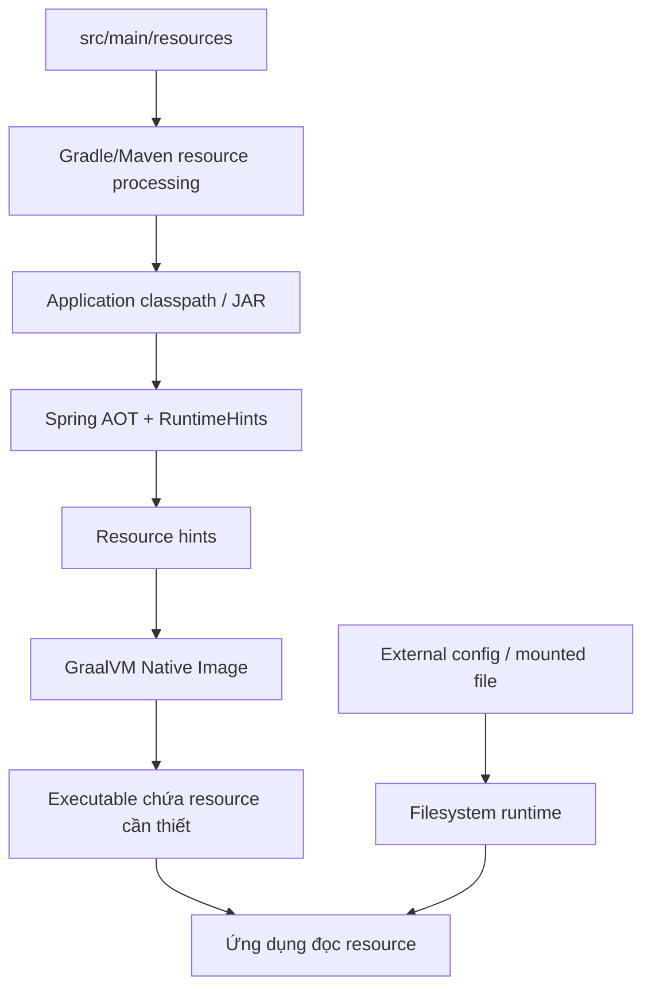

# Template, tệp SQL, tệp cấu hình và dữ liệu đọc qua ClassLoader

## 1. Vì sao resource cần được quan tâm khi build Native Image?

Ứng dụng Spring Boot thường đọc dữ liệu không phải mã Java từ **classpath**: template email, file SQL, schema JSON, file cấu hình mặc định, message bundle, chứng chỉ public hoặc dữ liệu khởi tạo. Trên JVM, lập trình viên thường gọi `ClassLoader.getResource`, `Class.getResource` hoặc `getResourceAsStream` và thấy file hoạt động ngay vì tài nguyên có trong JAR/classpath.

Với **GraalVM Native Image**, quá trình build phân tích trước những thành phần có thể được truy cập. Resource được đọc theo tên hoặc pattern động có thể không được nhận diện nếu không có metadata. Kết quả là ứng dụng native khởi động bình thường nhưng chỉ lỗi khi endpoint hiếm sử dụng template hoặc chạy migration SQL.

Trong module **SPRING_BOOT_NATIVE_IMAGE**, cần xác định rõ resource nào thuộc classpath và phải đóng gói vào executable, resource nào là file ngoài filesystem cần mount khi chạy. Spring AOT và Runtime Hints có thể khai báo resource pattern để Native Image giữ các file cần thiết.



## 2. Classpath resource khác filesystem resource

Hai loại tài nguyên có cách quản lý khác nhau:

- **Classpath resource**: được đóng gói cùng ứng dụng hoặc dependency JAR, truy cập qua class loader/resource loader. Ví dụ `templates/invoice.html`, `db/migration/V1__init.sql`.
- **Filesystem resource**: file nằm trên filesystem tại máy/container chạy, ví dụ `/etc/myapp/application-extra.yml` hoặc `/var/lib/myapp/import.csv`. File này được mount/copy/cấp ở runtime.

| Tiêu chí | Classpath resource | Filesystem resource |
|---|---|---|
| Nơi lưu | JAR/classes/dependency | Hệ thống file |
| Truy cập | ClassLoader, Class, Spring ResourceLoader | Path/File/Resource |
| Vòng đời | Thường đi cùng artifact | Do môi trường triển khai quản lý |
| Native Image | Có thể cần resource hint | Không tự được đóng gói chỉ vì có path |
| Ví dụ | Template mặc định, migration SQL | Secret file, dữ liệu import, config môi trường |

Không nên đóng gói secret, private key hoặc dữ liệu thay đổi theo môi trường vào native executable. Hãy cấp chúng qua secret manager, environment hoặc volume mount ở runtime.

## 3. Đặt resource trong dự án Spring Boot

Ví dụ cấu trúc:

```text
src/main/resources/
  templates/
    invoice.html
  db/
    migration/
      V1__create_invoice.sql
  config/
    default-rules.json
  messages/
    messages.properties
```

Maven và Gradle mặc định xử lý `src/main/resources` và đưa nội dung vào output classpath. Khi đóng gói JAR, các file thường xuất hiện trong archive dưới các đường dẫn tương ứng.

Kiểm tra JAR:

```bash
jar tf build/libs/app.jar
```

Với Maven có thể kiểm tra file dưới `target/`. Đường dẫn artifact phụ thuộc cấu hình project. Nếu resource thuộc một library dependency, cần xác minh dependency đó có trên runtime classpath của application module.

## 4. Đọc resource qua ClassLoader

Ví dụ đọc file JSON từ classpath:

```java
public String readDefaultRules() throws IOException {
    ClassLoader classLoader = Thread.currentThread().getContextClassLoader();

    try (InputStream input = classLoader.getResourceAsStream(
            "config/default-rules.json")) {
        if (input == null) {
            throw new FileNotFoundException("config/default-rules.json");
        }
        return new String(input.readAllBytes(), StandardCharsets.UTF_8);
    }
}
```

Tên resource trong `ClassLoader.getResourceAsStream` thường không bắt đầu bằng dấu `/`. API trả về `null` nếu không tìm thấy; luôn kiểm tra null và đóng stream.

Có thể dùng class loader của một class cụ thể để tránh phụ thuộc context class loader:

```java
InputStream input = InvoiceService.class
    .getResourceAsStream("/templates/invoice.html");
```

Với `Class.getResource`, đường dẫn bắt đầu bằng `/` được hiểu từ root classpath; đường dẫn không có `/` được hiểu tương đối với package của class.

Spring cũng cung cấp `ResourceLoader` và `Resource` abstraction. Ví dụ:

```java
Resource resource = resourceLoader.getResource(
    "classpath:config/default-rules.json"
);
try (InputStream input = resource.getInputStream()) {
    // Đọc nội dung.
}
```

Cách đọc qua abstraction giúp dễ thay đổi nguồn resource, nhưng vẫn phải khai báo resource classpath cần thiết khi Native Image không tự nhận diện được.

## 5. Đăng ký resource bằng Spring RuntimeHints

Spring cung cấp API `RuntimeHints.resources()` để khai báo file/pattern cần giữ.

Ví dụ registrar:

```java
import org.springframework.aot.hint.RuntimeHints;
import org.springframework.aot.hint.RuntimeHintsRegistrar;

public class ApplicationResourceHints implements RuntimeHintsRegistrar {

    @Override
    public void registerHints(RuntimeHints hints, ClassLoader classLoader) {
        hints.resources().registerPattern("templates/*.html");
        hints.resources().registerPattern("db/migration/*.sql");
        hints.resources().registerPattern("config/default-rules.json");
    }
}
```

Đăng ký registrar trong cấu hình:

```java
@Configuration
@ImportRuntimeHints(ApplicationResourceHints.class)
class ResourceConfiguration {
}
```

Khi Spring AOT xử lý application context, registrar được gọi và resource hints được thu thập. Nếu registrar không được import hoặc phát hiện qua cơ chế AOT, các pattern sẽ không có tác dụng.

Pattern phải khớp với đường dẫn resource trong classpath, không phải đường dẫn source như `src/main/resources/...`. Ví dụ resource `src/main/resources/templates/invoice.html` có classpath path là `templates/invoice.html`.

## 6. Chọn pattern hẹp và đúng

Không nên đăng ký tất cả resource nếu chỉ cần một nhóm nhỏ. Ví dụ:

```java
hints.resources().registerPattern("templates/*.html");
```

Pattern này có phạm vi theo glob syntax của API Spring/GraalVM tương ứng; cần xác minh semantics cụ thể của phiên bản. Nếu file nằm trong thư mục con sâu, hãy kiểm tra pattern có bao phủ đúng hay không, không giả định `*` luôn khớp mọi cấp thư mục.

Có thể khai báo resource cụ thể khi biết rõ:

```java
hints.resources().registerPattern("templates/invoice.html");
hints.resources().registerPattern("db/migration/V1__create_invoice.sql");
```

Đăng ký pattern quá rộng như toàn bộ classpath có thể làm tăng kích thước executable và giữ dữ liệu không cần thiết. Đặc biệt, tránh đưa file chứa secret, private keys, credentials hoặc dữ liệu cá nhân vào image.

## 7. Template engine và resource động

Một template engine có thể tìm template theo tên đến lúc request được xử lý:

```java
String templateName = request.getParameter("template");
Template template = configuration.getTemplate(templateName);
```

Nếu tên template đến từ request, Native Image không nhất thiết biết trước file nào cần giữ. Có thể đăng ký pattern template được phép:

```java
hints.resources().registerPattern("templates/*.html");
```

Nhưng nên dùng allowlist template name ở tầng ứng dụng. Không để client chọn đường dẫn tùy ý như `../../etc/passwd`; đó là rủi ro path traversal, độc lập với Native Image.

Một lựa chọn khác là dùng registry tĩnh map tên template hợp lệ tới resource cụ thể. Cách này làm rõ phạm vi resource và dễ test hơn.

## 8. Tệp SQL và database migration

Các thư viện migration như Flyway/Liquibase thường đọc migration scripts từ classpath hoặc filesystem tùy cấu hình. Với migration đóng gói trong JAR:

```text
src/main/resources/db/migration/
  V1__create_invoice.sql
  V2__add_status.sql
```

Nếu resource không được nhận diện khi build native, khai báo pattern tương ứng hoặc sử dụng tích hợp AOT/native mà thư viện cung cấp. Không giả định mọi phiên bản Flyway/Liquibase đều có cùng hỗ trợ Native Image; kiểm tra tài liệu phiên bản và chạy migration test trên executable native.

Ví dụ đọc SQL thủ công:

```java
try (InputStream stream = getClass().getClassLoader()
        .getResourceAsStream("db/migration/V1__create_invoice.sql")) {
    if (stream == null) {
        throw new IllegalStateException("Migration script missing");
    }
    String sql = new String(stream.readAllBytes(), StandardCharsets.UTF_8);
}
```

Không nên tự thay thế framework migration bằng cách đọc file thủ công trong production nếu ứng dụng cần versioning, transaction và migration history.

## 9. File cấu hình: đóng gói mặc định và cấp runtime

Có thể đóng gói cấu hình mặc định không nhạy cảm như `config/default-rules.json`. Nhưng cấu hình môi trường production như datasource password, API token, private key hoặc endpoint nội bộ nên được cấp lúc runtime.

Ví dụ Spring Boot đọc file ngoài:

```bash
java -jar app.jar --spring.config.additional-location=file:/etc/myapp/
```

Với native executable, cách truyền config location tương tự nếu ứng dụng được cấu hình theo Spring Boot:

```bash
./app --spring.config.additional-location=file:/etc/myapp/
```

File `/etc/myapp/` phải tồn tại trong container hoặc được mount. Resource filesystem ngoài không cần đưa vào Native Image resource hints; nhưng quyền truy cập, path, encoding và permission vẫn cần kiểm thử.

Không đặt config ngoài vào classpath hint. Phân loại đúng nguồn giúp tránh bake secret vào binary.

## 10. Native Image reachability metadata cho resource

Ngoài Spring RuntimeHints, GraalVM hỗ trợ reachability metadata để khai báo resource. Ví dụ cấu trúc JSON minh họa:

```json
{
  "resources": [
    {
      "glob": "templates/*.html"
    },
    {
      "glob": "db/migration/*.sql"
    }
  ]
}
```

Schema, vị trí metadata và glob semantics phụ thuộc phiên bản GraalVM Native Image. Với ứng dụng Spring Boot, RuntimeHints thường thuận tiện vì được Spring AOT thu thập. Với thư viện độc lập hoặc metadata do GraalVM quản lý, có thể cung cấp reachability metadata theo schema được hỗ trợ.

Không trộn JSON GraalVM với API Spring RuntimeHints; chúng là hai cách mô tả metadata ở các tầng khác nhau.

## 11. Kiểm thử resource trên Native Image

Quy trình xác minh:

1. Kiểm tra resource có trong source resources hoặc dependency JAR.
2. Chạy JVM test để xác nhận đường dẫn và encoding.
3. Đăng ký RuntimeHints nếu resource được đọc động/chưa được nhận diện.
4. Chạy Spring AOT và Native Image build.
5. Chạy executable native, gọi đúng endpoint đọc template/SQL/config.
6. Kiểm tra trường hợp resource thiếu để đảm bảo lỗi rõ ràng.
7. Đóng gói container và xác minh resource classpath cùng file mount runtime.

Ví dụ integration test:

```java
@Test
void loadsDefaultRulesFromClasspath() throws Exception {
    try (InputStream input = getClass().getClassLoader()
            .getResourceAsStream("config/default-rules.json")) {
        assertThat(input).isNotNull();
        assertThat(input.readAllBytes()).isNotEmpty();
    }
}
```

Test này kiểm tra resource trên test classpath JVM. Cần chạy tương đương trên native executable hoặc native test pipeline để chứng minh resource được đóng gói trong image.

## 12. Lỗi thường gặp

| Triệu chứng | Nguyên nhân có thể | Hướng xử lý |
|---|---|---|
| `getResourceAsStream` trả null trên native | Resource không được đưa vào image hoặc sai path | Kiểm tra JAR/classpath và RuntimeHints |
| JVM đọc được, native không đọc được | Build chưa có resource metadata | Đăng ký pattern và build lại |
| Template chỉ lỗi với một tên cụ thể | Pattern không bao phủ file hoặc tên động sai | Kiểm tra pattern/allowlist |
| Migration không tìm thấy SQL | Dependency/version hoặc resource path sai | Kiểm tra migration artifact và native support |
| File cấu hình runtime không thấy | Volume/path không tồn tại hoặc sai quyền | Kiểm tra mount, working directory, permission |
| Resource ngoài bị đưa vào executable | Nhầm filesystem path với classpath resource | Chuyển sang runtime mount/config |
| Image tăng dung lượng bất thường | Đăng ký resource pattern quá rộng | Thu hẹp pattern, bỏ file không cần |

Khi sửa RuntimeHints, phải chạy lại AOT/native build để tạo executable mới. Restart binary cũ không áp dụng metadata vừa sửa.

## 13. Checklist quản lý resource

- Xác định resource là classpath hay filesystem.
- Xác minh resource nằm trong JAR hoặc dependency runtime.
- Dùng đường dẫn classpath đúng, không kèm `src/main/resources`.
- Đăng ký pattern hẹp qua RuntimeHints khi cần.
- Đảm bảo registrar được Spring AOT phát hiện.
- Không đưa secret/private key/config nhạy cảm vào image.
- Kiểm tra encoding, case sensitivity và nested path.
- Test trên native executable và container thực tế.
- Kiểm tra file mount runtime, path và permission riêng.

## 14. Câu hỏi tự kiểm tra

1. Vì sao một resource có trong `src/main/resources` vẫn có thể không đọc được trên Native Image?
2. Khác nhau giữa `ClassLoader.getResourceAsStream` và đọc file từ filesystem là gì?
3. Vì sao pattern resource nên được giới hạn theo thư mục và loại file?
4. Khi nào cần đăng ký resource bằng Spring RuntimeHints?
5. Tại sao không nên đóng gói private key hoặc password vào native executable?
6. Vì sao test JVM đọc resource thành công chưa đủ chứng minh native image có resource?
7. Khi dùng migration SQL, cần kiểm tra thêm những yếu tố nào ngoài resource hints?

**Ghi nhớ:** resource classpath phải được đóng gói và có thể cần Runtime Hints nếu truy cập động; file filesystem được cấp qua môi trường chạy. Hãy phân loại nguồn, đăng ký pattern tối thiểu, tránh đóng gói secret và kiểm thử chính native executable/container.
