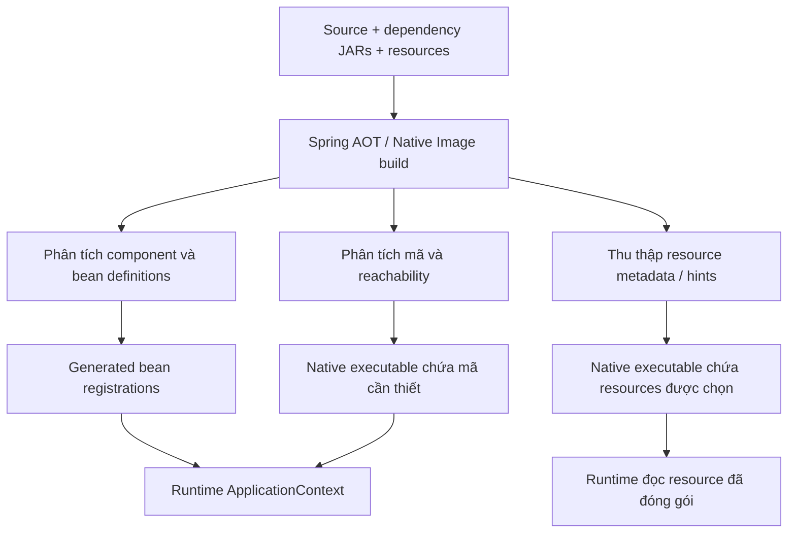

# Quét classpath, liệt kê tài nguyên và các giới hạn cần thay đổi thiết kế

Trên JVM, nhiều ứng dụng Spring có thể quét classpath, tìm class theo package, liệt kê file trong JAR hoặc chọn plugin theo tên tài nguyên. Khi chuyển sang **GraalVM Native Image**, những thao tác này cần được xem xét lại: native executable được tạo từ một tập mã và tài nguyên đã biết ở thời điểm build, nên chương trình không thể mặc nhiên khám phá mọi class hoặc file có thể xuất hiện trên classpath như một JVM chạy với hệ thống JAR mở rộng tùy ý.

Spring AOT giúp xử lý trước một phần công việc quét và xác định cấu trúc ứng dụng. Với tài nguyên, Native Image cần biết file nào phải được đóng gói; với class, compiler cần biết những kiểu nào có thể được sử dụng. Nếu ứng dụng dựa vào việc **tìm kiếm tùy ý ở runtime**, có thể phải bổ sung hints hoặc thay đổi thiết kế để tập class/resource được xác định ổn định.

Bài học thuộc chương **Tài nguyên** của mô-đun `SPRING_BOOT_NATIVE_IMAGE`. Ta sẽ phân biệt component scanning với resource scanning, hiểu `classpath:` và `classpath*:`, dùng `PathMatchingResourcePatternResolver`, đăng ký resource hints, xử lý `ResourceBundle`/ServiceLoader, và lựa chọn filesystem hoặc registry khi cần mở rộng động.

## 1. Classpath scanning và resource scanning là hai việc khác nhau

Cả hai đều có thể dùng classloader hoặc thư viện Spring để tìm nội dung trong classpath, nhưng mục tiêu khác nhau.

- **Component/class scanning:** tìm class có annotation hoặc thỏa điều kiện để tạo Spring bean, hoặc tìm kiểu theo package/tên.
- **Resource scanning:** tìm file như JSON, XML, YAML, template, schema, ảnh, file properties hoặc metadata nằm trong classpath.
- **Runtime enumeration:** liệt kê tất cả URL/resource/class có thể truy cập trong một vùng classpath tại thời điểm chạy, thường bằng `ClassLoader.getResources(...)`, `classpath*:` hoặc quét JAR.

| Hoạt động | Đối tượng được tìm | Ví dụ |
| --- | --- | --- |
| Component scanning | Java class và metadata của class | `@ComponentScan("com.example")` |
| Classpath resource lookup | Một file đã biết tên | `new ClassPathResource("templates/invoice.html")` |
| Resource pattern scanning | Các file khớp pattern | `resolver.getResources("classpath*:rules/*.json")` |
| Package/class discovery động | Class được tìm theo tên/package khi runtime | Quét package để tìm mọi implementation của interface |
| Service provider discovery | Provider đăng ký trong service descriptor | `ServiceLoader.load(PaymentPlugin.class)` |

Một ứng dụng có thể dùng cả năm cơ chế. Cần xác định chính xác cơ chế nào đang hoạt động để biết nên cấu hình Spring AOT, resource hints, reflection hints hay thay đổi thiết kế.

## 2. Vì sao native image không thể quét classpath tùy ý?

Native Image thực hiện phân tích *closed-world*. Khi tạo executable, GraalVM cần biết mã nào có thể chạy, kiểu nào có thể được truy cập động và tài nguyên nào phải được nhúng. Native executable không tương đương một JVM có thể mở thêm JAR bất kỳ vào classpath sau khi khởi động.

Với ứng dụng Spring Boot, Spring AOT có thể quét component, xử lý configuration và condition ở build time rồi sinh bean registrations. Khi native process chạy, Spring dùng cấu trúc đã chuẩn bị để tạo context. Điều này giảm phụ thuộc vào việc quét classpath động lúc startup.

Với resource, nếu ứng dụng cần đọc một file classpath trong native image, file đó phải được đưa vào image bằng phân tích tự động hoặc metadata/hint. File tồn tại trong source tree không tự bảo đảm file được đóng gói vào executable.



Cần phân biệt:

- **Class có trong dependency** không có nghĩa mọi class của dependency đều được giữ lại trong native executable.
- **Resource có trong JAR** không có nghĩa nó tự động được đưa vào native image.
- **Có resource hint** không có nghĩa file được tạo ra; file vẫn phải có trong build input.
- **Có bean registration AOT** không có nghĩa runtime có thể nạp một class mới từ JAR được mount sau build.

## 3. Lookup một resource đã biết bằng Spring Resource API

Nếu ứng dụng biết chính xác tên resource, lookup trực tiếp thường đơn giản và dễ kiểm soát.

Ví dụ cấu trúc:

```text
src/main/resources/
├── templates/
│   └── invoice.html
├── rules/
│   └── tax-rule.json
└── config/
    └── defaults.yaml
```

Đọc một template bằng `ClassPathResource`:

```java
import java.io.IOException;
import java.nio.charset.StandardCharsets;

import org.springframework.core.io.ClassPathResource;
import org.springframework.stereotype.Component;

@Component
class InvoiceTemplateReader {

    String readTemplate() throws IOException {
        ClassPathResource resource =
                new ClassPathResource("templates/invoice.html");

        try (var input = resource.getInputStream()) {
            return new String(input.readAllBytes(), StandardCharsets.UTF_8);
        }
    }
}
```

Đường dẫn ở đây là đường dẫn tương đối với classpath root, không phải đường dẫn file của máy build. Trên JVM, resource có thể nằm trong thư mục classes hoặc JAR; trên native, nó cần được đưa vào image.

Nếu Spring AOT hoặc Native Image không tự nhận ra đường truy cập, khai báo resource hint:

```java
import org.springframework.aot.hint.RuntimeHints;
import org.springframework.aot.hint.RuntimeHintsRegistrar;

class InvoiceResourceHints implements RuntimeHintsRegistrar {

    @Override
    public void registerHints(
            RuntimeHints hints, ClassLoader classLoader) {

        hints.resources().registerPattern("templates/invoice.html");
    }
}
```

Gắn registrar với cấu hình:

```java
import org.springframework.context.annotation.Configuration;
import org.springframework.context.annotation.ImportRuntimeHints;

@Configuration(proxyBeanMethods = false)
@ImportRuntimeHints(InvoiceResourceHints.class)
class InvoiceResourceConfiguration {
}
```

Resource hint chỉ giúp native image giữ file tương ứng. Khi runtime đọc resource, code vẫn cần xử lý trường hợp file thiếu hoặc lỗi I/O. Với tên resource cố định, hãy ưu tiên lookup trực tiếp thay vì quét cả classpath.

## 4. Liệt kê nhiều resource bằng PathMatchingResourcePatternResolver

Một số ứng dụng cần đọc tất cả rule JSON trong một thư mục classpath. Spring cung cấp `PathMatchingResourcePatternResolver` để tìm resource theo pattern:

```java
import java.io.IOException;
import java.nio.charset.StandardCharsets;
import java.util.Arrays;
import java.util.List;

import org.springframework.core.io.Resource;
import org.springframework.core.io.support.PathMatchingResourcePatternResolver;
import org.springframework.stereotype.Component;

@Component
class RuleCatalog {

    private final PathMatchingResourcePatternResolver resolver =
            new PathMatchingResourcePatternResolver();

    List<String> loadRules() throws IOException {
        Resource[] resources =
                resolver.getResources("classpath*:rules/*.json");

        return Arrays.stream(resources)
                .map(this::read)
                .toList();
    }

    private String read(Resource resource) {
        try (var input = resource.getInputStream()) {
            return new String(input.readAllBytes(), StandardCharsets.UTF_8);
        }
        catch (IOException ex) {
            throw new IllegalStateException(
                    "Cannot read rule resource: " + resource.getDescription(), ex);
        }
    }
}
```

Pattern `classpath*:rules/*.json` yêu cầu Spring tìm các resource phù hợp trên nhiều classpath locations. Trên JVM, resolver có thể duyệt thư mục và JAR để tìm các match. Trong native image, kết quả phụ thuộc resource nào đã được đưa vào image và khả năng liệt kê mà runtime hỗ trợ.

Nếu tập rule là cố định theo ứng dụng, khai báo pattern resource:

```java
// Đăng ký từng resource đã biết trong tập rule của ứng dụng.
hints.resources().registerPattern("rules/tax.json");
hints.resources().registerPattern("rules/vat.json");
```

Pattern `classpath*:rules/*.json` của `PathMatchingResourcePatternResolver` là cú pháp tìm kiếm resource của Spring. Đừng sao chép nguyên chuỗi đó vào `RuntimeHints.resources().registerPattern(...)`: API hints tạo metadata cho Native Image và có semantics riêng theo Spring/GraalVM version. Khi tập resource nhỏ và cố định, đăng ký từng đường dẫn chính xác là cách dễ kiểm tra nhất. Nếu cần pattern rộng, xem tài liệu đúng phiên bản và kiểm tra metadata native được sinh.

### 4.1. Phân biệt classpath: và classpath*:

| Prefix | Ý nghĩa thường gặp | Ví dụ |
| --- | --- | --- |
| `classpath:` | Tìm resource theo một classpath location; thường resolve một resource phù hợp | `classpath:rules/default.json` |
| `classpath*:` | Tìm tất cả resource cùng tên/pattern trên các classpath locations | `classpath*:META-INF/spring.factories` |
| `file:` | Đọc file từ filesystem | `file:/etc/orders/rules/` |

`classpath*:` hữu ích khi cùng một tên resource có thể đến từ nhiều dependency JAR. Nhưng nó không biến native executable thành hệ thống plugin có thể tự nhận JAR mới ở runtime. Trong native image, phải bảo đảm những resource cần tìm đã được đưa vào image, hoặc chuyển sang nguồn ngoài được thiết kế cho runtime.

### 4.2. Resource có tên được tạo động

Ví dụ:

```java
String resourceName = "templates/invoice-" + locale + ".html";
Resource resource = new ClassPathResource(resourceName);
```

Tên file phụ thuộc locale. Native Image có thể không suy ra tất cả tên resource có thể xuất hiện. Nếu danh sách locale hữu hạn, khai báo pattern hoặc từng resource:

```java
hints.resources().registerPattern("templates/invoice-vi.html");
hints.resources().registerPattern("templates/invoice-en.html");
```

Nếu tên file đến từ request/user input, không nên cho phép truy cập tùy ý vào classpath. Hãy giới hạn tên hợp lệ bằng allowlist, tránh path traversal, và kiểm tra resource tồn tại. Nếu danh sách resource thay đổi sau khi phát hành, dùng filesystem hoặc object storage thay vì classpath resource.

## 5. Component scanning và class discovery

Trên JVM, component scanning thường dùng package metadata và classpath để tìm các class có stereotype annotation. Ví dụ:

```java
@SpringBootApplication
@ComponentScan("com.example.orders")
public class OrdersApplication {
}
```

Spring AOT chạy phân tích context trong build, tìm các component phù hợp và sinh bean registrations. Khi native executable khởi động, ứng dụng sử dụng những registrations được chuẩn bị trước. Vì vậy, package và classpath của ứng dụng cần ổn định giữa build và runtime.

Một số kiểu class discovery không tương đương component scanning:

```java
// Ví dụ minh họa việc tìm class theo tên/package lúc runtime.
Class<?> type = Class.forName(configuredImplementationClass);
Object plugin = type.getDeclaredConstructor().newInstance();
```

Nếu tên class lấy từ config bên ngoài, compiler không nhất thiết biết class nào phải giữ hoặc constructor nào cần metadata. Có thể khai báo reflection hints cho tập class cố định, nhưng nếu implementation mới được thêm vào bằng JAR sau khi native image đã phát hành, hint không thể bổ sung bytecode chưa có trong executable.

### 5.1. Dùng registry có kiểu thay cho quét classpath

Nếu ứng dụng có một tập implementation đã biết, khai báo chúng rõ ràng:

```java
public interface DocumentExporter {
    String export(String content);
}

@Component("csv")
class CsvExporter implements DocumentExporter {
    @Override
    public String export(String content) {
        return "CSV:" + content;
    }
}

@Component("json")
class JsonExporter implements DocumentExporter {
    @Override
    public String export(String content) {
        return "JSON:" + content;
    }
}
```

Sau đó inject tập bean và chọn theo key runtime:

```java
@Component
class ExportService {
    private final Map<String, DocumentExporter> exporters;

    ExportService(Map<String, DocumentExporter> exporters) {
        this.exporters = exporters;
    }

    String export(String format, String content) {
        DocumentExporter exporter = exporters.get(format);
        if (exporter == null) {
            throw new IllegalArgumentException("Unsupported format: " + format);
        }
        return exporter.export(content);
    }
}
```

Spring AOT có thể xác định các bean `csv` và `json` khi build. Property/request chỉ chọn giữa các bean đã có. Đây là mô hình phù hợp khi tập implementation được biết trước.

## 6. ServiceLoader và META-INF/services

Java `ServiceLoader` là cơ chế khám phá provider theo service interface. Một JAR có thể khai báo:

```text
META-INF/services/com.example.orders.DocumentExporter
```

Nội dung file liệt kê tên class provider, mỗi dòng một class:

```text
com.example.orders.CsvExporter
com.example.orders.JsonExporter
```

Ứng dụng tải provider:

```java
import java.util.ServiceLoader;

ServiceLoader<DocumentExporter> exporters =
        ServiceLoader.load(DocumentExporter.class);

for (DocumentExporter exporter : exporters) {
    // Sử dụng provider.
}
```

Với dạng provider khai báo bằng file `META-INF/services` trên classpath, các class provider phải đáp ứng quy tắc khởi tạo của `ServiceLoader` (thông thường là class public có public no-argument constructor); mỗi provider thường nằm trong file Java riêng. Ví dụ `@Component` ở phần registry Spring trước đó là một cách đăng ký bean khác, không tự động biến một Spring bean bất kỳ thành ServiceLoader provider.

Đây là cơ chế discovery dựa trên resource descriptor và provider class. Native Image có hỗ trợ cho ServiceLoader trong những trường hợp được nhận biết, nhưng khả năng cụ thể phụ thuộc phiên bản GraalVM, cách provider được đóng gói và cách service được sử dụng. Đừng giả định chỉ cần có file `META-INF/services` trong source tree là mọi provider tự hoạt động trong mọi native build.

Khi gặp lỗi, xác minh:

1. File descriptor `META-INF/services/<service-interface>` có trong dependency/resource đầu vào không?
2. Tên provider có đúng package/class và class có trong classpath build không?
3. Metadata/service registration có được native compiler nhận biết hoặc khai báo phù hợp không?
4. Constructor/provider có dùng reflection hay truy cập động cần hints bổ sung không?
5. Native integration test có thực sự gọi `ServiceLoader.load(...)` và duyệt hết provider không?

Nếu provider set cố định, có thể cân nhắc registry tường minh hoặc đảm bảo metadata ServiceLoader được đưa vào native image. Nếu cần nạp provider mới từ JAR tùy ý sau khi phát hành, hãy cân nhắc tách plugin thành process/service độc lập hoặc dùng JVM cho phần plugin.

## 7. ResourceBundle và file properties theo locale

Một nhóm tài nguyên đặc biệt là `ResourceBundle`, thường dùng cho message đa ngôn ngữ:

```text
src/main/resources/
└── messages/
    ├── labels.properties
    ├── labels_vi.properties
    └── labels_en.properties
```

Đọc bundle:

```java
import java.util.Locale;
import java.util.ResourceBundle;

ResourceBundle bundle =
        ResourceBundle.getBundle("messages.labels", Locale.forLanguageTag("vi"));

String title = bundle.getString("invoice.title");
```

Native Image có cơ chế metadata riêng cho resource bundles. Spring RuntimeHints cung cấp API tương ứng:

```java
hints.resourceBundles().registerBundle("messages.labels");
```

Nếu locale hữu hạn và bundle base name đã biết, đăng ký rõ ràng giúp native image giữ bundle cần thiết. Hãy kiểm thử từng locale mà ứng dụng hỗ trợ; test chỉ chạy `Locale.ENGLISH` không chứng minh `labels_vi.properties` đã được đưa vào image.

Không nhầm resource bundle với file YAML cấu hình Spring Boot. Bundle thường phục vụ localization/message lookup; `application.yaml` thuộc hệ thống config data của Spring Boot và có cơ chế load/precedence riêng.

## 8. Metadata resource do dependency cung cấp và do ứng dụng tự khai báo

Resource hints có thể đến từ nhiều nguồn tương tự reflection hints:

| Nguồn | Ví dụ | Trách nhiệm |
| --- | --- | --- |
| Spring-generated | Resource mà Spring AOT/framework nhận biết từ configuration và feature được sử dụng | Spring Framework/Spring Boot |
| Dependency-provided | File schema/template hoặc metadata nội bộ của thư viện; registrar hoặc `META-INF/native-image` | Tác giả thư viện hoặc Reachability Metadata Repository |
| Application-declared | Template invoice, rule JSON, message bundle riêng | Ứng dụng |

Nếu thư viện PDF đã cung cấp resource metadata cho font/schema nội bộ, không nên chép lại toàn bộ metadata đó vào app. Nếu ứng dụng có template riêng, app nên sở hữu hint cho template đó. Khi nâng dependency, metadata do thư viện quản lý sẽ có cơ hội được cập nhật cùng phiên bản thư viện.

Một ví dụ registrar cho tài nguyên ứng dụng:

```java
import org.springframework.aot.hint.RuntimeHints;
import org.springframework.aot.hint.RuntimeHintsRegistrar;

class ApplicationResourceHints implements RuntimeHintsRegistrar {

    @Override
    public void registerHints(RuntimeHints hints, ClassLoader classLoader) {
        hints.resources().registerPattern("templates/invoice.html");
        hints.resources().registerPattern("templates/receipt.html");
        hints.resources().registerPattern("rules/tax.json");
        hints.resources().registerPattern("rules/vat.json");
        hints.resourceBundles().registerBundle("messages.labels");
    }
}
```

Các đường dẫn trên là những resource cụ thể đã biết. Cú pháp pattern của resolver và cú pháp pattern của Native Image hints không nên mặc định coi là một. Nếu cần đăng ký pattern rộng, kiểm tra tài liệu Spring/GraalVM đúng phiên bản và xác minh file metadata được sinh.

## 9. Khi resource cần thay đổi sau khi phát hành

Classpath resource nhúng trong native image là một phần của artifact. Nếu người vận hành cần thay nội dung mà không rebuild, hãy chuyển nội dung đó sang một nguồn runtime.

| Nhu cầu | Thiết kế phù hợp |
| --- | --- |
| Template cố định theo phiên bản ứng dụng | Classpath resource + resource hint |
| Rule được thay đổi theo từng môi trường | File YAML/JSON ngoài, mount qua volume hoặc external config |
| Danh mục nội dung lớn/cập nhật thường xuyên | Database, object storage hoặc service quản lý nội dung |
| Plugin class thay đổi theo release | Dependency/module trong build, sau đó build lại native |
| Plugin cần cài thêm tùy ý sau deploy | Process/service riêng hoặc JVM plugin host |
| Tập provider cố định, chỉ chọn provider lúc chạy | Bean registry/ServiceLoader với provider đã biết và được đóng gói |

Ví dụ đọc rule từ filesystem:

```java
import java.io.IOException;
import java.nio.file.Files;
import java.nio.file.Path;
import java.util.List;

import org.springframework.beans.factory.annotation.Value;
import org.springframework.stereotype.Component;

@Component
class ExternalRuleReader {

    private final Path ruleDirectory;

    ExternalRuleReader(
            @Value("${app.rules.directory:/etc/orders/rules}") String directory) {
        this.ruleDirectory = Path.of(directory);
    }

    List<String> listRuleFiles() throws IOException {
        try (var paths = Files.list(ruleDirectory)) {
            return paths
                    .filter(path -> path.getFileName().toString().endsWith(".json"))
                    .sorted()
                    .map(Path::toString)
                    .toList();
        }
    }
}
```

Trong thiết kế này, file rule không phải classpath resource. Native image không cần nhúng các file trong `/etc/orders/rules`; chúng được mount hoặc provision trên máy/container khi runtime. Tuy nhiên, cần bảo đảm directory tồn tại, process có quyền đọc và nội dung được validate. Không ghép trực tiếp đường dẫn do request cung cấp vào filesystem path mà thiếu allowlist/path normalization.

## 10. Các giới hạn thường buộc phải thay đổi thiết kế

### 10.1. Quét tất cả class trong một package ở runtime

**Dấu hiệu:** dùng thư viện quét package để tìm mọi implementation của interface, sau đó instantiate theo annotation hoặc tên class.

**Giới hạn:** native image không thể giữ mọi class có thể xuất hiện trên classpath sau build. Reflection hints cũng không thêm bytecode của JAR mới.

**Thiết kế:** dùng component scan/AOT cho tập class cố định, registry rõ ràng, generated index hoặc ServiceLoader với provider đã được đóng gói. Nếu plugin thực sự được cài sau deploy, tách nó thành service/process riêng.

### 10.2. Liệt kê mọi resource từ nhiều JAR bằng classpath*

**Dấu hiệu:** `classpath*:**/*.json` hoặc pattern quá rộng để thu thập mọi file trong mọi dependency.

**Giới hạn:** native image chỉ chứa resource được đưa vào image; kết quả enumeration không nhất thiết giống JVM classpath. Pattern rộng cũng làm khó xác định chính xác resource nào cần đóng gói.

**Thiết kế:** thu hẹp pattern theo thư mục/tên cụ thể, khai báo resource hints, hoặc tạo index ở build time. Nếu danh sách thay đổi sau phát hành, chuyển sang directory/DB/object storage.

### 10.3. Resource name được tạo từ dữ liệu bên ngoài

**Dấu hiệu:** ghép tên file từ request, tenant, locale hoặc config không giới hạn.

**Giới hạn:** compiler không biết trước mọi resource có thể được tham chiếu; pattern quá rộng có thể đóng gói nhiều file không cần thiết.

**Thiết kế:** allowlist các resource hợp lệ, đăng ký pattern có phạm vi, hoặc lưu nội dung động bên ngoài native image.

### 10.4. Plugin mới được mount sau khi binary đã tạo

**Dấu hiệu:** mount một JAR vào container rồi mong classloader native load được class mới.

**Giới hạn:** executable đã được phân tích/biên dịch với tập mã đã biết; resource/reflection hint không thể thêm code machine mới.

**Thiết kế:** build lại native khi thêm plugin, hoặc giao tiếp với plugin process/service riêng. Nếu yêu cầu kiến trúc bắt buộc dùng classloader/JAR động, đánh giá JVM cho phần đó.

## 11. Quy trình kiểm tra resource trên native image

Hãy thực hiện trên một ứng dụng có resource lookup cố định và một pattern enumeration:

1. Thêm `templates/invoice.html`, `rules/tax.json` và `messages/labels_vi.properties` vào `src/main/resources`.
2. Viết code đọc trực tiếp template, liệt kê rule theo `classpath*:rules/*.json`, và tải ResourceBundle theo locale `vi`.
3. Chạy test trên JVM để xác nhận nội dung và số lượng resource.
4. Thêm Runtime Hints cho resource pattern và bundle nếu AOT/native không tự nhận biết.
5. Chạy Spring AOT, xem generated resources/metadata để xác minh hints được đóng góp.
6. Build native executable và chạy đúng các đường code lookup/enumeration.
7. Thử một resource không tồn tại để kiểm tra lỗi được xử lý có chủ đích.
8. Thử thay file ngoài (nếu đã thiết kế external resource) mà không rebuild, xác nhận ứng dụng đọc đúng nguồn runtime.

Maven thường có thể chạy AOT bằng:

```bash
./mvnw spring-boot:process-aot
./mvnw -Pnative native:compile
```

Gradle thường dùng:

```bash
./gradlew processAot
./gradlew nativeCompile
```

Các goal/task yêu cầu plugin và toolchain phù hợp; vị trí generated output tùy cấu hình. Không nên chỉ kiểm tra file JSON tồn tại mà phải chạy binary native, vì điều cần xác minh là đường đọc thực tế.

## 12. Bảng điều tra lỗi resource/classpath

| Hiện tượng | Nguyên nhân cần kiểm tra | Cách xử lý |
| --- | --- | --- |
| JVM đọc được file nhưng native báo không tìm thấy | Resource chưa được đưa vào native image | Thêm resource hint, kiểm tra generated metadata và build lại |
| `classpath*:` trả ít kết quả hơn trên native | Một số resource không được đóng gói hoặc pattern không bao phủ đúng | Thu hẹp/điều chỉnh pattern và kiểm tra output |
| Component có trên JVM nhưng không có trên native | Bean graph/condition được xử lý khác ở AOT | Kiểm tra profile, condition và generated bean registrations |
| Reflection tạo class lỗi trên native | Thiếu reflection hint hoặc class không nằm trong binary | Kiểm tra classpath, registrar và metadata; rebuild nếu cần |
| ServiceLoader không tìm thấy provider | Thiếu descriptor/provider hoặc metadata chưa được nhận biết | Kiểm tra `META-INF/services`, provider classes và native integration test |
| ResourceBundle thiếu locale | Bundle chưa được đăng ký hoặc tên base bundle sai | Đăng ký bundle và test từng locale |
| File ngoài không đọc được trong container | Volume/path/permission không đúng | Kiểm tra mount, UID/GID và đường dẫn runtime |
| Đổi resource nhưng native vẫn đọc nội dung cũ | Resource là bản nhúng trong binary | Chuyển sang external file/object storage hoặc rebuild |

## 13. Checklist thiết kế resource phù hợp AOT/native

- [ ] Phân biệt rõ class scanning, resource lookup và runtime enumeration.
- [ ] Xác định resource nào là classpath resource, resource nào là file ngoài.
- [ ] Với resource tên cố định, dùng lookup trực tiếp và khai báo hint nếu cần.
- [ ] Với resource pattern, chỉ đăng ký phạm vi thực sự sử dụng.
- [ ] Với ResourceBundle, đăng ký base name và test tất cả locale.
- [ ] Với `classpath*:`, xác minh số lượng resource trên native executable.
- [ ] Với ServiceLoader, kiểm tra descriptor, provider class và metadata phù hợp.
- [ ] Không kỳ vọng reflection/resource hints bổ sung class hoặc JAR mới vào binary.
- [ ] Nếu danh mục thay đổi sau deploy, dùng filesystem, database hoặc service ngoài.
- [ ] Nếu cần plugin code động, chọn build-time plugin set hoặc process/JVM plugin host.
- [ ] Test đường đọc thực tế bằng native executable và container runtime.
- [ ] Xử lý lỗi file thiếu, quyền truy cập, encoding và path traversal có chủ đích.

### Câu hỏi tự đánh giá

1. Component scanning và resource scanning khác nhau ở đối tượng được tìm và kết quả tạo ra như thế nào?
2. Vì sao `classpath*:` trên JVM không bảo đảm sẽ liệt kê cùng số file trong native image?
3. Resource hint có thể làm gì, và không thể làm gì đối với một JAR plugin mới được mount sau deploy?
4. Khi nào nên dùng `ClassPathResource`, khi nào nên dùng `PathMatchingResourcePatternResolver`?
5. Vì sao ResourceBundle cần được kiểm tra theo từng locale?
6. Nếu rule JSON thay đổi hằng ngày mà không muốn rebuild native image, nên chuyển nguồn dữ liệu sang đâu?
7. Vì sao một ServiceLoader provider có descriptor nhưng vẫn có thể không hoạt động trong native executable?

**Kết quả cần đạt:** biết phân biệt quét class với liệt kê resource, khai báo chính xác những tài nguyên classpath cần đóng gói, kiểm tra ServiceLoader/ResourceBundle và nhận diện lúc nào phải thay đổi thiết kế. Tập class và resource cố định được xử lý trong build; nội dung cần cập nhật sau phát hành được đưa sang nguồn runtime phù hợp. Nhờ đó Spring Boot Native Image có hành vi dễ dự đoán, ít phụ thuộc vào quét classpath động và vận hành được trên nhiều môi trường.
