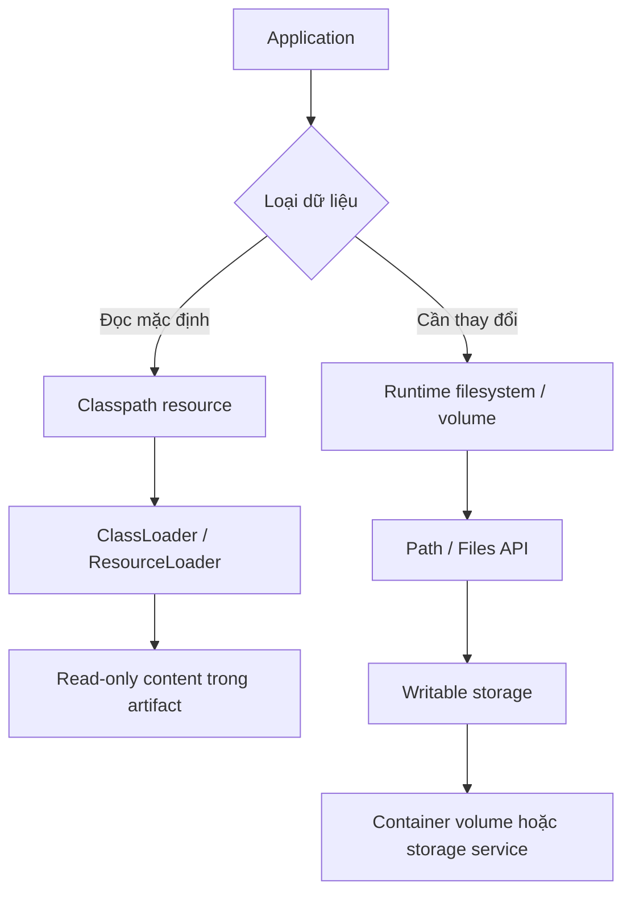

# Đọc, ghi tệp runtime mà không giả định tài nguyên nhúng là tệp có thể sửa

## 1. Phân biệt dữ liệu nhúng và dữ liệu runtime

Ứng dụng Spring Boot thường cần đọc template, SQL migration, file cấu hình mặc định và schema JSON từ classpath. Những tài nguyên này có thể được đóng gói trong JAR hoặc Native Image để ứng dụng đọc khi chạy. Tuy nhiên, **tài nguyên nhúng không phải là một file thông thường có thể sửa tại chỗ**.

Khi build thành GraalVM Native Image, resource classpath có thể được đưa vào image dưới dạng dữ liệu được đóng gói hoặc ánh xạ theo cơ chế runtime của Native Image. Nó không nhất thiết tồn tại như file riêng trên filesystem. Vì vậy, thao tác tìm một đường dẫn file rồi ghi đè lên resource classpath thường không hợp lệ.

Hãy phân biệt hai mục đích:

- **Resource bất biến (read-only)**: template mặc định, migration SQL, schema, message bundle, cấu hình mặc định. Đóng gói cùng ứng dụng và đọc qua ClassLoader/Spring Resource.
- **Dữ liệu thay đổi khi chạy (mutable runtime data)**: file upload, báo cáo, trạng thái, cache trên đĩa, file cấu hình được cập nhật, dữ liệu import/export. Lưu ở filesystem, volume hoặc object/database storage phù hợp.

Trong module **SPRING_BOOT_NATIVE_IMAGE**, điều này đặc biệt quan trọng khi đóng gói container: filesystem của container có thể là ephemeral, một số thư mục có thể read-only, và dữ liệu cần tồn tại qua lần restart phải được lưu vào volume hoặc dịch vụ lưu trữ bền vững.



## 2. Vì sao classpath resource không phải file có thể ghi?

Một resource trong `src/main/resources` thường được copy vào output classes hoặc JAR:

```text
src/main/resources/
  templates/invoice.html
  config/default-rules.json
  db/migration/V1__create_invoice.sql
```

Khi chạy từ IDE, resource có thể tình cờ nằm dưới thư mục build như `build/resources/main`; lúc đó đường dẫn trên đĩa trông giống file thông thường. Nhưng khi chạy từ JAR, resource có thể nằm bên trong archive. Khi chạy Native Image, resource có thể được đóng gói vào executable theo cơ chế riêng.

Đoạn code sau không an toàn:

```java
URL url = getClass().getClassLoader()
    .getResource("config/default-rules.json");
File file = new File(url.toURI());
Files.writeString(file.toPath(), updatedJson);
```

Các vấn đề:

- `url` có thể là `null` nếu không tìm thấy resource.
- URL có thể dùng protocol `jar:`, không phải `file:`.
- Native Image không bảo đảm resource có một đường dẫn filesystem riêng.
- Kể cả khi URL là file trong môi trường dev, thư mục có thể không writable trong container.
- Sửa file bên trong artifact không phải cách cập nhật cấu hình triển khai.

Cách đúng là đọc nội dung resource, sau đó nếu cần lưu phiên bản thay đổi thì ghi sang một vị trí runtime được cấu hình riêng.

## 3. Đọc classpath resource bằng ClassLoader

Ví dụ đọc JSON mặc định:

```java
public String loadDefaultRules() throws IOException {
    ClassLoader loader = Thread.currentThread().getContextClassLoader();

    try (InputStream input =
            loader.getResourceAsStream("config/default-rules.json")) {
        if (input == null) {
            throw new FileNotFoundException(
                "Classpath resource config/default-rules.json not found");
        }
        return new String(input.readAllBytes(), StandardCharsets.UTF_8);
    }
}
```

Một số điểm cần lưu ý:

- `ClassLoader.getResourceAsStream` thường dùng tên resource không có dấu `/` ở đầu.
- Luôn kiểm tra `null` và đóng stream.
- Chọn charset rõ ràng như UTF-8, không phụ thuộc charset mặc định của máy.
- Không giả định InputStream có thể seek hoặc ghi ngược.
- Nội dung resource nên được xem là đầu vào read-only.

Có thể đọc tương đối theo class:

```java
try (InputStream input = InvoiceService.class
        .getResourceAsStream("/templates/invoice.html")) {
    if (input == null) {
        throw new FileNotFoundException("templates/invoice.html");
    }
    // Đọc nội dung.
}
```

Với `Class.getResource`, đường dẫn bắt đầu bằng `/` được tính từ root classpath; không có `/` thì tính tương đối theo package của class.

## 4. Dùng Spring Resource abstraction để đọc

Spring cung cấp `ResourceLoader` và `Resource`, giúp code không phụ thuộc trực tiếp vào một loại URL:

```java
@Service
class DefaultRulesService {
    private final ResourceLoader resourceLoader;

    DefaultRulesService(ResourceLoader resourceLoader) {
        this.resourceLoader = resourceLoader;
    }

    String load() throws IOException {
        Resource resource = resourceLoader.getResource(
            "classpath:config/default-rules.json");

        try (InputStream input = resource.getInputStream()) {
            return new String(input.readAllBytes(), StandardCharsets.UTF_8);
        }
    }
}
```

`Resource` abstraction hỗ trợ nhiều nguồn như classpath, filesystem, URL. Nhưng nếu dùng prefix `classpath:`, vẫn phải coi resource đó là dữ liệu đọc. `Resource.getFile()` không được bảo đảm hoạt động với mọi resource; đặc biệt không dùng nó như cách chuyển mọi classpath resource thành File.

Nếu cần kiểm tra resource có tồn tại, dùng `resource.exists()` hoặc xử lý IOException phù hợp. Không dựa vào `getFile()` để ghi nội dung.

## 5. Khi cần thay đổi nội dung: ghi ra runtime filesystem

Giả sử ứng dụng cần lưu báo cáo đã sinh. Thay vì sửa template nhúng `templates/invoice.html`, hãy đọc template rồi ghi báo cáo kết quả vào một thư mục runtime, ví dụ `/var/lib/quote-service/reports`.

Dùng `Path` và `Files`:

```java
@Service
class ReportStorage {
    private final Path reportDirectory;

    ReportStorage(@Value("${app.storage.reports-dir}") String directory) {
        this.reportDirectory = Paths.get(directory).toAbsolutePath().normalize();
    }

    Path save(String fileName, byte[] content) throws IOException {
        Files.createDirectories(reportDirectory);

        Path target = reportDirectory.resolve(fileName).normalize();
        if (!target.startsWith(reportDirectory)) {
            throw new IllegalArgumentException("Invalid report path");
        }

        Files.write(
            target,
            content,
            StandardOpenOption.CREATE,
            StandardOpenOption.TRUNCATE_EXISTING,
            StandardOpenOption.WRITE
        );
        return target;
    }
}
```

Ví dụ cấu hình:

```yaml
app:
  storage:
    reports-dir: /var/lib/quote-service/reports
```

Đây là thư mục runtime, không phải classpath. Container phải cấp quyền ghi vào đó hoặc mount volume. Kiểm tra `normalize()` và `startsWith()` để ngăn tên file đi ngược ra ngoài thư mục đích; với upload từ người dùng, còn cần validate tên, giới hạn kích thước, loại file và quyền truy cập.

Đối với ứng dụng nhiều instance, filesystem local của mỗi container không tự chia sẻ dữ liệu giữa các replica. Nếu cần chia sẻ, dùng shared storage/object storage hoặc database theo yêu cầu hệ thống.

## 6. Ghi file an toàn hơn bằng temporary file và atomic move

Nếu file được cập nhật thường xuyên, tránh để reader nhìn thấy nội dung ghi dở. Có thể ghi vào file tạm trong cùng filesystem, sau đó move sang tên đích:

```java
Path target = reportDirectory.resolve("latest-report.json");
Path temporary = Files.createTempFile(
    reportDirectory, "latest-report-", ".tmp");

try {
    Files.writeString(
        temporary,
        json,
        StandardCharsets.UTF_8,
        StandardOpenOption.TRUNCATE_EXISTING
    );

    try {
        Files.move(
            temporary,
            target,
            StandardCopyOption.ATOMIC_MOVE,
            StandardCopyOption.REPLACE_EXISTING
        );
    } catch (AtomicMoveNotSupportedException ex) {
        Files.move(
            temporary,
            target,
            StandardCopyOption.REPLACE_EXISTING
        );
    }
} finally {
    Files.deleteIfExists(temporary);
}
```

Atomic move chỉ được hỗ trợ khi filesystem/provider đáp ứng điều kiện; fallback không có cùng bảo đảm nguyên tử. Temporary file nên nằm cùng filesystem với file đích để tăng khả năng atomic move.

Nếu nhiều request đồng thời cập nhật cùng file, cần thêm cơ chế đồng bộ, khóa hoặc thiết kế ghi theo tên/version riêng. Atomic move không tự giải quyết xung đột nghiệp vụ.

## 7. Cấu hình đường dẫn runtime theo môi trường

Đường dẫn ghi file nên được cấu hình thay vì hard-code trong code:

```yaml
app:
  storage:
    reports-dir: ${REPORTS_DIR:/var/lib/quote-service/reports}
```

Ở môi trường local, có thể đặt `REPORTS_DIR=./data/reports`; trong container production, cấu hình path mount phù hợp. Giá trị runtime được đọc khi ứng dụng khởi động và không cần đóng gói thành resource nhúng.

Ví dụ chạy:

```bash
REPORTS_DIR=/data/reports ./app
```

Trên container:

```bash
docker run --rm \
  -p 8080:8080 \
  -e REPORTS_DIR=/data/reports \
  -v quote-reports:/data/reports \
  example/quote-service:1.0.0
```

Volume `quote-reports` giữ dữ liệu độc lập với vòng đời container theo cơ chế Docker volume. Nếu dùng bind mount, cần kiểm tra path trên host và quyền UID/GID của process trong container.

## 8. Filesystem của container có thể ephemeral hoặc read-only

Container image thường chứa application artifact và filesystem nền. Khi container chạy, lớp writable của container có thể bị xóa khi container bị thay thế. Vì vậy:

- File ghi vào thư mục writable của container có thể mất khi container bị xóa.
- Volume hoặc bind mount phù hợp khi dữ liệu phải tồn tại qua lần triển khai.
- Một số môi trường bật read-only root filesystem; ứng dụng chỉ ghi được vào các volume/temp path được cấp rõ.
- Thư mục tạm như `java.io.tmpdir` cần được cấu hình và cấp quyền nếu ứng dụng sử dụng.
- Log nên gửi ra stdout/stderr hoặc hệ thống logging tập trung, tránh lưu lâu dài trong layer container.

Ví dụ Docker Compose:

```yaml
services:
  quote-service:
    image: example/quote-service:1.0.0
    read_only: true
    environment:
      REPORTS_DIR: /data/reports
    volumes:
      - reports:/data/reports

volumes:
  reports:
```

Ví dụ này yêu cầu ứng dụng chỉ ghi vào volume `/data/reports`; nếu framework hoặc thư viện còn cần ghi vào thư mục khác (temporary files, logs), phải cấp đường dẫn writable phù hợp. Không tắt read-only chỉ để che lỗi quyền ghi mà chưa xác định vị trí cần ghi.

## 9. Resource hint chỉ dành cho resource đóng gói

Spring RuntimeHints có thể khai báo classpath resource cần giữ:

```java
hints.resources().registerPattern("templates/*.html");
hints.resources().registerPattern("config/default-rules.json");
```

Hint này giúp Native Image giữ resource trong artifact. Nó **không tạo thư mục writable**, không cấp permission filesystem và không biến resource classpath thành file có thể sửa.

Đối với file runtime được mount tại `/data/reports`, không cần resource hint chỉ vì ứng dụng đọc/ghi file đó bằng `Files`. Cần cấu hình volume/path và permission trong môi trường chạy.

Đừng đăng ký toàn bộ filesystem path như `/etc/myapp/**` thành classpath resources. Hãy phân loại nguồn trước khi thêm metadata.

## 10. Cập nhật cấu hình: file nhúng hay file bên ngoài?

Có hai trường hợp:

**Cấu hình mặc định đóng gói trong ứng dụng**

- Dùng `application.yml` hoặc resource mặc định.
- Đọc như classpath resource.
- Thay đổi nội dung mặc định cần tạo artifact mới.
- Không sửa trực tiếp file trong native executable.

**Cấu hình môi trường bên ngoài**

- Cấp qua environment, mounted file hoặc Spring config location.
- Đường dẫn phải tồn tại và process có quyền đọc.
- Không bake password/token vào binary hoặc image.
- Quy định rõ precedence khi cấu hình ngoài ghi đè giá trị mặc định.

Ví dụ file cấu hình bên ngoài:

```bash
./app --spring.config.additional-location=file:/etc/quote-service/
```

Đường dẫn `/etc/quote-service/` là filesystem runtime. Container orchestration phải mount file/thư mục này. Đây là cách thay đổi cấu hình mà không cần sửa resource bên trong executable.

## 11. Kiểm thử đọc và ghi trên Native Image

Bộ test nên kiểm tra cả hai loại dữ liệu:

1. **Classpath read test**: đọc template hoặc JSON mặc định từ executable native.
2. **Filesystem write test**: ghi file vào thư mục runtime đã cấu hình, đọc lại và so sánh nội dung.
3. **Permission test**: chạy container với quyền user thực tế; xác nhận thư mục được cấp quyền.
4. **Read-only root test**: bật root filesystem read-only và chỉ mount các thư mục được phép ghi.
5. **Persistence test**: restart/recreate container và xác nhận dữ liệu còn tồn tại nếu volume được yêu cầu.
6. **Path traversal test**: thử tên file có `../` và xác nhận bị từ chối.
7. **Concurrency test**: nếu nhiều request cập nhật file, kiểm tra không mất dữ liệu hoặc ghi đè ngoài ý muốn.

Ví dụ kiểm thử filesystem:

```java
@Test
void writesAndReadsRuntimeFile() throws Exception {
    Path directory = Files.createTempDirectory("reports-test");
    Path file = directory.resolve("result.txt");

    Files.writeString(file, "native-ready", StandardCharsets.UTF_8);

    assertThat(Files.readString(file, StandardCharsets.UTF_8))
        .isEqualTo("native-ready");
}
```

Unit test dùng temporary directory trên JVM giúp kiểm tra logic filesystem; vẫn cần integration test trên container/native executable để xác nhận path, user và volume thực tế.

## 12. Lỗi thường gặp

| Triệu chứng | Nguyên nhân có thể | Hướng xử lý |
|---|---|---|
| `Resource.getFile()` lỗi trong JAR/native | Resource không phải file filesystem | Dùng `getInputStream()` để đọc |
| Không thể ghi vào classpath resource | Resource được đóng gói/read-only | Ghi bản thay đổi sang runtime path |
| `AccessDeniedException` | User container không có quyền ghi | Kiểm tra UID/GID, mount ownership và permission |
| File mất sau khi recreate container | Ghi vào writable layer ephemeral | Dùng volume hoặc storage bền vững |
| Native Image không tìm thấy template | Thiếu resource hint hoặc sai classpath path | Kiểm tra JAR, registrar và pattern |
| Read-only container không khởi động | Framework ghi vào thư mục không được cấp | Xác định path cần writable và mount rõ |
| File ghi sai thư mục | Relative path phụ thuộc working directory | Dùng absolute configured path |
| Upload ghi ra ngoài thư mục | Path traversal qua tên file | Normalize, kiểm tra boundary và dùng identifier an toàn |

## 13. Checklist thiết kế storage

- Phân loại từng dữ liệu: classpath read-only hay runtime mutable.
- Dùng ClassLoader/ResourceLoader để đọc resource nhúng.
- Không dùng `Resource.getFile()` như API ghi classpath.
- Cấu hình đường dẫn runtime bằng property/environment.
- Dùng `Path`/`Files`, validate tên file và chống path traversal.
- Dùng temporary file/atomic move khi cần tránh file ghi dở.
- Mount volume cho dữ liệu phải tồn tại qua vòng đời container.
- Kiểm tra quyền ghi với user thực tế và read-only root filesystem.
- Không đóng gói secret hoặc dữ liệu môi trường vào Native Image.
- Test trên native executable và application container.

## 14. Câu hỏi tự kiểm tra

1. Vì sao classpath resource trong JAR hoặc Native Image không nên được xem như file có thể sửa?
2. Khác biệt giữa `ClassLoader.getResourceAsStream` và `Files.write` là gì?
3. Khi nào nên dùng Spring `ResourceLoader`, và vì sao `Resource.getFile()` không luôn hoạt động?
4. Vì sao dữ liệu ghi trong container có thể mất khi container bị thay thế?
5. Volume giải quyết vấn đề nào và có tự bảo vệ dữ liệu khỏi mọi dạng mất mát không?
6. Resource hint có cấp quyền ghi cho filesystem path không?
7. Làm thế nào ngăn path traversal khi lưu file do người dùng gửi?

**Ghi nhớ:** resource nhúng trong classpath là dữ liệu để đọc và đi cùng artifact; dữ liệu cần sửa phải được ghi vào filesystem runtime hoặc storage riêng. Với Native Image/container, hãy cấu hình path, permission và volume tường minh, rồi kiểm thử chính môi trường triển khai.
