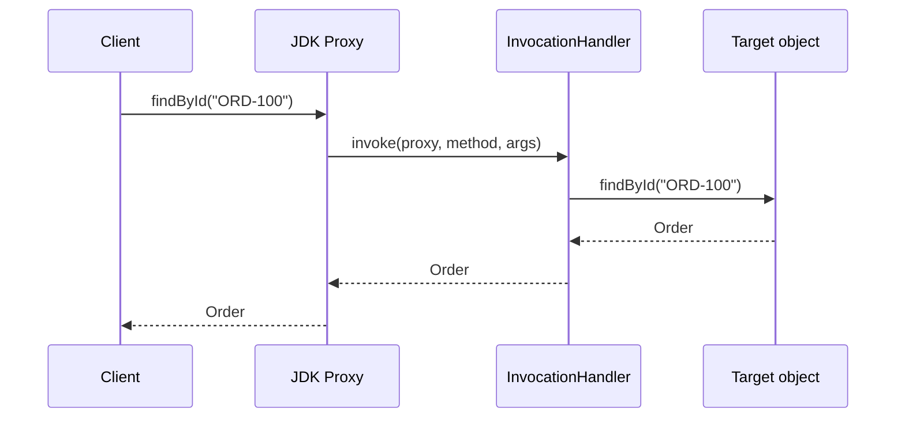
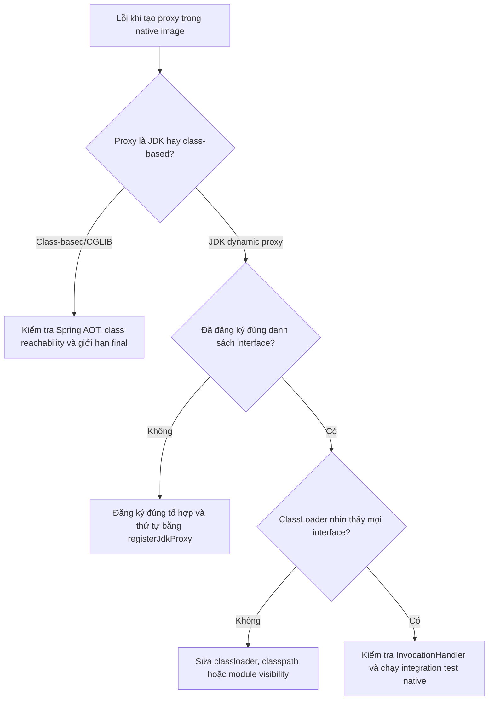

# JDK dynamic proxy và danh sách interface phải được biết trước

## 1. Vì sao JDK dynamic proxy cần được khai báo khi build Native Image?

Trong ứng dụng Spring Boot, proxy được dùng để bổ sung hành vi mà không sửa trực tiếp class nghiệp vụ. Ví dụ: kiểm tra quyền, ghi log, đo thời gian, mở transaction hoặc gọi một adapter từ xa. Một cách tạo proxy phổ biến của Java là **JDK dynamic proxy**: JVM tạo một class triển khai một hoặc nhiều interface, rồi chuyển lời gọi method về `InvocationHandler`.

Trên JVM thông thường, ứng dụng có thể gọi `Proxy.newProxyInstance(...)` với danh sách interface được xác định lúc chạy. Nhưng **GraalVM Native Image** phân tích mã và tạo executable ở build time. Compiler không thể tùy ý sinh một class proxy mới cho bất kỳ tập interface nào mà ứng dụng chỉ khám phá được sau khi executable đã chạy.

Vì vậy, với native image, những tổ hợp interface dùng để tạo JDK dynamic proxy phải được biết trước và đăng ký trong quá trình AOT/build. Spring cung cấp `RuntimeHints.proxies().registerJdkProxy(...)` để mô tả chính xác những tổ hợp này.

Sau bài học, bạn có thể:

- Giải thích `Proxy`, `InvocationHandler` và vai trò của danh sách interface.
- Hiểu vì sao **tập interface và thứ tự interface** là một phần của định nghĩa proxy.
- Đăng ký proxy bằng `RuntimeHintsRegistrar` và `@ImportRuntimeHints`.
- Nhận diện proxy do Spring AOP tạo ra và phân biệt với proxy được tạo động trong code ứng dụng.
- Kiểm thử proxy hints và xử lý lỗi khi chạy trên GraalVM Native Image.

Ví dụ xuyên suốt là dịch vụ `OrderService` được bọc bởi proxy triển khai `OrderOperations` và `Auditable`. Cả hai interface phải được khai báo đúng tổ hợp khi build native.

## 2. JDK dynamic proxy hoạt động như thế nào?

### 2.1. Proxy triển khai interface và ủy quyền lời gọi

JDK dynamic proxy tạo một đối tượng có thể được dùng thông qua các interface đã chỉ định. Khi code gọi một method trên proxy, lời gọi được chuyển tới `InvocationHandler.invoke(...)`.



Proxy không nhất thiết chứa logic nghiệp vụ. Nó là điểm chặn để handler quyết định xử lý, ủy quyền hoặc bổ sung hành vi trước/sau lời gọi.

### 2.2. Khai báo interface nghiệp vụ

```java
package com.example.orders;

public interface OrderOperations {
    Order findById(String orderId);
}
```

```java
package com.example.orders;

public interface Auditable {
    String auditId();
}
```

Đối tượng đích thực hiện nghiệp vụ:

```java
package com.example.orders;

public record Order(String id) {
}
```

```java
package com.example.orders;

public class OrderService implements OrderOperations {

    @Override
    public Order findById(String orderId) {
        return new Order(orderId);
    }
}
```

`Order` ở đây là kiểu dữ liệu của ứng dụng. Ví dụ tập trung vào cơ chế proxy; phần khởi tạo đối tượng, repository và xử lý lỗi của một dịch vụ thực tế được lược giản.

### 2.3. Tạo proxy với `Proxy.newProxyInstance`

```java
import java.lang.reflect.InvocationHandler;
import java.lang.reflect.Proxy;

OrderService target = new OrderService();

InvocationHandler handler = (proxy, method, args) -> {
    if (method.getDeclaringClass() == Object.class) {
        return switch (method.getName()) {
            case "toString" -> "OrderOperationsProxy";
            case "hashCode" -> System.identityHashCode(proxy);
            case "equals" -> proxy == args[0];
            default -> throw new UnsupportedOperationException(method.getName());
        };
    }

    if (method.getDeclaringClass() == Auditable.class) {
        return "order-service";
    }

    return method.invoke(target, args);
};

Object proxy = Proxy.newProxyInstance(
        OrderOperations.class.getClassLoader(),
        new Class<?>[] { OrderOperations.class, Auditable.class },
        handler);

OrderOperations orders = (OrderOperations) proxy;
Auditable audit = (Auditable) proxy;
```

Ở đây:

- `OrderOperations.class` và `Auditable.class` là các interface mà proxy phải triển khai.
- `InvocationHandler` nhận từng method invocation và quyết định cách xử lý.
- `target` thực hiện nghiệp vụ `findById`; handler tự xử lý method `auditId` và các method của `Object`.
- Đối tượng proxy có thể được ép kiểu sang cả `OrderOperations` và `Auditable`.

Trong ứng dụng thực tế, hãy cân nhắc xử lý ngoại lệ, method mặc định trên interface, method trùng chữ ký giữa nhiều interface và việc unwrap `InvocationTargetException` khi ủy quyền bằng reflection.

## 3. Danh sách interface là một phần của định nghĩa proxy

### 3.1. Native Image cần biết tổ hợp interface trước

Với JVM, đoạn code sau có thể nhận danh sách interface từ cấu hình runtime:

```java
Class<?>[] interfaces = discoverInterfacesFromConfiguration();

Object proxy = Proxy.newProxyInstance(
        applicationClassLoader,
        interfaces,
        invocationHandler);
```

Nếu `interfaces` chỉ được khám phá sau khi ứng dụng chạy, native compiler không biết cần tạo proxy class nào khi build. Với native image, cần xác định trước tổ hợp có thể xuất hiện:

```text
Tổ hợp A: [OrderOperations]
Tổ hợp B: [OrderOperations, Auditable]
Tổ hợp C: [PaymentOperations, Auditable]
```

Mỗi tổ hợp là một cấu hình proxy riêng. Chỉ đăng ký những tổ hợp mà ứng dụng thực sự có thể tạo.

### 3.2. Thứ tự interface cũng quan trọng

Không nên coi danh sách interface là một tập hợp không có thứ tự. JDK proxy sử dụng thứ tự interface khi tạo proxy class. Nếu hai interface khai báo method có cùng tên và tham số, `InvocationHandler` có thể nhận `Method` tương ứng với interface xuất hiện đầu tiên trong danh sách. Các metadata proxy của Native Image cũng mô tả danh sách interface theo thứ tự.

Ví dụ:

```java
new Class<?>[] { OrderOperations.class, Auditable.class }
```

khác với:

```java
new Class<?>[] { Auditable.class, OrderOperations.class }
```

Nếu code có thể tạo cả hai thứ tự, cần đăng ký cả hai tổ hợp. Nếu ứng dụng chỉ dùng một thứ tự, hãy giữ thứ tự đó nhất quán ở nơi tạo proxy và nơi đăng ký hints.

### 3.3. Các ràng buộc của danh sách interface

`Proxy.newProxyInstance(...)` có một số điều kiện quan trọng:

- Mỗi phần tử phải là một interface, không phải class thông thường.
- Không được lặp lại cùng một interface trong một danh sách.
- Tất cả interface phải nhìn thấy được từ class loader truyền vào.
- Nếu có interface không `public`, các interface không `public` trong cùng proxy phải tuân thủ quy tắc package/module của Java Proxy API.
- Nếu nhiều interface có method trùng chữ ký nhưng kiểu trả về không tương thích, việc tạo proxy có thể thất bại.

Do đó, khai báo hints đúng thứ tự vẫn chưa đủ nếu class loader runtime không nhìn thấy các interface hoặc cấu trúc interface không hợp lệ.

## 4. Đăng ký JDK proxy bằng Spring Runtime Hints

Spring AOT cung cấp API chuyên biệt để khai báo proxy interfaces. Với Spring Framework 6 trở lên, có thể dùng `RuntimeHintsRegistrar` và `@ImportRuntimeHints`.

### 4.1. Viết registrar cho tổ hợp interface

```java
package com.example.orders;

import org.springframework.aot.hint.RuntimeHints;
import org.springframework.aot.hint.RuntimeHintsRegistrar;

public class OrderProxyRuntimeHints implements RuntimeHintsRegistrar {

    @Override
    public void registerHints(RuntimeHints hints, ClassLoader classLoader) {
        hints.proxies().registerJdkProxy(
                OrderOperations.class,
                Auditable.class);
    }
}
```

Lệnh `registerJdkProxy(...)` đăng ký một tổ hợp proxy có thứ tự: `OrderOperations` đứng trước `Auditable`. Đối số là các interface class, không phải tên class dưới dạng chuỗi và cũng không phải implementation class của service.

### 4.2. Gắn hints vào component tạo proxy

```java
package com.example.orders;

import java.lang.reflect.Proxy;

import org.springframework.context.annotation.Bean;
import org.springframework.context.annotation.Configuration;
import org.springframework.context.annotation.ImportRuntimeHints;

@Configuration(proxyBeanMethods = false)
@ImportRuntimeHints(OrderProxyRuntimeHints.class)
public class OrderProxyConfiguration {

    @Bean
    OrderOperations orderOperations(OrderService target) {
        return (OrderOperations) Proxy.newProxyInstance(
                OrderOperations.class.getClassLoader(),
                new Class<?>[] { OrderOperations.class, Auditable.class },
                (proxy, method, args) -> {
                    if (method.getDeclaringClass() == Auditable.class) {
                        return "order-service";
                    }
                    return method.invoke(target, args);
                });
    }
}
```

Trong ứng dụng đầy đủ, cần xử lý thêm method `Object` và ngoại lệ của reflection như ví dụ trước. Phần quan trọng ở đây là danh sách interface trong `newProxyInstance(...)` **trùng thứ tự** với danh sách truyền cho `registerJdkProxy(...)`.

Có thể gắn `@ImportRuntimeHints` lên component hoặc `@Bean` method sở hữu proxy thay vì cấu hình toàn cục. Cách này giúp metadata gắn với integration cụ thể và tránh thêm proxy hints không cần thiết.

Trong ví dụ, factory method công bố bean qua kiểu `OrderOperations`; phần `Auditable` là interface bổ sung trên cùng đối tượng proxy. Nếu ứng dụng cần inject bean trực tiếp bằng cả hai interface trong lúc AOT phân tích, hãy khai báo một kiểu bean tổng hợp thể hiện rõ cả hai hợp đồng hoặc thiết kế factory/bean metadata để Spring biết đầy đủ kiểu có thể gán.

### 4.3. Đăng ký nhiều tổ hợp proxy

Nếu ứng dụng tạo nhiều loại proxy, đăng ký mỗi tổ hợp riêng:

```java
public class ApplicationProxyRuntimeHints implements RuntimeHintsRegistrar {

    @Override
    public void registerHints(RuntimeHints hints, ClassLoader classLoader) {
        hints.proxies().registerJdkProxy(OrderOperations.class);

        hints.proxies().registerJdkProxy(
                OrderOperations.class,
                Auditable.class);

        hints.proxies().registerJdkProxy(
                PaymentOperations.class,
                Auditable.class);
    }
}
```

Không đăng ký một danh sách gồm tất cả interface của toàn hệ thống với hy vọng nó bao phủ mọi tổ hợp. `[A, B]` và `[A, C]` là hai proxy khác nhau; `[A, B, C]` không thay thế hai tổ hợp đó.

## 5. Kiểm thử proxy hints

### 5.1. Dùng `RuntimeHintsPredicates`

Spring cung cấp predicate để kiểm tra một tổ hợp JDK proxy đã được đăng ký:

```java
package com.example.orders;

import org.junit.jupiter.api.Test;
import org.springframework.aot.hint.RuntimeHints;
import org.springframework.aot.hint.predicate.RuntimeHintsPredicates;

import static org.assertj.core.api.Assertions.assertThat;

class OrderProxyRuntimeHintsTests {

    @Test
    void registersTheExpectedOrderedInterfaceList() {
        RuntimeHints hints = new RuntimeHints();
        new OrderProxyRuntimeHints().registerHints(
                hints, getClass().getClassLoader());

        assertThat(RuntimeHintsPredicates.proxies()
                .forInterfaces(OrderOperations.class, Auditable.class))
                .accepts(hints);
    }
}
```

Test này xác nhận registrar có khai báo tổ hợp proxy mong đợi. Nếu đổi thứ tự interface trong code tạo proxy, hãy cập nhật cả registrar và test. Predicate không chứng minh mọi hành vi của `InvocationHandler` đúng; cần test riêng cho việc ủy quyền và các method đặc biệt.

### 5.2. Test hành vi proxy trên JVM

```java
@Test
void delegatesBusinessMethodAndExposesAuditInterface() {
    OrderService target = new OrderService();
    Object proxy = OrderProxyFactory.create(target);

    OrderOperations orders = (OrderOperations) proxy;
    Auditable audit = (Auditable) proxy;

    assertThat(orders.findById("ORD-100").id()).isEqualTo("ORD-100");
    assertThat(audit.auditId()).isEqualTo("order-service");
}
```

`OrderProxyFactory.create(...)` đại diện cho factory tạo proxy bằng cùng interface list đã đăng ký. Bài test JVM xác nhận handler và target phối hợp đúng; nó chưa thay thế việc chạy native image.

### 5.3. Kiểm thử trên native executable

Sau khi unit test hints và test hành vi qua JVM đạt, build ứng dụng native rồi chạy đúng đường code tạo proxy. Kiểm tra:

- Proxy được tạo mà không phát sinh lỗi thiếu proxy metadata.
- Có thể ép kiểu proxy sang từng interface đã khai báo.
- Mỗi method được chuyển tới đúng nhánh của `InvocationHandler`.
- Các method `equals`, `hashCode`, `toString` có hành vi phù hợp với thiết kế.
- Tổ hợp interface tùy chọn chỉ được dùng khi module tương ứng được đưa vào build.

Không kết luận proxy tương thích native chỉ vì `nativeCompile` thành công. Nhiều lỗi chỉ xuất hiện khi code path gọi `Proxy.newProxyInstance(...)` được thực thi.

## 6. Spring AOP có sử dụng JDK dynamic proxy không?

Spring AOP có thể dùng JDK dynamic proxy hoặc class-based proxy. Việc lựa chọn phụ thuộc cấu hình và loại target:

| Loại proxy | Cơ chế | Đặc điểm |
|---|---|---|
| JDK dynamic proxy | Tạo class triển khai các interface | Client thường tương tác qua interface; proxy không phải subclass của target |
| Class-based proxy (thường dùng CGLIB) | Tạo subclass của target class | Có thể proxy class không có interface; không thể override class/method `final` |

Ví dụ một service có interface:

```java
public interface PaymentService {
    void pay(String paymentId);
}

@Service
public class DefaultPaymentService implements PaymentService {

    @Override
    @Transactional
    public void pay(String paymentId) {
        // Xử lý thanh toán.
    }
}
```

Spring AOP có thể tạo proxy cho `PaymentService` để áp dụng transaction advice. Nếu cấu hình buộc dùng JDK proxy (ví dụ `proxyTargetClass = false` và target có interface), danh sách interface cần thiết phải được xác định. Nếu dùng class-based proxy, đó là một cơ chế khác và không đăng ký bằng `registerJdkProxy(...)`.

### 6.1. Proxy do Spring AOT quản lý

Spring AOT có thể phân tích các cấu hình AOP/proxy được khai báo tĩnh trong bean definitions và đóng góp metadata cần thiết. Vì vậy, với proxy do Spring tạo từ cấu hình được AOT nhận biết, hãy để Spring AOT xử lý trước và kiểm tra generated hints/build output.

Không thêm thủ công proxy hints trùng lặp chỉ vì bean có `@Transactional`, `@Async` hoặc `@Cacheable`. Chỉ bổ sung `RuntimeHints.proxies()` khi ứng dụng hoặc thư viện tự tạo JDK proxy theo một tổ hợp mà Spring AOT không tự phát hiện.

### 6.2. Proxy được tạo động từ danh sách interface runtime

Ví dụ sau khó tương thích với native image nếu danh sách interface không biết trước:

```java
Class<?>[] interfaces = pluginRegistry
        .findPlugin(pluginName)
        .proxyInterfaces();

Object proxy = Proxy.newProxyInstance(
        pluginClassLoader,
        interfaces,
        invocationHandler);
```

Nếu plugin có thể cung cấp một tập interface tùy ý sau khi native executable đã build, không thể đăng ký chính xác mọi tổ hợp mà compiler chưa biết. Cần thay đổi thiết kế để giới hạn tập tổ hợp proxy có thể có tại build time, hoặc dùng một cơ chế plugin/deployment phù hợp hơn với yêu cầu mở rộng đó.

## 7. Phân biệt JDK proxy với CGLIB và các loại proxy khác

`RuntimeHints.proxies().registerJdkProxy(...)` chỉ mô tả **JDK dynamic proxy**. Không dùng API này để đăng ký một subclass proxy của CGLIB.

| Dấu hiệu | JDK dynamic proxy | Class-based/CGLIB proxy |
|---|---|---|
| Đối tượng proxy triển khai interface | Có | Có thể có, nhưng không phải điều kiện bắt buộc |
| Proxy là subclass của target class | Không | Có |
| Tạo bằng `Proxy.newProxyInstance` | Có | Không |
| Đăng ký bằng `registerJdkProxy` | Có | Không |
| Giới hạn với class/method `final` | Không áp dụng theo cách subclass | Không thể override để intercept |
| Metadata native | Đăng ký tổ hợp interface nếu không được AOT tự phát hiện | Phụ thuộc cơ chế proxy/AOT và reachability của class-based proxy |

Khi điều tra một lỗi proxy trong native image, trước hết xác định proxy thực tế được tạo bởi JDK `Proxy`, Spring AOP hay CGLIB. Chọn sai loại hint có thể khiến metadata không có tác dụng.

## 8. Các lỗi thường gặp

| Triệu chứng | Nguyên nhân có thể | Cách xử lý |
|---|---|---|
| JVM chạy được nhưng native báo lỗi khi tạo proxy | Chưa đăng ký đúng tổ hợp interface | Thêm `registerJdkProxy(...)` cho đúng danh sách và thứ tự |
| Proxy có một interface nhưng thiếu interface khác | Hints chỉ đăng ký một interface hoặc tổ hợp khác | Đăng ký toàn bộ interface của lần gọi `newProxyInstance` |
| Proxy lỗi khi thay đổi thứ tự interface | Tổ hợp proxy được đăng ký với thứ tự khác hoặc method trùng chữ ký | Giữ thứ tự nhất quán, đăng ký riêng các thứ tự thực sự được dùng |
| `IllegalArgumentException` khi tạo proxy | Một phần tử không phải interface, interface trùng hoặc method conflict | Kiểm tra interface list và quy tắc của `Proxy.newProxyInstance` |
| `ClassNotFoundException`/visibility error | Class loader không nhìn thấy tất cả interface | Dùng loader phù hợp và kiểm tra classpath/module visibility |
| Native image build thành công nhưng code path proxy lỗi | Đường code tạo proxy chưa được chạy trong test hoặc metadata thiếu | Thêm integration test native thực hiện đúng code path |
| Đã thêm `registerJdkProxy` nhưng lỗi CGLIB vẫn còn | Đang dùng class-based proxy, không phải JDK proxy | Kiểm tra `proxyTargetClass` và loại proxy thực tế |
| Spring AOP hoạt động JVM nhưng native thiếu proxy | Cấu hình AOP không được AOT nhận biết hoặc proxy tạo động ngoài bean graph | Kiểm tra AOT output, thu hẹp cấu hình và bổ sung hints cho tổ hợp tùy chỉnh |

### 8.1. Quy trình chẩn đoán



## 9. Bài thực hành: tạo proxy cho `OrderService`

**Bối cảnh:** một dịch vụ đặt hàng cần bọc `OrderService` bằng proxy triển khai hai interface `OrderOperations` và `Auditable`. Proxy được tạo trong cấu hình Spring và phải hoạt động trên GraalVM Native Image.

### Bước 1 — Tạo target và interface

Tạo `OrderService implements OrderOperations`, cùng interface `Auditable`. Đảm bảo interface list hợp lệ, không có phần tử trùng và tất cả kiểu đều có thể được nhìn thấy từ class loader tạo proxy.

### Bước 2 — Tạo proxy factory

Đóng gói lời gọi `Proxy.newProxyInstance(...)` vào một factory. Giữ thứ tự `[OrderOperations, Auditable]` cố định. Handler phải xử lý method nghiệp vụ, method audit và các method của `Object` theo đúng yêu cầu ứng dụng.

### Bước 3 — Đăng ký runtime hints

Tạo `OrderProxyRuntimeHints implements RuntimeHintsRegistrar`, gọi:

```java
hints.proxies().registerJdkProxy(
        OrderOperations.class,
        Auditable.class);
```

Gắn registrar bằng `@ImportRuntimeHints` trên cấu hình hoặc component sở hữu proxy.

### Bước 4 — Viết unit test

Dùng `RuntimeHintsPredicates.proxies().forInterfaces(...)` để kiểm tra tổ hợp interface. Đồng thời viết test riêng để xác nhận `InvocationHandler` ủy quyền đúng method.

### Bước 5 — Build và kiểm thử native

Chạy quy trình Spring AOT/native của dự án, tạo executable và gọi endpoint thực tế có sử dụng proxy. Chạy cả test trên JVM và integration test trên native executable.

### Phiếu kết quả

| Hạng mục | Giá trị cần ghi |
|---|---|
| Loại proxy | JDK dynamic proxy / CGLIB |
| Danh sách interface theo thứ tự | `OrderOperations`, `Auditable` |
| Class loader tạo proxy | _(ghi)_ |
| Runtime hints registrar | `OrderProxyRuntimeHints` |
| Unit test proxy predicate | PASS/FAIL |
| JVM behavior test | PASS/FAIL |
| Native integration test | PASS/FAIL |
| Các method đã kiểm thử | Nghiệp vụ, audit, `equals`, `hashCode`, `toString` |

## 10. Ghi nhớ

JDK dynamic proxy là class được tạo để triển khai **một danh sách interface xác định** và chuyển lời gọi về `InvocationHandler`. Với native image, danh sách interface này phải được biết trước. Hơn nữa, thứ tự interface là một phần của cấu hình proxy; một tổ hợp khác thứ tự cần được khai báo riêng nếu ứng dụng thực sự tạo nó.

Với proxy tùy chỉnh, dùng `RuntimeHints.proxies().registerJdkProxy(...)` trong `RuntimeHintsRegistrar` và gắn registrar gần component tạo proxy bằng `@ImportRuntimeHints`. Với proxy do Spring AOP quản lý, trước tiên kiểm tra Spring AOT đã phát hiện và đóng góp metadata hay chưa. Phân biệt JDK proxy với CGLIB, kiểm thử cả interface list lẫn `InvocationHandler`, rồi chạy integration test trên native executable.

### Tài liệu tham khảo chính thức

- [Java SE — `java.lang.reflect.Proxy`](https://docs.oracle.com/en/java/javase/25/docs/api/java.base/java/lang/reflect/Proxy.html)
- [Java SE — `InvocationHandler`](https://docs.oracle.com/en/java/javase/25/docs/api/java.base/java/lang/reflect/InvocationHandler.html)
- [Spring Framework — Runtime Hints and AOT](https://docs.spring.io/spring-framework/reference/core/aot.html)
- [Spring Framework — `RuntimeHints` Javadoc](https://docs.spring.io/spring-framework/docs/current/javadoc-api/org/springframework/aot/hint/RuntimeHints.html)
- [Spring Framework — `ProxyHints` Javadoc](https://docs.spring.io/spring-framework/docs/current/javadoc-api/org/springframework/aot/hint/ProxyHints.html)
- [GraalVM Native Image — Dynamic Proxy Metadata](https://www.graalvm.org/latest/reference-manual/native-image/metadata/)
