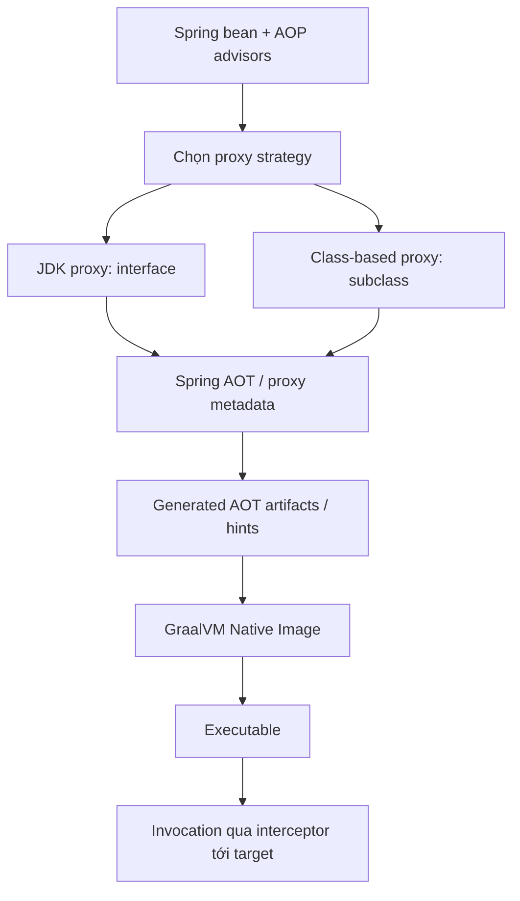

# Proxy dựa trên lớp và mã proxy do Spring AOT chuẩn bị

## 1. Proxy dựa trên lớp là gì?

Trong Spring AOP, proxy đứng giữa caller và object đích để thực hiện hành vi bổ sung như transaction, logging, security, retry hoặc metrics. Có hai kiểu proxy phổ biến:

- **JDK dynamic proxy**: tạo object triển khai một hoặc nhiều interface; lời gọi được chuyển tới `InvocationHandler`.
- **Class-based proxy**: tạo một lớp con của class mục tiêu (thường thông qua cơ chế sinh bytecode như CGLIB trong môi trường JVM); method được override để chuyển lời gọi qua interceptor rồi tới target.

Proxy dựa trên lớp hữu ích khi bean không có interface phù hợp hoặc cấu hình yêu cầu proxy theo class. Tuy nhiên, nó chịu các giới hạn của kế thừa: class `final` không thể subclass; method `final`, `private` hoặc không thể override không thể được intercept theo cách subclass proxy thông thường.

Trong module **SPRING_BOOT_NATIVE_IMAGE**, Spring AOT chuẩn bị một phần công việc proxy tại build time để GraalVM Native Image có thể phân tích và tạo executable. Mục tiêu là làm cho proxy cần thiết được biết trước, thay vì phụ thuộc vào việc sinh bytecode tùy ý khi ứng dụng native đang chạy.



Không phải mọi proxy trong Spring đều cần cấu hình thủ công. Spring AOT và các tích hợp framework có thể nhận diện proxy từ cấu hình bean/AOP. Khi có lỗi, hãy xác định proxy nào được tạo và cơ chế nào tạo nó trước khi thêm metadata.

## 2. Khi nào Spring sử dụng class-based proxy?

Spring AOP thường chọn JDK dynamic proxy khi bean triển khai interface và cấu hình cho phép proxy theo interface. Class-based proxy có thể được chọn khi:

- Bean không triển khai interface phù hợp.
- Ứng dụng bật proxy-target-class.
- Cấu hình AOP yêu cầu proxy theo class.
- Framework cần proxy một class cụ thể thay vì chỉ expose interface.

Ví dụ cấu hình Spring Boot:

```yaml
spring:
  aop:
    proxy-target-class: true
```

Property này yêu cầu Spring AOP ưu tiên class-based proxy trong phạm vi cấu hình Spring Boot tương ứng. Hành vi thực tế còn phụ thuộc loại proxy và framework integration; không nên giả định nó biến mọi proxy trong toàn ứng dụng thành cùng một loại.

Với Java configuration, có thể dùng:

```java
@Configuration
@EnableAspectJAutoProxy(proxyTargetClass = true)
class AopConfiguration {
}
```

Nếu đã dùng auto-configuration của Spring Boot, không cần thêm `@EnableAspectJAutoProxy` một cách máy móc. Tránh khai báo trùng cấu hình nếu ứng dụng đã bật AOP qua starter và property.

## 3. Ví dụ class-based proxy với Spring AOP

Giả sử service không triển khai interface:

```java
@Service
public class InvoiceService {

    public String issue(String customerId) {
        return "invoice:" + customerId;
    }
}
```

Aspect ghi nhận lời gọi:

```java
@Aspect
@Component
class TimingAspect {

    @Around("execution(* com.example.invoice.InvoiceService.*(..))")
    Object measure(ProceedingJoinPoint joinPoint) throws Throwable {
        long start = System.nanoTime();
        try {
            return joinPoint.proceed();
        } finally {
            long elapsed = System.nanoTime() - start;
            System.out.println("elapsed-ns=" + elapsed);
        }
    }
}
```

Khi Spring tạo bean và áp dụng aspect, proxy class có thể kế thừa `InvoiceService` và override method phù hợp để chuyển lời gọi qua interceptor. Caller nhận proxy như một `InvoiceService`, nhưng logic bổ sung chạy trước/sau target method.

Đây là ví dụ về AOP proxy ở mức khái niệm. Pointcut phải match method và bean phải được Spring quản lý; nếu aspect không chạy, cần kiểm tra component scan, pointcut, bean creation và self-invocation trước khi kết luận lỗi Native Image.

## 4. Các giới hạn của subclass proxy

Class-based proxy dựa trên khả năng tạo subclass và override method. Những trường hợp sau cần chú ý:

| Thành phần | Ảnh hưởng |
|---|---|
| Class `final` | Không thể tạo subclass proxy thông thường |
| Method `final` | Không thể override để chèn interceptor |
| Method `private` | Không được override và không phải join point phù hợp của subclass proxy |
| Method/package access | Khả năng override phụ thuộc package, visibility và class loader |
| Constructor | Subclass phải đáp ứng quy tắc khởi tạo class; framework có thể dùng cơ chế tạo instance phù hợp |
| Sealed class | Có thể hạn chế subclass ngoài danh sách permits |
| Native method | Không thể override theo cách Java method thông thường |

Nếu một method không được intercept, kiểm tra modifier và cách gọi trước. Không phải mọi method trên target đều tự động đi qua proxy.

### Self-invocation

Trong proxy-based AOP, lời gọi từ một method của target sang method khác trên cùng `this` thường không đi qua proxy:

```java
public void process() {
    this.save(); // self-invocation: thường bỏ qua proxy interceptor
}

@Transactional
public void save() {
    // persist data
}
```

Nếu `process()` gọi `save()` nội bộ trên cùng instance, transaction advice có thể không được áp dụng như mong đợi. Đây là đặc điểm proxy AOP, không riêng Native Image. Có thể tách method sang bean khác hoặc thiết kế lại ranh giới service để lời gọi đi qua proxy.

## 5. Vì sao Native Image cần chuẩn bị proxy trước?

Trên JVM, một số cơ chế proxy có thể sinh bytecode trong lúc chạy. Native Image áp dụng closed-world analysis: tập class và những hành vi động cần thiết phải được xác định đủ sớm để compiler có thể giữ và tạo mã tương ứng.

Nếu một thư viện cố tạo class proxy tùy ý bằng bytecode generation sau khi executable native đã được tạo, cơ chế đó có thể không tương thích với môi trường native. Spring AOT hỗ trợ bằng cách phân tích cấu hình và chuẩn bị các thành phần proxy mà framework biết trước.

Cần phân biệt ba việc:

1. **Chọn proxy strategy**: JDK interface proxy hay class-based proxy.
2. **Chuẩn bị proxy cho AOT/native**: framework xác định loại proxy, target class, interfaces và advisors cần thiết.
3. **Thực thi lời gọi runtime**: proxy đã được chuẩn bị chuyển lời gọi qua interceptor tới target.

Việc AOT thành công không bảo đảm mọi proxy do thư viện bên thứ ba tạo động đều được hỗ trợ. Các thư viện cần cung cấp tích hợp AOT/native phù hợp hoặc ứng dụng cần thay đổi cách tạo proxy.

## 6. Mã proxy được Spring AOT chuẩn bị

Trong quy trình Spring AOT, framework phân tích application context và các bean có thể được proxy. Tùy phiên bản Spring Framework/Spring Boot và loại proxy, AOT có thể tạo artifacts hoặc metadata cần thiết để Native Image biết các proxy sẽ được dùng.

Ý nghĩa thực tế:

- Tập target class và interface được xác định ở build time.
- Advisor/interceptor cần áp dụng được liên kết với cấu hình bean.
- Proxy cần thiết được chuẩn bị theo cơ chế AOT mà phiên bản framework hỗ trợ.
- Native Image có thể phân tích những class/hints được tạo hoặc đăng ký.

Không nên coi “Spring AOT sinh mã proxy” là một chi tiết giống hệt cho mọi loại proxy, mọi phiên bản Spring và mọi thư viện. API nội bộ, loại generated artifact và khả năng hỗ trợ phụ thuộc phiên bản. Hãy xem log AOT, generated sources/resources và tài liệu Spring Native/AOT của phiên bản thực tế.

Nếu ứng dụng tự gọi CGLIB hoặc ASM để sinh subclass dựa trên dữ liệu runtime, Spring AOT không tự động biến mọi class được sinh đó thành mã tĩnh. Cần kiểm tra thư viện có AOT contribution hay không, hoặc chuyển sang một thiết kế có thể xác định proxy trước lúc build.

## 7. Phân biệt class-based proxy với JDK proxy hints

Spring RuntimeHints có API `hints.proxies().registerJdkProxy(...)` cho JDK dynamic proxy theo tập interface. API đó **không phải** cách đăng ký mọi class-based proxy.

| Cơ chế | Đối tượng mô tả | Hướng xử lý |
|---|---|---|
| JDK dynamic proxy | Danh sách interface được proxy | JDK proxy hints khi AOT không tự nhận diện |
| Class-based proxy | Subclass của target class | Dựa vào hỗ trợ AOT/proxy của Spring hoặc thư viện tương ứng |
| Reflection trên target | Constructor/method/field truy cập động | Reflection hints riêng nếu cần |
| Resource dùng trong interceptor | File classpath đọc động | Resource hints riêng nếu cần |

Không thêm JDK proxy hint để chữa lỗi CGLIB/subclass proxy. Cũng không thêm reflection hint cho toàn bộ class với kỳ vọng nó tự sinh subclass proxy.

## 8. Kiểm tra proxy strategy và cấu hình

Khi cần xác định bean đang được proxy như thế nào, có thể quan sát trong test hoặc debug:

```java
Object bean = applicationContext.getBean(InvoiceService.class);

System.out.println(AopUtils.isAopProxy(bean));
System.out.println(AopUtils.isJdkDynamicProxy(bean));
System.out.println(AopUtils.isCglibProxy(bean));
```

Các phương thức trên thuộc Spring AOP utility. Chúng giúp phân biệt proxy object trong context JVM/test. Với Native Image, hãy chạy kiểm tra tương tự trên executable nếu ứng dụng cho phép hoặc kiểm tra hành vi qua integration test.

Không phụ thuộc tên class generated như `InvoiceService$$SpringCGLIB$$...` vì tên và cách triển khai có thể thay đổi giữa version, build và cơ chế AOT.

## 9. Kiểm thử AOT và Native Image

Một quy trình kiểm thử hữu ích:

1. Chạy test JVM để xác nhận aspect/proxy hoạt động.
2. Xác định bean nào là proxy, loại proxy và pointcut/advisor áp dụng.
3. Chạy Spring AOT với đúng profile và dependency graph.
4. Kiểm tra log/generated artifacts để xác nhận proxy được framework xử lý.
5. Build Native Image bằng Gradle `nativeCompile` hoặc Maven native compile.
6. Chạy executable native và gọi method cần interceptor.
7. Kiểm tra cả method public/final, self-invocation, exception path và các integration liên quan.
8. Chạy cùng luồng trên container mục tiêu.

Ví dụ test:

```java
@SpringBootTest
class InvoiceAopTest {

    @Autowired
    InvoiceService invoiceService;

    @Test
    void invoiceMethodCanBeInvokedThroughProxy() {
        assertThat(invoiceService.issue("C-100"))
            .isEqualTo("invoice:C-100");
    }
}
```

Test này xác nhận kết quả method; để chứng minh advice thực sự chạy, nên inject spy/counter hoặc kiểm tra side effect của interceptor. Sau đó cần chạy test trên native executable. JVM test pass không tự chứng minh native proxy đã được chuẩn bị đúng.

## 10. Những lỗi thường gặp

| Triệu chứng | Nguyên nhân có thể | Hướng xử lý |
|---|---|---|
| Bean không phải proxy | Aspect/pointcut không match hoặc AOP chưa bật | Kiểm tra dependency, component scan, pointcut |
| Không thể proxy class | Class final, sealed hoặc constructor/access constraint | Dùng interface proxy hoặc thay đổi thiết kế |
| Method không bị intercept | Method final/private hoặc self-invocation | Kiểm tra modifier và đường gọi |
| JVM chạy, native lỗi khi tạo proxy | Cơ chế sinh bytecode runtime chưa được AOT hỗ trợ | Kiểm tra framework/library AOT support |
| JDK proxy hints không sửa được lỗi | Lỗi thuộc class-based proxy | Xác định proxy strategy chính xác |
| AOT pass nhưng advice không chạy | Advisor/bean graph/pointcut không như dự kiến | Kiểm tra generated AOT context và integration test |
| Proxy chạy nhưng reflection trong target lỗi | Thiếu metadata cho member được gọi động | Bổ sung reflection hints riêng |

## 11. Nguyên tắc thiết kế

- Ưu tiên interface khi hợp đồng service tự nhiên có interface và JDK proxy đáp ứng yêu cầu.
- Nếu dùng class-based proxy, tránh class/method `final` tại điểm cần intercept.
- Thiết kế ranh giới bean để tránh self-invocation khi cần advice.
- Dùng Spring AOP/Framework integration có hỗ trợ AOT thay vì tự sinh bytecode tùy ý.
- Không nhầm JDK proxy hints với hỗ trợ class-based proxy.
- Đăng ký reflection/resource metadata riêng khi interceptor hoặc target có truy cập động.
- Kiểm thử proxy trên native executable và container thật.
- Ghi rõ phiên bản Spring Boot, Spring Framework, GraalVM và plugin trong build report.

## 12. Câu hỏi tự kiểm tra

1. Class-based proxy khác JDK dynamic proxy ở cách tạo và kiểu được proxy như thế nào?
2. Vì sao class hoặc method `final` có thể ngăn subclass proxy?
3. Spring AOT hỗ trợ gì cho proxy trước khi GraalVM Native Image biên dịch?
4. Vì sao `registerJdkProxy` không giải quyết lỗi class-based proxy?
5. Self-invocation ảnh hưởng đến transaction/AOP advice như thế nào?
6. Làm thế nào xác định bean đang dùng JDK hay class-based proxy?
7. Cần test gì để chứng minh advice hoạt động trên executable native?

**Ghi nhớ:** class-based proxy dựa trên subclass và có giới hạn kế thừa; Spring AOT chuẩn bị proxy mà framework có thể xác định trước để Native Image xử lý. Hãy xác định proxy strategy, tránh các member không thể override, phân biệt với JDK proxy hints và kiểm thử hành vi advice trên native executable.
