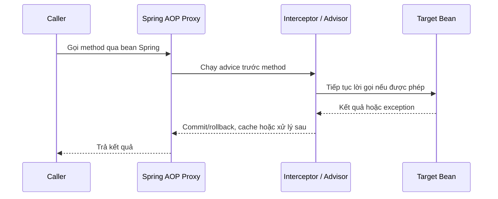
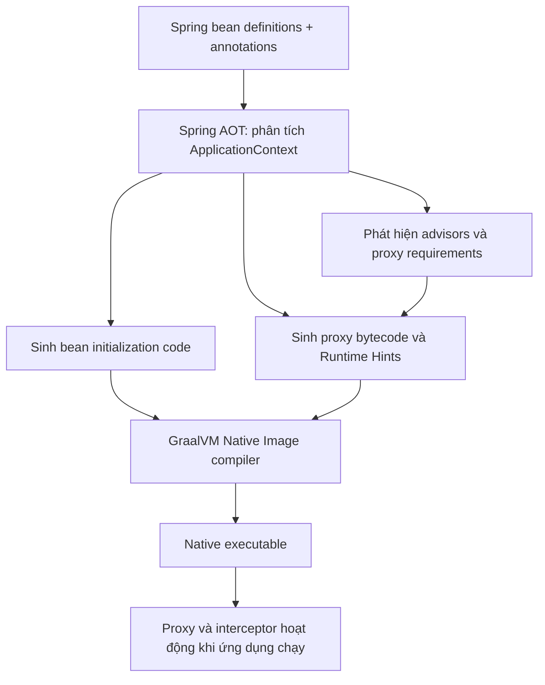

# @Transactional, @Async, cache và method security trong ứng dụng native

> **Chương: Proxy và AOP.** Module **SPRING_BOOT_NATIVE_IMAGE** biên dịch ứng dụng Spring Boot thành GraalVM Native Image bằng Spring AOT. Các tính năng transaction, xử lý bất đồng bộ, cache và phân quyền theo method thường dựa trên Spring AOP proxy. Bài này giải thích cách proxy được chuẩn bị cho Native Image, những giới hạn cần chú ý và cách kiểm thử để bảo đảm annotation thực sự có hiệu lực trong binary native.

## 1. Mục tiêu học tập

Sau bài học, bạn có thể:

1. Giải thích vì sao @Transactional, @Async, @Cacheable và @PreAuthorize thường hoạt động thông qua proxy.
2. Phân biệt JDK dynamic proxy, CGLIB class proxy và proxy được Spring AOT chuẩn bị ở build time.
3. Mô tả vai trò của Spring AOT và Runtime Hints khi tạo native executable.
4. Cấu hình transaction, async executor, cache manager và method security trong ứng dụng Spring Boot.
5. Nhận diện lỗi self-invocation, final/private method, profile/condition và metadata của thư viện bên thứ ba.
6. Viết kiểm thử chứng minh transaction, async, cache và phân quyền vẫn hoạt động trên Native Image.

## 2. Vì sao các annotation này cần proxy?

Các annotation như @Transactional hoặc @Cacheable chủ yếu là **metadata** mô tả hành vi mong muốn. Spring cần một cơ chế bao quanh lời gọi method để thực thi hành vi đó:

- Trước khi method chạy, interceptor có thể mở transaction, kiểm tra quyền hoặc tra cache.
- Method gốc được gọi nếu điều kiện cho phép.
- Sau khi method trả về hoặc ném exception, interceptor có thể commit/rollback transaction, lưu kết quả cache hoặc xử lý phần sau lời gọi.

Trong proxy mode, bean mà code khác nhận được là **proxy** bọc quanh target object. Lời gọi đi qua proxy mới đi qua chuỗi interceptor/advisor.



Ví dụ, khi gọi method có @Transactional, transaction interceptor lấy cấu hình transaction từ annotation và yêu cầu PlatformTransactionManager mở transaction phù hợp. Khi method kết thúc, interceptor commit hoặc rollback theo kết quả và quy tắc rollback.

**Không phải annotation tự tạo ra hành vi.** Nếu transaction management, caching, async hoặc method security chưa được bật, hoặc lời gọi không đi qua proxy, method vẫn có thể chạy nhưng hành vi mong muốn không xuất hiện.

## 3. JDK proxy, CGLIB và khác biệt khi chạy Native Image

Spring AOP có hai kiểu proxy phổ biến:

| Kiểu proxy | Cách hoạt động | Điều kiện và giới hạn |
|---|---|---|
| JDK dynamic proxy | Tạo proxy thực thi một hoặc nhiều interface | Caller thường truy cập bean qua interface được proxy |
| CGLIB class proxy | Tạo subclass của class target và override method có thể intercept | Class không được final; method cần intercept không được final hoặc private |

Nếu target implement interface, Spring có thể dùng JDK proxy. Nếu cần proxy theo class hoặc cấu hình ép class proxy, Spring có thể dùng CGLIB. Cấu hình mặc định thực tế phụ thuộc Spring Framework, Spring Boot và cấu hình proxy của ứng dụng; không nên suy đoán loại proxy chỉ từ việc class có interface.

### 3.1. Ví dụ interface-based proxy

```java
public interface OrderOperations {
    void confirmOrder(String orderId);
}

@Service
public class OrderService implements OrderOperations {

    @Override
    @Transactional
    public void confirmOrder(String orderId) {
        // Cập nhật trạng thái đơn hàng và ghi dữ liệu liên quan.
    }
}
```

Một JDK proxy có thể triển khai OrderOperations và chuyển lời gọi qua transaction interceptor trước khi gọi target. Code tiêu thụ service nên phụ thuộc interface nếu thiết kế cần interface proxy.

### 3.2. Ví dụ class-based proxy

```java
@Service
public class InventoryService {

    @Transactional
    public void reserve(String sku, int quantity) {
        // Giữ số lượng hàng tồn kho.
    }
}
```

Nếu Spring tạo CGLIB proxy, proxy là subclass của InventoryService. Do đó:

- Class final không thể được subclass.
- Method final không thể được override để chèn advice.
- Method private không thể được override.
- Các method không có visibility phù hợp cũng có thể không được intercept.

Với service cần proxy, hãy ưu tiên class và method có thể proxy; dùng interface khi phù hợp với thiết kế. Đừng ép CGLIB toàn cục nếu không có nhu cầu cụ thể.

## 4. Spring AOT chuẩn bị proxy như thế nào cho Native Image?

Trong JVM thông thường, Spring có thể phân tích bean và tạo proxy động khi ứng dụng khởi động. Native Image sử dụng mô hình closed-world: GraalVM cần biết trước các lớp, phương thức và proxy có thể cần dùng. Việc tạo lớp tùy ý bằng bytecode/classloader trong lúc chạy không có cùng mức linh hoạt như JVM.

Spring AOT xử lý ApplicationContext ở build time và sinh thêm các thành phần cần thiết. Tùy cấu trúc ứng dụng, output thường gồm:

- Java source để khởi tạo bean và cấu hình context theo cách tường minh.
- Bytecode/class proxy được tạo trước để đưa vào native executable.
- Runtime Hints cho reflection, resource, serialization và JDK dynamic proxies.



**Proxy thông thường do Spring quản lý có thể được chuẩn bị ở build time.** Ứng dụng không cần tự đăng ký thủ công mọi proxy chỉ vì dùng @Transactional hoặc @Async. Tuy nhiên, proxy tự tạo động, danh sách interface được quyết định bằng dữ liệu runtime, custom advisor hoặc thư viện ngoài có thể cần xử lý riêng.

### 4.1. Phạm vi cố định ở build time

Spring AOT phân tích một classpath và một Environment xác định. Một số quyết định được chốt khi build:

- Profile được chọn cho AOT phải tương ứng với profile khi chạy native.
- Điều kiện @Conditional ảnh hưởng đến việc bean có được tạo hay không được đánh giá khi AOT.
- Bean đăng ký động bằng registerSingleton hoặc instance supplier tùy biến có thể không được chuyển đổi AOT như bean definition thông thường.
- Advisor, interceptor và các cấu hình tạo proxy phải hiện diện trong context được xử lý.

Ví dụ, nếu @EnableMethodSecurity chỉ được đưa vào context khi một profile được kích hoạt, profile đó phải được chọn đúng trong quá trình AOT. Đổi profile runtime không làm Spring tự tạo thêm các bean security mà build time đã loại khỏi context.

### 4.2. Khi nào cần Runtime Hints thủ công?

Với các tính năng Spring tiêu chuẩn, Spring AOT thường tự thu thập hints. Hãy xem xét bổ sung hints khi:

- Tự tạo JDK proxy bằng Proxy.newProxyInstance với interface chỉ được xác định động.
- Thư viện bên thứ ba dùng reflection hoặc proxy mà chưa cung cấp reachability metadata.
- Custom security expression, serializer, cache provider hoặc interceptor truy cập kiểu dữ liệu qua reflection mà AOT không nhận diện.
- Dùng @AuthorizeReturnObject với kiểu trả về bị generic erasure khiến Spring Security không xác định được class cần proxy.

Ví dụ đăng ký JDK proxy thủ công bằng RuntimeHintsRegistrar:

```java
public class OrderProxyHints implements RuntimeHintsRegistrar {

    @Override
    public void registerHints(RuntimeHints hints, ClassLoader classLoader) {
        hints.proxies().registerJdkProxy(OrderOperations.class);
    }
}
```

Kết nối registrar với Spring AOT:

```java
@Configuration(proxyBeanMethods = false)
@ImportRuntimeHints(OrderProxyHints.class)
class NativeProxyConfiguration {
}
```

Đây là ví dụ cho **JDK interface proxy** được tạo theo cách riêng. Không thêm hint này một cách máy móc cho mọi bean Spring. Với proxy được Spring AOT nhận diện từ bean definitions, hãy kiểm tra output AOT trước khi bổ sung cấu hình trùng lặp.

## 5. @Transactional trong ứng dụng native

@Transactional khai báo ranh giới transaction cho lời gọi method. Để hoạt động, ứng dụng cần:

1. Bật transaction management, trực tiếp bằng @EnableTransactionManagement hoặc thông qua auto-configuration phù hợp của Spring Boot.
2. Có PlatformTransactionManager tương ứng với công nghệ truy cập dữ liệu.
3. Gọi method qua Spring-managed proxy.
4. Dùng transaction manager và JDBC/JPA driver có hỗ trợ Native Image hoặc reachability metadata phù hợp.

Ví dụ:

```java
@Service
public class OrderCommandService {

    private final OrderRepository orders;
    private final InventoryRepository inventory;

    public OrderCommandService(
            OrderRepository orders,
            InventoryRepository inventory) {
        this.orders = orders;
        this.inventory = inventory;
    }

    @Transactional
    public void confirm(String orderId) {
        Order order = orders.findById(orderId).orElseThrow();
        inventory.reserve(order.getSku(), order.getQuantity());
        order.confirm();
        orders.save(order);
    }
}
```

Khi có lỗi runtime, transaction interceptor áp dụng quy tắc rollback theo loại exception và cấu hình annotation. Ví dụ mặc định, unchecked exception và Error dẫn đến rollback; checked exception không tự động rollback nếu không khai báo rollbackFor phù hợp.

### 5.1. Lỗi self-invocation

Đoạn code sau dễ gây hiểu nhầm:

```java
@Service
public class OrderService {

    public void process(String orderId) {
        save(orderId); // Lời gọi nội bộ, không đi qua proxy.
    }

    @Transactional
    public void save(String orderId) {
        // Ghi dữ liệu.
    }
}
```

process() gọi trực tiếp save() trên cùng target object. Lời gọi không đi qua proxy nên transaction advice không được kích hoạt, dù save() có annotation.

Một cách thiết kế rõ ràng là tách ranh giới transaction thành bean riêng:

```java
@Service
public class OrderWriter {

    @Transactional
    public void save(String orderId) {
        // Ghi dữ liệu trong transaction.
    }
}

@Service
public class OrderWorkflow {

    private final OrderWriter writer;

    public OrderWorkflow(OrderWriter writer) {
        this.writer = writer;
    }

    public void process(String orderId) {
        writer.save(orderId); // Gọi qua bean proxy được inject.
    }
}
```

### 5.2. Visibility và class proxy

@Transactional thường nên đặt trên method public của class cụ thể. Với class-based proxy, các phiên bản Spring Framework mới có thể hỗ trợ method protected hoặc package-visible theo quy tắc tương ứng; interface-based proxy yêu cầu method public nằm trong interface được proxy. Private method không thể được intercept bằng proxy thông thường.

Không dùng class hoặc method final khi đang cần CGLIB proxy intercept method đó. Nếu service implement interface, cân nhắc thiết kế caller phụ thuộc interface để dùng JDK proxy.

### 5.3. Transaction và native runtime

Native Image không tự thay đổi semantics transaction. Các vấn đề thường đến từ:

- JDBC driver hoặc ORM cần reflection/resource metadata.
- Transaction manager tùy biến dùng proxy hoặc class loading động.
- Profile/condition khiến transaction configuration không có trong AOT context.
- Code tự gọi method nội bộ thay vì gọi qua proxy.

Kiểm thử phải xác minh rollback thật bằng cách gây lỗi sau một thao tác ghi rồi kiểm tra dữ liệu không được commit. Chỉ kiểm tra context khởi động thành công không đủ để xác nhận transaction hoạt động.

## 6. @Async trong ứng dụng native

@Async yêu cầu Spring gửi lời gọi method tới một TaskExecutor. Caller thường nhận kết quả ngay, còn công việc chạy trên thread khác. Tính năng cần được bật bằng @EnableAsync hoặc cấu hình tương đương.

Ví dụ cấu hình executor:

```java
@Configuration(proxyBeanMethods = false)
@EnableAsync
class AsyncConfiguration {

    @Bean("applicationTaskExecutor")
    ThreadPoolTaskExecutor applicationTaskExecutor() {
        ThreadPoolTaskExecutor executor = new ThreadPoolTaskExecutor();
        executor.setCorePoolSize(4);
        executor.setMaxPoolSize(8);
        executor.setQueueCapacity(100);
        executor.setThreadNamePrefix("orders-async-");
        return executor;
    }
}
```

Ví dụ service:

```java
@Service
public class ReceiptService {

    @Async("applicationTaskExecutor")
    public CompletableFuture<String> sendReceipt(String orderId) {
        // Gửi email hoặc gọi dịch vụ thông báo.
        return CompletableFuture.completedFuture("sent:" + orderId);
    }
}
```

Spring @Async hỗ trợ method trả về void hoặc kiểu Future/CompletableFuture phù hợp. Với void, exception phát sinh ở thread nền không được truyền về caller; cần cấu hình AsyncUncaughtExceptionHandler nếu muốn xử lý có kiểm soát. Với Future, caller có thể quan sát exception khi lấy kết quả.

### 6.1. Các lưu ý khi chạy native

- Thread pool vẫn cần được cấu hình theo số CPU, tải và giới hạn container. Native Image không làm cho executor tự có giới hạn tài nguyên phù hợp.
- Dùng Spring-managed executor và bean async đã được phát hiện trong AOT context.
- Không gọi async method từ @PostConstruct trên cùng bean rồi kỳ vọng proxy đã sẵn sàng.
- Self-invocation không kích hoạt async interceptor; hãy gọi qua một bean khác.
- Context gắn với thread hiện tại không tự động chuyển sang thread nền.

Ví dụ, transaction JDBC thường gắn với thread thực thi. Nếu một method @Async cần transaction riêng, đặt @Transactional trên method async hoặc service chạy ở thread nền để transaction được mở trong thread đó. Không giả định transaction của caller tự truyền sang thread executor.

Tương tự, nếu async task cần SecurityContext, hãy dùng cơ chế truyền context phù hợp như DelegatingSecurityContextAsyncTaskExecutor hoặc thiết kế truyền dữ liệu xác thực cần thiết một cách rõ ràng. Không giả định thread nền tự kế thừa danh tính của request.

### 6.2. Kiểm thử async

Test nên xác nhận method thực sự chạy trên executor và hoàn thành qua Future:

```java
@SpringBootTest
class ReceiptServiceTest {

    @Autowired
    ReceiptService receipts;

    @Test
    void sendsReceiptAsynchronously() throws Exception {
        CompletableFuture<String> result = receipts.sendReceipt("order-42");
        assertEquals("sent:order-42", result.get(5, TimeUnit.SECONDS));
    }
}
```

Chạy test trên JVM trước, sau đó chạy native test hoặc integration test trên binary native. Tránh dùng Thread.sleep() để phỏng đoán thời điểm hoàn thành; dùng Future, latch hoặc cơ chế đồng bộ có timeout.

## 7. Cache: @Cacheable, @CachePut và @CacheEvict

Spring Cache abstraction cung cấp annotation để cache kết quả method:

- @Cacheable: kiểm tra cache trước; nếu chưa có thì gọi method và lưu kết quả.
- @CachePut: luôn gọi method rồi cập nhật cache bằng kết quả.
- @CacheEvict: xóa một hoặc nhiều entry.

Để bật annotation-driven caching, dùng @EnableCaching và cung cấp CacheManager hoặc cơ chế cache tương ứng.

Ví dụ:

```java
@Configuration(proxyBeanMethods = false)
@EnableCaching
class CacheConfiguration {

    @Bean
    CacheManager cacheManager() {
        return new ConcurrentMapCacheManager("products");
    }
}

@Service
public class ProductCatalog {

    private final ProductRepository products;

    public ProductCatalog(ProductRepository products) {
        this.products = products;
    }

    @Cacheable(cacheNames = "products", key = "#productId")
    public Product findById(String productId) {
        return products.findById(productId).orElseThrow();
    }

    @CacheEvict(cacheNames = "products", key = "#productId")
    public void evict(String productId) {
        // Có thể dùng sau khi cập nhật sản phẩm.
    }
}
```

Ví dụ dùng ConcurrentMapCacheManager để minh họa. Trong production, chọn cache provider theo yêu cầu về chia sẻ giữa nhiều instance, eviction, TTL và độ bền dữ liệu. Cache in-memory của từng process không chia sẻ entry với replica khác.

### 7.1. Lưu ý cache trong Native Image

Proxy caching chuẩn do Spring quản lý thường được Spring AOT xử lý. Phần cần kiểm tra thêm thường nằm ở provider và kiểu dữ liệu:

- Cache provider có hỗ trợ GraalVM Native Image hay không?
- Serialization dùng reflection có cần reachability metadata cho constructor/field/getter không?
- Custom KeyGenerator, CacheResolver, SpEL expression hoặc serializer có truy cập kiểu dữ liệu động không?
- Resource/configuration của cache provider có được đóng gói không?

Nếu dùng cache provider bên thứ ba, tra metadata và hướng dẫn Native Image của đúng version. Không kết luận rằng @Cacheable hoạt động chỉ vì ứng dụng khởi động thành công.

### 7.2. Self-invocation và visibility

Trong proxy mode, lời gọi cache phải đi qua proxy. Ví dụ method trong cùng class gọi method @Cacheable trực tiếp sẽ bỏ qua cache advice. Với cache annotation, nên đặt trên method public của bean được Spring quản lý. Hãy gọi qua bean khác hoặc tách phần cache thành một service riêng.

## 8. Method security: @PreAuthorize và @PostAuthorize

Method security bảo vệ service method ở tầng nghiệp vụ. Nó hữu ích ngay cả khi endpoint đã có request-level authorization, vì một service có thể được gọi từ REST controller, message listener, scheduler hoặc batch job.

Kích hoạt method security:

```java
@Configuration(proxyBeanMethods = false)
@EnableMethodSecurity
class MethodSecurityConfiguration {
}
```

Sau đó bảo vệ method:

```java
@Service
public class AccountService {

    @PreAuthorize("hasAuthority('account:read')")
    public Account findAccount(String accountId) {
        // Tìm tài khoản.
        return loadAccount(accountId);
    }

    @PreAuthorize("#ownerId == authentication.name or hasRole('ADMIN')")
    public void updateAddress(String ownerId, Address address) {
        // Cập nhật địa chỉ.
    }
}
```

@EnableMethodSecurity bật các interceptor cho @PreAuthorize, @PostAuthorize, @PreFilter và @PostFilter theo cấu hình mặc định. @PreAuthorize kiểm tra trước khi method chạy; @PostAuthorize kiểm tra kết quả sau khi method trả về.

### 8.1. Spring Security hỗ trợ AOT cho method security

Spring Security có thể quét bean trong application context để tìm method dùng @PreAuthorize hoặc @PostAuthorize. Khi expression tham chiếu bean khác, framework có thể phân giải bean đó và đăng ký runtime hints cần thiết.

Với @AuthorizeReturnObject, Spring Security có thể duyệt kiểu trả về để tìm các method có annotation authorization và chuẩn bị proxy tương ứng. Tuy nhiên, generic erasure có thể khiến framework không biết kiểu phần tử thực tế. Ví dụ method trả về List<Account> nhưng thông tin kiểu bị mất trong quá trình xử lý có thể cần khai báo hints bổ sung bằng PrePostAuthorizeExpressionBeanHintsRegistrar hoặc cơ chế được tài liệu đúng phiên bản hướng dẫn.

**Không tự thêm reflection hints rộng cho toàn bộ package security.** Trước hết kiểm tra Spring Security AOT đã thu thập gì, rồi chỉ bổ sung kiểu thực sự không được suy ra.

### 8.2. Kiểm thử quyền truy cập

Test cần kiểm tra cả trường hợp được phép và bị từ chối:

```java
@SpringBootTest
class AccountServiceSecurityTest {

    @Autowired
    AccountService accounts;

    @Test
    @WithMockUser(authorities = "account:read")
    void readerCanLoadAccount() {
        assertNotNull(accounts.findAccount("account-1"));
    }

    @Test
    @WithMockUser(authorities = "account:write")
    void writerCannotLoadAccountWithoutReadAuthority() {
        assertThrows(
            AccessDeniedException.class,
            () -> accounts.findAccount("account-1")
        );
    }
}
```

Ví dụ cần có dependency Spring Security Test và test fixture phù hợp. Trên native test, xác minh cả security expression, bean được tham chiếu trong SpEL và các kiểu dữ liệu mà method security xử lý. Một test chỉ kiểm tra HTTP endpoint có trả 401/403 chưa đủ để xác nhận service-level method security đã được áp dụng.

## 9. Nhiều advisor trên cùng một bean

Một method có thể chịu nhiều advice: security, transaction, cache, metrics hoặc retry. Thứ tự advisor ảnh hưởng tới kết quả.

Ví dụ nếu một method vừa có @PreAuthorize vừa có @Transactional, cần xác định thứ tự mong muốn:

- Kiểm tra quyền trước khi mở transaction có thể tránh tạo transaction cho lời gọi bị từ chối.
- Cache và transaction cần được phối hợp phù hợp để tránh lưu kết quả chưa commit hoặc đọc dữ liệu chưa nhất quán.
- Retry và transaction có thể tạo transaction mới cho mỗi lần thử hoặc dùng chung, tùy thứ tự advice và cấu hình.

Spring có thứ tự mặc định cho nhiều advisor và cho phép điều chỉnh order. Không nên tự giả định thứ tự chỉ dựa trên thứ tự annotation được viết trong source. Khi logic nhạy cảm, hãy cấu hình rõ và viết integration test kiểm chứng.

Trong Native Image, các advisor vẫn phải được phát hiện trong AOT context và proxy tương ứng phải được chuẩn bị. Nếu advisor được đăng ký động sau khi context AOT đã được tạo, nó có thể không có mặt trong native executable.

## 10. Những lỗi thường gặp khi chuyển sang native

| Triệu chứng | Nguyên nhân có thể | Hướng xử lý |
|---|---|---|
| @Transactional không rollback | Method không được gọi qua proxy, transaction manager sai hoặc rollback rule không phù hợp | Kiểm tra bean injection, self-invocation, manager và exception |
| @Async chạy đồng bộ | Thiếu @EnableAsync, gọi nội bộ cùng class hoặc executor không được cấu hình | Kiểm tra proxy, executor bean và lời gọi qua bean Spring |
| @Cacheable luôn gọi repository | Thiếu @EnableCaching, cache manager không đúng hoặc self-invocation | Kiểm tra cache infrastructure, key và proxy |
| @PreAuthorize không chặn lời gọi | Method security chưa bật hoặc caller không đi qua Spring bean proxy | Kiểm tra @EnableMethodSecurity, bean registration và test quyền |
| Build native báo thiếu JDK proxy | Proxy interface được tạo động nhưng chưa có hint | Đăng ký JDK proxy hint hoặc để Spring AOT xử lý bean proxy |
| CGLIB proxy không tạo được | Class/method final, method private hoặc cấu trúc không thể subclass | Dùng interface proxy hoặc sửa thiết kế class |
| Runtime báo thiếu reflection | Custom advisor, expression, serializer hoặc thư viện truy cập động | Bổ sung hints hẹp hoặc reachability metadata đúng version |
| JVM pass nhưng native thiếu bean advisor | Profile/condition làm bean bị loại ở thời điểm AOT | Chọn đúng profile và property lúc build |
| Async mất SecurityContext | Context không được truyền sang thread executor | Dùng security-aware executor hoặc truyền dữ liệu xác thực tường minh |
| Native test pass nhưng production behavior sai | Test không bao phủ advisor order, DB/cache provider hoặc cấu hình production | Kiểm thử integration trên binary/container với dependency thật |

### 10.1. Checklist kiểm tra AOT output

Khi cần xác minh proxy đã được chuẩn bị:

1. Chạy AOT processing của Maven/Gradle theo cấu hình native.
2. Kiểm tra log xem các bean, advisors và configuration class mong muốn có được phát hiện.
3. Xem các thư mục output AOT của plugin đang dùng; đường dẫn có thể khác theo phiên bản và build tool.
4. Kiểm tra proxy class/hints được sinh cho các bean cần thiết.
5. Nếu thiếu, xác định bean bị loại do profile/condition, hoặc proxy được tạo động bởi code tùy biến.
6. Bổ sung RuntimeHints chỉ khi cần cho trường hợp không được Spring tự xử lý.

Không nên phụ thuộc vào tên class proxy sinh ra hoặc đường dẫn output cố định trong test ứng dụng. Đây là chi tiết implementation có thể thay đổi theo phiên bản Spring.

## 11. Chiến lược kiểm thử cho bốn tính năng

Nên chạy cùng một bộ hành vi ở hai chế độ:

| Tính năng | Kiểm tra trên JVM | Kiểm tra trên native |
|---|---|---|
| Transaction | Gây exception sau khi ghi, xác nhận dữ liệu rollback | Chạy cùng test trên native executable; kiểm tra driver/manager |
| Async | Xác nhận Future hoàn tất và thread khác caller | Xác nhận task chạy, timeout hợp lý, exception được quan sát |
| Cache | Gọi hai lần và xác nhận lần sau không gọi repository; kiểm tra eviction | Xác nhận cache provider khởi tạo, serialization/key hoạt động |
| Method security | Test authority cho phép/từ chối và SpEL bean reference | Chạy test native với cả nhánh allow/deny và các kiểu return object |

Các lệnh tổng quát khi dự án đã cấu hình GraalVM Native Build Tools:

```bash
# Test thông thường trên JVM
./gradlew test

# Chạy test trong Native Image
./gradlew nativeTest

# Biên dịch executable ứng dụng
./gradlew nativeCompile
```

Với Maven, goal/profile cụ thể phụ thuộc phiên bản Spring Boot và Native Build Tools. Hãy dùng cấu hình native tương ứng trong dự án và xác nhận goal test native được plugin hỗ trợ. Không coi nativeCompile thành công là bằng chứng bốn tính năng đã hoạt động; nó chỉ xác nhận quá trình tạo executable đã hoàn tất.

Khi kiểm thử production, chạy container image thực tế với database, cache backend, executor và security configuration gần với môi trường triển khai. Ghi rõ profile/conditional properties đã dùng lúc AOT để có thể tái hiện.

## 12. Bài tập thực hành

Xây dựng một service xử lý đơn hàng có bốn hành vi:

1. OrderCommandService.confirm() dùng @Transactional để cập nhật đơn và giữ tồn kho; khi lỗi xảy ra, cả hai thay đổi phải rollback.
2. ReceiptService.send() dùng @Async và trả CompletableFuture; cấu hình executor có giới hạn thread và queue.
3. ProductCatalog.findById() dùng @Cacheable; sau khi cập nhật sản phẩm, cache entry phải được evict.
4. OrderQueryService.findById() dùng @PreAuthorize để chỉ người có authority order:read được đọc đơn.

Thực hiện:

- Chạy toàn bộ integration test trên JVM.
- Build Spring AOT với profile/condition giống môi trường native mục tiêu.
- Chạy nativeTest hoặc test suite tương đương trên native executable.
- Kiểm tra proxy type của service và đảm bảo method không bị giới hạn bởi final/private.
- Thêm test self-invocation để chứng minh lời gọi nội bộ không kích hoạt advice, rồi refactor thành hai bean.
- Chạy container native và kiểm tra transaction, cache backend, async executor và quyền truy cập.

| Hành vi | JVM | Native | Bằng chứng |
|---|---|---|---|
| Transaction commit/rollback | Pass/Fail | Pass/Fail | Dữ liệu sau rollback |
| Async hoàn tất qua Future | Pass/Fail | Pass/Fail | Thread name và kết quả |
| Cache hit/evict | Pass/Fail | Pass/Fail | Số lần gọi repository |
| Method security allow/deny | Pass/Fail | Pass/Fail | Authority và exception/status |
| AOT proxy/hints | Pass/Fail | Pass/Fail | Log/output AOT |
| Container smoke test | Pass/Fail | Pass/Fail | Image, profile, DB/cache |

## 13. Câu hỏi tự kiểm tra

1. Vì sao @Transactional chỉ là metadata cho đến khi transaction management được bật?
2. JDK dynamic proxy và CGLIB class proxy khác nhau thế nào?
3. Spring AOT tạo những loại output nào để hỗ trợ proxy trong Native Image?
4. Vì sao lời gọi self-invocation không kích hoạt @Async, @Cacheable hoặc @Transactional trong proxy mode?
5. Vì sao class/method final gây vấn đề với CGLIB proxy?
6. Vì sao transaction của caller không tự động chuyển sang thread chạy @Async?
7. Spring Security AOT thu thập hints cho bean được tham chiếu trong @PreAuthorize như thế nào?
8. Khi nào cần RuntimeHints.proxies().registerJdkProxy(...)?
9. Vì sao native executable build thành công chưa chứng minh method security hoặc cache đang hoạt động?
10. Profile và property ảnh hưởng tới sự tồn tại của advisor bean cần được xử lý ở thời điểm nào?

## Ghi nhớ

**@Transactional, @Async, cache và method security dựa trên interceptor/advisor được áp dụng qua proxy trong proxy mode.** Spring AOT chuẩn bị bean setup, proxy bytecode và Runtime Hints để GraalVM đưa chúng vào native executable. Hãy bảo đảm bean và điều kiện cấu hình có mặt khi AOT chạy, tránh self-invocation, chọn class/interface có thể proxy, kiểm tra dependency bên thứ ba và kiểm thử hành vi thực tế trên native binary/container.

## Tài liệu tham khảo chính thức

- [Spring Framework — AOP Proxying Mechanisms](https://docs.spring.io/spring-framework/reference/core/aop/proxying.html): JDK dynamic proxy, CGLIB và giới hạn class/method.
- [Spring Framework — Ahead of Time Optimizations](https://docs.spring.io/spring-framework/reference/core/aot.html): Spring AOT, bytecode proxy và Runtime Hints.
- [Spring Framework — Using @Transactional](https://docs.spring.io/spring-framework/reference/data-access/transaction/declarative/annotations.html): transaction advice, visibility, self-invocation và proxy mode.
- [Spring Framework — Task Execution and Scheduling](https://docs.spring.io/spring-framework/reference/integration/scheduling.html): @Async, TaskExecutor và xử lý exception.
- [Spring Framework — Declarative Annotation-based Caching](https://docs.spring.io/spring/reference/7.0/integration/cache/annotations.html): @EnableCaching, cache proxy và self-invocation.
- [Spring Security — Method Security](https://docs.spring.io/spring-security/reference/servlet/authorization/method-security.html): @EnableMethodSecurity, AOP và AOT runtime hints.
- [Spring Boot — Introducing GraalVM Native Images](https://docs.spring.io/spring-boot/reference/packaging/native-image/introducing-graalvm-native-images.html): Spring AOT và Native Image.
- [Spring Boot — Advanced Native Images Topics](https://docs.spring.io/spring-boot/reference/packaging/native-image/advanced-topics.html): hints và các giới hạn tương thích thư viện.
