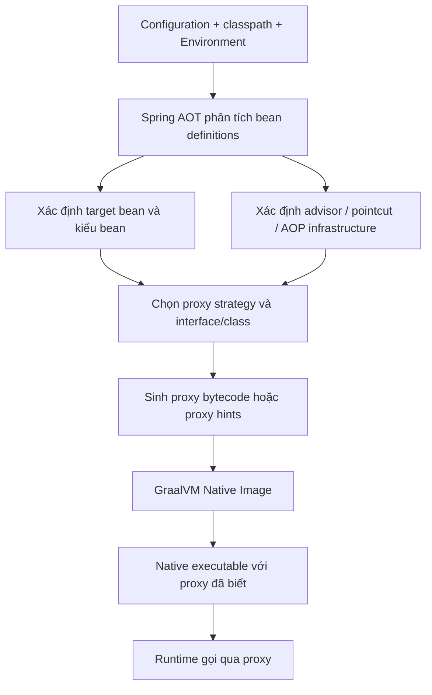

# Điều kiện tạo proxy phải được xác định khi phân tích bean

> **Chương:** Proxy và AOP  
> **Module:** `SPRING_BOOT_NATIVE_IMAGE`  
> **Mục tiêu:** Hiểu vì sao Spring AOT phải xác định bean nào cần proxy, proxy sẽ triển khai những interface hoặc kế thừa class nào và advisor nào áp dụng; phân biệt proxy JDK với CGLIB; nhận biết giới hạn khi thay đổi profile, bean conditions hoặc classpath sau build; kiểm thử proxy trên AOT mode và native executable.

## 1. Vì sao điều kiện tạo proxy phải được biết trước?

Spring AOP bổ sung hành vi cho bean bằng cách đặt một **proxy** trước object thật. Khi code gọi method trên proxy, proxy có thể chạy thêm logic như mở transaction, ghi log, kiểm tra quyền, cache kết quả hoặc đo thời gian, rồi mới chuyển tiếp tới target object.

Trên JVM thông thường, Spring có thể phát hiện advisor phù hợp và tạo proxy trong lúc ứng dụng khởi động. Với GraalVM Native Image, tập class và khả năng tạo proxy động bị giới hạn bởi phân tích build time. Những proxy cần thiết phải được Spring AOT nhận diện và chuẩn bị trước để Native Image đưa bytecode hoặc proxy metadata vào executable.

Điều đó đòi hỏi Spring AOT phải hiểu được **mô hình bean và điều kiện AOP tại thời điểm phân tích**:

- Bean nào tồn tại trong application context?
- Bean đó có kiểu thực tế nào, triển khai interface nào?
- Những advisor/aspect nào có mặt và áp dụng cho bean hoặc method nào?
- Cấu hình chọn JDK dynamic proxy hay class-based proxy?
- Những method, class hoặc interface nào cần có trong proxy?
- Profile, conditional và classpath nào đã quyết định cấu trúc đó?

Nếu các điều kiện này chỉ được quyết định sau khi native binary chạy, Spring không thể mặc định sinh thêm proxy class hoặc thay đổi tập proxy đã được chuẩn bị trong AOT output.



**Điểm cần nhớ:** AOT không chụp một object proxy đã chạy rồi lưu vào binary. Nó phân tích mô hình bean, tạo những đầu ra cần thiết để khi ứng dụng native khởi động, Spring có thể khôi phục đúng cơ chế proxy cho các bean đã xác định.

## 2. Những điều kiện quyết định có tạo proxy hay không

Một luồng AOP phổ biến gồm các thành phần:

1. Ứng dụng khai báo AOP infrastructure, chẳng hạn `@EnableAspectJAutoProxy` hoặc `@EnableTransactionManagement`.
2. Spring đăng ký các bean advisor/aspect hoặc infrastructure tương ứng.
3. Auto-proxy creator kiểm tra target bean và các advisor có thể áp dụng.
4. Nếu bean cần được áp dụng advice, Spring tạo proxy phù hợp.
5. Consumer nhận proxy thông qua dependency injection và gọi method trên proxy.
6. Proxy thực thi advice rồi chuyển lời gọi tới target object theo thứ tự interceptor.

Ví dụ một service có transaction:

```java
@Service
public class PaymentService {

    @Transactional
    public void capture(String paymentId) {
        // Ghi nhận thanh toán trong transaction.
    }
}
```

`@Transactional` được xử lý bởi Spring transaction infrastructure. Khi bean phù hợp được tạo, Spring AOP có thể cung cấp một proxy để lời gọi `capture` đi qua transaction interceptor.

Một ví dụ aspect tùy biến:

```java
@Aspect
@Component
public class TimingAspect {

    @Around("execution(* com.example.payment..*(..))")
    public Object measure(ProceedingJoinPoint joinPoint) throws Throwable {
        long start = System.nanoTime();
        try {
            return joinPoint.proceed();
        }
        finally {
            long elapsed = System.nanoTime() - start;
            System.out.println(joinPoint.getSignature() + ": " + elapsed);
        }
    }
}
```

Aspect và pointcut là một phần điều kiện để Spring quyết định bean/method nào cần advice. Nếu aspect chỉ xuất hiện ở một profile hoặc được bật bởi một conditional property, sự tồn tại của nó có thể làm thay đổi proxy topology.

### 2.1. AOT xử lý bean definitions, không chạy toàn bộ nghiệp vụ

Trong AOT processing, Spring chuẩn bị application context tới giai đoạn bean definitions có thể được phân tích. Quy trình này không đơn giản là khởi động ứng dụng production và gọi tất cả service method.

Spring AOT dùng thông tin cấu hình, classpath, Environment và các processor để sinh mã, bytecode cùng RuntimeHints. Khi chạy native, generated initializer sẽ khôi phục context theo mô hình đã được xử lý.

Vì thế, các thông tin cần để quyết định proxy phải có thể suy ra từ bean definitions và metadata tại build time. Nếu một bean chỉ được đăng ký tùy ý bằng code runtime hoặc một advisor chỉ được nạp từ plugin bên ngoài sau khi binary đã build, AOT không thể mặc định tạo proxy tương ứng.

### 2.2. Bean type phải đủ cụ thể

Spring AOT không nên phải đoán implementation từ một kiểu khai báo quá chung. Với factory method `@Bean`, khai báo kiểu trả về càng cụ thể càng giúp Spring suy ra target class, interface và method cần xử lý.

Ví dụ:

```java
@Bean
PaymentOperations paymentOperations() {
    return new DefaultPaymentService();
}
```

Spring chỉ thấy kiểu trả về `PaymentOperations` từ chữ ký factory method. Nếu cần xử lý AOT dựa trên implementation, khai báo kiểu cụ thể thường tốt hơn:

```java
@Bean
DefaultPaymentService paymentOperations() {
    return new DefaultPaymentService();
}
```

Consumer vẫn có thể inject theo interface `PaymentOperations`. Bean name vẫn là `paymentOperations`. Việc khai báo kiểu cụ thể giúp framework có nhiều thông tin hơn khi phân tích bean definition; nó không buộc mọi consumer phải phụ thuộc vào implementation.

Nếu dùng instance supplier dạng lambda/method reference hoặc đăng ký singleton trực tiếp ở runtime, cần lưu ý những trường hợp đó có thể không được AOT chuyển đổi đầy đủ. Ưu tiên bean definitions có type và factory method rõ ràng.

## 3. Chọn loại proxy: JDK dynamic proxy hay CGLIB

Spring AOP có hai chiến lược phổ biến.

### 3.1. JDK dynamic proxy — proxy theo interface

JDK proxy triển khai một hoặc nhiều interface. Consumer tương tác với proxy thông qua các interface đó; lời gọi method qua interface được chuyển đến invocation handler, rồi tới interceptor/target phù hợp.

Ví dụ:

```java
public interface PaymentOperations {
    void capture(String paymentId);
}

@Service
public class DefaultPaymentService implements PaymentOperations {

    @Override
    @Transactional
    public void capture(String paymentId) {
        // Business operation
    }
}
```

Với interface proxy, consumer nên inject theo `PaymentOperations`:

```java
@Service
public class CheckoutService {

    private final PaymentOperations payments;

    public CheckoutService(PaymentOperations payments) {
        this.payments = payments;
    }
}
```

Proxy triển khai interface `PaymentOperations`, không phải instance của `DefaultPaymentService`. Vì vậy, ép proxy thành implementation class có thể gây `ClassCastException`. Nếu consumer cần gọi method không có trong interface, interface proxy không cung cấp method đó.

Trong native image, các interface của JDK proxy cần được biết trước để GraalVM tạo proxy tương ứng. Spring AOT có thể tổng hợp proxy hints từ mô hình bean và AOP đã phân tích.

### 3.2. CGLIB — proxy bằng subclass của target class

CGLIB tạo class con của target class và override các method có thể override để chèn interceptor.

```java
@Service
public class DefaultPaymentService {

    @Transactional
    public void capture(String paymentId) {
        // Business operation
    }
}
```

Nếu không dùng interface proxy hoặc cấu hình yêu cầu class-based proxy, Spring có thể dùng CGLIB. Với native image, bytecode của class proxy cần được tạo trong AOT phase để đưa vào đầu ra build.

Một số giới hạn quan trọng:

- **Final class** không thể được kế thừa để tạo CGLIB proxy.
- **Final method** không thể override nên không thể được CGLIB advice theo cách proxy subclass.
- **Private method** không thể override; Spring proxy-based AOP không advice trực tiếp private method.
- Method package-private từ superclass ở package khác có thể không nhìn thấy/override được theo quy tắc Java.
- Cấu hình JPMS và visibility của class/package cũng có thể ảnh hưởng khả năng tạo subclass.

Nếu ứng dụng cần CGLIB proxy, nên thiết kế target class và method có thể kế thừa/override, đồng thời kiểm tra các modifier trước khi build native.

### 3.3. Cấu hình chiến lược proxy

Trong Spring Framework, chiến lược proxy phụ thuộc vào interface và cấu hình auto-proxy creator. Spring Boot thường cấu hình class-based proxy qua `spring.aop.proxy-target-class` với mặc định `true` trong auto-configuration; cấu hình của dự án có thể thay đổi điều này.

Có thể khai báo rõ:

```yaml
spring:
  aop:
    proxy-target-class: true
```

Hoặc chọn interface-based proxy nếu ứng dụng muốn hợp đồng interface:

```yaml
spring:
  aop:
    proxy-target-class: false
```

Với các annotation như `@EnableAspectJAutoProxy` hoặc `@EnableTransactionManagement`, thuộc tính `proxyTargetClass` cũng có thể tác động đến chiến lược. Nhiều cấu hình AOP/transaction được hợp nhất vào auto-proxy creator chung; một yêu cầu class-based proxy có thể ảnh hưởng rộng hơn một bean.

**Không dựa vào default ngầm định.** Ghi rõ proxy strategy trong build/runtime configuration và kiểm thử nó cùng phiên bản Spring Boot thực tế. Framework thuần và Spring Boot auto-configuration có thể có default khác nhau.

## 4. Điều kiện nào phải cố định khi chạy Spring AOT?

Spring AOT dựa trên giả định cấu trúc ứng dụng đã được xác định ở build time. Điều này ảnh hưởng trực tiếp tới proxy.

| Thành phần | Có thể đổi sau khi build native? | Lý do |
|---|---|---|
| Bean target có tồn tại hay không | Không thể giả định | Bean definitions đã được xử lý AOT |
| Aspect/advisor được đăng ký theo condition | Không thể giả định | Advisor có thể quyết định bean nào cần proxy |
| Interface mà JDK proxy triển khai | Không thể thêm tùy ý | Proxy metadata cần được biết lúc build |
| Target class của CGLIB proxy | Không thể thay bằng class bất kỳ sau build | Subclass bytecode được chuẩn bị theo class đã phân tích |
| Profile làm thay đổi bean graph | Phải chọn phù hợp lúc AOT | `@Profile` được đánh giá trong build context |
| Property chỉ thay giá trị trong method | Thường có thể thay | Không đổi cấu trúc bean/proxy nếu không điều khiển condition |
| Endpoint/timeout/credentials | Thường có thể thay | Là runtime configuration nếu bean tương ứng đã tồn tại |
| Thêm JAR/plugin advisor sau deploy | Không | Native classpath cố định tại build time |
| Bật/tắt AOP bằng conditional runtime | Không thể kỳ vọng thay đổi proxy topology | Condition ảnh hưởng cấu trúc đã xử lý AOT |

Ví dụ:

```java
@Configuration(proxyBeanMethods = false)
class PaymentAopConfiguration {

    @Bean
    @Profile("production")
    Advisor paymentAdvisor() {
        // Advisor chỉ tồn tại trong profile production.
        return createPaymentAdvisor();
    }
}
```

Nếu AOT build không có profile `production`, advisor này có thể không xuất hiện trong mô hình được xử lý. Chỉ bật `SPRING_PROFILES_ACTIVE=production` khi chạy native không đảm bảo Spring tạo lại advisor và proxy cho target bean.

Nếu cần hai topology AOP khác nhau, hãy tạo hai build variant rõ ràng hoặc thiết kế advisor/bean topology ổn định và chuyển phần khác biệt sang giá trị runtime trong advice/target bean.

## 5. Không nhầm proxy AOP với proxy của class cấu hình

Spring có thể tạo subclass cho class `@Configuration` khi `proxyBeanMethods=true` để các lời gọi giữa các method `@Bean` được điều phối qua container, bảo đảm semantics singleton/bean scope phù hợp.

Đây là **configuration class enhancement**, khác với AOP proxy của một service:

| Loại proxy/enhancement | Mục đích | Ví dụ |
|---|---|---|
| Configuration class enhancement | Điều phối lời gọi giữa các `@Bean` method trên class cấu hình | `@Configuration(proxyBeanMethods = true)` |
| Spring AOP proxy | Áp dụng advisor/interceptor cho method của bean | `@Transactional`, `@Cacheable`, custom `@Aspect` |
| JDK dynamic proxy | Proxy một tập interface | `PaymentOperations` |
| CGLIB subclass proxy | Proxy class bằng subclass | `DefaultPaymentService` |

`@Configuration(proxyBeanMethods = false)` tắt việc enhancement class cấu hình, nhưng không tắt AOP proxy của các service. Ngược lại, bật CGLIB cho AOP không đồng nghĩa mọi class `@Configuration` đều cần thay đổi cấu hình.

Khi đọc generated bytecode trong AOT output, cần xác định lớp proxy được tạo cho mục đích nào để tránh chẩn đoán nhầm.

## 6. Các giới hạn proxy vẫn tồn tại trong Native Image

Native Image không sửa những giới hạn vốn có của Spring proxy-based AOP.

### 6.1. Self-invocation không đi qua proxy

```java
@Service
public class OrderService {

    public void placeOrder() {
        this.saveOrder();
    }

    @Transactional
    public void saveOrder() {
        // Save order
    }
}
```

Lời gọi `this.saveOrder()` gọi trực tiếp method trên cùng target object, không đi qua proxy bên ngoài. Vì thế transaction advice có thể không được áp dụng cho lời gọi nội bộ.

Đây không phải lỗi riêng của Native Image hay thiếu proxy hint. Cần chuyển method cần advice sang bean khác, gọi qua proxy được inject hoặc chọn cơ chế weaving phù hợp nếu thật sự cần interception cho self-invocation.

### 6.2. Final/private method không được CGLIB advice

CGLIB subclass phải override method. Method final/private không thể được override nên proxy không chèn interceptor theo cơ chế đó.

Với JDK proxy, chỉ những method thuộc interface proxy mới là hợp đồng lời gọi của proxy. Method implementation riêng không nằm trong interface không thể được gọi qua proxy interface.

### 6.3. Runtime thêm advisor hoặc target mới

Nếu ứng dụng nạp plugin/advisor sau khi native binary đã được tạo, Spring không thể mặc định có bytecode/proxy metadata cho tổ hợp class/interface mới đó. Hãy xác định tập plugin và advisor ở build time, hoặc thiết kế extension point không yêu cầu tạo proxy động ngoài tập đã đóng gói.

### 6.4. Proxy type không khớp kiểu consumer

Một bean được proxy bằng JDK interface nhưng consumer yêu cầu implementation class có thể gây lỗi inject/cast. Một CGLIB proxy lại cần target class đủ điều kiện subclass. Hãy xác minh proxy strategy và kiểu injection đồng nhất.

## 7. Spring AOT tạo proxy output như thế nào?

Trong ứng dụng JVM thông thường, proxy class có thể được tạo trong lúc startup. Trong native workflow, Spring AOT chuẩn bị proxy cần thiết ở build time:

- **CGLIB proxy:** Spring tạo bytecode subclass trong AOT processing để Native Image có thể phân tích và đóng gói.
- **JDK dynamic proxy:** Spring AOT thu thập interface cần proxy và tạo proxy hints/metadata tương ứng cho GraalVM.
- **Reflection/other hints:** những thao tác động khác liên quan target/advisor có thể cần RuntimeHints bổ sung nếu framework không suy ra được.

Các đầu ra generated bytecode có thể xem trong thư mục AOT classes. Với một số cấu hình Spring Boot 3.x, vị trí thường gặp là:

| Build tool | AOT generated sources | AOT generated classes | AOT resources/hints |
|---|---|---|---|
| Maven | `target/spring-aot/main/sources` | `target/spring-aot/main/classes` | `target/spring-aot/main/resources` |
| Gradle | `build/generated/aotSources` | `build/generated/aotClasses` | `build/generated/aotResources` |

Đường dẫn cụ thể phụ thuộc phiên bản plugin và cấu hình. Hãy xem log/task output của build hiện tại. Generated bytecode thường không dễ đọc như source; có thể dùng `javap` để xem class file nếu cần kiểm tra.

### 7.1. Custom JDK proxy ngoài Spring AOP

Nếu ứng dụng tự tạo JDK proxy bằng `Proxy.newProxyInstance()` cho một interface set được biết ở build time, có thể cần đăng ký proxy hints riêng:

```java
import org.springframework.aot.hint.RuntimeHints;
import org.springframework.aot.hint.RuntimeHintsRegistrar;

public class PaymentProxyHints implements RuntimeHintsRegistrar {

    @Override
    public void registerHints(RuntimeHints hints, ClassLoader classLoader) {
        hints.proxies().registerJdkProxy(PaymentOperations.class);
    }
}
```

Kích hoạt registrar:

```java
@Configuration(proxyBeanMethods = false)
@ImportRuntimeHints(PaymentProxyHints.class)
class PaymentProxyConfiguration {
}
```

Đây là ví dụ cho **JDK proxy tự tạo** hoặc trường hợp framework không tự suy ra proxy cần thiết. Với Spring AOP proxy được tạo từ bean definitions/advisors mà Spring AOT đã hỗ trợ, hãy để framework thu thập và sinh proxy output; không đăng ký trùng lặp mọi proxy theo phỏng đoán.

Nếu proxy triển khai nhiều interface, cần đăng ký đúng tập interface và thứ tự/đặc điểm tương thích theo yêu cầu của JDK proxy. Chỉ đăng ký một interface trong khi proxy runtime thực tế cần nhiều interface có thể làm native image thiếu proxy tương ứng.

## 8. Kiểm thử điều kiện tạo proxy trước khi build native

Đừng chỉ xác nhận ứng dụng khởi động. Hãy kiểm tra target bean có proxy hay không, loại proxy nào được chọn và advice có thực sự chạy.

### 8.1. Kiểm tra proxy trên AOT-enabled JVM

Sau khi build artifact có chứa AOT generated code, có thể chạy ứng dụng trên JVM với AOT mode để kiểm tra kết quả generated initializer mà chưa cần chờ native compilation hoàn tất:

```bash
# Ví dụ Maven: kích hoạt native profile để đóng gói đầu ra AOT
./mvnw -Pnative package

# Chạy JAR đã chứa AOT output trên JVM
java -Dspring.aot.enabled=true -jar target/native-demo.jar
```

Với Gradle, bảo đảm GraalVM Native Image plugin đã được áp dụng để Spring Boot cấu hình các AOT tasks cần thiết. Đường dẫn JAR và tên artifact tùy dự án.

Ở integration test, có thể kiểm tra:

```java
Object bean = applicationContext.getBean(PaymentOperations.class);

assertThat(AopUtils.isAopProxy(bean)).isTrue();
assertThat(AopUtils.isJdkDynamicProxy(bean)).isTrue();
```

Nếu dự án chọn CGLIB, dùng `AopUtils.isCglibProxy(bean)` và kiểm tra class proxy phù hợp. Đừng assert một loại proxy nếu build configuration cho phép loại còn lại.

### 8.2. Kiểm tra advice có được thực thi

Một test có thể dùng aspect ghi nhận số lần method được gọi:

```java
AtomicInteger interceptedCalls = new AtomicInteger();

@Around("execution(* com.example.payment.PaymentOperations.capture(..))")
public Object count(ProceedingJoinPoint joinPoint) throws Throwable {
    interceptedCalls.incrementAndGet();
    return joinPoint.proceed();
}
```

Gọi method qua bean đã inject từ Spring container và assert counter tăng. Đồng thời có thể kiểm tra transaction status hoặc side effect phù hợp với advisor thực tế.

Test phải gọi **proxy được inject**, không tự tạo target object bằng `new`. Nếu test trực tiếp target, AOP infrastructure sẽ bị bỏ qua.

### 8.3. Kiểm thử native executable

Sau khi AOT-enabled JVM test đạt:

1. Build native executable bằng Maven/Gradle theo cấu hình dự án.
2. Khởi động binary trong môi trường test.
3. Gọi endpoint/use case đi qua bean proxy.
4. Xác nhận advice được thực thi và kết quả nghiệp vụ đúng.
5. Test các bean có JDK proxy và CGLIB proxy nếu ứng dụng dùng cả hai.
6. Kiểm tra profile/conditional tương thích với cấu hình AOT.
7. Ghi nhận log và generated output nếu native runtime không tạo được proxy.

Một test chạy trên JVM không đủ để chứng minh proxy metadata hoặc generated bytecode đã có trong native image. Native executable là bằng chứng cuối cùng.

## 9. Ma trận kiểm thử điều kiện proxy

| Case | Cấu hình build/AOT | Runtime | Kỳ vọng |
|---|---|---|---|
| P0 — Không có advisor | Bean không match pointcut | Cùng cấu hình | Bean không cần AOP proxy |
| P1 — Có advisor | Advisor áp dụng cho target bean | Cùng topology | Proxy được tạo, advice chạy |
| P2 — JDK proxy | Target có interface, cấu hình chọn interface proxy | Inject qua interface | Proxy triển khai interface và gọi được method |
| P3 — CGLIB proxy | Class-based proxy được bật | Target class đủ điều kiện | Subclass proxy được tạo, advice chạy |
| P4 — Final target | CGLIB được yêu cầu nhưng target final | Cùng cấu hình | Build/AOT hoặc test phát hiện không thể proxy theo chiến lược đó |
| P5 — Final method | CGLIB target có final method | Gọi final method | Không kỳ vọng method đó được advice bằng subclass proxy |
| P6 — Conditional advisor | Advisor chỉ tồn tại khi condition đúng lúc AOT | Runtime dùng cùng điều kiện | Proxy topology đúng với build |
| P7 — Profile khác | AOT với profile A, runtime chọn profile B làm đổi advisor/bean | Profile mismatch | Phát hiện cấu hình không tương thích, không giả định proxy mới xuất hiện |
| P8 — Self-invocation | Method nội bộ gọi bằng `this` | Cùng binary | Không kỳ vọng lời gọi nội bộ đi qua proxy |
| P9 — Custom JDK proxy | Proxy interface tạo bằng code riêng | Native binary | Proxy hints đủ cho interface set đã đăng ký |

### 9.1. Kết quả cần ghi

Với mỗi case, lưu:

- Build revision và phiên bản Spring Boot/Spring Framework/GraalVM.
- Active profile và property ảnh hưởng advisor/bean condition lúc AOT.
- Target bean class và các interface.
- Proxy strategy (JDK/CGLIB).
- Danh sách advisor/pointcut mong đợi.
- Generated proxy class hoặc proxy hint tương ứng.
- Kết quả AOT-enabled JVM test.
- Kết quả native executable test.
- Side effect chứng minh advice đã chạy.

Không điền PASS chỉ vì ứng dụng khởi động. Một proxy có thể tồn tại nhưng advice không áp dụng cho method được test; cần kiểm tra cả proxy type và hành vi interceptor.

## 10. Các lỗi thường gặp

| Triệu chứng | Nguyên nhân có thể | Hướng xử lý |
|---|---|---|
| Native build thiếu proxy class | AOT không nhận diện bean/advisor hoặc target type không rõ | Kiểm tra bean definitions, return type và điều kiện build |
| JVM có proxy, native không có | Generated proxy bytecode/hints không được tạo hoặc đưa vào native input | Xem AOT output và build log |
| `ClassCastException` khi inject implementation | Bean dùng JDK interface proxy nhưng consumer yêu cầu concrete class | Inject qua interface hoặc chọn CGLIB phù hợp |
| `Cannot subclass final class` | CGLIB được chọn cho target final | Dùng interface proxy hoặc thiết kế lại target |
| Advice không chạy cho final/private method | Method không thể override/intercept bằng CGLIB | Đổi visibility/thiết kế hoặc chọn cơ chế khác |
| Transaction không áp dụng khi gọi nội bộ | Self-invocation bypass proxy | Chuyển method sang bean khác hoặc gọi qua proxy |
| Đổi profile nhưng advisor không xuất hiện | Profile/conditional đã được xử lý lúc AOT | Build lại với topology phù hợp |
| Custom JDK proxy lỗi trên native | Thiếu proxy hint cho interface set | Đăng ký RuntimeHints cho đúng interface set |
| Proxy có nhưng pointcut không match | Pointcut/target type khác dự kiến | Kiểm tra advisor, method signature và class được suy ra |
| Bean type quá chung | AOT không suy ra target class đủ cụ thể | Khai báo return type cụ thể ở factory method |

## 11. Quy trình chẩn đoán một proxy bị thiếu

Khi bean có behavior AOP trên JVM nhưng không hoạt động đúng trên native, thực hiện theo thứ tự:

1. **Xác nhận bean có trong AOT context.** Kiểm tra profile, condition và bean definition.
2. **Xác nhận AOP infrastructure có mặt.** Ví dụ transaction management, auto-proxy creator hoặc aspect bean đã được đăng ký.
3. **Xác nhận advisor áp dụng.** Kiểm tra pointcut, target class và method signature.
4. **Xác nhận proxy strategy.** JDK proxy cần interface set đúng; CGLIB cần target class/method có thể override.
5. **Kiểm tra AOT output.** Tìm generated proxy bytecode hoặc JDK proxy hints trong output của build.
6. **Chạy AOT-enabled JVM.** Xác minh generated initializer/proxy configuration trước native compilation.
7. **Chạy native binary.** Gọi method qua Spring bean proxy và assert advice thực sự chạy.
8. **Điều chỉnh build-time configuration.** Nếu topology khác nhau, tạo build variant; nếu chỉ khác giá trị runtime, giữ bean/advisor topology ổn định và chuyển giá trị vào configuration.

Không sửa bằng cách thêm proxy hints rộng cho mọi interface nếu chưa xác định thiếu hụt nằm ở JDK proxy metadata, CGLIB generated bytecode hay chính điều kiện tạo advisor.

## 12. Checklist trước khi phát hành native image có AOP

- [ ] Đã xác định bean nào cần proxy và advisor/aspect nào áp dụng.
- [ ] Bean definitions, target types và interface có thể suy ra ở AOT build.
- [ ] Profile và conditional ảnh hưởng bean/advisor đã được chọn ở build time.
- [ ] Proxy strategy JDK/CGLIB được xác định rõ và không phụ thuộc default ngầm định.
- [ ] Nếu dùng JDK proxy, interface set cần thiết đã được Spring AOT/hints xử lý.
- [ ] Nếu dùng CGLIB, target class và method có thể được subclass/override.
- [ ] Không kỳ vọng advice chạy cho self-invocation hoặc private/final method không thể intercept.
- [ ] Không nhầm configuration class enhancement với AOP proxy của service.
- [ ] Đã kiểm tra generated proxy bytecode/hints trong AOT output.
- [ ] AOT-enabled JVM test xác nhận proxy type và advice behavior.
- [ ] Native executable test xác nhận cùng behavior trên artifact phát hành.
- [ ] Runtime profile/config không làm thay đổi bean/proxy topology đã xử lý AOT.

## 13. Ghi nhớ

Điều kiện tạo proxy phải được xác định khi Spring AOT phân tích bean vì native executable cần biết trước target bean, advisor, interface hoặc target class và proxy strategy. JDK dynamic proxy cần tập interface đã biết; CGLIB cần class có thể tạo subclass và bytecode proxy được chuẩn bị ở build time.

Hãy giữ ổn định bean/advisor topology giữa AOT build và runtime. Những giá trị vận hành như endpoint, timeout hoặc dữ liệu nghiệp vụ có thể thay đổi nếu chúng không làm thay đổi điều kiện tạo bean/proxy. Cuối cùng, kiểm tra cả **proxy có được tạo đúng** và **advice có thực sự chạy** trên native executable; đó mới là bằng chứng AOP tương thích với binary đã phát hành.

### Tài liệu tham khảo

- [Spring Framework — Ahead of Time Optimizations](https://docs.spring.io/spring-framework/reference/core/aot.html)
- [Spring Framework — Proxying Mechanisms](https://docs.spring.io/spring-framework/reference/core/aop/proxying.html)
- [Spring Boot — GraalVM Native Images, Proxy Class Generation](https://docs.spring.io/spring-boot/docs/3.2.5/reference/html/native-image.html)
- [Spring Boot — Advanced Native Images Topics](https://docs.spring.io/spring-boot/reference/packaging/native-image/advanced-topics.html)
- [Spring Framework Javadoc — RuntimeHints](https://docs.spring.io/spring-framework/docs/current/javadoc-api/org/springframework/aot/hint/RuntimeHints.html)
