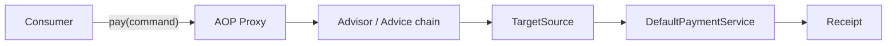
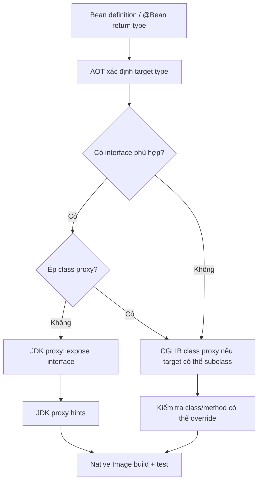

# Kiểu trả về, interface và thông tin target ảnh hưởng tới sinh proxy

Spring AOP không chèn advice trực tiếp vào mọi object của ứng dụng. Thay vào đó, Spring thường tạo một **proxy** đứng trước target object. Proxy nhận lời gọi từ consumer, tìm advisor phù hợp, chạy advice rồi chuyển lời gọi tới target. Hình dạng proxy phụ thuộc vào **interface mà bean công bố**, **kiểu target Spring biết được** và **cấu hình chọn JDK proxy hay CGLIB**.

Trong ứng dụng Spring Boot Native Image, các thông tin này còn quan trọng ở giai đoạn build. Spring AOT phân tích bean definitions để chuẩn bị container và các proxy có thể xác định trước. Nếu kiểu bean bị khai báo quá chung, target chỉ được tìm thấy bằng dữ liệu runtime hoặc proxy interface được tạo động mà AOT không thể quan sát, kết quả sinh mã và native hints có thể thiếu thông tin.

## 1. Mục tiêu học tập

Sau bài này, bạn có thể:

- Giải thích quan hệ giữa target object, proxy object, interface và kiểu trả về của bean.
- Phân biệt JDK dynamic proxy và CGLIB class proxy.
- Dự đoán khi nào consumer có thể inject theo interface hoặc concrete class.
- Hiểu ảnh hưởng của return type trong `@Bean` method đến type prediction và Spring AOT.
- Đọc thông tin target thông qua `TargetSource`, `TargetClassAware` và `AopUtils`.
- Nhận diện giới hạn của final class, final method, private method và self-invocation.
- Kiểm tra proxy type và chuẩn bị proxy hints khi build Spring Boot Native Image.

## 2. Target object và proxy object là hai đối tượng khác nhau

Giả sử có service thanh toán:

```java
public interface PaymentOperations {
    Receipt pay(PaymentCommand command);
}

@Service
public class DefaultPaymentService implements PaymentOperations {
    @Override
    public Receipt pay(PaymentCommand command) {
        // Xử lý thanh toán.
        return new Receipt("accepted");
    }
}
```

Khi không có AOP, consumer có thể nhận trực tiếp một instance `DefaultPaymentService`. Khi có transaction advice, caching, security hoặc aspect tùy biến, Spring có thể trả về một proxy thay cho target:



- **Target object** chứa logic nghiệp vụ thật, ví dụ `DefaultPaymentService`.
- **Proxy object** là đối tượng mà consumer nhìn thấy và gọi.
- **Advice/Advisor** xác định logic bổ sung trước, sau hoặc bao quanh lời gọi.
- **TargetSource** cung cấp target object cho proxy. TargetSource mặc định thường trả lại cùng một target; các implementation khác có thể cung cấp target theo pool, thread hoặc cơ chế thay thế.

Proxy phải công bố một kiểu mà consumer có thể gọi. Với JDK proxy, kiểu công bố là một hoặc nhiều interface. Với CGLIB proxy, kiểu công bố là một subclass của target class.

## 3. Hai cách Spring tạo AOP proxy

Spring AOP sử dụng hai cơ chế phổ biến:

| Tiêu chí | JDK dynamic proxy | CGLIB class proxy |
| --- | --- | --- |
| Kiểu proxy | Đối tượng implement các interface được chọn | Subclass được sinh từ target class |
| Điều kiện | Cần ít nhất một interface được proxy | Có thể dùng khi target không có interface hoặc khi cấu hình ép class proxy |
| Kiểu có thể inject | Các interface proxy implement | Interface và target class nếu class có thể được subclass |
| Method chỉ có trên implementation | Không gọi được qua proxy nếu không nằm trong interface | Có thể gọi nếu method có thể override và proxy expose kiểu class |
| Final class | Không phải trở ngại riêng của JDK proxy | Không thể subclass |
| Final method | Có thể được intercept khi lời gọi đi qua JDK proxy interface | Không thể override để intercept |
| Private method | Không phải method trên interface nên không thể gọi qua proxy | Không thể override/intercept |
| Native Image | JDK proxy interfaces cần được biết và đăng ký hints | Spring AOT cần biết target/proxy type; phải kiểm thử các proxy class được tạo trước |

### 3.1. JDK dynamic proxy

JDK proxy tạo một object implement các interface được chỉ định. Ví dụ:

```java
PaymentOperations payment =
    (PaymentOperations) Proxy.newProxyInstance(
        PaymentOperations.class.getClassLoader(),
        new Class<?>[] { PaymentOperations.class },
        (proxy, method, args) -> {
            System.out.println("Before " + method.getName());
            try {
                return method.invoke(target, args);
            }
            catch (InvocationTargetException ex) {
                throw ex.getTargetException();
            }
        }
    );
```

Đây là ví dụ Java Reflection API minh họa cơ chế JDK proxy, không phải cách khuyến nghị để tự tạo proxy trong Spring. Spring quản lý target, advice và exception handling qua AOP infrastructure.

Đặc điểm quan trọng:

- Proxy là instance của `PaymentOperations`.
- Proxy **không phải** instance của `DefaultPaymentService`.
- Consumer có thể gọi `pay` qua interface.
- Method chỉ có trong `DefaultPaymentService` nhưng không khai báo trong interface không thể được gọi qua reference proxy kiểu `PaymentOperations`.

Nếu ép cast:

```java
Object bean = applicationContext.getBean("paymentService");

PaymentOperations operations = (PaymentOperations) bean; // Hợp lệ
DefaultPaymentService concrete = (DefaultPaymentService) bean;
// ClassCastException nếu bean đang được expose bằng JDK proxy.
```

Vì vậy, khi dùng JDK proxy, consumer nên phụ thuộc vào **interface contract** thay vì concrete implementation.

### 3.2. CGLIB class proxy

CGLIB tạo một subclass của target class. Proxy có thể override các method có thể override và chèn interceptor trước khi delegate tới target.

Ví dụ:

```java
public class DefaultPaymentService {
    public Receipt pay(PaymentCommand command) {
        return new Receipt("accepted");
    }
}
```

Khi được tạo bằng CGLIB, proxy có dạng khái niệm:

```java
class DefaultPaymentService$$SpringCGLIBProxy
        extends DefaultPaymentService {
    @Override
    public Receipt pay(PaymentCommand command) {
        // Chạy interceptor chain rồi delegate tới target.
        return interceptorChain.invoke(target, command);
    }
}
```

Đây là **mã giả mô tả quan hệ kế thừa**, không phải tên class hay source code Spring thực sự sinh ra. Vì proxy là subclass nên nó có thể được gán vào biến kiểu target class, miễn là target class có thể được subclass.

Các giới hạn cần nhớ:

- Class `final` không thể được CGLIB subclass.
- Method `final` không thể override nên không thể được advice theo cơ chế subclass proxy.
- Method `private` không thể override và không phải điểm gọi qua proxy.
- Method `static` thuộc về class, không dispatch đa hình qua instance, nên không được AOP proxy intercept như instance method.
- Method package-private trong superclass thuộc package khác có thể không truy cập/override được và bị giới hạn tương tự method không visible.

Với Kotlin, class và method mặc định là `final` nếu không dùng plugin mở class/method hoặc khai báo `open`. Khi ép CGLIB, cần kiểm tra bytecode cuối cùng và các quy tắc mở class của dự án.

## 4. Cấu hình chọn kiểu proxy

### 4.1. Mặc định của Spring Framework và Spring Boot

Hai mặc định thường bị nhầm:

- **Spring Framework core:** khi target có interface và không ép class proxy, Spring AOP có thể dùng JDK dynamic proxy; nếu target không có interface, CGLIB được dùng.
- **Spring Boot auto-configuration:** mặc định cấu hình Spring AOP dùng CGLIB class proxy. Có thể chuyển sang JDK proxy bằng property `spring.aop.proxy-target-class=false`.

Trong `application.properties`:

```properties
# Yêu cầu Spring Boot sử dụng JDK interface proxies
spring.aop.proxy-target-class=false
```

Hoặc ép CGLIB:

```properties
spring.aop.proxy-target-class=true
```

Với cấu hình thuần Spring Framework:

```java
@Configuration
@EnableAspectJAutoProxy(proxyTargetClass = false)
class AopConfiguration {
}
```

Đặt `proxyTargetClass=true` để yêu cầu class-based proxy. Các cấu hình AOP/transaction khác nhau có thể cùng tham gia một auto-proxy creator thống nhất; một cấu hình ép class proxy có thể làm các proxy liên quan khác cũng chuyển sang CGLIB. Vì vậy, hãy xác minh proxy thực tế thay vì chỉ nhìn một annotation riêng lẻ.

### 4.2. Không chọn proxy type chỉ vì hiệu năng

Chênh lệch hiệu năng giữa JDK proxy và CGLIB thường không nên là tiêu chí quyết định chính. Hãy chọn theo:

- Contract mà consumer cần sử dụng.
- Có cần expose method ngoài interface không.
- Target class có thể subclass không.
- Các bean có được inject theo interface hay concrete class.
- Khả năng AOT/native và metadata mà build cần biết.
- Khả năng kiểm thử và bảo trì của thiết kế.

## 5. Kiểu trả về và interface ảnh hưởng thế nào?

Proxy có thể chỉ expose một phần API của target. Kiểu trả về ở nhiều vị trí quyết định Spring và Java có thể nhìn thấy phần API nào.

### 5.1. Interface return type giới hạn contract mà consumer nhìn thấy

Giả sử:

```java
public interface PaymentOperations {
    Receipt pay(PaymentCommand command);
}

public class DefaultPaymentService implements PaymentOperations {
    @Override
    public Receipt pay(PaymentCommand command) {
        return new Receipt("accepted");
    }

    public void rebuildSettlementCache() {
        // API nội bộ chỉ có trên implementation.
    }
}
```

Với JDK proxy chỉ expose `PaymentOperations`:

- Consumer gọi được `pay`.
- Consumer không gọi được `rebuildSettlementCache` qua proxy.
- Việc target class có method public không làm method đó tự xuất hiện trong interface proxy.

Nếu method là một phần contract mà consumer cần, hãy đưa nó vào interface phù hợp hoặc dùng class proxy nếu có lý do rõ ràng.

### 5.2. @Bean return type cần đủ chính xác cho Spring AOT

Spring AOT phân tích bean definitions trong build time và không dựa vào việc khởi tạo mọi bean instance để suy luận lại tất cả metadata. Vì vậy, return type của `@Bean` method nên là **kiểu cụ thể nhất có thể công bố một cách chính xác**.

Ví dụ return type quá chung:

```java
@Configuration(proxyBeanMethods = false)
class PaymentConfiguration {
    @Bean
    PaymentOperations paymentService() {
        return new DefaultPaymentService();
    }
}
```

Trong quá trình AOT, kiểu được khai báo cho bean là `PaymentOperations`. Những metadata chỉ có trên `DefaultPaymentService`, ví dụ các annotated members hoặc lifecycle callback riêng, có thể không được phát hiện khi AOT phân tích bean definition.

Nên khai báo return type cụ thể:

```java
@Configuration(proxyBeanMethods = false)
class PaymentConfiguration {
    @Bean
    DefaultPaymentService paymentService() {
        return new DefaultPaymentService();
    }
}
```

Consumer vẫn có thể inject qua interface:

```java
@Service
class CheckoutService {
    private final PaymentOperations payments;

    CheckoutService(PaymentOperations payments) {
        this.payments = payments;
    }
}
```

Hai quyết định này phục vụ hai mục tiêu khác nhau:

1. **Return type của factory method:** cung cấp thông tin target type đủ chính xác cho container và AOT.
2. **Kiểu injection của consumer:** phụ thuộc vào contract mà proxy expose. Với JDK proxy, inject interface; không ép cast về implementation.

Khai báo return type concrete không có nghĩa mọi proxy runtime sẽ là instance của concrete class. Nếu Spring tạo JDK proxy, object cuối cùng vẫn chỉ implement các interface được proxy.

### 5.3. Tránh return type quá tổng quát

Những khai báo sau thường làm giảm thông tin AOT có thể biết:

```java
@Bean
Object paymentService() {
    return new DefaultPaymentService();
}

@Bean
PaymentOperations anotherPaymentService() {
    return new DefaultPaymentService();
}
```

`Object` hoặc interface tổng quát có thể che mất:

- Annotation trên implementation class.
- Các method được dùng làm lifecycle callbacks.
- Field/method injection được khai báo trên implementation.
- Metadata phục vụ xác định target class và proxy.
- Các loại cụ thể được cần đến khi phân tích pointcut hoặc proxy.

Hãy khai báo `DefaultPaymentService` nếu đó là implementation thật và có thể biết trước. Nếu dùng `FactoryBean` hoặc đăng ký definition thủ công, cung cấp type/generic metadata rõ ràng, ví dụ `ResolvableType` cho generic target.

## 6. Target class và TargetSource ảnh hưởng đến sinh proxy

### 6.1. TargetSource cung cấp target metadata

`TargetSource` là abstraction để AOP proxy lấy target object khi có method invocation. Interface này cung cấp các thông tin quan trọng:

- `getTargetClass()`: kiểu target mà proxy dự kiến làm việc cùng.
- `isStatic()`: target có cố định hay không.
- `getTarget()`: lấy target instance cho lời gọi.
- `releaseTarget(target)`: trả target về nguồn quản lý khi cần.

`TargetSource` kế thừa hợp đồng `TargetClassAware`, trong đó `getTargetClass()` cho phép Spring biết kiểu target mà không cần dựa vào một instance đã được khởi tạo. Đây là metadata quan trọng khi container cần dự đoán kiểu bean hoặc chuẩn bị proxy.

Với target source thông thường, cùng một object được trả lại cho mọi lời gọi. Với pooling hoặc hot-swappable target source, target instance có thể thay đổi nhưng proxy phải giữ một contract tương thích.

### 6.2. Vì sao target class phải xác định được?

Để tạo proxy, Spring cần biết:

- Với JDK proxy: những interface nào proxy phải implement.
- Với CGLIB: class nào sẽ được subclass.
- Những method nào có thể được advise và method nào có thể được gọi qua proxy.
- Những kiểu cần được Spring AOT và Native Image giữ lại.

Nếu target source chỉ trả về object có class được quyết định bằng dữ liệu runtime, Spring không thể mặc nhiên tạo trước một proxy có hình dạng chính xác. Với nhiều target class khác nhau, tất cả target phải tương thích với cùng contract mà proxy công bố.

### 6.3. Đọc target metadata khi debug

Spring cung cấp các tiện ích để phân biệt proxy với target class:

```java
import org.springframework.aop.support.AopUtils;

Object bean = applicationContext.getBean("paymentService");

System.out.println("JDK proxy: " + AopUtils.isJdkDynamicProxy(bean));
System.out.println("CGLIB proxy: " + AopUtils.isCglibProxy(bean));
System.out.println("Target class: " + AopUtils.getTargetClass(bean).getName());
```

`AopUtils.getTargetClass(bean)` cố gắng lấy target class thay vì chỉ trả về class sinh ra của proxy. Khi cần kiểm tra chuỗi proxy lồng nhau, Spring còn có các tiện ích trong `AopProxyUtils`. Đây là công cụ chẩn đoán; không nên dùng thao tác unwrap target để bypass advice trong luồng nghiệp vụ.

### 6.4. this và target trong pointcut

Vì Spring AOP là proxy-based, `this` và `target` có ý nghĩa khác nhau:

- `this` tham chiếu đối tượng proxy.
- `target` tham chiếu đối tượng nghiệp vụ nằm phía sau proxy.

Ví dụ:

```java
@Aspect
@Component
class PaymentAspect {
    @Before("this(com.example.payment.PaymentOperations)")
    void calledThroughPaymentProxy() {
        // Kiểu proxy implement PaymentOperations.
    }

    @Before("target(com.example.payment.DefaultPaymentService)")
    void targetIsDefaultPaymentService() {
        // Target object là DefaultPaymentService.
    }
}
```

Với JDK proxy, `this(PaymentOperations)` có thể match vì proxy implement interface. `target(DefaultPaymentService)` match theo class của object đích. Nếu đổi kiểu proxy hoặc target, kết quả pointcut có thể khác.

## 7. Kiểu trả về của method và API proxy

Kiểu trả về của method được expose trên interface là contract mà consumer biên dịch dựa vào. Nếu implementation có covariant return type, consumer gọi qua interface vẫn nhìn thấy kiểu trả về được khai báo ở interface.

Ví dụ:

```java
interface PaymentOperations {
    PaymentResult pay(PaymentCommand command);
}

class DefaultPaymentService implements PaymentOperations {
    @Override
    public AcceptedPayment pay(PaymentCommand command) {
        return new AcceptedPayment("accepted");
    }
}
```

Nếu `AcceptedPayment` là subtype của `PaymentResult`, implementation có thể dùng covariant return type. Nhưng khi gọi qua JDK proxy reference `PaymentOperations`, kiểu compile-time của kết quả là `PaymentResult`. Consumer không nên phụ thuộc vào kiểu cụ thể hơn nếu interface không công bố kiểu đó.

Điều này quan trọng với:

- Generic service interface và type erasure.
- API trả về subtype chỉ được biết trên implementation.
- Method có annotation hoặc metadata riêng trên implementation.
- Reflection/serialization của giá trị trả về trong Native Image.

Nếu controller hoặc client cần serialize một DTO, hãy đảm bảo DTO đó được suy ra hoặc được cung cấp runtime hints. Proxy method return type và DTO runtime type là hai lớp metadata khác nhau.

## 8. Tác động tới Spring AOT và GraalVM Native Image

### 8.1. AOT cần biết bean type trước khi có instance

Trong AOT processing, Spring chuẩn bị ApplicationContext dựa trên bean definitions và các metadata có thể xác định ở build time. AOT không đơn giản khởi tạo toàn bộ ứng dụng như runtime thông thường rồi quan sát mọi object. Do đó, return type của `@Bean` method và target class metadata có vai trò lớn.

Spring AOT có thể tạo:

- Java source code để khôi phục bean definitions và container state.
- Bytecode, thường bao gồm các dynamic proxy có thể xác định.
- `RuntimeHints` cho reflection, resource, serialization và JDK proxies.

Nếu bean definition chỉ công bố `Object` hoặc interface quá chung, AOT có thể không nhìn thấy implementation metadata cần thiết. Đây là lý do nên expose target type chính xác trong bean factory method trong khi consumer vẫn lập trình theo interface.

### 8.2. JDK proxy cần interface hints

GraalVM Native Image cần biết các interface được sử dụng để tạo JDK dynamic proxy. Spring AOT có thể thu thập các proxy được tạo bởi infrastructure Spring và tạo hints tương ứng khi thông tin đã biết.

Nếu ứng dụng tự tạo JDK proxy theo danh sách interface cố định, có thể đăng ký proxy hints:

```java
import org.springframework.aot.hint.RuntimeHints;
import org.springframework.aot.hint.RuntimeHintsRegistrar;

class PaymentProxyRuntimeHints implements RuntimeHintsRegistrar {
    @Override
    public void registerHints(
            RuntimeHints hints, ClassLoader classLoader) {
        hints.proxies().registerJdkProxy(PaymentOperations.class);
    }
}
```

Đây là ví dụ đăng ký một JDK proxy có interface `PaymentOperations`. Nếu proxy implement nhiều interface, phải đăng ký đúng tập interface mà code tạo proxy sử dụng.

### 8.3. CGLIB và proxy được tạo động

CGLIB class proxy dựa trên subclassing. Target class phải có thể subclass và các method cần advice phải có thể override. Spring AOT có thể chuẩn bị bytecode cho các proxy có thể xác định trong quá trình phân tích; nhưng code tự tạo proxy hoặc target class từ dữ liệu chỉ xuất hiện lúc runtime có thể vượt ngoài những gì AOT suy ra được.

Vì vậy:

- Tránh tạo proxy cho class final hoặc method final khi cần CGLIB advice.
- Không dựa vào runtime classpath scanning để tìm implementation không có mặt khi build.
- Cung cấp target class/interface metadata chính xác trong bean definitions.
- Với JDK proxy tùy biến, đăng ký proxy hints.
- Với proxy phức tạp do thư viện tự tạo, kiểm tra AOT output và test chính native executable.

### 8.4. TargetSource động và closed-world

TargetSource có thể thay đổi target instance, nhưng các target phải có contract tương thích với proxy đã tạo. Nếu một pool chứa nhiều implementation, hãy đảm bảo chúng cùng implement interface được proxy hoặc cùng tương thích với target class proxy.

Native Image cần biết các kiểu sẽ được sử dụng. Nếu TargetSource tải implementation mới từ plugin hoặc tên class từ database sau khi deploy, những kiểu đó không tự xuất hiện trong binary. Hãy đăng ký các implementation cần thiết từ build input hoặc dùng một runtime registry với tập strategy class đã biết trước.

## 9. Những lỗi phổ biến khi chọn proxy

| Triệu chứng | Nguyên nhân | Cách xử lý |
| --- | --- | --- |
| `ClassCastException` khi cast bean về implementation | Bean đang được expose bằng JDK proxy chỉ implement interface | Inject interface hoặc cấu hình class proxy nếu thật sự cần concrete type |
| Không tìm thấy bean khi autowire concrete class | Proxy type không assignable với target implementation | Chọn contract interface hoặc xem lại `proxyTargetClass` |
| Method implementation không bị advice | Method không nằm trên interface JDK proxy hoặc không thể override với CGLIB | Đưa method vào interface hoặc dùng class proxy với method có thể override |
| CGLIB không tạo được proxy | Target class final hoặc method không thể override | Thiết kế class mở và kiểm tra method visibility |
| AOT không phát hiện metadata của implementation | `@Bean` return type khai báo quá chung | Trả về kiểu implementation cụ thể |
| Native Image báo thiếu JDK proxy | Proxy interface không được AOT nhận diện hoặc được tạo thủ công lúc runtime | Đăng ký `RuntimeHints.proxies()` cho interface cần thiết |
| Aspect không chạy khi gọi nội bộ | Self-invocation dùng `this` gọi method khác trên target, không đi qua proxy | Tách bean, gọi qua proxy hoặc dùng cơ chế phù hợp |
| TargetSource trả nhiều kiểu không tương thích | Proxy contract không bao phủ các target instance | Chuẩn hóa interface/target class hoặc tách proxy theo loại |
| Cấu hình Boot và Framework cho kết quả khác | Boot mặc định CGLIB, core Framework có thể dùng JDK proxy | Kiểm tra property/configuration và proxy thực tế |

## 10. Kiểm thử proxy type và target metadata

### 10.1. Kiểm tra loại proxy

Trong integration test:

```java
import static org.assertj.core.api.Assertions.assertThat;

import org.junit.jupiter.api.Test;
import org.springframework.aop.support.AopUtils;
import org.springframework.beans.factory.annotation.Autowired;
import org.springframework.boot.test.context.SpringBootTest;

@SpringBootTest
class PaymentProxyTests {
    @Autowired
    PaymentOperations paymentOperations;

    @Test
    void exposesPaymentOperationsContract() {
        assertThat(paymentOperations).isInstanceOf(PaymentOperations.class);
        assertThat(AopUtils.getTargetClass(paymentOperations))
            .isEqualTo(DefaultPaymentService.class);
    }
}
```

Nếu test muốn xác nhận cụ thể JDK hay CGLIB, thêm assertion tương ứng:

```java
assertThat(AopUtils.isJdkDynamicProxy(paymentOperations)).isTrue();
```

Hoặc:

```java
assertThat(AopUtils.isCglibProxy(paymentOperations)).isTrue();
```

Chỉ dùng assertion phù hợp với cấu hình test đang chọn. Không nên hard-code một proxy type nếu production được phép cấu hình khác; thay vào đó, test contract chung và tạo test riêng cho từng chế độ proxy cần hỗ trợ.

### 10.2. Ma trận kiểm thử

| Cấu hình | Target | Kết quả cần xác minh |
| --- | --- | --- |
| JDK proxy | Class implement interface | Proxy implement đúng interface; không cast về concrete class |
| JDK proxy | Class không có interface | Không thể dùng JDK proxy thuần; cần interface hoặc class proxy |
| CGLIB proxy | Class non-final | Proxy là subclass; method có thể override được advice |
| CGLIB proxy | Class final | Không thể tạo subclass proxy |
| CGLIB proxy | Final/private/static method | Không kỳ vọng method được intercept |
| AOT | `@Bean` trả về interface chung | Kiểm tra metadata implementation có bị che khuất |
| AOT | `@Bean` trả về concrete type | Kiểm tra generated initialization và proxy type |
| Native Image | JDK proxy interface đã biết | Kiểm tra proxy hints và lời gọi thật |
| Native Image | Proxy interface/target phát sinh runtime | Kiểm tra có thể dự đoán/đăng ký trước không |

### 10.3. Self-invocation

Proxy chỉ intercept lời gọi đi qua proxy. Nếu method trong target gọi method khác bằng `this`, lời gọi nội bộ không quay ra proxy:

```java
public class PaymentService {
    public void checkout() {
        this.validate(); // Không đi qua proxy.
    }

    @Transactional
    public void validate() {
        // Transaction advice có thể không được kích hoạt từ self-invocation.
    }
}
```

Nếu cần advice cho cả hai operation, tách method sang bean khác hoặc tổ chức lời gọi qua proxy. Việc đổi JDK sang CGLIB không tự giải quyết self-invocation.

## 11. Quy trình chọn proxy cho Spring Boot Native Image

1. **Xác định consumer contract:** consumer cần interface nào và có thật sự cần gọi method trên implementation không?
2. **Xác định target type:** bean được khai báo bằng component class hay `@Bean` method? Return type có đủ cụ thể cho AOT không?
3. **Chọn proxy strategy:** JDK nếu contract interface phù hợp; CGLIB nếu cần proxy class và class có thể subclass.
4. **Kiểm tra method:** method có public/protected và override được không? Có final/private/static không?
5. **Kiểm tra TargetSource:** target class có biết trước và các target instance có cùng contract không?
6. **Chạy AOT:** quan sát generated code/bytecode và RuntimeHints; kiểm tra proxy type đã được chuẩn bị.
7. **Build Native Image:** xác minh JDK proxy hints hoặc proxy classes cần thiết.
8. **Test binary native:** gọi các method qua đúng reference mà consumer sử dụng, kiểm tra advice, target resolution và lỗi kiểu.



## 12. Bài thực hành tổng hợp

**Bối cảnh:** service thanh toán có interface `PaymentOperations`, implementation `DefaultPaymentService` và aspect ghi thời gian thực thi. Ứng dụng Spring Boot sẽ được build thành Native Image.

1. Tạo `PaymentOperations` và `DefaultPaymentService` với method `pay`.
2. Tạo `@Aspect` dùng `@Around` để đo thời gian method `PaymentOperations.pay`.
3. Khởi chạy với cấu hình mặc định Spring Boot và dùng `AopUtils` kiểm tra loại proxy.
4. Đặt `spring.aop.proxy-target-class=false`, chạy lại và xác nhận bean vẫn implement `PaymentOperations` nhưng không phải `DefaultPaymentService`.
5. Đổi `@Bean` method return type từ `PaymentOperations` sang `DefaultPaymentService`; quan sát khác biệt trong AOT type prediction, rồi giữ consumer inject bằng interface.
6. Tạo một implementation final và thử ép CGLIB; ghi nhận vì sao subclass proxy không thể được tạo.
7. Chạy AOT, kiểm tra proxy bytecode/hints và build Native Image.
8. Chạy native binary, gọi endpoint thanh toán, xác nhận advice chạy và target class đúng.
9. Nếu tự tạo JDK proxy ngoài Spring AOP, đăng ký proxy hint cho đúng interface rồi build lại.

**Câu hỏi tự kiểm tra:** Vì sao một `@Bean` method trả về interface vẫn có thể chạy bình thường trên JVM nhưng làm AOT bỏ qua metadata của implementation? Vì AOT dựa trên bean definition và declared type; khi factory method chỉ công bố interface, implementation-specific members/lifecycle metadata có thể không được nhận diện trong lúc build.

## 13. Ghi nhớ

- Proxy và target là hai vai trò khác nhau: consumer gọi proxy, proxy chuyển lời gọi qua advice tới target được cung cấp bởi TargetSource.
- JDK proxy expose interface; CGLIB proxy là subclass của target class. Chọn theo contract và khả năng subclass, không chỉ theo thói quen.
- Spring Boot mặc định cấu hình CGLIB; Spring Framework core có thể dùng JDK proxy khi target có interface và không ép class proxy.
- JDK proxy không thể cast thành target implementation. CGLIB có thể assignable với target class nếu class không final và proxy tạo được.
- Return type của `@Bean` method nên là target type chính xác để Spring AOT nhìn thấy metadata implementation; consumer vẫn nên inject theo interface khi dùng JDK proxy.
- TargetClass/TargetSource và proxy interfaces cần xác định được khi AOT. Target class hoặc interface chỉ xuất hiện ở runtime làm cho proxy generation/native hints khó dự đoán.
- Spring AOT có thể sinh source, bytecode cho proxy và RuntimeHints cho JDK proxies; proxy tự tạo động cần được kiểm tra và đăng ký hints phù hợp.
- Kiểm thử proxy type, interface contract, target metadata, final methods và native executable để bảo đảm advice thật sự được áp dụng.

Khi return type, interface contract và target metadata được khai báo rõ, Spring có đủ thông tin để tạo proxy đúng và AOT có thể chuẩn bị những thành phần cần thiết trước khi GraalVM biên dịch ứng dụng.

## Tài liệu tham khảo chính thức

- [Spring Framework — Proxying Mechanisms](https://docs.spring.io/spring-framework/reference/core/aop/proxying.html): JDK dynamic proxy, CGLIB và các giới hạn của class proxy.
- [Spring Boot — Aspect-Oriented Programming](https://docs.spring.io/spring-boot/reference/features/aop.html): mặc định CGLIB và cấu hình `spring.aop.proxy-target-class`.
- [Spring Framework — Ahead of Time Optimizations](https://docs.spring.io/spring-framework/reference/core/aot.html): bean type precision, generated bytecode và runtime hints cho JDK proxies.
- [Spring Framework — TargetSource](https://docs.spring.io/spring-framework/reference/core/aop-api/targetsource.html): cách proxy lấy target object và các TargetSource implementations.
- [Spring Framework — Understanding AOP Proxies](https://docs.spring.io/spring-framework/reference/core/aop/proxying.html): proxy semantics, target và self-invocation.
