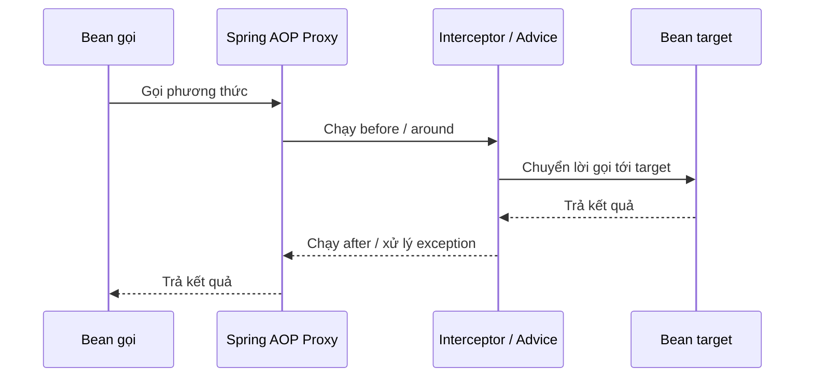
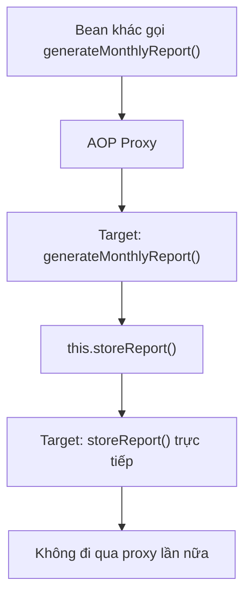
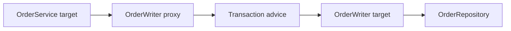

# Lời gọi nội bộ trong cùng đối tượng và các giới hạn AOP vốn có

## Mục tiêu bài học

Spring AOP thường áp dụng advice thông qua **proxy** bao quanh bean. Khi một phương thức của bean được gọi từ bean khác, lời gọi có thể đi qua proxy để Spring thực hiện transaction, cache, async, retry hoặc logic aspect. Tuy nhiên, khi một phương thức trong đối tượng gọi trực tiếp một phương thức khác của chính đối tượng đó, lời gọi nội bộ thường bỏ qua proxy.

Hiện tượng này được gọi là **self-invocation**. Đây là giới hạn vốn có của proxy-based AOP, không phải lỗi riêng của GraalVM Native Image.

Trong module **Spring Boot Native Image**, bạn cần hiểu ranh giới này để thiết kế bean và kiểm thử đúng cả trên JVM lẫn native executable. Spring AOT có thể chuẩn bị proxy và metadata cho native image, nhưng không tự biến lời gọi nội bộ thành lời gọi đi qua proxy.

Sau bài học, bạn có thể:

- Mô tả đường đi của một lời gọi qua proxy và lời gọi nội bộ trong cùng đối tượng.
- Giải thích vì sao `@Transactional`, `@Cacheable`, `@Async` và các advice khác có thể không chạy khi self-invocation.
- Nhận diện giới hạn của JDK dynamic proxy và class-based proxy.
- Chọn cách thiết kế lại bằng collaborator bean, transaction API hoặc AspectJ khi phù hợp.
- Kiểm tra hành vi AOP trên JVM và trên Spring Boot Native Image.

## 1. Spring AOP dựa trên proxy hoạt động như thế nào?

### 1.1. Proxy nằm giữa caller và target

Khi Spring tạo một bean có áp dụng advice, container có thể trả về một proxy đại diện cho bean đó. Caller tương tác với proxy; proxy chạy interceptor/advice phù hợp rồi mới chuyển lời gọi đến đối tượng target.



Proxy có thể áp dụng nhiều advice theo thứ tự phù hợp. Ví dụ, một lời gọi đến phương thức `@Transactional` có thể được transaction interceptor mở transaction trước khi gọi target và commit/rollback sau khi target trả về hoặc ném exception.

### 1.2. Self-invocation đi thẳng vào this

Xét một bean:

```java
@Service
class ReportService {

    public void generateMonthlyReport() {
        this.storeReport();
    }

    @Transactional
    public void storeReport() {
        // Ghi du lieu bao cao
    }
}
```

Khi một bean khác gọi `reportService.generateMonthlyReport()`, lời gọi bên ngoài có thể đi qua proxy. Nhưng bên trong target, biểu thức `this.storeReport()` gọi trực tiếp phương thức trên chính đối tượng hiện tại. Nó **không quay lại proxy**, nên transaction advice gắn với `storeReport()` không được kích hoạt bởi lời gọi đó.



Đây là điểm mấu chốt: annotation vẫn nằm trên phương thức, nhưng annotation không tự chặn mọi lời gọi Java. Với proxy-based AOP, advice chỉ được áp dụng khi lời gọi đi qua proxy và khớp pointcut/advisor tương ứng.

### 1.3. Lời gọi bên ngoài và lời gọi nội bộ khác nhau

| Cách gọi | Đường đi | Advice của phương thức đích |
|---|---|---|
| Bean A gọi bean B qua reference do Spring inject | Thường qua proxy của B | Có thể được áp dụng |
| Controller gọi service bean qua proxy | Thường qua proxy của service | Có thể được áp dụng |
| Phương thức trong target gọi `this.otherMethod()` | Trực tiếp trên cùng target | Bị bỏ qua trong proxy mode |
| Phương thức gọi một collaborator bean khác | Qua reference của collaborator | Có thể được áp dụng |

Từ “có thể” quan trọng: lời gọi qua proxy vẫn cần thỏa điều kiện của advisor, visibility/loại proxy và cấu hình tương ứng. Chỉ có proxy không có nghĩa mọi phương thức đều được advice.

## 2. Ví dụ thực tế: @Transactional bị bỏ qua khi self-invocation

### 2.1. Cấu hình dễ gây nhầm lẫn

Giả sử `placeOrder()` điều phối luồng đặt hàng, còn `persistOrder()` được kỳ vọng chạy trong transaction:

```java
@Service
class OrderService {

    private final OrderRepository orderRepository;

    OrderService(OrderRepository orderRepository) {
        this.orderRepository = orderRepository;
    }

    public void placeOrder(Order order) {
        validate(order);
        this.persistOrder(order);
    }

    @Transactional
    public void persistOrder(Order order) {
        orderRepository.save(order);
    }

    private void validate(Order order) {
        if (order == null) {
            throw new IllegalArgumentException("Order is required");
        }
    }
}
```

Một caller gọi `orderService.placeOrder(order)` thông qua Spring proxy. Tuy nhiên, `placeOrder()` không được đánh dấu `@Transactional`; khi target gọi `this.persistOrder(order)`, transaction interceptor không được đi qua. Vì vậy, transaction được khai báo trên `persistOrder()` không được mở bởi lời gọi nội bộ này.

Nếu repository tự có transaction riêng, một số thao tác database vẫn có thể chạy trong transaction do repository tạo ra. Điều đó không có nghĩa transaction boundary của `OrderService.persistOrder()` đã hoạt động. Hãy kiểm tra đúng boundary mà ứng dụng mong muốn.

### 2.2. Cả propagation cũng chịu ảnh hưởng

Giả sử phương thức nội bộ được khai báo:

```java
@Transactional(propagation = Propagation.REQUIRES_NEW)
public void writeAuditRecord(AuditRecord record) {
    auditRepository.save(record);
}
```

Nếu một phương thức khác trong cùng target gọi `this.writeAuditRecord(record)`, `REQUIRES_NEW` không được xử lý bởi transaction interceptor của proxy. Nếu đang có transaction bên ngoài, lời gọi nội bộ không tự tách ra một transaction mới.

Tương tự, các thuộc tính như `readOnly`, `timeout`, isolation level và rollback rules chỉ có hiệu lực khi transaction advice thật sự được áp dụng cho lời gọi đó.

### 2.3. Vì sao lỗi có thể khó phát hiện?

- Code compile bình thường và Spring vẫn khởi động thành công.
- Annotation `@Transactional` vẫn hiển thị trên method khi đọc source.
- Một số test gọi trực tiếp phương thức được đánh dấu transaction từ bên ngoài nên vẫn chạy đúng.
- Khi luồng nghiệp vụ đi qua phương thức điều phối nội bộ, transaction boundary có thể khác kỳ vọng.
- Repository hoặc một collaborator khác có thể tự tạo transaction, làm triệu chứng chỉ xuất hiện ở một số luồng.

Vì vậy, hãy kiểm tra **đường đi thực tế của lời gọi**, không chỉ tìm annotation trong source code.

## 3. Self-invocation ảnh hưởng đến những tính năng AOP nào?

Self-invocation không chỉ ảnh hưởng transaction. Bất kỳ tính năng nào được triển khai bằng proxy-based advice đều có thể gặp giới hạn tương tự.

### 3.1. @Cacheable và @CacheEvict

Ví dụ:

```java
@Service
class ProductService {

    public Product findProduct(String id) {
        return this.loadProduct(id);
    }

    @Cacheable(cacheNames = "products", key = "#id")
    public Product loadProduct(String id) {
        return productRepository.findById(id).orElseThrow();
    }
}
```

Nếu caller gọi `findProduct()` qua proxy, lời gọi nội bộ đến `loadProduct()` vẫn đi trực tiếp trên target. Cache interceptor không được gọi cho `loadProduct()`, nên cache có thể không được đọc/ghi như mong đợi.

Tương tự, một phương thức gọi nội bộ đến method có `@CacheEvict` có thể không kích hoạt việc xóa cache. Khi quan sát cache hit/miss, cần kiểm tra method có được gọi qua proxy hay không.

### 3.2. @Async

Ví dụ:

```java
@Service
class NotificationService {

    public void notifyCustomer(Customer customer) {
        this.sendAsync(customer);
    }

    @Async
    public void sendAsync(Customer customer) {
        // Gui thong bao
    }
}
```

Nếu `notifyCustomer()` gọi `this.sendAsync()`, lời gọi không đi qua async interceptor. Phương thức có thể chạy ngay trên thread hiện tại thay vì được gửi tới executor như kỳ vọng.

Điều này có thể làm tăng thời gian xử lý request hoặc khiến công việc blocking chạy trên thread không phù hợp.

### 3.3. Retry, validation và các advice khác

Các annotation như `@Retryable` (khi dùng Spring Retry), method validation hoặc custom aspect cũng dựa vào proxy/advice trong những cấu hình tương ứng. Nếu một phương thức được gọi nội bộ trên cùng target, advice của phương thức đó có thể không chạy.

| Tính năng | Triệu chứng có thể gặp khi self-invocation |
|---|---|
| `@Transactional` | Không mở transaction, không áp dụng `REQUIRES_NEW` hoặc rollback rule như mong muốn |
| `@Cacheable` | Không đọc/ghi cache qua interceptor |
| `@CacheEvict` | Cache không bị xóa ở lời gọi nội bộ |
| `@Async` | Công việc chạy đồng bộ trên caller thread |
| `@Retryable` | Không lặp lại khi phương thức ném exception |
| Custom `@Around` aspect | Không chạy logic logging, đo thời gian hoặc kiểm tra quyền được gắn trên method |

Điều kiện cụ thể vẫn phụ thuộc advisor, pointcut và cách bật tính năng. Bảng này mô tả giới hạn chung của proxy-based AOP.

Các tính năng cũng cần được bật và có hạ tầng tương ứng: transaction management, caching, async hoặc retry phải được cấu hình theo Spring Boot/Spring Framework và thư viện đang dùng (ví dụ **@EnableCaching**, **@EnableAsync**, **@EnableRetry** khi phù hợp). Việc bật đúng tính năng không loại bỏ giới hạn self-invocation.

## 4. Giới hạn của từng loại proxy

Spring AOP có thể sử dụng JDK dynamic proxy hoặc class-based proxy (thường được tạo bằng CGLIB). Việc chọn loại proxy ảnh hưởng đến kiểu bean mà caller nhìn thấy và những phương thức có thể được intercept.

### 4.1. JDK dynamic proxy

JDK dynamic proxy tạo một đối tượng proxy triển khai các interface. Caller thường cần tham chiếu bean qua interface:

```java
public interface PaymentService {
    void pay(PaymentRequest request);
}

@Service
class DefaultPaymentService implements PaymentService {
    @Override
    @Transactional
    public void pay(PaymentRequest request) {
        // Xu ly thanh toan
    }
}
```

Khi Spring tạo JDK proxy, lời gọi qua PaymentService có thể được intercept. Các phương thức không thuộc interface không được gọi qua kiểu proxy đó. Vì vậy, inject implementation class trực tiếp trong khi bean được bọc bằng JDK proxy có thể dẫn đến lỗi không tương thích kiểu.

### 4.2. Class-based proxy

Class-based proxy tạo lớp con của target class và override các phương thức có thể intercept. Ví dụ:

```java
@Service
class InvoiceService {

    @Transactional
    public void issueInvoice() {
        // Tao hoa don
    }
}
```

Proxy dựa trên lớp có thể áp dụng advice cho các phương thức override được. Tuy nhiên:

- Class final không thể được subclass bằng CGLIB.
- Method final không thể được override để chèn advice.
- Method private không thể được override và không phải join point của proxy-based method interception.
- Với Spring Framework hiện đại, class-based proxy có thể hỗ trợ method protected và package-private trong các trường hợp phù hợp; nếu cần khả năng tương thích rộng và API rõ ràng, public method trên service interface vẫn dễ dự đoán hơn.
- Method static không phải lời gọi instance đi qua proxy.

JDK proxy và class-based proxy đều có cùng giới hạn self-invocation: lời gọi trực tiếp từ target tới this.otherMethod() không đi qua proxy.

### 4.3. Chọn proxy không sửa được self-invocation

Chuyển từ JDK proxy sang CGLIB có thể giải quyết một số vấn đề kiểu tham chiếu hoặc khả năng proxy method, nhưng **không** làm cho lời gọi nội bộ tự quay lại proxy. Đây là vấn đề về đường đi của lời gọi, không phải chỉ là loại proxy.

## 5. Cách xử lý self-invocation

Không có một cách duy nhất phù hợp mọi trường hợp. Ưu tiên thiết kế sao cho ranh giới AOP thể hiện rõ qua các bean hoặc API mà caller gọi.

### 5.1. Tách phần cần advice thành collaborator bean

Đây thường là cách dễ hiểu và dễ kiểm thử nhất. Chuyển thao tác cần transaction sang một bean riêng:

```java
@Service
class OrderService {

    private final OrderWriter orderWriter;

    OrderService(OrderWriter orderWriter) {
        this.orderWriter = orderWriter;
    }

    public void placeOrder(Order order) {
        validate(order);
        orderWriter.persistOrder(order);
    }

    private void validate(Order order) {
        if (order == null) {
            throw new IllegalArgumentException("Order is required");
        }
    }
}

@Service
class OrderWriter {

    private final OrderRepository orderRepository;

    OrderWriter(OrderRepository orderRepository) {
        this.orderRepository = orderRepository;
    }

    @Transactional
    public void persistOrder(Order order) {
        orderRepository.save(order);
    }
}
```

Giờ OrderService gọi OrderWriter qua dependency được Spring inject. Nếu OrderWriter được proxy, lời gọi persistOrder() đi qua proxy và transaction interceptor có thể mở transaction.

Sơ đồ:



Lợi ích:

- Transaction boundary có tên và trách nhiệm rõ ràng.
- Có thể test OrderWriter độc lập.
- Không cần truy cập proxy của chính mình.
- Spring AOT có thể phân tích quan hệ bean và proxy rõ ràng hơn.

### 5.2. Đặt advice trên phương thức được gọi từ bên ngoài

Nếu toàn bộ thao tác placeOrder() cần chạy trong cùng một transaction, có thể đặt @Transactional ngay trên phương thức điều phối:

```java
@Service
class OrderService {

    @Transactional
    public void placeOrder(Order order) {
        validate(order);
        persistOrder(order);
    }

    private void persistOrder(Order order) {
        // Cac thao tac thuoc transaction cua placeOrder
    }

    private void validate(Order order) {
        // Kiem tra du lieu
    }
}
```

Caller gọi placeOrder() qua proxy, vì vậy transaction được mở cho toàn bộ thân phương thức. Lời gọi nội bộ persistOrder() vẫn không được intercept riêng, nhưng nếu nó chỉ cần tham gia transaction đã mở thì không cần một transaction advice thứ hai.

Không áp dụng cách này nếu mục tiêu là một boundary riêng như REQUIRES_NEW, timeout hoặc rollback rule độc lập cho phương thức nội bộ. Trong trường hợp đó, hãy dùng collaborator bean hoặc transaction API tường minh.

### 5.3. Dùng TransactionTemplate cho boundary lập trình

Nếu transaction chỉ bao quanh một đoạn code, TransactionTemplate làm ranh giới đó tường minh mà không phụ thuộc self-invocation:

```java
@Service
class OrderService {

    private final TransactionTemplate transactionTemplate;
    private final OrderRepository orderRepository;

    OrderService(
            TransactionTemplate transactionTemplate,
            OrderRepository orderRepository) {
        this.transactionTemplate = transactionTemplate;
        this.orderRepository = orderRepository;
    }

    public void placeOrder(Order order) {
        validate(order);
        transactionTemplate.executeWithoutResult(status -> {
            orderRepository.save(order);
            writeAuditRecord(order);
        });
    }

    private void writeAuditRecord(Order order) {
        // Ghi audit trong transaction hien tai
    }
}
```

TransactionTemplate cần được cấu hình với PlatformTransactionManager phù hợp. Đoạn code bên trong callback chạy trong transaction do template quản lý. Cách này hữu ích khi muốn ranh giới transaction nằm ngay tại một đoạn xử lý và không cần một method public riêng chỉ để nhận advice.

### 5.4. Gọi qua self proxy khi có lý do rõ ràng

Có thể inject tham chiếu proxy của chính bean rồi gọi qua tham chiếu đó, ví dụ với lazy self-reference:

```java
@Service
class ReportService {

    @Autowired
    @Lazy
    private ReportService self;

    public void generateMonthlyReport() {
        self.storeReport();
    }

    @Transactional
    public void storeReport() {
        // Ghi du lieu bao cao
    }
}
```

Lời gọi self.storeReport() đi qua proxy thay vì this. Tuy nhiên, self-injection tạo quan hệ phụ thuộc khó hiểu, có thể làm phức tạp vòng đời bean và khiến thiết kế khó kiểm thử hơn. Spring xem self-reference là lựa chọn dự phòng trong autowiring; không nên dùng nó thay cho việc tách trách nhiệm khi collaborator bean là giải pháp tự nhiên.

### 5.5. Dùng AopContext khi thật sự cần

Một cách khác là lấy proxy hiện tại từ AopContext:

```java
@EnableAspectJAutoProxy(exposeProxy = true)
@Configuration
class AopConfiguration {}

@Service
class ReportService {

    @Transactional(readOnly = true)
    public void generateMonthlyReport() {
        ((ReportService) AopContext.currentProxy()).storeReport();
    }

    @Transactional(propagation = Propagation.REQUIRES_NEW)
    public void storeReport() {
        // Ghi du lieu bao cao
    }
}
```

Cách này yêu cầu expose proxy và lời gọi phải đang ở trong invocation được proxy quản lý. Nếu không, AopContext.currentProxy() có thể ném IllegalStateException. Nó còn làm code nghiệp vụ phụ thuộc trực tiếp vào Spring AOP và cơ chế thread-bound. Chỉ dùng khi có lý do cụ thể và đã kiểm thử; collaborator bean thường dễ bảo trì hơn.

### 5.6. AspectJ weaving cho nhu cầu cần intercept self-invocation

AspectJ weaving hoạt động bằng cách thay đổi bytecode để áp dụng aspect, thay vì chỉ dựa vào proxy bao quanh bean. Vì vậy, lời gọi nội bộ có thể được intercept nếu join point và pointcut phù hợp.

Với transaction management, Spring hỗ trợ chế độ AspectJ qua cấu hình tương ứng như @EnableTransactionManagement(mode = AdviceMode.ASPECTJ) và dependency/weaving infrastructure phù hợp. Cần cấu hình compile-time weaving hoặc load-time weaving đúng cách; đây là lựa chọn nâng cao, không phải bật một thuộc tính đơn giản là mọi lời gọi sẽ tự được weave.

Khi dùng Native Image, nên ưu tiên xác định và weave bytecode trước giai đoạn AOT/native compilation. Load-time weaving dựa trên class loading động cần được đánh giá riêng vì Native Image sử dụng mô hình closed-world và không giống JVM runtime thông thường. Kiểm thử toàn bộ pipeline trên phiên bản Spring/AspectJ thực tế trước khi chọn cách này.

### 5.7. So sánh các lựa chọn

| Cách xử lý | Ưu điểm | Đánh đổi |
|---|---|---|
| Tách collaborator bean | Ranh giới rõ, dễ test, hợp với dependency injection | Có thể tăng số bean và cần thiết kế lại trách nhiệm |
| Đặt advice trên entry method | Đơn giản nếu toàn bộ use case cùng boundary | Không tạo boundary độc lập cho method nội bộ |
| TransactionTemplate | Boundary tường minh, không phụ thuộc proxy call | Code điều phối transaction trực tiếp |
| Self-injection / AopContext | Có thể gọi qua proxy mà không tách bean | Coupling cao, cần cấu hình và kiểm thử kỹ |
| AspectJ weaving | Có thể intercept self-invocation | Toolchain và build phức tạp hơn, cần xác minh native compatibility |

Trong hầu hết ứng dụng Spring Boot, bắt đầu bằng cách tách collaborator hoặc đặt transaction boundary tại entry method. Chỉ chọn self proxy hoặc weaving khi yêu cầu kỹ thuật thực sự cần đến chúng.

## 6. Kiểm tra và chẩn đoán self-invocation

### 6.1. Kiểm tra bean có được bọc proxy hay không

Spring cung cấp các tiện ích trong **AopUtils** để nhận diện proxy:

```java
import org.springframework.aop.support.AopUtils;

Object bean = applicationContext.getBean("orderService");

boolean isProxy = AopUtils.isAopProxy(bean);
boolean isJdkProxy = AopUtils.isJdkDynamicProxy(bean);
boolean isClassProxy = AopUtils.isCglibProxy(bean);
```

Các giá trị này giúp xác nhận bean được lấy từ context có phải proxy hay không và thuộc loại nào. Chúng **không** chứng minh một lời gọi cụ thể đã đi qua advice. Để xác minh, hãy quan sát trạng thái transaction/cache/thread hoặc log của interceptor tại đúng điểm thực thi.

### 6.2. Kiểm tra transaction ngay trong phương thức

Có thể dùng **TransactionSynchronizationManager** để quan sát transaction đang hoạt động:

```java
@Component
class TransactionProbe {

    private volatile boolean transactionActive;

    void record() {
        transactionActive =
                TransactionSynchronizationManager.isActualTransactionActive();
    }

    boolean wasTransactionActive() {
        return transactionActive;
    }
}

@Service
class ProbeService {

    private final TransactionProbe probe;

    ProbeService(TransactionProbe probe) {
        this.probe = probe;
    }

    public void outerCall() {
        this.transactionalMethod();
    }

    @Transactional
    public void transactionalMethod() {
        probe.record();
    }
}
```

Khi caller gọi **outerCall()** qua proxy, lời gọi nội bộ tới **transactionalMethod()** không kích hoạt transaction interceptor; probe ghi nhận không có transaction do method đó tạo ra. Khi caller gọi trực tiếp bean proxy bằng **transactionalMethod()**, transaction interceptor có thể mở transaction và probe ghi nhận trạng thái active.

Ví dụ này cần một **PlatformTransactionManager** hợp lệ và cấu hình transaction management. Không đánh dấu chính test method là **@Transactional**, nếu không transaction của test có thể làm sai kết quả quan sát. Trong hệ thống thực, kiểm tra thêm transaction do repository hoặc framework khác tạo ra.

### 6.3. Test so sánh lời gọi ngoài và lời gọi nội bộ

Ví dụ test minh họa với Spring Boot Test và AssertJ:

```java
@SpringBootTest
class SelfInvocationTransactionTests {

    @Autowired
    ProbeService probeService;

    @Autowired
    TransactionProbe probe;

    @Test
    void internalCallDoesNotApplyMethodTransactionAdvice() {
        probeService.outerCall();

        assertThat(probe.wasTransactionActive()).isFalse();
    }

    @Test
    void externalCallPassesThroughTransactionProxy() {
        probeService.transactionalMethod();

        assertThat(probe.wasTransactionActive()).isTrue();
    }
}
```

Đây là test khái niệm; dự án cần có transaction manager, test dependency và các import tương ứng. Test thứ nhất chứng minh lời gọi nội bộ bỏ qua advice của method; test thứ hai làm đối chứng bằng lời gọi từ bên ngoài qua proxy.

### 6.4. Quan sát log và thread

Khi cần chẩn đoán:

- Bật log ở mức phù hợp cho package transaction interceptor, ví dụ **org.springframework.transaction.interceptor**, để quan sát transaction boundary.
- Ghi nhận **Thread.currentThread().getName()** trong phương thức được đánh dấu **@Async**; nếu self-invocation, phương thức có thể chạy trên caller thread.
- Với cache, bật log của cache implementation hoặc dùng spy/mock để xác nhận cache get/put/evict có thực sự được gọi.
- Với retry, đếm số lần thực thi body và kiểm tra advisor/pointcut có áp dụng không.

Log chỉ là bằng chứng hỗ trợ. Kết hợp log với test có assertion về trạng thái hoặc số lần gọi để tránh kết luận dựa trên một thông báo startup chung.

## 7. Self-invocation trong Spring AOT và GraalVM Native Image

### 7.1. AOT chuẩn bị proxy, không thay đổi ngữ nghĩa lời gọi Java

Spring AOT phân tích cấu hình ứng dụng và chuẩn bị các thành phần cần cho runtime. Với các proxy mà Spring có thể nhận diện, AOT có thể sinh mã/hints cần thiết để native compiler xử lý proxy phù hợp.

Tuy nhiên, AOT **không tự viết lại**:

```java
this.transactionalMethod();
```

thành một lời gọi qua proxy. Native executable vẫn thực hiện lời gọi instance trực tiếp theo ngữ nghĩa Java. Vì vậy, nếu self-invocation đã bỏ qua transaction/cache/async advice trên JVM proxy mode, việc biên dịch thành native không tự khắc phục vấn đề đó.

### 7.2. Proxy được tạo trước và proxy động tùy biến

Trong ứng dụng Spring Boot Native Image:

- Proxy do Spring quản lý và phát hiện trong quá trình AOT có thể được xử lý thông qua generated code hoặc runtime hints phù hợp với phiên bản framework.
- JDK proxy, class-based proxy và proxy cho interface tổ hợp cần được kiểm tra theo kiểu proxy mà ứng dụng thực sự dùng.
- Thư viện tự tạo proxy động, tạo class bằng bytecode hoặc dùng reflection tùy biến có thể cần metadata/hints bổ sung.
- Không thêm Runtime Hints để chữa self-invocation; hints chỉ giải quyết khả năng giữ metadata hoặc tạo proxy cần thiết, không đổi đường đi của lời gọi nội bộ.

### 7.3. Kiểm thử cả JVM và native

Một quy trình kiểm thử hữu ích:

1. Chạy test JVM để xác nhận ranh giới proxy và self-invocation.
2. Chạy Spring AOT processing, kiểm tra proxy/bean metadata cần thiết đã được chuẩn bị.
3. Build native executable hoặc native container image.
4. Chạy smoke/integration test trên native, xác nhận transaction, cache, async hoặc retry có hành vi đúng.
5. So sánh log, thread, transaction state và kết quả nghiệp vụ giữa JVM và native.

Nếu ứng dụng dùng AspectJ weaving, bảo đảm bytecode đã được weave **trước** giai đoạn AOT/native compilation. Sau đó test đúng artifact đã weave; test JVM chạy bằng bytecode chưa weave không chứng minh được hành vi của native build.

### 7.4. Các lỗi thường gặp

| Triệu chứng | Nguyên nhân có thể | Hướng xử lý |
|---|---|---|
| **@Transactional** trên method nội bộ không mở transaction | Self-invocation gọi trực tiếp target | Tách collaborator hoặc đặt transaction trên entry method |
| **REQUIRES_NEW** không tạo transaction riêng | Transaction interceptor không nhận được lời gọi nội bộ | Gọi qua collaborator proxy hoặc dùng transaction API phù hợp |
| **@Cacheable** không tạo cache hit | Method cacheable được gọi bằng this | Chuyển method sang bean khác hoặc gọi qua proxy có chủ đích |
| **@Async** vẫn chạy trên request thread | Lời gọi nội bộ bỏ qua async interceptor | Tách async worker thành bean riêng và gọi qua dependency |
| Inject implementation class thất bại | Bean đang được bọc bằng JDK proxy chỉ công khai interface | Inject qua interface hoặc chọn class-based proxy nếu phù hợp |
| Advice không áp dụng cho method final/private | Proxy không thể override/intercept method đó | Đổi thiết kế/visibility hoặc cân nhắc weaving khi có lý do |
| JVM chạy đúng nhưng native thiếu proxy | Proxy động tùy biến hoặc metadata chưa được chuẩn bị | Kiểm tra AOT output, Runtime Hints và hỗ trợ của thư viện |
| AOT/native chạy nhưng transaction vẫn sai | Lỗi self-invocation vốn có của proxy mode | Sửa ranh giới bean/lời gọi; không chỉ thêm hints |

## 8. Checklist thiết kế AOP an toàn

Trước khi dựa vào annotation AOP, hãy kiểm tra:

- Caller có gọi bean thông qua reference do Spring quản lý không?
- Phương thức cần advice có được gọi từ bean khác hay chỉ được gọi bằng this?
- Bean đang dùng JDK proxy hay class-based proxy?
- Phương thức có nằm trên interface được proxy công khai không?
- Method có phải private, final hoặc thuộc class final không?
- Transaction boundary có đặt đúng tại entry point của use case không?
- Nếu cần transaction lồng nhau hoặc REQUIRES_NEW, lời gọi có thật sự đi qua proxy không?
- Test có quan sát trạng thái transaction/cache/thread thay vì chỉ kiểm tra annotation tồn tại không?
- Native build có xử lý proxy và metadata tùy biến mà ứng dụng sử dụng không?

## 9. Bài thực hành

1. Tạo **OrderService** với **placeOrder()** gọi nội bộ **persistOrder()**; chỉ đánh dấu **persistOrder()** bằng **@Transactional**.
2. Dùng probe kiểm tra **TransactionSynchronizationManager.isActualTransactionActive()** trong **persistOrder()**. So sánh lời gọi qua **placeOrder()** và lời gọi trực tiếp **persistOrder()** từ bean được inject.
3. Tách **persistOrder()** sang **OrderWriter** bean. Chạy lại test và xác nhận transaction được mở khi **OrderService** gọi **OrderWriter**.
4. Thử cùng hiện tượng với **@Cacheable** hoặc **@Async**, quan sát cache operation hoặc thread name.
5. Build ứng dụng native và chạy lại test/smoke test để xác nhận hành vi proxy tương đương với thiết kế đã sửa.

### Câu hỏi tự kiểm tra

1. Vì sao một lời gọi qua proxy có thể áp dụng **@Transactional**, còn lời gọi **this.persistOrder()** trong cùng target lại không?
2. Chuyển từ JDK proxy sang CGLIB có giải quyết self-invocation không? Giải thích.
3. Khi nào nên tách collaborator bean thay vì dùng **AopContext.currentProxy()**?
4. Vì sao **@Profile** hoặc Runtime Hints không thể tự sửa đường đi của một lời gọi Java nội bộ?
5. Nếu cần intercept self-invocation ở nhiều nơi, khi nào AspectJ weaving đáng được cân nhắc và phải chuẩn bị gì trước native compilation?

**Ghi nhớ:** proxy-based AOP chỉ áp dụng advice cho lời gọi đi qua proxy. Lời gọi nội bộ bằng this đi thẳng tới target và bỏ qua interceptor, bất kể method có annotation. Hãy đặt boundary ở entry method, tách collaborator hoặc dùng transaction API tường minh; chỉ dùng self proxy hay AspectJ khi có lý do kỹ thuật rõ ràng. Spring AOT hỗ trợ chuẩn bị proxy cho Native Image nhưng không thay đổi giới hạn self-invocation vốn có.
