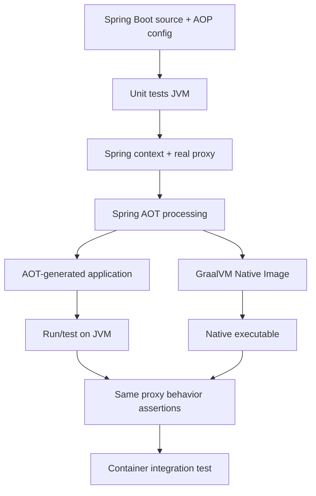

# Kiểm thử hành vi qua proxy thật trên JVM AOT và binary native

## 1. Vì sao cần kiểm thử proxy thật?

Spring AOP thường đặt proxy giữa caller và bean đích để thực thi transaction, security, logging, retry, metrics hoặc logic cross-cutting khác. Một unit test gọi trực tiếp class đích có thể xác nhận logic nghiệp vụ, nhưng không chứng minh lời gọi đã đi qua proxy và interceptor.

Khi chuyển ứng dụng Spring Boot sang **Spring AOT** và **GraalVM Native Image**, cần xác minh nhiều lớp hành vi:

- Spring có tạo đúng bean và proxy trong application context không?
- Proxy có dùng đúng chiến lược JDK interface hay class-based không?
- Advisor/Aspect có được áp dụng và chạy đúng thứ tự không?
- Lời gọi qua proxy có tới target, trả kết quả và truyền exception đúng không?
- Cùng hành vi đó có tồn tại trong context được xử lý AOT và executable native không?

Trong module **SPRING_BOOT_NATIVE_IMAGE**, kiểm thử này là một phần của xác nhận tương thích trước khi đo startup/bộ nhớ, đóng gói container và vận hành bản native. Một native build thành công chỉ chứng minh compiler tạo được executable; nó không chứng minh proxy và advice thực thi đúng trong mọi code path.



## 2. Phân biệt test target và test double

Để kiểm thử proxy, test phải lấy bean từ Spring container. Không tự tạo target bằng `new InvoiceService()` rồi gọi trực tiếp, vì object đó không đi qua proxy do Spring quản lý.

Ví dụ target:

```java
@Service
public class InvoiceService {
    public String issue(String customerId) {
        return "invoice:" + customerId;
    }
}
```

Aspect có side effect quan sát được:

```java
@Aspect
@Component
public class InvocationCounterAspect {
    private final AtomicInteger calls = new AtomicInteger();

    @Around("execution(* com.example.invoice.InvoiceService.issue(..))")
    public Object count(ProceedingJoinPoint joinPoint) throws Throwable {
        calls.incrementAndGet();
        return joinPoint.proceed();
    }

    public int count() {
        return calls.get();
    }
}
```

Test lấy bean từ application context:

```java
@SpringBootTest
class InvoiceProxyTest {

    @Autowired
    InvoiceService invoiceService;

    @Autowired
    InvocationCounterAspect counter;

    @Test
    void callPassesThroughSpringProxy() {
        assertThat(AopUtils.isAopProxy(invoiceService)).isTrue();

        String result = invoiceService.issue("C-100");

        assertThat(result).isEqualTo("invoice:C-100");
        assertThat(counter.count()).isEqualTo(1);
    }
}
```

Ví dụ cần dependency Spring AOP/AspectJ phù hợp và aspect được component scan. Bộ đếm giúp xác nhận advice đã chạy; chỉ kiểm tra `AopUtils.isAopProxy` chưa đủ chứng minh pointcut match và interceptor thực sự được gọi.

Trong test suite có nhiều test song song hoặc context dùng chung, bộ đếm cần reset/độc lập theo test để tránh phụ thuộc thứ tự. Có thể dùng một recorder test-scoped hoặc kiểm tra số lần tăng từ giá trị trước lời gọi.

## 3. Kiểm tra loại proxy thực tế

Spring có thể dùng JDK dynamic proxy hoặc class-based proxy. Dùng Spring AOP utilities để quan sát:

```java
assertThat(AopUtils.isAopProxy(invoiceService)).isTrue();

if (AopUtils.isJdkDynamicProxy(invoiceService)) {
    // Proxy triển khai interface.
}

if (AopUtils.isCglibProxy(invoiceService)) {
    // Class-based proxy.
}
```

Không nên luôn assert CGLIB nếu ứng dụng cho phép JDK proxy hoặc cấu hình thay đổi. Test cần khẳng định **hợp đồng kiến trúc mong muốn**: ví dụ phải dùng interface proxy vì client chỉ phụ thuộc interface, hoặc phải dùng class-based proxy vì bean không có interface.

Nếu kiểm tra class-based proxy, chú ý target class/method cần intercept không được `final` theo giới hạn subclass proxy. Method `private` cũng không thể được override để chèn advice theo cách này.

## 4. Kiểm thử kết quả, side effect và exception

Một proxy đúng phải duy trì hợp đồng của target, đồng thời thực hiện advice. Nên có ít nhất các trường hợp:

| Kịch bản | Điều cần xác minh |
|---|---|
| Lời gọi thành công | Advice chạy, target chạy, kết quả trả về đúng |
| Target ném exception | Advice chạy theo thiết kế, exception/cause được truyền đúng |
| Pointcut không match | Advice không chạy ngoài phạm vi dự kiến |
| Nhiều lời gọi | Số lần advice khớp số lần invocation |
| Lời gọi nội bộ self-invocation | Xác nhận rõ advice có/không chạy theo proxy semantics |
| Bean không đủ điều kiện | Context không tạo proxy ngoài ý muốn |

Ví dụ kiểm tra exception:

```java
assertThatThrownBy(() -> invoiceService.issue("INVALID"))
    .isInstanceOf(IllegalArgumentException.class)
    .hasMessageContaining("invalid customer");

assertThat(counter.count()).isEqualTo(1);
```

Assertion này giả định target ném exception và advice dùng `proceed()` rồi không nuốt exception. Nếu aspect có retry hoặc chuyển đổi exception, expected behavior cần phản ánh chính sách đó.

## 5. Kiểm tra thứ tự advisor và tương tác nhiều advice

Một bean có thể được áp dụng nhiều advice, ví dụ security, transaction và metrics. Thứ tự có thể ảnh hưởng đến kết quả:

- Security từ chối request trước khi target chạy.
- Transaction mở trước khi gọi target và commit/rollback sau đó.
- Metrics đo thời gian quanh lời gọi.
- Retry có thể gọi target nhiều lần.

Không chỉ kiểm tra từng aspect riêng; hãy kiểm tra tổ hợp ở luồng nghiệp vụ quan trọng. Dùng log/test recorder để xác nhận thứ tự vào/ra nếu thứ tự là một phần hợp đồng. Với transaction, xác minh rollback bằng trạng thái dữ liệu hoặc transaction manager thật phù hợp test environment, không chỉ assert annotation tồn tại.

Cũng cần phân biệt Spring proxy AOP với AspectJ compile-time/load-time weaving. Test của proxy-based Spring AOP không tự chứng minh weaving mode khác hoạt động giống nhau.

## 6. Self-invocation và ranh giới proxy

Trong proxy-based AOP, lời gọi từ một method của target sang method khác trên cùng `this` thường không đi qua proxy:

```java
@Service
class OrderService {

    public void placeOrder() {
        this.persistOrder();
    }

    @Transactional
    public void persistOrder() {
        // Persist order.
    }
}
```

Nếu `placeOrder()` gọi `persistOrder()` trực tiếp trên cùng object, transaction advice có thể không chạy. Đây là đặc tính proxy, không phải lỗi riêng Native Image.

Test nên có một trường hợp external call qua bean proxy và một trường hợp self-invocation nếu nghiệp vụ dựa vào nó. Cách khắc phục thường là tách phương thức có advice sang bean khác hoặc thiết kế ranh giới service để lời gọi đi qua proxy. Không dùng reflection để gọi nội bộ với kỳ vọng tự động giải quyết semantics này.

## 7. Kiểm thử ứng dụng sau Spring AOT trên JVM

Spring AOT xử lý application context tại build time và sinh source/resource/hints. Kiểm thử context AOT trên JVM giúp tách lỗi AOT khỏi lỗi riêng của Native Image compiler/runtime.

Quy trình tổng quát:

1. Chạy test JVM thông thường để có baseline.
2. Chạy tác vụ AOT của Spring Boot với profile/property mục tiêu.
3. Biên dịch generated AOT sources theo task graph của plugin.
4. Chạy ứng dụng dùng output AOT trên JVM nếu phiên bản plugin cung cấp task/run configuration tương ứng.
5. Lặp lại các assertion proxy: bean là proxy, advice chạy, target result và exception đúng.

Tên task và cách chạy AOT-processed application phụ thuộc Spring Boot Gradle/Maven Plugin version. Với Gradle, kiểm tra task graph bằng `./gradlew tasks --all`; với Maven, xem lifecycle goals được plugin cấu hình. Không giả định mọi phiên bản đều có một task tên giống nhau như `runAot` hoặc `bootRunAot`.

Ví dụ các bước Gradle thường gặp:

```bash
./gradlew test
./gradlew processAot
./gradlew compileAotJava
```

Các task trên minh họa giai đoạn xử lý AOT và biên dịch mã sinh ra; chúng chưa tự chứng minh application AOT đã chạy và proxy hoạt động. Hãy sử dụng cách chạy AOT-supported do phiên bản plugin cung cấp hoặc integration test thích hợp.

## 8. Kiểm thử trên binary native

Sau khi AOT và Native Image build thành công, cần chạy **chính executable vừa tạo**. Không chỉ chạy test trên JVM rồi suy luận binary native tương đương.

Một trình tự kiểm thử:

```bash
./gradlew nativeCompile
```

Sau đó chạy executable theo output path của project, ví dụ:

```bash
./build/native/nativeCompile/api-app
```

Đường dẫn/tên file thay đổi theo cấu hình Gradle; Maven thường dùng output dưới `target/`. Trên Windows, executable có thể có đuôi `.exe`. Xác minh đúng file được tạo ở build vừa chạy, không dùng artifact cũ.

Gọi endpoint nghiệp vụ kích hoạt proxy:

```bash
curl -i http://localhost:8080/api/invoices/C-100
```

Endpoint ví dụ cần được triển khai trong ứng dụng và gọi qua bean được Spring proxy. Để xác minh advice, nên quan sát side effect an toàn như counter, audit event hoặc test recorder. Log text đơn thuần có thể hữu ích nhưng không phải assertion mạnh nếu không kiểm soát cấu hình logging.

Với integration test native, có thể dùng khả năng native test của GraalVM Build Tools nếu dự án cấu hình phù hợp. Cách chạy test native phụ thuộc plugin và version; kiểm tra task list và tài liệu của dự án. Nếu không có native test task, chạy executable như một process riêng rồi gọi HTTP bằng test client.

## 9. Kiểm thử trong container

Native executable có thể hoạt động trên máy phát triển nhưng gặp vấn đề khi đóng gói container vì khác OS, libc, thư viện hệ thống, user hoặc cấu hình runtime.

Sau khi tạo application image bằng Cloud Native Buildpacks hoặc Dockerfile, test:

- Container khởi động và readiness thành công.
- Request đi qua controller/service proxy và advice thực sự chạy.
- Các biến môi trường/profile runtime đúng.
- Resource, thư viện native và file mount cần thiết tồn tại.
- User container có quyền phù hợp.
- Memory/CPU limit không làm process bị kill.
- Container restart vẫn giữ các dữ liệu cần bền vững.

Nếu proxy hoạt động trên executable local nhưng không hoạt động trong container, kiểm tra image có đúng binary/digest, đúng profile/config và cùng build report. Đừng lập tức thêm proxy hints khi nguyên nhân có thể là container đang chạy artifact cũ hoặc cấu hình khác.

## 10. Ma trận kiểm thử JVM, AOT JVM và native

| Hành vi | JVM thông thường | AOT-processed JVM | Native executable |
|---|---|---|---|
| Bean được tạo | PASS/FAIL | PASS/FAIL | PASS/FAIL |
| Bean là proxy theo strategy yêu cầu | PASS/FAIL | PASS/FAIL | PASS/FAIL |
| Advice chạy đúng pointcut | PASS/FAIL | PASS/FAIL | PASS/FAIL |
| Target trả kết quả đúng | PASS/FAIL | PASS/FAIL | PASS/FAIL |
| Exception được truyền đúng | PASS/FAIL | PASS/FAIL | PASS/FAIL |
| Transaction/security/retry | PASS/FAIL | PASS/FAIL | PASS/FAIL |
| Self-invocation semantics | PASS/FAIL | PASS/FAIL | PASS/FAIL |

Đây là bảng ghi kết quả cần điền bằng test thực tế. Không coi AOT-processed JVM là bắt buộc phải có một task riêng ở mọi phiên bản; nếu toolchain không cung cấp cách chạy output AOT trên JVM, ghi rõ phạm vi test thay thế và xác minh native trực tiếp.

## 11. Phân biệt lỗi proxy với lỗi Native Image metadata

Khi test native thất bại, phân loại trước:

| Dấu hiệu | Nhóm nguyên nhân | Kiểm tra |
|---|---|---|
| Bean không tồn tại | Component scan, profile, condition, AOT bean graph | Context configuration và AOT output |
| Bean tồn tại nhưng không phải proxy | AOP chưa bật, pointcut/advisor không match | Spring AOP configuration |
| Proxy có nhưng advice không chạy | Pointcut, self-invocation, method final/private | Proxy strategy và đường gọi |
| JDK proxy lỗi khi tạo | Interface set chưa được nhận diện/hints thiếu | ProxyHints và AOT integration |
| Class-based proxy lỗi | Subclass/bytecode generation không tương thích | Framework/library AOT support |
| Advice chạy nhưng target reflection lỗi | Reflection metadata thiếu | RuntimeHints/member category |
| Resource trong advice không đọc được | Resource metadata/path sai | Resource hints và classpath |
| Container không khởi động | OS/library/config/permission | Run image và deployment environment |

Proxy metadata, reflection metadata và resource hints giải quyết các vấn đề khác nhau. Không đăng ký tất cả mọi thứ một cách rộng rãi khi chưa xác định lỗi thuộc nhóm nào.

## 12. Nguyên tắc tạo test ổn định

- Lấy bean qua Spring context; không tự `new` target trong test proxy.
- Assert cả kết quả target và side effect của advice.
- Xác nhận proxy strategy theo hợp đồng, không hard-code generated class name.
- Reset counter/recorder giữa các test.
- Không để test phụ thuộc thứ tự chạy hoặc thời gian thực.
- Dùng dependency/configuration thật ở những phần cần xác minh AOP; mock chỉ ở ranh giới không thuộc mục tiêu test.
- Kiểm thử exception, pointcut không match và self-invocation.
- Chạy lại trên AOT output và native executable/container.
- Gắn test report với commit, toolchain và artifact digest.

## 13. Checklist trước khi chấp nhận proxy trong Native Image

- Bean mục tiêu được Spring quản lý và có proxy trong context.
- Proxy strategy đúng với thiết kế (JDK hoặc class-based).
- Aspect/advisor được phát hiện, pointcut match và advice thực thi.
- Target result, exception và side effects đúng.
- Các giới hạn final/private/self-invocation đã được xử lý.
- Spring AOT chạy với đúng profile và dependency graph.
- Metadata proxy/reflection/resource được bổ sung đúng nơi nếu cần.
- Native executable mới được chạy và test trên code path thật.
- Container image chạy đúng binary và cấu hình triển khai.
- Test report gắn với artifact cụ thể trước khi benchmark/phát hành.

## 14. Câu hỏi tự kiểm tra

1. Vì sao gọi trực tiếp target bằng `new` không kiểm tra được Spring AOP proxy?
2. `AopUtils.isAopProxy` chứng minh điều gì và chưa chứng minh điều gì?
3. Vì sao cần assert side effect của advice bên cạnh kết quả method?
4. Self-invocation ảnh hưởng thế nào tới transaction hoặc logging advice?
5. Khác biệt giữa kiểm thử JVM thông thường, AOT-processed JVM và native executable là gì?
6. Khi native proxy lỗi, làm sao phân biệt thiếu proxy metadata với pointcut không match?
7. Vì sao cần chạy lại integration test trong container đích?

**Ghi nhớ:** kiểm thử proxy phải đi qua bean thật do Spring quản lý và xác nhận cả target lẫn advice. Lặp lại cùng hợp đồng trên JVM, output AOT khi có thể chạy, native executable và container giúp chứng minh hành vi proxy tương thích trước khi phát hành Spring Boot Native Image.
