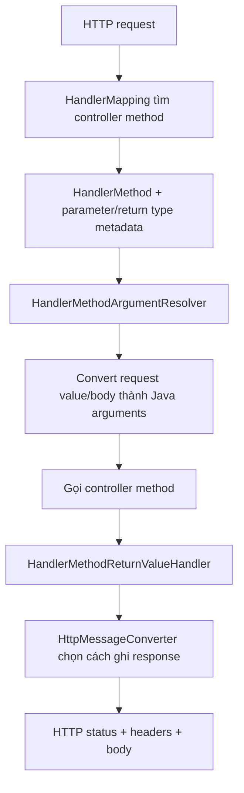
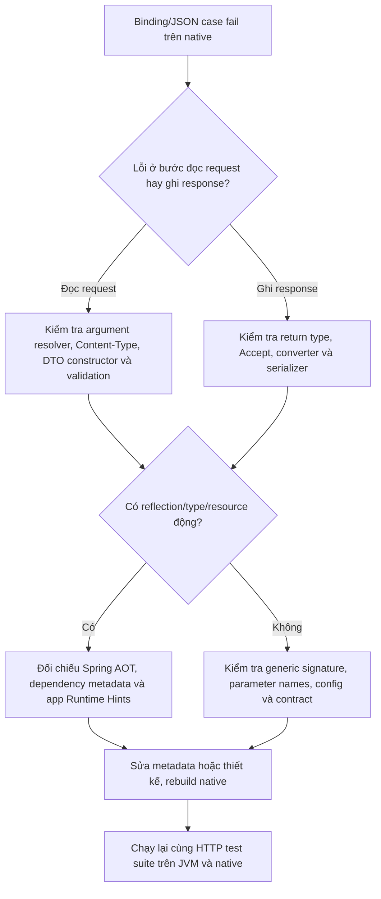

# Kiểu request, response được suy ra từ khai báo endpoint

Trong Spring Boot Web MVC, chữ ký của một endpoint là một phần quan trọng của hợp đồng HTTP. Spring đọc các annotation, kiểu tham số và kiểu trả về của phương thức controller để xác định **cách lấy dữ liệu từ request, chuyển đổi dữ liệu đó thành Java object, gọi phương thức và ghi kết quả thành response**.

Ví dụ, từ khai báo:

```java
@PostMapping("/orders")
OrderResponse create(@Valid @RequestBody CreateOrderRequest request) {
    // ...
}
```

Spring biết body cần được đọc và chuyển thành `CreateOrderRequest`, còn kết quả trả về là `OrderResponse` cần được ghi thành HTTP response. Jackson thường đảm nhiệm JSON conversion khi media type phù hợp. Với GraalVM Native Image, các kiểu dữ liệu, constructor, annotation và metadata mà quá trình binding/serialization cần phải được giữ lại hoặc khai báo phù hợp.

Bài học thuộc chương **Binding và JSON** của mô-đun `SPRING_BOOT_NATIVE_IMAGE`. Ta sẽ lần từ khai báo endpoint đến kiểu request/response, hiểu cách Spring MVC và message converter suy ra kiểu, nhận diện giới hạn generic type/parameter names, và kiểm thử đường binding trên native executable.

## 1. Spring MVC suy ra hợp đồng endpoint từ đâu?

Spring MVC tìm các handler method trong controller và xây dựng thông tin về endpoint từ:

- Annotation mapping: `@RequestMapping`, `@GetMapping`, `@PostMapping`, `@PutMapping`, `@PatchMapping`, `@DeleteMapping`.
- Annotation trên tham số: `@PathVariable`, `@RequestParam`, `@RequestHeader`, `@CookieValue`, `@RequestBody`, `@ModelAttribute`, `@RequestPart`.
- Kiểu Java của tham số: `String`, `long`, record, DTO, collection, generic type hoặc multipart type.
- Annotation và kiểu trả về: `@ResponseBody`, `ResponseEntity<T>`, `HttpEntity<T>`, `ModelAndView`, `void`, `StreamingResponseBody` và các kiểu reactive khi dùng stack tương ứng.
- Media type và message converter được cấu hình: `Content-Type`, `Accept`, Jackson converter, string converter, byte-array converter và các converter khác.



Điểm cần nhớ: Spring không suy ra hợp đồng chỉ từ tên method. Annotation mapping và kiểu tham số/return type tạo nên thông tin mà framework dùng. Nếu khai báo không rõ hoặc có nhiều cách diễn giải, cần dùng annotation tường minh để tránh phụ thuộc vào convention.

## 2. Đọc kiểu request từ tham số controller

Một endpoint có thể nhận dữ liệu từ nhiều phần của HTTP request. Mỗi annotation chọn một cơ chế binding khác nhau.

```java
@RestController
@RequestMapping("/api/orders")
class OrderController {

    @GetMapping("/{id}")
    OrderResponse find(
            @PathVariable("id") long id,
            @RequestParam(name = "expand", defaultValue = "false") boolean expand,
            @RequestHeader(name = "X-Request-Id", required = false) String requestId) {
        // ...
    }

    @PostMapping
    OrderResponse create(@RequestBody CreateOrderRequest request) {
        // ...
    }
}
```

| Khai báo | Nguồn dữ liệu | Kiểu Java Spring cần bind |
| --- | --- | --- |
| `@PathVariable("id") long id` | Một đoạn trong URL path | `long` |
| `@RequestParam("expand") boolean expand` | Query parameter hoặc form parameter theo cấu hình | `boolean` |
| `@RequestHeader("X-Request-Id") String requestId` | HTTP header | `String` |
| `@CookieValue("SESSION") String session` | Cookie | `String` |
| `@RequestBody CreateOrderRequest request` | HTTP body | `CreateOrderRequest` |
| `@ModelAttribute SearchCriteria criteria` | Query/form fields bind vào object | `SearchCriteria` |
| `@RequestPart("file") MultipartFile file` | Một phần multipart request | `MultipartFile` |

Spring sử dụng các `HandlerMethodArgumentResolver` để giải quyết từng tham số. Với body, framework chọn `HttpMessageConverter` theo content type và kiểu đích. Với path/query/header, framework chuyển đổi chuỗi đầu vào sang kiểu Java thông qua conversion service/converter phù hợp.

### 2.1. Vì sao nên ghi rõ tên path/query parameter?

Có thể viết:

```java
@GetMapping("/{id}")
OrderResponse find(@PathVariable long id) {
    // ...
}
```

Trong một số cấu hình, Spring suy ra tên `id` từ metadata tên tham số của bytecode. Điều này phụ thuộc compiler có lưu thông tin tham số (ví dụ tùy chọn `-parameters`) và phiên bản/framework đang dùng. Nếu metadata không có, ứng dụng có thể lỗi khi khởi động hoặc khi resolve tham số.

Khai báo tường minh:

```java
@GetMapping("/{id}")
OrderResponse find(@PathVariable("id") long id) {
    // ...
}
```

Cách này làm hợp đồng rõ ràng hơn và ít phụ thuộc việc suy tên tham số. Tương tự, nên ghi tên trong `@RequestParam("page")`, `@RequestHeader("X-Tenant")` khi tên HTTP là một phần quan trọng của API contract.

Với native build, bật compiler parameter metadata vẫn hữu ích cho những framework/library cần tên tham số. Tuy nhiên, **không dùng `-parameters` để thay thế annotation tường minh** khi tên request parameter cần ổn định.

## 3. Kiểu request body được suy ra từ @RequestBody

Khi một tham số được đánh dấu `@RequestBody`, Spring đọc body qua `HttpMessageConverter`. Nếu request có `Content-Type: application/json` và Jackson converter được cấu hình, JSON sẽ được deserialize thành kiểu Java khai báo trên tham số.

Ví dụ DTO dạng record:

```java
import jakarta.validation.constraints.Min;
import jakarta.validation.constraints.NotBlank;

public record CreateOrderRequest(
        @NotBlank String sku,
        @Min(1) int quantity) {
}
```

Controller:

```java
@PostMapping(
        path = "/api/orders",
        consumes = MediaType.APPLICATION_JSON_VALUE,
        produces = MediaType.APPLICATION_JSON_VALUE)
ResponseEntity<OrderResponse> create(
        @Valid @RequestBody CreateOrderRequest request) {

    OrderResponse response = orderService.create(request);
    return ResponseEntity.status(HttpStatus.CREATED).body(response);
}
```

Với khai báo này, Spring/Jackson cần:

1. Nhận body JSON.
2. Nhận diện kiểu đích `CreateOrderRequest`.
3. Tạo record qua canonical constructor và gán đúng giá trị component.
4. Chạy Bean Validation do `@Valid` kích hoạt nếu validation provider có mặt.
5. Gọi phương thức controller với object đã bind.

Nếu JSON sai cú pháp hoặc không thể chuyển đổi kiểu, Spring thường trả lỗi 400 theo cơ chế exception handling mặc định. Nếu dữ liệu parse được nhưng vi phạm validation, `MethodArgumentNotValidException` thường được phát sinh và xử lý thành 400. Hợp đồng lỗi cụ thể có thể được tùy chỉnh qua `@ControllerAdvice`.

### 3.1. DTO mutable với constructor và setter

Một lựa chọn khác là JavaBean:

```java
public class CreateOrderRequest {
    private String sku;
    private int quantity;

    public CreateOrderRequest() {
    }

    public String getSku() {
        return sku;
    }

    public void setSku(String sku) {
        this.sku = sku;
    }

    public int getQuantity() {
        return quantity;
    }

    public void setQuantity(int quantity) {
        this.quantity = quantity;
    }
}
```

Jackson thường tạo object qua constructor mặc định rồi gán property bằng setter/field theo cấu hình visibility. Với kiểu này, native image có thể cần metadata cho constructor và các thành viên được truy cập qua reflection nếu chúng không được suy ra tự động.

Không nên mặc định mọi DTO đều cần khai báo toàn bộ reflection members bằng tay. Spring AOT và các integration của Jackson có thể suy ra nhiều trường hợp chuẩn. Hãy chạy native test trên DTO thực tế và chỉ thêm hints nếu đường truy cập cụ thể chưa được xử lý.

### 3.2. Constructor tường minh với @JsonCreator

Khi DTO không có constructor mặc định hoặc cần kiểm soát cách deserialize, có thể khai báo constructor rõ:

```java
import com.fasterxml.jackson.annotation.JsonCreator;
import com.fasterxml.jackson.annotation.JsonProperty;

public class MoneyRequest {
    private final long amount;
    private final String currency;

    @JsonCreator
    public MoneyRequest(
            @JsonProperty("amount") long amount,
            @JsonProperty("currency") String currency) {
        this.amount = amount;
        this.currency = currency;
    }

    public long getAmount() {
        return amount;
    }

    public String getCurrency() {
        return currency;
    }
}
```

`@JsonCreator` và `@JsonProperty` làm rõ constructor/property mà Jackson sử dụng. Đây là cách hữu ích khi muốn hợp đồng JSON độc lập với tên tham số compiler. Native build vẫn cần giữ metadata phù hợp cho constructor và annotation; Jackson/Spring integration có thể cung cấp một phần hints nhưng phải xác minh trên phiên bản đang dùng.

## 4. Kiểu response được suy ra từ kiểu trả về

Spring MVC chọn `HandlerMethodReturnValueHandler` dựa trên kiểu trả về và annotation của handler method. Với `@RestController`, kết quả thường được ghi vào HTTP response body qua `HttpMessageConverter`.

```java
public record OrderResponse(
        long id,
        String sku,
        int quantity,
        String status) {
}

@GetMapping("/api/orders/{id}")
OrderResponse find(@PathVariable("id") long id) {
    return orderService.find(id);
}
```

Jackson converter thường serialize `OrderResponse` thành JSON. Các property được suy ra từ record components hoặc getter theo quy tắc Jackson.

Có thể trả `ResponseEntity<T>` để kiểm soát status và headers:

```java
@PostMapping("/api/orders")
ResponseEntity<OrderResponse> create(
        @Valid @RequestBody CreateOrderRequest request) {

    OrderResponse response = orderService.create(request);
    URI location = URI.create("/api/orders/" + response.id());

    return ResponseEntity.created(location).body(response);
}
```

Ở đây, `ResponseEntity<OrderResponse>` mô tả wrapper HTTP response, còn `OrderResponse` là kiểu body. Spring lấy status 201 và header Location từ `ResponseEntity`, rồi serialize body theo converter phù hợp.

| Kiểu trả về | Cách Spring diễn giải thường gặp |
| --- | --- |
| `OrderResponse` trong `@RestController` | Serialize object thành response body |
| `ResponseEntity<OrderResponse>` | Dùng status/header/body do ResponseEntity cung cấp |
| `List<OrderResponse>` | Serialize collection và các phần tử |
| `Page<OrderResponse>` | Serialize kiểu Page theo Jackson/configuration của ứng dụng |
| `String` | Thường ghi text body; cần xét content negotiation/converter |
| `byte[]` | Ghi binary body |
| `void` | Tùy annotation và response đã được ghi/chỉnh sửa; không mặc định có JSON body |
| `StreamingResponseBody` | Ghi dữ liệu theo luồng thay vì serialize một object thông thường |

Kiểu trả về cần phù hợp với media type mà API công bố. Nếu endpoint khai báo `produces = application/json`, hãy trả kiểu có thể serialize thành JSON và test content type thực tế.

## 5. Generic type và Java type erasure

Java compiler xóa phần lớn generic type parameter ở runtime, nhưng class file vẫn có thể chứa generic signature metadata. Spring sử dụng các abstraction như `MethodParameter`, `ResolvableType` và `GenericTypeResolver` để suy ra kiểu đầy đủ trong nhiều trường hợp.

Ví dụ:

```java
@GetMapping("/api/orders")
ResponseEntity<List<OrderResponse>> list() {
    return ResponseEntity.ok(orderService.findAll());
}

@PostMapping("/api/batches")
List<OrderResponse> createBatch(
        @RequestBody List<CreateOrderRequest> requests) {
    return orderService.createBatch(requests);
}
```

Spring/Jackson cần biết phần tử của collection là `OrderResponse` hoặc `CreateOrderRequest`, không chỉ biết kiểu raw là `List`. Nếu metadata generic bị thiếu hoặc code dùng raw type, converter có thể deserialize phần tử thành kiểu không mong muốn hoặc không đủ thông tin để tạo object chính xác.

Không nên viết raw type:

```java
// Không khuyến nghị: mất thông tin phần tử trong khai báo.
List createBatch(@RequestBody List requests) {
    // ...
}
```

Nên giữ generic đầy đủ:

```java
List<OrderResponse> createBatch(
        @RequestBody List<CreateOrderRequest> requests) {
    // ...
}
```

Với kiểu generic lồng nhau hoặc wrapper tùy biến, hãy kiểm tra cách framework resolve generic signature và cách Jackson xây dựng JavaType. Native Image cũng cần giữ metadata liên quan đến kiểu/thành viên mà đường serialize/deserialize sử dụng.

### 5.1. Wrapper response tùy biến

Ví dụ:

```java
public record ApiResponse<T>(
        boolean success,
        T data,
        String traceId) {
}

@GetMapping("/api/orders/{id}")
ApiResponse<OrderResponse> find(@PathVariable("id") long id) {
    return new ApiResponse<>(true, orderService.find(id), "trace-123");
}
```

Generic signature giúp Spring/Jackson hiểu `data` có kiểu `OrderResponse`. Nếu response được tạo từ `Object`, raw type hoặc reflection động, thông tin có thể không còn đầy đủ. Thiết kế wrapper generic có kiểu rõ ràng giúp contract dễ đọc và dễ kiểm thử hơn.

## 6. Content-Type, Accept và message converter

Kiểu Java chưa đủ để quyết định cách đọc/ghi body. Spring còn xét media type.

- `Content-Type` mô tả định dạng body request gửi lên.
- `Accept` mô tả định dạng response client muốn nhận.
- `consumes` và `produces` trên mapping giới hạn media type endpoint hỗ trợ.
- `HttpMessageConverter` được chọn dựa trên kiểu đích/nguồn và media type.

Ví dụ:

```java
@PostMapping(
        path = "/api/orders",
        consumes = MediaType.APPLICATION_JSON_VALUE,
        produces = MediaType.APPLICATION_JSON_VALUE)
ResponseEntity<OrderResponse> create(
        @RequestBody CreateOrderRequest request) {
    // ...
}
```

Một số tình huống thường gặp:

| Request/response | Kết quả cần kiểm tra |
| --- | --- |
| JSON body + `Content-Type: application/json` | Jackson converter đọc đúng DTO |
| JSON body nhưng thiếu/sai Content-Type | Có thể không chọn được converter; thường dẫn tới 415 hoặc lỗi chuyển đổi tùy request |
| Client gửi `Accept: application/xml` nhưng endpoint chỉ produces JSON | Không thỏa content negotiation; thường trả 406 |
| Response là `String` | Converter và media type có thể khác JSON object |
| Response là `byte[]` | Cần kiểm tra content type và binary bytes |
| Multipart request | Kiểm tra `@RequestPart`, multipart resolver và giới hạn kích thước |

Native parity test nên gửi đúng headers như client thật. Nếu chỉ gọi controller method trực tiếp trong unit test, bạn không kiểm tra được argument resolver, message converter, status code hoặc content negotiation.

## 7. Binding path/query và chuyển đổi kiểu

Ví dụ endpoint tìm đơn:

```java
@GetMapping("/api/orders/{id}")
OrderResponse find(
        @PathVariable("id") long id,
        @RequestParam(name = "includeLines", defaultValue = "false") boolean includeLines) {
    return orderService.find(id, includeLines);
}
```

Spring nhận giá trị chuỗi từ URL và chuyển sang `long` hoặc `boolean`. Nếu `id=abc`, conversion thất bại và request thường nhận HTTP 400. Với kiểu ngày giờ, enum hoặc custom value object, conversion cần formatter/converter phù hợp.

Ví dụ custom converter:

```java
import java.util.Locale;

import org.springframework.core.convert.converter.Converter;
import org.springframework.stereotype.Component;

@Component
class OrderCodeConverter implements Converter<String, OrderCode> {

    @Override
    public OrderCode convert(String source) {
        return new OrderCode(source.trim().toUpperCase(Locale.ROOT));
    }
}
```

```java
@GetMapping("/api/orders/by-code")
OrderResponse findByCode(@RequestParam("code") OrderCode code) {
    return orderService.findByCode(code);
}
```

Đường binding này dùng conversion service của Spring, không phải Jackson JSON deserialization. Khi debug native, cần xác định lỗi ở resolver/conversion hay ở message converter; hai cơ chế có cách cấu hình và metadata khác nhau.

## 8. Những metadata native có thể liên quan đến binding và JSON

Jackson có thể dùng introspection, annotation metadata, constructor/property access và reflection tùy kiểu DTO/configuration. Spring AOT và các integration có thể tự suy ra nhiều nhu cầu từ controller mapping và model types.

Các trường hợp cần chú ý:

- DTO được chọn bằng tên class từ config hoặc request.
- Constructor không chuẩn, private constructor hoặc factory method được gọi bằng reflection.
- Polymorphic deserialization với subtype chỉ được nêu trong metadata/annotation.
- Jackson custom serializer/deserializer tự truy cập member động.
- Annotation mix-in được đăng ký qua cấu hình động.
- Generic type bị raw hoặc mất signature.
- Custom module/service được tìm bằng ServiceLoader.
- Resource như schema, template hoặc file mapping được đọc theo tên động.

Ví dụ polymorphic DTO:

```java
import com.fasterxml.jackson.annotation.JsonSubTypes;
import com.fasterxml.jackson.annotation.JsonTypeInfo;

@JsonTypeInfo(use = JsonTypeInfo.Id.NAME, property = "kind")
@JsonSubTypes({
        @JsonSubTypes.Type(value = CardPaymentRequest.class, name = "card"),
        @JsonSubTypes.Type(value = BankPaymentRequest.class, name = "bank")
})
public sealed interface PaymentRequest
        permits CardPaymentRequest, BankPaymentRequest {
}

public record CardPaymentRequest(String token, long amount)
        implements PaymentRequest {
}

public record BankPaymentRequest(String account, long amount)
        implements PaymentRequest {
}
```

Các subtype được khai báo rõ trong annotation, nên framework có cơ hội nhận biết chúng. Nếu subtype được chọn từ tên chuỗi bên ngoài mà không có metadata/registration, native image có thể thiếu class hoặc reflection metadata cần thiết.

### 8.1. Không thêm hints tràn lan

Không nên mặc định đăng ký toàn bộ constructors, methods và fields của mọi DTO. Hãy chạy native integration test để xác định đường binding nào lỗi, đọc stack trace và generated metadata, sau đó bổ sung hints tối thiểu nếu cần.

Spring Framework Runtime Hints API có thể khai báo reflection cho một kiểu:

```java
hints.reflection().registerType(
        LegacyRequest.class,
        MemberCategory.INVOKE_DECLARED_CONSTRUCTORS,
        MemberCategory.INVOKE_PUBLIC_METHODS);
```

Đoạn này chỉ minh họa quyền truy cập cần thiết; hãy chọn category đúng với Jackson/custom serializer thực tế. Nếu thư viện Jackson/Spring đã cung cấp hints cho đường sử dụng đó, không cần sao chép metadata vào ứng dụng.

## 9. Một controller hoàn chỉnh để kiểm tra request/response inference

Ví dụ sau gom các kiểu binding phổ biến vào một controller:

```java
package com.example.orders;

import java.net.URI;
import java.util.List;

import jakarta.validation.Valid;

import org.springframework.http.HttpStatus;
import org.springframework.http.MediaType;
import org.springframework.http.ResponseEntity;
import org.springframework.web.bind.annotation.*;

@RestController
@RequestMapping("/api/orders")
class OrderController {

    private final OrderService service;

    OrderController(OrderService service) {
        this.service = service;
    }

    @PostMapping(consumes = MediaType.APPLICATION_JSON_VALUE)
    ResponseEntity<OrderResponse> create(
            @Valid @RequestBody CreateOrderRequest request) {

        OrderResponse response = service.create(request);
        return ResponseEntity.created(
                URI.create("/api/orders/" + response.id()))
                .body(response);
    }

    @GetMapping("/{id}")
    OrderResponse find(@PathVariable("id") long id) {
        return service.find(id);
    }

    @GetMapping
    List<OrderResponse> list(
            @RequestParam(name = "status", required = false) String status) {
        return service.findByStatus(status);
    }

    @PostMapping("/batch")
    List<OrderResponse> createBatch(
            @Valid @RequestBody List<CreateOrderRequest> requests) {
        return service.createBatch(requests);
    }
}
```

Hợp đồng suy ra:

| Method | Request data | Kiểu Java đầu vào | Kiểu response body |
| --- | --- | --- | --- |
| `POST /api/orders` | JSON body | `CreateOrderRequest` | `OrderResponse`, status 201 |
| `GET /api/orders/{id}` | Path variable | `long` | `OrderResponse` |
| `GET /api/orders?status=...` | Query parameter | `String` nullable | `List<OrderResponse>` |
| `POST /api/orders/batch` | JSON array body | `List<CreateOrderRequest>` | `List<OrderResponse>` |

Controller này minh họa contract, giả định các kiểu `OrderService`, DTO và validation đã được định nghĩa. Khi triển khai thật, cần xử lý ID không tồn tại, lỗi nghiệp vụ, batch validation và giới hạn kích thước body.

## 10. Kiểm thử binding trên JVM và Native Image

Một unit test gọi trực tiếp method không đi qua Spring MVC. Để kiểm tra kiểu request/response được suy ra đúng, hãy dùng integration test gửi HTTP request.

Ví dụ dùng `@SpringBootTest(webEnvironment = RANDOM_PORT)` và `TestRestTemplate`:

```java
import org.junit.jupiter.api.Test;
import org.springframework.beans.factory.annotation.Autowired;
import org.springframework.boot.test.context.SpringBootTest;
import org.springframework.boot.test.web.client.TestRestTemplate;
import org.springframework.http.HttpStatus;
import org.springframework.http.ResponseEntity;

import static org.assertj.core.api.Assertions.assertThat;

@SpringBootTest(webEnvironment = SpringBootTest.WebEnvironment.RANDOM_PORT)
class OrderHttpTests {

    @Autowired
    TestRestTemplate http;

    @Test
    void createsAndReadsOrder() {
        CreateOrderRequest request = new CreateOrderRequest("COFFEE", 2);

        ResponseEntity<OrderResponse> created =
                http.postForEntity("/api/orders", request, OrderResponse.class);

        assertThat(created.getStatusCode()).isEqualTo(HttpStatus.CREATED);
        assertThat(created.getBody()).isNotNull();
        assertThat(created.getBody().sku()).isEqualTo("COFFEE");

        long id = created.getBody().id();
        ResponseEntity<OrderResponse> found =
                http.getForEntity("/api/orders/" + id, OrderResponse.class);

        assertThat(found.getStatusCode()).isEqualTo(HttpStatus.OK);
        assertThat(found.getBody()).isNotNull();
        assertThat(found.getBody().quantity()).isEqualTo(2);
    }
}
```

Đây là ví dụ test cho application có DTO record và service đã được cấu hình. Để kiểm tra trường hợp lỗi, bổ sung JSON body thiếu `sku`, quantity bằng 0, JSON sai cú pháp và `id` không hợp lệ.

Với native, cần chạy cùng các case qua native executable hoặc native test setup tương ứng. Đừng chỉ kiểm tra `RuntimeHintsPredicates`: unit test hints không thay thế việc Jackson thực sự deserialize/serialize trong binary.

### 10.1. Ma trận test tối thiểu

| Case | Request | Kỳ vọng |
| --- | --- | --- |
| JSON object hợp lệ | `POST` body có sku và quantity | 201, body đúng kiểu/giá trị |
| Thiếu field bắt buộc | JSON không có sku | 400 theo validation/contract |
| Sai kiểu dữ liệu | quantity là chuỗi không chuyển được | 400 |
| Validation fail | quantity = 0 | 400, không tạo đơn |
| JSON malformed | body không hợp lệ | 400 |
| Path variable sai | `/api/orders/abc` | 400 khi chuyển sang long |
| Query parameter sai | `?includeLines=maybe` cho boolean | 400 |
| Generic collection | JSON array tạo batch | Các phần tử đúng DTO, response đúng danh sách |
| Content negotiation | Accept/Content-Type khác nhau | 406/415 hoặc kết quả theo contract |
| Polymorphic body | kind card/bank | Đúng subtype và đúng fields |

Chạy cùng ma trận trên JVM và native, dùng cùng request headers, body và dữ liệu ban đầu. So sánh status, content type, JSON fields và tác dụng phụ. Các trường như timestamp/request ID có thể khác giữa lần chạy; chuẩn hóa theo hợp đồng thay vì bỏ qua mọi khác biệt.

## 11. Điều tra lỗi khi binding chạy trên JVM nhưng lỗi trong native

| Hiện tượng | Nguyên nhân cần xem | Cách kiểm tra |
| --- | --- | --- |
| JSON body thành object nhưng field null | Property name/constructor/record component mapping không khớp | Kiểm tra JSON contract, Jackson annotations và constructor |
| Native báo không thể tạo DTO | Constructor/creator cần reflection metadata chưa có | Đọc stack trace, kiểm tra generated hints và kiểu DTO |
| Polymorphic type không resolve | Subtype không được đăng ký hoặc metadata thiếu | Kiểm tra `@JsonSubTypes`, subtype registration và class reachability |
| Collection thành List<Map> hoặc kiểu không mong muốn | Raw generic type hoặc thiếu generic signature | Khai báo `List<Dto>`/generic wrapper rõ ràng |
| Path variable không tìm thấy tên | Dựa vào parameter name nhưng compiler metadata không có | Ghi tên rõ trong `@PathVariable("id")`, kiểm tra compiler `-parameters` |
| Request trả 415 | Content-Type không phù hợp converter/consumes | Kiểm tra request headers và converter |
| Request trả 406 | Accept không tương thích produces/converter | Kiểm tra content negotiation |
| Custom serializer lỗi trong native | Serializer dùng reflection/resource động | Kiểm tra hints do app/dependency cung cấp |
| Native test pass nhưng endpoint thật lỗi | Test chỉ gọi method trực tiếp hoặc không kiểm tra HTTP converter | Dùng HTTP integration test trên native executable |

Quy trình điều tra:



## 12. Thiết kế API để binding dễ dự đoán

Một số nguyên tắc hữu ích khi viết controller:

- Dùng DTO riêng cho request và response; không expose trực tiếp JPA entity.
- Dùng record hoặc constructor rõ ràng cho immutable request DTO nếu phù hợp.
- Ghi tên rõ cho path/query/header parameter quan trọng.
- Giữ generic type đầy đủ, tránh raw `List`, `Map` hoặc `ResponseEntity`.
- Đặt `consumes`/`produces` khi API contract cần cố định media type.
- Dùng `@Valid` và validation constraints để từ chối dữ liệu sai ở biên HTTP.
- Định nghĩa error response ổn định bằng `@ControllerAdvice`.
- Hạn chế polymorphic deserialization theo tên class tùy ý từ input bên ngoài; dùng allowlist subtype.
- Kiểm tra custom Jackson modules/serializers có metadata native cần thiết.
- Viết HTTP integration tests chạy trên native executable.

Không nên thêm reflection hints quá rộng để che một contract không rõ. Nhiều lỗi binding bắt nguồn từ raw generic, parameter name hoặc JSON schema không nhất quán; sửa hợp đồng trước thường làm cả JVM lẫn native dễ bảo trì hơn.

## 13. Checklist trước khi phát hành native API

- [ ] Mọi endpoint có mapping rõ ràng và tham số được gắn annotation phù hợp.
- [ ] Path/query/header names quan trọng được khai báo tường minh.
- [ ] Request DTO có constructor/record mapping rõ, validation phù hợp.
- [ ] Response DTO và generic wrapper giữ đầy đủ kiểu.
- [ ] Jackson annotations, custom modules và polymorphic subtypes được kiểm tra.
- [ ] `Content-Type`, `Accept`, `consumes` và `produces` phù hợp contract.
- [ ] Spring AOT/dependency đã cung cấp hints cho các đường binding chuẩn.
- [ ] Reflection/resource tùy biến có hints tối thiểu nếu cần.
- [ ] HTTP integration tests bao phủ thành công, lỗi parse, validation, generic collection và content negotiation.
- [ ] Cùng request suite chạy qua native executable thực tế.
- [ ] So sánh status, body, headers và tác dụng phụ với bản JVM.
- [ ] Không dùng hints rộng hoặc raw types để che lỗi thiết kế contract.

### Câu hỏi tự đánh giá

1. Spring MVC dùng thông tin nào trong khai báo controller để suy ra cách bind tham số?
2. Vì sao `@RequestBody List<CreateOrderRequest>` cung cấp thông tin tốt hơn raw `List`?
3. Khác biệt giữa `@PathVariable` và `@RequestBody` về nguồn dữ liệu và cơ chế chuyển đổi là gì?
4. `ResponseEntity<OrderResponse>` cung cấp thông tin nào ngoài kiểu body?
5. Vì sao một unit test gọi trực tiếp controller method không chứng minh Jackson binding hoạt động trên native?
6. Khi constructor DTO không có metadata tên tham số, `@JsonCreator` và `@JsonProperty` giúp điều gì?
7. Khi endpoint trả 415 hoặc 406, cần kiểm tra Content-Type/Accept và converter như thế nào?
8. Khi nào nên thêm Runtime Hints cho DTO, và tại sao không nên đăng ký tất cả member của mọi class?

## Tài liệu tham khảo

- [Spring Framework — Web MVC: Method Arguments](https://docs.spring.io/spring-framework/reference/web/webmvc/mvc-controller/ann-methods/arguments.html): cách Spring phân giải tham số controller.
- [Spring Framework — Web MVC: Return Values](https://docs.spring.io/spring-framework/reference/web/webmvc/mvc-controller/ann-methods/return-types.html): cách framework xử lý các kiểu trả về.
- [Spring Framework — Message Converters](https://docs.spring.io/spring-framework/reference/web/webmvc/message-converters.html): chuyển đổi request/response body theo media type.
- [Spring Boot — GraalVM Native Images](https://docs.spring.io/spring-boot/reference/packaging/native-image/introducing-graalvm-native-images.html): quy trình native image và vai trò Spring AOT.
- [Jackson Annotations](https://github.com/FasterXML/jackson-annotations): `@JsonCreator`, `@JsonProperty`, polymorphic type annotations.

**Kết quả cần đạt:** đọc được chữ ký endpoint và xác định chính xác kiểu request/response, nguồn dữ liệu HTTP, converter và metadata cần thiết. Khi chuyển Spring Boot sang GraalVM Native Image, các contract được khai báo rõ, generic type đầy đủ và integration test chạy trên binary native sẽ giúp binding/JSON ổn định và dễ điều tra hơn.
