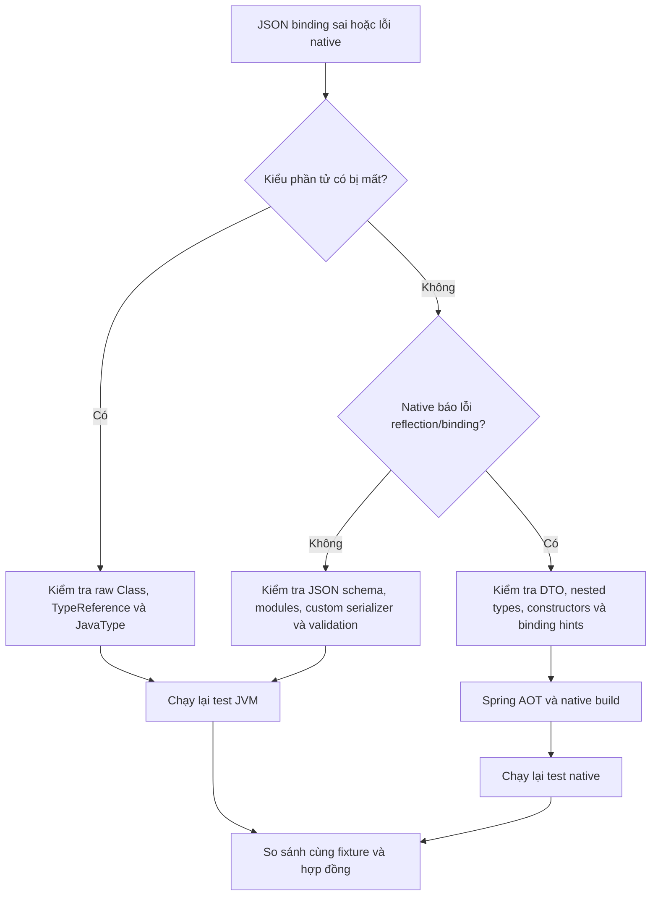

# Kiểu chỉ được chuyển đổi thông qua mã gọi chung hoặc generic bị mất thông tin

## 1. Vì sao JSON binding dễ gặp lỗi khi chuyển sang native?

Trong module **SPRING_BOOT_NATIVE_IMAGE**, chúng ta dùng **Spring AOT** để chuẩn bị ứng dụng Spring Boot cho **GraalVM Native Image**, sau đó kiểm tra tính tương thích, đo thời gian khởi động và bộ nhớ, đóng gói container và vận hành bản native. Một nhóm lỗi thường gặp xuất hiện ở tầng **binding và JSON**: ứng dụng chạy trên JVM nhưng native executable không chuyển đổi đúng DTO, collection generic hoặc kiểu chỉ được chọn lúc runtime.

Nguyên nhân thường liên quan đến hai vấn đề:

1. **Generic type bị mất thông tin:** Java dùng type erasure. Nếu code chỉ truyền `List.class` hoặc `Map.class` cho Jackson, thư viện không biết kiểu phần tử/giá trị cần tạo.
2. **Binding cần reflection:** Jackson và các HTTP message converter có thể đọc constructor, field, accessor, annotation, generic signature hoặc subtype bằng reflection. Native Image cần được cung cấp đủ metadata cho những truy cập động này.

Ví dụ, cùng một JSON:

```json
[
  {"id": 101, "customer": "An"},
  {"id": 102, "customer": "Bình"}
]
```

Nếu đọc bằng `List.class`, Jackson có thể tạo `List` chứa các map kiểu `LinkedHashMap`, thay vì `List<Order>`. Nếu đọc bằng `TypeReference<List<Order>>`, Jackson có thông tin kiểu phần tử. Tuy nhiên, khi chạy native, `Order` và các kiểu lồng bên trong vẫn cần được nhận diện/đăng ký cho data binding theo yêu cầu của framework và phiên bản đang dùng.

Sau bài học, người học có thể:

1. Giải thích type erasure và vì sao raw `Class` không mô tả đầy đủ kiểu JSON generic.
2. Chọn `TypeReference`, `JavaType` hoặc `ParameterizedTypeReference` cho từng API.
3. Viết helper generic mà không vô tình làm mất kiểu cụ thể của caller.
4. Đăng ký DTO, nested DTO và polymorphic subtypes bằng Spring binding hints khi cần.
5. Phân biệt generic type resolution với reflection reachability.
6. Kiểm thử JSON binding trên JVM và native executable bằng cùng dữ liệu và hợp đồng.

> **Nguyên tắc:** giữ được thông tin kiểu và giữ được metadata reflection là hai điều kiện riêng. `TypeReference<List<Order>>` giải quyết việc mô tả kiểu generic cho Jackson; nó không tự đăng ký mọi constructor, field hoặc subtype cho Native Image.

## 2. Type erasure: vì sao raw List không đủ?

Java generics được triển khai bằng **type erasure**. Kiểu tham số thường bị xóa hoặc thay bằng bound ở bytecode. Vì vậy:

```java
List<Order> orders = new ArrayList<>();
List<Customer> customers = new ArrayList<>();

System.out.println(orders.getClass() == customers.getClass()); // true
```

Hai object đều có runtime class là `java.util.ArrayList`. Từ `orders.getClass()` không thể suy ra phần tử là `Order`; từ `customers.getClass()` cũng không thể suy ra phần tử là `Customer`.

Jackson cần biết kiểu đích để chuyển từng object JSON thành đúng Java type. Nếu chỉ cung cấp raw class:

```java
List<?> values = objectMapper.readValue(json, List.class);
```

Jackson biết cần tạo một collection `List`, nhưng không có thông tin để tạo `Order` cho từng phần tử. Với object JSON, kết quả thường là các map; với array/string/number, Jackson dùng kiểu dữ liệu tổng quát tương ứng. Điều này có thể khiến lỗi chỉ xuất hiện về sau khi code ép kiểu hoặc gọi method đặc thù của DTO.

| Kiểu đích | Thông tin Jackson nhận được |
| --- | --- |
| `List.class` | Chỉ biết raw collection; kiểu phần tử không được chỉ định. |
| `List<Order>` qua `TypeReference` | Biết collection và kiểu phần tử `Order`. |
| `Map<String, List<Order>>` qua `TypeReference`/`JavaType` | Biết key, value collection và kiểu phần tử lồng nhau. |
| `Page<Order>` qua type token/`JavaType` | Biết wrapper generic và actual type argument `Order`. |

Generic signature của field/method có thể còn trong class file và đọc được qua reflection, nhưng **không tự động truyền từ một biến `Class<?>` raw vào Jackson**. Code cần cung cấp đúng `Type`/`JavaType` hoặc một type token.

## 3. Jackson TypeReference: giữ generic type tại điểm gọi

`com.fasterxml.jackson.core.type.TypeReference<T>` dùng kỹ thuật **super type token**: tạo một anonymous subclass để generic superclass của nó giữ lại kiểu cụ thể trong metadata khai báo.

### 3.1. Đọc một collection generic

Ví dụ DTO:

```java
package com.example.orders;

public record Order(Long id, String customer) {
}
```

Đọc JSON:

```java
import com.fasterxml.jackson.core.type.TypeReference;
import com.fasterxml.jackson.databind.ObjectMapper;
import java.util.List;

ObjectMapper mapper = new ObjectMapper();

List<Order> orders = mapper.readValue(
    json,
    new TypeReference<List<Order>>() {}
);
```

Anonymous subclass `new TypeReference<List<Order>>() {}` giữ lại `List<Order>` trong generic superclass signature. Jackson có thể phân tích type argument và tạo từng phần tử thành `Order`.

Điều quan trọng là type token phải được tạo tại nơi kiểu cụ thể được biết. Không thay `List<Order>` bằng raw `List.class` nếu code cần DTO thay vì map tổng quát.

### 3.2. Generic lồng nhiều tầng

Với `Map<String, List<Order>>`, type token phải giữ toàn bộ cấu trúc:

```java
TypeReference<Map<String, List<Order>>> type =
    new TypeReference<Map<String, List<Order>>>() {};

Map<String, List<Order>> ordersByRegion =
    mapper.readValue(json, type);
```

Jackson phân tích raw type ngoài là `Map`, key type là `String`, value type là `List<Order>`, và element type bên trong list là `Order`. Nếu chỉ dùng `Map.class`, Jackson không có thông tin để tạo `List<Order>` cho từng value.

### 3.3. Sai lầm trong helper generic

Một helper thường được viết như sau:

```java
static <T> T decode(
        String json,
        ObjectMapper mapper) throws JsonProcessingException {
    return mapper.readValue(json, new TypeReference<T>() {});
}
```

Đoạn này **không giữ được actual type argument của caller theo cách người viết thường mong đợi**. Anonymous subclass chỉ thấy type variable `T` của generic method; method type parameter đã bị erasure tại runtime. Jackson không thể tự biết caller muốn `List<Order>` hay `Map<String, Order>`.

Hãy truyền type token từ caller:

```java
static <T> T decode(
        String json,
        TypeReference<T> targetType,
        ObjectMapper mapper) throws JsonProcessingException {
    return mapper.readValue(json, targetType);
}

List<Order> orders = decode(
    json,
    new TypeReference<List<Order>>() {},
    mapper
);
```

Trong ví dụ này, caller tạo type token khi biết `List<Order>`, helper chỉ nhận và chuyển tiếp token. Một cách khác là nhận `JavaType` đã được dựng sẵn. Không tạo `new TypeReference<T>() {}` bên trong helper rồi kỳ vọng nó khôi phục kiểu đã bị xóa.

### 3.4. Generic method nhận Class phù hợp với trường hợp nào?

```java
static <T> T decode(
        String json, Class<T> targetClass, ObjectMapper mapper)
        throws JsonProcessingException {
    return mapper.readValue(json, targetClass);
}
```

Method này phù hợp với kiểu không generic hoặc khi caller chỉ cần một `Class<T>` cụ thể:

```java
Order order = decode(json, Order.class, mapper);
```

Nhưng không thể truyền `List<Order>.class` vì Java không có class literal cho kiểu tham số hóa. `List.class` chỉ biểu diễn raw list. Khi cần generic lồng nhau, nhận `TypeReference<T>` hoặc `JavaType`.

## 4. JavaType: dựng kiểu động từ class và type arguments

Jackson `JavaType` hữu ích khi kiểu đích được lắp ghép từ các class/type arguments lúc runtime, ví dụ plugin registry, cấu hình endpoint hoặc wrapper generic được chọn theo metadata.

### 4.1. Dựng List<Order>

```java
import com.fasterxml.jackson.databind.JavaType;
import com.fasterxml.jackson.databind.ObjectMapper;
import com.fasterxml.jackson.databind.type.TypeFactory;
import java.util.List;

ObjectMapper mapper = new ObjectMapper();
TypeFactory types = mapper.getTypeFactory();

JavaType orderListType =
    types.constructCollectionType(List.class, Order.class);

List<Order> orders = mapper.readValue(json, orderListType);
```

`constructCollectionType` mô tả raw collection class cùng kiểu phần tử. Cách này không cần anonymous subclass và phù hợp khi element type đã nằm trong một biến `Class<?>`.

### 4.2. Dựng Map<String, List<Order>>

```java
TypeFactory types = mapper.getTypeFactory();

JavaType orderListType =
    types.constructCollectionType(List.class, Order.class);

JavaType mapType = types.constructMapType(
    Map.class,
    types.constructType(String.class),
    orderListType
);

Map<String, List<Order>> ordersByRegion =
    mapper.readValue(json, mapType);
```

`constructMapType` nhận key type và value type. Ở đây value type đã là `List<Order>`, không bị rút gọn thành raw `List`.

### 4.3. Dựng wrapper generic

Giả sử API trả về:

```java
public record ApiResponse<T>(String requestId, T data) {}
```

Có thể dựng kiểu `ApiResponse<Order>`:

```java
JavaType responseType = types.constructParametricType(
    ApiResponse.class,
    Order.class
);

ApiResponse<Order> response = mapper.readValue(json, responseType);
```

Với wrapper lồng nhau như `ApiResponse<List<Order>>`, dựng `JavaType` của list trước rồi truyền nó làm actual type argument:

```java
JavaType orderList = types.constructCollectionType(List.class, Order.class);
JavaType responseOfOrders = types.constructParametricType(
    ApiResponse.class,
    orderList
);

ApiResponse<List<Order>> response =
    mapper.readValue(json, responseOfOrders);
```

Các overload của `TypeFactory` có thể khác giữa Jackson versions; kiểm tra API version được Spring Boot dependency management chọn. Ý tưởng cốt lõi vẫn là giữ cấu trúc kiểu ở dạng `JavaType` thay vì ép về raw class.

### 4.4. Chọn type động bằng allowlist

Nếu cấu hình chỉ chọn một trong vài loại đã biết, có thể ánh xạ key sang `JavaType`:

```java
Map<String, JavaType> supportedTypes = Map.of(
    "orders", types.constructCollectionType(List.class, Order.class),
    "customers", types.constructCollectionType(List.class, Customer.class)
);

JavaType target = supportedTypes.get(configuredKind);
if (target == null) {
    throw new IllegalArgumentException("Unsupported payload kind");
}

Object value = mapper.readValue(json, target);
```

Allowlist giúp ứng dụng kiểm soát các kiểu được phép giải mã. Không lấy class name tùy ý từ request rồi gọi `Class.forName`/`constructType` mà không kiểm tra nguồn dữ liệu và giới hạn loại được hỗ trợ.

## 5. Spring ParameterizedTypeReference cho HTTP client

`ParameterizedTypeReference<T>` của Spring dùng cùng ý tưởng super type token nhưng dành cho API Spring nhận kiểu generic, đặc biệt khi đọc body HTTP.

### 5.1. RestTemplate trả về List<Order>

```java
ParameterizedTypeReference<List<Order>> responseType =
    new ParameterizedTypeReference<List<Order>>() {};

ResponseEntity<List<Order>> response = restTemplate.exchange(
    url,
    HttpMethod.GET,
    HttpEntity.EMPTY,
    responseType
);

List<Order> orders = response.getBody();
```

Nếu truyền `List.class` vào overload chỉ nhận raw class, response converter có thể tạo collection của map thay vì `Order`. `ParameterizedTypeReference` giữ `List<Order>` để Spring/Jackson xử lý response body.

### 5.2. WebClient

```java
Mono<List<Order>> ordersMono = webClient.get()
    .uri("/api/orders")
    .retrieve()
    .bodyToMono(new ParameterizedTypeReference<List<Order>>() {});
```

Spring giữ generic response type qua `ParameterizedTypeReference`. Jackson vẫn cần khả năng bind DTO và nested types khi chuyển JSON thành object; type token không tự thay thế reflection hints.

### 5.3. Helper generic cho HTTP response

Tương tự Jackson `TypeReference`, hãy truyền token vào helper:

```java
static <T> Mono<T> getBody(
        WebClient client,
        String path,
        ParameterizedTypeReference<T> bodyType) {
    return client.get()
        .uri(path)
        .retrieve()
        .bodyToMono(bodyType);
}

Mono<List<Order>> orders = getBody(
    webClient,
    "/api/orders",
    new ParameterizedTypeReference<List<Order>>() {}
);
```

Không tạo `new ParameterizedTypeReference<T>() {}` trong helper rồi mong nó khôi phục kiểu concrete của caller. Caller cần tạo token ở vị trí đã biết kiểu đích và truyền vào.

## 6. Generic binding trong Spring MVC và Jackson

Spring MVC sử dụng `HttpMessageConverter` để chuyển request/response body. Với JSON, converter Jackson thường dựa trên thông tin type của parameter/return value cùng `ObjectMapper` đã cấu hình.

Ví dụ controller:

```java
@RestController
@RequestMapping("/api/orders")
class OrderController {

    @PostMapping("/batch")
    List<Order> createBatch(@RequestBody List<Order> orders) {
        return orderService.createAll(orders);
    }
}
```

Ở đây kiểu `List<Order>` được khai báo trên method signature nên Spring có thể phân tích generic parameter. Tuy nhiên, `Order` vẫn là DTO mà Jackson cần bind: constructor/record components, property accessors, annotations và nested DTO có thể cần reflection metadata cho native.

Với wrapper:

```java
record PageResult<T>(List<T> content, int page, int size, long totalElements) {}

@PostMapping("/search")
PageResult<Order> search(@RequestBody OrderSearchRequest request) {
    // ...
}
```

Generic return type `PageResult<Order>` giúp Spring hiểu hợp đồng response. Nếu Jackson cần introspect/bind `PageResult` và `Order` trong native image, phải xác minh hỗ trợ AOT hiện có hoặc bổ sung binding hints cho các kiểu cụ thể.

### 6.1. Raw type làm sai dữ liệu mà không nhất thiết báo lỗi ngay

Đây là dạng code dễ che giấu vấn đề:

```java
List rawOrders = mapper.readValue(json, List.class);
Map first = (Map) rawOrders.get(0);
String customer = (String) first.get("customer");
```

Code có thể chạy được nhưng ứng dụng mất type safety. Lỗi thường xuất hiện muộn khi cast field, gọi method DTO hoặc truyền dữ liệu sang service khác. Hãy dùng `List<Order>` và type token/JavaType thích hợp, đồng thời kiểm tra schema/validation ở ranh giới API.

### 6.2. DTO immutable, record và constructor binding

Jackson có thể tạo object qua constructor, record canonical constructor, creator method hoặc property-based binding. Ví dụ:

```java
public record Customer(Long id, String name) {}

public class Order {
    private final Long id;
    private final Customer customer;

    @JsonCreator
    public Order(
        @JsonProperty("id") Long id,
        @JsonProperty("customer") Customer customer) {
        this.id = id;
        this.customer = customer;
    }

    public Long getId() { return id; }
    public Customer getCustomer() { return customer; }
}
```

Trong native image, các constructor/property mà Jackson sử dụng cần được hỗ trợ bởi hints/AOT metadata. Với Spring, có thể dùng `@RegisterReflectionForBinding` để đăng ký kiểu phục vụ data binding khi auto-detection chưa đủ.

### 6.3. Polymorphic JSON và subtype

Một field có thể khai báo base type nhưng JSON xác định implementation:

```java
@JsonTypeInfo(use = JsonTypeInfo.Id.NAME, property = "kind")
@JsonSubTypes({
    @JsonSubTypes.Type(value = CardPayment.class, name = "card"),
    @JsonSubTypes.Type(value = BankTransfer.class, name = "bank")
})
sealed interface Payment permits CardPayment, BankTransfer {}

record CardPayment(String token) implements Payment {}
record BankTransfer(String accountNumber) implements Payment {}
```

Khi bind `Payment`, Jackson cần biết các subtype hợp lệ và khả năng tạo object của chúng. Đăng ký base type cùng concrete subtypes trong binding hints khi cần; không cho phép mọi class name tùy ý được chọn từ JSON.

Tránh bật polymorphic default typing rộng cho JSON đến từ nguồn không tin cậy. Dùng subtype allowlist có tên rõ ràng, validate payload và kiểm tra chính sách bảo mật trước khi deserialize.

## 7. Đăng ký binding hints cho DTO và generic wrappers

Spring Framework cung cấp annotation `@RegisterReflectionForBinding` để đăng ký reflection hints cho các kiểu cần data binding. Ví dụ:

```java
import org.springframework.aot.hint.annotation.RegisterReflectionForBinding;
import org.springframework.context.annotation.Configuration;

@Configuration(proxyBeanMethods = false)
@RegisterReflectionForBinding({
    Order.class,
    Customer.class,
    PageResult.class
})
class JsonBindingConfiguration {
}
```

Annotation này hữu ích khi một kiểu được sử dụng trong binding nhưng đường truy cập không đủ rõ để phân tích tĩnh. Đặt cấu hình trong application context được Spring AOT xử lý hoặc trên type phù hợp theo API Spring Framework version đang dùng.

**Lưu ý với generic:** Java không có `PageResult<Order>.class`. Đăng ký raw class `PageResult.class` mô tả kiểu wrapper cần reflection cho binding; `Order.class` là kiểu phần tử cụ thể cũng cần được nhận diện nếu Jackson bind nó. Với nested DTO hoặc subtype, đăng ký thêm các concrete types cần thiết. Generic type token (`TypeReference`/`JavaType`) vẫn cần được cung cấp tại nơi đọc JSON.

### 7.1. Khi cần RuntimeHintsRegistrar

Nếu cần đăng ký binding cho danh sách kiểu được quyết định trong cấu hình build, có thể dùng registrar:

```java
import org.springframework.aot.hint.RuntimeHints;
import org.springframework.aot.hint.RuntimeHintsRegistrar;
import org.springframework.aot.hint.TypeReference;
import org.springframework.aot.hint.MemberCategory;

public final class AdditionalJsonHints implements RuntimeHintsRegistrar {
    @Override
    public void registerHints(RuntimeHints hints, ClassLoader classLoader) {
        hints.reflection().registerType(
            TypeReference.of("com.example.plugins.JsonOrderPlugin"),
            MemberCategory.INVOKE_DECLARED_CONSTRUCTORS,
            MemberCategory.INTROSPECT_PUBLIC_METHODS
        );
    }
}
```

Đây là ví dụ cho plugin được tải bằng tên chuỗi; với DTO Jackson thông thường, ưu tiên `@RegisterReflectionForBinding` hoặc các hints binding được Spring hỗ trợ. Registrar phải được kết nối bằng `@ImportRuntimeHints` trên cấu hình thuộc application context. Đừng đăng ký invocation categories cho DTO nếu Jackson chỉ cần binding/introspection khác và annotation chuyên dụng đã mô tả đúng.

### 7.2. Hints không thay thế schema và validation

Reflection hints chỉ giải quyết khả năng truy cập ở runtime. Chúng không kiểm tra JSON có đúng nghiệp vụ hay không, không tự tạo `TypeReference<List<Order>>` khi code chỉ truyền raw `List.class`, không chọn subtype an toàn khi payload không có discriminator hợp lệ, và không thêm dependency hoặc class bị thiếu khỏi classpath.

Tách rõ ba lớp: **type token** mô tả kiểu đích; **binding hints** cho phép framework truy cập các kiểu cần thiết; **validation** kiểm tra dữ liệu sau khi chuyển đổi.

## 8. Kiểm thử JSON binding trên JVM và native

Một bộ kiểm thử tốt cần bao phủ cả generic type resolution và reflection binding. Không chỉ kiểm tra `ObjectMapper` chạy được một JSON đơn giản.

### 8.1. Unit test cho TypeReference

```java
@Test
void readsNestedGenericPayload() throws Exception {
    String json = """
        {
          "north": [
            {"id": 1, "customer": "Lan"}
          ]
        }
        """;

    TypeReference<Map<String, List<Order>>> target =
        new TypeReference<>() {};

    Map<String, List<Order>> result =
        objectMapper.readValue(json, target);

    assertThat(result.get("north").get(0).id()).isEqualTo(1L);
    assertThat(result.get("north").get(0).customer()).isEqualTo("Lan");
}
```

Test xác nhận cả map, list và DTO element được tạo đúng. Với Java version chưa hỗ trợ text block, dùng string literal hoặc test resource JSON.

### 8.2. Unit test cho JavaType

```java
@Test
void readsGenericWrapperWithJavaType() throws Exception {
    JavaType orderList = objectMapper.getTypeFactory()
        .constructCollectionType(List.class, Order.class);
    JavaType responseType = objectMapper.getTypeFactory()
        .constructParametricType(ApiResponse.class, orderList);

    ApiResponse<List<Order>> result =
        objectMapper.readValue(json, responseType);

    assertThat(result.data()).hasSize(1);
    assertThat(result.data().get(0)).isInstanceOf(Order.class);
}
```

Kiểm tra cả kiểu thực tế của phần tử, không chỉ kích thước collection. Nếu helper generic được sử dụng ở nhiều nơi, thêm test xác nhận caller truyền đúng `JavaType`/type token.

### 8.3. Test cho polymorphic DTO

Tạo payload với từng discriminator hợp lệ (`card`, `bank`) và một giá trị không hợp lệ. Xác nhận payload hợp lệ được tạo thành đúng subtype, field/constructor được bind đầy đủ, discriminator không hỗ trợ bị từ chối theo hợp đồng API và không có class name tùy ý từ payload được tải ngoài allowlist.

### 8.4. Native integration test

Chạy cùng JSON test cases trên native executable hoặc native test mode được plugin hỗ trợ. Bao gồm DTO đơn giản và immutable record; `List<Order>`, `Map<String, List<Order>>`, `ApiResponse<List<Order>>`; DTO lồng nhau; custom serializer/deserializer; polymorphic subtype; dữ liệu sai; và các profile/configuration khác nhau nếu chúng thay đổi kiểu được bind.

Nếu JVM pass nhưng native fail, đọc stack trace để phân biệt lỗi raw type/type erasure với thiếu reflection metadata. Hai lỗi này có cách sửa khác nhau: type token/JavaType sửa mô tả kiểu; binding hints sửa khả năng truy cập DTO/member.

## 9. Quy trình build bằng Maven và Gradle

### 9.1. Maven

Với dự án đã cấu hình Spring Boot AOT và GraalVM Native Build Tools:

```bash
./mvnw clean test
./mvnw -Pnative spring-boot:process-aot
./mvnw -Pnative native:compile
```

Kiểm tra DTO và nested DTO nằm trong classpath; `@RegisterReflectionForBinding` hoặc registrar được Spring AOT phát hiện; native build dùng đúng GraalVM/plugin/profile; và native executable bind được các JSON test cases đã định nghĩa.

### 9.2. Gradle

Với dự án đã cấu hình Spring Boot Gradle plugin và GraalVM Native Build Tools:

```bash
./gradlew clean test
./gradlew processAot
./gradlew nativeCompile
./gradlew nativeCompile --info
```

Xác minh task AOT có trong graph phù hợp và đúng GraalVM/toolchain được chọn. Nếu dùng native test task, kiểm tra test report để biết test nào thực sự được thực thi.

### 9.3. Khi chạy trong container

Sau khi tạo native executable hoặc image qua Buildpacks, chạy smoke test bằng đúng JSON fixtures đã dùng trên JVM. Kiểm tra charset/UTF-8, timezone, environment variables, cấu hình Jackson modules, resource bundles và các dependency ngoài. Một image build thành công chưa chứng minh mọi đường binding đã được thực thi.

## 10. Lỗi thường gặp và cách xử lý

| Triệu chứng | Nguyên nhân có thể | Cách xác minh |
| --- | --- | --- |
| JSON array thành `List<LinkedHashMap>` | Dùng raw `List.class`, thiếu element type. | Dùng `TypeReference<List<Order>>` hoặc `JavaType`. |
| Generic helper trả object/map thay vì DTO | Tạo `new TypeReference<T>() {}` bên trong generic method; `T` đã bị erasure. | Nhận `TypeReference<T>`/`JavaType` từ caller. |
| `List<Order>` chạy JVM nhưng native lỗi constructor | DTO chưa có binding hints hoặc constructor/member chưa được hỗ trợ. | Đăng ký binding type, kiểm tra native stack trace và DTO shape. |
| `ApiResponse<List<Order>>` chỉ bind được wrapper nhưng `data` sai kiểu | Type token chỉ mô tả raw `ApiResponse` hoặc nested generic bị bỏ. | Dựng `JavaType` lồng hoặc TypeReference đầy đủ. |
| Record/immutable DTO lỗi khi deserialize native | Constructor/property metadata hoặc Jackson version/configuration không phù hợp. | Kiểm tra creator, component names, Jackson modules và binding hints. |
| Polymorphic JSON báo subtype không nhận diện | Subtype chưa khai báo/đăng ký hoặc discriminator sai. | Dùng allowlist subtype rõ ràng, đăng ký binding cho concrete subtype. |
| Custom deserializer hoạt động trên JVM nhưng native lỗi | Deserializer tạo DTO qua reflection hoặc class name động. | Kiểm tra deserializer, đăng ký các type/member cần thiết. |
| TypeReference có nhưng vẫn thiếu class | Type token không tự thêm class vào classpath hoặc reflection metadata. | Kiểm tra dependency, class reachability và binding hints. |
| Predicate hints pass nhưng JSON vẫn lỗi native | Predicate chỉ xác nhận một nhóm metadata, còn nested DTO/subtype/member khác bị thiếu. | Chạy integration test native với payload tái hiện và mở rộng hints chính xác. |
| JSON sai nhưng không báo rõ | Raw type, coercion hoặc cấu hình Jackson quá lỏng che mất lỗi dữ liệu. | Bật test schema/validation, kiểm tra strict coercion và error handling. |

### 10.1. Cây chẩn đoán



## 11. Bài thực hành: API trả về generic wrapper

**Bối cảnh:** dịch vụ có endpoint `/api/orders` trả JSON theo cấu trúc `ApiResponse<List<Order>>`. Ứng dụng có HTTP client dùng generic helper để đọc response. JVM hoạt động, nhưng code cũ dùng raw `List.class` và native executable còn thiếu metadata cho DTO.

### Nhiệm vụ

1. Tạo `Order`, `Customer` và `ApiResponse<T>`; trong đó `Order` có nested DTO hoặc record.
2. Viết test đọc JSON bằng `TypeReference<List<Order>>`.
3. Viết test đọc `ApiResponse<List<Order>>` bằng `JavaType` được dựng từ `TypeFactory`.
4. Tạo generic helper nhận `TypeReference<T>` hoặc `JavaType` từ caller; không tạo type token từ `T` bên trong helper.
5. Tạo HTTP client dùng `ParameterizedTypeReference<List<Order>>` để đọc response.
6. Nếu có polymorphic field, khai báo subtype allowlist và test discriminator hợp lệ/không hợp lệ.
7. Đăng ký DTO/nested DTO/subtypes bằng `@RegisterReflectionForBinding` khi cần; chỉ thêm registrar cho trường hợp đặc biệt.
8. Chạy test JVM, Spring AOT, native build và cùng JSON fixtures trên native executable.
9. Ghi lại lỗi type erasure (nếu có), lỗi reflection/binding (nếu có) và cách sửa riêng từng nhóm.

### Hồ sơ kết quả

| Bằng chứng | Nội dung cần ghi |
| --- | --- |
| JSON contract | Ví dụ request/response và kiểu Java mong đợi. |
| Generic type token | `TypeReference`, `JavaType` hoặc `ParameterizedTypeReference` được dùng. |
| DTO graph | Wrapper, nested DTO, subtype và constructor/binding shape. |
| Runtime hints | Các kiểu đã đăng ký và lý do. |
| JVM tests | Kết quả binding, validation và lỗi dữ liệu. |
| Native build/tests | Phiên bản GraalVM/Spring/Jackson, log và kết quả cùng fixtures. |
| Container smoke test | Image/architecture, endpoint và JSON response. |

### Tiêu chí hoàn thành

- [ ] Giải thích được vì sao raw `List.class` không biểu diễn `List<Order>`.
- [ ] Generic helper nhận type token hoặc JavaType từ caller.
- [ ] Nested generic wrapper được Jackson bind đúng kiểu.
- [ ] DTO, nested DTO và polymorphic subtype có metadata phù hợp cho native.
- [ ] JVM và native cho cùng kết quả với bộ JSON fixtures.
- [ ] Các trường hợp dữ liệu sai và subtype không hỗ trợ được xử lý rõ ràng.
- [ ] Có bằng chứng build và smoke test trên artifact/container thực tế.

## 12. Câu hỏi tự đánh giá

1. Vì sao `List<Order>.class` không tồn tại và `List.class` không đủ để Jackson tạo `Order`?
2. `TypeReference<List<Order>>` lưu generic type bằng cơ chế nào?
3. Vì sao `new TypeReference<T>() {}` trong generic helper không khôi phục kiểu concrete của caller?
4. Khi nào nên dùng Jackson `JavaType` thay cho `TypeReference`?
5. `ParameterizedTypeReference` giải quyết vấn đề gì ở Spring HTTP client?
6. Vì sao type token không tự đăng ký reflection metadata cho Native Image?
7. Khi binding `Payment` theo discriminator JSON, vì sao cần quản lý subtype allowlist?
8. Phân biệt lỗi do type erasure với lỗi do thiếu binding hints bằng chứng nào?

## 13. Tài liệu chính thức

API cụ thể phụ thuộc Jackson và Spring Framework version do Spring Boot quản lý. Đối chiếu tài liệu đúng phiên bản dự án:

- [Jackson — ObjectMapper API](https://javadoc.io/doc/com.fasterxml.jackson.core/jackson-databind/latest/com/fasterxml/jackson/databind/ObjectMapper.html): `readValue`, `JavaType` và các overload binding.
- [Jackson — TypeReference API](https://javadoc.io/doc/com.fasterxml.jackson.core/jackson-core/latest/com/fasterxml/jackson/core/type/TypeReference.html): super type token cho generic type.
- [Jackson — TypeFactory API](https://javadoc.io/doc/com.fasterxml.jackson.core/jackson-databind/latest/com/fasterxml/jackson/databind/type/TypeFactory.html): dựng `JavaType` cho collection, map và parametric type.
- [Spring Framework — ParameterizedTypeReference API](https://docs.spring.io/spring-framework/docs/current/javadoc-api/org/springframework/core/ParameterizedTypeReference.html): giữ generic type cho API Spring.
- [Spring Framework — RegisterReflectionForBinding API](https://docs.spring.io/spring-framework/docs/current/javadoc-api/org/springframework/aot/hint/annotation/RegisterReflectionForBinding.html): đăng ký reflection hints cho data binding.
- [Spring Framework — Ahead-of-Time Processing](https://docs.spring.io/spring-framework/reference/core/aot.html): Runtime Hints và quá trình AOT.
- [Spring Boot — GraalVM Native Image](https://docs.spring.io/spring-boot/reference/packaging/native-image/index.html): tích hợp Spring AOT và Native Image.

**Điểm cần nhớ:** type token/`JavaType` bảo toàn cấu trúc generic mà Jackson cần để tạo đúng object; binding hints giúp Native Image giữ và truy cập DTO, constructor, property hoặc subtype cần thiết. Kiểm thử cả hai lớp trên cùng JSON fixtures là cách xác nhận ứng dụng Spring Boot native chuyển đổi dữ liệu đúng hợp đồng.
