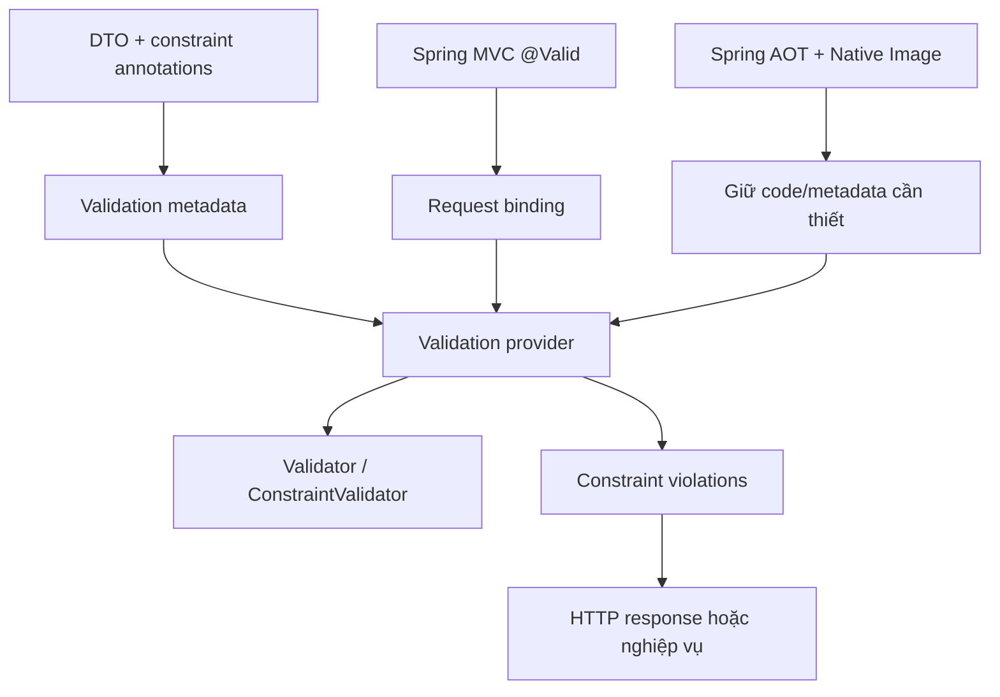

# Bean Validation, annotation và dữ liệu metadata cần có

## 1. Bean Validation hoạt động dựa trên metadata

Spring Boot thường dùng **Bean Validation** để kiểm tra dữ liệu đầu vào trước khi xử lý nghiệp vụ: request body phải có trường bắt buộc, chuỗi không vượt giới hạn, email đúng định dạng, số nằm trong khoảng cho phép. Các quy tắc thường được khai báo bằng annotation như `@NotNull`, `@NotBlank`, `@Size`, `@Email`, `@Min` và `@Valid`.

Các annotation này tạo thành **metadata mô tả constraint**. Validation provider (thường là Hibernate Validator trong ứng dụng Spring Boot) đọc metadata, xác định constraint áp dụng lên property/parameter và thực thi validator tương ứng. Vì thế, Bean Validation không chỉ là một vài câu lệnh kiểm tra; nó phụ thuộc vào việc phát hiện annotation, đọc cấu trúc class, tìm validator và đôi khi khởi tạo đối tượng qua cơ chế động.

Khi chuyển ứng dụng sang **Spring AOT** và **GraalVM Native Image**, cần đảm bảo các metadata và code path validation mà ứng dụng sử dụng được nhận diện và hỗ trợ. Một số tích hợp Spring/Hibernate Validator đã cung cấp hỗ trợ AOT/native theo phiên bản; không nên mặc định mọi custom constraint, validator hoặc cách truy cập metadata đều được tự động xử lý.

Trong module **SPRING_BOOT_NATIVE_IMAGE**, mục tiêu là build ứng dụng Spring Boot bằng Maven/Gradle, kiểm tra tương thích và chạy trên executable native. Bài này tập trung vào annotation, DTO, constraint metadata và các trường hợp cần kiểm chứng trong Native Image.



## 2. Khai báo constraint trên DTO

Ví dụ request tạo khách hàng:

```java
package com.example.customer;

import jakarta.validation.constraints.Email;
import jakarta.validation.constraints.NotBlank;
import jakarta.validation.constraints.Size;

public record CreateCustomerRequest(
    @NotBlank
    @Size(max = 80)
    String fullName,

    @NotBlank
    @Email
    @Size(max = 254)
    String email
) {
}
```

Record giúp DTO gọn và bất biến. Constraint annotation gắn trên record component có thể được dùng để xác định quy tắc validation cho dữ liệu tương ứng. Với class Java thông thường, annotation có thể đặt trên field, getter hoặc parameter theo mục tiêu annotation và cách provider đọc metadata.

Các constraint cơ bản:

| Annotation | Mục đích | Lưu ý |
|---|---|---|
| `@NotNull` | Giá trị không được null | Không cấm chuỗi rỗng |
| `@NotBlank` | Chuỗi không null và có ít nhất một ký tự không phải whitespace | Dành cho CharSequence |
| `@NotEmpty` | Chuỗi/collection/map/array không rỗng | Không kiểm tra khoảng trắng |
| `@Size` | Giới hạn độ dài/kích thước | null thường được coi là hợp lệ; kết hợp `@NotNull` nếu cần |
| `@Email` | Kiểm tra định dạng email theo validator | Không xác minh mailbox tồn tại |
| `@Min`, `@Max` | Giới hạn số | Dùng cho kiểu số được hỗ trợ |
| `@Pattern` | Kiểm tra chuỗi bằng regular expression | Cẩn thận regex quá phức tạp |

Không nên kỳ vọng một annotation tự áp dụng cho mọi kiểu dữ liệu. Chọn constraint phù hợp với type và quy tắc nghiệp vụ.

## 3. Kích hoạt validation trong Spring MVC

Với Spring MVC, thêm dependency validation starter phù hợp phiên bản Spring Boot, sau đó dùng `@Valid` hoặc `@Validated` tại điểm nhận dữ liệu.

```java
@RestController
@RequestMapping("/api/customers")
class CustomerController {

    @PostMapping
    ResponseEntity<?> create(
            @Valid @RequestBody CreateCustomerRequest request) {
        return ResponseEntity.ok(
            Map.of("name", request.fullName(), "email", request.email())
        );
    }
}
```

Khi request body được bind, Spring MVC kích hoạt Bean Validation cho argument có `@Valid`. Nếu vi phạm, framework thường tạo lỗi validation và trả HTTP 400 theo exception handling mặc định. Cấu trúc response phụ thuộc Spring Boot version và cấu hình xử lý lỗi.

Phân biệt:

- `@Valid` kích hoạt cascade validation theo Bean Validation.
- `@Validated` là annotation của Spring, còn hỗ trợ validation groups và method validation trong các trường hợp tương ứng.
- `@NotBlank` và các constraint là metadata của Jakarta Bean Validation; chỉ có annotation mà không có provider/validation integration thì chưa đủ để thực thi.

## 4. Cascade validation cho object lồng nhau

Ví dụ request có địa chỉ:

```java
public record AddressRequest(
    @NotBlank String city,
    @NotBlank String country
) {}

public record CreateCustomerRequest(
    @NotBlank String fullName,
    @Valid @NotNull AddressRequest address
) {}
```

`@Valid` trên thuộc tính `address` yêu cầu provider tiếp tục kiểm tra constraint bên trong object. Nếu thiếu `@Valid`, constraint của nested object có thể không được cascade như mong muốn.

Với collection:

```java
public record OrderRequest(
    @NotEmpty
    List<@Valid OrderLineRequest> lines
) {}
```

Container element constraints cho phép gắn constraint lên phần tử generic. Cần dùng đúng phiên bản Jakarta Validation provider và Java/Jakarta API hỗ trợ. Hãy kiểm thử trường hợp collection rỗng, phần tử null và phần tử vi phạm.

## 5. Constraint metadata được provider đọc như thế nào?

Validation provider xây dựng metadata từ class và annotation. Metadata có thể mô tả:

- Bean/property nào có constraint.
- Constraint đặt trên field, getter, constructor hoặc method parameter.
- Nhóm validation (groups) và group sequence.
- Message template, payload và thuộc tính constraint.
- Cascade validation và container element constraints.
- Constraint composition và custom validator class.

Ví dụ lấy metadata qua API:

```java
BeanDescriptor descriptor =
    validator.getConstraintsForClass(CreateCustomerRequest.class);

PropertyDescriptor emailProperty =
    descriptor.getConstraintsForProperty("email");

boolean hasConstraints =
    emailProperty != null && emailProperty.hasConstraints();
```

API metadata hữu ích cho framework, UI generator hoặc kiểm tra cấu hình. Nếu ứng dụng chỉ gọi `validator.validate(dto)`, provider vẫn cần metadata nội bộ để thực thi constraint, nhưng không nhất thiết ứng dụng tự gọi descriptor API.

Với Native Image, cần quan tâm đường code thực sự dùng: provider có thể cần đọc annotation, truy cập property/constructor hoặc khởi tạo validator. Hỗ trợ của phiên bản Hibernate Validator/Spring Framework cần được kiểm tra thay vì tự đăng ký toàn bộ DTO theo reflection một cách rộng rãi.

## 6. Custom constraint và ConstraintValidator

Khi constraint chuẩn không diễn đạt được quy tắc nghiệp vụ, có thể tạo annotation riêng.

```java
@Target({ FIELD, PARAMETER, RECORD_COMPONENT })
@Retention(RUNTIME)
@Constraint(validatedBy = SupportedCountryValidator.class)
public @interface SupportedCountry {
    String message() default "Unsupported country";
    Class<?>[] groups() default {};
    Class<? extends Payload>[] payload() default {};
}
```

Validator:

```java
public class SupportedCountryValidator
        implements ConstraintValidator<SupportedCountry, String> {

    private static final Set<String> ALLOWED =
        Set.of("VN", "SG", "JP");

    @Override
    public boolean isValid(String value, ConstraintValidatorContext context) {
        return value == null || ALLOWED.contains(value);
    }
}
```

DTO sử dụng:

```java
public record AddressRequest(
    @NotBlank
    @SupportedCountry
    String country
) {}
```

Các điểm cần chú ý:

- Annotation constraint phải có `@Retention(RUNTIME)` để provider đọc metadata lúc chạy.
- `@Constraint(validatedBy = ...)` liên kết validator.
- `initialize()` có thể nhận thuộc tính annotation nếu validator cần cấu hình.
- Validator nên stateless hoặc quản lý state an toàn vì provider có thể tái sử dụng instance.
- Xác định rõ cách xử lý null; constraint thường phối hợp với `@NotNull`/ `@NotBlank`.

Custom validator là code do ứng dụng/thư viện cung cấp. Nếu validator dùng reflection, tải class theo tên, đọc resource hoặc gọi thư viện native, các đường đó cần được kiểm tra riêng khi build Native Image.

## 7. Method validation và metadata trên parameter

Ngoài request DTO, Bean Validation có thể kiểm tra method parameter và return value. Ví dụ Spring method validation:

```java
@Service
@Validated
class TransferService {

    public void transfer(
            @NotBlank String sourceAccount,
            @NotBlank String targetAccount,
            @Positive BigDecimal amount) {
        // Business operation.
    }
}
```

Spring có thể áp dụng method validation qua AOP proxy theo cấu hình và version framework. Vì vậy, bài toán có thể kết hợp cả hai nhóm metadata:

1. Constraint metadata của Jakarta Validation.
2. Proxy/AOP metadata để intercept method invocation.

Nếu method validation hoạt động trên JVM nhưng không hoạt động trên native, xác định bean có được proxy hay không, method có được gọi qua proxy không, provider có phát hiện constraints không và custom validator có tương thích native không. Không quy mọi lỗi method validation thành lỗi reflection.

## 8. Annotation retention và target rất quan trọng

Một annotation chỉ có thể được đọc runtime nếu retention phù hợp. Với constraint, `RUNTIME` là yêu cầu thiết yếu để provider phát hiện annotation trong lúc chạy.

Các target cần được chọn theo nơi constraint được áp dụng:

- `FIELD`: field của class.
- `METHOD`: getter/property hoặc method.
- `PARAMETER`: parameter.
- `ANNOTATION_TYPE`: meta-annotation và constraint composition.
- `TYPE_USE`: type-use/container element constraint.
- `RECORD_COMPONENT`: record component trong Java hỗ trợ record.

Nếu custom annotation thiếu target cần thiết, compiler có thể không cho gắn annotation tại vị trí mong muốn. Nếu retention không phải runtime, provider có thể không đọc được annotation lúc validation.

## 9. Spring AOT và Native Image: metadata nào cần được giữ?

Spring AOT phân tích application context và các tích hợp framework, sinh mã và Runtime Hints. GraalVM Native Image sau đó thực hiện reachability analysis. Với Bean Validation, các yếu tố cần xác minh gồm:

- Constraint annotation và metadata trên DTO được provider phát hiện.
- Validator implementation có trong runtime classpath và reachable.
- Constructor/property access mà provider cần được hỗ trợ.
- Custom constraint validator có thể được khởi tạo theo cơ chế provider/Spring tích hợp.
- Method validation proxy được tạo và lời gọi thực sự đi qua proxy.
- Message bundle/resource cho validation message có trong native image nếu được đọc động.

Không nên mặc định mọi DTO đều cần đăng ký tất cả constructors, methods và fields bằng reflection hints. Các phiên bản Spring Boot, Spring Framework và Hibernate Validator có thể cung cấp tích hợp AOT/native riêng. Trước tiên dùng phiên bản thư viện có hỗ trợ chính thức và kiểm tra log/build. Chỉ bổ sung hints khi có lỗi hoặc code path động chưa được xử lý.

Ví dụ RuntimeHints có thể cần cho custom class nếu thư viện dùng reflection không được framework nhận diện:

```java
class ValidationRuntimeHints implements RuntimeHintsRegistrar {
    @Override
    public void registerHints(RuntimeHints hints, ClassLoader classLoader) {
        hints.reflection().registerType(
            SupportedCountryValidator.class,
            MemberCategory.INVOKE_DECLARED_CONSTRUCTORS
        );
    }
}
```

Đây là ví dụ có điều kiện, không phải cấu hình bắt buộc cho mọi custom validator. Nếu provider/Spring AOT đã đăng ký constructor hoặc validator được khởi tạo qua đường tĩnh được nhận diện, hint trùng có thể không cần thiết. Đăng ký registrar qua `@ImportRuntimeHints` hoặc cơ chế AOT phù hợp.

## 10. Message bundle và resource của validation

Constraint thường có message template, ví dụ:

```java
@NotBlank(message = "{customer.name.required}")
String fullName;
```

Message có thể được lấy từ `ValidationMessages.properties` hoặc message source được cấu hình. Nếu file message nằm trong classpath và được truy cập theo tên/pattern động, kiểm tra resource có trong JAR và Native Image.

Ví dụ:

```text
src/main/resources/
  ValidationMessages.properties
  ValidationMessages_vi.properties
```

Nếu native executable thiếu message bundle, lỗi có thể xuất hiện khi validation tạo violation hoặc chỉ khiến message fallback không như mong đợi. Xác minh resource packaging và thêm Spring resource hints khi cần. Không đăng ký filesystem path của file cấu hình bên ngoài như classpath resource.

## 11. Kiểm thử validation trên JVM và Native Image

Một bộ test nên bao phủ:

| Trường hợp | Kết quả mong đợi |
|---|---|
| DTO hợp lệ | Request được chấp nhận |
| Chuỗi bắt buộc null/rỗng | Validation violation |
| Chuỗi vượt giới hạn | Violation từ `@Size` |
| Email sai định dạng | Violation theo provider |
| Nested object sai | Cascade validation phát hiện |
| Custom constraint không đạt | Custom validator trả false |
| Method parameter sai | Method validation từ chối lời gọi qua proxy |
| Message bundle | Nội dung message đúng locale |

Ví dụ test controller:

```java
@SpringBootTest
@AutoConfigureMockMvc
class CustomerValidationTest {

    @Autowired
    MockMvc mvc;

    @Test
    void rejectsBlankName() throws Exception {
        mvc.perform(post("/api/customers")
                .contentType(MediaType.APPLICATION_JSON)
                .content("""
                    {"fullName":" ","email":"a@example.com"}
                    """))
            .andExpect(status().isBadRequest());
    }
}
```

Ví dụ dùng text block của Java 15+ và MockMvc; thêm static imports và dependency tương ứng. Expected response body phụ thuộc exception handling của ứng dụng, nên test ở đây tập trung HTTP status.

Chạy test JVM:

```bash
./mvnw test
```

hoặc:

```bash
./gradlew test
```

Sau đó chạy Spring AOT và native compile theo cấu hình project:

```bash
./gradlew processAot
./gradlew nativeCompile
```

Hoặc Maven native profile tương ứng. Cuối cùng gọi endpoint trên executable native/container bằng cùng payload hợp lệ và không hợp lệ. JVM test pass không chứng minh binary native đã có đủ metadata.

## 12. Lỗi thường gặp

| Triệu chứng | Nguyên nhân có thể | Hướng kiểm tra |
|---|---|---|
| Annotation có nhưng không validation | Thiếu validation provider/starter hoặc thiếu `@Valid` | Dependency và controller parameter |
| Custom constraint không được gọi | Validator không được liên kết/đăng ký hoặc target sai | `@Constraint`, retention, target |
| JVM chạy, native lỗi khi validation | Metadata/provider/validator path chưa được hỗ trợ | Stack trace, AOT integration và runtime hints |
| Nested constraint không chạy | Thiếu `@Valid` ở association/container element | DTO declaration |
| Method validation không chạy | Thiếu `@Validated`, proxy không được tạo hoặc self-invocation | Spring AOP/method validation setup |
| Message tiếng Việt không đúng | Resource bundle thiếu hoặc locale không được chọn | Resource packaging và message source |
| Validator lỗi khi khởi tạo | Constructor/dependency/side effect không phù hợp AOT | Cơ chế tạo validator và custom initialization |

## 13. Checklist tương thích Native Image

- Dùng Jakarta Validation API/provider đúng phiên bản Spring Boot.
- Constraint annotation có retention/target phù hợp.
- DTO và nested object được gắn `@Valid` đúng nơi.
- Custom ConstraintValidator có trong runtime classpath và khởi tạo được.
- Kiểm tra method validation proxy riêng với constraint metadata.
- Message bundle/resource có trong artifact nếu được dùng.
- Ưu tiên tích hợp AOT/native có sẵn của framework/provider.
- Chỉ thêm RuntimeHints cho code path động thực sự cần.
- Chạy test validation trên native executable và container.
- Ghi lại Spring Boot, Hibernate Validator, GraalVM và plugin versions.

## 14. Câu hỏi tự kiểm tra

1. Bean Validation sử dụng annotation và metadata như thế nào để thực thi constraint?
2. Vì sao custom constraint cần retention runtime?
3. Khác biệt giữa `@Valid` và `@Validated` trong Spring là gì?
4. Vì sao nested object cần cascade validation?
5. Những yếu tố nào cần kiểm tra khi custom ConstraintValidator hoạt động trên JVM nhưng lỗi trong Native Image?
6. Vì sao method validation còn liên quan đến proxy/AOP?
7. Khi nào cần resource hint cho validation message bundle?

**Ghi nhớ:** Bean Validation dựa trên annotation và metadata để tìm constraint, validator và quy tắc cascade. Với Spring AOT/Native Image, hãy bảo đảm provider, custom validator, proxy và message resource đều tương thích; kiểm thử cả request hợp lệ, không hợp lệ và executable native thực tế.
