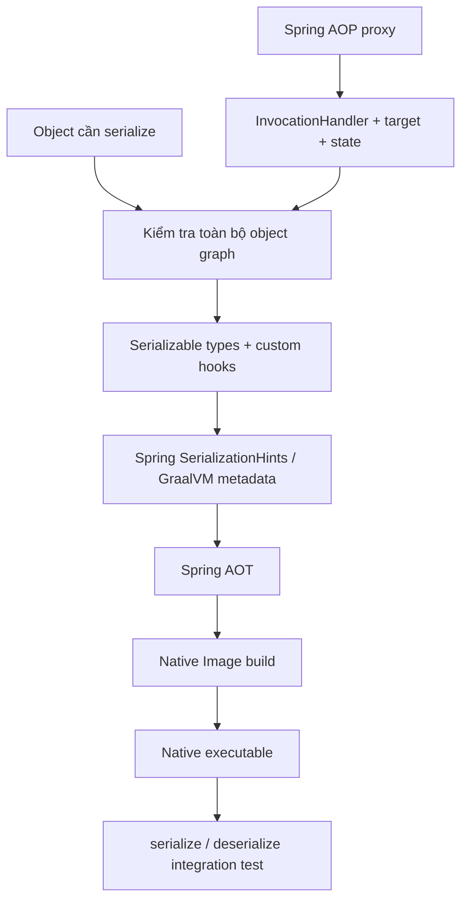

# Đăng ký kiểu Serializable và giới hạn serialization của proxy

## 1. Vì sao serialization cần được kiểm tra khi dùng Native Image?

Java serialization cho phép chuyển object graph thành luồng bytes và khôi phục object từ luồng đó. Cơ chế này thường xuất hiện trong cache, session, message, lưu trạng thái hoặc tích hợp thư viện cũ. Một class tham gia Java Object Serialization thường triển khai `java.io.Serializable`, nhưng chỉ có marker interface không có nghĩa mọi object graph đều có thể serialize thành công.

Với **GraalVM Native Image**, chương trình được phân tích và biên dịch trước. Serialization có những yêu cầu metadata riêng vì runtime cần xác định class nào được phép serialize/deserialize, cách khôi phục object và những thành phần đặc biệt như constructor serialization, `writeObject`, `readObject`, `writeReplace` hoặc `readResolve`. Cấu hình cần thiết phụ thuộc phiên bản GraalVM, chế độ serialization và cách framework tích hợp.

Trong module **SPRING_BOOT_NATIVE_IMAGE**, cần xác minh serialization trên chính executable native, đặc biệt khi object chứa proxy do Spring AOP tạo ra. Proxy có thể thêm một invocation handler và trạng thái nội bộ vào object graph; việc target class implements Serializable không tự động làm proxy hoặc handler serialize được.



## 2. Serializable chỉ là điểm bắt đầu

Ví dụ DTO:

```java
import java.io.Serializable;

public record CustomerSnapshot(
    String customerId,
    String displayName
) implements Serializable {
}
```

Một class thông thường cũng có thể triển khai marker interface:

```java
public class InvoiceSnapshot implements Serializable {
    private static final long serialVersionUID = 1L;

    private final String invoiceId;
    private final long total;

    public InvoiceSnapshot(String invoiceId, long total) {
        this.invoiceId = invoiceId;
        this.total = total;
    }
}
```

`serialVersionUID` giúp kiểm soát tương thích phiên bản của class khi deserialize. Nếu không khai báo, JVM có thể tính một giá trị mặc định dựa trên cấu trúc class; thay đổi class có thể làm thay đổi giá trị và gây `InvalidClassException`.

Tuy nhiên, khi serialize một object, Java xử lý **toàn bộ object graph** có thể đi tới từ object gốc. Nếu một field tham chiếu tới object không serializable và không được loại trừ/biến đổi qua custom serialization, thao tác có thể ném `NotSerializableException`.

Ví dụ:

```java
public class UserSession implements Serializable {
    private static final long serialVersionUID = 1L;

    private String userId;
    private Object connection; // Có thể không Serializable
}
```

Triển khai `Serializable` trên `UserSession` không biến `connection` thành serializable. Cần thiết kế object graph, đánh dấu field phù hợp `transient`, hoặc cung cấp custom serialization nếu có lý do rõ ràng.

## 3. Object graph và các giới hạn cơ bản

Trước khi cấu hình Native Image, xác định:

- Những object nào là root của thao tác serialize/deserialize.
- Các field tham chiếu tới object khác và kiểu thực tế lúc runtime.
- Collection/map có chứa phần tử serializable hay không.
- Có field `transient`, static hoặc tài nguyên ngoài như socket/file/database connection không.
- Có custom serialization hooks hoặc `Externalizable` không.
- Có proxy, lambda, class generated hoặc class được nạp động trong graph không.

Một số kiểu thường không nên serialize trực tiếp:

| Kiểu dữ liệu | Vấn đề |
|---|---|
| Socket, stream, database connection | Là tài nguyên đang mở, không phải trạng thái có thể khôi phục an toàn |
| Thread, Executor, lock | Trạng thái đồng bộ và vòng đời không phù hợp để lưu/khôi phục tùy ý |
| Request/response object của framework | Có thể chứa container, stream hoặc reference không serializable |
| Spring application bean/proxy | Có thể chứa target, interceptor, handler và trạng thái nội bộ |
| Classloader, reflection object | Phụ thuộc môi trường/runtime, khó tương thích và có rủi ro bảo mật |

Thường nên serialize DTO hoặc snapshot nhỏ, ổn định thay vì serialize toàn bộ Spring bean hoặc object graph của framework.

## 4. Serialization và deserialization không phải cùng một quyền

Serialize ghi object graph ra bytes; deserialize đọc bytes và tái tạo object. Hai hướng có thể có yêu cầu metadata khác nhau trong Native Image.

Ví dụ:

```java
byte[] serialize(Object value) throws IOException {
    try (var output = new ByteArrayOutputStream();
         var stream = new ObjectOutputStream(output)) {
        stream.writeObject(value);
        return output.toByteArray();
    }
}

Object deserialize(byte[] bytes)
        throws IOException, ClassNotFoundException {
    try (var input = new ByteArrayInputStream(bytes);
         var stream = new ObjectInputStream(input)) {
        return stream.readObject();
    }
}
```

Khi deserialize, runtime cần xác định class tương ứng với thông tin trong stream và tạo object theo quy tắc Java serialization. Constructor của lớp Serializable không được gọi theo cách thông thường trong quá trình khôi phục; chuỗi khởi tạo superclass không Serializable và các hook serialization có quy tắc riêng.

Không nên giả định đăng ký một constructor thông thường để reflection invoke là đủ cho mọi trường hợp Java serialization. Dùng metadata serialization đúng cơ chế và phiên bản GraalVM.

## 5. Spring RuntimeHints cho serialization

Spring AOT cung cấp nhóm hints serialization thông qua `RuntimeHints.serialization()`. Ví dụ đăng ký một kiểu cụ thể:

```java
import org.springframework.aot.hint.RuntimeHints;
import org.springframework.aot.hint.RuntimeHintsRegistrar;

public class SnapshotSerializationHints
        implements RuntimeHintsRegistrar {

    @Override
    public void registerHints(RuntimeHints hints, ClassLoader classLoader) {
        hints.serialization().registerType(CustomerSnapshot.class);
        hints.serialization().registerType(InvoiceSnapshot.class);
    }
}
```

Đăng ký registrar:

```java
@Configuration
@ImportRuntimeHints(SnapshotSerializationHints.class)
class SerializationConfiguration {
}
```

Ví dụ sử dụng API Spring RuntimeHints ở mức cơ bản. Hãy xác nhận chữ ký API theo Spring Framework version của dự án và chỉ đăng ký những type thực sự được serialize/deserialize. Nếu thư viện/provider đã đóng góp serialization hints qua AOT, tránh khai báo trùng không cần thiết.

Serialization hint không làm cho một class vốn không triển khai `Serializable` trở nên serializable. Nó cũng không biến toàn bộ object graph thành an toàn; hợp đồng Java serialization và các ràng buộc của class vẫn áp dụng.

## 6. Reachability metadata của GraalVM

GraalVM Native Image có metadata dành cho serialization bên cạnh reflection, resource và proxy metadata. Định dạng, vị trí file và tùy chọn hỗ trợ phụ thuộc GraalVM version. Một số phiên bản cung cấp tracing agent để quan sát serialization trên JVM và sinh cấu hình gợi ý.

Không tự sao chép JSON serialization từ một phiên bản GraalVM khác mà không kiểm tra schema và tài liệu tương ứng. Với ứng dụng Spring Boot, ưu tiên Spring RuntimeHints khi phù hợp vì Spring AOT có thể thu thập hints từ application và dependency.

Hai tầng cần phân biệt:

- **Spring SerializationHints**: API của Spring AOT để thư viện/ứng dụng đóng góp thông tin.
- **GraalVM serialization metadata**: định dạng/cơ chế Native Image dùng trong quá trình build.

Spring AOT có trách nhiệm tích hợp hints với Native Image theo toolchain tương ứng; không nên trộn API Java serialization, Spring hints và JSON GraalVM thành một cấu hình duy nhất.

## 7. Custom serialization hooks

Java serialization hỗ trợ các method đặc biệt:

- `private void writeObject(ObjectOutputStream out)`
- `private void readObject(ObjectInputStream in)`
- `Object writeReplace()`
- `Object readResolve()`
- `Externalizable.writeExternal/readExternal`

Ví dụ:

```java
public class AccountSnapshot implements Serializable {
    private static final long serialVersionUID = 1L;

    private String accountId;
    private transient String accessToken;

    private void writeObject(ObjectOutputStream out) throws IOException {
        out.defaultWriteObject();
    }

    private void readObject(ObjectInputStream in)
            throws IOException, ClassNotFoundException {
        in.defaultReadObject();
        accessToken = null;
    }
}
```

Custom hooks phải tuân theo signature và visibility theo quy tắc serialization của Java. Nếu Native Image cần phát hiện hoặc gọi các method này, hãy xác minh serialization metadata được tạo đúng; không chỉ thêm reflection hint tùy tiện rồi cho rằng mọi hook đã hoạt động.

Không serialize secret như access token nếu không có yêu cầu bảo mật và quản lý khóa rõ ràng. `transient` có thể loại field khỏi default serialization, nhưng không phải cơ chế bảo vệ toàn diện nếu custom hook vẫn ghi nó ra stream.

## 8. Proxy có giới hạn riêng khi serialize

Spring AOP có thể tạo proxy cho bean. Với JDK dynamic proxy, object proxy triển khai một tập interface và giữ một `InvocationHandler`. Để proxy có thể serialize theo Java serialization, các điều kiện quan trọng gồm:

1. Proxy class phải thuộc cơ chế proxy có thể serialize.
2. Các interface cần thiết phải đáp ứng yêu cầu serialization theo cách tạo proxy.
3. `InvocationHandler` phải serializable.
4. Object target và trạng thái mà handler giữ phải serializable hoặc được xử lý custom.
5. Các dependency/transient state phải được khôi phục hợp lệ sau deserialize.

Ví dụ tạo JDK proxy serializable:

```java
public interface GreetingService extends Serializable {
    String greet(String name);
}

public class GreetingHandler
        implements InvocationHandler, Serializable {

    private static final long serialVersionUID = 1L;

    @Override
    public Object invoke(Object proxy, Method method, Object[] args) {
        if (method.getName().equals("greet")) {
            return "Hello " + args[0];
        }
        return null;
    }
}
```

Tạo proxy:

```java
GreetingService proxy = (GreetingService) Proxy.newProxyInstance(
    GreetingService.class.getClassLoader(),
    new Class<?>[] { GreetingService.class },
    new GreetingHandler()
);
```

Ví dụ này minh họa proxy interface serializable; handler không giữ target phức tạp. Trong ứng dụng thực, nếu handler chứa target hoặc advisor, toàn bộ graph đó cũng phải thỏa điều kiện serialization. Không được kết luận proxy Spring AOP tự động serialize chỉ vì interface target extends Serializable.

## 9. Vì sao Spring AOP proxy thường không nên được serialize?

Một Spring AOP proxy có thể giữ reference tới:

- Target bean.
- Advisor chain và MethodInterceptor.
- BeanFactory hoặc infrastructure reference.
- Transaction manager, security context hoặc các service khác.
- Invocation handler hoặc callback có trạng thái.
- Classloader/framework state.

Nhiều thành phần trong số này không serializable hoặc không có ý nghĩa khi chuyển sang process/máy khác. Ngay cả khi serialize thành công, deserialize có thể tạo object chứa reference cũ hoặc thiếu infrastructure để hoạt động.

Vì vậy, cách thiết kế thường tốt hơn là serialize **dữ liệu nghiệp vụ** (DTO/snapshot) rồi lấy lại Spring bean/proxy từ application context ở nơi nhận. Không serialize proxy để truyền qua message/cache trừ khi thư viện và kiến trúc có hợp đồng hỗ trợ cụ thể.

Class-based proxy cũng có giới hạn riêng: class proxy/subclass và trạng thái framework không tự nhiên trở thành serialization contract ổn định. RuntimeHints cho JDK proxy không giải quyết serialization của mọi class-based proxy.

## 10. Proxy hints khác serialization hints

Hai nhóm hints phục vụ mục đích khác nhau:

| Hint | Mục đích |
|---|---|
| Reflection hints | Truy cập class/constructor/method/field bằng reflection |
| JDK Proxy hints | Chuẩn bị proxy cho một tập interface |
| Serialization hints | Hỗ trợ kiểu được Java serialization sử dụng |
| Resource hints | Giữ resource classpath |
| JNI hints | Hỗ trợ các điểm tương tác Java/native khi cần |

Một proxy được tạo thành công không có nghĩa nó serialize được. Một type được đăng ký serialization cũng không tự tạo JDK proxy metadata cho tập interface. Nếu ứng dụng thật sự cần serialize proxy, phải kiểm tra đồng thời proxy creation, interface/handler, object graph và serialization metadata.

## 11. Kiểm thử serialization trên JVM và Native Image

Viết test round-trip cho DTO:

```java
@Test
void serializesAndDeserializesSnapshot() throws Exception {
    CustomerSnapshot source =
        new CustomerSnapshot("C-100", "Lan");

    byte[] bytes = serialize(source);
    Object restored = deserialize(bytes);

    assertThat(restored).isEqualTo(source);
}
```

Với class thông thường không phải record, cần triển khai `equals/hashCode` hoặc assert từng field. Ngoài round-trip, kiểm tra:

- Object graph có field không serializable.
- Version compatibility và `serialVersionUID`.
- Custom `writeObject/readObject`, `writeReplace/readResolve`.
- Proxy handler và target state nếu có yêu cầu serialize proxy.
- Hành vi sau deserialize, đặc biệt dependency transient phải được tái tạo thế nào.

Quy trình native:

1. Chạy unit/integration test serialization trên JVM.
2. Đăng ký Spring SerializationHints hoặc metadata GraalVM khi cần.
3. Chạy Spring AOT và Native Image build.
4. Chạy cùng round-trip test trên executable native/native test pipeline.
5. Kiểm thử trong container đích với cùng dữ liệu đại diện.
6. Ghi lại version Spring/GraalVM và loại metadata được sử dụng.

JVM test pass không chứng minh Native Image có đủ metadata. Ngược lại, native build pass cũng không chứng minh mọi object graph production có thể serialize.

## 12. Lưu ý bảo mật khi deserialize

Java native serialization có rủi ro bảo mật nếu nhận bytes không tin cậy. Deserialization có thể tạo object graph phức tạp và kích hoạt logic trong các class/hook; thư viện trên classpath có thể làm tăng bề mặt gadget.

- Không deserialize dữ liệu tùy ý từ client hoặc nguồn không tin cậy.
- Ưu tiên format dữ liệu có schema rõ như JSON/Protobuf với DTO và validation.
- Nếu buộc phải dùng Java serialization, áp dụng allowlist/filter bằng `ObjectInputFilter` phù hợp, giới hạn depth, references, bytes và class.
- Xác thực nguồn dữ liệu và bảo vệ tính toàn vẹn.
- Không serialize Spring bean, proxy, connection, credential hoặc object chứa secret.
- Giữ dependency được vá và rà soát các thư viện serialization.

Native Image không tự loại bỏ rủi ro gadget/deserialization. Hints chỉ hỗ trợ build/runtime metadata; chúng không phải cơ chế bảo mật đầu vào.

## 13. Lỗi thường gặp

| Triệu chứng | Nguyên nhân có thể | Hướng xử lý |
|---|---|---|
| `NotSerializableException` | Một object trong graph không serializable | Tìm field gây lỗi, dùng DTO/snapshot hoặc custom serialization |
| JVM serialize được nhưng native lỗi | Thiếu serialization metadata hoặc hỗ trợ version | Kiểm tra hints/schema và native test |
| Deserialize báo `InvalidClassException` | `serialVersionUID` hoặc schema class thay đổi | Quản lý version và migration dữ liệu |
| Proxy không serialize được | Handler/interface/target graph không serializable | Không serialize proxy hoặc thiết kế graph rõ ràng |
| Deserialize xong proxy không hoạt động | Infrastructure/dependency không được khôi phục | Lấy lại bean từ Spring context, không lưu proxy |
| Secret xuất hiện trong bytes | Field được serialize hoặc custom hook ghi ra | Loại secret khỏi DTO/graph và rà soát hooks |
| Hints đã khai báo nhưng lỗi còn | Registrar không được AOT phát hiện hoặc metadata chưa đủ | Kiểm tra AOT registration, rebuild và test đúng path |

## 14. Checklist thiết kế và triển khai

- Chỉ serialize DTO/snapshot có hợp đồng dữ liệu rõ ràng.
- Kiểm tra toàn bộ object graph, không chỉ class gốc implements Serializable.
- Quản lý `serialVersionUID` và compatibility của dữ liệu lưu lâu dài.
- Xác định custom serialization hooks và transient state.
- Tránh serialize Spring AOP proxy, BeanFactory, connection và infrastructure.
- Nếu bắt buộc serialize JDK proxy, kiểm tra interface, InvocationHandler và toàn bộ handler/target graph.
- Đăng ký serialization hints theo API Spring/GraalVM version thực tế.
- Kiểm thử round-trip trên executable native và container.
- Không deserialize dữ liệu không tin cậy; dùng filter/allowlist nếu Java serialization bắt buộc.
- Không đưa secret vào serialized bytes hoặc artifact.

## 15. Câu hỏi tự kiểm tra

1. Vì sao triển khai `Serializable` trên class gốc chưa đảm bảo object graph serialize được?
2. `serialVersionUID` giúp xử lý vấn đề gì?
3. Spring SerializationHints khác reflection hints như thế nào?
4. Điều kiện nào khiến JDK dynamic proxy có thể serialize được?
5. Vì sao Spring AOP proxy thường không phải dữ liệu phù hợp để serialize?
6. Proxy hints có thay thế serialization hints không?
7. Vì sao Java deserialization từ nguồn không tin cậy vẫn nguy hiểm trong Native Image?
8. Cần những test nào để xác nhận serialization tương thích trên binary native?

**Ghi nhớ:** Java serialization phụ thuộc toàn bộ object graph và các hook khôi phục; proxy còn mang theo handler, target và infrastructure. Hãy ưu tiên DTO/snapshot, đăng ký serialization metadata đúng nhu cầu, tránh serialize Spring proxy nếu không có hợp đồng rõ ràng và kiểm thử round-trip trên chính Native Image.
