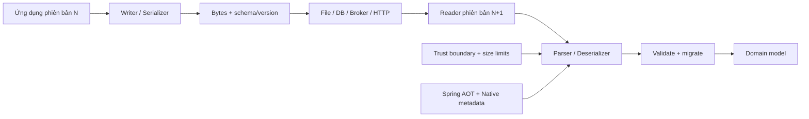

# Định dạng dữ liệu, tương thích phiên bản và rủi ro nhận dữ liệu không tin cậy

> **Chương:** Serialization và JNI  
> **Module:** `SPRING_BOOT_NATIVE_IMAGE`  
> **Mục tiêu:** Chọn định dạng serialization phù hợp cho API, message và dữ liệu lưu trữ; thiết kế schema có thể tiến hóa giữa các phiên bản; nhận diện rủi ro khi deserialize dữ liệu không tin cậy; cấu hình metadata cần thiết cho Spring AOT/GraalVM Native Image và kiểm thử cả JVM lẫn native executable.

## 1. Serialization là hợp đồng dữ liệu giữa hai thời điểm

Serialization chuyển trạng thái hoặc dữ liệu trong chương trình thành dạng có thể ghi vào file, database, cache, message broker hoặc truyền qua network. Deserialization đọc dạng đã lưu/truyền và dựng lại dữ liệu để chương trình sử dụng.

Một luồng dữ liệu thường có ít nhất hai phía:

- **Writer:** phiên bản ứng dụng tạo dữ liệu.
- **Reader:** phiên bản ứng dụng đọc dữ liệu đó sau này hoặc ở một dịch vụ khác.

Hai phía có thể chạy cùng phiên bản, nhưng trong hệ thống thực tế chúng thường được deploy lệch thời điểm. Một producer mới có thể gửi dữ liệu tới consumer cũ; một bản rollback có thể đọc lại dữ liệu do phiên bản mới ghi; một file backup có thể được phục hồi sau nhiều tháng.

Do đó, serialization không chỉ là câu hỏi “ghi object thành bytes như thế nào”. Nó còn là **hợp đồng về cấu trúc, kiểu dữ liệu, ý nghĩa field, phiên bản schema và chính sách tin cậy**.

Với Spring Boot Native Image, hợp đồng này có thêm một yêu cầu: GraalVM Native Image cần biết trước các class và thao tác động cần thiết. Spring AOT có thể sinh code và runtime hints cho một số đường binding/serialization; những đường không được suy ra phải được khai báo và kiểm thử.



Ba câu hỏi cần trả lời trước khi chọn định dạng:

1. **Dữ liệu được trao đổi ở đâu?** API công khai, message nội bộ, cache, file lưu trữ lâu dài hay giao tiếp với native library.
2. **Phiên bản nào phải đọc được dữ liệu nào?** Chỉ cùng phiên bản, reader mới đọc writer cũ, reader cũ đọc writer mới hay cả hai chiều.
3. **Ai kiểm soát dữ liệu đầu vào?** Chỉ service nội bộ có xác thực, hay người dùng/đối tác có thể gửi bytes tùy ý.

## 2. Các định dạng thường gặp và phạm vi sử dụng

Không có định dạng nào tốt nhất cho mọi tình huống. Cần chọn dựa trên khả năng tương thích, hiệu năng, khả năng debug, mức phụ thuộc vào ngôn ngữ và mô hình bảo mật.

| Định dạng | Đặc điểm | Điểm mạnh | Điều cần quản lý |
|---|---|---|---|
| **Java Object Serialization** | Ghi object graph theo cơ chế của Java, dùng `Serializable`/`Externalizable` | Có thể giữ cấu trúc object và tham chiếu; hữu ích cho một số hệ thống Java legacy | Gắn chặt với class name/hierarchy/serialVersionUID; rủi ro khi deserialize dữ liệu không tin cậy; cần metadata cho Native Image |
| **JSON** | Văn bản, object/array/string/number/boolean/null | Dễ đọc, phổ biến cho HTTP API, hỗ trợ nhiều ngôn ngữ | Quy tắc schema thường nằm ngoài payload; cần quản lý unknown fields, enum, polymorphism và giới hạn parser |
| **Protocol Buffers** | Binary, field được nhận diện bằng tag number và schema `.proto` | Gọn, nhanh, schema rõ, có quy tắc evolution | Không được đổi/reuse field number; phải quản lý generated code và schema |
| **Apache Avro** | Binary hoặc JSON, reader/writer schema được dùng khi giải mã | Phù hợp event/data pipeline, hỗ trợ schema resolution | Phải lưu hoặc truy xuất writer schema; cần schema registry/quy trình tương thích |
| **CBOR** | Mô hình dữ liệu gần JSON nhưng mã hóa binary | Hữu ích khi cần binary format và kiểu dữ liệu mở rộng | Vẫn cần schema/contract, giới hạn kích thước và validation |

### 2.1. Phân biệt Java object với data transfer object

Một domain object thường chứa hành vi, quan hệ entity, lazy proxy, trạng thái nội bộ hoặc dependency không nên trở thành hợp đồng dữ liệu bên ngoài.

Ví dụ không nên trả trực tiếp JPA entity:

```java
@Entity
class PaymentEntity {
    @Id
    private Long id;

    @ManyToOne(fetch = FetchType.LAZY)
    private CustomerEntity customer;

    private BigDecimal amount;

    // getters/setters
}
```

Nếu serializer truy cập `customer`, ORM có thể kích hoạt lazy loading, tạo vòng tham chiếu hoặc vô tình xuất dữ liệu nội bộ. Một thay đổi schema database cũng có thể làm thay đổi JSON API mà không chủ ý.

Nên tạo DTO có cấu trúc rõ ràng:

```java
public record PaymentResponse(
        String paymentId,
        long amountMinor,
        String currency,
        String status
) {
}
```

DTO là hợp đồng dữ liệu. Domain entity là mô hình nghiệp vụ. Tách hai loại này giúp thay đổi nội bộ mà không làm client phụ thuộc vào implementation của ứng dụng.

## 3. Java Object Serialization: tiện lợi nhưng gắn chặt với class

Java native serialization thường dùng:

- `Serializable` để đánh dấu class có thể được serialize theo cơ chế mặc định.
- `ObjectOutputStream` để ghi object graph thành byte stream.
- `ObjectInputStream` để dựng lại object graph.
- `serialVersionUID` để nhận diện phiên bản serialization của class.
- `writeObject`/`readObject` để tùy biến quá trình ghi/đọc.
- `writeReplace`/`readResolve` để thay thế object trong luồng serialization.
- `Externalizable` khi class tự quản lý định dạng dữ liệu bằng `writeExternal`/`readExternal`.

Ví dụ tối giản:

```java
import java.io.Serializable;

public final class PaymentSnapshot implements Serializable {

    private static final long serialVersionUID = 1L;

    private String paymentId;
    private long amountMinor;
    private String currency;

    public PaymentSnapshot(
            String paymentId,
            long amountMinor,
            String currency) {
        this.paymentId = paymentId;
        this.amountMinor = amountMinor;
        this.currency = currency;
    }
}
```

Ghi object:

```java
try (var output = new ObjectOutputStream(
        Files.newOutputStream(Path.of("payment.snapshot")))) {
    output.writeObject(snapshot);
}
```

Đọc object:

```java
try (var input = new ObjectInputStream(
        Files.newInputStream(Path.of("payment.snapshot")))) {
    Object value = input.readObject();

    if (!(value instanceof PaymentSnapshot snapshot)) {
        throw new InvalidObjectException("Unexpected root type");
    }

    // Validate snapshot trước khi dùng.
}
```

Stream Java serialization lưu tên class, mô tả class và trạng thái các field có thể serialize. Khi đọc, runtime cần tìm class tương ứng và dựng object graph. Nếu class thay đổi không tương thích hoặc không còn trên classpath, việc đọc có thể thất bại.

**Không nên dùng Java native serialization làm định dạng API công khai hoặc nhận trực tiếp bytes từ client không tin cậy.** Nó gắn chặt dữ liệu với class Java và có bề mặt tấn công lớn khi deserialization.

## 4. Tương thích phiên bản của Java Serialization

### 4.1. Vai trò của `serialVersionUID`

`serialVersionUID` là version identifier của class serializable. Khi đọc stream, runtime so sánh UID trong stream với UID của class hiện tại. Nếu khác nhau, có thể ném `InvalidClassException`.

Nên khai báo UID tường minh:

```java
private static final long serialVersionUID = 1L;
```

Nếu không khai báo, Java tính UID mặc định từ một số đặc điểm của class. Những thay đổi tưởng như nhỏ trong cấu trúc class hoặc khác biệt compiler có thể làm UID thay đổi ngoài ý muốn.

Tuy nhiên, **giữ nguyên UID không tự biến mọi thay đổi class thành tương thích**. UID chỉ là một phần của cơ chế kiểm tra. Nếu đổi kiểu field, thay hierarchy hoặc thay ý nghĩa dữ liệu, reader vẫn có thể không khôi phục được trạng thái đúng.

### 4.2. Các thay đổi class và ảnh hưởng

| Thay đổi | Ảnh hưởng thường gặp | Việc cần làm |
|---|---|---|
| Thêm field non-static, non-transient | Reader mới có thể nhận default value nếu stream cũ không có field | Khởi tạo default hợp lệ hoặc migrate |
| Bỏ field | Reader mới bỏ qua dữ liệu field cũ; reader cũ có thể nhận default khi đọc stream mới | Xác định có mất thông tin nghiệp vụ không |
| Đổi tên field | Có thể được xem như bỏ field cũ và thêm field mới | Dùng mapping/custom serialization nếu cần giữ dữ liệu |
| Đổi kiểu field | Thường không tương thích hoặc cần chuyển đổi tường minh | Dùng custom `readObject`/`writeObject` hoặc format mới |
| Đổi superclass/hierarchy | Có thể thay đổi cấu trúc stream và không tương thích | Tránh thay hierarchy trong dữ liệu lưu lâu dài |
| Đổi `static`/`transient` | Thay đổi field có được ghi hay không | Đánh giá dữ liệu cũ và dữ liệu cần bảo toàn |
| Thay đổi invariant nghiệp vụ | Stream vẫn đọc được nhưng object có thể không hợp lệ | Validate và migrate sau khi đọc |

### 4.3. Custom `readObject` để phục hồi invariant

Deserialization không gọi constructor thông thường của class serializable theo cùng cách tạo object mới. Vì vậy, không được giả định validation chỉ đặt trong constructor là đủ.

Ví dụ:

```java
private void readObject(ObjectInputStream input)
        throws IOException, ClassNotFoundException {

    input.defaultReadObject();

    if (paymentId == null || paymentId.isBlank()) {
        throw new InvalidObjectException("paymentId is required");
    }

    if (amountMinor < 0) {
        throw new InvalidObjectException("amountMinor must be non-negative");
    }

    if (currency == null || currency.length() != 3) {
        throw new InvalidObjectException("currency is invalid");
    }
}
```

Trong class nhạy cảm, cần xem xét:

- `transient` cho dữ liệu không nên được ghi vào stream.
- `serialPersistentFields` để kiểm soát danh sách field trong định dạng serialization.
- `writeReplace` để ghi một serialization proxy thay vì object nội bộ.
- `readResolve` để thay thế object sau khi đọc nếu hợp đồng yêu cầu.
- Defensive copy cho array/collection mutable.
- Kiểm tra invariant và trạng thái khởi tạo trước khi object được sử dụng.

Private field vẫn có thể xuất hiện trong byte stream. Người có bytes có thể phân tích được nội dung đó. Không serialize password, token, secret hoặc dữ liệu nhạy cảm với kỳ vọng rằng modifier `private` sẽ bảo vệ chúng.

## 5. JSON: hợp đồng dễ đọc nhưng phải quản lý schema

JSON thường là lựa chọn phù hợp cho REST API Spring Boot. Một payload có thể như sau:

```json
{
  "eventId": "evt-1001",
  "paymentId": "pay-501",
  "amountMinor": 259900,
  "currency": "VND",
  "occurredAt": "2026-11-23T08:30:00Z"
}
```

JSON không tự mang theo đầy đủ quy tắc versioning. Reader phải biết:

- Field nào bắt buộc?
- Field nào optional và có default?
- Unknown field được bỏ qua hay từ chối?
- Enum mới được xử lý ra sao?
- Number có giới hạn precision/range nào?
- Timestamp có timezone và format nào?
- Null khác gì field bị thiếu?

### 5.1. Thêm field và giữ khả năng đọc dữ liệu cũ

Giả sử phiên bản 1:

```json
{
  "paymentId": "pay-501",
  "amountMinor": 259900
}
```

Phiên bản 2 thêm field optional:

```json
{
  "paymentId": "pay-501",
  "amountMinor": 259900,
  "channel": "MOBILE"
}
```

Để reader mới đọc dữ liệu cũ, `channel` cần có chính sách default rõ ràng. Để reader cũ đọc dữ liệu mới, reader cũ cần chấp nhận unknown field hoặc có chính sách tương thích tương ứng.

Với Jackson, hành vi unknown properties phụ thuộc cấu hình `ObjectMapper` và cấu hình Spring Boot. Hãy quyết định rõ thay vì dựa vào default không được kiểm tra. Có thể cho phép bỏ qua field chưa biết ở một boundary có yêu cầu forward compatibility, nhưng vẫn phải validate những field mà ứng dụng thực sự sử dụng.

### 5.2. Những thay đổi JSON dễ phá vỡ hợp đồng

| Thay đổi | Rủi ro |
|---|---|
| Thêm optional field có default | Thường ít rủi ro nếu reader xử lý unknown fields phù hợp |
| Thêm required field | Reader cũ hoặc payload cũ có thể thiếu field |
| Đổi tên field | Reader cũ và mới không còn cùng key |
| Đổi number thành string | Client có thể không parse hoặc binding lỗi |
| Đổi nullability | Có thể gây lỗi validation hoặc thay đổi ý nghĩa |
| Xóa enum value | Reader cũ có thể nhận giá trị mà nó không biết |
| Đổi timezone/timestamp semantics | Dữ liệu parse được nhưng diễn giải sai |
| Bật polymorphic typing quá rộng | Tạo rủi ro class instantiation từ type metadata |

### 5.3. Polymorphic deserialization và type metadata

Một số API dùng trường type discriminator để chọn subtype. Ví dụ:

```json
{
  "kind": "card",
  "cardNumberToken": "tok-123"
}
```

Nếu cần polymorphism, nên dùng danh sách subtype được phép rõ ràng, chẳng hạn `@JsonTypeInfo(use = JsonTypeInfo.Id.NAME)` kết hợp `@JsonSubTypes`, và kiểm tra mọi subtype có thể được khởi tạo.

Tránh bật default typing rộng cho payload không tin cậy. Đặc biệt, không dùng class name do client cung cấp làm type id để Jackson tự nạp class tùy ý. Cấu hình type resolver phải giới hạn tập kiểu được phép. Jackson cảnh báo default typing có thể tạo rủi ro bảo mật nếu input đến từ nguồn không tin cậy.

### 5.4. Validation sau khi parse

Parse thành công chỉ chứng minh dữ liệu có thể ánh xạ vào DTO. Nó chưa chứng minh dữ liệu hợp lệ về nghiệp vụ.

Ví dụ:

```java
public record CreatePaymentRequest(
        @NotBlank String orderId,
        @Positive long amountMinor,
        @NotBlank @Pattern(regexp = "[A-Z]{3}") String currency
) {
}
```

Controller:

```java
@PostMapping("/payments")
ResponseEntity<PaymentResponse> create(
        @Valid @RequestBody CreatePaymentRequest request) {
    return ResponseEntity.ok(paymentService.create(request));
}
```

Cần giới hạn kích thước request body ở tầng HTTP/gateway, giới hạn độ sâu và số phần tử nếu format/parser hỗ trợ, đồng thời validate range và invariant trước khi gọi nghiệp vụ.

## 6. Protocol Buffers: schema evolution bằng field number

Protocol Buffers gán một số tag cho mỗi field. Tag number là một phần của wire format và phải được giữ ổn định qua các phiên bản.

Ví dụ:

```protobuf
syntax = "proto3";

message PaymentCreated {
  string event_id = 1;
  string payment_id = 2;
  int64 amount_minor = 3;
  string currency = 4;
  int64 occurred_at_epoch_millis = 5;
}
```

Phiên bản sau thêm field:

```protobuf
syntax = "proto3";

message PaymentCreated {
  string event_id = 1;
  string payment_id = 2;
  int64 amount_minor = 3;
  string currency = 4;
  int64 occurred_at_epoch_millis = 5;
  string source_channel = 6;
}
```

Với binary wire format, field mới có tag mới thường có thể được reader cũ bỏ qua nếu runtime giữ unknown fields theo cách cần thiết. Reader mới có thể nhận message cũ và thấy giá trị default cho field mới.

**Không bao giờ tái sử dụng tag number đã phát hành.** Khi xóa field, reserve số và tên:

```protobuf
message PaymentCreated {
  reserved 6;
  reserved "source_channel";

  string event_id = 1;
  string payment_id = 2;
  int64 amount_minor = 3;
  string currency = 4;
  int64 occurred_at_epoch_millis = 5;
  string settlement_reference = 7;
}
```

Các nguyên tắc quan trọng:

- Không đổi tag number của field đang dùng.
- Không tái sử dụng tag đã xóa.
- Reserve tag và tên field đã xóa.
- Thận trọng khi đổi kiểu scalar, thay đổi `oneof`, enum và cardinality.
- Phân biệt binary Protobuf với ProtoJSON/TextFormat: quy tắc tương thích của JSON encoding không hoàn toàn giống binary wire format.
- Kiểm tra generated code và schema compiler cùng phiên bản.

## 7. Apache Avro: reader schema và writer schema

Avro binary thường không chứa tên field hoặc đầy đủ thông tin kiểu của từng byte. Vì vậy, reader cần schema đã được dùng để ghi dữ liệu (**writer schema**) và schema mà ứng dụng muốn đọc (**reader schema**).

Ví dụ schema ban đầu:

```json
{
  "type": "record",
  "name": "PaymentCreated",
  "namespace": "com.example.events",
  "fields": [
    { "name": "eventId", "type": "string" },
    { "name": "amountMinor", "type": "long" }
  ]
}
```

Reader schema mới thêm field có default:

```json
{
  "type": "record",
  "name": "PaymentCreated",
  "namespace": "com.example.events",
  "fields": [
    { "name": "eventId", "type": "string" },
    { "name": "amountMinor", "type": "long" },
    { "name": "sourceChannel", "type": ["null", "string"], "default": null }
  ]
}
```

Khi đọc dữ liệu được ghi bởi schema cũ, reader có thể dùng default cho field mới. Khi writer có field mà reader không có, reader có thể bỏ qua field đó theo quy tắc schema resolution.

Với Avro, nên quản lý:

- Writer schema ID hoặc schema version đi cùng message/file.
- Schema registry hoặc kho schema có version bất biến.
- Chính sách backward, forward hoặc full compatibility.
- Default value cho field mới khi reader cần đọc dữ liệu cũ.
- Kiểm thử schema resolution giữa phiên bản writer và reader.

Không nên chỉ lưu payload binary mà không có cách xác định writer schema tương ứng. Dữ liệu không có schema hoặc schema ID có thể không thể giải mã đúng sau khi hệ thống thay đổi.

## 8. Backward, forward và full compatibility

Ba thuật ngữ thường dùng khi quản lý schema:

- **Backward compatibility:** reader mới có thể đọc dữ liệu được ghi bởi writer cũ.
- **Forward compatibility:** reader cũ có thể đọc dữ liệu được ghi bởi writer mới.
- **Full compatibility:** hỗ trợ cả hai chiều.

Quy ước cụ thể của schema registry có thể khác nhau về phạm vi kiểm tra (phiên bản liền kề hay tất cả phiên bản trước). Phải đọc policy của registry đang sử dụng.

| Tình huống rollout | Yêu cầu thường gặp |
|---|---|
| Deploy consumer mới trước producer mới | Reader mới phải đọc được dữ liệu cũ (backward) |
| Deploy producer mới trước consumer mới | Reader cũ phải xử lý dữ liệu mới (forward) |
| Producer/consumer deploy độc lập, rollback được | Nên hướng tới full compatibility |
| Lưu trữ lâu dài và replay nhiều năm | Cần kiểm thử reader mới với các writer schema lịch sử |
| Chỉ truyền nội bộ cùng một phiên bản đồng bộ | Có thể chấp nhận policy chặt hơn, nhưng vẫn phải có kế hoạch rollback |

### 8.1. Ma trận reader/writer cần kiểm thử

| Writer | Reader | Câu hỏi |
|---|---|---|
| V1 | V1 | Round-trip cùng phiên bản có giữ đúng dữ liệu không? |
| V1 | V2 | Reader mới có đọc được dữ liệu cũ không? |
| V2 | V1 | Reader cũ có chịu được field/enum mới không? |
| V2 | V2 | Phiên bản mới có đúng semantics không? |
| V1 | V3 | Reader hiện tại có đọc được dữ liệu lưu từ phiên bản xa hơn không? |
| V3 | V1 | Rollback có đọc được dữ liệu do phiên bản mới tạo không? |

Không chỉ test parse. Hãy kiểm tra **ý nghĩa dữ liệu sau khi parse**. Một field có thể được parse thành công nhưng đổi đơn vị từ cents sang major units, đổi timezone hoặc đổi semantics enum khiến nghiệp vụ sai.

## 9. Rủi ro khi nhận dữ liệu không tin cậy

Dữ liệu không tin cậy có thể đến từ:

- HTTP request body hoặc multipart upload.
- Message broker có producer bên ngoài.
- File import/export do người dùng tải lên.
- Cache hoặc database có dữ liệu bị sửa.
- Backup/restore từ hệ thống khác.
- JNI/native library hoặc thiết bị gửi buffer.
- Một dịch vụ nội bộ đã bị xâm nhập.

Không nên đánh giá độ tin cậy chỉ dựa trên việc bytes đến từ mạng nội bộ hoặc database. Cần xác định trust boundary và quyền kiểm soát writer.

### 9.1. Java deserialization và gadget chain

Java native deserialization có thể khởi tạo object và gọi logic tùy biến như `readObject` trong quá trình dựng object graph. Nếu stream có thể chỉ định class tùy ý nằm trên classpath, một chuỗi class có side effect (**gadget chain**) có thể bị lợi dụng để thực thi hành vi nguy hiểm hoặc gây từ chối dịch vụ.

Rủi ro không chỉ là “đọc nhầm kiểu”. Nó có thể gồm:

- Gọi method có side effect trong quá trình dựng object.
- Reflection hoặc class loading ngoài dự kiến.
- Tạo graph rất sâu hoặc có quá nhiều reference.
- Cấp phát array/object quá lớn.
- Dùng CPU/memory quá mức khi parse.
- Đưa object vào trạng thái không hợp lệ trước khi validation hoàn tất.

**Không deserialize Java object stream từ client không xác thực hoặc nguồn không tin cậy.** Ưu tiên định dạng dữ liệu có schema rõ như JSON hoặc Protobuf, sau đó validate và chuyển thành domain object.

### 9.2. `ObjectInputFilter` và giới hạn graph

Nếu phải đọc Java serialization trong hệ thống legacy, dùng `ObjectInputFilter` với allowlist class rõ ràng và giới hạn tài nguyên. JDK 9 giới thiệu serialization filtering; các phiên bản mới hỗ trợ thêm filter theo context.

Ví dụ cho một snapshot nhỏ chỉ gồm `PaymentSnapshot` và `String`:

```java
static ObjectInputFilter paymentSnapshotFilter() {
    return info -> {
        if (info.depth() > 8
                || info.references() > 128
                || info.streamBytes() > 64 * 1024
                || info.arrayLength() > 4_096) {
            return ObjectInputFilter.Status.REJECTED;
        }

        Class<?> type = info.serialClass();
        if (type == null) {
            return ObjectInputFilter.Status.UNDECIDED;
        }

        if (type == PaymentSnapshot.class || type == String.class) {
            return ObjectInputFilter.Status.ALLOWED;
        }

        return ObjectInputFilter.Status.REJECTED;
    };
}
```

Đặt filter trước khi đọc object:

```java
static PaymentSnapshot readSnapshot(byte[] bytes)
        throws IOException, ClassNotFoundException {

    if (bytes.length > 64 * 1024) {
        throw new InvalidObjectException("Snapshot is too large");
    }

    try (var input = new ObjectInputStream(
            new ByteArrayInputStream(bytes))) {

        input.setObjectInputFilter(paymentSnapshotFilter());

        Object value = input.readObject();
        if (!(value instanceof PaymentSnapshot snapshot)) {
            throw new InvalidObjectException("Unexpected root object");
        }

        validateSnapshot(snapshot);
        return snapshot;
    }
}
```

Ví dụ trên chỉ cho phép một graph rất hẹp. Nếu class có collection, array hoặc kiểu khác, phải mở rộng allowlist có chủ đích và kiểm thử graph thực tế. Không đổi sang wildcard rộng như toàn bộ package chỉ để làm lỗi biến mất.

Filter giới hạn class và độ phức tạp graph; nó **không thay thế validation nghiệp vụ**. Vẫn cần kiểm tra field, invariant, quyền sở hữu dữ liệu và tính toàn vẹn của payload. Bộ lọc cũng không làm Java serialization trở thành lựa chọn tốt cho API công khai.

### 9.3. Giới hạn parser cho JSON và binary format

JSON không có gadget chain theo cơ chế Java Object Serialization mặc định, nhưng vẫn có thể bị khai thác qua:

- Payload quá lớn hoặc nesting quá sâu.
- Số lượng field/array/map vượt giới hạn.
- Number cực lớn hoặc gây overflow khi chuyển kiểu.
- Polymorphic type metadata không được giới hạn.
- String rất dài hoặc regex/validation có độ phức tạp cao.
- Unknown fields chứa dữ liệu nặng làm tăng memory/CPU.

Với Protobuf/Avro cũng cần giới hạn message size, collection count, string length, nesting/recursion và xử lý unknown field phù hợp. Binary format nhỏ hơn không có nghĩa input tự động an toàn.

### 9.4. XML và các định dạng có parser mở rộng

Nếu hệ thống nhận XML, phải cấu hình parser an toàn để chặn DTD và external entities khi use case không cần chúng. XXE có thể khiến parser truy cập file local hoặc URL nội bộ. Đừng bật tính năng include/resolve từ nguồn ngoài chỉ để làm tài liệu parse được.

### 9.5. Type validation và domain validation

Nên chia validation thành nhiều lớp:

1. **Transport limit:** giới hạn bytes, request size, timeout và tốc độ nhận.
2. **Syntax/schema validation:** payload đúng cấu trúc, kiểu, field bắt buộc và phiên bản.
3. **Domain validation:** giá trị nằm trong miền nghiệp vụ, currency hợp lệ, amount không âm, trạng thái chuyển đổi đúng.
4. **Authorization:** caller có quyền gửi/đọc/thay đổi object đó không.
5. **Integrity/authenticity:** nếu dữ liệu được lưu hoặc truyền qua trust boundary, xác minh nguồn và tính toàn vẹn theo giao thức phù hợp.

Parse thành công không đồng nghĩa được phép thực hiện nghiệp vụ. Một `paymentId` hợp lệ về cú pháp vẫn có thể thuộc về người dùng khác.

## 10. Spring AOT và Native Image: serialization cần metadata nào?

Native Image dùng phân tích tĩnh ở build time để xác định code nào có thể truy cập. Những đường reflection hoặc serialization mà compiler không suy ra được có thể bị thiếu trong executable.

Spring AOT tạo mã khởi tạo, bytecode và `RuntimeHints`. RuntimeHints có thể mô tả nhu cầu reflection, resource, serialization và JDK proxy. Một số trường hợp được Spring tự suy ra, ví dụ DTO được dùng trong controller response. Những DTO dùng trong code tùy biến hoặc client body có thể cần khai báo rõ.

### 10.1. JSON binding không phải Java native serialization

Hai khái niệm thường bị nhầm:

- **JSON binding:** Jackson hoặc codec chuyển JSON sang DTO và ngược lại. Spring AOT có thể tự suy ra nhiều reflection hints; `@RegisterReflectionForBinding` giúp khai báo DTO mà framework không suy ra được.
- **Java Object Serialization:** `ObjectOutputStream`/`ObjectInputStream` dùng cơ chế `Serializable`. Đây là yêu cầu metadata riêng cho Java serialization.

Ví dụ DTO dùng với custom WebClient:

```java
public record PartnerPayment(
        String id,
        long amountMinor,
        String currency) {
}
```

Nếu Spring AOT không thể suy ra DTO qua controller signature hoặc bean contract, có thể đăng ký binding hints:

```java
@Configuration(proxyBeanMethods = false)
@RegisterReflectionForBinding(PartnerPayment.class)
class PartnerClientAotConfiguration {
}
```

Annotation này phục vụ reflection/binding cho kiểu dữ liệu, không phải lời gọi Java Object Serialization. Với response/request types của Spring MVC, WebFlux hoặc message converter, kiểm tra xem Spring đã tự suy hints chưa trước khi thêm khai báo trùng.

### 10.2. Khai báo Java Serialization trong Spring RuntimeHints

Với Spring Framework 6.0–6.2, có thể đăng ký type cần Java serialization qua `RuntimeHints.serialization()`:

```java
public class PaymentSnapshotRuntimeHints implements RuntimeHintsRegistrar {

    @Override
    public void registerHints(RuntimeHints hints, ClassLoader classLoader) {
        hints.serialization().registerType(PaymentSnapshot.class);
    }
}
```

Đăng ký registrar:

```java
@Configuration(proxyBeanMethods = false)
@ImportRuntimeHints(PaymentSnapshotRuntimeHints.class)
class PaymentSnapshotAotConfiguration {
}
```

Từ Spring Framework 7.0.6, API `RuntimeHints.serialization()` đã deprecated để chuyển sang `RuntimeHints.reflection().registerJavaSerialization(...)`. Ví dụ cho phiên bản mới:

```java
public class PaymentSnapshotRuntimeHints implements RuntimeHintsRegistrar {

    @Override
    public void registerHints(RuntimeHints hints, ClassLoader classLoader) {
        hints.reflection().registerJavaSerialization(PaymentSnapshot.class);
    }
}
```

Hãy dùng API tương ứng phiên bản Spring Framework thực tế của dự án. Không sao chép một ví dụ từ Spring 7.1 vào ứng dụng Spring 6.2 mà không kiểm tra compile.

### 10.3. Metadata của GraalVM Native Image

Với Native Image hiện hành, serialization metadata có thể nằm trong phần `reflection` của `reachability-metadata.json`. Ví dụ:

```json
{
  "reflection": [
    {
      "type": "com.example.payment.PaymentSnapshot",
      "serializable": true
    }
  ]
}
```

Vị trí metadata theo convention thường nằm dưới:

```text
src/main/resources/META-INF/native-image/<groupId>/<artifactId>/reachability-metadata.json
```

Các phiên bản Native Image cũ có thể dùng file `serialization-config.json` riêng và schema khác. Hãy sử dụng đúng schema/tài liệu của GraalVM được khóa trong toolchain dự án. Khi dùng Spring RuntimeHints, Spring AOT sẽ tạo metadata GraalVM tương ứng; không duy trì hai nguồn cấu hình thủ công nếu không có lý do rõ ràng.

GraalVM còn có thể nhận diện một số lời gọi `ObjectInputFilter.Config.createFilter(...)` có pattern hằng số để đăng ký các class được allowlist cho serialization. Đây là hỗ trợ build-time cho metadata; filter vẫn phải được cài đặt và thực thi khi đọc stream để bảo vệ ứng dụng.

### 10.4. Test RuntimeHints

Có thể test registrar riêng bằng `RuntimeHintsPredicates` để xác minh type đã được đăng ký cho serialization hoặc binding. Spring Core cũng cung cấp AOT testing utilities và RuntimeHints Agent để ghi nhận các lời gọi cần hints trong quá trình test.

Các bài test hints là một lớp kiểm tra build metadata. Chúng không thay thế integration test trên native executable: binary phải thực sự ghi/đọc hoặc bind dữ liệu trong use case cần triển khai.

## 11. Kiểm thử tương thích và an toàn theo phiên bản

Một quy trình tốt phải giữ được **fixture dữ liệu cũ** và chạy chúng với reader mới. Không chỉ serialize rồi deserialize trong cùng một test bằng cùng phiên bản class, vì test đó không kiểm tra schema evolution.

### 11.1. Lưu fixture theo phiên bản writer

Ví dụ cấu trúc thư mục test:

```text
src/test/resources/serialization/
  java-v1/payment.snapshot
  java-v2/payment.snapshot
  json-v1/payment-created.json
  json-v2/payment-created.json
  protobuf-v1/payment-created.bin
  protobuf-v2/payment-created.bin
  avro-v1/payment-created.avro
```

Mỗi fixture nên ghi kèm metadata:

- Format và schema version.
- Phiên bản writer tạo fixture.
- Encoding/charset/timezone nếu liên quan.
- Mục đích test và expected semantic value.
- Hash hoặc checksum nếu fixture được lưu như test asset bất biến.

Không ghi secret thật hoặc dữ liệu cá nhân thật vào fixture.

### 11.2. Test matrix writer/reader

| Test | Input | Reader | Kỳ vọng |
|---|---|---|---|
| Same-version round trip | V1 | V1 | Giữ đúng dữ liệu và semantics |
| Backward compatibility | V1 | V2 | Reader mới đọc được dữ liệu cũ |
| Forward compatibility | V2 | V1 | Reader cũ xử lý được dữ liệu mới theo contract |
| Long-term replay | V1/V2 cũ | V hiện tại | Dữ liệu lịch sử được migrate/đọc đúng |
| Unknown field | Payload có field mới | Reader cũ | Bỏ qua hoặc từ chối đúng policy |
| Missing field | Payload thiếu field mới | Reader mới | Default/migration đúng |
| Unknown enum | Enum value mới | Reader cũ | Fallback hoặc lỗi có chủ đích |
| Invalid type/range | Payload sai kiểu hoặc giá trị | Reader | Reject rõ ràng |
| Truncated/corrupt | Bytes bị cắt hoặc sửa | Reader | Lỗi an toàn, không tạo object dùng dở |
| Oversized/deep graph | Payload quá lớn hoặc quá sâu | Reader | Bị giới hạn trước khi cạn tài nguyên |

### 11.3. Test trên JVM và Native Image

Với Spring Boot Native Image, cần ít nhất ba lớp:

1. **Unit/schema tests trên JVM:** kiểm tra migration, validation, reader/writer compatibility.
2. **AOT/RuntimeHints tests:** kiểm tra hints và các đường dynamic access được đăng ký.
3. **Native integration tests:** chạy đúng binary native, đọc fixture cũ, ghi fixture mới, parse payload JSON/Protobuf/Avro và xử lý input bị từ chối.

Một JAR JVM đọc được Java serialization không chứng minh native executable có đủ metadata. Ngược lại, native build thành công không chứng minh stream cũ tương thích với class hiện tại.

## 12. JNI boundary: dữ liệu đã parse vẫn phải kiểm tra trước khi gọi native code

Nếu ứng dụng gọi C/C++ qua JNI, dữ liệu từ parser có thể tiếp tục đi qua một ranh giới memory khác. Không truyền trực tiếp offset, length, pointer hoặc buffer do input bên ngoài kiểm soát vào native method.

Nên có Java wrapper validate trước:

```java
public final class ImageDecoder {

    public byte[] decode(byte[] input, int offset, int length) {
        Objects.requireNonNull(input, "input");

        if (offset < 0 || length < 0
                || offset > input.length
                || length > input.length - offset) {
            throw new IllegalArgumentException("Invalid input range");
        }

        if (length > 2_000_000) {
            throw new IllegalArgumentException("Input is too large");
        }

        return decodeNative(input, offset, length);
    }

    private native byte[] decodeNative(
            byte[] input,
            int offset,
            int length);
}
```

Biểu thức `offset > input.length - length` thường được dùng để tránh overflow khi kiểm tra range; ví dụ trên viết lại điều kiện theo hướng kiểm tra an toàn trước khi cộng offset và length.

Các nguyên tắc:

- Kiểm tra null, length, offset, overflow và kích thước tối đa ở Java side.
- Giữ ownership/lifetime của buffer rõ ràng.
- Không để native code ghi vượt vùng nhớ đã cấp.
- Kiểm tra giá trị trả về từ native code trước khi đưa vào domain model.
- Không coi dữ liệu đã qua JSON/Protobuf parser là an toàn để truyền thẳng xuống JNI.

JNI metadata cho Native Image là một yêu cầu khác với serialization metadata. Nếu native library gọi ngược vào Java hoặc dùng JNI để truy cập class/member, cần khai báo JNI hints phù hợp và test trên executable native.

## 13. Quy trình chọn format và thiết kế versioning

Khi bắt đầu một luồng dữ liệu mới:

1. **Xác định boundary:** API bên ngoài, event broker, cache, file backup hay IPC.
2. **Chọn format theo contract:** JSON cho HTTP API phổ biến; Protobuf cho message binary có schema; Avro cho data pipeline cần writer/reader schema; Java serialization chỉ cân nhắc cho hệ thống Java legacy có trust boundary được kiểm soát.
3. **Định nghĩa schema/version policy:** required/optional/default, unknown field, enum, numeric range, timestamp và migration.
4. **Xác định trust level:** ai được gửi dữ liệu, dữ liệu có được xác thực/integrity protection không, có cần filter hay sandbox không.
5. **Đặt giới hạn tài nguyên:** body bytes, array length, nesting, object references, timeout và rate.
6. **Chuẩn bị native metadata:** reflection/binding hints, Java serialization metadata hoặc JNI hints tùy thao tác thật.
7. **Tạo fixture:** giữ payload từ writer version cũ và test với reader hiện tại.
8. **Kiểm thử rollout/rollback:** producer mới với consumer cũ, consumer mới với producer cũ.
9. **Chạy native integration:** test cùng fixture và negative cases trên executable cuối.
10. **Theo dõi production:** log schema ID/version và loại lỗi parse/validation mà không ghi raw secret hoặc payload nhạy cảm.

### 13.1. Chọn format theo tình huống

| Tình huống | Lựa chọn thường hợp lý | Lý do |
|---|---|---|
| REST API cho web/mobile/partner | JSON DTO | Dễ quan sát, ngôn ngữ trung lập, phổ biến |
| Event nội bộ cần payload gọn và schema rõ | Protobuf hoặc Avro | Có schema evolution và tooling |
| Data lake/stream processing | Avro hoặc format columnar theo workload | Writer/reader schema và pipeline tooling |
| Cache tạm trong cùng process | Cache object hoặc format nội bộ tùy vòng đời | Không nhất thiết cần durable contract |
| File snapshot Java legacy đã tồn tại | Java Serialization có filter và migration plan | Phải tương thích dữ liệu cũ, giới hạn nguồn đọc |
| Input do người dùng tải lên | JSON/CSV/format có parser giới hạn | Tránh Java native deserialization |
| Dữ liệu đi qua JNI | Buffer/struct có length và schema rõ | Validate trước khi truyền qua memory boundary |

## 14. Checklist bảo vệ dữ liệu và native compatibility

- [ ] Đã xác định writer/reader version và trust boundary của dữ liệu.
- [ ] Đã chọn format dựa trên hợp đồng, không serialize trực tiếp domain entity tùy tiện.
- [ ] Java native serialization không được dùng để deserialize input từ nguồn không tin cậy.
- [ ] Nếu phải đọc Java stream, đã allowlist class và giới hạn depth, references, bytes, array length bằng `ObjectInputFilter`.
- [ ] `serialVersionUID` được khai báo rõ; thay đổi class đã được kiểm thử tương thích.
- [ ] Không serialize password, token hoặc dữ liệu nhạy cảm.
- [ ] `readObject`/migration có validation và defensive copy cần thiết.
- [ ] JSON unknown fields, null, required fields, enum và polymorphic type được xử lý theo policy rõ ràng.
- [ ] Protobuf tag number đã phát hành không bị đổi hoặc tái sử dụng; field xóa được reserve.
- [ ] Avro writer schema được lưu/truy xuất để reader có thể resolve schema.
- [ ] Có fixture writer cũ và test backward/forward/full compatibility theo policy.
- [ ] Parser có giới hạn kích thước, độ sâu, số phần tử và thời gian xử lý.
- [ ] Spring AOT hints được kiểm tra cho DTO/Java serialization type mà framework không tự suy ra.
- [ ] Native executable được test với fixture cũ, payload mới, payload lỗi và input vượt giới hạn.
- [ ] JNI wrapper kiểm tra buffer, offset, length và overflow trước khi gọi native code.

## 15. Ghi nhớ

Định dạng dữ liệu là một **hợp đồng có vòng đời**. Java Object Serialization gắn dữ liệu với class và có rủi ro cao khi deserialize nguồn không tin cậy; JSON dễ đọc nhưng cần schema/validation rõ; Protobuf dùng field number ổn định; Avro cần writer schema và reader schema để resolve dữ liệu giữa các phiên bản.

Với Spring Boot Native Image, hãy phân biệt JSON binding hints với metadata cho Java native serialization. Spring AOT có thể tự suy ra một số DTO hints và hỗ trợ đăng ký bổ sung qua RuntimeHints; GraalVM Native Image cần serialization metadata cho class thực sự đi qua `ObjectInputStream`/`ObjectOutputStream`. Sau đó, kiểm thử compatibility và security trên **chính executable native**. Dữ liệu parse thành công vẫn phải qua validation, authorization và giới hạn tài nguyên trước khi đi vào nghiệp vụ hoặc JNI.

### Tài liệu tham khảo

- [Spring Framework Reference — Ahead of Time Optimizations and Runtime Hints](https://docs.spring.io/spring-framework/reference/core/aot.html)
- [Spring Framework Javadoc — RuntimeHints](https://docs.spring.io/spring-framework/docs/current/javadoc-api/org/springframework/aot/hint/RuntimeHints.html)
- [Spring Framework Javadoc — ReflectionHints](https://docs.spring.io/spring-framework/docs/current/javadoc-api/org/springframework/aot/hint/ReflectionHints.html)
- [GraalVM Native Image — Reachability Metadata and Serialization](https://www.graalvm.org/latest/reference-manual/native-image/metadata/)
- [Oracle Java Secure Coding Guidelines — Serialization and Deserialization](https://www.oracle.com/java/technologies/javase/seccodeguide.html)
- [Oracle Java — Addressing Deserialization Vulnerabilities](https://docs.oracle.com/en/java/javase/21/core/addressing-serialization-vulnerabilities.html)
- [Java Object Serialization Specification — Versioning](https://docs.oracle.com/en/java/javase/26/docs/specs/serialization/version.html)
- [Java API — ObjectInputFilter](https://docs.oracle.com/en/java/javase/26/docs/api/java.base/java/io/ObjectInputFilter.html)
- [Protocol Buffers — Proto Best Practices](https://protobuf.dev/programming-guides/dos-donts/)
- [Protocol Buffers — Language Guide](https://protobuf.dev/programming-guides/editions/)
- [Apache Avro — Specification and Schema Resolution](https://avro.apache.org/docs/1.12.0/specification/)
