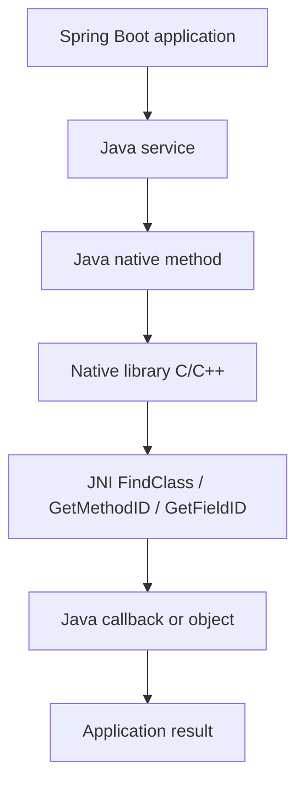

# JNI và những lớp, field, method được mã native gọi tới

## 1. Vì sao cần mô tả những điểm truy cập JNI?

Java Native Interface (JNI) là giao diện cho phép mã Java và mã native C/C++ trao đổi với nhau trong cùng process. Một ứng dụng Spring Boot có thể dùng JNI trực tiếp hoặc thông qua dependency, chẳng hạn thư viện xử lý ảnh, mã hóa, nén dữ liệu, machine learning hay SDK thiết bị.

Trên JVM, mã native có thể dùng JNI API để tìm class, lấy method ID/field ID, tạo object và gọi method Java. Với GraalVM Native Image, reachability analysis chủ yếu diễn ra tại build time. Các class và member chỉ được mã native truy cập có thể không xuất hiện trong call graph Java thông thường. Nếu không được mô tả bằng metadata phù hợp, chúng có thể không được giữ lại hoặc không được phép truy cập theo cách JNI yêu cầu.

Spring AOT cung cấp **RuntimeHints** để khai báo trước các khả năng runtime. Với JNI, API `RuntimeHints.jni()` mô tả type và quyền truy cập mà mã native cần. Bài học tập trung vào việc lập danh sách class, constructor, field và method mà C/C++ thực sự gọi tới, đăng ký hints trong Spring AOT, sau đó xác minh trên native executable.

## 2. Hai hướng gọi qua JNI

Có hai hướng tương tác cần phân biệt:

- **Java gọi mã native:** Java khai báo method có từ khóa `native`, rồi gọi method đó. Native library thực thi phần việc C/C++.
- **Mã native gọi ngược vào Java:** C/C++ dùng JNI API để tìm class, lấy constructor/method/field ID, tạo object hoặc gọi method Java.



Bài này tập trung vào các class/member mà **mã native gọi tới**. Đây là đường truy cập dễ bị bỏ sót vì Java bytecode không nhất thiết có lời gọi trực tiếp tới chúng.

## 3. JNI tìm class và member bằng tên cùng chữ ký

Ví dụ native code tìm class và gọi method:

```c
jclass callbackClass = (*env)->FindClass(
    env, "com/example/nativebridge/NativeCallback");

jmethodID onDone = (*env)->GetMethodID(
    env, callbackClass, "onCompleted", "(I)V");

(*env)->CallVoidMethod(env, callback, onDone, status);
```

Các chuỗi trong ví dụ có ý nghĩa chính xác:

- `com/example/nativebridge/NativeCallback`: tên class theo dạng internal name dùng bởi JNI, phân cách package bằng dấu `/`.
- `onCompleted`: tên method.
- `(I)V`: JNI method descriptor, nhận một `int` và trả về `void`.

Nếu descriptor sai, `GetMethodID` không tìm được method. Nếu class/member đúng nhưng không có metadata JNI phù hợp trong Native Image, thao tác vẫn có thể thất bại. Vì vậy, cần kiểm tra cả **tên/chữ ký** lẫn **hints**.

## 4. Lập bảng contract trước khi đăng ký hints

Giả sử native library xử lý tác vụ nền và gọi callback Java. Trước khi viết registrar, lập bảng mọi điểm truy cập:

| Type | Member | JNI operation | Ý nghĩa |
|---|---|---|---|
| `NativeCallback` | Class | `FindClass` | Tìm callback type |
| `NativeCallback` | Constructor | `GetMethodID("<init>", ...)` nếu native tạo object | Tạo callback instance |
| `NativeCallback` | `onCompleted(int)` | `GetMethodID` + `CallVoidMethod` | Gọi callback |
| `NativeResult` | Field `code` | `GetFieldID` / `SetIntField` | Đọc hoặc ghi trạng thái |
| `NativeResult` | Field `message` | `GetFieldID` / `SetObjectField` | Trao đổi thông báo |
| `NativeResult` | Constructor | `NewObject` | Tạo kết quả từ C/C++ |

Bảng phải dựa trên code native thực tế. Nếu Java tạo callback rồi truyền object reference sang C, native không cần constructor để tạo callback. Nếu C tạo `NativeResult`, cần khai báo quyền tạo instance phù hợp.

Không đăng ký tất cả member của mọi class trong package chỉ để phòng ngừa. Metadata nên phản ánh contract JNI đã xác định.

## 5. RuntimeHints.jni() và JNIAccess

Spring AOT cung cấp API trong package `org.springframework.aot.hint`:

```java
RuntimeHints hints = new RuntimeHints();

hints.jni().registerType(
        NativeCallback.class,
        JNIAccess.INVOKE
);
```

`hints.jni()` trả về registry dành cho type được truy cập từ JNI. `registerType` khai báo type cùng các quyền mà mã native cần. Các hằng trong `JNIAccess` biểu diễn những khả năng như gọi method, cấp phát hoặc khởi tạo object, cũng như phạm vi public/declared theo API của phiên bản Spring Framework.

Những quyền thường gặp gồm:

| Quyền | Khi nào xem xét |
|---|---|
| `INVOKE` | Native gọi method Java qua JNI |
| `ALLOCATE` | Native cần cấp phát object theo cơ chế JNI được hỗ trợ |
| `CONSTRUCT` | Native tạo instance thông qua constructor |
| `PUBLIC` | Native truy cập public members |
| `DECLARED` | Native cần phạm vi members được khai báo trên type, bao gồm member không public theo khả năng hỗ trợ |

Enum và cách kết hợp chính xác cần được kiểm tra theo version Spring Framework của dự án. Không giả định mọi phiên bản có cùng tập hằng hoặc cùng semantics. Dùng Javadoc/IDE và test để xác nhận.

## 6. Đăng ký callback class mà native chỉ gọi method

Giả sử Java tạo callback và truyền reference vào native library:

```java
package com.example.nativebridge;

public final class NativeCallback {

    public void onCompleted(int status) {
        System.out.println("Native task status: " + status);
    }
}
```

Native code chỉ nhận object đã được tạo từ Java và gọi method:

```c
jclass type = (*env)->GetObjectClass(env, callback);

jmethodID method = (*env)->GetMethodID(
    env, type, "onCompleted", "(I)V");

(*env)->CallVoidMethod(env, callback, method, status);
```

Với contract này, điều quan trọng là native có quyền gọi method. Có thể đăng ký:

```java
hints.jni().registerType(
        NativeCallback.class,
        JNIAccess.INVOKE
);
```

Không cần thêm constructor hint chỉ vì class có constructor: callback được Java tạo trước khi truyền sang native. Nếu C/C++ còn đọc hoặc ghi field, cần bổ sung quyền tương ứng và kiểm tra API hỗ trợ cho field access.

## 7. Khi native tạo object Java

Một số thư viện native tự tạo object để trả kết quả cho Java. Ví dụ:

```c
jclass resultClass = (*env)->FindClass(
    env, "com/example/nativebridge/NativeResult");

jmethodID constructor = (*env)->GetMethodID(
    env, resultClass, "<init>", "(ILjava/lang/String;)V");

jobject result = (*env)->NewObject(
    env, resultClass, constructor, code, message);
```

Java class:

```java
package com.example.nativebridge;

public final class NativeResult {

    private final int code;
    private final String message;

    public NativeResult(int code, String message) {
        this.code = code;
        this.message = message;
    }

    public int code() {
        return code;
    }

    public String message() {
        return message;
    }
}
```

Ở đây native cần tìm class, lấy constructor ID và gọi `NewObject`. Hints phải mô tả khả năng tìm type và tạo instance qua JNI, thường cần quyền `CONSTRUCT` và/hoặc quyền liên quan theo API Spring/GraalVM version. Nếu native sau đó gọi getter bằng JNI, cần thêm khả năng invoke method.

Không nhầm JNI constructor access với Java reflection constructor hints. Chúng thuộc hai cơ chế metadata riêng.

## 8. Field access: GetFieldID, GetIntField và SetObjectField

JNI có các API đọc/ghi field instance. Ví dụ native đọc field:

```c
jfieldID codeField = (*env)->GetFieldID(
    env, resultClass, "code", "I");

jint code = (*env)->GetIntField(env, result, codeField);
```

Hoặc ghi object field:

```c
jfieldID messageField = (*env)->GetFieldID(
    env, resultClass, "message", "Ljava/lang/String;");

(*env)->SetObjectField(env, result, messageField, message);
```

Nếu field là private, quyền truy cập JNI và metadata cần phù hợp với phạm vi field được khai báo. Không mặc định `INVOKE` bao phủ field access. Hãy kiểm tra JNIAccess của version đang dùng; nếu API Spring không biểu diễn đủ quyền field cụ thể, dùng reachability metadata Native Image phù hợp và test trên executable.

Field descriptor cũng phải đúng:

| Java field type | JNI descriptor |
|---|---|
| `int` | `I` |
| `long` | `J` |
| `boolean` | `Z` |
| `String` | `Ljava/lang/String;` |
| `byte[]` | `[B` |
| `Invoice` | `Lcom/example/Invoice;` |

Lỗi descriptor có thể làm `GetFieldID` trả null ngay cả khi tên field đúng.

## 9. Đăng ký JNI hints qua RuntimeHintsRegistrar

Tập trung metadata trong một registrar:

```java
package com.example.nativebridge;

import org.springframework.aot.hint.JNIAccess;
import org.springframework.aot.hint.RuntimeHints;
import org.springframework.aot.hint.RuntimeHintsRegistrar;

final class NativeBridgeHints implements RuntimeHintsRegistrar {

    @Override
    public void registerHints(
            RuntimeHints hints,
            ClassLoader classLoader) {

        hints.jni().registerType(
                NativeCallback.class,
                JNIAccess.INVOKE
        );

        hints.jni().registerType(
                NativeResult.class,
                JNIAccess.CONSTRUCT,
                JNIAccess.INVOKE
        );
    }
}
```

Ví dụ minh họa quyền gọi callback method và tạo/gọi method trên result type. Nếu native chỉ tạo result nhưng Java đọc getter bằng lời gọi trực tiếp, có thể không cần JNI invoke cho getter. Nếu native truy cập field trực tiếp, bổ sung quyền field phù hợp.

Gắn registrar với configuration:

```java
@Configuration(proxyBeanMethods = false)
@ImportRuntimeHints(NativeBridgeHints.class)
class NativeBridgeConfiguration {
}
```

Configuration phải thuộc ApplicationContext được Spring AOT xử lý. Nếu registrar không được phát hiện, code đăng ký dù đúng cũng không xuất hiện trong metadata native.

## 10. JNI hints không thay thế reflection hints

JNI và Java reflection đều có thể truy cập member động, nhưng nguồn gọi khác nhau:

| Cơ chế | Ví dụ | Hints |
|---|---|---|
| JNI gọi method Java | `CallVoidMethod` | `hints.jni()` |
| JNI tạo object | `NewObject` | JNI construct/allocate tương ứng |
| Java gọi `Method.invoke` | Reflection | `hints.reflection()` |
| Java gọi `Constructor.newInstance` | Reflection | `hints.reflection()` |
| Java đọc classpath file | ClassLoader | `hints.resources()` |
| Tạo JDK dynamic proxy | `Proxy.newProxyInstance` | `hints.proxies()` |

Một type có thể cần cả JNI hints và reflection hints nếu thư viện vừa gọi nó từ C/C++ vừa có Java code dùng reflection. Không nên coi một loại hints bao phủ loại còn lại.

Tương tự, JNI hints không đóng gói `.so`, `.dll` hay `.dylib`. Native library phải được cung cấp và load đúng kiến trúc/ABI riêng.

## 11. Tên class, method descriptor và overload

JNI tìm method bằng tên cùng descriptor. Nếu Java có overload:

```java
public void onCompleted(int status) {}
public void onCompleted(String message) {}
```

Hai method có descriptor khác nhau:

- `onCompleted(int)`: `(I)V`
- `onCompleted(String)`: `(Ljava/lang/String;)V`

Nếu native code gọi overload thứ hai nhưng hints hoặc code C mô tả overload đầu tiên, việc tra cứu không khớp. Tương tự, constructor descriptor phải bao gồm mọi tham số và kiểu trả về `V`.

Khi refactor Java class, hãy xem JNI signature như một contract tương thích. Thay package, đổi tên method, đổi kiểu tham số hoặc chuyển field có thể yêu cầu cập nhật C/C++ và hints. Nên có integration test xác nhận signature ở cả hai phía.

## 12. Classloader, thread và reference lifecycle

JNI code cần tuân thủ quy tắc runtime, không chỉ metadata:

- `JNIEnv*` gắn với thread hiện tại, không chuyển sang thread khác để dùng.
- Native-created thread cần attach vào runtime theo JNI API hỗ trợ trước khi gọi Java.
- Local reference có vòng đời giới hạn; không giữ qua JNI call tùy tiện.
- Global reference cần được giải phóng bằng `DeleteGlobalRef` khi không còn dùng.
- Kiểm tra exception sau `FindClass`, `GetMethodID`, `GetFieldID` và lời gọi Java.
- Classloader context có thể ảnh hưởng việc tìm class; không giả định mọi thread có cùng context classloader.

Hints không sửa được lỗi dùng sai `JNIEnv*`, rò rỉ global reference, signature không đúng hoặc callback sau khi object đã hết vòng đời. Những lỗi này cần được xử lý trong code native và kiểm thử riêng.

## 13. Đưa native library vào runtime image

Nếu Java dùng:

```java
static {
    System.loadLibrary("taskengine");
}
```

thì runtime phải tìm được thư viện tương ứng, ví dụ Linux `libtaskengine.so`. Kiểm tra:

- Tên file và đường dẫn loader.
- Architecture khớp executable.
- ABI/libc và shared libraries phụ thuộc tương thích.
- Quyền đọc/thực thi của user container.
- Native library được đóng gói hoặc mount đúng vị trí.

JNI hints chỉ mô tả class/member Java được truy cập qua JNI. Chúng không tự thêm file thư viện vào native executable hay OCI image. Nếu thư viện được cung cấp qua container layer, phải kiểm tra runtime image có chứa file và dependency của nó.

## 14. Kiểm thử JNI hints

Có thể unit test registrar bằng cách tạo RuntimeHints và kiểm tra các entry JNI theo API predicate mà Spring Framework version cung cấp. Tên predicate cụ thể có thể thay đổi; kiểm tra Javadoc/IDE. Unit test xác minh khai báo metadata, nhưng chưa chứng minh native executable đã thu thập và dùng metadata đúng.

Quy trình đầy đủ:

1. Unit test registrar để xác nhận type và quyền JNI đã đăng ký.
2. Chạy Spring AOT, xác nhận registrar được phát hiện trong context.
3. Build GraalVM Native Image.
4. Chạy đường native-to-Java: tìm class, gọi callback, tạo object hoặc truy cập field theo contract.
5. Chạy đường Java-to-native: gọi native method và xác minh kết quả.
6. Kiểm thử callback bất đồng bộ, thread attach/detach và reference lifecycle nếu có.
7. Chạy trong runtime container đích, kiểm tra native library và dependency.

Không chỉ test một callback đơn giản nếu thư viện thực tế còn tạo object, đọc field hoặc gọi overload khác. Mỗi operation trong contract cần được bao phủ.

## 15. Chẩn đoán lỗi thường gặp

| Triệu chứng | Nguyên nhân có thể | Hướng xử lý |
|---|---|---|
| `FindClass` trả null | Sai internal class name hoặc type không được hỗ trợ | Kiểm tra package/name và JNI hints |
| `GetMethodID` trả null | Sai tên, descriptor hoặc thiếu quyền JNI | Đối chiếu chữ ký và metadata |
| `GetFieldID` trả null | Sai field name/descriptor hoặc field không được mô tả | Kiểm tra Java field và JNI field descriptor |
| `NewObject` thất bại | Constructor không khớp hoặc thiếu construct capability | Kiểm tra descriptor và JNI hints |
| Native callback lỗi nhưng JVM chạy | Reachability metadata cho native access chưa đủ | Đăng ký type/member qua JNI hints |
| `UnsatisfiedLinkError` | Không tìm thấy native library hoặc thiếu dependency | Kiểm tra tên, loader, architecture và ABI |
| Chỉ lỗi trên một architecture | Thư viện native không được build cho target đó | Cung cấp binary đúng platform |
| Crash ở callback thread | Thread/ENV/reference lifecycle sai | Sửa JNI programming và test concurrency |

Luôn phân biệt lỗi metadata với lỗi JNI programming hoặc lỗi loader. Thêm hints không sửa được method descriptor sai, native library thiếu hoặc memory/reference bug.

## 16. Bài thực hành: callback và result object từ thư viện C

**Bối cảnh:** dịch vụ Spring Boot gọi `libtaskengine`. Java truyền callback; C/C++ gọi `onCompleted(int)` và tạo `NativeResult` trả về.

**Bước 1 — Viết Java contract.** Tạo `NativeCallback`, `NativeResult` với constructor và getter rõ ràng.

**Bước 2 — Viết JNI contract.** Ghi internal class name, method name, constructor descriptor, field descriptor và operation tương ứng.

**Bước 3 — Viết registrar.** Đăng ký callback invoke và result construct/invoke theo đúng hoạt động native. Bổ sung field access nếu C/C++ đọc/ghi field trực tiếp.

**Bước 4 — Import hints.** Gắn `RuntimeHintsRegistrar` bằng `@ImportRuntimeHints` vào configuration thuộc context AOT.

**Bước 5 — Kiểm tra native library.** Build thư viện cho đúng architecture/ABI, kiểm tra shared library dependency và đường dẫn load.

**Bước 6 — Build native executable.** Chạy Spring AOT và GraalVM Native Image, lưu log compiler và xác nhận metadata được thu thập.

**Bước 7 — Chạy cả hai chiều.** Gọi native method từ Java; xác minh C gọi callback và trả result object. Kiểm tra exception, thread và reference lifecycle.

**Bước 8 — Chạy container.** Đưa executable cùng native library vào runtime image tương thích, chạy dưới user triển khai và lặp lại integration tests.

Tiêu chí hoàn thành: mọi class/member trong JNI contract được đăng ký đúng, thư viện native load được, callback/object creation hoạt động trên native executable và container, không có lỗi descriptor hoặc lifecycle.

## 17. Kết luận

Khi mã C/C++ gọi vào Java, Native Image cần biết trước những **class, constructor, method và field** mà JNI sẽ tìm và thao tác. Spring `RuntimeHints.jni()` cung cấp cách khai báo type cùng quyền truy cập trong Spring AOT. Các khai báo này khác reflection hints và không thay thế việc đóng gói native library.

Hãy bắt đầu từ JNI contract thực tế: internal class name, member name, descriptor và operation. Đăng ký đúng quyền, gắn registrar vào context AOT, kiểm thử cả callback lẫn object/field access và chạy executable trong runtime container đích. Kết hợp metadata chính xác với quản lý thread/reference đúng chuẩn giúp tích hợp JNI trong Spring Boot Native Image ổn định và có thể truy vết.
