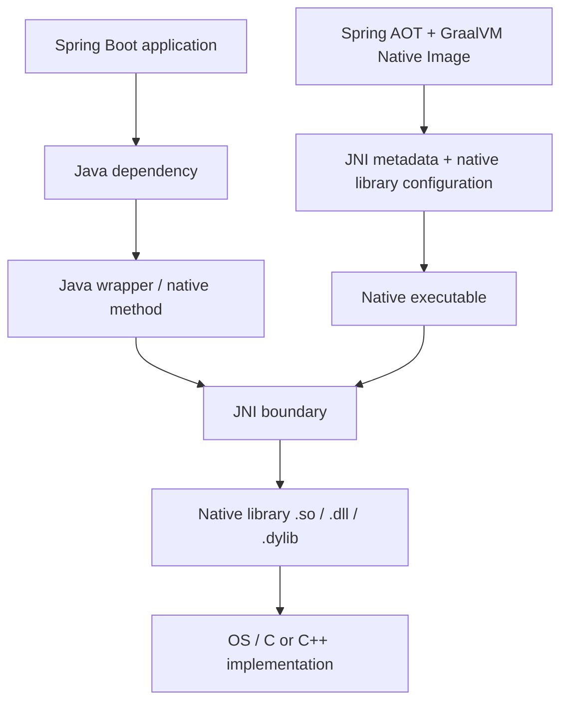

# Dependency dùng JNI dù ứng dụng không trực tiếp viết mã C

## 1. JNI có thể xuất hiện từ dependency

Một ứng dụng Spring Boot có thể chỉ chứa Java code nhưng vẫn phụ thuộc vào **Java Native Interface (JNI)** thông qua thư viện bên thứ ba. JNI cho phép mã Java gọi hàm native trong thư viện hệ điều hành hoặc thư viện C/C++; chiều ngược lại, native code cũng có thể gọi vào JVM theo hợp đồng JNI.

Các dependency có thể dùng JNI để truy cập chức năng hệ thống hoặc tăng hiệu năng, ví dụ:

- Driver database có thành phần native hoặc wrapper tới thư viện client C.
- Thư viện mật mã, nén, xử lý ảnh/video hoặc tối ưu CPU.
- Native transport cho networking.
- Thư viện truy cập thiết bị, hệ thống tệp đặc thù hoặc thư viện C có sẵn.
- Dependency chọn backend native tùy OS/CPU khi khởi động.

Vì vậy, việc không có file `.c` hay `.cpp` trong repository không chứng minh ứng dụng không dùng JNI. Một dependency có thể chứa Java wrapper gọi `native` method và tải thư viện `.dll`, `.so` hoặc `.dylib` lúc runtime.

Trong module **SPRING_BOOT_NATIVE_IMAGE**, cần nhận diện các dependency như vậy trước khi build GraalVM Native Image. Native executable phải có metadata JNI phù hợp, thư viện native đúng nền tảng và cách nạp thư viện được hỗ trợ. Build thành công trên máy phát triển không bảo đảm binary chạy được trong container đích.



## 2. JNI là gì trong góc nhìn Java?

Một class Java có thể khai báo method với từ khóa `native`:

```java
public final class FastChecksum {
    static {
        System.loadLibrary("fastchecksum");
    }

    public native long calculate(byte[] data);
}
```

Method `calculate` không có phần thân Java; implementation nằm trong native library. Khi gọi method, runtime tìm native implementation đã đăng ký hoặc được ánh xạ theo quy ước JNI.

Ví dụ trên chỉ minh họa cấu trúc JNI. Trong ứng dụng thực, code này thường nằm trong dependency chứ không nằm trong source của Spring Boot service.

Các dấu hiệu cần chú ý khi kiểm tra dependency:

- Method khai báo `native` trong bytecode/class.
- Lời gọi `System.loadLibrary` hoặc `System.load`.
- File thư viện native được đóng gói trong JAR, JAR classifier hoặc tải riêng.
- Startup code chọn backend theo OS/architecture.
- Exception như `UnsatisfiedLinkError`, `NoClassDefFoundError` liên quan wrapper/native binding.

JNI là một cơ chế riêng với reflection. Một class có thể được gọi trực tiếp trong Java nhưng vẫn gọi native method; khi đó cần xử lý phần JNI dù không cần reflection hint cho lời gọi Java tĩnh.

## 3. Những loại dependency có thể dùng JNI gián tiếp

| Nhóm dependency | Vì sao có thể dùng native code | Ví dụ cần kiểm tra |
|---|---|---|
| Networking | Native event loop hoặc transport tối ưu | Native transport theo OS |
| Cryptography/TLS | Gọi thư viện crypto hệ thống hoặc backend native | OpenSSL binding, provider native |
| Compression | Dùng codec C/C++ để tăng tốc | zlib, zstd, lz4 wrapper |
| Database | Dùng client library hoặc engine nhúng native | SQLite/JNI wrapper, database client |
| Image/media | Gọi codec và thư viện xử lý ảnh/video | ImageIO plugin/native codec |
| Machine learning | Runtime inference hoặc accelerator native | Tensor/runtime backend |
| Hardware/system integration | Truy cập API hệ điều hành hoặc thiết bị | USB, serial, GPU binding |

Đây là nhóm để rà soát, không phải khẳng định mọi thư viện thuộc các nhóm trên đều dùng JNI hoặc đều không tương thích Native Image. Một số thư viện dùng Java thuần, một số dùng JNI, một số chuyển sang Foreign Function & Memory API hoặc cơ chế khác tùy version.

## 4. Tìm dependency có JNI trong dự án

Bắt đầu từ runtime dependency graph vì dependency chỉ có trong test không nhất thiết đi vào ứng dụng production.

Với Gradle:

```bash
./gradlew :api-app:dependencies --configuration runtimeClasspath
```

Truy nguyên một dependency cụ thể:

```bash
./gradlew :api-app:dependencyInsight --dependency netty --configuration runtimeClasspath
```

Với Maven:

```bash
./mvnw dependency:tree
```

Sau khi xác định dependency đáng nghi, kiểm tra JAR và nội dung:

```bash
jar tf path/to/library.jar
```

Tìm các file native theo phần mở rộng như `.so`, `.dll`, `.dylib`, hoặc các thư mục `META-INF/native`, `native/` tùy cách đóng gói. Một số dependency tải thư viện ở runtime nên file native không nằm trong JAR chính.

Có thể kiểm tra class bytecode bằng công cụ JDK:

```bash
javap -classpath path/to/library.jar -p -c com.example.NativeBridge
```

Tìm khai báo `native` và lời gọi tới `System.loadLibrary` trong class đã chọn. Cần dùng đúng classpath và tên class của dependency thực tế.

Không nên kết luận một dependency không dùng JNI chỉ vì không tìm thấy file `.so` trong JAR: nó có thể lấy native library từ package riêng, hệ thống hoặc runtime download.

## 5. Phân biệt JNI với thư viện native được gọi qua process

Không phải mọi dependency gọi mã bên ngoài đều dùng JNI:

- **JNI**: Java process gọi native function qua JNI boundary trong cùng process.
- **Process invocation**: Java gọi chương trình ngoài qua `ProcessBuilder` hoặc shell; đây là process riêng.
- **Network client**: Java giao tiếp với service qua socket/HTTP; code server chạy ở process/máy khác.
- **FFM API**: Java dùng Foreign Function & Memory API (tùy JDK) để gọi native function theo cơ chế khác JNI.

Cách xử lý Native Image có thể khác nhau. JNI cần JNI configuration/metadata và thư viện tương thích; process invocation cần executable ngoài có trong image và quyền chạy; network client cần cấu hình kết nối; FFM cần kiểm tra hỗ trợ theo JDK/GraalVM version.

Không thêm JNI metadata để sửa lỗi `ProcessBuilder` không tìm thấy executable. Trước hết xác định boundary thực tế của dependency.

## 6. JNI metadata trong Native Image

GraalVM Native Image cần biết những lớp Java nào được dùng ở JNI boundary và cách native code có thể truy cập chúng. Tùy phiên bản, cấu hình JNI có thể mô tả:

- Class được tìm hoặc khởi tạo từ native code.
- Constructor/method/field được native code truy cập qua JNI.
- Native method Java được đăng ký hoặc được gọi.
- Các kiểu và member cần thiết khi Java/native trao đổi object.

Không nên nhầm JNI metadata với reflection metadata. Reflection mô tả truy cập động từ Java reflection APIs; JNI mô tả truy cập qua Java Native Interface. Một thư viện có thể cần cả hai, nhưng hai tập quyền không tự thay thế cho nhau.

GraalVM Native Image có hỗ trợ cấu hình JNI riêng. Cú pháp file, schema và cách cung cấp metadata thay đổi theo phiên bản GraalVM. Hãy dùng tài liệu đúng version hoặc metadata do thư viện phát hành, không sao chép cấu hình cũ mà chưa xác minh.

## 7. Native library phải đúng nền tảng

JNI library là binary phụ thuộc OS và kiến trúc. Ví dụ:

| Build/runtime target | Loại thư viện thường cần |
|---|---|
| Linux x86_64 | ELF shared object `.so` cho x86_64 |
| Linux ARM64 | ELF shared object `.so` cho aarch64 |
| Windows x64 | PE DLL `.dll` cho x64 |
| macOS ARM64 | Mach-O dynamic library `.dylib` cho arm64 |

Không thể dùng DLL Windows trong Linux container. Cũng không thể dùng binary x86_64 trên ARM64 chỉ vì Java bytecode giống nhau.

Ngoài kiến trúc, cần tương thích ABI và shared libraries. Ví dụ một `.so` liên kết với glibc hoặc OpenSSL version cụ thể có thể không chạy trong run image khác. Kiểm tra dependencies của native library và run image đích.

Trên Linux, công cụ thường dùng để kiểm tra:

```bash
file libfastchecksum.so
ldd libfastchecksum.so
```

`ldd` hiển thị shared library dependencies của ELF trong môi trường Linux. Chỉ chạy trên binary đáng tin cậy và môi trường phù hợp; với binary không tin cậy, ưu tiên công cụ phân tích tĩnh như `readelf -d`. Trên Windows, dùng công cụ kiểm tra PE/dependency tương ứng của Visual Studio; trên macOS có thể dùng `otool -L`.

## 8. Thư viện native được đóng gói ở đâu?

Một dependency có thể phân phối native library theo nhiều cách:

1. JAR chứa nhiều binary theo OS/architecture trong resource path.
2. JAR classifier riêng cho từng nền tảng.
3. Package manager hoặc OS package cài thư viện vào hệ thống.
4. Thư viện tải/extract binary từ JAR vào thư mục tạm khi runtime.
5. Native library được cung cấp sẵn trong base/run image.

Khi dùng Cloud Native Buildpacks, builder image và run image có vai trò khác nhau. Toolchain build có thể nằm trong builder, nhưng thư viện cần lúc chạy phải có trong application image/run image. Không giả định file native có trong builder sẽ tự có trong container cuối cùng.

Nếu thư viện extract binary vào thư mục tạm, container cần thư mục đó tồn tại và writable. Với root filesystem read-only, phải cấu hình temp directory và permission theo hướng dẫn của thư viện.

## 9. Spring AOT và JNI: vai trò khác nhau

Spring AOT phân tích Spring application context, sinh mã khởi tạo và đóng góp Runtime Hints. Nó có thể giúp chuẩn bị reflection, proxy, resource và serialization metadata khi các tích hợp tương ứng hỗ trợ.

Tuy nhiên, Spring AOT không tự biên dịch mã C/C++ của dependency hoặc tự bảo đảm native library đúng ABI. Native Image build và packaging phải xử lý các yêu cầu JNI và thư viện hệ điều hành tương ứng.

Một quy trình đúng cần xác minh:

- Dependency JNI có trên runtime classpath của application module.
- Phiên bản thư viện hỗ trợ Native Image hoặc có hướng dẫn metadata.
- JNI metadata được cung cấp theo cơ chế GraalVM/Spring tương thích.
- Native library đúng OS/architecture được đóng gói hoặc cài trong run image.
- Dynamic loading và temp extraction hoạt động trong môi trường runtime.
- Các code path JNI được thực thi trong integration test native.

## 10. Ví dụ dependency gián tiếp trong ứng dụng Spring Boot

Giả sử ứng dụng dùng một thư viện checksum tối ưu. Controller chỉ gọi API Java:

```java
@RestController
class ChecksumController {

    private final ChecksumService checksumService;

    ChecksumController(ChecksumService checksumService) {
        this.checksumService = checksumService;
    }

    @PostMapping("/api/checksum")
    String calculate(@RequestBody byte[] payload) {
        return checksumService.calculate(payload);
    }
}
```

Service:

```java
@Service
class ChecksumService {

    private final FastChecksumLibrary library;

    ChecksumService(FastChecksumLibrary library) {
        this.library = library;
    }

    String calculate(byte[] payload) {
        return library.sha256(payload);
    }
}
```

Code Spring không có `native` method, nhưng `FastChecksumLibrary` có thể gọi JNI bên trong. Vì vậy, test JVM thành công trên laptop không đủ chứng minh executable native chạy trong Linux container.

Nếu thư viện có Java fallback, cần xác định runtime chọn backend nào. Nếu native backend được chọn, kiểm tra library binary và JNI metadata; nếu fallback thuần Java được chọn, test phải xác nhận behavior và hiệu năng tương ứng.

Không tự viết JNI hints cho thư viện trước khi đọc tài liệu tích hợp của nó. Nhà cung cấp có thể đã phát hành reachability metadata hoặc hướng dẫn Native Image riêng.

## 11. Cách kiểm thử dependency JNI

Một kế hoạch kiểm thử thực tế:

1. **Dependency inspection**: ghi lại artifact/version và xác định native backend được chọn.
2. **JVM smoke test**: gọi API sử dụng thư viện trên JVM.
3. **Native build**: chạy Spring AOT và GraalVM Native Image với đúng profile/target.
4. **Native smoke test**: gọi cùng API trên executable vừa build.
5. **Container test**: chạy image với run image thực tế, kiểm tra shared library và quyền filesystem.
6. **Architecture test**: chạy trên đúng OS/CPU target; không suy luận từ máy developer khác kiến trúc.
7. **Fallback test**: nếu có Java fallback, xác nhận cả native backend và fallback theo yêu cầu sản phẩm.

Test phải thực sự gọi đường code JNI. Một ứng dụng khởi động thành công nhưng chưa gọi native method chưa xác nhận JNI hoạt động.

## 12. Chẩn đoán lỗi thường gặp

| Triệu chứng | Nguyên nhân có thể | Hướng kiểm tra |
|---|---|---|
| `UnsatisfiedLinkError: no ... in java.library.path` | Không tìm thấy native library hoặc sai đường dẫn | Kiểm tra load path, packaging và runtime filesystem |
| `UnsatisfiedLinkError: ... not found` | Native method chưa được liên kết/đăng ký | Kiểm tra JNI implementation, symbol và metadata |
| `wrong ELF class` | Sai kiến trúc hoặc bitness | Kiểm tra `file`, architecture và binary dependency |
| `GLIBC_x.y not found` | Binary cần glibc mới hơn run image | Chọn base/run image tương thích hoặc rebuild |
| DLL/shared library dependency missing | Thiếu dependency bắc cầu của native library | Kiểm tra PE/ELF dependencies và cài runtime library |
| JVM chạy, native lỗi JNI | Thiếu JNI metadata hoặc cơ chế native chưa hỗ trợ | Đọc GraalVM diagnostics và hướng dẫn vendor |
| Chỉ lỗi trong container | Binary không có trong image, temp path/permission/ABI sai | Kiểm tra image cuối và runtime user |
| Startup pass nhưng endpoint lỗi | JNI path chỉ được gọi khi xử lý request | Viết test kích hoạt chính native call |

## 13. Checklist quản lý JNI gián tiếp

- Kiểm tra runtime dependency graph và version thư viện.
- Tìm native methods, `System.loadLibrary`, native binaries hoặc runtime extraction.
- Phân biệt JNI với process invocation, network và FFM.
- Đọc tài liệu Native Image của nhà cung cấp dependency.
- Kiểm tra JNI metadata đúng GraalVM version.
- Đóng gói native library cho đúng OS/architecture.
- Kiểm tra ABI và shared library dependencies của run image.
- Cấp temp directory writable nếu thư viện cần extract binary.
- Chạy integration test thực sự gọi native method trên executable/container.
- Ghi toolchain, dependency version, target platform và artifact digest.

## 14. Câu hỏi tự kiểm tra

1. Vì sao ứng dụng Java thuần về mặt source vẫn có thể phụ thuộc JNI?
2. Những dấu hiệu nào giúp phát hiện dependency gọi `System.loadLibrary` hoặc khai báo native method?
3. Khác nhau giữa JNI và gọi executable ngoài qua `ProcessBuilder` là gì?
4. Vì sao reflection metadata không thay thế JNI metadata?
5. Những điều kiện OS/architecture/ABI nào cần kiểm tra với native library?
6. Vì sao kiểm tra startup thành công chưa đủ chứng minh dependency JNI hoạt động?
7. Spring AOT hỗ trợ phần nào và phần nào vẫn do GraalVM/native library packaging đảm nhiệm?

**Ghi nhớ:** JNI có thể được gọi gián tiếp từ dependency dù ứng dụng không viết C/C++. Hãy kiểm tra runtime dependency graph, native methods và thư viện được tải, cung cấp metadata theo đúng GraalVM version, đóng gói binary đúng nền tảng và kiểm thử code path JNI trên chính native container.
