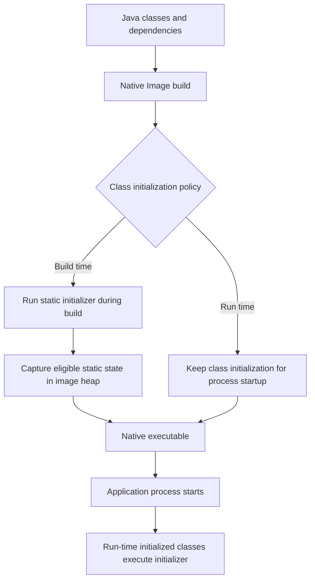

# Static initializer chạy ở giai đoạn build hoặc lúc ứng dụng khởi động

## 1. Vì sao thời điểm khởi tạo class quan trọng?

Trong Java, một class có thể chứa static field và static initializer (khối `static`). Khi class được khởi tạo, JVM thực thi các phép gán static field và khối initializer theo thứ tự xuất hiện. Trên JVM thông thường, việc này thường xảy ra lần đầu class được sử dụng theo quy tắc khởi tạo của Java.

GraalVM Native Image có thể thực hiện một số class initialization ngay trong quá trình build executable, thay vì chờ đến lúc process chạy. Cách này giúp chuyển công việc khởi tạo bất biến sang build time và có thể giảm startup. Tuy nhiên, nếu static initializer đọc environment, thời gian hệ thống, file, network, tạo thread hoặc lưu trạng thái phụ thuộc môi trường, kết quả có thể bị đóng băng vào image.

Trong module **SPRING_BOOT_NATIVE_IMAGE**, cần hiểu hai thời điểm:

- **Build-time initialization:** static initializer được chạy khi Native Image build, trạng thái static phù hợp có thể được lưu vào image heap.
- **Run-time initialization:** static initializer được thực thi khi ứng dụng native khởi chạy và class được khởi tạo theo quy tắc runtime.

Quyết định này ảnh hưởng đến tính đúng đắn, khả năng tái sử dụng cùng binary giữa các môi trường, startup và độ an toàn của image. Không nên chuyển mọi class sang build-time chỉ để giảm thời gian khởi động.

## 2. Static initializer trong Java

Ví dụ đơn giản:

```java
public final class TaxRules {

    static final int DEFAULT_RATE;

    static {
        DEFAULT_RATE = 10;
        System.out.println("TaxRules initialized");
    }

    private TaxRules() {
    }
}
```

Khi class được khởi tạo, khối `static` chạy và gán `DEFAULT_RATE`. Với JVM thông thường, điều này thường diễn ra ở lần sử dụng đầu tiên cần khởi tạo class, ví dụ đọc static field không phải constant variable hoặc gọi static method.

Một ví dụ khác:

```java
public final class AppEnvironment {

    static final String REGION =
            System.getenv("APP_REGION");

    private AppEnvironment() {
    }
}
```

Giá trị `REGION` được đọc khi class được khởi tạo. Nếu Native Image khởi tạo class này ở build time, nó có thể giữ lại giá trị `APP_REGION` của môi trường build. Khi chạy cùng executable ở staging hoặc production, biến môi trường khác không tự làm static field được tính lại.

Đây là một ví dụ rủi ro điển hình: static field phụ thuộc môi trường nhưng lại được khởi tạo quá sớm.

## 3. Build-time initialization và image heap

Native Image thực hiện phân tích và tạo executable trước khi ứng dụng chạy. Nếu một class được khởi tạo ở build time, trạng thái static của class có thể được đưa vào **image heap** — vùng dữ liệu khởi tạo sẵn được lưu trong executable và được sử dụng khi process bắt đầu.

Mô hình:



Lợi ích của build-time initialization:

- Chuyển một số phép tính bất biến ra khỏi startup.
- Tránh lặp lại công việc khởi tạo giống nhau ở mỗi process.
- Có thể giảm thời gian khởi động cho những class phù hợp.

Rủi ro:

- Giá trị phụ thuộc máy build có thể bị đóng băng.
- Object graph static có thể giữ trạng thái không mong muốn trong image heap.
- Tài nguyên hoặc handle chỉ hợp lệ trong build process có thể không hợp lệ khi chạy.
- Side effect trong initializer có thể xảy ra ở sai thời điểm.

Không phải mọi object được tạo trong static initializer đều có thể lưu vào image heap. Native Image kiểm tra khả năng lưu trữ và các quy tắc an toàn; một số trạng thái có thể khiến build báo lỗi.

## 4. Run-time initialization có nghĩa gì?

Với run-time initialization, Native Image giữ việc thực thi static initializer cho lúc ứng dụng native khởi chạy và class được khởi tạo. Giá trị phụ thuộc runtime như environment variables, filesystem hoặc runtime configuration có thể được đọc trong đúng môi trường process.

Ví dụ:

```java
public final class RuntimeSettings {

    static final String REGION;

    static {
        REGION = System.getenv().getOrDefault(
                "APP_REGION", "local");
    }

    private RuntimeSettings() {
    }
}
```

Nếu class được khởi tạo lúc runtime, `APP_REGION` có thể phản ánh environment của container đang chạy. Tuy nhiên, việc đọc một lần vào static final vẫn có nghĩa giá trị được giữ trong suốt vòng đời process; nó không tự reload nếu environment hoặc file thay đổi sau khi process đã khởi động.

Đối với cấu hình Spring Boot, thường nên dùng `Environment`, `@ConfigurationProperties` hoặc dependency injection thay vì tự đọc environment trong static initializer. Cách này làm rõ nguồn cấu hình, thứ tự property source và thời điểm binding.

## 5. Các tùy chọn Native Image điều khiển class initialization

Native Image cung cấp các option để điều khiển thời điểm khởi tạo class:

```bash
native-image --initialize-at-build-time=com.example.rules ...
```

và:

```bash
native-image --initialize-at-run-time=com.example.environment ...
```

Các option có thể nhận danh sách package/class theo cú pháp phiên bản GraalVM. Phạm vi package cần cân nhắc kỹ: chỉ định package rộng có thể ảnh hưởng rất nhiều class bên trong và dependency.

- `--initialize-at-build-time`: yêu cầu khởi tạo class ở build time.
- `--initialize-at-run-time`: yêu cầu giữ khởi tạo class cho runtime.

Native Image cũng có quy tắc mặc định và tự động phân tích initialization. Không nên giả định mọi class đều mặc định runtime hoặc mọi class trong dependency đều build-time. Kết quả phụ thuộc GraalVM version, classpath và phân tích an toàn của compiler.

Với Spring Boot Native Image, các option này thường được cấu hình qua Maven/Gradle Native Build Tools plugin hoặc buildpack environment/configuration. Cú pháp truyền argument phải phù hợp plugin version đang dùng.

## 6. Một static initializer phù hợp để chạy ở build time

Ví dụ dữ liệu bất biến và độc lập môi trường:

```java
final class CurrencyTable {

    static final Map<String, Integer> SCALE;

    static {
        Map<String, Integer> values = new HashMap<>();
        values.put("VND", 0);
        values.put("USD", 2);
        values.put("JPY", 0);
        SCALE = Map.copyOf(values);
    }

    private CurrencyTable() {
    }
}
```

Initializer tạo map từ các literal cố định. Nó không đọc file, network, environment, clock hay secret. Nếu các class liên quan được Native Image xác định là an toàn và được khởi tạo build time, dữ liệu có thể được lưu sẵn trong image heap.

Dù vậy, không cần ép mọi bảng hằng sang build time bằng option thủ công. Native Image có thể tự xử lý các constant/initializer phù hợp. Chỉ cấu hình khi có lý do đo được hoặc cần kiểm soát hành vi rõ ràng.

## 7. Static initializer có side effect: không nên chạy ở build time

Ví dụ tạo thread:

```java
final class BackgroundWorker {

    static final ScheduledExecutorService EXECUTOR;

    static {
        EXECUTOR = Executors.newSingleThreadScheduledExecutor();
        EXECUTOR.scheduleAtFixedRate(
                () -> System.out.println("tick"),
                1, 1, TimeUnit.SECONDS);
    }
}
```

Đây là thiết kế nguy hiểm cho build-time initialization. Thread và executor thuộc process build không thể được đóng gói như một thread đang chạy vào native executable. Native Image có thể báo lỗi khi phát hiện thread/unsupported state, hoặc việc khởi tạo cần được chuyển sang runtime.

Những side effect cần tránh trong static initializer:

- Tạo thread, executor, scheduler hoặc background worker.
- Mở socket, database connection hoặc HTTP client kết nối từ build environment.
- Đọc file theo đường dẫn máy build.
- Lấy thời gian hiện tại, random seed hoặc environment khi giá trị phải thay đổi theo process.
- Đọc credentials, token hoặc private key.
- Khởi tạo native library phụ thuộc OS/architecture nếu chưa phù hợp với build target.
- Đăng ký shutdown hook hoặc thao tác với process state.

Đối với tài nguyên runtime, chuyển việc tạo/đóng tài nguyên sang bean lifecycle hoặc phương thức khởi tạo runtime có kiểm soát.

## 8. Thời gian hệ thống và random value

Static initializer có thể tạo giá trị từ thời gian hoặc random:

```java
final class BuildStamp {
    static final Instant CREATED_AT = Instant.now();
    static final UUID INSTANCE_ID = UUID.randomUUID();
}
```

Nếu class bị khởi tạo lúc build time, cả timestamp và UUID có thể được tạo trong build process và giữ trong image. Mọi container chạy cùng binary có thể nhìn thấy cùng giá trị, điều thường không đúng với ý nghĩa instance ID hoặc thời gian khởi động.

Nếu cần thời gian process, hãy gọi `Instant.now()` lúc runtime hoặc inject `Clock`. Nếu cần ID theo instance, tạo khi process khởi động hoặc theo yêu cầu nghiệp vụ. Nếu cần build timestamp để truy vết artifact, hãy tạo có chủ đích như metadata build bất biến và không nhầm nó với thời điểm ứng dụng khởi động.

## 9. Đọc file và environment trong static initializer

Ví dụ rủi ro:

```java
final class Rules {
    static final String CONTENT;

    static {
        try {
            CONTENT = Files.readString(
                    Path.of("/etc/orders/rules.json"));
        }
        catch (IOException ex) {
            throw new ExceptionInInitializerError(ex);
        }
    }
}
```

Nếu build-time initialization xảy ra, Native Image có thể cố đọc file trên máy build. File production không tồn tại trong build container, hoặc nội dung build được đọc có thể bị đóng băng vào image.

Thiết kế tốt hơn là đọc external file qua bean/service ở runtime:

```java
@Component
class RulesLoader {

    private final RulesProperties properties;

    RulesLoader(RulesProperties properties) {
        this.properties = properties;
    }

    String load() throws IOException {
        return Files.readString(
                properties.path(), StandardCharsets.UTF_8);
    }
}
```

Đường dẫn được cấp bằng `@ConfigurationProperties` hoặc nguồn cấu hình runtime. Cần quyết định rõ đọc một lần lúc bean khởi tạo hay đọc lại mỗi lần sử dụng; hai lựa chọn có semantics và chi phí khác nhau.

## 10. Class initialization và Spring AOT là hai cơ chế khác nhau

Spring AOT phân tích ApplicationContext và sinh mã đăng ký/khởi tạo bean cùng RuntimeHints. Native Image class initialization quyết định **khi nào static initializer của Java class được thực thi**.

| Cơ chế | Câu hỏi trả lời |
|---|---|
| Spring AOT | Bean/configuration nào được phân tích và mã khởi tạo nào được sinh? |
| Native Image class initialization | Static initializer của class chạy trong build hay runtime? |
| RuntimeHints | Class/member/resource/proxy nào cần được hỗ trợ khi chạy? |
| Image heap | Trạng thái build-time nào được lưu trong executable? |

Một bean Spring được AOT xử lý không có nghĩa mọi class mà bean sử dụng đều được static-initialize ở build time. Ngược lại, chỉ định một class build-time không tự làm bean Spring được đăng ký hoặc thay đổi condition evaluation.

Khi điều tra lỗi, xác định đúng lớp cơ chế. Nếu bean không tồn tại do `@ConditionalOnProperty`, đó là vấn đề cấu trúc AOT. Nếu static field chứa giá trị environment của builder, đó là vấn đề class initialization.

## 11. Class initialization và native library

Một class có thể nạp native library trong static block:

```java
final class ImageCodec {
    static {
        System.loadLibrary("imagecodec");
    }

    static native byte[] resize(byte[] source);
}
```

Việc nạp thư viện có thể phụ thuộc OS, architecture, loader path và filesystem. Không nên ép class này build-time initialized nếu native library chỉ có trong runtime image hoặc phụ thuộc môi trường triển khai khác.

Cần xác định:
- Native library được cung cấp trong build environment hay runtime image?
- Library target có cùng architecture/ABI với executable?
- Class initialization có thực hiện `System.loadLibrary` trong build process không?
- Thư viện có side effect hoặc giữ native state không thể đóng gói?

Với JNI, còn phải đăng ký type/member hints và đóng gói native library phù hợp. Class initialization policy không thay thế JNI metadata hay library packaging.

## 12. Chẩn đoán lỗi class initialization

Khi Native Image build thất bại, thông báo có thể cho biết class được khởi tạo quá sớm hoặc chứa trạng thái không thể lưu vào image heap. Khi runtime gặp lỗi, có thể thấy initializer exception hoặc giá trị static không như mong đợi.

Một số lệnh/biện pháp hữu ích:

```bash
native-image --verbose ...
```

Bật log chi tiết qua plugin build tool khi cần. Tùy GraalVM version, có các diagnostic option để báo cáo class initialization và lý do lựa chọn. Kiểm tra tài liệu đúng phiên bản thay vì sao chép option diagnostic cũ.

Cách điều tra:

1. Xác định class đầu tiên xuất hiện trong lỗi.
2. Đọc static field initializer và khối `static` của class đó.
3. Kiểm tra class phụ thuộc được khởi tạo gián tiếp.
4. Tìm environment/file/network/time/random/thread/native-library side effect.
5. Xác định trạng thái static nào bị đưa vào image heap.
6. Chuyển class phù hợp sang run-time initialization hoặc refactor side effect ra khỏi static initializer.
7. Build lại và chạy trong môi trường runtime đích.

Không giải quyết mọi lỗi bằng cách thêm toàn bộ package vào `--initialize-at-run-time`. Cách đó có thể làm startup chậm, thay đổi thứ tự khởi tạo hoặc che khuất dependency initialization cần xử lý đúng.

## 13. Cấu hình qua Maven và Gradle

Khi dùng GraalVM Native Build Tools, có thể truyền Native Image build arguments qua cấu hình plugin.

Ví dụ Maven minh họa:

```xml
<plugin>
    <groupId>org.graalvm.buildtools</groupId>
    <artifactId>native-maven-plugin</artifactId>
    <configuration>
        <buildArgs>
            <buildArg>--initialize-at-run-time=com.example.environment</buildArg>
        </buildArgs>
    </configuration>
</plugin>
```

Ví dụ Gradle minh họa:

```groovy
graalvmNative {
    binaries {
        main {
            buildArgs.add(
                '--initialize-at-run-time=com.example.environment'
            )
        }
    }
}
```

Đây là cấu hình khái niệm; DSL/XML schema và cách truyền arguments phụ thuộc Native Build Tools version. Đặt argument vào đúng plugin configuration của dự án và kiểm tra log để xác nhận nó thực sự được chuyển tới Native Image.

Chỉ định tên class đầy đủ và phạm vi nhỏ. Nếu class thuộc dependency, kiểm tra package/class name đúng với version dependency đã resolve.

## 14. Kiểm thử sự khác biệt build time và runtime

Tạo class test đọc environment khi static initialization:

```java
final class RegionHolder {
    static final String REGION =
            System.getenv("APP_REGION");
}
```

Để kiểm tra, build native trong một môi trường có `APP_REGION=build-region`, sau đó chạy executable với `APP_REGION=runtime-region`. Nếu class được khởi tạo ở build time, giá trị quan sát có thể là build-region; nếu được khởi tạo ở runtime, giá trị có thể là runtime-region.

Không dùng ví dụ này như thiết kế production; đây là fixture để minh họa thời điểm khởi tạo. Test phải đảm bảo class thực sự được khởi tạo trong pha đang khảo sát và không bị compiler loại bỏ vì không reachable.

Một quy trình test có kiểm soát:

1. Tạo class có static initializer đọc environment.
2. Ghi rõ class initialization policy mặc định của build.
3. Build trong environment A.
4. Chạy executable với environment B.
5. Quan sát giá trị static và log initializer.
6. Cấu hình run-time initialization cho class.
7. Build lại và chạy lại với environment C.
8. So sánh kết quả, ghi GraalVM version và build arguments.

Bổ sung test cho file, clock hoặc random chỉ khi cần chứng minh đúng rủi ro tương ứng. Tránh dùng test có side effect thực như kết nối production service.

## 15. Nguyên tắc quyết định class nào build-time, class nào runtime

| Đặc điểm initializer | Xu hướng lựa chọn |
|---|---|
| Chỉ tạo dữ liệu bất biến từ literal | Có thể phù hợp build time |
| Tính toán thuần, deterministic, không phụ thuộc môi trường | Có thể phù hợp build time |
| Đọc environment hoặc system property cần thay đổi theo deployment | Runtime |
| Đọc file external hoặc secret | Runtime |
| Lấy thời gian hiện tại hoặc random per process | Runtime |
| Tạo thread/executor/socket/database connection | Runtime, nhưng nên chuyển khỏi static initializer |
| Nạp native library phụ thuộc target/runtime path | Cần phân tích kỹ, thường tránh build-time nếu không phù hợp |
| Giữ object chứa handle/resource của build process | Không phù hợp image heap |

Bảng là nguyên tắc thiết kế, không phải quy tắc compiler tự động. Một class có initializer hỗn hợp có thể cần refactor: phần tính toán bất biến tách riêng, phần side effect chuyển sang bean lifecycle/runtime method. Việc này thường rõ ràng hơn so với điều khiển cả class bằng một option rộng.

## 16. Bài thực hành: phát hiện giá trị bị đóng băng trong image

**Bối cảnh:** một ứng dụng Spring Boot có class `DeploymentRegion` đọc `APP_REGION` trong static initializer.

**Bước 1 — Tạo fixture.** Viết class static final đọc environment và một endpoint trả giá trị để quan sát.

**Bước 2 — Chạy JVM.** Khởi động với `APP_REGION=jvm-region`, gọi endpoint và ghi kết quả.

**Bước 3 — Build native.** Đặt `APP_REGION=build-region` trong môi trường build, tạo executable và lưu toolchain/build arguments.

**Bước 4 — Chạy native.** Đặt `APP_REGION=runtime-region` khi chạy executable; quan sát giá trị trả về.

**Bước 5 — Chuyển initialization policy.** Cấu hình class phù hợp bằng `--initialize-at-run-time`, build lại và lặp test.

**Bước 6 — Refactor thiết kế.** Thay static environment access bằng `@ConfigurationProperties` hoặc bean nhận giá trị qua Spring Environment. Chạy lại cả JVM/native.

**Bước 7 — Kiểm tra side effect.** Xác nhận không còn đọc secret, mở network hoặc tạo thread trong static initializer chạy build time.

Tiêu chí hoàn thành: giải thích được giá trị nào bị đóng băng, xác định class initialization policy, chứng minh runtime value nhận đúng environment process và refactor cấu hình theo lifecycle Spring.

## 17. Kết luận

Trong GraalVM Native Image, static initializer có thể chạy ở build time hoặc runtime. Build-time initialization có thể giảm công việc startup và lưu trạng thái bất biến vào image heap, nhưng có nguy cơ đóng băng environment, timestamp, random value, file content hoặc trạng thái của tài nguyên build process vào executable.

Với Spring Boot Native Image, hãy giữ static initializer thuần và deterministic nếu muốn hưởng lợi từ build time; chuyển cấu hình, secret, filesystem, network, thread và tài nguyên phụ thuộc deployment sang runtime lifecycle. Dùng các option initialization có phạm vi hẹp, kiểm tra log/diagnostics và chạy thử binary với environment khác môi trường build để xác nhận hành vi trước khi phát hành.
