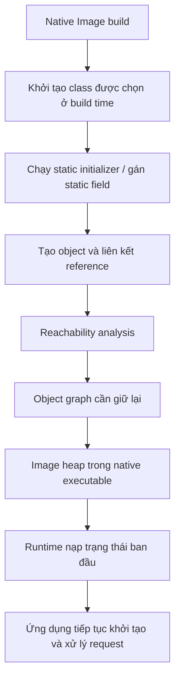
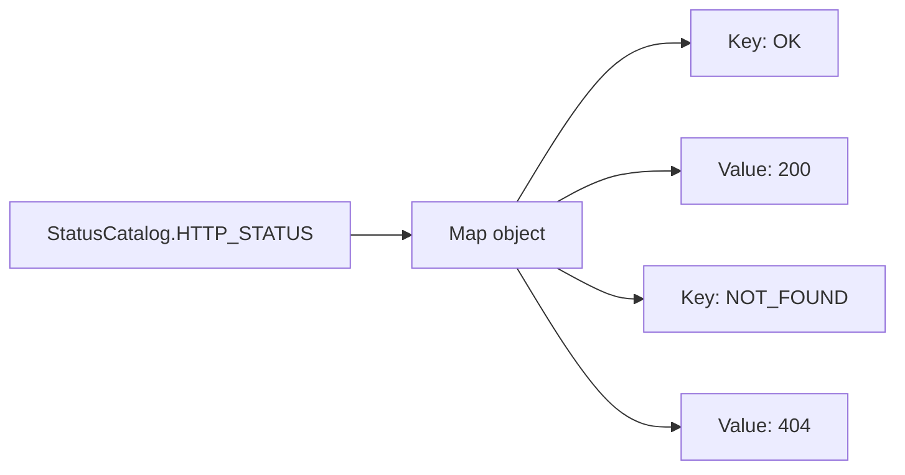

# Image heap và các giá trị được lưu từ static field

## Mục tiêu bài học

Trong ứng dụng Java thông thường, các trường `static` được gắn với trạng thái của class và được khởi tạo khi class được JVM khởi tạo. Khi biên dịch ứng dụng Spring Boot thành **GraalVM Native Image**, một số class có thể được khởi tạo ngay trong quá trình build. Giá trị mà các trường `static` giữ tại thời điểm đó có thể được lưu cùng đồ thị đối tượng trong **image heap** của native executable.

Điều này giúp ứng dụng khởi động nhanh hơn vì một phần công việc khởi tạo đã được thực hiện trước. Tuy nhiên, nếu class khởi tạo quá sớm, binary có thể mang theo giá trị phụ thuộc máy build, thời điểm build, biến môi trường, dữ liệu nhạy cảm hoặc trạng thái mutable không phù hợp.

Bài học này giúp bạn:

- Giải thích image heap và mối liên hệ với class initialization.
- Nhận diện object graph được giữ lại từ giá trị của `static` field.
- Phân biệt dữ liệu được tạo lúc build với dữ liệu được tạo lúc runtime.
- Phát hiện giá trị thời gian, môi trường, random, secret và mutable state có nguy cơ bị đóng băng vào binary.
- Chọn class phù hợp để khởi tạo tại build time hoặc runtime.
- Kiểm tra hành vi của static state trong Spring Boot Native Image.

## 1. Image heap là gì?

### 1.1. Native Image tạo snapshot trạng thái ban đầu

GraalVM Native Image phân tích ứng dụng và tạo executable dành cho hệ điều hành/kiến trúc đích. Trong quá trình build, một số class được khởi tạo sớm. Mã khởi tạo class (`<clinit>`) có thể gán giá trị cho static field, gọi phương thức khác và tạo ra các object.

Những object còn reachable từ các static field hoặc root phù hợp của class đã khởi tạo ở build time có thể được ghi vào **image heap**. Có thể hình dung image heap là trạng thái object ban đầu được chuẩn bị khi tạo executable, thay vì phải tạo lại toàn bộ trạng thái đó khi ứng dụng bắt đầu chạy.



Image heap không phải một file cache riêng mà ứng dụng tự đọc khi khởi động. Nó là một phần trạng thái được tích hợp vào native executable theo định dạng mà Native Image runtime quản lý.

### 1.2. Object graph từ static field

Xét ví dụ:

```java
final class StatusCatalog {

    static final Map<String, Integer> HTTP_STATUS = Map.of(
            "OK", 200,
            "NOT_FOUND", 404,
            "ERROR", 500
    );
}
```

Nếu `StatusCatalog` được khởi tạo tại build time và field `HTTP_STATUS` còn được sử dụng, map cùng các object liên quan có thể trở thành một phần của image heap. Đồ thị không chỉ gồm biến static; nó có thể bao gồm object map, các node nội bộ, key và value mà map tham chiếu.

Ví dụ về quan hệ tham chiếu:



Đây là sơ đồ khái niệm; cấu trúc nội bộ thực tế của `Map.of` phụ thuộc JDK. Điều cần nhớ là **reference từ static field có thể giữ lại cả object graph reachable**, không chỉ một giá trị scalar.

### 1.3. Image heap và runtime heap

| Tiêu chí | Image heap | Runtime heap |
|---|---|---|
| Thời điểm hình thành | Trong Native Image build | Khi native executable đang chạy |
| Nguồn dữ liệu | Object được tạo trong build-time initialization và còn reachable | Object được tạo trong quá trình thực thi |
| Vị trí | Snapshot được tích hợp vào native executable | Vùng heap được runtime quản lý |
| Mục đích | Cung cấp trạng thái ban đầu đã chuẩn bị | Chứa object nghiệp vụ, request, cache và trạng thái phát sinh lúc chạy |
| Ví dụ | Bảng tra cứu bất biến được tạo từ literal | Request DTO, session, kết quả truy vấn DB |

Image heap có thể giảm công việc khởi tạo lúc startup. Runtime heap vẫn cần thiết cho object được tạo khi ứng dụng phục vụ request và thực hiện nghiệp vụ.

### 1.4. Image heap không đồng nghĩa mọi static field đều được lưu

Không phải tất cả class đều được khởi tạo tại build time, và không phải mọi field đều chắc chắn được giữ lại. Việc lưu phụ thuộc vào:

- Class được khởi tạo ở build time hay runtime.
- Field và object graph có còn reachable sau phân tích hay không.
- Native Image compiler có loại bỏ được phần không sử dụng hay không.
- Quy tắc class initialization và các tùy chọn build.
- Các ràng buộc về object, reference và trạng thái được Native Image kiểm tra.

Vì vậy, đừng suy luận chỉ từ việc một field được khai báo `static final`. Hãy kiểm tra class initialization và kết quả build thực tế.

## 2. Class initialization quyết định static state được tạo lúc nào

### 2.1. Khởi tạo class trên JVM

Trong Java, class có static initializer hoặc static field initializer sẽ được khởi tạo khi JVM thực hiện một hành động cần initialization theo quy tắc của ngôn ngữ. Quá trình đó diễn ra một lần cho mỗi class loader; static field nhận giá trị được tạo trong lần khởi tạo đó.

Ví dụ:

```java
final class BuildInfo {

    static final long INITIALIZED_AT =
            System.currentTimeMillis();

    static {
        System.out.println("BuildInfo initialized");
    }
}
```

Trên JVM thông thường, `INITIALIZED_AT` được gán khi class được khởi tạo trong tiến trình đang chạy. Mỗi lần khởi chạy tiến trình mới, giá trị có thể khác.

### 2.2. Khởi tạo class tại build time

Native Image có thể thực hiện class initialization ngay trong quá trình tạo executable. Khi đó, static initializer chạy trong môi trường build; giá trị field và object được tạo có thể được lưu trong image heap nếu còn reachable.

Nếu `BuildInfo` được khởi tạo tại build time, `INITIALIZED_AT` có thể phản ánh thời điểm build thay vì thời điểm ứng dụng native khởi động. Khi chạy binary nhiều ngày sau, giá trị vẫn là giá trị đã được tạo trong lần build đó.

### 2.3. Khởi tạo class tại runtime

Khi class được cấu hình khởi tạo tại runtime, static initializer được thực hiện trong tiến trình native khi class được sử dụng lần đầu theo quy tắc class initialization. Giá trị static khi đó được tạo trong môi trường runtime.

Ví dụ:

```java
final class RuntimeSettings {

    static final String REGION =
            System.getenv("APP_REGION");

    static final long STARTED_AT =
            System.currentTimeMillis();
}
```

Nếu `RuntimeSettings` được khởi tạo ở runtime, `REGION` và `STARTED_AT` được lấy khi ứng dụng native chạy. Nếu class bị khởi tạo ở build time, các giá trị có thể bị đóng băng vào image heap theo môi trường build.

### 2.4. So sánh hai thời điểm

| Thuộc tính | Build-time initialization | Runtime initialization |
|---|---|---|
| Chạy static initializer | Trong quá trình build native | Trong tiến trình native |
| Giá trị `System.currentTimeMillis()` | Có thể là thời điểm build | Thời điểm class được khởi tạo lúc chạy |
| `System.getenv(...)` | Đọc môi trường của build process | Đọc môi trường runtime |
| Object được tạo | Có thể được giữ trong image heap nếu reachable | Được tạo trong runtime heap |
| Phù hợp với | Dữ liệu cố định, an toàn, không phụ thuộc máy chạy | Cấu hình theo môi trường, mutable state, tài nguyên runtime |

**AOT không có nghĩa mọi class của ứng dụng đều được khởi tạo tại build time.** Spring AOT chuẩn bị bean definitions và mã bootstrap; quyết định class nào được khởi tạo tại build time còn phụ thuộc Native Image, framework, thư viện và cấu hình class initialization.

## 3. static, static final và giá trị được lưu

### 3.1. static không tự động có nghĩa build-time

Từ khóa `static` nói rằng field thuộc về class, không phải từng instance. Nó không tự quyết định field được khởi tạo ở build time hay runtime.

```java
final class CounterState {
    static int requestCount;
}
```

Field `requestCount` là trạng thái cấp class. Thời điểm class được khởi tạo quyết định giá trị ban đầu của field. Nếu class được khởi tạo lúc runtime, giá trị ban đầu được tạo trong tiến trình native. Nếu class được khởi tạo ở build time, trạng thái ban đầu có thể đi vào image heap; không nên dùng cách này để giữ một counter cần bắt đầu mới cho mỗi tiến trình.

### 3.2. static final không luôn là compile-time constant

Java có khái niệm **constant variable**: biến `final` có kiểu primitive hoặc `String` và được khởi tạo bằng constant expression. Giá trị loại này có thể được compiler inline vào bytecode của nơi sử dụng.

Ví dụ:

```java
final class AppConstants {
    static final int MAX_RETRIES = 3;
    static final String SERVICE_CODE = "PAYMENT";

    static final Instant BUILD_TIME = Instant.now();
    static final Map<String, String> LABELS = Map.of(
            "vi", "Thanh toan",
            "en", "Payment"
    );
}
```

`MAX_RETRIES` và `SERVICE_CODE` là ví dụ constant variable. `BUILD_TIME` và `LABELS` không phải compile-time constant: chúng là reference/object được tạo khi class initializer chạy. Nếu class được khởi tạo tại build time và các object còn reachable, chúng có thể được giữ trong image heap.

`final` chỉ ngăn gán lại reference/giá trị sau khi khởi tạo; nó **không tự làm object trở nên immutable**. Một `static final List` vẫn có thể tham chiếu tới list mutable.

### 3.3. Reference và object graph

Ví dụ:

```java
final class FeatureCatalog {

    static final List<String> ENABLED_FEATURES =
            new ArrayList<>(List.of("search", "export"));
}
```

Field `ENABLED_FEATURES` là `final`, nhưng object `ArrayList` có thể thay đổi nội dung. Nếu class được khởi tạo tại build time, object này có thể nằm trong image heap. Không nên mặc định có thể cập nhật nó như một static cache được tạo mới lúc runtime.

Với dữ liệu tra cứu chỉ đọc, ưu tiên cấu trúc bất biến như `List.of`, `Set.of`, `Map.of` hoặc object value immutable. Với trạng thái cần cập nhật, hãy khởi tạo ở runtime và quản lý vòng đời rõ ràng.

## 4. Giá trị nào an toàn để lưu vào image heap?

### 4.1. Dữ liệu cố định, xác định

Những dữ liệu sau thường phù hợp để chuẩn bị ở build time nếu không chứa thông tin theo môi trường:

- Bảng mã trạng thái được định nghĩa bằng literal.
- Danh sách loại sự kiện cố định.
- Metadata bất biến được sinh từ source.
- Cấu trúc lookup nhỏ, chỉ đọc và không phụ thuộc môi trường chạy.
- Object value bất biến có dữ liệu xác định và không thực hiện I/O trong initializer.

Ví dụ:

```java
final class CountryCatalog {

    static final Map<String, String> COUNTRY_NAMES = Map.of(
            "VN", "Viet Nam",
            "JP", "Japan",
            "SG", "Singapore"
    );
}
```

Nếu `CountryCatalog` được khởi tạo ở build time, map bất biến này có thể được đưa vào image heap để dùng ngay khi ứng dụng chạy. Việc này tránh tạo lại cùng một cấu trúc ở mỗi lần startup.

### 4.2. Dữ liệu phụ thuộc thời gian

Không nên lưu giá trị cần phản ánh thời điểm runtime vào static field của class được khởi tạo ở build time:

```java
final class RuntimeClock {

    static final Instant START_TIME = Instant.now();
    static final LocalDate TODAY = LocalDate.now();
}
```

Nếu class này được khởi tạo trong build, `START_TIME` và `TODAY` có thể giữ ngày/giờ của máy build. Khi ứng dụng chạy vào ngày khác hoặc múi giờ khác, dữ liệu không phản ánh thực tế.

Hãy đọc thời gian khi cần:

```java
Instant requestTime = Instant.now();
LocalDate businessDate = LocalDate.now(clock);
```

Với nghiệp vụ cần kiểm thử, inject `Clock` dưới dạng bean runtime thay vì đóng băng ngày/giờ vào static field.

### 4.3. Dữ liệu phụ thuộc môi trường hoặc máy build

Các giá trị như sau có thể khác giữa máy build và môi trường triển khai:

- `System.getenv(...)`.
- `System.getProperty(...)`.
- `Locale.getDefault()` và `TimeZone.getDefault()`.
- `user.dir`, thư mục home, hostname và đường dẫn tuyệt đối.
- Network interface, địa chỉ IP, filesystem và các biến môi trường CI.

Ví dụ rủi ro:

```java
final class HostConfiguration {
    static final String HOST =
            System.getenv("HOSTNAME");
    static final Path WORK_DIR =
            Paths.get(System.getProperty("user.dir"));
    static final ZoneId ZONE =
            ZoneId.systemDefault();
}
```

Nếu class này được khởi tạo tại build time, binary có thể mang theo hostname, working directory hoặc timezone của builder. Khi chạy trên container hoặc máy chủ khác, giá trị đó không tự thay đổi.

Hãy chuyển cấu hình theo môi trường sang `@ConfigurationProperties`, `Environment` hoặc nguồn cấu hình runtime tương ứng.

### 4.4. Secret và dữ liệu nhạy cảm

Không đọc API key, password, token, private key hoặc credential production trong static initializer có thể chạy ở build time.

```java
final class UnsafeCredentials {
    static final String API_KEY =
            System.getenv("PAYMENT_API_KEY");
}
```

Nếu class được khởi tạo trong quá trình build, giá trị secret có thể trở thành một phần trạng thái được đóng gói trong executable. Người có binary có thể phân tích artifact để tìm dữ liệu được nhúng; việc xóa biến môi trường khỏi container sau đó không loại bỏ giá trị đã được ghi vào binary.

Hãy cấp secret khi container/ứng dụng khởi động qua secret manager, Kubernetes Secret hoặc cơ chế bảo mật tương đương. Tránh in secret ra log build và không truyền secret production vào CI job tạo image nếu không có yêu cầu thực sự.

### 4.5. Random, seed và trạng thái bảo mật

Các object tạo số ngẫu nhiên hoặc giữ seed không nên được khởi tạo tùy tiện tại build time:

```java
final class UnsafeRandomState {
    static final SecureRandom RANDOM = new SecureRandom();
    static final UUID INSTANCE_ID = UUID.randomUUID();
}
```

Nếu class được khởi tạo tại build time, trạng thái random hoặc UUID có thể được tạo từ môi trường build và lưu lại trong image heap. Điều này có thể khiến nhiều instance dùng chung trạng thái ban đầu không như mong muốn hoặc ảnh hưởng yêu cầu bảo mật.

Tạo `SecureRandom`, instance identifier và token cần thiết ở runtime theo đúng vòng đời của ứng dụng. Không dùng một giá trị build-time làm nonce, session secret hoặc định danh duy nhất của từng instance.

## 5. Mutable object và tài nguyên không nên được đóng băng

### 5.1. Static cache mutable

Ví dụ:

```java
final class ProductCache {
    static final Map<String, Product> CACHE = new ConcurrentHashMap<>();
}
```

`ConcurrentHashMap` có trạng thái mutable. Nếu class được khởi tạo ở build time và map được đưa vào image heap, không nên coi nó như một cache mới tinh được tạo độc lập cho mỗi runtime instance. Native Image có các ràng buộc đối với object trong image heap; việc sửa đổi object được lưu trong image heap có thể bị phát hiện hoặc gây lỗi tùy loại object, cách truy cập và phiên bản runtime.

Hãy tạo cache ở runtime, chẳng hạn bằng bean do Spring quản lý:

```java
@Configuration(proxyBeanMethods = false)
class ProductCacheConfiguration {

    @Bean
    Map<String, Product> productCache() {
        return new ConcurrentHashMap<>();
    }
}
```

Bean này được tạo trong vòng đời runtime của ApplicationContext, nên cache bắt đầu với trạng thái mới cho tiến trình. Trong ứng dụng thật, nên dùng abstraction/cache manager phù hợp thay vì expose trực tiếp map nếu cần eviction, metrics hoặc giới hạn dung lượng.

### 5.2. Thread, executor, socket và connection

Không khởi tạo tài nguyên gắn với tiến trình hoặc hệ điều hành trong static initializer có thể chạy ở build time:

- `Thread`, `ExecutorService` hoặc scheduler.
- Socket, HTTP client có connection pool và network channel.
- Database connection, connection pool hoặc transaction manager phụ thuộc tài nguyên runtime.
- File handle, lock, watcher và native resource.
- Object giữ class loader, thread context hoặc reference tới môi trường build.

Những tài nguyên này cần được tạo, quản lý và đóng trong vòng đời runtime. Hãy dùng bean lifecycle của Spring (`@Bean`, `@PreDestroy`, `DisposableBean` hoặc cơ chế tương ứng) để quản lý khởi tạo và giải phóng.

### 5.3. Side effect trong static initializer

Static initializer không nên:

- Gọi API bên ngoài hoặc kết nối database.
- Đọc file tùy thuộc working directory của builder.
- Tạo thư mục, ghi file hoặc giữ file descriptor.
- Đăng ký shutdown hook hoặc khởi động thread.
- Lấy credential hoặc cấu hình chỉ có ở môi trường deploy.

Build native nên có thể tái lập trong CI mà không cần phụ thuộc dịch vụ production. Nếu initializer thực hiện side effect, build có thể thất bại khi chạy offline hoặc tạo binary mang theo trạng thái không phù hợp.

## 6. Chọn khởi tạo build time hay runtime

### 6.1. Dùng tùy chọn class initialization có mục tiêu

Native Image hỗ trợ các tùy chọn để điều khiển class initialization. Ví dụ:

```bash
# Yeu cau khoi tao class catalog trong qua trinh build
--initialize-at-build-time=com.example.catalog.StatusCatalog

# De class runtime settings tu khoi tao khi executable chay
--initialize-at-run-time=com.example.runtime.RuntimeSettings
```

Các tên class trên là ví dụ. Cần truyền tùy chọn vào đúng native-image build invocation hoặc cấu hình Native Build Tools của dự án. Cú pháp cấu hình Gradle/Maven phụ thuộc phiên bản plugin.

Ưu tiên cấu hình **theo class hoặc nhóm class hẹp**. Tránh bật `--initialize-at-build-time` cho toàn bộ ứng dụng hoặc package rộng chỉ để giảm startup khi chưa kiểm tra các static initializer và dependency của chúng.

### 6.2. Không dùng build-time initialization để che lỗi thiết kế

Nếu một thư viện thất bại khi chạy native do class initialization, không nên lập tức thêm class đó vào danh sách build-time. Trước hết hãy xác định:

1. Static initializer thực hiện công việc gì?
2. Nó đọc environment, thời gian, filesystem, network hay random state không?
3. Những object nào được gán vào static field?
4. Object graph đó có an toàn để tồn tại trong image heap không?
5. Class có thực sự cần khởi tạo sớm để tối ưu startup không?

Nếu class phụ thuộc môi trường runtime, thường nên để nó khởi tạo ở runtime hoặc tái cấu trúc để trì hoãn việc tạo trạng thái.

### 6.3. Dùng runtime initialization cho class chứa trạng thái động

Ví dụ, class chứa cấu hình theo môi trường:

```java
final class RuntimeSettings {

    static final String REGION =
            System.getenv("APP_REGION");

    static final Path DATA_DIR =
            Paths.get(System.getProperty("app.data-dir", "/var/app"));
}
```

Có thể yêu cầu Native Image khởi tạo class này tại runtime bằng tùy chọn:

```bash
--initialize-at-run-time=com.example.runtime.RuntimeSettings
```

Khi đó, class initializer chạy trong môi trường tiến trình native. Nếu có thể, thiết kế tốt hơn là dùng `@ConfigurationProperties` và bean runtime thay cho static configuration, vì cách đó dễ kiểm thử, thay đổi và quản lý hơn.

### 6.4. Cấu hình qua Gradle và Maven

Với Gradle Native Build Tools, build argument thường được khai báo trong cấu hình binary:

```groovy
graalvmNative {
    binaries {
        main {
            buildArgs.add(
                '--initialize-at-run-time=com.example.runtime.RuntimeSettings'
            )
        }
    }
}
```

Với Maven Native Build Tools, build argument có thể được cấu hình trong phần plugin:

```xml
<configuration>
    <buildArgs>
        <buildArg>--initialize-at-run-time=com.example.runtime.RuntimeSettings</buildArg>
    </buildArgs>
</configuration>
```

Đây là hình thức cấu hình minh họa. Hãy đặt vào plugin đang thực sự thực hiện Native Image compilation và kiểm tra schema/version của plugin. Nếu build qua Spring Boot Buildpacks, tùy chọn native image có thể phải được truyền qua cấu hình buildpack/builder thay vì cấu hình `nativeCompile` trên máy.

## 7. Đọc log và truy vết class initialization

### 7.1. Tìm dấu hiệu build-time initialization

Trong quá trình native compilation, log có thể hiển thị thông tin về class initialization, class được khởi tạo tại build time/runtime, image heap hoặc thống kê object. Định dạng và mức chi tiết thay đổi theo phiên bản GraalVM.

Khi build gặp lỗi liên quan class initialization hoặc object trong image heap:

- Đọc class được nhắc trong thông báo lỗi.
- Tìm static initializer và static field của class đó.
- Lần theo object/reference mà field đang giữ.
- Kiểm tra class nào đã được khởi tạo trước đó và vì sao.
- Xác định dữ liệu được tạo từ builder hay cần được tạo trong runtime.

### 7.2. Truy vết class initialization

Native Image cung cấp tùy chọn chẩn đoán class initialization như:

```bash
--trace-class-initialization=com.example.runtime.RuntimeSettings
```

Tùy chọn này giúp truy vết thời điểm/đường đi khởi tạo class được chỉ định. Hãy kiểm tra tài liệu của phiên bản GraalVM đang dùng vì tên và cách hiển thị diagnostic option có thể thay đổi.

Có thể chạy build với log chi tiết của build tool:

```bash
# Gradle
./gradlew nativeCompile --info

# Maven
./mvnw -Pnative native:compile
```

`--info` tăng thông tin từ Gradle; nó không tự bật mọi diagnostic của Native Image. Nếu cần truyền thêm native build argument, cấu hình qua plugin tương ứng.

### 7.3. Phân biệt lỗi class initialization và lỗi reflection

| Dấu hiệu | Nhóm vấn đề | Hướng kiểm tra |
|---|---|---|
| Class được khởi tạo quá sớm và đọc giá trị môi trường build | Class initialization | Chuyển class sang runtime initialization hoặc loại bỏ static dependency |
| Object graph từ static field chứa trạng thái không phù hợp | Image heap | Xem object nào reachable, có mutable/resource/secret không |
| Thiếu constructor/method khi reflection | Runtime metadata | Bổ sung Runtime Hints/reflection metadata |
| Không tìm thấy file resource | Resource inclusion | Đăng ký resource hint hoặc cấu hình đóng gói |
| Native build gọi database/network trong static initializer | Side effect lúc build | Trì hoãn kết nối tới runtime lifecycle |
| Giá trị `static final` giống nhau ở nhiều instance dù môi trường khác | Build-time snapshot | Kiểm tra class initialization và nguồn giá trị |

Không phải mọi lỗi Native Image đều là lỗi image heap. Chẩn đoán theo class và thao tác thực tế trước khi thêm cấu hình.

## 8. Ví dụ hoàn chỉnh: dữ liệu bất biến và cấu hình runtime

### 8.1. Catalog phù hợp để chuẩn bị sớm

```java
package com.example.catalog;

import java.util.Map;

public final class StatusCatalog {

    public static final Map<String, Integer> HTTP_STATUS = Map.of(
            "OK", 200,
            "CREATED", 201,
            "NOT_FOUND", 404,
            "ERROR", 500
    );

    private StatusCatalog() {}
}
```

Catalog chỉ chứa dữ liệu literal, không đọc thời gian, environment hoặc tài nguyên ngoài. Nếu class được khởi tạo ở build time và catalog còn reachable, object graph của map có thể được lưu trong image heap. Đây là dạng dữ liệu phù hợp hơn với build-time initialization.

### 8.2. Cấu hình runtime không nên đóng băng

```java
package com.example.runtime;

import org.springframework.boot.context.properties.ConfigurationProperties;

import java.net.URI;

@ConfigurationProperties(prefix = "payment.provider")
public record PaymentProviderProperties(
        URI baseUrl,
        String apiKey
) {}
```

Đăng ký cấu hình bằng `@ConfigurationPropertiesScan` hoặc `@EnableConfigurationProperties` phù hợp với ứng dụng. Spring bind giá trị từ nguồn cấu hình runtime; không cần đọc secret trong static initializer.

Một bean sử dụng cấu hình:

```java
@Configuration(proxyBeanMethods = false)
@EnableConfigurationProperties(PaymentProviderProperties.class)
class PaymentProviderConfiguration {

    @Bean
    PaymentProviderClient paymentProviderClient(
            PaymentProviderProperties properties) {
        return new PaymentProviderClient(
                properties.baseUrl(),
                properties.apiKey()
        );
    }
}
```

`PaymentProviderClient` là ví dụ về client của ứng dụng; implementation thực tế cần có cơ chế timeout, connection pool, TLS và đóng tài nguyên phù hợp. Bean được Spring tạo theo lifecycle runtime, còn URL và API key được cung cấp khi triển khai.

### 8.3. Kiểm thử để phát hiện giá trị bị đóng băng

Một bài kiểm tra đơn giản:

1. Build native trong môi trường có `APP_REGION=build-region`.
2. Chạy executable với `APP_REGION=runtime-region`.
3. Quan sát giá trị class trả về.
4. Nếu class được khởi tạo tại build time, giá trị có thể vẫn là `build-region`.
5. Chuyển class sang runtime initialization hoặc dùng configuration bean, build lại và xác nhận giá trị là `runtime-region`.

Không dùng secret thật trong thử nghiệm. Dùng chuỗi giả lập để xác nhận thời điểm đọc environment.

## 9. Checklist thiết kế static state cho Native Image

Trước khi cho phép class được khởi tạo tại build time, hãy kiểm tra:

- Static initializer có gọi `System.currentTimeMillis()`, `Instant.now()`, `LocalDate.now()` hoặc random không?
- Có đọc environment variable, system property, locale, timezone, hostname hoặc working directory không?
- Có đọc file, truy cập network, database hoặc secret không?
- Static field có giữ collection/object mutable không?
- Object graph có chứa thread, executor, socket, connection, file handle hoặc native resource không?
- Giá trị có cần khác nhau giữa container instance hoặc môi trường triển khai không?
- Object có thực sự immutable và dữ liệu có xác định không?
- Class có thật sự cần khởi tạo ở build time hay có thể khởi tạo khi ứng dụng chạy?
- Đã kiểm tra log class initialization và chạy native executable trong môi trường đích chưa?

## 10. Bài thực hành

### Bài 1 — Quan sát image heap

Tạo class `StatusCatalog` chứa một `static final Map` chỉ đọc. Cấu hình class khởi tạo ở build time, build native và tìm thông tin image heap trong log nếu phiên bản GraalVM hiển thị. Ghi lại vì sao map và các object liên quan có thể được giữ trong executable.

### Bài 2 — Phát hiện giá trị build-time

Tạo class `BuildStamp` có `static final String REGION = System.getenv("APP_REGION")`. Build với giá trị giả `build-region`, sau đó chạy executable với `runtime-region`. Quan sát kết quả và giải thích dựa trên thời điểm class initialization.

### Bài 3 — Chuyển trạng thái sang runtime

Đặt class `BuildStamp` ở runtime initialization hoặc chuyển dữ liệu sang `@ConfigurationProperties`. Build lại và kiểm tra giá trị nhận được trong tiến trình native.

### Bài 4 — Phân tích mutable static state

Tạo một static `ConcurrentHashMap` và thử cập nhật nó trong native executable sau khi class được khởi tạo ở build time. Quan sát cảnh báo/lỗi hoặc hành vi theo phiên bản GraalVM; sau đó chuyển cache thành bean runtime và so sánh. Không dùng dữ liệu production.

### Câu hỏi tự kiểm tra

1. Vì sao một `static final Map` có thể nằm trong image heap dù field được khai báo `final`?
2. `static final String` được khởi tạo bằng literal khác gì `static final String` được gán từ `System.getenv()`?
3. Nếu class được khởi tạo ở build time, `System.currentTimeMillis()` phản ánh thời điểm nào?
4. Vì sao không nên tạo `SecureRandom`, database connection hoặc executor trong static initializer được chạy lúc build?
5. Khi nào nên dùng `--initialize-at-run-time` và khi nào dữ liệu bất biến có thể được chuẩn bị ở build time?
6. Spring AOT có tự động làm cho mọi static field trở thành build-time state không? Giải thích.

**Ghi nhớ:** image heap lưu trạng thái object được chuẩn bị trong Native Image build, trong đó có object graph reachable từ static field của class đã khởi tạo ở build time. Dữ liệu bất biến, xác định có thể giúp giảm công việc startup; thời gian, environment, secret, random state, cache mutable và tài nguyên hệ điều hành cần được tạo đúng thời điểm runtime. Hãy quyết định class initialization theo bản chất dữ liệu và kiểm chứng bằng log cùng native executable.
