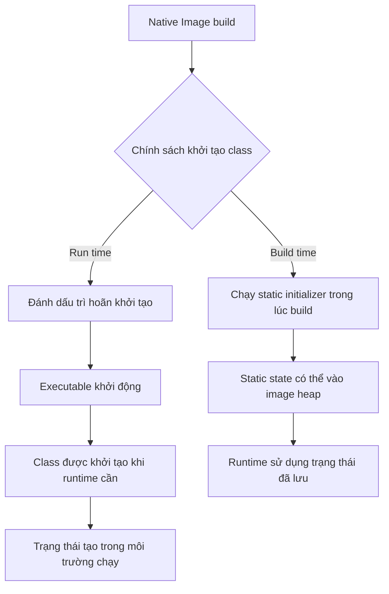

# --initialize-at-run-time và lựa chọn trì hoãn khởi tạo

## 1. Khởi tạo class ở build time và runtime

Java class có thể chứa static field, static initializer (`static { ... }`) và các biểu thức khởi tạo static. Trên JVM thông thường, class được khởi tạo khi JVM thực hiện một trong các thao tác kích hoạt khởi tạo theo quy tắc của Java. Static initializer có thể đọc đồng hồ, biến môi trường, file, cấu hình hệ thống, tạo random seed hoặc nạp thư viện native.

**GraalVM Native Image** có thể thực hiện khởi tạo một số class ngay trong quá trình build image. Trạng thái static được tạo ở build time có thể được lưu vào image heap và xuất hiện khi executable khởi động. Cách này có thể giảm công việc khởi động, nhưng chỉ an toàn khi kết quả khởi tạo không phụ thuộc môi trường runtime và không chứa trạng thái cần được tạo mới cho từng lần chạy.

Tùy chọn **`--initialize-at-run-time`** yêu cầu Native Image trì hoãn khởi tạo class được chỉ định cho tới runtime. Khi đó, static initializer chạy trong tiến trình native lúc class được khởi tạo theo quy tắc Java, thay vì chạy trong lúc build image.

Trong module **SPRING_BOOT_NATIVE_IMAGE**, lựa chọn này quan trọng khi dependency của ứng dụng Spring Boot có static state phụ thuộc môi trường, thời điểm, random seed, native library hoặc tài nguyên runtime. Không nên dùng cờ này đại trà; hãy xác định class có vấn đề, hiểu side effect của initializer và kiểm thử hành vi sau khi chuyển thời điểm khởi tạo.



## 2. Ví dụ static initializer phụ thuộc môi trường

Xét class đọc biến môi trường khi khởi tạo:

```java
public final class EndpointConfig {
    static final String API_ENDPOINT =
        System.getenv("PAYMENT_API_ENDPOINT");

    private EndpointConfig() {
    }
}
```

Nếu class được khởi tạo ở build time, giá trị đọc được có thể là giá trị trong môi trường CI/build (hoặc null nếu biến không tồn tại). Giá trị static đó có thể được lưu trong image heap. Khi container chạy ở production với `PAYMENT_API_ENDPOINT` khác, class không nhất thiết đọc lại biến môi trường; ứng dụng có thể tiếp tục dùng giá trị được ghi nhận lúc build.

Đặt class ở runtime initialization có thể làm cho việc đọc biến môi trường xảy ra trong tiến trình chạy:

```bash
native-image --initialize-at-run-time=com.example.config.EndpointConfig ...
```

Đây là ví dụ về cú pháp Native Image option. Khi build Spring Boot, truyền option qua cấu hình GraalVM Native Build Tools hoặc Spring Boot plugin phù hợp với phiên bản đang dùng, thay vì tự gọi lệnh minh họa với classpath không đầy đủ.

Tuy nhiên, thiết kế tốt hơn thường là đọc cấu hình qua Spring `Environment` hoặc `@ConfigurationProperties` tại runtime, thay vì giữ cấu hình môi trường trong static field. Runtime initialization chỉ thay đổi thời điểm chạy initializer; nó không biến static field thành property có thể refresh hay tự xử lý thay đổi cấu hình sau khi class đã được khởi tạo.

## 3. Cú pháp và phạm vi của --initialize-at-run-time

Native Image hỗ trợ chỉ định class hoặc package cần khởi tạo tại runtime. Ví dụ:

```bash
native-image --initialize-at-run-time=com.example.crypto.RandomProvider -jar app.jar
```

Có thể chỉ định nhiều class/package theo cú pháp option của phiên bản GraalVM đang sử dụng. Ví dụ định hướng:

```bash
native-image \
  --initialize-at-run-time=com.example.crypto.RandomProvider,com.example.config.EndpointConfig \
  -jar app.jar
```

Với package, cần xác nhận cú pháp và phạm vi áp dụng theo tài liệu Native Image version; tránh vô tình chuyển cả một package lớn sang runtime nếu chỉ một class có vấn đề.

Các điểm cần nhớ:

- Option tác động đến **class initialization policy**, không phải cách nạp mọi class.
- Nó không thay thế reflection, resource, proxy hay JNI metadata.
- Class có thể được khởi tạo muộn hơn, nhưng khi khởi tạo vẫn phải có đủ dependency, resource và quyền truy cập runtime.
- Static initializer có thể ném exception; chuyển nó sang runtime có thể làm lỗi xuất hiện lúc ứng dụng chạy thay vì lúc build.
- Phải kiểm tra class liên quan và các lớp phụ thuộc, vì initialization policy có thể tương tác với superclass và class khác.

## 4. Khi nào nên trì hoãn khởi tạo?

Một class đáng xem xét runtime initialization khi static initializer:

- Đọc biến môi trường, system property hoặc file phụ thuộc máy chạy.
- Lấy thời gian hiện tại hoặc tạo trạng thái cần mới theo từng process.
- Tạo random seed, nonce, key material hoặc trạng thái bảo mật không được phép cố định từ build.
- Nạp thư viện native phụ thuộc OS/architecture hoặc đường dẫn runtime.
- Khởi tạo client kết nối tới service bên ngoài.
- Lưu trạng thái global thay đổi theo container, tenant hoặc request.
- Phát hiện runtime capabilities hoặc cấu hình phần cứng.

Ví dụ tạo timestamp:

```java
public final class BuildClock {
    static final Instant CREATED_AT = Instant.now();
}
```

Nếu được khởi tạo ở build time, `CREATED_AT` có thể phản ánh thời điểm build chứ không phải thời điểm tiến trình native khởi động. Nếu yêu cầu là thời điểm runtime, cần trì hoãn initialization hoặc tốt hơn là cung cấp method/service đọc thời gian khi cần.

Ví dụ random seed:

```java
public final class TokenSeed {
    static final SecureRandom RANDOM = new SecureRandom();
}
```

Việc khởi tạo security-sensitive state ở build time có thể không phù hợp. Cần tuân theo hướng dẫn của provider/GraalVM về entropy và secure random; không tự ý ép class crypto vào build time chỉ để giảm startup.

## 5. Khi nào build-time initialization có lợi?

Khởi tạo ở build time có thể phù hợp khi:

- Static state hoàn toàn xác định từ code/constant.
- Không đọc dữ liệu môi trường hoặc filesystem runtime.
- Không tạo random/security-sensitive state cần mới khi chạy.
- Không nạp native library phụ thuộc target runtime theo cách không được hỗ trợ.
- Không giữ object có trạng thái hoặc tài nguyên chỉ hợp lệ trong môi trường build.

Ví dụ bảng tra cứu bất biến được tạo từ hằng số:

```java
public final class CurrencyTable {
    static final Map<String, Integer> SCALE = Map.of(
        "USD", 2,
        "JPY", 0,
        "KWD", 3
    );
}
```

Nếu dữ liệu chỉ phụ thuộc code và an toàn để tồn tại trong image heap, build-time initialization có thể giảm công việc runtime. Tuy nhiên, không phải cứ class chỉ có static field là tự động an toàn; hãy kiểm tra toàn bộ logic initializer và object graph được tạo ra.

## 6. Quan hệ với --initialize-at-build-time

Native Image cũng có option `--initialize-at-build-time` để yêu cầu class được khởi tạo trong lúc build. Một số class có thể được xử lý build time theo mặc định hoặc do framework/toolchain thiết lập. Không nên thêm option build-time cho một class chỉ để chữa lỗi runtime mà chưa hiểu static state.

Ví dụ:

```bash
native-image \
  --initialize-at-build-time=com.example.constants.CurrencyTable \
  --initialize-at-run-time=com.example.config.EndpointConfig \
  -jar app.jar
```

Đây là ví dụ minh họa chính sách cho hai nhóm class khác nhau. Nếu một class đồng thời bị chỉ định trong các nhóm xung đột, Native Image có thể báo lỗi hoặc áp dụng quy tắc theo version; không khai báo chồng lấn. Luôn kiểm tra log và tài liệu của GraalVM đang dùng.

Một class được build-time initialized có thể mang state vào image heap. Nếu state đó chứa thread, socket, file handle, timestamp, random seed hoặc tham chiếu tới môi trường build, nó có thể gây lỗi hoặc hành vi không mong muốn khi executable chạy.

## 7. Lỗi build-time initialization thường gặp

Một số dấu hiệu có thể xuất hiện trong log Native Image:

- Build-time initialization thất bại khi static initializer đọc file không có trên CI.
- Native Image cảnh báo class khởi tạo ở build time và state được lưu vào image heap.
- Lỗi liên quan tới object không thể đưa vào image heap.
- Runtime dùng giá trị cấu hình cũ hoặc trạng thái được tạo từ máy build.
- Native library không thể load trong môi trường build/target tương ứng.

Ví dụ class tạo file handle trong static initializer:

```java
public final class LocalCache {
    static final FileInputStream INPUT;

    static {
        try {
            INPUT = new FileInputStream("/etc/myapp/cache.bin");
        } catch (IOException ex) {
            throw new ExceptionInInitializerError(ex);
        }
    }
}
```

Đây là thiết kế có vấn đề: file handle không nên được lưu như static state trong image heap. Chuyển class sang runtime initialization có thể khiến file được mở lúc chạy, nhưng cần quản lý vòng đời/đóng stream đúng cách. Tốt hơn là mở file theo nhu cầu qua service có lifecycle rõ ràng và cấu hình path runtime.

## 8. Cấu hình qua Gradle và Maven

Với Gradle GraalVM Native Build Tools, có thể cấu hình build arguments trong block extension/task theo phiên bản plugin. Ví dụ minh họa:

```groovy
graalvmNative {
    binaries {
        main {
            buildArgs.add("--initialize-at-run-time=com.example.config.EndpointConfig")
        }
    }
}
```

Vị trí và API cấu hình có thể khác theo phiên bản plugin. Một số project dùng `buildArgs` ở extension, một số dùng task configuration/convention plugin. Hãy đối chiếu Native Build Tools plugin version trong project và kiểm tra command line thực tế của task.

Với Spring Boot Gradle Plugin, task `bootBuildImage` có thể build native image qua buildpacks theo cấu hình riêng. Build arguments dành cho Native Image và build environment của buildpack không phải lúc nào cũng được cấu hình cùng một chỗ. Kiểm tra tài liệu Spring Boot version và log buildpack để xác nhận option đã tới native-image process.

Với Maven, Native Build Tools Maven Plugin có cấu hình build arguments tương ứng. Cần xác định plugin nào thực sự chạy native compilation trong lifecycle của dự án; không thêm option vào một plugin/task không được gọi.

Sau khi cấu hình, kiểm tra log native-image hoặc thông tin build để xác nhận option xuất hiện. Chỉ nhìn file `pom.xml`/`build.gradle` là chưa đủ nếu profile/task khác đang được chạy.

## 9. Ảnh hưởng tới Spring Boot và Spring AOT

Spring AOT xử lý application context và sinh mã/hints trước khi GraalVM Native Image biên dịch. Class initialization policy là một khía cạnh ở tầng Native Image; nó không thay thế việc cấu hình Spring bean graph.

Ví dụ:

- `@Profile` và `@ConditionalOnProperty` quyết định bean nào có mặt trong AOT context.
- Runtime Hints mô tả reflection, resource, proxy và serialization cần thiết.
- `--initialize-at-run-time` quyết định thời điểm static initializer của class chạy.

Ba cơ chế này giải quyết ba vấn đề khác nhau. Nếu một bean không được tạo do profile AOT, trì hoãn khởi tạo class không làm bean xuất hiện. Nếu resource thiếu metadata, runtime initialization không tự đóng gói resource. Nếu static initializer cần đọc cấu hình runtime, chuyển class sang runtime có thể đúng nhưng vẫn nên xem xét dùng Spring Environment thay cho static global.

## 10. Dependency có native library hoặc static state

Một dependency có thể khởi tạo class để:

- Tìm thư viện native theo OS.
- Đọc property như `java.library.path`.
- Chọn implementation theo kiến trúc CPU.
- Tạo global native context.
- Khởi tạo provider crypto hoặc random source.

Không nên áp dụng `--initialize-at-run-time` cho cả dependency package theo phỏng đoán. Trước tiên đọc tài liệu GraalVM/native support của thư viện, kiểm tra log class initialization và xác định class thực sự có side effect.

Nếu library đã cung cấp reachability metadata hoặc hướng dẫn initialization, ưu tiên dùng cấu hình được nhà cung cấp xác nhận. Thay đổi initialization policy có thể làm một phần logic chạy muộn hơn và bộc lộ lỗi thiếu file, thiếu quyền hoặc thiếu thư viện trong container.

## 11. Chẩn đoán với Native Image build output

Khi gặp lỗi, cần lấy bằng chứng:

1. Class nào bị khởi tạo ở build time?
2. Static initializer đã làm gì?
3. Có đọc environment, file, network, clock, random hay native library không?
4. Object nào được tạo và có bị lưu vào image heap không?
5. Lỗi xảy ra ở build time hay lần đầu class được dùng ở runtime?
6. Có thể loại bỏ side effect hoặc chuyển state thành dependency được quản lý không?

Native Image cung cấp các tùy chọn chẩn đoán class initialization; tên option và định dạng output thay đổi theo phiên bản. Kiểm tra `native-image --help` và tài liệu của đúng GraalVM version trước khi dùng option tracing/report. Không sao chép diagnostic flag từ version khác mà chưa xác minh.

Có thể dùng log build chi tiết của Gradle/Maven và bật native-image verbose theo cơ chế plugin hỗ trợ. Khi đã tìm được class, thử thay đổi chính class đó trong một build riêng để kiểm chứng giả thuyết, sau đó chạy test runtime.

## 12. Ví dụ thực hành: cấu hình endpoint theo runtime

Thiết kế static field:

```java
public final class PaymentClientConfig {
    static final String ENDPOINT =
        System.getenv("PAYMENT_API_ENDPOINT");
}
```

Thiết kế Spring-friendly hơn:

```java
@ConfigurationProperties(prefix = "payment.api")
public record PaymentApiProperties(URI endpoint) {
}
```

```java
@Configuration
@EnableConfigurationProperties(PaymentApiProperties.class)
class PaymentClientConfiguration {

    @Bean
    PaymentClient paymentClient(PaymentApiProperties properties) {
        return new PaymentClient(properties.endpoint());
    }
}
```

Với cấu hình runtime, Spring bind property theo môi trường chạy vào bean được tạo. AOT vẫn cần cấu trúc bean được xác định đúng, nhưng giá trị endpoint có thể được cung cấp từ environment/config file lúc runtime theo thiết kế. Cách này rõ ràng hơn việc đóng gói giá trị môi trường trong static field.

Nếu dependency không thể thay đổi và vẫn dùng static initializer đọc environment, có thể cần runtime initialization cho class đó, nhưng hãy kiểm tra khả năng cấu hình chính thức của dependency trước.

## 13. Kiểm thử sau khi chuyển sang runtime initialization

Khi thay đổi class initialization policy:

- Build lại executable native từ đầu hoặc đảm bảo task inputs buộc native image được tạo lại.
- Chạy trong môi trường có biến môi trường/configuration khác môi trường build.
- Kiểm tra static state phản ánh runtime environment mong muốn.
- Test trường hợp biến/file không tồn tại để xác nhận lỗi rõ ràng.
- Kiểm tra khởi tạo thread, connection, native library và tài nguyên được quản lý đúng lifecycle.
- Chạy concurrent requests để phát hiện race condition trong static initialization hoặc lazy state.
- Đo lại startup time vì chuyển initialization sang runtime có thể tăng thời gian khởi động/lần truy cập đầu.
- Chạy integration test trong container target OS/architecture.

Java đảm bảo class initialization có đồng bộ theo quy tắc JVM, nhưng logic static sau khi class khởi tạo vẫn có thể chứa mutable state và race condition do ứng dụng tạo ra. Runtime initialization không tự làm class thread-safe.

## 14. Tác động tới hiệu năng và bảo mật

Trì hoãn khởi tạo có thể làm executable build ổn định hơn và tránh đóng gói trạng thái môi trường build. Tuy nhiên, nó có trade-off:

| Tác động | Build-time initialization | Run-time initialization |
|---|---|---|
| Công việc startup | Có thể giảm | Có thể tăng |
| Phụ thuộc môi trường runtime | Không phù hợp nếu state đã cố định khi build | Có thể đọc môi trường chạy |
| State trong image heap | Có thể lưu trạng thái đã khởi tạo | Tạo mới trong process |
| Lỗi initializer | Có thể xuất hiện lúc build | Có thể xuất hiện lúc startup/lần dùng đầu |
| Random/security state | Cần thận trọng | Thường phù hợp hơn nếu cần state mới khi chạy |
| Khả năng tái lập build | Có thể tốt nếu initializer thuần và xác định | Có thể giảm việc phụ thuộc môi trường build |

Không đưa secret, token, private key hoặc dữ liệu môi trường production vào static state được khởi tạo lúc build. Nếu nghi ngờ thông tin nhạy cảm đã bị đưa vào image heap hoặc artifact, cần tạo build mới từ môi trường sạch và kiểm tra quy trình phát hành; chỉ đổi cờ runtime không xóa dữ liệu đã được ghi vào artifact cũ.

## 15. Checklist lựa chọn --initialize-at-run-time

- Xác định class có static initializer hoặc static state phụ thuộc môi trường.
- Đọc log Native Image để biết class được khởi tạo ở giai đoạn nào.
- Ưu tiên loại bỏ side effect hoặc chuyển cấu hình sang Spring Environment.
- Chỉ chỉ định class/package cụ thể cần runtime initialization.
- Không áp dụng cờ rộng cho toàn bộ dependency khi chưa có bằng chứng.
- Kiểm tra superclass, dependency và class initialization interaction.
- Xác nhận option được truyền thật vào native-image process.
- Build lại executable mới.
- Test với environment khác môi trường build.
- Đo startup và lần gọi đầu sau thay đổi.
- Kiểm tra native library, filesystem permission và resource ở container.

## 16. Câu hỏi tự kiểm tra

1. Khác nhau giữa build-time initialization và runtime initialization là gì?
2. Vì sao static field đọc environment có thể giữ giá trị của máy build trong native executable?
3. `--initialize-at-run-time` thay đổi thời điểm chạy static initializer như thế nào?
4. Vì sao không nên áp dụng option này cho toàn bộ package chỉ để chữa một lỗi?
5. Runtime initialization có tự giải quyết thiếu reflection/resource/JNI metadata không?
6. Khi chuyển class sang runtime initialization, những lỗi nào có thể chỉ xuất hiện khi executable khởi động?
7. Vì sao `@ConfigurationProperties` thường là thiết kế tốt hơn static field giữ endpoint runtime?
8. Cần đo lại những chỉ số nào sau khi thay đổi initialization policy?

**Ghi nhớ:** `--initialize-at-run-time` trì hoãn static initialization để trạng thái phụ thuộc môi trường được tạo trong tiến trình native. Hãy xác định đúng class có side effect, ưu tiên cấu hình Spring runtime rõ ràng, áp dụng option ở phạm vi hẹp và kiểm thử executable trong môi trường triển khai thực tế.
