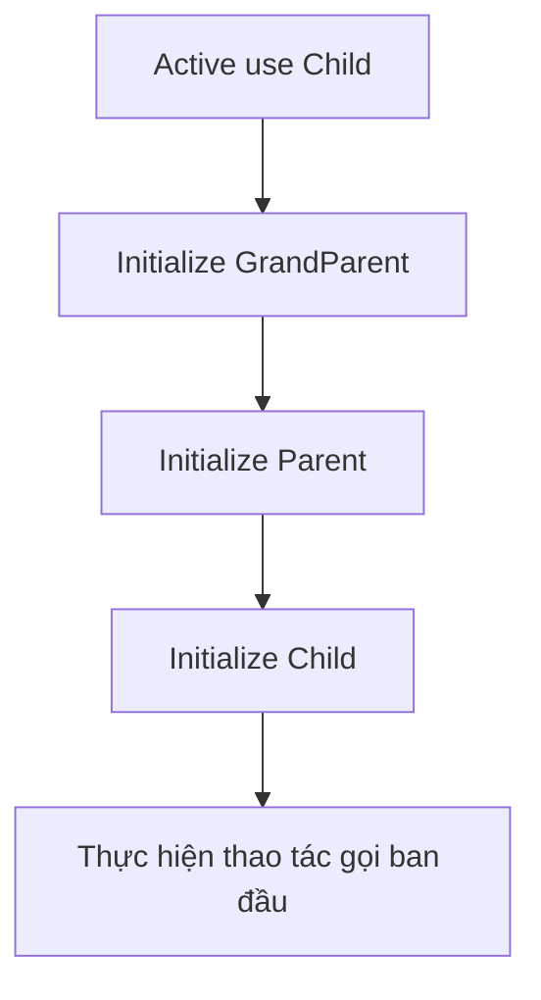

# Quan hệ khởi tạo giữa lớp cha, lớp con và các kiểu được tham chiếu

## 1. Khởi tạo lớp là gì?

Trong Java, một class có thể được **load**, **link** và **initialize** ở những thời điểm khác nhau. Việc JVM đã tìm thấy bytecode hoặc đã tạo `Class` object không có nghĩa các static initializer của class đã chạy.

**Khởi tạo lớp (class initialization)** là bước JVM thực thi các phép gán giá trị ban đầu cho static field và các static initializer (`static { ...}`) của class hoặc interface. JVM bảo đảm bước này diễn ra theo quy tắc và đồng bộ giữa các thread.

Trong ứng dụng Spring Boot được biên dịch thành **GraalVM Native Image**, thời điểm khởi tạo class còn liên quan đến quyết định của native-image build: một số class có thể được khởi tạo trong lúc build để chuyển trạng thái static vào image; những class phụ thuộc môi trường chạy phải được giữ lại để khởi tạo khi executable chạy.

Bài này thuộc chương **Khởi tạo lớp** của module **SPRING_BOOT_NATIVE_IMAGE**, tập trung vào:

- Quan hệ thứ tự khởi tạo giữa superclass và subclass.
- Cách interface có default method tham gia quá trình khởi tạo class.
- Khác biệt giữa kiểu được tham chiếu và kiểu thực sự được initialize.
- Hành vi của static field, compile-time constant và class literal.
- Chu trình khởi tạo, an toàn đa luồng và initialization-on-demand holder.
- Tác động của build-time/runtime class initialization trong GraalVM Native Image.

## 2. Load, link và initialize không phải một thao tác

JVM xử lý class theo ba giai đoạn khái quát:

| Giai đoạn | Công việc chính | Có chạy static initializer không? |
| --- | --- | --- |
| **Loading** | Tìm bytecode và tạo biểu diễn class trong JVM | Không nhất thiết |
| **Linking** | Verification, preparation và resolution | Không chạy `<clinit>` của class theo cách khởi tạo thông thường |
| **Initialization** | Gán giá trị khởi tạo cho static field và chạy static initializer | Có |

Trong giai đoạn **preparation**, các static field nhận giá trị mặc định của kiểu dữ liệu: số là `0`, boolean là `false`, reference là `null`. Các biểu thức khởi tạo do lập trình viên viết sẽ chạy trong giai đoạn initialization, theo thứ tự khai báo trong class.

Ví dụ:

```java
class StartupRegistry {

    static int retryCount = 3;
    static String endpoint = loadEndpoint();

    static {
        System.out.println("StartupRegistry initialized");
    }

    private static String loadEndpoint() {
        return "https://api.example.com";
    }
}
```

Khi `StartupRegistry` được initialize, JVM thực hiện phép gán `retryCount`, gọi `loadEndpoint()` để gán `endpoint`, sau đó chạy static block theo đúng thứ tự xuất hiện trong source. Nếu static block nằm trước một khai báo static field khác, nó sẽ chạy trước phần initializer của field đó.

Một class có thể đã được load hoặc verified mà chưa initialize. Ví dụ, lấy `StartupRegistry.class` chỉ tạo class literal; nó không tự chạy static block của `StartupRegistry`.

## 3. Khi nào JVM bắt đầu khởi tạo class?

JVM thực hiện initialization khi có một **active use** theo quy tắc của Java Language Specification. Những trường hợp phổ biến:

- Tạo instance mới bằng `new SomeClass()`.
- Gọi static method được khai báo bởi class/interface.
- Đọc hoặc ghi static field không phải compile-time constant được khai báo bởi class/interface.
- Một số thao tác reflection yêu cầu khởi tạo class, ví dụ `Class.forName(name)` với mặc định `initialize = true`.
- Class được JVM chọn làm lớp khởi chạy chứa `main` cũng được initialize trước khi gọi `main`.

Ví dụ:

```java
class RuntimeSettings {

    static {
        System.out.println("RuntimeSettings initialized");
    }

    static void printStatus() {
        System.out.println("ready");
    }
}

public class Main {
    public static void main(String[] args) {
        RuntimeSettings.printStatus();
    }
}
```

Lời gọi `RuntimeSettings.printStatus()` là active use, nên JVM initialize `RuntimeSettings` trước khi chạy thân static method.

### 3.1. Những thao tác không tự initialize kiểu được tham chiếu

Chỉ nhắc đến tên một class trong khai báo hoặc lấy class literal thường không phải active use:

```java
class ReferencedType {
    static {
        System.out.println("ReferencedType initialized");
    }
}

class ReferenceHolder {
    static ReferencedType value;

    static ReferencedType create() {
        return null;
    }
}

public class ReferenceExample {
    public static void main(String[] args) {
        Class<?> type = ReferencedType.class;
        ReferencedType[] items = new ReferencedType[5];

        System.out.println(type.getName());
        System.out.println(items.length);
    }
}
```

Trong ví dụ này, lấy `ReferencedType.class` và tạo mảng `ReferencedType[]` không initialize `ReferencedType`. Khai báo field có kiểu `ReferencedType` hoặc return type của method là `ReferencedType` cũng không tự initialize kiểu đó.

Ngược lại, `new ReferencedType()` sẽ initialize class trước khi tạo instance. Gọi static method hoặc đọc static field không phải constant của `ReferencedType` cũng kích hoạt initialization theo quy tắc tương ứng.

### 3.2. Class.forName có hai hành vi khác nhau

```java
Class.forName("com.example.ReferencedType");
```

Overload một tham số tương đương yêu cầu initialize class. Nếu chỉ muốn load class mà chưa chạy static initializer, dùng overload có cờ `initialize = false`:

```java
ClassLoader loader = Thread.currentThread().getContextClassLoader();

Class<?> type = Class.forName(
    "com.example.ReferencedType",
    false,
    loader
);
```

Điều này hữu ích khi framework dò tìm kiểu hoặc kiểm tra metadata trước khi thực sự sử dụng class. Tuy nhiên, các bước reflection tiếp theo có thể gây active use hoặc yêu cầu khởi tạo; cần phân biệt rõ việc tìm thấy class với việc chạy initializer.

## 4. Thứ tự khởi tạo giữa superclass và subclass

Khi một class được initialize, JVM phải initialize superclass của nó trước. Các initializer của superclass chạy xong rồi mới đến initializer của subclass.

Ví dụ:

```java
class ParentService {

    static {
        System.out.println("1. ParentService static block");
    }

    static int parentValue = initParentValue();

    private static int initParentValue() {
        System.out.println("2. ParentService field initializer");
        return 10;
    }
}

class ChildService extends ParentService {

    static int childValue = initChildValue();

    static {
        System.out.println("4. ChildService static block");
    }

    private static int initChildValue() {
        System.out.println("3. ChildService field initializer");
        return 20;
    }
}

public class InitializationOrderDemo {
    public static void main(String[] args) {
        System.out.println(ChildService.childValue);
    }
}
```

Thứ tự output:

```text
1. ParentService static block
2. ParentService field initializer
3. ChildService field initializer
4. ChildService static block
20
```

Trong từng class, static field initializer và static block được thực hiện theo **thứ tự xuất hiện trong source**. Toàn bộ phần initialization của superclass hoàn tất trước khi JVM thực hiện phần initialization của subclass.

### 4.1. Chuỗi kế thừa nhiều cấp

Với `GrandParent -> Parent -> Child`, active use của `Child` khiến JVM initialize theo thứ tự:



Điều này bảo đảm static state mà class con dựa vào ở superclass đã được thiết lập theo quy tắc Java trước khi class con chạy static initializer.

### 4.2. Đọc static field kế thừa qua tên subclass

Một chi tiết dễ gây nhầm: static field thuộc về class **khai báo** nó, không thuộc về từng subclass. Vì vậy:

```java
class Parent {
    static int parentValue = initializeParent();
    static int initializeParent() {
        System.out.println("Parent initialized");
        return 10;
    }
}

class Child extends Parent {
    static {
        System.out.println("Child initialized");
    }

    static int childValue = 20;
}

public class StaticFieldOwnerDemo {
    public static void main(String[] args) {
        System.out.println(Child.parentValue);
    }
}
```

`parentValue` được khai báo trong `Parent`. Truy cập `Child.parentValue` vẫn là truy cập field của `Parent`; nó initialize `Parent` mà không vì tên `Child` xuất hiện trong biểu thức mà initialize `Child`.

Nếu truy cập `Child.childValue`, JVM initialize `Parent` trước rồi initialize `Child`, sau đó mới đọc giá trị. Khi phân tích initialization trigger, hãy xác định **class thực sự khai báo static member**, không chỉ nhìn kiểu được viết ở vế trái dấu chấm.

Quy tắc tương tự cần được ghi nhớ khi gọi static method kế thừa: initialization gắn với class/interface khai báo method được gọi.

## 5. Interface và default method trong thứ tự khởi tạo

Interface cũng có thể có static field và static initializer. Tuy nhiên, quy tắc khởi tạo interface khác class:

- Initialize một interface **không tự động initialize các superinterface** của nó.
- Khi initialize một class, JVM initialize superclass trước, sau đó initialize các superinterface (kể cả superinterface gián tiếp) **có khai báo default method**, theo thứ tự duyệt được quy định, rồi mới chạy initializer của class.
- Interface chỉ được implements nhưng không khai báo default method không vì thế mà luôn được initialize trước class.

Ví dụ:

```java
interface AuditContract {

    int AUDIT_VERSION = initializeAudit();

    private static int initializeAudit() {
        System.out.println("AuditContract initialized");
        return 1;
    }

    default void audit() {
        System.out.println("audit");
    }
}

interface MarkerContract {

    int MARKER_VERSION = initializeMarker();

    private static int initializeMarker() {
        System.out.println("MarkerContract initialized");
        return 1;
    }
}

class PaymentService implements AuditContract, MarkerContract {

    static {
        System.out.println("PaymentService initialized");
    }
}
```

Khi active use `PaymentService`, JVM initialize `AuditContract` vì interface này khai báo default method `audit()`. `MarkerContract` không khai báo default method nên không được initialize chỉ vì `PaymentService` implements nó. Sau khi xử lý superclass và superinterface có default method, JVM chạy static initializer của `PaymentService`.

Đây là quy tắc về **default method**, không phải cứ interface có static field là tự được initialize khi một class implements nó.

### 5.1. Chủ động truy cập static field của interface

Nếu code đọc một static field không phải compile-time constant được khai báo trong interface, chính interface khai báo field sẽ được initialize:

```java
interface FeatureFlags {
    int CURRENT_VERSION = loadVersion();

    private static int loadVersion() {
        System.out.println("FeatureFlags initialized");
        return 2;
    }
}

class FeatureService implements FeatureFlags {
}

public class InterfaceInitializationDemo {
    public static void main(String[] args) {
        System.out.println(FeatureFlags.CURRENT_VERSION);
    }
}
```

Truy cập `FeatureFlags.CURRENT_VERSION` kích hoạt initialization của `FeatureFlags`. Điều đó khác với việc chỉ tạo `FeatureService` implements interface mà không có default method.

## 6. Compile-time constant và static field thông thường

Không phải mọi lần đọc static field đều gây initialization. Một **constant variable** theo JLS là `final` với kiểu primitive hoặc `String`, được khởi tạo bằng constant expression. Giá trị của nó có thể được compiler inline vào nơi sử dụng.

Ví dụ:

```java
class BuildInfo {

    static {
        System.out.println("BuildInfo initialized");
    }

    static final int API_LEVEL = 3;
    static final String RELEASE_NAME = "native-demo";

    static final Integer BOXED_LEVEL = 3;
    static final int COMPUTED_LEVEL = Integer.parseInt("3");
}
```

Sự khác nhau:

| Field | Có phải constant variable? | Đọc field có tự initialize `BuildInfo` không? |
| --- | --- | --- |
| `static final int API_LEVEL = 3` | Có | Không |
| `static final String RELEASE_NAME = "native-demo"` | Có | Không |
| `static final Integer BOXED_LEVEL = 3` | Không, vì kiểu không phải primitive/String | Có |
| `static final int COMPUTED_LEVEL = Integer.parseInt("3")` | Không, vì initializer không phải constant expression | Có |

Ví dụ truy cập hai constant:

```java
System.out.println(BuildInfo.API_LEVEL);
System.out.println(BuildInfo.RELEASE_NAME);
```

Hai giá trị này có thể được compiler đưa thẳng vào bytecode nơi sử dụng, do đó không cần initialize `BuildInfo`. Truy cập `BuildInfo.BOXED_LEVEL` hoặc `BuildInfo.COMPUTED_LEVEL` là truy cập static field không phải constant variable và sẽ kích hoạt initialization.

Điều này cũng có hệ quả khi nâng cấp thư viện: nếu một constant được inline vào consumer, thay đổi giá trị constant trong thư viện nhưng không biên dịch lại consumer có thể khiến consumer tiếp tục dùng giá trị cũ.

## 7. Thứ tự initializer bên trong cùng một class

Trong một class, static field initializer và static block chạy theo thứ tự văn bản. Không phải mọi static field đều được gán giá trị biểu thức trước rồi mới chạy toàn bộ static block.

```java
class InitializationSequence {

    static int first = log("first field", 1);

    static {
        log("first static block", 0);
    }

    static int second = log("second field", 2);

    static {
        log("second static block", 0);
    }

    private static int log(String name, int value) {
        System.out.println(name);
        return value;
    }
}
```

Output khi initialize class:

```text
first field
first static block
second field
second static block
```

Ở giai đoạn preparation, các static field đã nhận giá trị mặc định. Trong initialization, JVM chạy từng initializer theo thứ tự khai báo. Vì vậy, một static block có thể quan sát giá trị mặc định của field được khai báo phía dưới nếu field đó chưa chạy initializer.

## 8. Chu trình khởi tạo giữa các class

Hai class có thể tham chiếu static field của nhau trong initializer. Khi có chu trình, một class có thể đọc giá trị mặc định của class còn lại nếu class đó đang trong quá trình initialization trên cùng thread.

Ví dụ:

```java
class Alpha {
    static int value = Beta.value + 1;
}

class Beta {
    static int value = Alpha.value + 1;
}

public class CircularInitializationDemo {
    public static void main(String[] args) {
        System.out.println(Alpha.value);
        System.out.println(Beta.value);
    }
}
```

Nếu `Alpha` được initialize trước:

1. `Alpha.value` đang mang giá trị mặc định `0`.
2. Initializer của `Alpha` yêu cầu `Beta.value`, nên JVM bắt đầu initialize `Beta`.
3. Initializer của `Beta` đọc `Alpha.value` trong lúc `Alpha` đang initialize trên cùng thread; nó quan sát giá trị hiện tại là `0`.
4. `Beta.value` trở thành `1`.
5. `Alpha.value` tiếp tục và trở thành `2`.

Kết quả phụ thuộc class nào được active use đầu tiên. Nếu `Beta` được initialize trước, kết quả có thể khác. Đây là lý do không nên tạo chuỗi static initializer phụ thuộc vòng tròn.

Cách xử lý là đưa dependency vào constructor/bean lifecycle có thứ tự rõ ràng, dùng holder hoặc factory tường minh, và tránh để static initializer của class này gọi ngược sang class kia.

## 9. An toàn đa luồng và lỗi khi khởi tạo

JVM đồng bộ quá trình class initialization bằng initialization lock của class. Nếu nhiều thread cùng active use một class chưa initialize:

- Một thread thực hiện initialization.
- Thread khác phải chờ kết quả.
- Sau khi initialization hoàn tất thành công, các thread tiếp theo quan sát static state đã được thiết lập.
- Nếu initialization thất bại, class được đánh dấu erroneous; các lần active use sau thường nhận `NoClassDefFoundError`.

Một chu trình phụ thuộc còn có thể gây deadlock giữa hai thread: thread A đang initialize `Alpha` rồi cần `Beta`, trong khi thread B đang initialize `Beta` rồi cần `Alpha`. Mỗi thread có thể phải chờ initialization lock do thread kia giữ. Vì vậy, static initializer nên ngắn, không chờ công việc bên ngoài và tránh gọi qua lại giữa các class.

Nếu initializer ném một exception không phải `Error`, JVM thường bọc exception đó trong `ExceptionInInitializerError` cho lần khởi tạo đầu tiên. Nếu chính initializer ném một `Error`, lỗi có thể được truyền ra trực tiếp. Các lần sử dụng tiếp theo sau khi class đã bị đánh dấu erroneous sẽ không thử chạy initializer lại như một lần khởi tạo mới.

Ví dụ:

```java
class RemoteRegistry {

    static final String CONFIG = loadConfig();

    private static String loadConfig() {
        throw new IllegalStateException("Cannot load config");
    }
}

public class InitializationFailureDemo {
    public static void main(String[] args) {
        System.out.println(RemoteRegistry.CONFIG);
    }
}
```

Nếu `loadConfig()` thất bại trong lần initialize đầu tiên, lỗi xuất hiện ngay khi truy cập `RemoteRegistry.CONFIG`. Những lần truy cập sau không tự chạy lại `loadConfig()` để phục hồi.

Vì vậy, tránh đặt thao tác dễ lỗi hoặc phụ thuộc môi trường như gọi network, truy cập database, đọc secret, tạo thread hoặc mở socket trong static initializer. Với Spring Boot, những công việc này thường phù hợp hơn với bean lifecycle, startup runner hoặc một service có thể kiểm soát lỗi và retry.

## 10. Initialization-on-demand holder

Một kỹ thuật Java phổ biến là dùng nested holder để trì hoãn khởi tạo singleton cho đến lần đầu cần sử dụng:

```java
public final class PaymentRegistry {

    private PaymentRegistry() {
        System.out.println("PaymentRegistry created");
    }

    private static class Holder {
        static final PaymentRegistry INSTANCE = new PaymentRegistry();
    }

    public static PaymentRegistry getInstance() {
        return Holder.INSTANCE;
    }
}
```

Khi `PaymentRegistry` được load hoặc khi gọi một method không dùng `Holder`, nested class `Holder` chưa nhất thiết được initialize. Lần đầu gọi `getInstance()` đọc `Holder.INSTANCE`, kích hoạt initialization của `Holder`, từ đó tạo singleton.

Ưu điểm:

- Khởi tạo lazy theo active use.
- Dựa vào bảo đảm thread-safe của class initialization.
- Không cần synchronized thủ công cho lần truy cập đầu tiên.
- Dependency và thời điểm tạo instance được thể hiện rõ.

Trong ứng dụng Spring Boot, ưu tiên Spring bean khi đối tượng cần dependency injection, lifecycle, proxy hoặc scope của container. Holder hữu ích cho thư viện Java độc lập hoặc một registry tĩnh thực sự không cần Spring.

## 11. Spring AOT và class initialization trong GraalVM Native Image

Spring AOT và GraalVM class initialization là hai cơ chế khác nhau:

| Cơ chế | Thời điểm | Vai trò |
| --- | --- | --- |
| **Spring AOT** | Build time | Phân tích cấu hình Spring, sinh mã khởi tạo bean/context và runtime hints |
| **Native Image reachability analysis** | Build time | Xác định code, class và resource cần đưa vào executable |
| **Build-time class initialization** | Khi native image được tạo | Chạy initializer được chỉ định và lưu static state cần thiết vào image |
| **Runtime class initialization** | Khi native executable chạy | Chạy initializer trong môi trường process thực tế |

Spring AOT **không có nghĩa mọi class ứng dụng được initialize ở build time**. AOT có thể sinh code tạo bean, nhưng quyết định class nào được GraalVM initialize ở build time hay runtime là một phần riêng của Native Image class initialization policy.

Native Image có thể cho phép chỉ định nhóm class được initialize tại build time hoặc giữ lại cho runtime. Tùy phiên bản toolchain, các option thường gặp có dạng:

```text
--initialize-at-build-time=com.example.staticdata.ImmutableRegistry
--initialize-at-run-time=com.example.runtime.RuntimeEnvironment
```

Đây là cú pháp option khái quát của GraalVM Native Image; cách truyền option qua Maven/Gradle plugin hoặc Buildpacks phụ thuộc phiên bản plugin và cấu hình dự án.

### 11.1. Khi nào build-time initialization phù hợp?

Một class có thể phù hợp nếu initializer của nó:

- Tạo dữ liệu tĩnh, bất biến và xác định.
- Chỉ xây dựng lookup table từ constant đã biết lúc build.
- Không phụ thuộc hostname, IP, environment variable hay system property của máy chạy.
- Không đọc file cấu hình thay đổi theo môi trường.
- Không tạo thread, socket, database connection hoặc native handle.
- Không tạo giá trị phụ thuộc thời gian hiện tại hoặc random runtime.

Ví dụ một registry bất biến:

```java
final class CurrencyTable {

    static final Map<String, Integer> FRACTION_DIGITS = Map.of(
        "VND", 0,
        "USD", 2,
        "JPY", 0
    );
}
```

Nếu dữ liệu thật sự cố định theo artifact, build-time initialization có thể giúp chuyển chi phí tạo bảng sang lúc build. Nhưng phải cân nhắc kích thước image heap và khả năng dữ liệu cần cập nhật theo môi trường.

### 11.2. Khi nào phải giữ runtime initialization?

Class phụ thuộc vào trạng thái môi trường chạy nên được initialize khi executable chạy, ví dụ:

- Đọc `System.getenv()` hoặc `System.getProperty()` để chọn cấu hình theo môi trường.
- Gọi `InetAddress.getLocalHost()` để xác định hostname/IP của container.
- Đọc file cấu hình hoặc secret được mount sau khi image được build.
- Tạo `SecureRandom`, random seed hoặc giá trị phụ thuộc entropy runtime.
- Khởi tạo logging, metrics, tracing, database driver hoặc client kết nối tới dịch vụ bên ngoài.
- Tạo thread, executor, socket hoặc native resource có vòng đời gắn với process.

Nếu class chứa các giá trị này bị initialize ở build time, static state có thể bị đóng băng trong image. Ví dụ hostname hoặc system property của máy build có thể bị mang sang môi trường production; timestamp hoặc random seed có thể được chia sẻ sai giữa các process. Với trạng thái phụ thuộc runtime, hãy giữ class initialization ở runtime và khởi tạo resource trong lifecycle phù hợp.

### 11.3. Quan hệ superclass và class initialization policy

Quy tắc Java về superclass và superinterface vẫn áp dụng khi Native Image thực thi initialization. GraalVM cũng phải bảo đảm thứ tự hợp lệ khi xử lý class initialization trong lúc tạo image. Nếu một class được chỉ định build-time nhưng chuỗi superclass/interface hoặc dependency của nó có trạng thái chỉ nên tạo ở runtime, toolchain có thể phát hiện xung đột, chuyển thời điểm khởi tạo theo quy tắc hỗ trợ hoặc báo lỗi cấu hình.

Vì vậy:

1. Xác định initializer của class được chỉ định có gọi static method/đọc field của superclass hoặc class khác không.
2. Kiểm tra những kiểu đó có đọc môi trường hoặc tạo resource runtime không.
3. Không ép cả package initialize build-time chỉ vì một registry nhỏ có thể khởi tạo sớm.
4. Đọc cảnh báo class initialization từ Native Image build log.
5. Chạy native executable ở đúng container/OS/CPU và kiểm tra giá trị static thực tế.

Nếu GraalVM báo class bị initialize sớm hơn dự kiến hoặc state không an toàn trong image heap, điều chỉnh policy cho class phù hợp và tách initializer chứa trạng thái runtime ra khỏi dữ liệu bất biến.

## 12. Cách điều tra class initialization khi build native

Khi native build báo lỗi liên quan class initialization, cần tìm **class nào** được khởi tạo, **ai kích hoạt nó**, và **state nào** bị lưu trong image.

Quy trình thực tế:

1. Đọc tên class trong thông báo lỗi hoặc cảnh báo.
2. Mở static field initializer và static block của class đó.
3. Lần theo các lời gọi tới superclass, superinterface có default method và các class được tham chiếu trong initializer.
4. Xác định initializer có đọc environment, file, clock, random, network hoặc thread không.
5. Kiểm tra class có thể tách phần dữ liệu bất biến khỏi phần cấu hình runtime không.
6. Chỉ định build-time hoặc runtime initialization cho phạm vi hẹp.
7. Build lại native executable và kiểm thử trong môi trường triển khai.

Một số lỗi có thể chỉ xuất hiện khi class khởi tạo trong build process, chẳng hạn do thiếu file mà môi trường CI không có. Lỗi khác chỉ xuất hiện khi runtime initializer cố truy cập thư viện native không có trong run image. Phân biệt hai thời điểm sẽ giúp tìm đúng nguyên nhân.

### 12.1. Ví dụ tách dữ liệu tĩnh khỏi môi trường runtime

Thiết kế dễ gây vấn đề:

```java
final class RuntimeEnvironment {

    static final String HOST =
        System.getenv("SERVICE_HOST");

    static final String CONFIG_PATH =
        System.getProperty("app.config");
}
```

Nếu class này bị initialize tại build time, giá trị có thể lấy từ môi trường build thay vì container. Có thể tách cấu hình runtime thành một component/service:

```java
import org.springframework.core.env.Environment;
import org.springframework.stereotype.Component;

@Component
class RuntimeEnvironment {

    private final String host;
    private final String configPath;

    RuntimeEnvironment(Environment environment) {
        this.host = environment.getProperty("SERVICE_HOST");
        this.configPath = environment.getProperty("app.config");
    }

    String host() {
        return host;
    }

    String configPath() {
        return configPath;
    }
}
```

Spring tạo bean trong lifecycle của application context, đọc cấu hình theo environment runtime. Đây thường là mô hình phù hợp hơn cho cấu hình thay đổi theo môi trường so với static initializer.

## 13. Bài thực hành: quan sát thứ tự khởi tạo và ảnh hưởng native

**Bối cảnh:** Ứng dụng có `ParentSettings`, `ChildSettings`, một interface có default method và một `ReferencedType` được dùng làm field type. Mục tiêu là xác định chính xác class nào initialize và ở thời điểm nào.

**Các bước thực hiện:**

1. Tạo superclass và subclass, mỗi class có static field initializer và static block in tên class.
2. Chạy chương trình chỉ active use static field của superclass thông qua tên subclass; ghi lại class nào initialize.
3. Truy cập static field được khai báo trong subclass; so sánh thứ tự.
4. Tạo interface có default method và interface chỉ có constant; cho class implements cả hai rồi quan sát initialization.
5. Lấy class literal và tạo mảng của `ReferencedType`; xác nhận thao tác này không tự initialize component class.
6. Đọc một compile-time constant rồi đọc một static field không phải constant; so sánh output.
7. Tạo chu trình static initializer trong hai class để quan sát giá trị mặc định và thứ tự active use.
8. Tạo native executable và kiểm tra log class initialization.
9. Nếu thử build-time initialization, chỉ chọn class chứa dữ liệu tĩnh bất biến; không chọn class đọc environment hoặc tạo kết nối.
10. Chạy binary trong container với cấu hình khác môi trường build và xác nhận runtime values phản ánh môi trường container.

**Tiêu chí đạt:**

| Hạng mục | Điều kiện hoàn thành |
| --- | --- |
| Superclass/subclass | Giải thích được superclass initialize trước subclass |
| Static member | Xác định class thực sự khai báo field/method và trigger tương ứng |
| Interface | Phân biệt interface có default method với interface chỉ được implements |
| Referenced type | Biết class literal, field signature và array creation không tự initialize component class |
| Constant variable | Phân biệt primitive/String compile-time constant với static field runtime |
| Circularity | Giải thích được việc đọc giá trị mặc định khi initialization đang diễn ra |
| Native Image | Phân biệt Spring AOT với build-time class initialization |
| Runtime state | Không đóng băng environment, clock, random hoặc network state vào image |

## 14. Tổng kết

JVM chỉ initialize class khi có active use, và việc initialize một subclass sẽ initialize superclass trước. Với class, các superinterface có khai báo default method cũng tham gia thứ tự khởi tạo; việc chỉ tham chiếu một kiểu, lấy class literal hoặc tạo mảng của kiểu đó không tự initialize kiểu được tham chiếu. Static constant variable còn có thể được compiler inline nên đọc nó không nhất thiết kích hoạt initializer.

Trong GraalVM Native Image, cần phân biệt Spring AOT với chính sách class initialization. Build-time initialization phù hợp với trạng thái tĩnh, bất biến và xác định; class phụ thuộc environment, file, clock, random, thread hoặc network phải được xử lý ở runtime. Hiểu chuỗi superclass/interface và các active use giúp chọn đúng thời điểm khởi tạo, tránh state bị đóng băng trong image và bảo đảm native executable hoạt động đúng trong môi trường triển khai.

