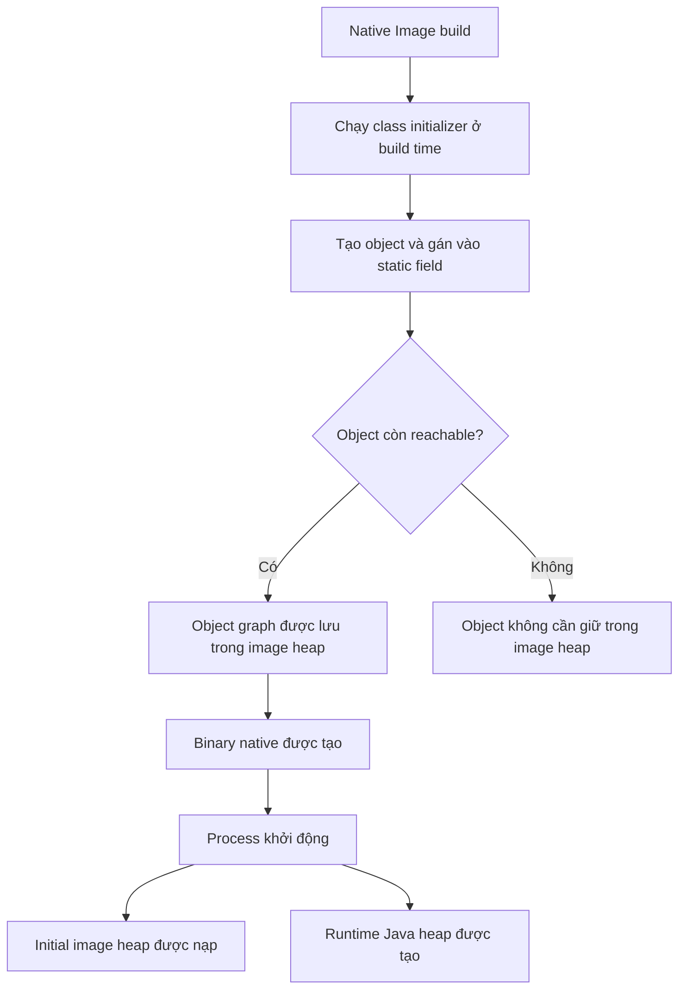
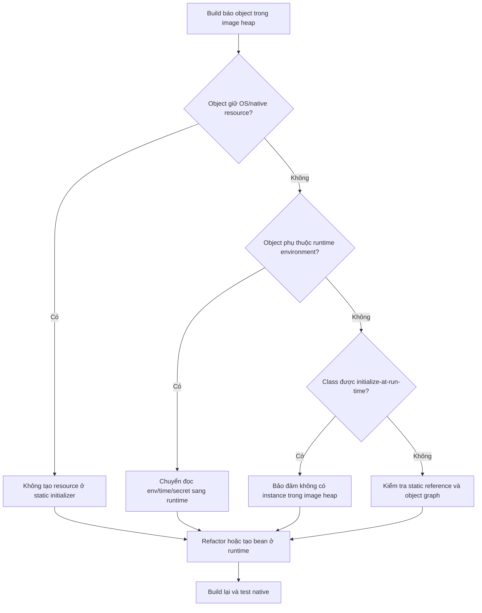

# Đối tượng không phù hợp để tồn tại trong image heap

> **Chương: Khởi tạo lớp.** Module **SPRING_BOOT_NATIVE_IMAGE** biên dịch ứng dụng Spring Boot thành GraalVM Native Image bằng Spring AOT. Khi một lớp được khởi tạo ở build time, trạng thái static của nó có thể được lưu vào executable. Bài học này giúp nhận diện các object không phù hợp để nằm trong image heap, hiểu vì sao build bị từ chối hoặc vì sao trạng thái bị đóng băng từ máy build, rồi chọn cách chuyển phần khởi tạo sang runtime.

## 1. Mục tiêu học tập

Sau bài học, bạn có thể:

1. Giải thích image heap là snapshot ban đầu của các object được tạo ở build time và còn reachable.
2. Phân biệt object không thể được lưu trong executable với object lưu được nhưng mang trạng thái sai hoặc nhạy cảm.
3. Nhận diện file descriptor, thread đang chạy, socket/connection và native resource không phù hợp với image heap.
4. Phát hiện dữ liệu phụ thuộc thời gian, môi trường, hostname, đường dẫn hoặc secret bị đóng băng trong static state.
5. Đọc lỗi image heap và dùng các tùy chọn chẩn đoán để tìm nơi object được tạo.
6. Chuyển khởi tạo sang runtime bằng cách sửa static initializer, tạo bean khi ứng dụng khởi động hoặc cấu hình `--initialize-at-run-time`.

## 2. Image heap lưu những gì?

Native Image có hai vùng heap cần phân biệt:

- **Image heap** là trạng thái ban đầu được lưu trong binary. Nó chứa các object được tạo trong quá trình build và còn reachable từ ứng dụng, metadata `Class` và một số object constant được nhúng trong mã.
- **Runtime Java heap** được tạo khi executable bắt đầu chạy. Các object ứng dụng tạo trong quá trình phục vụ request, mở kết nối hoặc xử lý công việc thông thường nằm ở vùng này.

Khi native executable khởi động, runtime lấy initial image heap từ binary. Vì vậy, object được lưu ở image heap đã tồn tại về mặt trạng thái trước khi process production chạy.



Ví dụ:

```java
public final class BuildSnapshot {
    static final String MESSAGE = System.getProperty("message");

    private BuildSnapshot() {
    }
}
```

Nếu `BuildSnapshot` được khởi tạo ở build time, giá trị `message` được đọc trong môi trường build và lưu cùng static state của lớp. Khi executable chạy với một `-Dmessage` khác, field `MESSAGE` vẫn giữ giá trị đã snapshot ở build time.

Điều này không có nghĩa mọi object tạo trong build đều được lưu. Object phải còn reachable từ image heap; object tạm thời và không còn được tham chiếu có thể được thu gom trước khi image được tạo. Vấn đề xuất hiện khi một object cần giữ lại nhưng vòng đời của nó thuộc về process hoặc môi trường runtime.

## 3. Hai nhóm object không phù hợp

Không phải mọi trường hợp đều có cùng biểu hiện. Hãy chia thành hai nhóm:

1. **Không thể tồn tại an toàn trong executable:** object giữ tài nguyên của hệ điều hành hoặc trạng thái native chỉ có ý nghĩa trong process build. Native Image có thể từ chối build nếu các object này còn reachable.
2. **Có thể được lưu nhưng sai ngữ nghĩa:** object chỉ chứa dữ liệu Java bình thường, nhưng dữ liệu được tính từ thời gian, biến môi trường, hostname, đường dẫn, secret hoặc trạng thái ngẫu nhiên của máy build. Build có thể thành công, nhưng mọi process chạy từ binary sẽ nhận snapshot đó.

| Nhóm | Ví dụ | Rủi ro |
|---|---|---|
| Tài nguyên hệ điều hành đang mở | File descriptor, `FileInputStream` đang mở, socket, channel | Handle gắn với process/máy build; không thể dùng như tài nguyên runtime |
| Thread và công việc đang chạy | `Thread` đã start, timer đang chạy, executor đã khởi động worker | Thread của máy build không thể tiếp tục chạy trong process native sau này |
| Native resource | Native pointer, handle từ JNI hoặc thư viện C đang quản lý | Địa chỉ và vòng đời phụ thuộc process/host build |
| Trạng thái phụ thuộc môi trường | `System.getenv`, system property, hostname, thư mục tạm | Giá trị của build host bị đóng băng, không phản ánh deployment |
| Trạng thái phụ thuộc thời gian | `Instant.now()`, timestamp, thời điểm hết hạn được tính ở static initializer | Mọi process nhận cùng thời điểm build thay vì thời điểm chạy |
| Secret và trạng thái bảo mật | Password, token, private key, seed của random generator | Dữ liệu nhạy cảm có thể bị nhúng trong binary hoặc dùng chung giữa các process |
| Cache hoặc client đã khởi động | Cache nạp từ dữ liệu môi trường, connection pool, client đã mở kết nối | Dữ liệu cũ, kết nối không hợp lệ hoặc side effect xảy ra khi build |

`static final` không làm object trở nên an toàn. `final` chỉ ngăn gán lại reference; object được tham chiếu vẫn có thể mutable và vẫn có thể giữ tài nguyên hoặc dữ liệu nhạy cảm.

## 4. Tài nguyên hệ điều hành và native handle

File descriptor, socket đang mở, thread đang chạy và native handle là những ví dụ điển hình không được lưu vào executable. Các giá trị này gắn với process hoặc hệ điều hành cụ thể. Binary được tạo trên máy build không thể mang theo handle đó sang process mới trên máy production.

### 4.1. File và stream đang mở

Không mở file trong static initializer rồi giữ stream trong static field:

```java
public final class RuntimeFiles {
    // Không phù hợp: file descriptor được mở trong lúc build.
    static final FileInputStream CONFIG =
            new FileInputStream("/etc/orders/application.yml");
}
```

Build có thể thất bại vì object graph giữ `FileDescriptor` hoặc tài nguyên liên quan. Ngay cả khi đường dẫn tồn tại trên máy build, file có thể không tồn tại hoặc có nội dung khác trong container production.

Hãy mở file khi ứng dụng thực sự cần đọc và đóng stream sau khi sử dụng:

```java
public String readExternalConfig(Path configPath) throws IOException {
    try (InputStream input = Files.newInputStream(configPath)) {
        return new String(input.readAllBytes(), StandardCharsets.UTF_8);
    }
}
```

Nếu đây là file cấu hình deployment, cấp nó bằng volume, secret hoặc config mount. Nếu đây là template bất biến đóng gói trong ứng dụng, đặt nó trong classpath và khai báo Resource Hint khi cần; không mở file thành stream ở build time rồi giữ stream trong static field.

### 4.2. Socket, channel và connection

Một socket hoặc connection đã mở phụ thuộc vào network namespace, DNS, credential, port và process tại thời điểm mở. Không tạo chúng trong static initializer:

```java
public final class RemoteConnectionHolder {
    // Không phù hợp: kết nối được mở trong quá trình tạo image.
    static final Socket SOCKET = connectToRemoteService();
}
```

Thay vào đó, tạo client/connection sau khi ứng dụng khởi động và có cấu hình runtime. Với Spring Boot, để connection pool hoặc client được tạo bởi bean lifecycle/autoconfiguration ở runtime. Đóng tài nguyên bằng lifecycle callback phù hợp (`close`, `shutdown`, `destroyMethod`) khi context dừng.

### 4.3. Thread và executor

Thread đang chạy không thể được đóng gói như một object Java bình thường. Không khởi động thread hoặc scheduler trong static initializer:

```java
public final class BackgroundJobs {
    static final ScheduledExecutorService EXECUTOR =
            Executors.newSingleThreadScheduledExecutor();

    static {
        EXECUTOR.scheduleAtFixedRate(
                BackgroundJobs::refresh,
                0, 1, TimeUnit.MINUTES
        );
    }

    private static void refresh() {
        // Làm mới dữ liệu.
    }
}
```

Một executor có thể khởi tạo worker thread khi task được submit; dù thread chưa start ngay, executor và các object quản lý trạng thái vẫn không nên được tạo trong build-time static state. Hãy để Spring tạo executor khi context runtime khởi động:

```java
@Configuration(proxyBeanMethods = false)
class JobConfiguration {

    @Bean(destroyMethod = "shutdown")
    ScheduledExecutorService jobExecutor() {
        return Executors.newScheduledThreadPool(2);
    }
}
```

Bean method trên chạy khi Spring tạo bean trong process ứng dụng. Nó không có nghĩa executor được tạo và lưu trong image heap chỉ vì Spring AOT đã phân tích bean definition.

## 5. Object chứa trạng thái của máy build

Một số object không chứa file descriptor hay native handle nhưng vẫn không nên snapshot. Chúng có thể được lưu vào image heap hợp lệ, song giá trị của chúng phản ánh môi trường build.

### 5.1. Thời gian và timestamp

Ví dụ:

```java
public final class BuildTime {
    static final Instant STARTED_AT = Instant.now();
}
```

Nếu lớp được khởi tạo ở build time, `STARTED_AT` là thời điểm tạo image. Mỗi container chạy cùng binary có thể nhìn thấy cùng timestamp này, dù process bắt đầu vào thời điểm khác.

Nếu cần thời gian hiện tại, hãy lấy tại runtime:

```java
@Component
class RuntimeClock {

    private final Clock clock;

    RuntimeClock(Clock clock) {
        this.clock = clock;
    }

    Instant now() {
        return Instant.now(clock);
    }
}
```

Spring Boot có thể cung cấp bean `Clock` riêng nếu ứng dụng cần kiểm thử thời gian có kiểm soát. Điều quan trọng là gọi `Instant.now(clock)` khi xử lý nghiệp vụ, không tính một timestamp cố định trong static initializer.

### 5.2. Environment, system property và hostname

Ví dụ:

```java
public final class BuildEnvironment {
    static final String API_URL = System.getenv("ORDERS_API_URL");
    static final String HOST = System.getProperty("user.name");
}
```

Nếu static initializer chạy ở build time, giá trị đọc được có thể bị lưu trong image heap. Khi deploy với `ORDERS_API_URL` khác, field static vẫn không tự đọc lại environment.

Hãy bind cấu hình ở runtime:

```java
@ConfigurationProperties(prefix = "orders.remote")
public record RemoteServiceProperties(URI baseUrl) {
}
```

Đăng ký class properties bằng `@ConfigurationPropertiesScan` hoặc `@EnableConfigurationProperties`. Spring Boot đọc giá trị từ Environment khi tạo cấu hình ứng dụng; container có thể cung cấp biến môi trường hoặc config mount riêng cho mỗi deployment.

Hostname, IP, thư mục làm việc, thư mục tạm, locale và timezone mặc định cũng có thể phụ thuộc môi trường. Không cache chúng trong static state được snapshot ở build time nếu giá trị phải phản ánh máy chạy.

### 5.3. Random seed và dữ liệu bảo mật

Không tạo seed bảo mật hoặc secret trong static initializer chạy lúc build:

```java
public final class TokenGenerator {
    // Trạng thái random có thể bị tạo và snapshot khi build.
    static final SecureRandom RANDOM = new SecureRandom();
}
```

Native Image có thể lưu thông tin được tính trong static initializer vào executable. Với dữ liệu nhạy cảm, điều này có thể khiến password, key hoặc random seed xuất hiện trong snapshot; với dữ liệu phụ thuộc môi trường, giá trị có thể được dùng lại ngoài dự kiến.

Hãy tạo đối tượng bảo mật trong runtime lifecycle và quản lý secret bằng secret manager:

```java
@Configuration(proxyBeanMethods = false)
class SecurityRuntimeConfiguration {

    @Bean
    SecureRandom secureRandom() {
        return new SecureRandom();
    }
}
```

Đây là ví dụ về thời điểm tạo object. Cần dùng API sinh số ngẫu nhiên phù hợp với mục đích bảo mật và runtime GraalVM/JDK đang triển khai; không tự tạo seed bằng timestamp hoặc giá trị commit.

## 6. Cache, singleton và client khởi tạo quá sớm

Một cache Java thuần có thể được lưu trong image heap nếu toàn bộ object graph hợp lệ. Nhưng điều đó không đồng nghĩa dữ liệu cache thích hợp để snapshot:

- Cache có thể chứa dữ liệu lấy từ database hoặc API trong lúc build.
- Entry có thể chứa thời điểm hết hạn đã trôi qua khi production bắt đầu.
- Cache có thể phụ thuộc tenant, profile hoặc environment của pipeline.
- Cache có thể giữ object từ thư viện sử dụng thread, file, socket hoặc native memory.

Tương tự, HTTP client, Redis client, Kafka client, datasource và connection pool không nên được khởi tạo bằng static initializer. Một số client chỉ tạo object cấu hình mà chưa mở kết nối, nhưng các thư viện có thể thay đổi hành vi giữa phiên bản; lựa chọn an toàn là để Spring tạo bean theo lifecycle runtime và kiểm tra khả năng tương thích Native Image của dependency.

Ví dụ không nên dùng:

```java
public final class GlobalServices {
    static final DataSource DATA_SOURCE = createDataSource();
    static final HttpClient CLIENT = HttpClient.newHttpClient();
}
```

Với Spring Boot, cấu hình datasource và HTTP client bằng properties/bean:

```java
@Configuration(proxyBeanMethods = false)
class RemoteClientConfiguration {

    @Bean
    HttpClient ordersHttpClient() {
        return HttpClient.newBuilder()
                .connectTimeout(Duration.ofSeconds(3))
                .build();
    }
}
```

Bean được tạo khi application context runtime khởi động. Nếu client cần background thread, native transport hoặc resource hệ điều hành, kiểm tra tài liệu của provider và cách đóng tài nguyên khi shutdown.

## 7. Mối quan hệ giữa class initialization và image heap

Native Image có thể thực thi static initializer ở build time. Khi lớp được khởi tạo tại thời điểm đó, trạng thái static được tạo có thể trở thành một phần của image heap.

Một quy tắc quan trọng: **instance của class được chỉ định khởi tạo ở runtime không được tồn tại trong image heap**. Nếu một object của class runtime-initialized đã được tạo và còn reachable trong initial heap, Native Image không thể giữ nó trước khi class initializer của nó chạy; build sẽ báo lỗi.

Điều này tạo ra hai dạng lỗi thường gặp:

1. Một class được khởi tạo ở build time tạo object không thể lưu trong executable, chẳng hạn object giữ file descriptor hoặc thread đang chạy.
2. Một object của class được cấu hình khởi tạo ở runtime lại được tạo trong quá trình build và còn reachable từ static field của class khác.

Không nên giải quyết lỗi bằng cách tùy tiện ép tất cả lớp sang build time. Nếu object không phù hợp với image heap, ép khởi tạo build time có thể khiến lỗi nặng hơn hoặc đóng băng dữ liệu sai.

### 7.1. Ví dụ object thuộc class runtime-initialized

Giả sử `RuntimeClientHolder` được cấu hình khởi tạo ở runtime nhưng một lớp khác tạo instance của nó trong static initializer:

```java
public class RuntimeClientHolder {
    public RuntimeClientHolder() {
        // Khởi tạo state phụ thuộc runtime.
    }
}

public class StaticRegistry {
    // Không phù hợp nếu RuntimeClientHolder được initialize-at-run-time.
    static final RuntimeClientHolder CLIENT =
            new RuntimeClientHolder();
}
```

Sửa bằng cách không tạo instance trong static state:

```java
@Component
class RuntimeClientRegistry {

    private final RuntimeClientHolder client;

    RuntimeClientRegistry() {
        this.client = new RuntimeClientHolder();
    }

    RuntimeClientHolder client() {
        return client;
    }
}
```

Trong ứng dụng thực tế, có thể dùng constructor injection hoặc `@Bean` để tạo client khi context runtime khởi động. Ví dụ chỉ minh họa việc chuyển object khỏi static image heap; constructor và dependency của client vẫn cần phù hợp với runtime.

## 8. Cách sửa: chuyển state và side effect sang runtime

Khi phát hiện object không phù hợp, xử lý theo thứ tự:

1. Xác định static field hoặc object constant đang giữ reference.
2. Lần theo object graph để tìm tài nguyên hoặc state runtime.
3. Xác định code nào tạo object: static initializer, static field initializer, thư viện được gọi gián tiếp hay build-time callback.
4. Chuyển việc tạo object sang method, factory hoặc Spring bean runtime.
5. Chỉ dùng class initialization policy khi không thể sửa thư viện hoặc cần kiểm soát thời điểm initializer chạy.
6. Build lại và test trên native executable với environment production tương đương.

### 8.1. Trước và sau khi refactor

Trước:

```java
public final class LegacyRemoteClient {
    static final String ENDPOINT = System.getenv("ORDERS_ENDPOINT");
    static final ExecutorService EXECUTOR =
            Executors.newFixedThreadPool(4);
    static final Instant CREATED_AT = Instant.now();

    private LegacyRemoteClient() {
    }
}
```

Sau:

```java
@ConfigurationProperties(prefix = "orders.remote")
public record RemoteProperties(URI endpoint) {
}

@Configuration(proxyBeanMethods = false)
class RemoteRuntimeConfiguration {

    @Bean(destroyMethod = "shutdown")
    ExecutorService ordersExecutor() {
        return Executors.newFixedThreadPool(4);
    }

    @Bean
    Clock applicationClock() {
        return Clock.systemUTC();
    }
}
```

`RemoteProperties` nhận endpoint từ cấu hình runtime; executor được tạo trong lifecycle của Spring; thời gian được đọc từ `Clock` khi nghiệp vụ cần. Đây là cách tách dữ liệu cấu hình, tài nguyên runtime và giá trị thời gian khỏi static image heap.

## 9. Khi không thể refactor: cấu hình initialize-at-run-time

Native Image hỗ trợ chỉ định class hoặc package cần khởi tạo ở runtime:

```bash
native-image \
  --initialize-at-run-time=com.example.orders.LegacyRemoteClient \
  -cp target/classes:target/dependency/* \
  com.example.orders.Application
```

Tùy chọn này yêu cầu class initializer của `LegacyRemoteClient` chạy khi native executable hoạt động, thay vì lúc tạo image. Có thể chỉ định nhiều class bằng danh sách phân tách dấu phẩy; cú pháp và cách truyền option cần kiểm tra theo GraalVM release đang sử dụng.

**Quan trọng:** `--initialize-at-run-time` không làm cho object đã được tạo ở build time trở nên hợp lệ. Phải bảo đảm không có instance của class đó nằm trong image heap. Nếu static field của một lớp khác đã giữ instance, hãy xóa đường tham chiếu đó hoặc chuyển nơi tạo instance sang runtime.

### 9.1. Cấu hình qua GraalVM Native Build Tools

Ví dụ Gradle với Native Build Tools plugin:

```groovy
graalvmNative {
    binaries {
        main {
            buildArgs.add(
                "--initialize-at-run-time=com.example.orders.LegacyRemoteClient"
            )
        }
    }
}
```

Ví dụ Maven với `native-maven-plugin`:

```xml
<plugin>
    <groupId>org.graalvm.buildtools</groupId>
    <artifactId>native-maven-plugin</artifactId>
    <configuration>
        <buildArgs>
            <buildArg>--initialize-at-run-time=com.example.orders.LegacyRemoteClient</buildArg>
        </buildArgs>
    </configuration>
</plugin>
```

Đặt option trong đúng plugin/goal tạo Native Image của dự án. Nếu Spring Boot Maven/Gradle plugin đang điều khiển native build, hãy chuyển build argument theo cơ chế mà plugin và version đó hỗ trợ; không cấu hình vào nhầm task chỉ đóng gói JAR hoặc build container image JVM.

### 9.2. Không lạm dụng initialize-at-build-time

`--initialize-at-build-time` có thể giảm công việc khởi động và lưu static state vào image heap, nhưng cần được dùng có chọn lọc:

- Chỉ chọn class có static initializer thuần, xác định và không phụ thuộc environment/runtime.
- Tránh áp dụng cho cả package lớn khi chưa kiểm tra các lớp con.
- Không dùng nó để che lỗi do file descriptor, thread, socket, native handle hoặc secret.
- Kiểm tra tác động đến class hierarchy và thứ tự khởi tạo.
- Đo startup, kích thước image và hành vi runtime sau thay đổi.

Đối với phần lớn ứng dụng, hãy để Native Image chọn các class an toàn theo mặc định. Chỉ điều chỉnh class cụ thể khi có bằng chứng và hiểu rõ trạng thái static được snapshot.

## 10. Chẩn đoán object bị đưa vào image heap

Khi build thất bại, đọc đầy đủ thông báo thay vì chỉ nhìn class cuối cùng. Thông báo thường cho biết:

- Loại object không hợp lệ hoặc class bị ảnh hưởng.
- Đường đi reference từ static field hoặc object gốc tới object đó.
- Class nào đã được khởi tạo ở build time hoặc runtime.
- Gợi ý chuyển class sang runtime initialization hoặc loại bỏ object khỏi image heap.

Các công cụ hữu ích:

```bash
# In thông tin class initialization trong quá trình build.
native-image -H:+PrintClassInitialization ...

# Theo dõi nơi tạo instance của class nghi vấn.
native-image --trace-object-instantiation=java.lang.Thread ...

# Kiểm tra phiên bản và các option được hỗ trợ.
native-image --version
native-image --help
```

`-H:+PrintClassInitialization` là tùy chọn chẩn đoán phụ thuộc phiên bản; nếu GraalVM release không nhận option này, kiểm tra option tương đương trong tài liệu hoặc `native-image --help`. `--trace-object-instantiation` nhận tên class đầy đủ và giúp tìm nơi object được tạo trong quá trình image build.

### 10.1. Cây quyết định xử lý



### 10.2. Ma trận triệu chứng

| Triệu chứng | Nguyên nhân thường gặp | Hành động |
|---|---|---|
| Báo `FileDescriptor` hoặc file handle trong image heap | Stream/file mở ở build time còn reachable | Mở file ở runtime, dùng try-with-resources |
| Báo thread hoặc thread-related object | Thread/scheduler được start trong static initializer | Tạo executor khi Spring context runtime khởi động |
| Báo object của class runtime-initialized | Instance được tạo trong static field hoặc build-time callback | Loại instance khỏi image heap; tạo sau khi process chạy |
| Build pass nhưng endpoint trỏ nhầm host | URL/hostname đọc trong static initializer | Bind endpoint từ runtime properties |
| Mọi process có cùng timestamp | `Instant.now()` được gọi khi build | Đọc `Clock` tại runtime |
| Secret xuất hiện trong binary hoặc scan report | Static initializer đọc secret trong build | Xóa secret khỏi build context; dùng secret manager runtime |
| Random sequence giống nhau giữa các process | Random state/seed bị snapshot | Tạo generator ở runtime, không seed từ build metadata |
| Build fail sau khi đổi initialize policy | Object graph vẫn chứa instance của runtime-initialized class | Tìm static reference và nơi tạo object; không chỉ đổi option |

## 11. Những lưu ý riêng cho Spring Boot AOT

Spring AOT phân tích cấu trúc application context và sinh code/hints để Native Image có thể biên dịch ứng dụng. Quá trình này có thể thực thi một phần logic build-time, vì vậy static initializer của application code và dependency cần được xem xét cẩn thận.

Tuy nhiên, **Spring AOT không có nghĩa toàn bộ Spring bean production được tạo rồi lưu vào image heap**. AOT tạo thông tin khởi tạo và cấu hình cần thiết; các bean nghiệp vụ, datasource, executor và client runtime vẫn được tạo theo lifecycle của application context khi native process khởi động.

Các nguyên tắc thực hành:

- Để Spring quản lý lifecycle của `DataSource`, connection pool, HTTP client, Redis/Kafka client và executor.
- Không gọi `SpringApplication.run()` hoặc khởi tạo `ApplicationContext` trong static initializer.
- Không truy cập secret, database hoặc network trong code chỉ chạy để tạo image.
- Đưa cấu hình theo môi trường vào `@ConfigurationProperties` hoặc `Environment`, đọc trong runtime context.
- Nếu dependency tự khởi tạo resource trong static initializer, nâng cấp phiên bản có hỗ trợ Native Image hoặc cấu hình class initialization theo hướng dẫn của thư viện.
- Kiểm thử với cùng image nhưng hai bộ environment khác nhau để phát hiện dữ liệu bị snapshot.

## 12. Bài tập thực hành

Một thư viện legacy có lớp:

```java
public final class LegacySettings {
    static final String API_HOST = System.getenv("PAYMENT_HOST");
    static final Instant CREATED_AT = Instant.now();
    static final ExecutorService EXECUTOR =
            Executors.newSingleThreadExecutor();
}
```

Ứng dụng Spring Boot dùng lớp này trong service thanh toán. Khi build native, nhóm gặp cảnh báo hoặc lỗi liên quan tới thread và nhận thấy binary luôn dùng endpoint của pipeline build.

Thực hiện:

1. Xác định field nào giữ OS/runtime resource và field nào chứa dữ liệu bị snapshot.
2. Dùng `--trace-object-instantiation` hoặc log class initialization để tìm nơi executor được tạo.
3. Refactor endpoint sang `@ConfigurationProperties` và đọc giá trị từ runtime environment.
4. Tạo executor bằng Spring bean với lifecycle shutdown rõ ràng.
5. Thay timestamp static bằng `Clock` và đọc thời gian tại thời điểm xử lý.
6. Nếu chưa thể sửa thư viện, thử `--initialize-at-run-time` cho đúng class, đồng thời bảo đảm không còn instance của class đó trong image heap.
7. Build hai lần từ cùng binary nhưng chạy với hai giá trị `PAYMENT_HOST` khác nhau; xác nhận mỗi process dùng đúng endpoint của runtime.
8. Kiểm tra binary và log build không chứa secret từ môi trường CI.

Mẫu báo cáo:

| Kiểm tra | Trước refactor | Sau refactor |
|---|---|---|
| Thread/executor được tạo lúc nào? | Build time / runtime | Build time / runtime |
| Endpoint được đọc lúc nào? | Build time / runtime | Build time / runtime |
| Timestamp phản ánh thời điểm nào? | Build / startup / request | Build / startup / request |
| Image heap có OS handle? | Có/Không | Có/Không |
| Hai runtime environment cho kết quả khác nhau đúng yêu cầu? | Có/Không | Có/Không |
| Native build và smoke test | Pass/Fail | Pass/Fail |

## 13. Câu hỏi tự kiểm tra

1. Image heap khác runtime Java heap ở thời điểm hình thành và vòng đời như thế nào?
2. Vì sao file descriptor hoặc thread đang chạy không thể được snapshot vào native executable?
3. Vì sao `static final` không bảo đảm object được tham chiếu là an toàn?
4. Một field `static final String` đọc từ `System.getenv()` có thể gây lỗi gì dù build không thất bại?
5. Vì sao `Instant.now()` trong static initializer có thể làm sai dữ liệu ở production?
6. Quy tắc nào áp dụng cho instance của class được cấu hình initialize-at-run-time?
7. Vì sao `--initialize-at-run-time` không tự sửa được object đã được tạo và lưu trong image heap?
8. Khi nào nên refactor static initializer, khi nào mới dùng class initialization option?
9. `--trace-object-instantiation` và `-H:+PrintClassInitialization` giúp điều tra hai vấn đề nào?
10. Spring AOT khác với việc snapshot toàn bộ Spring bean graph vào image heap như thế nào?

## Ghi nhớ

**Image heap là trạng thái ban đầu được snapshot vào native executable.** Không để tài nguyên hệ điều hành đang mở, thread đang chạy, native handle, connection hoặc trạng thái runtime nhạy cảm nằm trong static object graph được tạo ở build time. Một số object vẫn có thể được lưu nhưng mang dữ liệu của máy build như thời gian, environment, hostname hoặc secret. Hãy chuyển side effect và state phụ thuộc môi trường sang runtime lifecycle, dùng `--initialize-at-run-time` có chọn lọc khi cần, rồi xác minh bằng native build và test với nhiều cấu hình runtime.

## Tài liệu tham khảo chính thức

- [GraalVM — Native Image Basics](https://www.graalvm.org/latest/reference-manual/native-image/basics/): image heap, build time, runtime và class initialization.
- [GraalVM — Native Image Compatibility Guide](https://www.graalvm.org/latest/reference-manual/native-image/metadata/Compatibility/): file descriptor, running thread và các khác biệt có thể gặp khi chạy Native Image.
- [GraalVM — Class Initialization in Native Image](https://www.graalvm.org/dev/reference-manual/native-image/optimizations-and-performance/ClassInitialization/): quy tắc và chính sách khởi tạo lớp.
- [GraalVM — Specify Class Initialization Explicitly](https://www.graalvm.org/latest/reference-manual/native-image/guides/specify-class-initialization/): `--initialize-at-build-time` và `--initialize-at-run-time`.
- [GraalVM — Security Considerations in Native Image](https://www.graalvm.org/latest/security-guide/native-image/): dữ liệu nhạy cảm và random seed trong build-time snapshot.
- [GraalVM SDK — RuntimeClassInitialization](https://www.graalvm.org/sdk/javadoc/org/graalvm/nativeimage/hosted/RuntimeClassInitialization.html): API điều khiển class initialization trong quá trình build.
- [GraalVM — Native Image Command-line Options](https://www.graalvm.org/latest/reference-manual/native-image/overview/Options/): các build option và cách kiểm tra option theo phiên bản.
- [Spring Boot — GraalVM Native Images](https://docs.spring.io/spring-boot/reference/packaging/native-image/introducing-graalvm-native-images.html): Spring AOT và quá trình tạo native executable.
