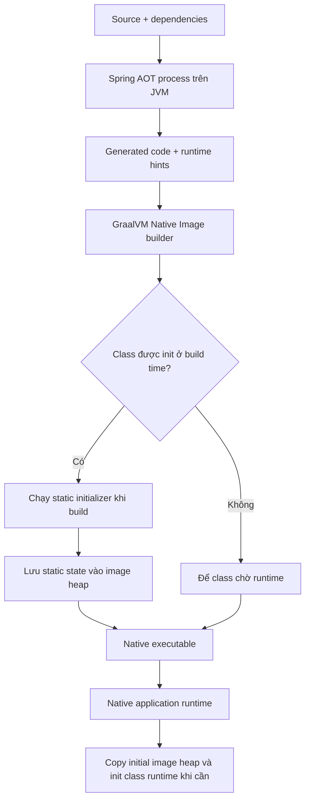

# Random, thời gian, biến môi trường và trạng thái gắn với máy build

Một ứng dụng Spring Boot có thể chạy đúng trên JVM nhưng cho kết quả bất ngờ sau khi biên dịch thành **GraalVM Native Image** nếu static initializer đọc dữ liệu của máy build. Các giá trị như số ngẫu nhiên, thời điểm hiện tại, biến môi trường, thư mục home, hostname, locale hoặc truststore có thể bị lưu vào executable nếu class tương ứng được **khởi tạo tại build time**.

Khi đó, binary có thể mang theo trạng thái của CI runner hoặc máy developer. Đến lúc triển khai, việc thay đổi environment variables hay cấu hình container không tự làm static initializer chạy lại. Muốn ứng dụng đọc dữ liệu của từng instance khi khởi động, cần giữ class liên quan ở **runtime initialization** hoặc chuyển việc đọc dữ liệu sang bean/service được tạo trong runtime.

## 1. Mục tiêu học tập

Sau bài học, bạn có thể:

- Giải thích static initializer và thời điểm một Java class được khởi tạo.
- Phân biệt class initialization trong Spring AOT process với class initialization của GraalVM Native Image builder.
- Mô tả cách build-time initialized classes lưu static state vào image heap.
- Nhận diện rủi ro khi static initializer đọc random seed, thời gian, environment, system properties, locale, filesystem, network hoặc secrets.
- Sử dụng `--initialize-at-build-time` và `--initialize-at-run-time` cho đúng class.
- Cấu hình class initialization arguments trong Maven/Gradle Native Build Tools.
- Thiết kế Spring bean dùng `Environment`, `Clock` và nguồn random tại runtime thay cho static state phụ thuộc máy.
- Kiểm tra class initialization policy, tính tái lập của build và hành vi trên native executable.

## 2. Class initialization trong Java

Java class có thể chứa static field và static initializer:

```java
public class ApplicationMetadata {
    static final String NAME = "order-service";
    static final Instant CREATED_AT = Instant.now();

    static {
        System.out.println("ApplicationMetadata initialized");
    }
}
```

JVM không chạy static initializer ngay khi file class được nạp. Theo quy tắc Java, class được **khởi tạo** trước lần sử dụng chủ động đầu tiên, ví dụ truy cập static field không phải constant variable, gọi static method hoặc tạo instance. Việc khởi tạo chỉ diễn ra một lần trong vòng đời class loader tương ứng.

Trong ứng dụng JVM thông thường, nếu lần đầu gọi `ApplicationMetadata.CREATED_AT` xảy ra lúc service đang chạy, `Instant.now()` được đánh giá tại thời điểm runtime đó.

Native Image bổ sung một lựa chọn khác: class có thể được khởi tạo ngay trong lúc tạo executable. Khi đó, static initializer chạy trên JVM đang thực hiện quá trình build và trạng thái static được lưu vào binary.

## 3. Build time, Spring AOT và runtime là ba thời điểm khác nhau

Khi build Spring Boot Native Image, cần phân biệt ba tiến trình:

1. **Spring AOT process:** Maven/Gradle khởi chạy ứng dụng trên JVM để phân tích cấu hình Spring, bean definitions và tạo mã/metadata AOT.
2. **GraalVM Native Image builder:** phân tích bytecode, áp dụng class initialization policy, có thể chạy static initializer và tạo image heap.
3. **Native application runtime:** executable được triển khai, khởi tạo trạng thái runtime và xử lý request.



Hai loại xử lý build time có liên quan nhưng không đồng nhất:

- Spring AOT có thể đánh giá `@Profile` hoặc `@ConditionalOnProperty` và tạo bean graph theo cấu hình lúc build.
- GraalVM class initialization quyết định static initializer của một class chạy lúc Native Image build hay lúc executable chạy.

Ví dụ, Spring AOT có thể quyết định bean audit có mặt hay không dựa trên property. Đó là quyết định cấu trúc container. Còn một class `BuildMetadata` có `static final Instant CREATED_AT = Instant.now()` chỉ bị đóng băng vào image heap nếu class thực sự được khởi tạo ở build time.

## 4. Native Image lưu trạng thái build-time như thế nào?

Khi một class được khởi tạo ở build time:

1. Static initializer của class chạy trong tiến trình Native Image builder.
2. Các giá trị được gán vào static fields trở thành trạng thái của class.
3. Những object còn reachable từ static fields có thể được đưa vào **image heap**.
4. Native executable lưu snapshot ban đầu của image heap.
5. Khi tiến trình native khởi động, initial image heap được dùng làm trạng thái ban đầu; static initializer của class đã được build-time initialized không chạy lại.

Ví dụ:

```java
public final class BuildSnapshot {
    static final String REGION =
            System.getenv().getOrDefault("APP_REGION", "unknown");
    static final Instant CREATED_AT = Instant.now();
    static final long RANDOM_SEED = new Random().nextLong();

    private BuildSnapshot() {
    }

    public static void print() {
        System.out.println("region=" + REGION);
        System.out.println("createdAt=" + CREATED_AT);
        System.out.println("seed=" + RANDOM_SEED);
    }
}
```

Nếu `BuildSnapshot` được khởi tạo ở build time, ba giá trị trên phản ánh môi trường của builder:

- `REGION` là giá trị `APP_REGION` nhìn thấy khi build.
- `CREATED_AT` là thời điểm static initializer chạy trong quá trình build.
- `RANDOM_SEED` là số đã được sinh trong quá trình build.

Khi executable chạy, thay `APP_REGION` thành giá trị khác không làm `REGION` tự cập nhật. Tương tự, thời gian và seed không được tạo lại chỉ vì một process native mới bắt đầu.

### 4.1. Một executable có thể mang cùng trạng thái ban đầu cho nhiều process

Nếu một object random generator được tạo trong static initializer build-time và lưu trong image heap, các native process khởi chạy từ cùng executable có thể bắt đầu từ cùng trạng thái generator. Nếu các process thực hiện cùng chuỗi lời gọi, chúng có nguy cơ sinh cùng chuỗi kết quả.

Điều này đặc biệt nguy hiểm khi trạng thái đó được dùng cho session identifiers, request identifiers, randomized backoff, nonce, token hoặc giá trị cần khác nhau giữa instance. Không dùng một static random generator được snapshot ở build time để tạo dữ liệu cần duy nhất theo process hoặc request. Với giá trị bảo mật, dùng nguồn entropy phù hợp tại runtime, chẳng hạn `SecureRandom`.

## 5. Chính sách khởi tạo lớp mặc định của GraalVM

Không nên hiểu rằng Native Image mặc định khởi tạo **mọi class ứng dụng** tại build time.

Theo chính sách hiện hành:

- Application classes thường được khởi tạo ở **runtime**.
- Native Image có thể tự khởi tạo ở build time những application classes mà nó chứng minh là **safe**.
- Nhiều class thuộc JDK được khởi tạo ở build time theo chính sách của Native Image.
- Người dùng hoặc framework có thể yêu cầu thời điểm khởi tạo rõ ràng bằng build arguments.

Một class chỉ được nạp không có nghĩa static initializer của nó đã chạy. Việc class được khởi tạo ở build time phụ thuộc policy, quan hệ khởi tạo giữa các class và những thao tác được thực hiện trong quá trình phân tích.

### 5.1. Safe initialization

Native Image cố gắng xác định class nào có thể khởi tạo an toàn ở build time. Việc phân tích xem xét initializer và các class liên quan. Những lời gọi có thể đi vào native code, lời gọi virtual không xác định được target hoặc một số method được thay thế bởi Native Image có thể khiến class không được chứng minh là safe.

Vì vậy, đừng suy luận rằng một class có static field đơn giản thì chắc chắn sẽ được build-time initialized. Hãy kiểm tra báo cáo class initialization của đúng phiên bản GraalVM và đúng cấu hình build.

### 5.2. Khi nào cần cấu hình tường minh?

Cấu hình tường minh hữu ích khi:

- Một class chứa state phụ thuộc máy build và cần được chuyển sang runtime initialization.
- Một class chỉ tính toán dữ liệu thuần, bất biến và có thể hưởng lợi từ việc khởi tạo sớm.
- Build report cho thấy class đang được khởi tạo ở thời điểm khác với mong muốn.
- Thư viện/framework yêu cầu một chính sách class initialization cụ thể.

Ưu tiên cấu hình **từng class** thay vì áp dụng rộng cho cả package khi chưa hiểu các initializer bên trong.

## 6. Các nguồn trạng thái dễ bị đóng băng

| Nguồn dữ liệu | Ví dụ trong static initializer | Rủi ro nếu class được build-time initialized |
| --- | --- | --- |
| Thời gian | `Instant.now()`, `LocalDate.now()`, `System.currentTimeMillis()` | Thời gian build trở thành giá trị của executable |
| Random | `new Random().nextLong()`, random generator static | Các process có thể bắt đầu từ cùng seed/state |
| Environment | `System.getenv("APP_REGION")` | Binary mang giá trị của CI/build host |
| System properties | `System.getProperty("user.home")`, `user.name` | Đường dẫn/user của builder bị lưu lại |
| Hostname/network | `InetAddress.getLocalHost()`, network interface lookup | Hostname/IP của builder có thể bị snapshot hoặc build phụ thuộc mạng |
| Locale/timezone | `Locale.getDefault()`, `ZoneId.systemDefault()` | Cache có thể phản ánh locale/timezone của builder |
| Filesystem | Đọc file config, home directory, temp directory | Nội dung hoặc đường dẫn của builder trở thành trạng thái ban đầu |
| Security material | Đọc token, key, certificate hoặc truststore | Secret hoặc trust configuration của builder có thể vào image |
| CPU/process state | Số processor, process id, OS-specific values | Giá trị có thể không phù hợp với node runtime |

Không phải mọi lời gọi trong bảng đều luôn được Native Image chạy ở build time. Rủi ro xuất hiện khi lời gọi được thực hiện bởi initializer của class đã được khởi tạo ở build time, hoặc một cơ chế build-time khác lưu kết quả vào generated artifact/image heap.

### 6.1. Thời gian

Ví dụ:

```java
final class BuildClock {
    static final Instant CREATED_AT = Instant.now();
}
```

Nếu class được build-time initialized, `CREATED_AT` phản ánh thời điểm tạo image. Nếu mục tiêu là ghi nhận thời điểm process khởi động hoặc thời điểm request, hãy đọc clock tại runtime thay vì cache thời gian trong static field.

### 6.2. Biến môi trường và system properties

Ví dụ:

```java
final class DeploymentEnvironment {
    static final String REGION = System.getenv("APP_REGION");
    static final String HOME = System.getProperty("user.home");
}
```

Nếu class được khởi tạo trong build, giá trị có thể trỏ tới runner hoặc user thực hiện build. Khi chạy container ở production, biến `APP_REGION` hoặc `user.home` mới không ghi đè static fields đã được snapshot.

### 6.3. Truststore và certificate

Native Image có một lưu ý vận hành đáng chú ý: theo tài liệu bảo mật GraalVM, hành vi mặc định của `native-image` là capture default TrustStore từ môi trường host lúc build. Có thể thay đổi hành vi khi chạy bằng các system properties `javax.net.ssl.trustStore` và các thuộc tính liên quan.

Điều này có nghĩa một image build trên máy có truststore tùy biến có thể không có hành vi TLS giống image build trên runner sạch. Với ứng dụng gọi HTTPS hoặc database TLS, hãy xác định rõ nguồn truststore và kiểm thử trên runtime image thực tế.

### 6.4. Secrets

Nếu static initializer đọc API token hoặc private key từ environment, và class được khởi tạo ở build time, giá trị đó có thể được lưu vào image heap và trở thành một phần của executable. Việc xóa biến môi trường khỏi container sau build không xóa dữ liệu đã được snapshot.

Không cấp secrets production cho native-image builder nếu không cần thiết. Dùng build environment tối giản, secret scanning và cơ chế cấp credentials ở runtime.

## 7. Chuyển class sang runtime initialization

Native Image hỗ trợ hai tùy chọn quan trọng:

| Tùy chọn | Ý nghĩa |
| --- | --- |
| `--initialize-at-build-time=<class-or-package>` | Yêu cầu khởi tạo class/package trong lúc tạo executable |
| `--initialize-at-run-time=<class-or-package>` | Hoãn việc khởi tạo class/package đến khi native executable chạy |

Ví dụ:

```bash
# Yêu cầu class đọc môi trường khi native process chạy
native-image \
  --initialize-at-run-time=com.example.DeploymentEnvironment \
  -o order-service \
  com.example.Application
```

Sau khi class được chỉ định runtime initialization, static initializer sẽ chạy trong native process khi class được sử dụng lần đầu theo quy tắc Java. Khi đó, các giá trị như environment variable và thời gian được đọc từ môi trường runtime.

### 7.1. Chỉ rõ build-time initialization cho class thuần

Một class chỉ tính toán dữ liệu tĩnh từ literal có thể phù hợp với build-time initialization:

```java
import java.util.Map;

final class CurrencyTable {
    static final Map<String, Integer> SCALE = Map.of(
        "USD", 2,
        "JPY", 0,
        "KWD", 3
    );
}
```

Nếu đã xác nhận initializer thuần, không phụ thuộc môi trường, có thể chỉ định:

```bash
native-image \
  --initialize-at-build-time=com.example.CurrencyTable \
  -o order-service \
  com.example.Application
```

Lợi ích có thể là giảm công việc khởi tạo ở runtime hoặc giúp Native Image loại bỏ code chỉ cần trong lúc tính toán. Tuy nhiên, không nên đánh đổi tính đúng đắn và kích thước image chỉ để tăng số lượng class được khởi tạo sớm.

### 7.2. Tránh cấu hình cả package một cách tùy tiện

Ví dụ sau có phạm vi rộng:

```bash
--initialize-at-build-time=com.example
```

Nếu package chứa class đọc environment, random, thời gian, filesystem hoặc secret, chúng có thể bị kéo vào build-time initialization. Bắt đầu với class cụ thể:

```bash
--initialize-at-run-time=com.example.DeploymentEnvironment
--initialize-at-run-time=com.example.RandomState
```

Các quy tắc class initialization có ràng buộc về superclass và superinterface liên quan. Nếu một class được khởi tạo ở build time, các superclass/relevant superinterfaces cần được khởi tạo trước nó cũng có thể bị ảnh hưởng. Một class được yêu cầu runtime initialization cũng có thể kéo theo các subtype liên quan. Khi policy xung đột hoặc object đã nằm trong image heap, Native Image có thể báo lỗi; cần đọc thông báo và điều chỉnh class cụ thể.

## 8. Cấu hình Maven và Gradle Native Build Tools

Các arguments phải được truyền đến **Native Image builder**, không chỉ đặt trong shell của ứng dụng sau khi executable đã được tạo.

### 8.1. Maven

Với GraalVM Native Build Tools Maven plugin, có thể thêm build arguments:

```xml
<plugin>
    <groupId>org.graalvm.buildtools</groupId>
    <artifactId>native-maven-plugin</artifactId>
    <configuration>
        <buildArgs>
            <buildArg>--initialize-at-run-time=com.example.DeploymentEnvironment</buildArg>
            <buildArg>--initialize-at-run-time=com.example.RandomState</buildArg>
            <buildArg>-H:+PrintClassInitialization</buildArg>
        </buildArgs>
    </configuration>
</plugin>
```

Đây là đoạn cấu hình plugin, cần đặt trong `pom.xml` của dự án đã cấu hình Native Build Tools tương thích. Sau đó chạy goal native đã được project thiết lập, ví dụ:

```bash
./mvnw -Pnative native:compile
```

`-Pnative` chỉ là Maven profile nếu project có khai báo profile đó. Nó không tự thêm class initialization arguments nếu chúng chưa được cấu hình.

### 8.2. Gradle Groovy DSL

Với GraalVM Native Build Tools Gradle plugin:

```groovy
graalvmNative {
    binaries {
        main {
            buildArgs.add(
                '--initialize-at-run-time=com.example.DeploymentEnvironment'
            )
            buildArgs.add(
                '--initialize-at-run-time=com.example.RandomState'
            )
            buildArgs.add('-H:+PrintClassInitialization')
        }
    }
}
```

Chạy:

```bash
./gradlew nativeCompile
```

Tên task và cấu hình binary phụ thuộc phiên bản plugin. Nếu dự án có nhiều native binaries, cần áp dụng arguments cho đúng binary thay vì giả định mọi task dùng cùng cấu hình.

### 8.3. Khi dùng Spring Boot buildpacks

Nếu dùng `spring-boot:build-image` hoặc `bootBuildImage`, GraalVM Native Image thường chạy bên trong CNB builder. Class initialization arguments cần được truyền qua cơ chế cấu hình native build của buildpack/builder tương ứng. Đừng thêm `--initialize-at-run-time` vào environment của container runtime rồi kỳ vọng nó thay đổi policy của executable đã biên dịch.

Hãy pin phiên bản builder/buildpacks và tham khảo đúng cách truyền native-image build arguments của phiên bản đó. Sau build, kiểm tra log builder để xác nhận arguments đã được nhận.

## 9. Thiết kế Spring Boot để đọc dữ liệu ở runtime

Cách bền vững thường là tránh đọc trạng thái thay đổi trong static initializer. Đưa dữ liệu phụ thuộc môi trường vào bean hoặc service được tạo khi ứng dụng native khởi động.

### 9.1. Dùng Environment cho cấu hình triển khai

```java
import org.springframework.core.env.Environment;
import org.springframework.stereotype.Component;

@Component
class DeploymentSettings {
    private final String region;

    DeploymentSettings(Environment environment) {
        this.region = environment.getRequiredProperty("app.region");
    }

    String region() {
        return region;
    }
}
```

Trong `application.properties`:

```properties
app.region=${APP_REGION:local}
```

Khi bean được tạo trong native application runtime, Spring đọc cấu hình runtime và truyền vào constructor. Điều này cho phép cùng một executable chạy ở nhiều môi trường với `APP_REGION` khác nhau, miễn property không được dùng để thay đổi bean graph trong quá trình AOT.

### 9.2. Dùng Clock thay vì static Instant.now()

```java
import java.time.Clock;
import java.time.Instant;
import org.springframework.context.annotation.Bean;
import org.springframework.context.annotation.Configuration;

@Configuration(proxyBeanMethods = false)
class TimeConfiguration {
    @Bean
    Clock applicationClock() {
        return Clock.systemUTC();
    }
}

@Service
class ReportService {
    private final Clock clock;

    ReportService(Clock clock) {
        this.clock = clock;
    }

    Instant createdAt() {
        return Instant.now(clock);
    }
}
```

`Clock` được cung cấp khi Spring tạo bean ở runtime. Test có thể thay bằng `Clock.fixed(...)` để kiểm thử xác định; production dùng `Clock.systemUTC()` để đọc thời gian thực.

### 9.3. Tạo random source tại runtime

```java
import java.security.SecureRandom;
import org.springframework.context.annotation.Bean;
import org.springframework.context.annotation.Configuration;

@Configuration(proxyBeanMethods = false)
class RandomConfiguration {
    @Bean
    SecureRandom secureRandom() {
        return new SecureRandom();
    }
}
```

Inject `SecureRandom` vào component cần sinh token/nonce thay vì giữ một static instance được khởi tạo trong build-time initialized class. Cần xác nhận class/provider liên quan được Native Image hỗ trợ và entropy được lấy ở runtime theo cấu hình nền tảng.

### 9.4. Khi nào static field vẫn phù hợp?

Static field phù hợp với dữ liệu:

- Hằng số được khai báo trực tiếp trong source và không phụ thuộc môi trường.
- Lookup table được tạo hoàn toàn từ literal cố định.
- Pattern hoặc cấu trúc immutable không chứa trạng thái theo process.
- Metadata phiên bản build được chủ động đóng dấu và có ý nghĩa là **build metadata**, không phải thông tin runtime.

Không nên dùng static initializer để cache giá trị có thể khác theo container, node, tenant, request hoặc thời điểm chạy.

## 10. Phân biệt cấu hình bean graph và class initialization

Hai nhóm vấn đề có thể xuất hiện cùng lúc trong Spring Boot Native Image nhưng cần xử lý khác nhau:

| Vấn đề | Cơ chế | Cách xử lý |
| --- | --- | --- |
| Bean không xuất hiện vì `@ConditionalOnProperty` lúc AOT | Spring AOT đã phân tích cấu hình và tạo graph | Build với property/profile cấu trúc phù hợp |
| Static field giữ giá trị environment của builder | Class được khởi tạo ở build time | Dùng runtime initialization hoặc đọc Environment trong runtime bean |
| Static timestamp phản ánh lúc build | Static initializer chạy trong Native Image build | Dùng Clock ở runtime hoặc giữ field dưới dạng build metadata có chủ đích |
| Random generator có cùng state ban đầu | Random object nằm trong image heap | Khởi tạo generator trong runtime |
| Truststore khác môi trường triển khai | Native Image capture truststore mặc định từ build host | Cấu hình truststore runtime và kiểm thử TLS |
| Host path hoặc locale không đúng | Static cache lưu state của builder | Đọc lại ở runtime, tránh cache build-host values |

Ví dụ, đổi `APP_REGION` khi chạy không thể khôi phục bean đã bị loại khỏi graph bởi AOT condition. Ngược lại, nếu bean đã có trong graph và chỉ cần đọc region để chọn endpoint, `Environment` trong runtime bean là cách phù hợp.

## 11. Chẩn đoán class initialization

### 11.1. In báo cáo class initialization

Native Image hỗ trợ:

```bash
-H:+PrintClassInitialization
```

Argument này giúp xem class nào được khởi tạo ở build time, class nào ở runtime và thông tin liên quan tới policy. Dùng báo cáo để xác nhận class phụ thuộc môi trường có đang bị khởi tạo quá sớm hay không.

Khi đọc kết quả, tập trung vào:

1. Class chứa static field phụ thuộc môi trường.
2. Class chứa static initializer gọi random, clock, filesystem hoặc security APIs.
3. Class bị khởi tạo sớm do một class khác.
4. Superclass hoặc dependency liên quan cũng bị đưa vào policy.
5. Lý do class được xem là safe hoặc bị yêu cầu build-time/runtime.

### 11.2. Dùng native-image build output và security report

Kiểm tra log Native Image để biết class initialization policy và các cảnh báo liên quan. Security report có thể giúp nhận diện bề mặt bảo mật, nhưng không thay thế việc rà soát static initializers của ứng dụng và dependencies.

Nếu executable có thể chứa dữ liệu nhạy cảm, hãy coi image heap và native binary là artifact có thể mang theo dữ liệu đó. Rà soát build environment, CI logs, binary scanning và quyền truy cập artifact registry.

### 11.3. Đừng chỉ dựa vào JVM test

JVM test thường chạy static initializer tại runtime trong class loader của test. Điều đó không chứng minh native image dùng cùng class initialization policy. Cần build native executable và kiểm thử đúng tình huống:

- Build với environment A, chạy với environment B.
- Build trên runner có timezone/locale khác, chạy trên container production.
- Khởi chạy nhiều process từ cùng executable và kiểm tra random state.
- Dùng truststore/certificate đúng với môi trường triển khai.
- Xác minh static timestamps là build metadata hay runtime timestamp theo ý định.

## 12. Ma trận kiểm thử build và runtime

Giả sử ứng dụng có `BuildSnapshot` với ba giá trị `REGION`, `CREATED_AT` và `RANDOM_SEED`.

| Build input | Class policy | Runtime input | Kết quả mong đợi |
| --- | --- | --- | --- |
| `APP_REGION=builder` | Build time | `APP_REGION=prod` | Region vẫn là `builder`; timestamp/seed phản ánh build |
| `APP_REGION=builder` | Runtime | `APP_REGION=prod` | Region đọc được là `prod`; timestamp/seed tạo khi runtime |
| `APP_REGION=dev` | Runtime | `APP_REGION=prod` | Cùng binary có thể dùng cấu hình runtime `prod` |
| `APP_REGION=prod` | Build time | `APP_REGION=prod` | Có thể trông đúng trong môi trường này nhưng không portable sang region khác |

### 12.1. Thử nghiệm standalone

Để quan sát rõ cơ chế, có thể dùng một class Java độc lập:

```java
package com.example;

import java.time.Instant;
import java.util.Random;

public class BuildSnapshot {
    static final String REGION =
            System.getenv().getOrDefault("APP_REGION", "unknown");
    static final Instant CREATED_AT = Instant.now();
    static final long SEED = new Random().nextLong();

    public static void main(String[] args) {
        System.out.println("region=" + REGION);
        System.out.println("createdAt=" + CREATED_AT);
        System.out.println("seed=" + SEED);
    }
}
```

Biên dịch class trước:

```bash
javac -d out src/main/java/com/example/BuildSnapshot.java
```

Build-time initialization:

```bash
APP_REGION=builder native-image \
  -cp out \
  --initialize-at-build-time=com.example.BuildSnapshot \
  -o snapshot-build \
  com.example.BuildSnapshot

APP_REGION=production ./snapshot-build
```

Kết quả region vẫn là giá trị build đã đọc trong static initializer. Timestamp và seed cũng được tạo trong lúc build.

Runtime initialization:

```bash
APP_REGION=builder native-image \
  -cp out \
  --initialize-at-run-time=com.example.BuildSnapshot \
  -o snapshot-runtime \
  com.example.BuildSnapshot

APP_REGION=production ./snapshot-runtime
```

Trong lần chạy thứ hai, static initializer được thực hiện trong native process, nên region và timestamp được lấy từ môi trường runtime. Ví dụ standalone dùng để quan sát cơ chế class initialization; với Spring Boot, hãy truyền arguments qua Native Build Tools hoặc buildpacks của dự án thay vì giả định mọi executable JAR có thể đưa trực tiếp vào raw `native-image` command.

## 13. Lỗi thường gặp và cách khắc phục

| Triệu chứng | Nguyên nhân có thể | Hướng xử lý |
| --- | --- | --- |
| Environment variable đổi khi chạy nhưng static field không đổi | Class đã được khởi tạo ở build time | Chuyển class sang runtime init hoặc đọc Environment qua bean |
| Nhiều process bắt đầu cùng random sequence | Random state đã được snapshot trong image heap | Tạo random generator ở runtime, tránh static build-time state |
| Timestamp của ứng dụng cũ hơn thời điểm deploy | `Instant.now()` chạy trong static initializer lúc build | Dùng `Clock`/`Instant.now(clock)` ở runtime |
| Path trỏ tới thư mục CI | Static field cache `user.home`, `java.io.tmpdir` hoặc path build host | Tạo path từ runtime configuration/filesystem |
| TLS hoạt động ở build host nhưng lỗi ở production | Truststore mặc định bị capture hoặc runtime truststore không đúng | Cấu hình `javax.net.ssl.trustStore*` và test trong final image |
| Native Image báo lỗi khi ép class sang runtime | Class/object đã bị khởi tạo hoặc đưa vào image heap theo policy khác | Đọc lỗi, kiểm tra class dependencies và thu hẹp policy |
| Build-time init làm binary chứa secret | Static initializer đọc credential từ build environment | Loại secret khỏi builder; dùng runtime secret provider |
| Class vẫn bị init sớm dù đã đánh dấu một class khác runtime | Class liên quan được init bởi dependency/hierarchy | Dùng `-H:+PrintClassInitialization` để tìm nguyên nhân |
| Build native khác hành vi JVM | JVM test và native class initialization policy khác nhau | Test native binary với environment khác build host |

## 14. Best practices

1. **Mặc định để class phụ thuộc môi trường khởi tạo ở runtime.** Chỉ yêu cầu build-time init khi đã xác nhận initializer thuần và có lợi ích rõ.
2. **Tránh static initializer có I/O.** Không đọc file cấu hình deployment, gọi network hoặc lấy secret trong static block.
3. **Không tạo random seed cho runtime ở build time.** Đặc biệt tránh static random state dùng cho token hoặc định danh.
4. **Dùng Clock và Environment injection.** Cho phép ứng dụng đọc thời gian/cấu hình khi chạy và test bằng clock cố định.
5. **Chỉ định class cụ thể.** Hạn chế `--initialize-at-build-time` trên package lớn nếu chưa kiểm tra toàn bộ initializer.
6. **Kiểm tra class initialization report.** Dùng `-H:+PrintClassInitialization` trong giai đoạn điều tra.
7. **Giữ build environment sạch.** Không cấp secrets production cho native-image builder và kiểm soát truststore.
8. **Kiểm thử với build/runtime environments khác nhau.** Một binary chỉ được test trên cùng máy build có thể che giấu lỗi snapshot.
9. **Ghi nhận policy cùng artifact.** Lưu build arguments, GraalVM version, commit và checksum để tái tạo kết quả.
10. **Đọc tài liệu đúng phiên bản GraalVM.** Quy tắc safe initialization và option có thể thay đổi theo phiên bản.

## 15. Bài thực hành tổng hợp

**Bối cảnh:** một Spring Boot service cần region, timestamp tạo report và random token. Bản native sẽ được build trong CI rồi triển khai ở nhiều region.

Thực hiện:

1. Tìm các static fields/static initializers có gọi `System.getenv`, `System.getProperty`, `Instant.now`, `new Random` hoặc `SecureRandom`.
2. Xác định class nào đang được Native Image khởi tạo ở build time bằng `-H:+PrintClassInitialization`.
3. Chuyển region sang cấu hình `app.region` và inject `Environment` vào bean runtime.
4. Chuyển timestamp sang `Clock` được inject và tạo `Instant.now(clock)` khi cần.
5. Chuyển random source sang bean/runtime service; không giữ generator static được snapshot.
6. Với class thư viện vẫn cần runtime initialization, thêm `--initialize-at-run-time` cho class cụ thể qua Maven/Gradle build arguments.
7. Build executable với `APP_REGION=build-region`, sau đó chạy container với `APP_REGION=prod-region`.
8. Xác nhận app dùng `prod-region`, timestamp được tạo ở runtime và random state được khởi tạo theo process.
9. Kiểm tra TLS truststore, filesystem paths và quyền truy cập trong final container image.
10. Lưu build arguments, class initialization report và checksum của executable.

**Câu hỏi tự kiểm tra:** Vì sao đổi `APP_REGION` trong Kubernetes Deployment không sửa được một static field đã được đọc trong build-time initialized class? Vì giá trị đó đã được tính trong static initializer trên máy build và lưu vào image heap; native process chỉ nhận snapshot ban đầu, không chạy lại initializer. Cần runtime initialization hoặc đọc cấu hình qua bean/service ở runtime.

## 16. Ghi nhớ

- Java static initializer chạy khi class được khởi tạo, không phải ngay khi class chỉ được load.
- GraalVM Native Image mặc định để phần lớn application classes khởi tạo ở runtime, ngoại trừ các class được chứng minh safe; nhiều JDK classes có policy build-time.
- Nếu class được khởi tạo ở build time, static state và object reachable có thể được lưu trong image heap và xuất hiện trong executable.
- Random seed, thời gian, environment, system properties, filesystem paths, locale, hostname, truststore và secrets là những dữ liệu cần xem xét kỹ.
- `--initialize-at-run-time` giữ static initialization cho native process; `--initialize-at-build-time` chuyển công việc sang lúc build và chỉ nên dùng cho class có initializer xác định, không phụ thuộc máy.
- Spring AOT condition và GraalVM class initialization là hai cơ chế khác nhau: một bên chuẩn bị bean graph, bên kia quyết định thời điểm static initializer chạy.
- Dùng `Environment`, `Clock` và runtime random service để đọc dữ liệu theo từng deployment/process.
- Kiểm tra `-H:+PrintClassInitialization`, build với environment khác runtime và test native executable để phát hiện trạng thái bị đóng băng.

Khi phân định rõ dữ liệu nào là **build metadata** và dữ liệu nào phải được đọc theo **môi trường runtime**, bạn tránh được việc native executable mang nhầm trạng thái của máy build, đồng thời giữ được khả năng triển khai cùng một artifact ở nhiều môi trường.

## Tài liệu tham khảo chính thức

- [GraalVM Native Image — Specify Class Initialization Explicitly](https://www.graalvm.org/latest/reference-manual/native-image/guides/specify-class-initialization/): mặc định runtime initialization, safe classes và hai tùy chọn class initialization.
- [GraalVM Native Image — Native Image Basics](https://www.graalvm.org/latest/reference-manual/native-image/basics/): build time, run time, image heap và static state được lưu vào executable.
- [GraalVM Native Image — Class Initialization](https://www.graalvm.org/latest/reference-manual/native-image/optimizations-and-performance/ClassInitialization/): policy khởi tạo, safe initialization và báo cáo class initialization.
- [GraalVM Security Considerations in Native Image](https://www.graalvm.org/latest/security-guide/native-image/): nguy cơ snapshot secrets/random seeds và truststore được capture từ build host.
