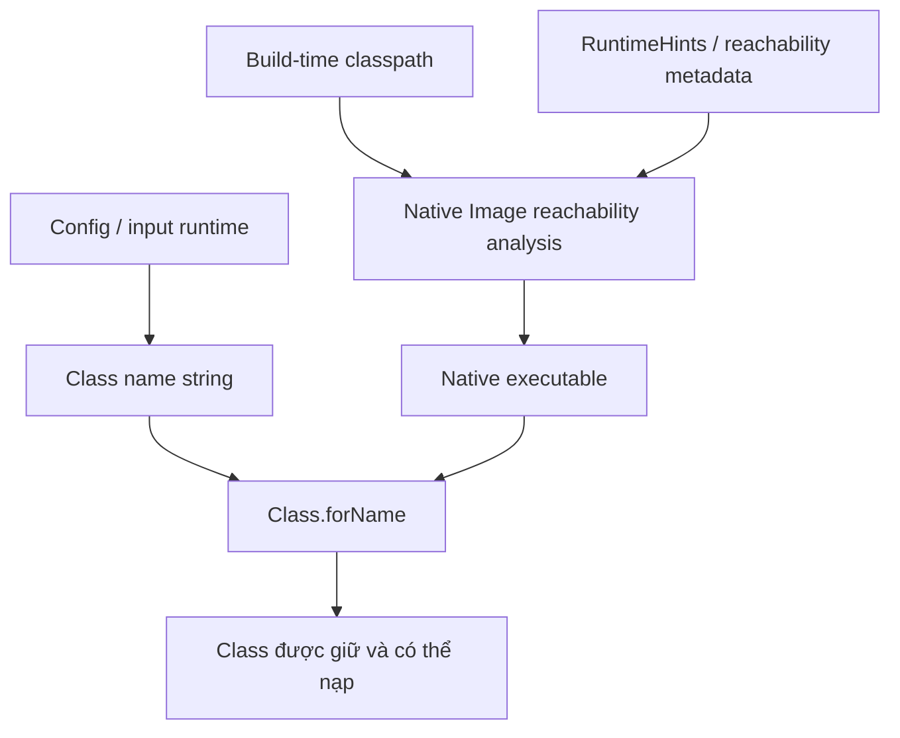

# Class.forName với tên lớp chỉ được biết khi chạy

## 1. Nạp class động và giới hạn của Native Image

Java cho phép nạp một class bằng tên được xác định trong lúc chạy thông qua `Class.forName`. Cơ chế này thường được dùng trong plugin system, driver discovery, framework, serializer, dependency injection tùy biến và các ứng dụng chọn implementation từ cấu hình.

Trên JVM thông thường, classloader có thể tìm class theo tên khi chương trình chạy, miễn là class có trên classpath/module path và classloader có quyền truy cập. Với **GraalVM Native Image**, quá trình build phân tích tập class có thể được sử dụng theo mô hình closed-world. Compiler không thể mặc định giữ mọi class có thể được nêu bởi một chuỗi bất kỳ trong tương lai.

Ví dụ:

```java
String className = environment.getProperty("plugin.class");
Class<?> pluginClass = Class.forName(className);
Object plugin = pluginClass.getDeclaredConstructor().newInstance();
```

Compiler nhìn thấy lời gọi `Class.forName`, nhưng không nhất thiết biết giá trị `className` khi build. Nếu class đích không được xác định và giữ lại trong executable, lời gọi có thể thành công trên JVM nhưng thất bại trên native executable.

Trong module **SPRING_BOOT_NATIVE_IMAGE**, cần thiết kế rõ danh sách class được phép nạp, bảo đảm các class đó có trong runtime classpath, đăng ký metadata cần thiết và kiểm thử trên executable native. Reflection hints giải quyết quyền truy cập động; chúng không tự đưa dependency còn thiếu vào ứng dụng.



## 2. Class.forName thực hiện những gì?

Các overload thường gặp:

```java
Class<?> type = Class.forName("com.example.plugins.CsvPlugin");
```

Overload một tham số tương đương yêu cầu khởi tạo class theo hành vi mặc định của API. Có thể chỉ định rõ việc khởi tạo và classloader:

```java
Class<?> type = Class.forName(
    "com.example.plugins.CsvPlugin",
    false,
    Thread.currentThread().getContextClassLoader()
);
```

Tham số thứ hai:

- `true`: khởi tạo class nếu cần; static initializer có thể chạy.
- `false`: nạp class mà không yêu cầu khởi tạo ngay tại thời điểm gọi này.

Tham số thứ ba là classloader dùng để tìm class. Lựa chọn classloader quan trọng trong ứng dụng có plugin, application server hoặc thư viện tạo classloader riêng. Native Image không nhất thiết hỗ trợ mọi kiểu class loading động như JVM; hãy kiểm tra giới hạn của phiên bản GraalVM và kiến trúc ứng dụng.

Sau khi có `Class<?>`, ứng dụng có thể truy vấn constructor, method, annotation hoặc tạo instance. Mỗi thao tác reflection đó có thể cần metadata riêng.

## 3. Vì sao tên class tùy ý không phù hợp với closed-world analysis?

Giả sử ứng dụng nhận tên class từ request:

```java
String name = request.getParameter("implementation");
Class<?> implementation = Class.forName(name);
```

Nếu người dùng có thể gửi bất kỳ chuỗi nào, tập class tiềm năng là không giới hạn từ góc nhìn build. Native Image không thể tự đưa mọi class trong mọi thư viện vào executable chỉ vì một biến String có thể chứa tên của chúng.

Có ba vấn đề riêng biệt:

1. **Reachability**: class có được đưa vào native executable hay bị loại bỏ?
2. **Reflection access**: constructor/method/field cần truy cập động đã được đăng ký chưa?
3. **Class availability**: dependency chứa class có thực sự nằm trong runtime classpath của application module không?

Thêm reflection hint không sửa được dependency bị thiếu. Thêm dependency cũng không tự động bảo đảm constructor hoặc method được truy cập qua reflection đã được giữ.

## 4. Dùng allowlist thay vì nạp tên tùy ý

Nếu nghiệp vụ chỉ hỗ trợ một số implementation, xác định danh sách cho phép trong code hoặc cấu hình đã kiểm soát:

```java
public enum PluginKind {
    CSV,
    JSON
}
```

Registry tĩnh:

```java
@Component
class PluginRegistry {

    private final Map<PluginKind, Supplier<Plugin>> factories = Map.of(
        PluginKind.CSV, CsvPlugin::new,
        PluginKind.JSON, JsonPlugin::new
    );

    Plugin create(PluginKind kind) {
        Supplier<Plugin> factory = factories.get(kind);
        if (factory == null) {
            throw new IllegalArgumentException("Unsupported plugin");
        }
        return factory.get();
    }
}
```

Cách này tạo tham chiếu tĩnh tới implementation. Native Image dễ nhận diện các class và constructor hơn, đồng thời ứng dụng không phải nhận tên class Java trực tiếp từ bên ngoài.

Nếu cần ánh xạ tên cấu hình:

```java
private static final Map<String, Supplier<Plugin>> PLUGINS = Map.of(
    "csv", CsvPlugin::new,
    "json", JsonPlugin::new
);

Plugin create(String configuredName) {
    Supplier<Plugin> factory = PLUGINS.get(configuredName);
    if (factory == null) {
        throw new IllegalArgumentException("Unsupported plugin: " + configuredName);
    }
    return factory.get();
}
```

Không nối chuỗi input với package prefix rồi gọi `Class.forName` như một biện pháp bảo mật. Allowlist nên ánh xạ giá trị nghiệp vụ tới class/factory đã biết; tránh cho client chọn class tùy ý.

## 5. Khi nào vẫn cần Class.forName?

Có trường hợp plugin hoặc extension được phân phối độc lập và implementation chỉ được chọn từ cấu hình tại runtime. Khi đó, vẫn có thể dùng class name, nhưng cần giới hạn rõ:

- Danh sách class hợp lệ được khai báo và kiểm soát trước khi build.
- Các class nằm trong runtime classpath của artifact.
- Class được đăng ký reflection/reachability phù hợp.
- Constructor và method cần dùng có metadata tương ứng.
- Classloader được chọn phù hợp với cách đóng gói.
- Input không thể chỉ định class tùy ý từ bên ngoài.

Ví dụ kiểm tra allowlist:

```java
private static final Map<String, Class<? extends Plugin>> ALLOWED = Map.of(
    "csv", CsvPlugin.class,
    "json", JsonPlugin.class
);

Plugin create(String key) throws ReflectiveOperationException {
    Class<? extends Plugin> type = ALLOWED.get(key);
    if (type == null) {
        throw new IllegalArgumentException("Unknown plugin");
    }
    return type.getDeclaredConstructor().newInstance();
}
```

Class literal trong map tạo tham chiếu tĩnh tới implementation, còn constructor vẫn được gọi qua reflection. Nếu muốn giữ cách tạo này, đăng ký constructor cần thiết hoặc dùng factory trực tiếp để tránh reflection không cần thiết.

## 6. Đăng ký reflection bằng Spring RuntimeHints

Spring AOT cung cấp `RuntimeHintsRegistrar` để đăng ký class và member cần truy cập động. Ví dụ:

```java
public class PluginRuntimeHints implements RuntimeHintsRegistrar {

    @Override
    public void registerHints(RuntimeHints hints, ClassLoader classLoader) {
        hints.reflection().registerType(
            CsvPlugin.class,
            MemberCategory.INVOKE_DECLARED_CONSTRUCTORS
        );

        hints.reflection().registerType(
            JsonPlugin.class,
            MemberCategory.INVOKE_DECLARED_CONSTRUCTORS
        );
    }
}
```

Đăng ký registrar:

```java
@Configuration
@ImportRuntimeHints(PluginRuntimeHints.class)
class PluginConfiguration {
}
```

Ví dụ sử dụng class literal cho các implementation đã biết. Category phải khớp thao tác thực tế: nếu chỉ gọi public constructor, chọn phạm vi public phù hợp; nếu gọi declared constructor, dùng category tương ứng và kiểm tra giới hạn truy cập Java.

Không đăng ký tất cả method/field nếu plugin chỉ cần constructor. Nếu sau đó ứng dụng gọi method qua reflection, hãy bổ sung metadata cho đúng method và signature.

## 7. Nạp class theo tên nhưng giữ class bằng tham chiếu tĩnh

Có thể kết hợp danh sách class đã biết với tên cấu hình:

```java
Map<String, Class<? extends Plugin>> allowed = Map.of(
    "csv", CsvPlugin.class,
    "json", JsonPlugin.class
);

Class<?> type = allowed.get(configuredName);
if (type == null) {
    throw new IllegalArgumentException("Unsupported plugin");
}

Object instance = type.getDeclaredConstructor().newInstance();
```

Cách này vẫn dùng reflection để tạo instance nhưng class đích đã được tham chiếu tĩnh. Đăng ký constructor hint nếu Native Image cần reflection invocation. Nếu không có yêu cầu framework đặc biệt, factory map dùng `Supplier` thường đơn giản và ít metadata hơn.

## 8. Class.forName và static initialization

Overload `Class.forName(String)` khởi tạo class theo hành vi mặc định. Điều đó có nghĩa static initializer có thể chạy ngay khi class được nạp qua lời gọi này.

Ví dụ:

```java
public class NativePlugin {
    static {
        System.out.println("Plugin initialized");
    }
}
```

Nếu class initialization policy của Native Image cho phép class được khởi tạo ở build time, trạng thái static có thể được tạo trong lúc build. Nếu class cần đọc environment, thời gian, random seed hoặc nạp native library phụ thuộc runtime, phải xem xét initialization policy phù hợp.

Overload `Class.forName(name, false, loader)` trì hoãn khởi tạo ở lần gọi đó, nhưng không thay thế cấu hình class initialization của Native Image. Class vẫn có thể được khởi tạo khi một thao tác sau đó yêu cầu. Tham khảo bài về `--initialize-at-run-time` để hiểu lựa chọn thời điểm khởi tạo.

## 9. ServiceLoader là lựa chọn cho hệ sinh thái plugin

Nếu plugin tuân theo một interface và được đóng gói như provider, Java `ServiceLoader` thường là cơ chế rõ ràng hơn việc tự đọc tên class từ property.

Interface:

```java
public interface Exporter {
    String export(Object value);
}
```

Provider đăng ký trong file:

```text
META-INF/services/com.example.export.Exporter
```

Nội dung file liệt kê class implementation, mỗi dòng một provider:

```text
com.example.export.CsvExporter
com.example.export.JsonExporter
```

Sử dụng:

```java
ServiceLoader<Exporter> exporters =
    ServiceLoader.load(Exporter.class);

for (Exporter exporter : exporters) {
    // Sử dụng provider.
}
```

`ServiceLoader` giúp chuẩn hóa discovery và tách consumer khỏi tên class cụ thể. Tuy nhiên, trong Native Image vẫn phải xác minh hỗ trợ service provider và metadata của GraalVM/Spring theo version. Đừng giả định chỉ vì file `META-INF/services` tồn tại trong JAR là mọi provider tự động hoạt động trong native executable.

Spring cũng có cơ chế discovery/auto-configuration riêng. Nếu plugin thực chất là Spring bean, cân nhắc đăng ký bean theo cấu hình Spring thay vì tự tạo instance ngoài container.

## 10. ClassLoader và module path

`Class.forName` có thể dùng classloader mặc định hoặc classloader được truyền rõ. Trong ứng dụng phức tạp, context classloader có thể khác classloader của class gọi.

Ví dụ:

```java
ClassLoader loader = Thread.currentThread().getContextClassLoader();
Class<?> type = Class.forName(className, false, loader);
```

Cần lưu ý:

- Context classloader có thể null trong một số môi trường; có fallback phù hợp.
- Classloader không thể nạp class không có trong runtime image.
- Module access và visibility có thể giới hạn việc truy cập constructor/member.
- Một số cơ chế tạo classloader tùy biến hoặc nạp bytecode mới có thể không tương thích với Native Image closed-world model.
- Không dùng tên class từ dữ liệu không tin cậy làm cơ chế mở rộng tùy ý.

## 11. Kiểm tra classpath và dependency trước khi thêm hints

Với Gradle, kiểm tra runtime classpath của đúng application module:

```bash
./gradlew :api-app:dependencies --configuration runtimeClasspath
./gradlew :api-app:dependencyInsight --dependency plugin-library --configuration runtimeClasspath
```

Với Maven:

```bash
./mvnw dependency:tree
```

Sau đó kiểm tra JAR có implementation và service metadata hay không:

```bash
jar tf path/to/plugin-library.jar
```

Nếu class không có trong runtime dependency graph, reflection hint không thể tự đóng gói nó. Sửa scope/exclusion/dependency trước, rồi chạy lại Spring AOT và Native Image build.

## 12. Phân biệt lỗi nạp class và lỗi reflection

| Dấu hiệu | Nguyên nhân thường gặp | Hướng kiểm tra |
|---|---|---|
| `ClassNotFoundException` | Class không có hoặc classloader không tìm thấy | Runtime classpath, tên class, classloader |
| `NoClassDefFoundError` | Class hoặc dependency liên quan không khả dụng lúc liên kết/nạp | Dependency graph và transitive dependencies |
| `NoSuchMethodException` | Constructor/method signature sai hoặc không tồn tại | Kiểm tra class và signature |
| `IllegalAccessException` | Member không thể truy cập theo access/module rules | Visibility, module access và hint |
| `UnsupportedFeatureError` | Cơ chế dynamic class loading/bytecode không được hỗ trợ theo cách dùng | Kiến trúc plugin và giới hạn Native Image |
| JVM chạy, native lỗi | Class/member chưa được giữ hoặc thiếu metadata | RuntimeHints/reachability metadata và native test |
| Class được nạp nhưng khởi tạo lỗi | Static initializer hoặc dependency runtime thất bại | Class initialization policy và stack trace |

Đọc exception gốc và xác định lỗi xảy ra ở bước nào: tìm class, liên kết dependency, khởi tạo class, tìm constructor hay tạo instance. Không xử lý tất cả bằng cách mở rộng reflection hints.

## 13. Kiểm thử Class.forName trên Native Image

Một quy trình thực tế:

1. Tạo test JVM cho mọi plugin hợp lệ và trường hợp tên không hợp lệ.
2. Xác minh dependency của từng plugin có trên runtime classpath.
3. Đăng ký RuntimeHints cho class/constructor/member được truy cập động.
4. Chạy Spring AOT với đúng profile và application module.
5. Build Native Image từ output AOT mới.
6. Chạy executable native và kích hoạt từng plugin hợp lệ.
7. Kiểm tra lỗi khi key không nằm trong allowlist.
8. Chạy test trong container target OS/architecture.
9. Ghi artifact digest, toolchain và danh sách plugin được hỗ trợ.

Smoke test chỉ kiểm tra startup là chưa đủ. Cần gọi thật code path sử dụng `Class.forName` hoặc factory tương ứng.

## 14. Thiết kế an toàn cho ứng dụng Spring Boot

- Ưu tiên dependency injection và bean registration tĩnh khi implementation đã biết lúc build.
- Dùng registry/factory map cho một tập plugin cố định.
- Dùng `ServiceLoader` khi cần SPI độc lập với Spring và đã xác minh hỗ trợ Native Image.
- Nếu buộc dùng `Class.forName`, áp dụng allowlist và chỉ cho phép class nằm trong artifact đã kiểm soát.
- Không nhận fully-qualified class name tùy ý từ HTTP request hoặc message không tin cậy.
- Đăng ký constructor/method reflection tối thiểu cần thiết.
- Phân biệt class reachability với reflection access và runtime dependency.
- Kiểm tra static initializer, native library và classloader.
- Test từng provider trên executable native, không chỉ JVM.

## 15. Câu hỏi tự kiểm tra

1. Vì sao `Class.forName` với tên chỉ biết khi chạy có thể hoạt động trên JVM nhưng thất bại trong Native Image?
2. Khác nhau giữa class reachability và reflection access là gì?
3. Vì sao reflection hint không thể thay thế một dependency bị thiếu khỏi runtime classpath?
4. Khi nào registry tĩnh hoặc `Supplier` phù hợp hơn việc nạp class theo tên?
5. `Class.forName(name, false, loader)` thay đổi điều gì và không giải quyết điều gì?
6. `ServiceLoader` giúp tổ chức plugin ra sao và vì sao vẫn cần kiểm thử native?
7. Vì sao nhận class name tùy ý từ request là rủi ro bảo mật?
8. Những test nào cần chạy để xác nhận tất cả plugin được hỗ trợ trong native executable?

**Ghi nhớ:** `Class.forName` chỉ nạp được class mà runtime có thể tìm thấy; Native Image còn cần biết class/member nào phải được giữ và truy cập động. Hãy giới hạn tên class bằng allowlist, ưu tiên registry tĩnh hoặc ServiceLoader phù hợp, đăng ký metadata tối thiểu và kiểm thử từng plugin trên native executable.
