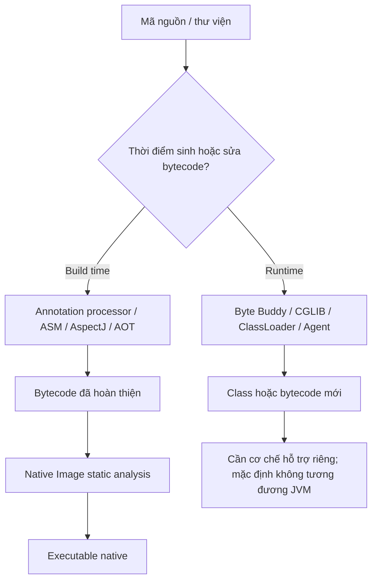
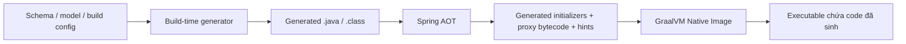

# Sinh, biến đổi bytecode và tạo lớp mới lúc chạy

## 1. Vì sao đây là một giới hạn quan trọng?

Ứng dụng Java trên JVM có thể thực hiện nhiều thao tác động: tạo class mới từ bytecode, sửa bytecode trước khi class được nạp, nạp plugin từ JAR mới, tạo proxy bằng Byte Buddy/CGLIB, hoặc dùng Java agent để thay đổi hành vi của class đang chạy. Những kỹ thuật này rất hữu ích với framework, thư viện ORM, mocking, instrumentation và hệ thống plugin.

Khi biên dịch **Spring Boot thành GraalVM Native Image**, mô hình thực thi thay đổi. Native Image phân tích mã ở build time theo giả định *closed world*: phần mã có thể được gọi phải được biết trước để compiler đưa vào executable. Spring AOT cũng phân tích `ApplicationContext` trước khi chạy và sinh source code, bytecode cùng runtime hints.

Vì vậy, cần phân biệt ba việc thường bị gọi chung là "dynamic code":

1. **Reflection:** tìm class, method hoặc field đã tồn tại bằng tên hoặc metadata lúc chạy.
2. **Runtime class generation/loading:** tạo bytecode mới rồi định nghĩa class mới qua class loader.
3. **Runtime bytecode transformation:** sửa bytecode của class trước khi nạp hoặc redefine/retransform class sau khi đã nạp.

Reflection có thể hoạt động trong Native Image khi các class/member cần thiết đã được đưa vào reachability metadata. Điều đó **không đồng nghĩa** với việc executable có thể tạo một class hoàn toàn mới tùy ý như JVM. Tương tự, proxy có danh sách interface đã biết có thể được chuẩn bị trước, nhưng một plugin tạo tổ hợp class/interface bất kỳ sau khi phát hành là bài toán khác.

Sau bài học, bạn có thể:

- Giải thích closed-world assumption và phân biệt class có sẵn với bytecode được tạo lúc chạy.
- Nhận diện thư viện hoặc framework đang sinh, biến đổi hoặc nạp class động.
- Chọn giữa build-time code generation, Spring AOT, metadata, predefined classes và runtime class loading thử nghiệm.
- Đánh giá giới hạn của Java agent, class loader, Byte Buddy, CGLIB và plugin architecture.
- Lập kế hoạch kiểm thử để phát hiện lỗi dynamic code trước khi phát hành native executable.

## 2. Phân biệt reflection, class loading và bytecode generation

### 2.1. Reflection truy cập class đã có

Ví dụ:

```java
package com.example.orders;

import java.lang.reflect.Method;
import org.springframework.context.ApplicationContext;

public class ReflectionExample {

    public Object invokeReflectively(ApplicationContext applicationContext)
            throws ReflectiveOperationException {
        OrderService orderService = applicationContext.getBean(OrderService.class);
        Class<?> type = Class.forName("com.example.orders.OrderService");
        Method method = type.getMethod("findById", String.class);
        return method.invoke(orderService, "ORD-100");
    }
}
```

Ở đây `OrderService` và method `findById` đã tồn tại trong ứng dụng. Code chỉ tìm và gọi chúng qua reflection. Với Native Image, GraalVM cần biết class và các member được truy cập động để giữ chúng trong executable. Spring có thể tự suy ra một số trường hợp; phần còn lại cần `RuntimeHints` hoặc reachability metadata.

### 2.2. Runtime class generation tạo class mới

Một thư viện như Byte Buddy có thể sinh bytecode cho một subclass mới rồi nạp class đó:

```java
import com.example.orders.OrderService;
import net.bytebuddy.ByteBuddy;
import net.bytebuddy.dynamic.loading.ClassLoadingStrategy;

Class<? extends OrderService> generatedType = new ByteBuddy()
        .subclass(OrderService.class)
        .name("com.example.orders.generated.AuditedOrderService")
        .make()
        .load(OrderService.class.getClassLoader(), ClassLoadingStrategy.Default.INJECTION)
        .getLoaded();

OrderService instance = generatedType.getDeclaredConstructor().newInstance();
```

Class `AuditedOrderService` không nằm sẵn trong JAR ban đầu. Nó được tạo từ bytecode sau khi chương trình chạy. Đây là khác biệt căn bản so với reflection.

Ví dụ giả định `OrderService` không phải `final`, có constructor mà subclass có thể gọi và Byte Buddy được khai báo trong dependency. Đây là minh họa cho JVM; để chạy trong Native Image cần chọn một trong các phương án ở phần sau.

### 2.3. Bytecode transformation thay đổi class trước khi thực thi

Một công cụ ASM, Byte Buddy hoặc AspectJ có thể sửa bytecode của class hiện hữu, ví dụ chèn lệnh đo thời gian vào method. Có hai thời điểm biến đổi khác nhau:

- **Build-time transformation:** sửa file `.class` trong quá trình build, sau đó AOT/native-image compiler phân tích bytecode đã sửa.
- **Runtime transformation:** dùng `ClassFileTransformer`, Java agent hoặc cơ chế redefine/retransform để thay đổi bytecode khi ứng dụng đang chạy.

Native Image phù hợp hơn với đường build-time transformation. Runtime instrumentation dựa trên JVM/JVMTI và bytecode đang được nạp có giới hạn lớn; không thể mặc định rằng một Java agent chạy tốt trên HotSpot sẽ hoạt động trong native executable.



## 3. Closed-world assumption tác động như thế nào?

### 3.1. Tập class và call graph được xác định khi build

Native Image bắt đầu phân tích từ entry point và xác định các method, field, class có thể reachable. Mục tiêu là chỉ đưa phần cần thiết vào executable để giảm kích thước, thời gian khởi động và mức dùng bộ nhớ.

Các hệ quả thực tế:

- Classpath và dependency được cố định tại build time.
- Native Image không có cơ chế lazy class loading giống HotSpot; code và class được đóng gói được xử lý theo mô hình executable đã build.
- Một class không reachable có thể bị loại khỏi executable.
- Class được tìm bằng chuỗi runtime cần metadata hoặc phải được compiler suy ra từ biểu thức hằng.
- Reflection, resource, serialization, JNI và JDK proxy cần thông tin bổ sung khi static analysis không suy ra đủ.
- Một class file mới được tạo và nạp sau khi executable khởi động không tự nhiên trở thành một phần của call graph đã phân tích.

Spring AOT bổ sung các ràng buộc ở cấp container: tập bean được xác định ở build time; profile và property ảnh hưởng `@Conditional` phải được chọn khi AOT chạy; bean đăng ký bằng `registerSingleton` và bean definition có instance supplier tùy ý không được chuyển đổi AOT theo cách thông thường.

### 3.2. Reflection hint không phải class-generation hint

Ví dụ đăng ký reflection cho một class đã có:

```java
package com.example.orders;

import org.springframework.aot.hint.MemberCategory;
import org.springframework.aot.hint.RuntimeHints;
import org.springframework.aot.hint.RuntimeHintsRegistrar;
import org.springframework.context.annotation.Configuration;
import org.springframework.context.annotation.ImportRuntimeHints;

@ImportRuntimeHints(OrderReflectionHints.class)
@Configuration(proxyBeanMethods = false)
class OrderConfiguration {
}

class OrderReflectionHints implements RuntimeHintsRegistrar {
    @Override
    public void registerHints(RuntimeHints hints, ClassLoader classLoader) {
        hints.reflection().registerType(
                OrderService.class,
                MemberCategory.INVOKE_PUBLIC_METHODS);
    }
}
```

Hint này cho phép Native Image giữ metadata cần thiết để gọi method công khai của `OrderService` bằng reflection. Nó không tạo ra `AuditedOrderService`, không thêm JAR plugin và không cho phép sửa bytecode của `OrderService` khi chạy.

| Nhu cầu | Cơ chế phù hợp |
|---|---|
| Gọi method đã biết bằng reflection | Reflection hints hoặc static analysis |
| Tạo JDK proxy cho interface đã biết | Proxy hints / Spring AOT |
| Sinh subclass proxy trước khi native compile | Spring AOT hoặc build-time code generation |
| Tạo subclass từ bytecode hoàn toàn mới sau khi khởi động | Cần runtime class loading được hỗ trợ; mặc định không tương đương JVM |
| Sửa class file trước native compile | Build-time bytecode transformation |
| Redefine class đã nạp trong tiến trình native | Không nên giả định JVM instrumentation/JVMTI được hỗ trợ |

## 4. Các thư viện thường tạo hoặc biến đổi bytecode

| Công nghệ | Việc thường thực hiện trên JVM | Điểm cần kiểm tra khi build native |
|---|---|---|
| Byte Buddy | Sinh subclass, proxy, implementation và class từ DSL | Có thể sinh class lúc chạy; xem có thể chuyển sang build time hoặc cần runtime class loading thử nghiệm không |
| CGLIB | Sinh subclass proxy cho class | Spring AOT có thể tạo proxy cần thiết ở build time; proxy tự sinh tùy ý ở runtime cần đánh giá riêng |
| Javassist | Tạo class, sửa method/bytecode và nạp class | Các API `toClass`, `defineClass` hoặc class pool có thể cần runtime class loading và setup bổ sung |
| ASM | Đọc, tạo và sửa bytecode | Dùng tốt ở build time; sinh class mới ở runtime là một use case khác |
| AspectJ load-time weaving | Dùng class loader/agent để weave class khi nạp | Ưu tiên compile-time weaving hoặc build-time weaving; không giả định LTW hoạt động như JVM |
| Mockito / mocking libraries | Tạo mock qua proxy hoặc bytecode generation | Kiểm tra mock maker và native test support; test JVM không thay thế test native |
| Hibernate / ORM | Có thể dùng proxy, enhancement và bytecode metadata | Dùng phiên bản có hỗ trợ AOT/native; ưu tiên build-time enhancement và kiểm tra proxy/lazy loading |
| Groovy hoặc Java compiler API | Biên dịch script/source thành class khi chạy | Compiler, class loader và runtime-generated bytecode có thể không có trong image hoặc cần tính năng thử nghiệm |

Không nên kết luận một thư viện hoàn toàn không tương thích chỉ dựa trên tên công nghệ. Một thư viện có thể hỗ trợ cả JVM và Native Image bằng cách chọn đường triển khai khác nhau khi phát hiện native mode. Hãy xem tài liệu native của đúng phiên bản và kiểm tra class generation thực tế trong code path của ứng dụng.

## 5. Spring AOT giải quyết proxy và code generation như thế nào?

### 5.1. Sinh code và proxy ở build time

Spring AOT xử lý `ApplicationContext` trong quá trình build, áp dụng các quyết định cấu hình và khám phá thường diễn ra khi runtime khởi động. Kết quả thường bao gồm:

- Java source code để khôi phục trạng thái bean factory.
- Bytecode, thường dùng cho các dynamic proxy cần thiết.
- `RuntimeHints` cho reflection, resource, serialization và JDK proxy.

Với Spring Boot, một số proxy mà Spring Framework cần trên JVM có thể được tạo trước ở AOT build để GraalVM đưa vào native executable. Do đó, việc Spring AOP hoặc CGLIB xuất hiện trong dependency không tự động có nghĩa native image không dùng được.

### 5.2. Cấu trúc proxy được quyết định từ cấu hình đã biết

Ví dụ cấu hình AOP:

```java
import org.aspectj.lang.ProceedingJoinPoint;
import org.aspectj.lang.annotation.Around;
import org.aspectj.lang.annotation.Aspect;
import org.springframework.context.annotation.Configuration;
import org.springframework.context.annotation.EnableAspectJAutoProxy;
import org.springframework.stereotype.Component;

@Configuration(proxyBeanMethods = false)
@EnableAspectJAutoProxy
class OrderAopConfiguration {
}

@Aspect
@Component
class OrderTimingAspect {

    @Around("execution(* com.example.orders.OrderService.*(..))")
    Object measure(ProceedingJoinPoint invocation) throws Throwable {
        long started = System.nanoTime();
        try {
            return invocation.proceed();
        }
        finally {
            long elapsed = System.nanoTime() - started;
            // Ghi metric theo cơ chế của ứng dụng.
        }
    }
}
```

Khi bean, aspect và pointcut đều có mặt trong cấu hình mà Spring AOT phân tích, Spring có thể chuẩn bị proxy tương ứng trong output AOT. Điều này khác với việc một plugin tải sau khi triển khai tự đưa thêm một aspect tùy ý rồi yêu cầu Spring sinh proxy mới.

### 5.3. Các giới hạn Spring AOT liên quan

- Classpath phải được xác định đầy đủ ở build time.
- Tập bean không thể tùy ý thay đổi sau khi executable được tạo.
- `@Profile` và property ảnh hưởng `@Conditional` được đánh giá khi AOT chạy.
- Bean được đăng ký bằng `registerSingleton(...)` không được chuyển đổi AOT theo cách thông thường.
- Bean definition có instance supplier là lambda hoặc method reference không được biến đổi ahead-of-time theo cách tổng quát.
- Kiểu khai báo của bean nên cụ thể để Spring phân tích được constructor, method và proxy cần thiết.

Với ứng dụng cần nhiều biến thể cấu hình, hãy tạo artifact riêng cho từng tập bean/profile được chọn. Nếu cần mở rộng bằng plugin runtime tùy ý, cân nhắc tách plugin thành tiến trình JVM riêng hoặc thiết kế một registry cố định trong native image.

## 6. Các phương án xử lý runtime class generation

Không có một giải pháp duy nhất cho mọi thư viện. Hãy chọn theo việc bytecode có thể được biết trước hay không.

### 6.1. Phương án 1: loại bỏ sinh class lúc chạy

Nếu mục tiêu chỉ là chọn một implementation hoặc thêm hành vi, thường có thể dùng:

- Interface và các implementation được biên dịch sẵn.
- Strategy/factory/registry với danh sách implementation cố định.
- Spring `@Bean`, `@Import`, `@Conditional` được quyết định tại AOT build.
- JDK proxy có interface list được biết trước.
- Các callback hoặc decorator tĩnh thay cho subclass được sinh tùy ý.

Ví dụ registry tĩnh:

```java
package com.example.orders;

import org.springframework.stereotype.Component;

public interface OrderPricingPolicy {
    long calculate(Order order);
}

@Component
class StandardPricingPolicy implements OrderPricingPolicy {
    @Override
    public long calculate(Order order) {
        return order.subtotal();
    }
}

@Component
class PriorityPricingPolicy implements OrderPricingPolicy {
    @Override
    public long calculate(Order order) {
        return Math.round(order.subtotal() * 0.95);
    }
}
```

Ứng dụng chọn implementation theo dữ liệu runtime nhưng không tạo class mới. Cả hai implementation đã nằm trong executable và có thể được Spring AOT phân tích. Nếu điều kiện chọn bean thay đổi bean graph, hãy chọn điều kiện đó ở build time; nếu chỉ chọn hành vi giữa các implementation đã có, có thể quyết định ở runtime trong code nghiệp vụ.

### 6.2. Phương án 2: chuyển generation sang build time

Đây thường là phương án tốt nhất nếu class sinh ra chỉ phụ thuộc schema, cấu hình hoặc source đã biết khi build.

Ví dụ quy trình:

1. Đọc schema hoặc định nghĩa model ở build time.
2. Dùng annotation processor, ASM, Byte Buddy hoặc generator để tạo source/bytecode.
3. Đưa class sinh ra vào output của module.
4. Chạy Spring AOT sau khi generation hoàn tất để AOT nhìn thấy class mới.
5. Chạy Native Image compiler trên classpath đã hoàn thiện.



Nếu cần sinh class bằng static initializer của một class chuyên biệt trong quá trình image build, GraalVM tài liệu hóa cách giữ `Class<?>` đã tạo trong static field và khởi tạo class generator ở build time bằng `--initialize-at-build-time=<class_name>`. Cách này dành cho trường hợp đặc biệt; generator phải chạy được trong môi trường build và mọi trạng thái được lưu vào image heap phải hợp lệ ở runtime.

Ví dụ dạng cấu hình:

```bash
native-image \
  --initialize-at-build-time=com.example.codegen.BuildTimeProxyCatalog \
  -jar app.jar order-service
```

Không nên build-time initialize bừa bãi các class có static initializer đọc file production, gọi network, lấy secret, mở socket, tạo thread hoặc phụ thuộc đồng hồ/ngẫu nhiên. Các side effect này diễn ra trên máy build; trạng thái không phù hợp có thể bị đóng băng vào executable hoặc làm build thất bại.

### 6.3. Phương án 3: dùng predefined classes được Native Image Agent thu thập

Với ứng dụng legacy không thể dễ dàng thay đổi thư viện tạo class động, GraalVM có cơ chế **predefined classes** mang tính thử nghiệm/best-effort. Native Image Agent có thể ghi lại bytecode của class được tạo trong một lần chạy JVM để image builder đóng gói chúng.

Ví dụ chạy ứng dụng trên JVM cùng agent:

```bash
java \
  -agentlib:native-image-agent=config-output-dir=target/native-agent,experimental-class-define-support \
  -jar target/order-service.jar
```

Thực hiện các kịch bản tạo proxy/class cần thiết trong lần chạy có agent. Thư mục cấu hình được agent sinh ra có thể chứa `agent-extracted-predefined-classes` và metadata tương ứng. Dùng thư mục này làm đầu vào cho native-image build theo hướng dẫn của đúng phiên bản GraalVM.

Giới hạn cần hiểu rõ:

- Agent chỉ thu thập class được tạo trong những đường code thực sự chạy khi tracing.
- Khi native executable chạy, class phải khớp **cả tên và bytecode** với class đã được thu thập.
- Class có tên hoặc bytecode thay đổi theo số thứ tự, UUID, timestamp hoặc dữ liệu ngẫu nhiên thường không thể khớp ổn định.
- Predefined class chỉ được nạp một lần trong một lần thực thi và qua một class loader.
- Class được khởi tạo lúc nạp ở runtime, không thể build-time initialize theo cơ chế này.
- Đây là giải pháp tương thích cho một số legacy use case, không phải bảo đảm cho plugin hoặc proxy có biến thể tùy ý.
- Predefined classes không thể kết hợp với tùy chọn `-H:+RuntimeClassLoading`.

Không tự viết tay `predefined-classes-config.json`; hãy để agent tạo metadata và bytecode theo schema mà GraalVM mong đợi.

### 6.4. Phương án 4: bật runtime class loading thử nghiệm

Từ dòng GraalVM 25.1, Native Image có hỗ trợ ban đầu/thử nghiệm cho việc định nghĩa class từ bytecode trong lúc executable chạy. Tùy chọn `-H:+RuntimeClassLoading` cho phép class loader dùng `ClassLoader.defineClass(...)` trong phạm vi tính năng này.

Ví dụ lệnh theo tài liệu GraalVM:

```bash
native-image \
  -H:+UnlockExperimentalVMOptions \
  -H:+RuntimeClassLoading \
  -H:-UnlockExperimentalVMOptions \
  -jar app.jar order-service
```

Với Gradle Native Build Tools, có thể truyền các build arguments tương ứng vào binary `main` nếu phiên bản GraalVM và plugin đang dùng hỗ trợ:

```groovy
graalvmNative {
    binaries {
        main {
            buildArgs.addAll(
                    '-H:+UnlockExperimentalVMOptions',
                    '-H:+RuntimeClassLoading',
                    '-H:-UnlockExperimentalVMOptions'
            )
        }
    }
}
```

Đây là tính năng **experimental**, cần kiểm tra tài liệu của đúng GraalVM distribution/version. Bật flag không đồng nghĩa mọi thư viện Byte Buddy, Javassist, URLClassLoader hoặc Java compiler đều tự hoạt động không cần cấu hình bổ sung.

Các giới hạn được tài liệu hóa gồm:

- Một class loader không thể định nghĩa hai class cùng binary name; muốn định nghĩa biến thể phải dùng tên hoặc defining class loader khác.
- Class nạp lúc runtime có thể liên kết với class đã được phân tích ở build time, nhưng static analysis có thể đã loại method hoặc static field không thấy reachable. Khi cần giữ toàn bộ thành phần trong package, xem xét `-H:Preserve=package=...`.
- Parallel class loading chưa được hỗ trợ.
- `URLClassLoader` và việc nạp class qua JDK/application class loader có thể cần setup thêm.
- Kích thước image và mức dùng bộ nhớ có thể tăng.
- Không kết hợp với predefined classes.

Chỉ bật tùy chọn này khi ứng dụng thật sự cần định nghĩa bytecode sau khi khởi động, đã xác nhận version hỗ trợ và có integration test bao phủ các class loader/bytecode được sinh.

## 7. Bytecode transformation và Java agents

### 7.1. Build-time weaving phù hợp với Native Image

Nếu muốn chèn logging, metrics, transaction hoặc validation vào class, hãy ưu tiên sửa bytecode trước AOT/native compile:

- AspectJ compile-time weaving.
- Byte Buddy Maven/Gradle plugin hoặc một build task chạy trước AOT.
- ASM task tạo class mới trong `build/generated` hoặc output directory của module.
- Annotation processor sinh source code thay vì sinh class bằng class loader lúc runtime.

Thứ tự build cần bảo đảm các class đã được biến đổi xuất hiện trong classpath khi Spring AOT và Native Image phân tích. Nếu chạy AOT trước khi weaving, generated initializer có thể phản ánh class cũ.

### 7.2. Runtime instrumentation không giống tracing agent

Java Instrumentation API (`java.lang.instrument`) và JVMTI thường được dùng để cài `ClassFileTransformer`, redefine hoặc retransform class đang chạy trên HotSpot. Native Image là executable native, không có mô hình bytecode/JIT đầy đủ như HotSpot; tài liệu GraalVM nêu các công cụ JVMTI và bytecode-based tooling không được hỗ trợ như trên JVM.

Phân biệt hai loại agent:

| Loại agent | Mục đích | Cách dùng với Native Image |
|---|---|---|
| Java instrumentation agent | Biến đổi class trong JVM khi nạp/redefine/retransform | Không giả định hoạt động trong native executable; chuyển instrumentation sang build time nếu có thể |
| GraalVM Native Image Tracing Agent | Chạy ứng dụng trên JVM để thu thập metadata về reflection, proxy, resource, JNI và một số class được tạo động | Dùng trong giai đoạn chuẩn bị build; agent không biến native executable thành JVM |

Tracing Agent không phải cơ chế để attach agent và sửa bytecode sau khi native application đã chạy. Nó ghi nhận hành vi trong lần chạy JVM có instrument, rồi tạo metadata/bytecode hỗ trợ native-image build.

## 8. Thiết kế plugin architecture cho ứng dụng native

### 8.1. Plugin được cài sau khi phát hành

Một hệ thống JVM có thể quét thư mục `plugins/`, tìm JAR mới, tạo `URLClassLoader`, nạp implementation và đăng ký bean/service lúc runtime. Đây là kiến trúc linh hoạt nhưng xung đột với các giả định của Spring AOT và Native Image:

- Classpath của executable đã cố định.
- Class mới trong JAR bên ngoài không tự được compiler phân tích.
- Bean graph không thể thay đổi tùy ý sau khi AOT đã sinh initializer.
- Class loader tùy chỉnh có thể cần runtime class loading thử nghiệm và giới hạn bổ sung.

### 8.2. Các cách thiết kế thay thế

| Yêu cầu mở rộng | Thiết kế phù hợp hơn |
|---|---|
| Một số plugin đã biết khi phát hành | Đóng gói tất cả implementation vào image và chọn bằng registry runtime |
| Plugin khác nhau theo khách hàng/môi trường | Build artifact riêng cho từng nhóm plugin/configuration |
| Plugin chỉ cung cấp luật nghiệp vụ | Dùng DSL, JSON/YAML schema hoặc rule engine có interpreter hỗ trợ native thay vì nạp bytecode Java mới |
| Plugin cần thư viện Java bất kỳ | Chạy plugin trong tiến trình JVM riêng và giao tiếp qua HTTP/gRPC/message broker |
| Plugin cần cập nhật độc lập | Tách thành service hoặc worker có vòng đời phát hành riêng |
| Một số class generated ổn định | Sinh ở build time hoặc dùng predefined classes nếu đã xác minh giới hạn |
| Class bytecode thật sự thay đổi sau mỗi lần khởi động | Đánh giá `-H:+RuntimeClassLoading` thử nghiệm hoặc giữ thành phần này trong JVM riêng |

Nếu dùng rule engine hoặc scripting, cần xác nhận engine có runtime implementation tương thích Native Image. Một DSL được thông dịch từ dữ liệu không đồng nghĩa với việc có thể compile Java source thành class mới tùy ý.

## 9. Bài thực hành: đánh giá Byte Buddy và Spring AOT

**Bối cảnh:** `order-service` có một use case dùng Byte Buddy để tạo subclass audit khi chạy JVM. Mục tiêu là tìm cách giữ chức năng audit trong native executable.

### Bước 1 — Xác định hành vi hiện tại

Ghi lại:

- Thư viện tạo class và phiên bản đang dùng.
- API thực hiện generation (`make`, `defineClass`, `load`, `ClassLoader.defineClass` hoặc API tương đương).
- Tên class được sinh có ổn định không.
- Bytecode có thay đổi theo request, dữ liệu khách hàng, timestamp hoặc UUID không.
- Có dùng custom class loader, parallel class loading hoặc classpath plugin không.

### Bước 2 — Kiểm tra khả năng chuyển sang build time

Nếu class chỉ phụ thuộc cấu hình đã biết, chuyển generation vào Gradle/Maven build task. Đưa class sinh ra vào output và chạy Spring AOT sau đó. Nếu mục tiêu chỉ là audit một service bean, thử Spring AOP hoặc decorator tĩnh trước.

### Bước 3 — Kiểm tra AOT output

Với Gradle Spring Boot project, chạy AOT task theo cấu hình plugin và kiểm tra output generated classes/proxy bytecode. Với Maven, kiểm tra thư mục generated classes của Spring AOT. Xác nhận proxy cần thiết đã được tạo trước khi native compiler chạy.

### Bước 4 — Nếu không thể chuyển generation

Đánh giá theo thứ tự:

1. Có thể dùng registry hoặc implementation tĩnh không?
2. Có thể generate class ở build time và giữ `Class<?>` cần thiết không?
3. Predefined classes có thể khớp tên/bytecode qua các lần chạy không?
4. GraalVM version đang dùng có hỗ trợ experimental runtime class loading không, và các giới hạn class loader có chấp nhận được không?
5. Có nên tách generator/plugin thành tiến trình JVM riêng không?

### Bước 5 — Chạy kiểm thử native

Build native executable và thực thi chính code path audit. Kiểm tra class proxy được tạo hoặc được nạp đúng, handler hoạt động, dependency được tìm thấy, và không có race do class loading song song. Chạy thêm integration test trên container/nền tảng triển khai thật.

### Phiếu ghi kết quả

| Hạng mục | Kết quả cần ghi |
|---|---|
| Thư viện sinh bytecode | _(tên và phiên bản)_ |
| API tạo/nạp class | _(ghi)_ |
| Tên và bytecode class có ổn định? | _(có/không, lý do)_ |
| Class loader | _(ghi)_ |
| Đã chuyển sang build-time generation? | _(có/không)_ |
| Spring AOT đã thấy proxy/generated class? | _(bằng chứng)_ |
| RuntimeClassLoading hoặc predefined classes | _(không dùng / version + tùy chọn)_ |
| Native build | PASS/FAIL |
| Native integration test | PASS/FAIL |
| Kích thước image/RSS sau thay đổi | _(đo)_ |

## 10. Các lỗi thường gặp

| Triệu chứng | Nguyên nhân có thể | Hướng xử lý |
|---|---|---|
| `ClassNotFoundException` cho class có tên từ cấu hình | Class không có trong classpath/build output hoặc tên chỉ xuất hiện ở runtime | Đóng gói class, dùng tên hằng/metadata hoặc chuyển generation sang build time |
| `UnsupportedFeatureError` khi gọi `defineClass` | Đang dùng runtime class loading mà chưa bật tính năng hỗ trợ hoặc version không hỗ trợ | Ưu tiên build-time generation; chỉ thử `-H:+RuntimeClassLoading` khi version xác nhận hỗ trợ |
| Reflection hint đã có nhưng Byte Buddy vẫn lỗi | Reflection metadata không tạo class bytecode mới | Xác định đường class generation; dùng AOT, predefined classes hoặc runtime class loading thử nghiệm |
| Proxy Spring chạy JVM nhưng native lỗi | Proxy được sinh sau AOT hoặc Spring AOT không nhìn thấy bean/config | Kiểm tra AOT output và cấu hình bean/proxy; thêm hints khi đúng loại proxy cần hỗ trợ |
| Plugin JAR thêm sau khi chạy không được nạp | Classpath đóng tại build time | Đóng gói plugin trước build, tách tiến trình JVM hoặc đánh giá runtime class loading thử nghiệm |
| Class cùng tên được define lần hai | Một class loader không thể define cùng binary name nhiều lần | Dùng tên khác hoặc defining class loader khác theo thiết kế được hỗ trợ |
| Class runtime-generated gọi method của class build-time nhưng method mất | Static analysis loại method/field không thấy reachable | Giữ method cần thiết qua reachability hoặc xem xét `-H:Preserve=package=...` |
| Predefined class không được tìm thấy | Tên hoặc bytecode khác với dữ liệu agent đã thu thập | Ổn định tên/bytecode, chạy agent trên mọi đường code hoặc chuyển sang giải pháp khác |
| Runtime class loading lỗi khi chạy song song | Parallel class loading chưa được hỗ trợ trong tính năng thử nghiệm | Tuần tự hóa thao tác load hoặc không dùng tính năng này cho use case đó |
| Java agent không chạy trong native executable | Agent phụ thuộc JVM instrumentation/JVMTI | Chuyển instrumentation sang build time hoặc dùng native observability tương ứng |

## 11. Checklist trước khi phát hành Native Image

- [ ] Đã tìm các API tạo class hoặc biến đổi bytecode trong dependency và code ứng dụng.
- [ ] Đã phân biệt reflection với việc định nghĩa class mới.
- [ ] Đã kiểm tra `ClassLoader`, `URLClassLoader`, Byte Buddy, CGLIB, Javassist và Java agent nếu có sử dụng.
- [ ] Đã chuyển code generation có thể dự đoán sang build time.
- [ ] Spring AOT chạy sau các bước generation/weaving cần thiết.
- [ ] Các proxy do Spring quản lý được tạo trong AOT output.
- [ ] Nếu dùng predefined classes, đã kiểm tra bytecode/name ổn định và giới hạn class loader.
- [ ] Nếu dùng runtime class loading, đã xác minh GraalVM version, experimental flag và giới hạn vận hành.
- [ ] Đã chạy test bao phủ tất cả đường code tạo/nạp class.
- [ ] Đã đo kích thước executable, RSS và startup sau khi bật tính năng động bổ sung.

## 12. Kết luận

Sinh bytecode, biến đổi class và nạp class mới lúc chạy là những khả năng mạnh của JVM, nhưng chúng cần được xem xét riêng khi chuyển Spring Boot sang GraalVM Native Image. Reflection hints chỉ giúp truy cập động tới class/member đã biết; chúng không tự cho phép tạo class mới.

Ưu tiên chuyển code generation và bytecode weaving sang build time để Spring AOT và Native Image compiler nhìn thấy kết quả hoàn chỉnh. Khi phải duy trì ứng dụng legacy, có thể khảo sát predefined classes do Native Image Agent thu thập. GraalVM 25.1 trở lên còn có hỗ trợ runtime class loading ở trạng thái experimental, nhưng cần chấp nhận các giới hạn về class loader, parallel loading, image size và memory. Nếu plugin phải nạp bytecode Java tùy ý sau phát hành, tách phần đó sang tiến trình JVM riêng thường là phương án dễ kiểm soát hơn.

### Tài liệu tham khảo chính thức

- [GraalVM — Run-Time Class Loading](https://www.graalvm.org/dev/reference-manual/native-image/runtime-class-loading/)
- [GraalVM — Reachability Metadata: Defining Classes at Run Time](https://www.graalvm.org/jdk25/reference-manual/native-image/metadata/)
- [GraalVM — Experimental Agent Options: Predefined Classes](https://www.graalvm.org/jdk25.5/reference-manual/native-image/metadata/ExperimentalAgentOptions/)
- [GraalVM 25.1 Release Notes](https://www.graalvm.org/release-notes/25.1/)
- [GraalVM — Native Image Compatibility Guide](https://www.graalvm.org/dev/reference-manual/native-image/metadata/Compatibility/)
- [Spring Framework — Ahead of Time Optimizations](https://docs.spring.io/spring-framework/reference/core/aot.html)
- [Spring Boot — Introducing GraalVM Native Images](https://docs.spring.io/spring-boot/reference/packaging/native-image/introducing-graalvm-native-images.html)
