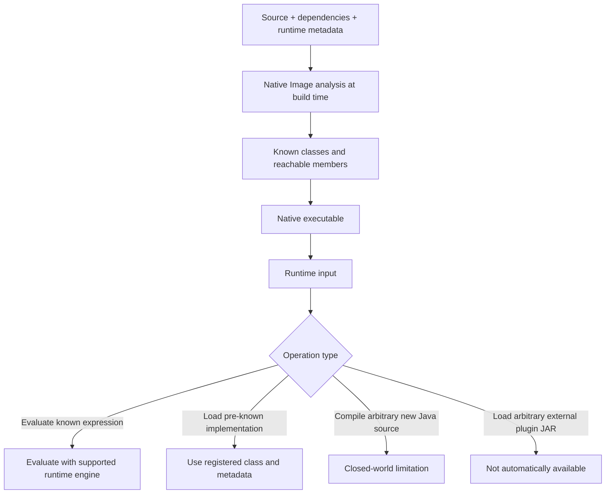
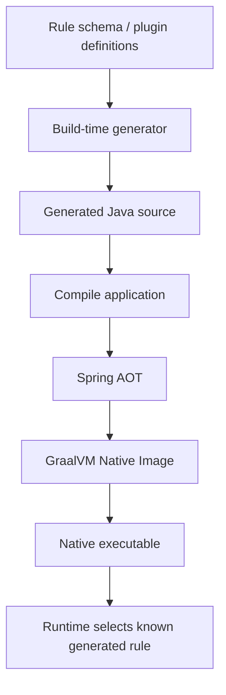

# Script engine, expression và thư viện dùng biên dịch động

## 1. Vì sao các cơ chế động cần được xem xét riêng?

Ứng dụng Spring Boot có thể cho phép người dùng viết biểu thức, chạy script, biên dịch mã Java lúc runtime hoặc nạp plugin từ JAR bên ngoài. Những khả năng này thường dựa trên việc khám phá class, tạo bytecode, nạp class mới hoặc gọi member theo tên trong lúc process đang chạy.

Trên JVM thông thường, các cơ chế như Java Compiler API, classloader tùy chỉnh, scripting engine hoặc thư viện bytecode có thể tạo và nạp mã mới khi runtime đáp ứng đủ điều kiện. **GraalVM Native Image** hoạt động theo mô hình closed-world: compiler phân tích những class và đường đi có thể truy cập tại build time rồi tạo executable từ tập mã đã biết. Nó không tự động biến một binary đã phát hành thành JVM tổng quát có thể biên dịch mọi Java source hoặc nạp bất kỳ plugin class nào xuất hiện sau đó.

Vì vậy, khi thiết kế **SPRING_BOOT_NATIVE_IMAGE**, cần phân biệt:

- **Expression evaluation:** đánh giá một biểu thức trong một ngôn ngữ hoặc mô hình đã có sẵn, chẳng hạn Spring Expression Language (SpEL).
- **Scripting:** thực thi script bằng engine như JavaScript hoặc một ngôn ngữ nhúng khác.
- **Dynamic compilation:** chuyển source hoặc DSL thành bytecode/mã máy trong lúc ứng dụng chạy.
- **Dynamic class loading/plugin:** nạp class hoặc JAR chưa có trong image lúc build.

Các nhóm này có giới hạn khác nhau. Không nên kết luận rằng mọi biểu thức đều không dùng được trong native, hoặc mọi script engine đều hoạt động chỉ vì dependency có thể compile trên JVM.

## 2. Closed-world ảnh hưởng tới mã được tạo lúc runtime

Native Image phân tích classpath, metadata và các điểm truy cập có thể nhận diện khi build. Những class được gọi trực tiếp hoặc được đăng ký qua hints có thể được giữ lại. Nhưng việc đăng ký reflection cho một class đã biết không đồng nghĩa có thể nạp một class Java hoàn toàn mới từ file do người dùng tải lên sau khi executable được tạo.



Một ứng dụng native vẫn có thể xử lý dữ liệu động, parse expression hoặc chọn một implementation trong tập class đã biết. Giới hạn xuất hiện khi yêu cầu runtime tạo ra hoặc nạp mã mới mà build không thể biết trước.

## 3. Phân biệt expression với compilation

Một biểu thức thường là dữ liệu được parser diễn giải bằng engine đã tồn tại. Ví dụ:

```text
order.total > 100000 && customer.active
```

Engine có thể parse biểu thức thành AST hoặc cấu trúc nội bộ rồi đánh giá trên object runtime. Không nhất thiết phải biên dịch biểu thức thành class Java mới.

Ngược lại, dynamic compilation có thể nhận source:

```java
public class DiscountRule {
    public BigDecimal apply(Order order) {
        return order.total().multiply(new BigDecimal("0.9"));
    }
}
```

sau đó gọi Java compiler hoặc bytecode generator để tạo class mới. Việc nạp và thực thi class vừa tạo là yêu cầu khác với parse expression.

| Cơ chế | Input | Công việc chính | Native Image cần xem xét |
|---|---|---|---|
| SpEL | Expression text | Parse/evaluate theo SpEL | Khả năng của Spring/SpEL và đường truy cập reflection |
| Rule DSL | Cú pháp nghiệp vụ | Parse thành AST hoặc rule model | Parser, model và evaluator có sẵn |
| Script engine | Script source | Engine thực thi ngôn ngữ script | Engine có hỗ trợ Native Image và runtime code generation không |
| Java Compiler API | Java source | Biên dịch source thành bytecode | Compiler implementation, filesystem và class loading |
| Bytecode library | Mô hình class/method | Sinh bytecode | Dynamic class definition và runtime compiler constraints |
| Plugin classloader | JAR/class ngoài image | Nạp implementation mới | Tập class đóng tại build và khả năng nạp code mới |

Đây là phân loại theo hoạt động. Một expression engine có thể dùng bytecode generation nội bộ để tối ưu; khi đó vẫn phải kiểm tra cơ chế triển khai cụ thể của engine.

## 4. Spring Expression Language (SpEL)

SpEL cho phép đọc và tính toán biểu thức trên object, gọi property/method, truy cập collection và dùng toán tử. Ví dụ:

```java
ExpressionParser parser = new SpelExpressionParser();

Expression expression =
        parser.parseExpression("quantity * unitPrice");

EvaluationContext context = new StandardEvaluationContext(order);

BigDecimal total = expression.getValue(
        context, BigDecimal.class);
```

SpEL parse expression thành cấu trúc biểu thức và đánh giá trên context. Với expression đơn giản, không yêu cầu nạp class Java mới. Đây là trường hợp khác với nhận source Java rồi biên dịch thành class.

Tuy nhiên, SpEL có thể gọi method, truy cập property qua reflection hoặc dùng type reference/constructor expression. Những đường đi động này cần được xem xét trong Native Image. Không nên giả định mọi SpEL expression đều được hỗ trợ tự động chỉ vì parser có thể khởi tạo.

Các điểm cần kiểm tra:

- Expression có gọi method qua reflection không?
- Có dùng `T(com.example.SomeType)` để tham chiếu type không?
- Có gọi constructor bằng `new` trong expression không?
- Có truy cập class/member theo tên từ dữ liệu runtime không?
- Có dùng custom property accessor, method resolver hoặc type converter không?
- Tập type được phép truy cập có cố định và đăng ký được ở build time không?

Nếu ứng dụng chỉ cần một tập phép tính nghiệp vụ nhỏ, một DSL giới hạn hoặc evaluator có kiểu rõ ràng thường dễ kiểm soát hơn một expression engine cho phép truy cập tùy ý mọi class.

## 5. Giới hạn bảo mật khi đánh giá expression

Expression evaluation có thể trở thành rủi ro bảo mật nếu người dùng không tin cậy được phép gọi method, truy cập bean hoặc tạo object tùy ý.

Ví dụ không nên đưa expression do người dùng cung cấp trực tiếp vào context có quyền truy cập toàn bộ Spring beans hoặc API hệ thống. Một expression có khả năng gọi method có thể mở đường đọc dữ liệu, sửa trạng thái hoặc thực hiện hành động ngoài ý định.

Thiết kế an toàn hơn:

- Chỉ cho phép một tập toán tử và property nghiệp vụ cần thiết.
- Dùng object context chứa dữ liệu đã chọn lọc, không expose toàn bộ ApplicationContext.
- Giới hạn type references, method calls và constructor access.
- Đặt giới hạn độ dài/độ phức tạp expression và thời gian đánh giá nếu engine hỗ trợ.
- Kiểm tra và phân quyền ai được tạo/sửa rule.
- Không coi Native Image là sandbox bảo mật cho expression.

Native Image giới hạn tập mã có thể được đóng gói, nhưng không thay thế authorization, validation hay sandbox của ngôn ngữ expression.

## 6. Script engine và javax.script

Java Scripting API (`javax.script`) định nghĩa các abstraction như `ScriptEngineManager`, `ScriptEngine` và `Bindings`. Ví dụ trên JVM:

```java
ScriptEngineManager manager = new ScriptEngineManager();
ScriptEngine engine = manager.getEngineByName("javascript");

if (engine == null) {
    throw new IllegalStateException(
            "JavaScript engine is not available");
}

Object result = engine.eval("1 + 2");
```

API này chỉ là cơ chế tìm engine; nó không tự cung cấp mọi ngôn ngữ script. Engine phải được thêm vào classpath/module path và phải tương thích với JDK đang dùng.

Từ JDK 15, Nashorn đã bị loại bỏ khỏi JDK sau giai đoạn deprecated. Vì vậy, không nên giả định `getEngineByName("javascript")` trả về Nashorn trên JDK hiện đại. Các engine khác có cơ chế phân phối và mức hỗ trợ Native Image riêng.

Khi đưa script engine vào native, cần xác minh:

- Engine có hỗ trợ Native Image theo đúng version không?
- Engine dùng reflection, method handles, classloader hoặc bytecode generation như thế nào?
- Engine có cần resource, locale data, module hoặc file ngoài không?
- Script được compile thành bytecode mới hay diễn giải bằng interpreter?
- Engine có yêu cầu runtime component hoặc native library riêng không?

Một dependency compile thành công không chứng minh engine hoạt động đầy đủ trong executable native.

## 7. GraalJS và các engine khác

GraalVM có các công nghệ ngôn ngữ đa ngôn ngữ như GraalJS. Tuy nhiên, cần phân biệt **GraalJS chạy trên GraalVM runtime/JVM** với việc nhúng engine vào một ứng dụng được đóng gói thành Native Image. Khả năng, cấu hình và giới hạn phụ thuộc phiên bản GraalVM, engine distribution và cách embedding.

Khi lựa chọn engine:

1. Xác định engine version tương thích với GraalVM/JDK của dự án.
2. Kiểm tra tài liệu Native Image của engine, không chỉ tài liệu chạy trên JVM.
3. Xây dựng một spike nhỏ dùng đúng API embedding.
4. Build native và thử script thật, bao gồm lỗi, module import và thư viện cần dùng.
5. Kiểm tra startup, memory, thời gian compile/evaluation và giới hạn bảo mật.
6. Kiểm tra giấy phép và cách phân phối runtime components.

Không giả định một script engine có thể tạo bytecode tùy ý trong native chỉ vì nó được gọi là GraalVM language. Một số engine có thể cần cấu hình hoặc mode riêng; phải dựa trên tài liệu chính thức của phiên bản triển khai.

## 8. Java Compiler API và biên dịch Java source lúc runtime

Java Compiler API nằm trong module `java.compiler`, với điểm vào thường là `ToolProvider.getSystemJavaCompiler()`. Trên JDK đầy đủ, ứng dụng có thể biên dịch source thành bytecode:

```java
JavaCompiler compiler =
        ToolProvider.getSystemJavaCompiler();

if (compiler == null) {
    throw new IllegalStateException(
            "Java compiler is not available");
}
```

Trong Native Image, không nên mặc định compiler implementation của JDK có thể được đóng gói và chạy như trên một JDK đầy đủ. Native executable không phải một JDK distribution. Compiler có thể không có mặt trong runtime image, module cần thiết có thể không được hỗ trợ theo cách dự kiến, và việc định nghĩa class mới tiếp tục gặp giới hạn closed-world.

Ngay cả khi có thể tạo bytecode bằng thư viện riêng, bước tiếp theo là nạp và thực thi class mới. Khả năng đó phải được đánh giá riêng; reflection hints chỉ mô tả member của type đã biết, không biến native executable thành môi trường Java compiler tổng quát.

Nếu sản phẩm bắt buộc cho phép khách hàng gửi Java source mới sau khi triển khai, hãy cân nhắc tách phần biên dịch/chạy mã động sang một JVM service hoặc môi trường thực thi chuyên biệt có sandbox.

## 9. Bytecode generation và runtime class definition

Một số thư viện tạo class bằng bytecode thay vì gọi Java compiler. Ví dụ có thể dùng ASM, Byte Buddy hoặc CGLIB để sinh proxy/subclass.

Trên JVM, thư viện có thể tạo byte array rồi định nghĩa class qua classloader hoặc cơ chế tương đương. Trong Native Image, dynamic class definition tùy ý không hoạt động như JVM thông thường vì tập class được xác định trước. Một số thư viện có tích hợp Native Image hoặc cơ chế thay thế cho use case giới hạn, nhưng không nên suy rộng hỗ trợ đó cho mọi loại class generation.

Phân biệt:

- **JDK dynamic proxy:** proxy triển khai interface đã biết; có thể khai báo trước bằng proxy hints.
- **Spring AOP proxy:** Spring AOT có thể phân tích và chuẩn bị proxy cần thiết.
- **Generated subclass tùy ý lúc runtime:** có thể cần tạo class mới ngoài tập được biết ở build; đây là trường hợp khó hoặc không phù hợp với Native Image.
- **Bytecode enhancement lúc build:** có thể phù hợp nếu class được tạo trước Native Image analysis và được đưa vào build inputs.

Nếu thư viện tạo proxy hoặc subclass, kiểm tra nó có hỗ trợ AOT/native và có cơ chế build-time generation hay không. Không cố khắc phục runtime class definition bằng cách đăng ký reflection hints cho class chưa tồn tại lúc build.

## 10. Plugin và JAR được tải sau khi phát hành

Mô hình plugin JVM thường dùng `URLClassLoader` để nạp JAR từ thư mục `plugins/` sau khi ứng dụng khởi động. Native Image không tự mang theo khả năng nạp mọi class mới theo cách đó.

Nếu plugin class không nằm trong tập class được phân tích khi build, thêm JAR vào filesystem runtime không tự làm code của plugin trở thành reachable hoặc được biên dịch vào executable.

Các phương án thiết kế:

| Nhu cầu | Hướng phù hợp |
|---|---|
| Tập plugin cố định khi build | Đưa plugin vào dependency/build inputs, đăng ký type/hints và build lại |
| Chọn một trong vài implementation | Đăng ký tất cả implementation đã biết, chọn bằng runtime configuration |
| Plugin thay đổi độc lập sau deploy | Tách plugin host sang JVM service hoặc process riêng |
| Logic thay đổi thường xuyên | Dùng DSL/rule data được diễn giải bởi engine đã đóng gói |
| Chạy mã không tin cậy | Dùng sandbox/process isolation chuyên biệt, không dựa vào Native Image làm sandbox |

Nếu plugin là JAR được build cùng ứng dụng nhưng chỉ chọn lúc runtime, cần bảo đảm các class và metadata đã nằm trong image. Việc chọn runtime chỉ chọn trong tập implementation có sẵn.

## 11. Chuyển dynamic compilation thành build-time generation

Một chiến lược thường hiệu quả là chuyển công việc sinh mã sang build pipeline:



Ví dụ ứng dụng có một tập rule được quản lý trong repository. Thay vì nhận Java source rồi compile mỗi khi process chạy, pipeline có thể:

- Validate rule definition.
- Sinh Java source hoặc class trước build.
- Compile vào application output.
- Đưa class vào Spring AOT/Native Image analysis.
- Runtime chọn rule đã có bằng ID hoặc cấu hình.

Ưu điểm là lỗi compile được phát hiện trong CI, tập code được kiểm soát và native executable chứa đầy đủ class cần dùng. Nhược điểm là thay đổi rule có thể yêu cầu build/phát hành artifact mới.

Với rule cần thay đổi độc lập, giữ rule dưới dạng dữ liệu và dùng interpreter/DSL giới hạn có thể tránh build lại, miễn evaluator hỗ trợ Native Image.

## 12. Thiết kế DSL/interpreter thay cho compile code tùy ý

Nếu nghiệp vụ chỉ cần điều kiện, phép toán và thao tác trên một mô hình dữ liệu nhỏ, không nhất thiết phải nhận Java source. Có thể định nghĩa DSL:

```text
IF order.total > 100000
THEN discount = 0.10
ELSE discount = 0
```

Parser chuyển DSL thành AST:

```text
GreaterThan
├── Property(order.total)
└── Number(100000)
```

Interpreter duyệt AST và tính kết quả trên context được phép. Các node và phép toán đều là class đã biết trong native image. Dữ liệu rule có thể được đọc từ external file lúc runtime.

Thiết kế cần kiểm soát:

- Grammar và toán tử được hỗ trợ.
- Kiểu dữ liệu, null semantics và lỗi parse.
- Giới hạn độ sâu AST, số node và thời gian đánh giá.
- Property nào được phép truy cập.
- Hàm nào được phép gọi.
- Quyền tạo/sửa/kích hoạt rule.
- Version của DSL và khả năng tương thích rule cũ.

Một DSL nhỏ thường dễ kiểm thử và bảo vệ hơn việc cho phép người dùng thực thi mã Java tùy ý.

## 13. RuntimeHints giúp gì và không giúp gì?

RuntimeHints mô tả những khả năng runtime mà Native Image cần giữ lại, chẳng hạn reflection, resource, proxy, serialization và JNI. Hints có ích khi class/member đã biết nhưng được truy cập qua đường động mà compiler không tự suy ra.

| Tình huống | Hints có thể hỗ trợ? |
|---|---|
| Gọi method reflectively trên class đã biết | Có, nếu đăng ký đúng member |
| Đọc resource classpath có tên động trong tập đã biết | Có, qua resource hints |
| Tạo JDK proxy từ interface đã biết | Có, qua proxy hints |
| Native code gọi method Java đã biết | Có, qua JNI hints |
| Nạp class hoàn toàn mới từ JAR sau khi image đã build | Không tự giải quyết |
| Biên dịch Java source tùy ý sau khi image đã build | Không tự biến native executable thành compiler/runtime JVM tổng quát |
| Tạo bytecode class mới rồi định nghĩa tùy ý | Không được bảo đảm chỉ bằng reflection hints |

Đây là ranh giới quan trọng: hints bổ sung metadata cho tập type/operation mà image có thể hỗ trợ; chúng không mở rộng image thành môi trường thực thi mã mới không biết trước.

## 14. Chẩn đoán lỗi script và dynamic compilation

| Triệu chứng | Nguyên nhân có thể | Hướng kiểm tra |
|---|---|---|
| `ScriptEngineManager` không tìm thấy engine | Engine không có trong runtime hoặc service provider resource thiếu | Kiểm tra dependency, provider metadata và resource |
| Engine chạy trên JVM nhưng native lỗi | Engine dùng dynamic class loading/bytecode generation không được hỗ trợ | Kiểm tra Native Image support matrix và diagnostics |
| `ToolProvider.getSystemJavaCompiler()` trả null | Compiler implementation không có trong runtime | Kiểm tra module/JDK distribution và không giả định native chứa javac |
| Generated class không nạp được | Dynamic class definition không tương thích closed-world | Chuyển generation sang build time hoặc process JVM riêng |
| Plugin JAR thêm sau deploy không được nhận | Class không thuộc image build inputs | Đưa plugin vào build hoặc tách plugin host |
| SpEL expression lỗi ở native | Method/type access động hoặc thiếu metadata | Xác định expression operation và đăng ký type/member nếu đã biết |
| Rule runtime không cần class mới nhưng lỗi | Parser/resource/reflective access thiếu hỗ trợ | Kiểm tra resource, hints và evaluator |
| Build thành công nhưng một script hiếm gặp lỗi | Nhánh engine chưa được test hoặc metadata thiếu | Tạo fixture cho script và native integration test |

Khi điều tra, tách lỗi engine discovery, resource loading, reflection, bytecode generation, class definition và business expression. Không phải lỗi nào cũng có thể sửa bằng thêm reflection hints.

## 15. Quy trình đánh giá một thư viện động trước khi chọn Native Image

Trước khi đưa script/expression/plugin library vào production native, thực hiện một spike nhỏ:

1. Ghi tên thư viện, version, JDK/GraalVM version và mục đích sử dụng.
2. Xác định thư viện diễn giải dữ liệu hay tạo bytecode/class mới.
3. Kiểm tra tài liệu hỗ trợ GraalVM Native Image chính thức.
4. Xác định reflection, resource, proxy, JNI và classloader behavior.
5. Tạo ứng dụng mẫu dùng đúng API thật của thư viện.
6. Build native với cấu hình tối thiểu; không thêm hàng loạt hints để che lỗi.
7. Test script/rule điển hình, script lỗi, module import và runtime configuration.
8. Đo startup, RSS, thời gian parse/compile/evaluate và kích thước artifact.
9. Kiểm tra bảo mật, sandbox, giới hạn tài nguyên và nguồn code.
10. Quyết định giữ engine trong native, chuyển sang DSL hoặc tách thành JVM service.

Một bài test chỉ gọi `engine.getEngineByName(...)` chưa đủ. Phải thực thi script thật, bao gồm các nhánh thư viện sử dụng trong production.

## 16. Bài thực hành: thay Java source runtime bằng rule DSL

**Bối cảnh:** hệ thống giảm giá hiện nhận đoạn Java source do quản trị viên cung cấp, compile thành class rồi nạp vào ứng dụng. Nhóm muốn triển khai phần xử lý chính dưới dạng native executable.

**Bước 1 — Ghi nhận use case.** Liệt kê các cấu trúc Java mà rule hiện tại thực sự dùng: so sánh số, điều kiện boolean, phép toán, truy cập field và kết quả.

**Bước 2 — Thiết kế DSL giới hạn.** Định nghĩa grammar chỉ cho phép các toán tử và property nghiệp vụ cần thiết. Không cho phép gọi class/method tùy ý.

**Bước 3 — Viết parser và AST.** Tạo các node class cố định như `And`, `GreaterThan`, `Property`, `NumberLiteral` và `DiscountAction`.

**Bước 4 — Viết interpreter.** Đánh giá AST trên một context chỉ chứa dữ liệu đơn hàng được phép truy cập. Thêm giới hạn độ sâu và số node.

**Bước 5 — Kiểm thử JVM.** Dùng cùng rule fixtures cho kết quả đúng, sai cú pháp, property thiếu và boundary values.

**Bước 6 — Build native.** Chạy Spring AOT và GraalVM Native Image. Xác minh parser, AST classes và resource rule được đóng gói đúng.

**Bước 7 — Chạy native với rule thay đổi.** Cập nhật external rule data và chạy lại process theo chính sách reload đã thiết kế; không cần nạp class mới.

**Bước 8 — So sánh với phương án JVM compiler service.** Đánh giá độ linh hoạt, bảo mật, latency, memory và chi phí vận hành.

Tiêu chí hoàn thành: rule thay đổi được như yêu cầu mà không cần biên dịch class mới trong native process; grammar và quyền truy cập được giới hạn; cùng fixture cho kết quả nhất quán trên JVM/native; có test giới hạn tài nguyên và lỗi.

## 17. Kết luận

Script engine, expression evaluator và dynamic compiler không có cùng mức độ phù hợp với GraalVM Native Image. **Expression trên tập type đã biết** thường có thể hoạt động nếu engine và các đường reflection/resource được hỗ trợ. **Biên dịch source mới, tạo class tùy ý hoặc nạp plugin JAR sau khi phát hành** xung đột với mô hình closed-world nếu không có cơ chế hỗ trợ chuyên biệt.

Với Spring Boot Native Image, hãy kiểm tra cách thư viện thực thi script thay vì chỉ nhìn API bề mặt. Khi nghiệp vụ chỉ cần rule động, cân nhắc DSL/interpreter có grammar giới hạn hoặc sinh mã ở build time. Nếu sản phẩm thực sự cần biên dịch và nạp mã Java tùy ý sau triển khai, tách năng lực đó sang JVM service hoặc môi trường thực thi chuyên biệt, có kiểm soát quyền và tài nguyên.
