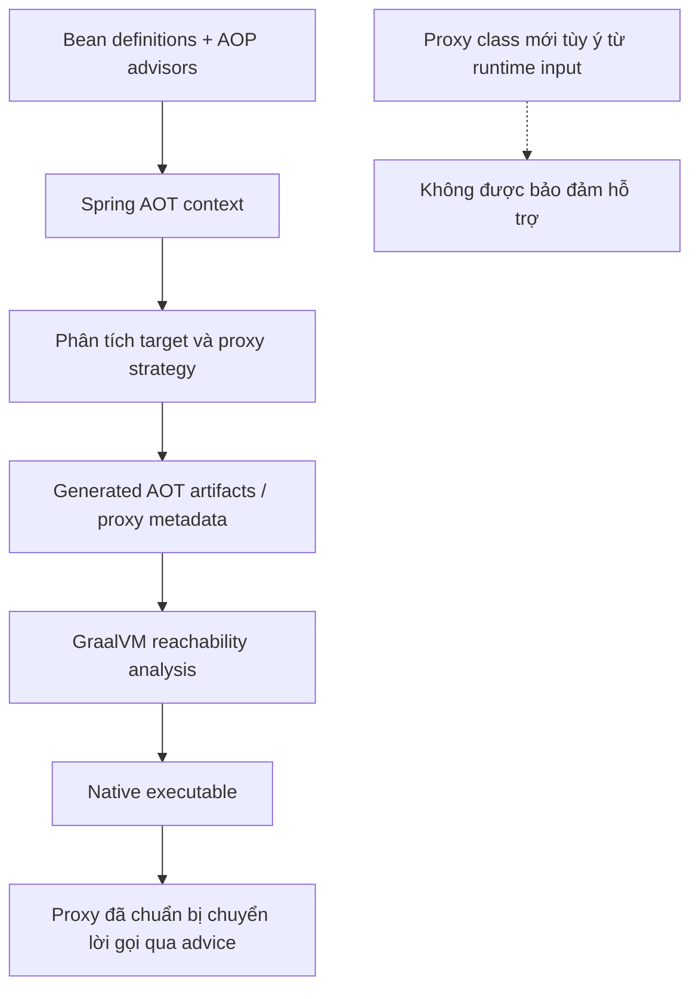

# Runtime proxy và trường hợp metadata không thể thay thế thiết kế không tương thích

## 1. Proxy động lúc runtime và giới hạn của Native Image

Spring AOP dùng proxy để đặt interceptor giữa caller và bean đích. Proxy có thể thực hiện transaction, security, logging, retry hoặc metrics. Trong ứng dụng JVM, một số thư viện tạo proxy ngay khi chạy bằng JDK dynamic proxy hoặc sinh subclass/bytecode bằng CGLIB, Byte Buddy hay ASM.

GraalVM Native Image áp dụng mô hình phân tích closed-world: compiler cần xác định trước những class và hành vi động cần thiết để tạo executable. Vì vậy, một thư viện dựa vào việc **tùy ý sinh class proxy mới lúc runtime** có thể không hoạt động trong native executable, dù chạy bình thường trên HotSpot.

Cần phân biệt hai trường hợp:

- **Proxy có thể xác định trước**: target class, interface, advisors và tập proxy cần thiết có thể được Spring AOT hoặc thư viện tích hợp nhận diện và chuẩn bị ở build time.
- **Proxy được tạo tùy ý lúc runtime**: class/interface hoặc bytecode chỉ được quyết định sau khi executable đã build, ví dụ compile class mới từ dữ liệu nhận lúc chạy. Native Image không thể mặc định tạo mọi loại class động như JVM.

Runtime hints mô tả những quyền truy cập hoặc proxy cần giữ. Chúng không phải bộ biên dịch bytecode tổng quát và không thể biến một thư viện phụ thuộc vào class generation không được hỗ trợ thành tương thích native.

## 2. Các loại proxy thường gặp

| Cơ chế | Cách hoạt động | Điểm cần kiểm tra trong Native Image |
|---|---|---|
| JDK dynamic proxy | Tạo object triển khai một tập interface và chuyển lời gọi qua InvocationHandler | Tập interface phải xác định; cần proxy metadata nếu AOT không tự nhận diện |
| Class-based proxy (CGLIB/subclass) | Sinh subclass và override method để chèn interceptor | Cần hỗ trợ AOT của framework; target class/method phải có thể subclass/override |
| Byte Buddy/ASM tùy biến | Sinh hoặc sửa bytecode theo logic thư viện | Phải xác minh khả năng tương thích Native Image; không mặc định runtime class generation được hỗ trợ |
| Spring AOP proxy | Spring tạo proxy dựa trên bean, advisors và cấu hình AOP | Dùng đường tích hợp Spring AOT được hỗ trợ và test trên executable |
| Proxy do plugin runtime tự biên dịch | Tạo class từ metadata/script nhận sau khi build | Thường cần đổi thiết kế sang registry/proxy đã biết trước hoặc cơ chế khác |

Không phải mọi ứng dụng dùng CGLIB hoặc Byte Buddy đều tự động thất bại. Một số framework có thể tích hợp AOT để chuẩn bị class cần thiết. Vấn đề là liệu **đường tạo proxy cụ thể** có được framework hỗ trợ và chuẩn bị trước hay không.

## 3. Spring AOT chuẩn bị proxy như thế nào?

Spring AOT xử lý application context trong giai đoạn build. Khi framework nhận diện được bean cần proxy và loại proxy có thể xác định, nó có thể tạo generated artifacts hoặc metadata để Native Image phân tích.

Một pipeline khái quát:



Cơ chế cụ thể và generated artifacts phụ thuộc phiên bản Spring Framework/Spring Boot, loại proxy và thư viện tích hợp. Không nên giả định mọi proxy đều được tạo theo cùng một cách hoặc tên class sinh ra luôn giống nhau.

Khi điều tra, kiểm tra:

- Bean nào được proxy và vì sao.
- Proxy strategy là JDK hay class-based.
- Advisor/Aspect nào áp dụng.
- Spring AOT có phát hiện bean/proxy trong context build-time không.
- Thư viện tạo proxy có AOT contribution hoặc tài liệu Native Image không.
- Native executable có thực sự chạy qua proxy và advice mong muốn không.

## 4. Metadata có thể giải quyết điều gì?

Các nhóm metadata giải quyết các nhu cầu khác nhau:

| Metadata | Giải quyết | Không giải quyết |
|---|---|---|
| JDK ProxyHints | Khai báo tập interface cần JDK proxy | Không sinh subclass tùy ý |
| Reflection hints | Cho phép truy cập class/constructor/method/field qua reflection | Không tạo class bytecode mới |
| Resource hints | Giữ file classpath cần đọc | Không tạo proxy |
| Serialization hints | Hỗ trợ kiểu dùng Java serialization | Không bảo đảm proxy/handler bất kỳ serialize được |
| JNI hints | Mô tả tương tác qua JNI | Không sửa thư viện native sai ABI |
| Class initialization options | Chọn thời điểm chạy static initializer | Không thêm class hoặc method bị thiếu |

Ví dụ JDK proxy hint:

```java
hints.proxies().registerJdkProxy(
    PaymentService.class,
    Auditable.class
);
```

Điều này mô tả proxy triển khai các interface đã biết. Nó không yêu cầu Native Image sinh subclass của một class tùy ý và không thay thế metadata reflection nếu InvocationHandler còn gọi target bằng reflection.

## 5. Trường hợp metadata không thể thay thế thiết kế

### 5.1. Sinh subclass từ class name nhận lúc runtime

Ví dụ thư viện lấy class name từ cấu hình rồi tạo subclass mới:

```java
Class<?> targetType = Class.forName(configuredClass);
Class<?> proxyType = bytecodeGenerator.createSubclass(targetType);
Object proxy = proxyType.getDeclaredConstructor().newInstance();
```

Reflection hint cho target class có thể hỗ trợ một số thao tác reflection, nhưng không tự cung cấp khả năng compile/generate subclass bytecode tùy ý sau khi native executable đã được tạo.

Nếu chỉ có một tập target class đã biết, hãy xem thư viện có chế độ AOT/pre-generated proxy không. Nếu không, đổi sang interface registry hoặc proxy strategy có thể chuẩn bị trước.

### 5.2. Compile Java source hoặc script thành class mới

Một plugin cho phép người vận hành upload mã Java rồi compile ngay trong process native sẽ cần compiler, classloader và dynamic class definition. Đây là mô hình khác với việc gọi một method reflection trên class đã được đóng gói.

Thêm RuntimeHints cho class hiện có không cung cấp compiler, không đưa class mới vào native image và không biến classloader động thành một cơ chế được hỗ trợ đầy đủ. Hãy chuyển việc compile sang build/deployment pipeline hoặc chạy plugin trong process/service JVM riêng nếu runtime compilation là yêu cầu bắt buộc.

### 5.3. Thư viện cần redefine/retransform class

Cơ chế instrumentation như redefine/retransform class phụ thuộc khả năng agent/instrumentation của JVM. Không được giả định mọi tính năng Java Instrumentation đều khả dụng trong Native Image. Hãy kiểm tra hỗ trợ chính thức theo GraalVM version; nếu thư viện cần sửa bytecode tùy ý lúc chạy, cần thay đổi kiến trúc hoặc chọn runtime phù hợp.

## 6. Giới hạn của class-based proxy

Class-based proxy dựa trên subclass và override. Các ràng buộc Java vẫn áp dụng:

- Class target không thể là final nếu cần tạo subclass thông thường.
- Method final không thể override để chèn advice.
- Method private không được override.
- Sealed class có thể giới hạn subclass ngoài danh sách permits.
- Constructor và visibility/package access có thể ảnh hưởng khả năng tạo subclass.
- Native method không thể được override như method Java thông thường.

Không có reflection hint nào xóa bỏ các quy tắc kế thừa này. Nếu class không thể subclass, cân nhắc interface-based proxy, composition/decorator hoặc tách hợp đồng service.

## 7. Thiết kế thay thế: interface và decorator

Nếu ứng dụng cần thay đổi hành vi theo cấu hình runtime, có thể dùng interface ổn định và chọn implementation đã biết:

```java
public interface PaymentProcessor {
    PaymentResult process(PaymentCommand command);
}
```

Decorator:

```java
public final class AuditingPaymentProcessor implements PaymentProcessor {
    private final PaymentProcessor delegate;
    private final AuditService audit;

    public AuditingPaymentProcessor(
            PaymentProcessor delegate,
            AuditService audit) {
        this.delegate = delegate;
        this.audit = audit;
    }

    @Override
    public PaymentResult process(PaymentCommand command) {
        audit.record(command);
        return delegate.process(command);
    }
}
```

Spring có thể đăng ký implementation và decorator như bean tĩnh trong context. AOT nhìn thấy cấu trúc dependency; runtime chỉ chọn bean/behavior đã được đưa vào graph theo chiến lược cấu hình đã thiết kế.

Nếu lựa chọn bean phụ thuộc profile hoặc conditional property, xác định các điều kiện đó ở AOT time. Nếu cần thay đổi lựa chọn ở runtime, giữ registry/service bean ổn định và chọn delegate trong tập implementation đã đóng gói.

## 8. Dùng registry/factory thay cho proxy class mới

Khi cần chọn hành vi theo cấu hình, factory tĩnh thường đủ:

```java
@Component
class PaymentProcessorRegistry {
    private final Map<String, PaymentProcessor> processors;

    PaymentProcessorRegistry(
            @Qualifier("cardProcessor") PaymentProcessor card,
            @Qualifier("bankProcessor") PaymentProcessor bank) {
        this.processors = Map.of(
            "card", card,
            "bank", bank
        );
    }

    PaymentProcessor get(String name) {
        PaymentProcessor processor = processors.get(name);
        if (processor == null) {
            throw new IllegalArgumentException("Unsupported processor");
        }
        return processor;
    }
}
```

Cách này không sinh class mới. Tất cả implementation được Spring tạo và quản lý theo bean graph đã biết. Runtime chỉ tra cứu một object đã tồn tại.

Không nhận class name tùy ý từ HTTP request để tạo proxy. Dùng key nghiệp vụ trong allowlist và kiểm soát quyền chọn implementation.

## 9. Khi thư viện bên thứ ba tạo proxy

Nếu lỗi đến từ dependency, không vội thêm hints cho mọi class. Điều tra theo trình tự:

1. Xác định thư viện và version thực tế trên runtime classpath.
2. Tìm nơi gọi CGLIB, Byte Buddy, ASM, Proxy.newProxyInstance hoặc class definition APIs.
3. Xác định proxy được tạo lúc AOT/build hay chỉ khi một request runtime kích hoạt.
4. Kiểm tra thư viện có AOT processor, Spring RuntimeHints hoặc GraalVM reachability metadata chính thức.
5. Đọc tài liệu Native Image của phiên bản thư viện và GraalVM.
6. Tạo integration test nhỏ kích hoạt đúng đường proxy trên executable native.
7. Nếu cơ chế không được hỗ trợ, thay phiên bản, đổi cấu hình/proxy strategy hoặc thay thiết kế.

Một dependency có thể có hỗ trợ Native Image ở version mới nhưng không có ở version cũ. Ghi rõ version thay vì áp dụng một workaround chung cho mọi phiên bản.

## 10. Chẩn đoán lỗi proxy trên Native Image

| Triệu chứng | Nguyên nhân có thể | Hướng xử lý |
|---|---|---|
| Thiếu JDK proxy metadata | Tập interface chưa được phát hiện/đăng ký | Kiểm tra Spring AOT và ProxyHints |
| Reflection exception khi tạo target | Constructor/member chưa được đăng ký | Bổ sung reflection hints đúng member |
| Không thể tạo subclass | Class final/sealed hoặc method không override được | Chuyển interface proxy/composition |
| Runtime bytecode generation thất bại | Thư viện cần sinh class động không được hỗ trợ | Dùng AOT/pre-generated proxy hoặc thay kiến trúc |
| Aspect không chạy | Pointcut/advisor không match, self-invocation | Kiểm tra Spring context và đường gọi |
| Bean không tồn tại | Profile/condition/classpath AOT sai | Kiểm tra bean graph và dependency |
| Proxy hoạt động JVM, lỗi native | Thiếu tích hợp AOT hoặc code path động chưa được chuẩn bị | Kiểm tra hỗ trợ thư viện và native integration test |

Phân biệt lỗi metadata với lỗi thiết kế. Nếu class proxy chỉ được tạo bằng cách compile bytecode tùy ý sau khi chương trình chạy, đăng ký thêm reflection hints cho target không giải quyết nguyên nhân.

## 11. Quy trình kiểm thử end-to-end

Một bộ kiểm thử nên đi từ cấu hình Spring tới executable:

1. **JVM baseline**: xác nhận bean được tạo, proxy strategy đúng, advice chạy và kết quả target chính xác.
2. **AOT**: chạy Spring AOT với đúng profile/property và dependency graph.
3. **AOT artifact**: kiểm tra generated output/log và xác nhận thư viện proxy được xử lý.
4. **Native build**: chạy native compile với toolchain đúng version.
5. **Native behavior**: khởi chạy executable và gọi code path tạo proxy/thực thi advice.
6. **Negative cases**: thử class không được hỗ trợ, input ngoài allowlist, target final hoặc thiếu metadata theo test phù hợp.
7. **Container**: chạy image đích, xác minh OS/architecture, quyền filesystem và cấu hình runtime.
8. **Release evidence**: lưu test report, commit, toolchain version và artifact digest.

Test chỉ xác nhận startup thành công chưa đủ. Phải gọi endpoint hoặc service method thực sự đi qua proxy.

## 12. Checklist quyết định có thể dùng metadata hay phải đổi thiết kế

- Proxy có tập interface/target class cố định trước khi build không?
- Spring AOT hoặc thư viện có thể phát hiện và chuẩn bị proxy đó không?
- Cơ chế tạo proxy là JDK proxy, subclass proxy hay runtime bytecode generation?
- Class target có final/sealed hoặc method không thể override không?
- Reflection hints có đúng là phần còn thiếu, hay vấn đề là class generation?
- Dependency và version có hỗ trợ GraalVM Native Image không?
- Có thể thay bằng interface, decorator, registry hoặc generated implementation không?
- Native integration test đã kích hoạt đúng code path chưa?

Nếu câu trả lời cho việc chuẩn bị proxy trước build là không, và thư viện yêu cầu sinh bytecode tùy ý lúc runtime, cần đổi thiết kế hoặc chọn môi trường chạy phù hợp. Không mở rộng hints vô hạn để che giấu một cơ chế không tương thích.

## 13. Câu hỏi tự kiểm tra

1. Khác nhau giữa proxy được Spring AOT chuẩn bị và proxy class được sinh tùy ý lúc runtime là gì?
2. Vì sao JDK ProxyHints không thể thay thế runtime bytecode generation?
3. Reflection hints giải quyết những thao tác nào và không giải quyết điều gì?
4. Vì sao class final hoặc method final giới hạn class-based proxy?
5. Khi dependency bên thứ ba tạo proxy động, cần kiểm tra thông tin nào trước khi sửa cấu hình?
6. Registry/factory hoặc decorator giúp giảm phụ thuộc vào dynamic proxy như thế nào?
7. Cần test gì để xác nhận proxy thực sự hoạt động trên executable native và container?

**Ghi nhớ:** metadata giúp Native Image giữ những class, member và proxy đã xác định; nó không phải cơ chế sinh bytecode tổng quát lúc runtime. Hãy tận dụng Spring AOT và hỗ trợ chính thức của thư viện, ưu tiên proxy có thể chuẩn bị trước, và thay đổi thiết kế khi ứng dụng phụ thuộc vào proxy generation tùy ý sau build.
